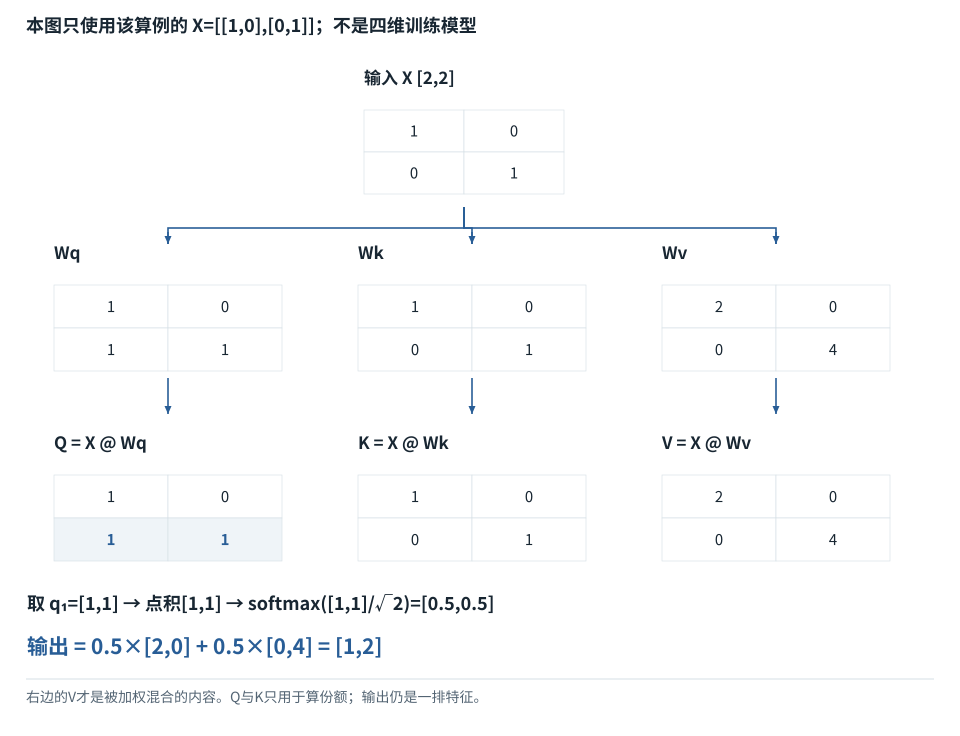
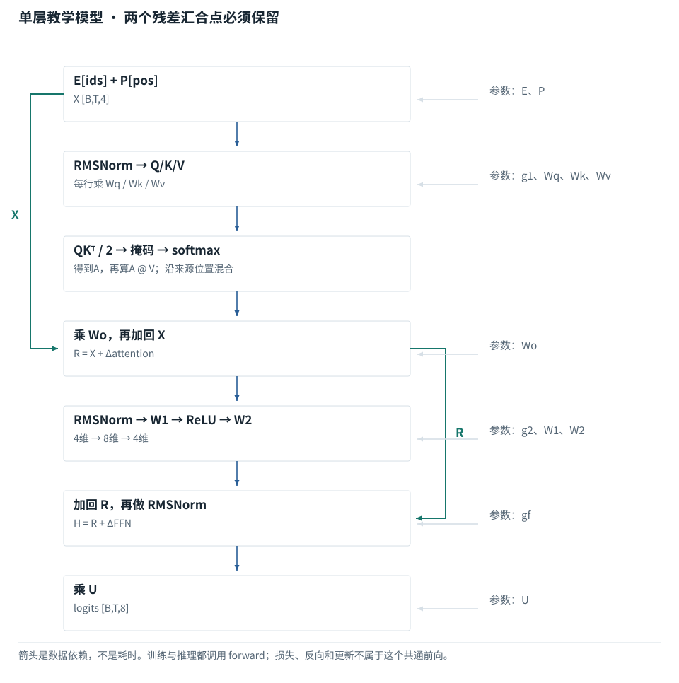
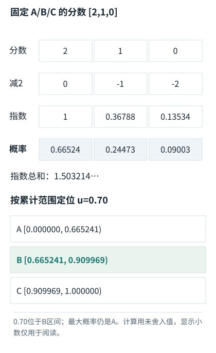

系统篇


<span id="ch02-s0"></span>


# 02｜一次Transformer前向：逐张量、逐算子讲明白


<span id="section-1"></span>


### 本章预备知识

本章所有矩阵式子都由两件事组成：把一些数乘上不同系数再相加，以及重新排列这些数。注意力先找匹配分数，再变成总和为1的份额，最后按份额混合内容。

本章各题列出所需基础。可先完成相应基础课，也可通过自检确认掌握程度。

[F07 · 模型最常做的算术](../foundations/07.md)[F08 · reshape、转轴、广播](../foundations/08.md)[F09 · 概率、指数与softmax](../foundations/09.md)[F10 · 神经网络最小模型](../foundations/10.md)[F11 · Attention逐步计算](../foundations/11.md)[F14 · 把Attention装进一层](../foundations/14.md)


<span id="concept-intro-1"></span>


先认识这里的对象与符号

[Query、Key、Value：三种中间数值表示](../concepts.md#concept-qkv)
:   q是接收信息的一行查询表示；k是可读位置提供的一行匹配表示；v是该位置供混合的一行内容表示。大写Q/K/V把多行收集成表。它们由输入与参数计算得到，分别承担打分与提供内容的职责。某个q与两个k点积得到两个分数；softmax得到两个份额；这些份额分别乘两行v，再相加。这里不生成搜索词，也不直接选答案。

**进入深读前的小检查：**先手算q=[1,0]与两行K的分数，再用V=[[10,0],[0,20]]算结果。不要把Q、K、V当三种独立输入文本。

术语带虚线时可点击速查。公式中的字母先看定义；不要用猜缩写替代推导。


<span id="layer-symbols"></span>


## 本章各张表的来源与去向

首先把**参数、函数和中间结果**分开。下面的名称在本章局部公式中使用；同一字母在其他公式里须重新按定义读。

| 名字 | 对象身份 | 由谁产生，交给谁 |
| --- | --- | --- |
| X、U、R、Y | 输入或临时结果数组 | X是当前层输入；U/R/Y是相应等式算出后给结果起的名字，不是额外参数。U在不同段落可能被重新定义。 |
| Wq、Wk、Wv、Wo、W1、W2 | 模型的系数表 | 加载训练好的参数；作用到各位置，生成新的表示。F11逐格演示Q/K/V。 |
| Norm、Attention、FFN | 可调用的运算或子网络 | 接收一个数组并返回数组；函数内部是否含参数由结构定义。 |
| S、A、O、M | 分数、份额、输出及读取约束 | S由Q/K比较，A由softmax，O由A混合V；M由读取规则构造。 |
| B、T、d、H、Dh | 尺寸整数 | 批大小、位置数、隐藏宽度、头数、单头宽度；不是五份输入文本。 |
| I、γ、β、ε | 特例矩阵、规范化参数与稳定常数 | I保持乘法前后值不变；γ/β可学习；ε是设置的小正数。不能把W=I的演示当作真实模型通则。 |


<span id="concept-intro-5"></span>


先认识这里的对象与符号

[SwiGLU、Wg/Wu/Wd：两路变换再合成](../concepts.md#concept-swiglu)
:   这是门控前馈结构。Wg生成要过SiLU的一路，Wu生成另一条内容路径，两路逐元素相乘，再用Wd映回原宽度。这些W是三组参数，不是三个Agent。读(SiLU(XWg)⊙XWu)Wd时，先算XWg和XWu，再SiLU，再⊙，最后乘Wd。每个位置独立用同一组参数。

[Norm、LayerNorm、RMSNorm：不是概率归一化](../concepts.md#concept-norm)
:   Norm在层公式中表示一个规范化函数。LayerNorm通常按一个Token的特征减均值、除标准差，再缩放平移；RMSNorm通常不减均值，按均方根缩放。它们不等于softmax。独立微例，忽略稳定分母用的小正数ε与可学缩放：LayerNorm([1,3])=[-1,1]；RMSNorm([1,3])=[1/√5,3/√5]。

[pre-norm / post-norm：归一化放在何处](../concepts.md#concept-prenorm)
:   pre-norm是先规范化再进入子层，残差从原输入直接相加；post-norm是子层结果与原输入相加之后再规范化。这描述运算顺序，不是训练前后两个阶段。独立结构对照：x+F(Norm(x)) 与 Norm(x+F(x))一般不相等。F代表这里被包裹的子层函数。

本章以教学用的decoder-only、[pre-norm](../glossary.md#g090 "归一化放在子层变换之前或残差之后的结构安排。 例：不同结构的梯度与数值行为不能只看模块名称判断。")结构为主。2017年原论文是encoder-decoder架构；[RMSNorm](../glossary.md#g086 "按均方根尺度归一化，通常不减均值。 例：[1,3]除以sqrt(5)。")、[RoPE](../glossary.md#g082 "通过按位置旋转成对坐标来引入位置信息的方法。 例：二维90度旋转把[2,3]变为[-3,2]。")与[SwiGLU](../glossary.md#g089 "以一个分支产生的值调节另一个分支输出的前馈结构。 例：不是“挑一个词通过”，而是逐数值调制。")是后来常见的选择，不能把这些组合说成原论文或所有商业模型的统一实现。全章的形状和数值用于说明算法，不是实际服务配置。


<span id="visual-reading"></span>


<span id="topic-1"></span>


## 沿着对象与状态理解本章

本章可以分成两种动作：同一位置内部改变特征，与不同位置之间混合信息。X乘参数表属于前者，注意力份额乘V属于后者。先在下图指出“输入数据”“参数”“本次结果”，再读多层公式，避免把W与Q/K/V当成同一种东西。

下方图解的固定输入在“输入与适用条件”中声明。它用于解释本章机制，不与本章其他独立例子的数值暗中接续。


<span id="visual-F11"></span>

<span id="topic-2"></span>

<span id="topic-3"></span>

<span id="topic-4"></span>

<span id="topic-5"></span>

<span id="topic-6"></span>

<span id="topic-7"></span>


相关动态过程：[Q/K/V：先算从哪读，再算读进多少](../visual/F11.md)。本节下文继续展示更具体的计算与工程边界。

继续看相关机制：[F07 · 矩阵乘法像逐格填写配方结果](../visual/F07.md)[F14 · 一层Transformer不是只有Attention](../visual/F14.md)[F18 · 一次输入如何连着预测，直到结束](../visual/F15.md)


<span id="Q005"></span>


## Q005｜一串Token进入Transformer后，究竟依次经过哪些计算？

这题先认识什么先看X各轴含义，再检查乘法内侧长度相等。转轴调整排列，乘权重才在组合数值，不能只因形状相同就说内容相同。

[F02 · 一排数、一张表和一叠表](../foundations/02.md)[F07 · 模型最常做的算术](../foundations/07.md)[F08 · reshape、转轴、广播](../foundations/08.md)[F10 · 神经网络最小模型](../foundations/10.md)[F11 · Attention逐步计算](../foundations/11.md)[F14 · 把Attention装进一层](../foundations/14.md)


<span id="ch02-s2"></span>


### 核心回答


<span id="concept-intro-2"></span>


先认识这里的对象与符号

[Wout、LM head：词表打分参数](../concepts.md#concept-wout)
:   把最后隐藏表示转换为每个词表候选分数的参数层。输入宽度d，词表有Vocab项，右乘的参数形状是[d,Vocab]。生成概率需再对这些分数归一化。注意力Wo输出的是隐藏特征；Wout输出的是词表候选分数。名字都含output，输出对象却不同。

[MHA、MQA、GQA：头怎样共享](../concepts.md#concept-heads)
:   一个注意力头是一套匹配并聚合内容的路径。MHA常让每个Query头有自己的K/V头；MQA让多个Query头共用一组K/V；GQA在两者之间，分组共享。它们是结构选择，不是运行时随便改一个开关。独立形状例：8个Query头、2个K/V头，若均匀分组，每4个Query头共享1组K/V；缓存按K/V头数记账。

对每一层，先把当前隐藏状态归一化，再投影出Q/K/V；加入位置机制和可见性约束，计算注意力并混合[Value](../glossary.md#g074 "每个可读位置将被加权汇集的内容表示。 例：这里V不是词表大小。")；经输出投影后加回残差；再经过归一化与前馈网络，加第二次残差。重复各层后做最终归一化与词表投影，最后位置的[logits](../glossary.md#g091 "输出投影给各词表候选的未归一化分数。 例：可以是负数，还不是概率或Token编号。")用于预测下一[Token](../glossary.md#g027 "模型分词器使用的片段单位。 例：可能是词、词的一部分、标点或部分字节。")。[[TR]](../sources.md#src-TR "来源说明")[[ROPE]](../sources.md#src-ROPE "来源说明")[[GQA]](../sources.md#src-GQA "来源说明")


<span id="ch02-s3"></span>


### 把每个张量的身份固定下来

设`B=1,T=4,d=8,H=2,Dh=4`，暂用[MHA](../glossary.md#g127 "不同查询头与K/V头共享方式的注意力结构。 例：共享更多K/V可减少缓存，但不保证质量完全相同。")。`X`的形状是`[1,4,8]`，4个位置各有8个数。注意：一个位置是一个Token，不一定是一个单词。

| 顺序 | 运算 | 形状 | 这一步实际改变什么 |
| --- | --- | --- | --- |
| 1 | `U=Norm(X)` | `[1,4,8]` | 控制每个位置的特征尺度，不混合不同位置 |
| 2 | `Q=U Wq,K=U Wk,V=U Wv` | 各`[1,4,8]` | 同一输入映射成匹配、被匹配、被读取三种子空间 |
| 3 | 拆头并换轴 | 各`[1,2,4,4]` | 2个头，每头处理4个位置、4维特征 |
| 4 | 对Q/K施加位置变换 | 同上 | 让相关性包含位置关系 |
| 5 | `S=QKᵀ/√Dh+M` | `[1,2,4,4]` | 每个查询位置对每个可见键位置评分 |
| 6 | 沿最后一维[softmax](../glossary.md#g062 "将各分数取指数，再除以所有指数之和。 例：分数[2,1,0]经Softmax后约为[0.6652,0.2447,0.0900]。") | `[1,2,4,4]` | 每个查询的一行评分变成读取权重 |
| 7 | `O=A V` | `[1,2,4,4]` | 按每行权重加权历史Value |
| 8 | 合头、`Wo`投影、残差 | `[1,4,8]` | 把各头结果融合回主隐藏空间 |
| 9 | [Norm](../glossary.md#g053 "衡量向量大小的一类函数，L2范数为平方和开根号。 例：[3,4]的L2范数为5。")→[FFN](../glossary.md#g088 "通常在每个位置应用的前馈子网络。 例：常把宽度先扩展再缩回，带非线性或门控。")→残差 | `[1,4,8]` | 对每个位置做非线性特征变换 |

第5行的两个“4”意义不同：一个是查询长度，一个是键长度；缓存解码时它们会变成`1`与历史总长度，不能因为训练时恰好相等就写死。第6行softmax必须在键位置轴上，这决定当前Token从哪些位置读信息。沿头轴softmax虽然可能形状合法，算法却已经被换掉。

一层结束后，输出是下一层的输入。下一层重新用自己的Wq/Wk/Wv投影，不会复用上一层的K/V。层数增加的意义不是把同一搜索重复若干次，而是在已经融合上下文的表示上进一步变换。最终词表投影一般不是每个头各自采样一个词，而是先融合整层表示，再对整个词表评分。


<span id="mechanism-Q005"></span>


<span id="topic-8"></span>


### 一次前向中，哪些步骤混合位置，哪些只混合特征

**本例条件：**本图只追踪单样本、3个Token、每位置4个特征的形状。采用一个教学Pre-Norm层，省略bias与dropout；不是所有Transformer的固定排列。

位置轴T
:   有几处Token。

特征轴d
:   每处有几个数。

残差
:   把同形状分支结果加回主路。

一次前向中，哪些步骤混合位置，哪些只混合特征

| 运算 | 形状变化 | 混合发生在哪里 |
| --- | --- | --- |
| 输入X | [3,4] | 每行=一个位置 |
| Q/K/V投影 | [3,4]×[4,2]→[3,2] | 只重组同一行特征 |
| 匹配QKᵀ | [3,2]×[2,3]→[3,3] | 每格=一个查询对一个Key |
| 权重乘V | [3,3]×[3,2]→[3,2] | 沿可见位置混合信息 |
| 输出投影与残差 | [3,2]×[2,4] + X→[3,4] | 回到主路宽度 |
| FFN | [3,4]→[3,8]→[3,4] | 各位置使用同一组参数 |

各行是独立对象或条件的对照，不暗示上一行的结果自动进入下一行。

#### 怎样把图中的变化读明白

沿着表第二列检查相邻操作能否相乘，再读第三列：很多投影都没有跨Token交换信息。

真正把其他位置的信息搬进来的是权重乘V；矩阵乘法只是统一的计算工具，不同轴上的相乘有不同含义。

残差相加要求两边形状一致。扩宽到8是FFN的中间宽度，不能直接和4维主路相加。

**不要混淆：**若把[3,3]权重误当3个词表候选，程序也许仍可做softmax，但解释已经错了：这里的列是输入位置，不是输出词表。

机制依据：[[TR]](../sources.md#src-TR) [[F-TENSOR]](../sources.md#src-F-TENSOR)。本例数字和宿主场景为明确给定的教学设定，不是商业模型输出或生产性能测量。


<span id="worked-Q005"></span>


运行示例 · Q005


<span id="topic-9"></span>


### 一个两位置单层Decoder，从输入一直算到词表概率

**输入与条件。**采用教学pre-norm Decoder：X=`[[1,0],[0,2]]`；LayerNorm的ε=1e−5，γ=1、β=0；Wq=Wk=Wv=Wo=I；因果注意力；FFN(z)=0.5×ReLU(z)；最后再LayerNorm并乘词表头 `[[1,0,-1],[0,1,0.5]]`。不使用RoPE和bias。

| 步骤与对象 | 内部动作 | 中间结果 / 新状态 |
| --- | --- | --- |
| 1输入归一化 | 逐行Norm，不跨位置 | 约 `[[0.999980,−0.999980],[−0.999995,0.999995]]`。 |
| 2生成Q/K/V | 本例投影是单位矩阵 | 三者都等于归一化输入；这是为方便计算而选的特例。 |
| 3算因果注意力 | 第1位置只能看自己，第2位置可看两处 | 第2行权重约 `[0.055810,0.944190]`，加权输出约 `[−0.888377,0.888377]`。 |
| 4第一次残差 | 把注意力输出加回原X | 第2位置变 `[−0.888377,2.888377]`。 |
| 5Norm与FFN | 第2位置归一化约 `[−0.999999,0.999999]` | ReLU与0.5缩放后约 `[0,0.499999]`，再加残差得 `[−0.888377,3.388376]`。 |
| 6生成分数 | 最后Norm后乘词表头 | logits约 `[−0.999999,0.999999,1.499998]`，概率约 `[0.048611,0.359188,0.592201]`。 |

**把过程连起来。**模型内部每一个“层名”都对应一份实际新数组。词表概率出现在最后投影之后，而不是Attention权重直接变成词。

**边界与反例。**全部数值来自随包程序同一条前向链，展示值经舍入；这是未训练微型结构，不是任何商业模型的架构或输出。

[查看本例程序结果](../example-verification.md#result-Q005) · [完整可运行代码](../example-verification.md#code)

依据与适用范围：[[SDPA]](../example-sources.md#ex-src-SDPA)。示例输入和场景由本书明确设定。


<span id="ch02-s4"></span>


### 追问：为什么prefill通常需要计算所有输入位置，而不是只算最后一个？

最后位置在第2层要读取前面位置的第2层K/V；这些K/V来自前面位置经过第1层后的隐藏状态。因此不能从原始[Embedding](../glossary.md#g038 "按输入编号取出对应可学习向量的参数表及操作。 例：E形状[6,4]，编号2取E的第2行。")直接跨过所有历史位置的中间层。因果mask使历史位置相互依赖有方向，但不消除它们作为后续层输入的必要性。实现可省略不需要的中间logits输出，不能普遍省掉建立历史表示的工作。


<span id="ch02-s5"></span>


### 追问：Attention输出已经混合信息，为什么还要`Wo`？


<span id="symbol-intro-2"></span>


先认识这里的对象与符号

[Concat、split与chunk：拼接与拆分](../concepts.md#concept-concat)
:   Concat把多份数组沿指定轴连接起来，不把元素相加；split或chunk按规定边界分组。所有未拼接轴需相容。这里chunk指数组块；网络中的chunk则是字节分片。独立例：两头各[2,3]，沿特征轴拼成[2,6]；沿位置轴拼会变[4,3]，语义已经不同。

每个头在自己的子空间给出结果，拼接只把它们并排放置，`Wo`使模型能学习如何跨头线性组合并映射回残差宽度。没有`Wo`并非数学上不可能构造模型，但表达结构改变，需要重新训练评价，不能在现有模型中随意删除。


<span id="ch02-s6"></span>


### 追问：怎么判断自己真的理解了这条链？

给出`B,T,H,Dh`后能写出所有形状，能指出softmax的轴、转置的轴、残差加法发生处，以及最后哪个位置预测下一个Token。仅能背“Embedding—[Attention](../glossary.md#g071 "计算查询与可读候选的匹配份额，再加权组合内容。 例：先计算分数和权重，再用权重混合V。")—[MLP](../glossary.md#g088 "通常在每个位置应用的前馈子网络。 例：常把宽度先扩展再缩回，带非线性或门控。")”还不足以调试真实实现。


<span id="core-projection-1"></span>


<span id="core-projection-1--mc-section-1"></span>


## 先说明这堂课正在准备什么

接下来会频繁看到 `Q=N1@Wq`。`@`不是新的神秘计算，它只是许多“对应相乘再求和”一起进行。要理解Q从哪里来，先看清某一个输出格子到底用了哪些输入。

本课使用贯通模型的实际参数，不另外设置一个乘法模型。第0样本t=2处，原始X是 `[-0.2, 0.8, 0, 0.45]`。基础篇已经逐格计算了RMSNorm结果N1=`[-0.425787, 1.70315, 0, 0.958022]`。这里先把这一排视为已经给定，专注它如何乘Wq；**它的来源是同一X沿特征轴执行RMSNorm，详细算式见基础篇的归一化小节**。

初始Wq：四个输入特征，四个输出Query特征

| 对象／位置 | Query输出j=0 | Query输出j=1 | Query输出j=2 | Query输出j=3 |
| --- | --- | --- | --- | --- |
| 输入特征k=0 | 0.2 | -0.2 | -0.1 | -0.1 |
| 输入特征k=1 | 0.1 | 0.1 | -0.3 | -0.2 |
| 输入特征k=2 | -0.2 | 0.1 | 0.2 | -0.2 |
| 输入特征k=3 | -0.2 | -0.1 | -0.2 | -0.1 |

展示值经过舍入；后续运算使用未舍入值。

依据：[tiny\_model.py:63–65](../reference/model-code.md#tiny_model-L63)；[对应参数、前向及梯度记录](../labs/model-values.md)。


<span id="core-projection-2"></span>


<span id="core-projection-2--mc-section-2"></span>


## 只计算Q[0,2,0]这一个格子

拿N1的整行，配Wq的第0列。每对相乘，四个乘积相加：

```
q₀ = N1[0,2,:] · Wq[:,0]
= (-0.425787)×(0.2) + (1.70315)×(0.1) + (0)×(-0.2) + (0.958022)×(-0.2)
≈ -0.106447
```

这里的0是Query特征编号，不是第0个Token。t仍然固定为2。“当前Token得到一个Query向量”意味着对Wq的第0、1、2、3列各算一次，得到四个结果。

同一输入行与Wq的四列对应

| 对象／位置 | j | k=0乘积 | k=1乘积 | k=2乘积 | k=3乘积 | 相加结果 |
| --- | --- | --- | --- | --- | --- | --- |
| 输出j=0 | 0 | -0.085157 | 0.170315 | -0 | -0.191604 | -0.106447 |
| 输出j=1 | 1 | 0.085157 | 0.170315 | 0 | -0.095802 | 0.15967 |
| 输出j=2 | 2 | 0.042579 | -0.510945 | 0 | -0.191604 | -0.65997 |
| 输出j=3 | 3 | 0.042579 | -0.34063 | -0 | -0.095802 | -0.393853 |

展示值经过舍入；后续运算使用未舍入值。

依据：[tiny\_model.py:63–65](../reference/model-code.md#tiny_model-L63)；[对应参数、前向及梯度记录](../labs/model-values.md)。


<span id="core-projection-3"></span>


<span id="core-projection-3--mc-section-3"></span>


## 为什么内侧维度必须相同

一排4个输入数，要和一列4个系数配对；如果系数列只有3个数，就有一个输入没有对应项。于是 `[T,4]@[4,4]→[T,4]`；把批次也算进来是 `[B,T,4]@[4,4]→[B,T,4]`。同一张W在每条样本、每个位置上使用；这一步**没有把不同Token混在一起**。

投影改变的是每位置的特征，而不是位置数

| 步骤 / 对象 | 本步实际变化 |
| --- | --- |
| 固定一行 | 取样本0、位置2的4个特征。 |
| 依次取列 | Wq有4列，每列是一组4个系数。 |
| 四次点积 | 每列产生一个数，拼成q[0,2]的一排4个数。 |
| 遍历所有行 | 对另外9个训练输入位置重复同一规则，得到Q[2,5,4]。 |

真正跨位置混合要到Attention的A×V，不发生在这次线性投影里。

依据：[tiny\_model.py:63–65](../reference/model-code.md#tiny_model-L63)；[对应参数、前向及梯度记录](../labs/model-values.md)。


<span id="core-projection-4"></span>


<span id="core-projection-4--mc-section-4"></span>


## 线性投影、偏置和非线性不是同一件事

一般线性层可写 `y=xW+b`。本模型没有b。线性投影按固定系数重组输入，负系数也合法，系数之和不必为1，因此不能把它都解释成“各占百分之几”。

如果连续两次线性变换中间没有非线性，`(xW1)W2=x(W1W2)`，可以合并成一次；加入ReLU把负值置0，输出不再能用一张固定矩阵在所有输入上等价替代。本书对应的基础小节会展示正负格子怎么改变前馈结果。

依据：[tiny\_model.py:63–65](../reference/model-code.md#tiny_model-L63)；[对应参数、前向及梯度记录](../labs/model-values.md)。


<span id="core-projection-5"></span>


<span id="core-projection-5--mc-section-5"></span>


## 代码接口中最常见的转置差异

本书保存W形状 `[输入宽度,输出宽度]`，使用右乘 `x@W`。PyTorch `nn.Linear` 内部的 `weight` 保存为 `[输出宽度,输入宽度]`，算的是 `x@weight.T+b`。手写模型迁到Linear时，应赋 `layer.weight=W.T`，而不是原样拷贝。方阵时两种写法形状都合法，数值却不同，所以“没有报shape错误”并不能证明实现一致。

依据：[tiny\_model.py:63–65](../reference/model-code.md#tiny_model-L63)；[对应参数、前向及梯度记录](../labs/model-values.md)。


<span id="Q006"></span>


## Q006｜Q、K、V为什么要分成三份？Attention到底算出什么？

这题先认识什么Q是当前位置提出匹配需求的数值，K是每个候选被比较的数值，V是按份额汇集的内容；三者一般由同一输入的不同变换得到。

[F07 · 模型最常做的算术](../foundations/07.md)[F11 · Attention逐步计算](../foundations/11.md)


<span id="ch02-s8"></span>


### 核心回答

Q与K共同决定“某位置如何从可见位置取信息”，V决定“取到的内容是什么”。它们来自可学习投影，语义不是人为固定的“问题、关键词、答案”。Attention输出是Value的加权混合，不是直接生成词，也不是数据库精确查询。[[TR]](../sources.md#src-TR "来源说明")


<span id="ch02-s9"></span>


### 用一个可以手算的例子走一遍

令三个位置的输入为`x1=[1,0]`、`x2=[0,1]`、`x3=[1,1]`，只看一头并暂不做归一化和位置旋转。设`Wq=Wk=I`，`Wv=[[1,2],[3,4]]`，则：

```
q3=[1,1]
k1=[1,0]  k2=[0,1]  k3=[1,1]
v1=[1,2]  v2=[3,4]  v3=[4,6]
```

第三位置能够看到三个位置。三个点积是`1、1、2`，除以`√2`后为`0.7071、0.7071、1.4142`。softmax得到约`0.248255、0.248255、0.503490`。于是第三位置输出是：

```
o3 = 0.248255×[1,2] + 0.248255×[3,4] + 0.503490×[4,6]
   ≈ [3.006980, 4.510470]
```

权重在三个位置上求和为1，但输出不是某个原始Value，而是混合结果。这解释了为什么不能简单把最大权重对应的Token称为“唯一原因”。残差、其他头、后续前馈和层间变化也都影响最终输出。

若把`Wv`改掉而不动Q/K，读取比例可以不变，被读取的内容却变了；若只改变Q，当前查询会以不同方式分配读取比例。Q/K/V分开允许匹配空间和内容空间具有不同用途。把三者强行共享会降低参数并改变归纳偏置，不等于与标准结构完全等价。

第一位置只看自己，权重应为`[1,0,0]`；第二位置只看前两个。这个例子也展示因果mask与内容相关性是两道不同机制：相关性高但在未来的Token仍必须被屏蔽。


<span id="mechanism-Q006"></span>


<span id="topic-10"></span>


### 从同一份X算三条支路，再得到一个具体输出

**本例条件：**独立两位置算例：X=[[1,0],[0,1]]；Wq=[[1,0],[1,1]]，Wk=单位矩阵，Wv=[[2,0],[0,4]]。只计算位置1的因果注意力，两个位置均可见，d\_k=2。

Wq/Wk/Wv
:   固定的乘法系数表，本次前向不更新。

q₁
:   位置1从Wq支路得到的一排数。

读取份额
:   本次输入动态算出的值，不是参数表。

**从同一份X算三条支路，再得到一个具体输出**



本图仅使用当前算例声明的输入；具体公式、来源和边界见紧邻正文。

[SVG图源](../../diagrams/rendered/Q006-3be14f581451.svg) · [原算例数据：Q006](../../diagrams/source/mechanism-cases.json)

核对完整输入与结果

本图使用的数据与条件

| 对象 | 两行数据或当前行 | 下一步用途 |
| --- | --- | --- |
| Q=XWq | [[1,0],[1,1]] | 取q₁=[1,1] |
| K=XWk | [[1,0],[0,1]] | 逐行与q₁点积 |
| V=XWv | [[2,0],[0,4]] | 提供待混合的内容 |
| 缩放后的分数 | [1/√2,1/√2] | 相等→softmax=[0.5,0.5] |
| 位置1输出 | 0.5×[2,0]+0.5×[0,4]=[1,2] | 仍是数值表示，不是文字 |

#### 怎样把图中的变化读明白

X第二行是[0,1]，所以乘Wq等于取Wq第二行[1,1]。这一步把“参数表”和“本次算出的q”连起来。

q₁与两行K的点积都为1，缩放后仍相等，所以各占一半。并不是因为我们事先规定“各读一半”。

份额决定怎么读，V决定读进来什么。只把Wv第二行改成[0,8]，Q/K和份额不变，输出却变成[1,4]。

**不要混淆：**这个单头微型例没有完整模型的多层、位置旋转与输出头；它证明分工和计算，不证明模型理解了句子的语义。

机制依据：[[TR]](../sources.md#src-TR) [[F-LINALG]](../sources.md#src-F-LINALG)。本例数字和宿主场景为明确给定的教学设定，不是商业模型输出或生产性能测量。


<span id="worked-Q006"></span>


运行示例 · Q006


<span id="topic-11"></span>


### 只改Value，与只改Query，分别让什么改变

局部核对例：以下输入以本例列出的条件为准，不能把它的中间值接到贯通模型的计算记录中。

**输入与条件。**取q=[1,0]，k0=[1,0]、k1=[0,1]，原v0=[10,0]、v1=[0,20]，宽度2。原注意力份额约 `[0.669762,0.330238]`。

| 步骤与对象 | 内部动作 | 中间结果 / 新状态 |
| --- | --- | --- |
| 1保持Q/K | 把两个Value都乘2 | 注意力份额不变，输出从约 `[6.697615,6.604769]` 变为 `[13.395231,13.209538]`。 |
| 2恢复Value | 把q改成 `[0,1]` | 点积从 `[1,0]` 变 `[0,1]`。 |
| 3重新softmax | 新的份额交换 | 约 `[0.330238,0.669762]`。 |
| 4计算新输出 | 原Value按新份额混合 | 约 `[3.302385,13.395231]`。 |
| 5意义对照 | Value改内容，Q/K改读取分配 | 两条路径影响不同，不能把V解释成K的另一个名字。 |

**把过程连起来。**这个对照实验比只背Q查询、K键、V值更能说明三者分工。

**边界与反例。**Q/K/V是人为给定，分量没有固定人类语义；此例不是余弦检索。

依据与适用范围：[[SDPA]](../example-sources.md#ex-src-SDPA)。示例输入和场景由本书明确设定。


<span id="ch02-s10"></span>


### 追问：Self-Attention中的“self”是只看自己吗？

不是。它表示Q与K/V来自同一序列或同一表示来源；序列中不同位置仍可互相读取，范围由mask决定。Cross-Attention中Q通常来自一个序列，K/V来自另一个，例如解码器读取编码器输出。decoder-only聊天模型不需要每层都有Cross-Attention。


<span id="ch02-s11"></span>


### 追问：Value为何不直接用原始X？

直接用X是可设计的变体，但可学习的V投影让模型选择适合被聚合的内容表示，也能改变每头宽度。现有权重依赖训练时的结构，不能把V投影删除而期待同样结果。类似地，K不是固定索引表：每个位置的K依赖该层的上下文表示。


<span id="ch02-s12"></span>


### 追问：Attention是否就是“语义相似度”？

它是模型学出来的匹配函数，可能表达位置复制、语法依赖、模式匹配等，不一定符合人类语义相似度。点积还受向量尺度影响；它通常也不是对外部文档Embedding做余弦检索。把两者都叫检索有类比价值，但不能混用算法和评价指标。


<span id="engineering-E03"></span>


工程深挖 · E03 · 接续Q006


<span id="engineering-E03-title"></span>


### 投影两次、缩放两次、eval仍随机：同名Attention接口的三种陷阱

预备知识：[F07](../foundations/07.md) · [F11](../foundations/11.md) · [F14](../foundations/14.md)。阅读顺序：先确认运行契约，再看反例与修复，最后检验边界。


<span id="engineering-E03-detail-1"></span>


#### 先明确接口位于计算链的哪一段

`Q=XWq`的Q是已经投影的Query。高层MultiheadAttention接口可能接收投影前输入并在内部完成投影；底层SDPA接收已经投影并整理为头维度的Q/K/V。把两种接口都叫“attention”不能省掉这个边界。读取接口输入形状、参数表归属和缩放职责，再决定调用者做哪一步。[[MHA]](../engineering/sources.md#src-MHA "PyTorch · MultiheadAttention") [[SDPA]](../engineering/sources.md#src-SDPA "PyTorch · scaled_dot_product_attention")


<span id="engineering-E03-detail-2"></span>


#### 第一种：矩阵方形使转置错误静默通过

教材按右乘记号写`X @ W`，W的形状是`[in,out]`；PyTorch Linear参数存成`[out,in]`。本书取`X=[[1,2]]`、`W=[[1,3],[2,4]]`。正确输出`[5,11]`；错误地又转一次得到`[7,10]`。因为W是2×2，两者都能乘，形状测试完全抓不到。

测试必须用非对称且最好非方形权重，核对具体值。权重转换、分头、合并头等路径都应以这种“能跑但不等价”的小矩阵测试，而不是只用单位矩阵：单位矩阵会掩盖许多转置错误。


<span id="engineering-E03-detail-3"></span>


#### 第二种：缩放职责重复

默认SDPA内部对点积使用`1/√d_k`。调用前已经把Q除以`√d_k`，又用默认SDPA，就把分数整体缩小为原来的`1/d_k`。这改变softmax分布，不是无害重排。若自定义了scale参数，必须核对当前版本语义；不要同时在张量和函数选项里各处理一次。[[SDPA]](../engineering/sources.md#src-SDPA "PyTorch · scaled_dot_product_attention")


<span id="engineering-E03-detail-4"></span>


#### 第三种：model.eval()不接管裸函数参数

Module的eval模式改变模块行为，不会神奇地把任意函数入参改成0。PyTorch文档明确说SDPA依`dropout_p`应用dropout；推理时调用方需传0。[[SDPA]](../engineering/sources.md#src-SDPA "PyTorch · scaled_dot_product_attention")

```
# 在自定义Module.forward中显式绑定训练状态
out = torch.nn.functional.scaled_dot_product_attention(
    q, k, v, attn_mask=allowed,
    dropout_p=self.dropout if self.training else 0.0,
)
```

本地测试把自定义模块置为eval，但仍传0.5；换随机种子后输出仍变化。传0则固定。这是对实际PyTorch2.10 CPU函数的检查，而不是对商业模型随机性的解释。


<span id="engineering-E03-detail-5"></span>


#### 追问：固定seed就足够了吗？

固定seed有助于定位随机路径，不应被拿来掩盖误开的dropout。不同内核、精度、批形状的数值路径仍可能不同。先关掉本不该出现的随机操作，再做容差比较；只有确需逐位复现时，才额外约束设备与确定性算法。


<span id="engineering-E03-detail-6"></span>


#### 追问：返回注意力权重为什么可能变慢？

请求完整权重意味着实现可能必须物化本来可以省掉的大中间量，甚至改变可用快速路径。诊断时记录`need_weights`、训练状态、dtype、掩码类型和后端，不要只比较函数名。性能结论必须在目标硬件测量。


<span id="engineering-E03-observations"></span>


#### 本地观察与复核入口

以下为随包程序实际运行记录。数值算子、临时文件／数据库实验与教学逻辑模拟各自的范围，在实验页逐项注明；不能据此声称已测试商业模型或生产环境。


<span id="mechanism-record-E03"></span>


#### E03：怎样读这份结果，而不是只看“通过”

本节各子记录分别固定输入，单独改变投影、缩放或dropout。不要把不同子记录当成一条连续前向；同名接口接收的可能是原表示，也可能已是Q/K/V。

实验记录：字段与原值

| 原始字段路径 | 原始值 |
| --- | --- |
| E03-dropout.eval\_without\_dropout | [[[[1.0]]]] |
| E03-dropout.outputs\_with\_p\_half | [0.5, 2.0, 0.5, 1.5, 1.0, 1.5, 0.5, 1.0, 1.0, 1.5, 0.5, 0.5, 1.0, 1.0, 1.0, 2.0] |
| E03-linear.correct | [[5.0, 11.0]] |
| E03-linear.wrong | [[7.0, 10.0]] |

这里是实际实验记录，不用条长或箭头伪装成额外证据；完整日志与解释仍保留在本节。

本图整理的是本小节已有的局部实验记录，不把通过局部测试扩展为产品在所有环境下可靠。原测试环境、输入和完整输出仍以本节记录为准。

```
{
  "E03-dropout": {
    "eval_without_dropout": [
      [
        [
          [
            1.0
          ]
        ]
      ]
    ],
    "outputs_with_p_half": [
      0.5,
      2.0,
      0.5,
      1.5,
      1.0,
      1.5,
      0.5,
      1.0,
      1.0,
      1.5,
      0.5,
      0.5,
      1.0,
      1.0,
      1.0,
      2.0
    ]
  },
  "E03-linear": {
    "correct": [
      [
        5.0,
        11.0
      ]
    ],
    "wrong": [
      [
        7.0,
        10.0
      ]
    ]
  }
}
```

[本条全部结果、验证范围与完整代码 →](../engineering/labs.md#proof-E03)

**自检：**为什么单位矩阵的Attention对照测试可能过于宽松？

<details class="quiz-answer"><summary><span class="when-closed">查看参考答案</span><span class="when-open">收起参考答案</span></summary><div class="answer">单位矩阵转置仍相同，且部分重复投影不会改变值，容易让错误实现通过。应使用非对称参数和可区分输入，并检查实际数值、掩码与dropout状态。</div></details>

证据核对：2026-10-21。[[SDPA]](../engineering/sources.md#src-SDPA) [[MHA]](../engineering/sources.md#src-MHA) · [事实、推导与实验的边界](../engineering/sources.md#evidence-levels)


<span id="core-forward-trace-1"></span>


<span id="core-forward-trace-1--mc-section-1"></span>


## 到这里为什么仍不能说“训练完了”

我们只使用初始参数做了一次前向。没有根据标签调整任何参数。初始模型也能给出分数和概率，这证明计算链可运行，不证明已经学会语言。

本课把前面分散解释的对象放在一张账表中。记号统一：N1是第一次归一化结果，R是注意力残差，N2是第二次归一化结果，H是本层结束表示，F是最终归一化后送入词表头的表示。代码trace分别叫n1、residual、n2、hidden、final。

| 程序记录 | 从哪里计算 | 训练批形状 | 第0样本t=2的实际值 |
| --- | --- | --- | --- |
| `embedding` | 查E[input\_ids] | [2,5,4] | `[-0.3, 0.8, 0.1, 0.5]` |
| `position` | 查P[position\_ids] | [2,5,4] | `[0.1, 0, -0.1, -0.05]` |
| `x` | embedding+position | [2,5,4] | `[-0.2, 0.8, 0, 0.45]` |
| `n1` | RMSNorm(x,g1) | [2,5,4] | `[-0.425787, 1.70315, 0, 0.958022]` |
| `q` | n1@Wq | [2,5,4] | `[-0.106447, 0.15967, -0.65997, -0.393853]` |
| `k` | n1@Wk | [2,5,4] | `[0.830285, 0.574813, 0.329985, 0.138381]` |
| `v` | n1@Wv | [2,5,4] | `[0.542879, 0.798351, -0.415143, 0.298051]` |
| `scores` | q@kᵀ /2 | [2,5,5] | `[0.011222, -0.223314, -0.134441, 0.097469, -0.202749]` |
| `A` | masked softmax沿Key轴 | [2,5,5] | `[0.376593, 0.297862, 0.325545, 0, 0]` |
| `mix` | A@v | [2,5,4] | `[-0.445025, 0.338826, -0.183626, -0.394481]` |
| `attn_delta` | mix@Wo | [2,5,4] | `[-0.211347, -0.133473, -0.044859, -0.01622]` |
| `residual` | x+attn\_delta | [2,5,4] | `[-0.411347, 0.666527, -0.044859, 0.43378]` |
| `n2` | RMSNorm(residual,g2) | [2,5,4] | `[-0.91769, 1.486982, -0.100079, 0.967737]` |
| `ff_pre` | n2@W1 | [2,5,8] | `[-0.148697, -0.02502, 0.8482, 0.165783, -0.456104, -0.022089, -0.594604, -0.701387]` |
| `ff_act` | ReLU(ff\_pre) | [2,5,8] | `[0, 0, 0.8482, 0.165783, 0, 0, 0, 0]` |
| `ff_delta` | ff\_act@W2 | [2,5,4] | `[0.271038, 0.051663, -0.219375, 0.287617]` |
| `hidden` | residual+ff\_delta | [2,5,4] | `[-0.140309, 0.718191, -0.264234, 0.721397]` |
| `final` | RMSNorm(hidden,gf) | [2,5,4] | `[-0.264479, 1.353778, -0.498077, 1.359821]` |
| `logits` | final@U | [2,5,8] | `[0.158738, -0.257314, -0.315546, 0.665091, 0.445588, -0.711376, 0.252297, 0.341439]` |
| `probabilities` | softmax沿词表轴 | [2,5,8] | `[0.125143, 0.08255, 0.07788, 0.207641, 0.166718, 0.052423, 0.137416, 0.150229]` |

依据：[tiny\_model.py:53–98](../reference/model-code.md#tiny_model-L53)；[对应参数、前向及梯度记录](../labs/model-values.md)。


<span id="trace-forward"></span>


**完整前向：两条残差旁路不能省略**



数据/调用方向以图中连线为准；参数与激活、训练与推理分别标注。

[SVG图源](../../diagrams/rendered/trace-forward-7b668e360c1d.svg)

代码路径：[tiny\_model.py:62–98](../reference/model-code.md#tiny_model-L62) · [Mermaid源文件](../diagrams/forward.mmd)。图的排布只表达数据／调用顺序，不代表计算耗时。


<span id="core-forward-trace-2"></span>


<span id="core-forward-trace-2--mc-section-2"></span>


## 哪些步骤混合位置，哪些只混合特征

Embedding和位置表按地址取行；投影、RMSNorm和FFN逐位置计算特征；QKᵀ为位置对打分；A×V沿位置轴混合。残差只相加同位置同特征。明确这个分工，可以检查因果性：如果某一步意外跨T统计、跨批次拼接，就可能把不该读的信息混进来。

依据：[tiny\_model.py:53–98](../reference/model-code.md#tiny_model-L53)；[对应参数、前向及梯度记录](../labs/model-values.md)。


<span id="core-forward-trace-3"></span>


<span id="core-forward-trace-3--mc-section-3"></span>


## 整条链的同一位置视图

省略显示的其他位置并未省略计算；Attention所需的其他Key和Value来自同批前向。

依据：[tiny\_model.py:53–98](../reference/model-code.md#tiny_model-L53)；[对应参数、前向及梯度记录](../labs/model-values.md)。


<span id="core-forward-trace-4"></span>


<span id="core-forward-trace-4--mc-section-4"></span>


## 从单层推广到多层，究竟多了什么

每层有自己的一套注意力、归一化和FFN参数。上一层输出H进入下一层，深层的K/V来自深层当前表示，不是反复使用最底层Embedding。输出头通常在最后一层后面使用；不要求每一层都先生成一个词再传给下一层。

层数增加带来更多表示变换，也增加参数、激活、计算和缓存。不能只把本例层数从1写成32，却继续用同一份K/V或同一张W当成所有层的结果。

依据：[tiny\_model.py:53–98](../reference/model-code.md#tiny_model-L53)；[对应参数、前向及梯度记录](../labs/model-values.md)。


<span id="core-forward-trace-5"></span>


<span id="core-forward-trace-5--mc-section-5"></span>


## 为什么训练可以同时算五个位置

这些位置的输入来自真实训练样本，已经给定；因果mask确保每行的结果只依赖允许前缀。并行是把互相不需要未知未来结果的算术安排到一起，**不是模型先知道了下一次自由生成会选什么**。

在推理中，第一个新Token未选出来之前，下一轮输入编号不存在，因此不能按同一种teacher forcing方式一次确定整个未知回答。推测解码可先提出草稿再验证，它仍要处理验证与拒绝边界，不推翻这个依赖关系。

依据：[tiny\_model.py:53–98](../reference/model-code.md#tiny_model-L53)；[对应参数、前向及梯度记录](../labs/model-values.md)。


<span id="core-forward-trace-6"></span>


<span id="core-forward-trace-6--mc-section-6"></span>


## 检查是否真的懂了前向

你应能指着账表回答：一个logit来自哪一列U？U前面是哪一排F？F前面是哪一排H？H的两个加数分别从哪来？Attention读取了哪些Value？这些Value又由哪个N1和参数生成？

如果某一步只能回答“模型自己算出来的”，应返回相应课的数表。**理解不是背公式名称，而是能把某一个输出格子追溯到输入和参数。**

依据：[tiny\_model.py:53–98](../reference/model-code.md#tiny_model-L53)；[对应参数、前向及梯度记录](../labs/model-values.md)。


<span id="Q007"></span>


## Q007｜为什么除以√d？为什么softmax？数值稳定为什么必须减最大值？

这题先认识什么点积得到可正可负的分数；缩放控制尺度；softmax把分数变成非负且总和1的权重。权重不是事实置信度。

[F09 · 概率、指数与softmax](../foundations/09.md)[F11 · Attention逐步计算](../foundations/11.md)


<span id="ch02-s14"></span>


### 核心回答

在一个常用初始化近似下，d维点积的方差随d增长；除以√d使尺度不随维度线性膨胀，降低softmax过早饱和的风险。softmax把分数转换成非负、和为1的权重。减最大值保持数学分布不变，却显著降低指数溢出风险。[[TR]](../sources.md#src-TR "来源说明")


<span id="ch02-s15"></span>


### 从方差推导缩放，不要只背结论


<span id="concept-intro-3"></span>


先认识这里的对象与符号

[Σ：按下标逐项求和](../concepts.md#concept-sum)
:   Σ是加法的简写。下标指出哪项在变化；没有被求和的下标保持不变。它不是一个额外参数，也不表示把数组拼在一起。独立微例：Σᵢ xᵢyᵢ，x=[1,2]、y=[3,4]，就是1×3+2×4=11。


<span id="symbol-intro-4"></span>


先认识这里的对象与符号

[E、Π、∼、∝：概率式的常用记号](../concepts.md#concept-probability-symbols)
:   x∼p表示按分布p抽样，E表示依指定分布求期望，Π表示把指定项连乘，∝表示相差一个公共比例因子而非已经相等。这里E不是Embedding参数表。独立例：pᵢ∝exp(zᵢ)还需除以所有候选指数的总和；写∝时不能把未归一化值直接读作概率。

设`qi,ki`独立、均值0、方差1，且各维独立，则`E[qi ki]=0`，`Var(qi ki)=1`。点积`S=Σi qi ki`有`Var(S)=d`，标准差为`√d`。所以`S/√d`的方差为1。真实训练后的向量不严格满足这些条件，但这解释了缩放的设计动机；它不是对每个样本方差的精确估计。

若分数变成`[100,0,-100]`，softmax几乎全部质量集中在第一项。softmax导数包含`pi(1-pi)`和`-pi pj`，当p极端时很多梯度变得很小。模型在训练初期就过度尖锐，会使学习困难。缩放是稳定训练的一部分，不替代归一化、初始化、学习率等其他因素。

对任意常数c，有`exp(zi-c)/Σj exp(zj-c)=exp(zi)/Σj exp(zj)`。取`c=max(z)`后所有指数不超过1，避免`exp(1000)`溢出。这里不是“为了让概率更平滑”，因为分布在精确数学下完全不变。它是同一公式的数值稳定实现。


<span id="mechanism-Q007"></span>


<span id="topic-12"></span>


### 减最大值只换计算尺度，不改候选之间的概率

**本例条件：**沿用F09的候选A/B/C与分数[2,1,0]；不换输入、不加温度、不截断候选。下方把直接计算和稳定计算逐项对齐。

exp
:   把分数转为正数的指数函数。

分母
:   当前全部候选的指数之和。

平移
:   所有分数减去同一个常数。

**减最大值只换计算尺度，不改候选之间的概率**

![同一组分数 [2,1,0]，从计算到抽样](../figures/17e2bb7203a74420.svg)



本图仅使用当前算例声明的输入；具体公式、来源和边界见紧邻正文。

[SVG图源](../../diagrams/rendered/Q007-a7054aed922c.svg) · [原算例数据：Q007](../../diagrams/source/mechanism-cases.json)

核对完整输入与结果

本图使用的数据与条件

| 计算路线 | 指数值与分母 | 最终概率 |
| --- | --- | --- |
| 直接算 | [7.389056,2.718282,1]；和11.107338 | [0.665241,0.244728,0.090031] |
| 减去最大值2 | [1,0.367879,0.135335]；和1.503215 | [0.665241,0.244728,0.090031] |
| 与Attention缩放比较 | 除√d\_k改变相对差值 | 通常会改变概率，不能混称稳定平移 |

#### 怎样把图中的变化读明白

直接路线与稳定路线的每个指数都相差同一倍exp(2)，分母也相差同一倍，所以分子分母一起约掉。

除√d\_k不是给全部分数加减常数。它会缩小分数差，通常使分布不那么尖锐；这是另一件事。

数值稳定仍有前提：一行若全是−∞，减最大值会出现−∞−(−∞)。应先处理“无可见Key”，而不是相信减最大值能修好一切。

**不要混淆：**直接用[2,1,0]/3得到[2/3,1/3,0]不是softmax；分数为负时，这样做还会产生非法负概率。

机制依据：[[TR]](../sources.md#src-TR) [[F-PROB]](../sources.md#src-F-PROB) [[SDPA-213]](../mechanisms/sources.md#source-SDPA-213)。本例数字和宿主场景为明确给定的教学设定，不是商业模型输出或生产性能测量。


<span id="worked-Q007"></span>


运行示例 · Q007


<span id="topic-13"></span>


### 一次稳定softmax计算，加一个全屏蔽反例

局部核对例：以下输入以本例列出的条件为准，不能把它的中间值接到贯通模型的计算记录中。

**输入与条件。**分数是 `[1002,1001,1000]`。常见浮点环境直接计算exp(1002)会溢出，但目标概率本身并不巨大。

| 步骤与对象 | 内部动作 | 中间结果 / 新状态 |
| --- | --- | --- |
| 1减最大值 | 变 `[0,−1,−2]` | 所有指数≤1。 |
| 2求概率 | 与 `[2,1,0]` 得到完全相同的数学分布 | 约 `[0.665241,0.244728,0.090031]`。 |
| 3解释不变量 | 给全部分数加同一常数 | 分子分母同乘exp(c)，比例不变。 |
| 4错误输入 | 若mask后变 `[−∞,−∞]` | 不存在可选项，不能再进行普通归一化。 |
| 5程序处理 | 教学函数对全非有限值显式报错 | 防止NaN悄悄进入下一层。 |

**把过程连起来。**稳定实现改变算式的数值路径，不改变目标分布；它不能修复没有任何合法候选的语义错误。

**边界与反例。**每个生产内核对全mask行的约定可能不同，调用者应显式确认，而不是依赖本例异常策略。

[查看本例程序结果](../example-verification.md#result-Q007) · [完整可运行代码](../example-verification.md#code)

依据与适用范围：[[SDPA]](../example-sources.md#ex-src-SDPA)。示例输入和场景由本书明确设定。


<span id="ch02-s16"></span>


### 追问：全mask行为什么容易出现NaN？

若所有分数都是`-∞`，最大值也是`-∞`，相减出现`-∞-(-∞)`，没有有效归一化分布。正确实现要事先避免这样的查询，或约定输出零、跳过[padding](../glossary.md#g035 "给短序列增加占位项，使指定组织方式可用。 例：[4,2]右补齐为[4,2,0]。")位置等行为。不能指望“使用稳定softmax”自动解决未定义输入。核的具体约定要与上层mask逻辑一致。


<span id="ch02-s17"></span>


### 追问：为什么不直接用argmax取一个Value？

硬选择会改变模型表达和梯度性质；softmax提供可微的软混合，让多个位置共同贡献并能通过损失更新匹配参数。训练后出现尖锐或分散权重都可能有用途。某些稀疏或路由模型确实使用不同选择机制，但需要单独设计，不能直接替换已训练网络的注意力。


<span id="ch02-s18"></span>


### 追问：Attention的softmax与生成时softmax是同一个东西吗？

是相同类型的数学归一化，作用轴与含义不同。Attention在“可见键位置”上归一化，得到信息读取权重；输出softmax在“词表Token”上归一化，得到下一Token概率。前者不直接决定输出哪个词，后者才参与解码采样。


<span id="engineering-E04"></span>


工程深挖 · E04 · 接续Q007


<span id="engineering-E04-title"></span>


### 一整行都被遮住时，减最大值为什么仍救不了softmax？

预备知识：[F09](../foundations/09.md) · [F12](../foundations/12.md)。阅读顺序：先确认运行契约，再看反例与修复，最后检验边界。


<span id="engineering-E04-detail-1"></span>


#### 数值稳定有一个经常没写出的前提

减去最大值能缓解指数溢出，但前提是本行存在至少一个有限、可参与的分数。若所有候选都被禁止，正确的语义不是“在这些候选中选一个”，而是**这行没有合法分布**。必须先处理可见性，再谈数值技巧。

本书使用两个被禁止的位置。若把两格填成有限值`−1e9`，softmax会返回`[0.5,0.5]`；程序无NaN，但把被禁止内容平均了。若填成`−∞`，手写“减最大值”会出现`−∞−(−∞)`，得到NaN。两种写法的失败方式不同，不能用“没有NaN”当作正确性证明。


<span id="engineering-E04-detail-2"></span>


#### 库的特殊处理不是数学定义改变

本次PyTorch2.10 CPU SDPA对全False布尔掩码的观测输出为0；手写softmax全负无穷得到NaN。这个**局部实测**只证明该版本与该后端行为，不意味着所有融合kernel、所有dtype都如此。官方文档也要求关注不同实现的行为与浮点差异。[[SDPA]](../engineering/sources.md#src-SDPA "PyTorch · scaled_dot_product_attention")


<span id="engineering-E04-detail-3"></span>


#### 怎样选修复取决于这行是谁

如果它是PAD查询，通常根本不应把输出当成有效Token使用：可以在后续明确清零/忽略，并确保不进入损失或池化分母。如果它是真实查询，却没有任何可读Key，通常是掩码、位置偏移或索引错误，应暴露错误而不是制造均匀概率。如果它是生成端约束把词表全部禁止，则需要显式的失败/放宽策略，不能悄悄采样禁项。

**先计算`has_valid = allowed.any(-1)`，再按任务语义分流。** 对无效行采用安全占位参与数值运算后，还必须把占位结果排除出业务结果。只用`nan_to_num`把NaN擦掉会让上游错误难以发现。


<span id="engineering-E04-detail-4"></span>


#### 验收应覆盖四种边界

正常多候选行、只有一个候选行、全禁止的PAD行、全禁止的真实行必须分别有断言。检查“不允许位置的权重为0”“有效行权重和为1”“无效行不计损失”，比笼统检查输出finite更有辨别力。还要测混合精度，因为某个巨大负数在一种dtype中有限，在另一种中可能溢出成负无穷。


<span id="engineering-E04-detail-5"></span>


#### 追问：只有一个合法Key时，Q/K变了而输出没变是bug吗？

不一定。单候选softmax恒为1，输出等于该Value；Q/K的变化没有竞争对象可影响。应该用至少两个不同分数和不同Value的可见位置测试注意力，而不能把单Key案例当成梯度路径已经有效的证据。


<span id="engineering-E04-detail-6"></span>


#### 追问：把PAD的Embedding设为0就不用mask了吗？

不成立。零向量经过偏置、位置处理、归一化或其他层可产生非零表示；即使Value为0，PAD仍可能分走softmax份额，改变有效内容的归一化。因此内容填0与禁止参与是两个约束。


<span id="engineering-E04-observations"></span>


#### 本地观察与复核入口

以下为随包程序实际运行记录。数值算子、临时文件／数据库实验与教学逻辑模拟各自的范围，在实验页逐项注明；不能据此声称已测试商业模型或生产环境。


<span id="mechanism-record-E04"></span>


#### E04：怎样读这份结果，而不是只看“通过”

份额[0.5,0.5]看起来合法，却可能让两个本应禁止的位置都参与计算。NaN与零输出是不同实现的边界结果，应核对具体接口和版本，不用一条通用口诀替代测试。

实验记录：字段与原值

| 原始字段路径 | 原始值 |
| --- | --- |
| E04.finite\_fill\_result | [0.5, 0.5] |
| E04.manual\_minus\_inf\_nan | true |
| E04.native\_sdpa\_observed | [[[[0.0]]]] |
| E04.scope | "native result not generalized to all backends" |

这里是实际实验记录，不用条长或箭头伪装成额外证据；完整日志与解释仍保留在本节。

本图整理的是本小节已有的局部实验记录，不把通过局部测试扩展为产品在所有环境下可靠。原测试环境、输入和完整输出仍以本节记录为准。

```
{
  "E04": {
    "finite_fill_result": [
      0.5,
      0.5
    ],
    "manual_minus_inf_nan": true,
    "native_sdpa_observed": [
      [
        [
          [
            0.0
          ]
        ]
      ]
    ],
    "scope": "native result not generalized to all backends"
  }
}
```

[本条全部结果、验证范围与完整代码 →](../engineering/labs.md#proof-E04)

**自检：**softmax([-1e9,-1e9])返回[0.5,0.5]。为什么它比抛异常更危险？

<details class="quiz-answer"><summary><span class="when-closed">查看参考答案</span><span class="when-open">收起参考答案</span></summary><div class="answer">它产生看似合法的概率，却把本来禁止读取的两个位置平均进输出，静默违反可见性。要先识别是否存在合法候选，并按PAD/真实查询语义处理。</div></details>

证据核对：2026-10-21。[[SDPA]](../engineering/sources.md#src-SDPA) · [事实、推导与实验的边界](../engineering/sources.md#evidence-levels)


<span id="Q008"></span>


## Q008｜为什么一层除了Attention还需要残差、Norm和FFN？

这题先认识什么残差把原输入加回来，归一化控制每排数字尺度，前馈层对每个位置做带非线性的变换；它们不承担完全相同的任务。

[F10 · 神经网络最小模型](../foundations/10.md)[F14 · 把Attention装进一层](../foundations/14.md)


<span id="ch02-s20"></span>


### 核心回答

Attention负责位置间的信息交互，FFN负责逐位置非线性变换，残差提供直接的信息与梯度通路，Norm控制特征尺度。它们解决的问题不同，不能把FFN称为可有可无的装饰，也不能把残差说成保证训练永不失败的机制。[[TR]](../sources.md#src-TR "来源说明")[[V3]](../sources.md#src-V3 "来源说明")


<span id="ch02-s21"></span>


### 把pre-norm的一层写成两条等式

```
U = X + Attention(Norm1(X))
Y = U + FFN(Norm2(U))
```


<span id="concept-intro-7"></span>


先认识这里的对象与符号

[∂、∇：偏导与梯度](../concepts.md#concept-gradient)
:   ∂L/∂w询问保持其他独立变量不变时，w小幅改变会让损失L怎样变化。多个参数的这些变化率合成梯度∇L。它们是导数记号，不是把两个普通数直接相除。独立微例：L=w²时，w=3处的梯度为6。最简单更新w←w−η×6中，η是学习率。

[Jacobian：多输出的导数表](../concepts.md#concept-jacobian)
:   当函数有多个输入和输出，Jacobian用一张表记录每个输出对每个输入的偏导。J\_F表示函数F的这张表，不是训练数据里的新矩阵。独立微例：F([x₁,x₂])=[2x₁,3x₂]，J\_F=[[2,0],[0,3]]。残差x+F(x)的导数表为I+J\_F。

在这个结构里，残差主路中的X没有被直接替换为注意力输出，模型学习的是在现有表示上增加什么。反向传播时，`∂U/∂X`包含恒等项I，梯度可以沿较直接路径传回；这缓解深层优化困难，但整体梯度仍受到各分支Jacobian、训练配置和数值状态影响。


<span id="symbol-intro-3"></span>


先认识这里的对象与符号

[BatchNorm：跨样本统计不同于LayerNorm](../concepts.md#concept-batchnorm)
:   BatchNorm常对同一特征/通道，沿批次和适用空间轴计算统计量；LayerNorm沿指定的样本内部特征维度计算。BatchNorm的训练与评估可使用不同来源的统计，具体还取决于配置。只见Norm这个词，不能把不同规范化层的统计轴混用；两个独立用户不应该因此共享会话上下文。

[LayerNorm](../glossary.md#g085 "通常对每位置的特征计算均值方差并标准化，再用可学习尺度偏移。 例：[1,3]忽略epsilon时标准化为[-1,1]。")对每个位置的特征减均值，再除标准差并应用可学习缩放/平移。RMSNorm通常不减均值，而用均方根缩放并应用可学习权重。它们不是跨整个[batch](../glossary.md#g034 "一起组织计算的一组输入。 例：普通样本batch不让不同用户相互读取内容。")统计；所以这里的Norm不同于图像网络中常见的BatchNorm。pre-norm先归一化再进入子层，[post-norm](../glossary.md#g090 "归一化放在子层变换之前或残差之后的结构安排。 例：不同结构的梯度与数值行为不能只看模块名称判断。")则在残差相加后归一化，优化行为不同。


<span id="concept-intro-4"></span>


先认识这里的对象与符号

[⊙：逐元素乘，不是矩阵乘](../concepts.md#concept-elementwise)
:   逐元素乘把形状对齐后的同位置数相乘，不沿某个维度再求和。公式的并排矩阵或@通常表示矩阵乘，二者不可互换。独立微例：[1,2]⊙[3,4]=[3,8]，点积则为11。门控前馈里的⊙是在每个特征上调节另一路。

[SiLU：输入乘一份门控系数](../concepts.md#concept-silu)
:   SiLU(x)=x×sigmoid(x)。先把x映射到0与1之间，再乘回x本身，形成非线性。负数不会像ReLU那样一律变为0。独立微例：SiLU(0)=0；SiLU(1)约0.731059；SiLU(-1)约-0.268941。


<span id="symbol-intro-1"></span>


先认识这里的对象与符号

[σ：看清函数符号与统计量](../concepts.md#concept-sigma)
:   在σ(XW+b)中，σ常泛指这一层选定的非线性函数；具体可以是ReLU等，不能仅凭σ认定是sigmoid。统计公式中σ常指标准差，σ²是方差。它们不是同一对象。独立例：σ若指定为ReLU，σ(-1)=0；若指定为sigmoid，则约0.268941。必须先给函数定义，才能算结果。

普通两层FFN可以写为`σ(XW1+b1)W2+b2`：先升维，再非线性，再降回d。SwiGLU形式可写为`(SiLU(XWg) ⊙ XWu)Wd`，乘法门控控制哪些特征通过。它对每个位置使用同一组权重，但不直接读取其他位置；其他位置的信息先通过Attention进入该位置表示，再由FFN加工。


<span id="concept-intro-6"></span>


先认识这里的对象与符号

[MoE、专家与路由器](../concepts.md#concept-moe)
:   MoE是包含多套子网络的模型结构；路由器为当前Token表示选择或加权少数专家。专家通常是数值子网络，不是被赋予“数学老师”等提示词的聊天Agent。独立例：有4个专家，每Token选2个，表示某次只激活其中2条专家路径；仍需保存模型设计要求的参数与路由状态。

参数量也能看出FFN不是小附件。忽略bias，MHA四个d×d投影约`4d²`参数；若普通FFN中间维度为4d，两次投影约`8d²`。SwiGLU若中间维度m，则三矩阵约`3dm`。具体现代模型可能用不同m、[GQA](../glossary.md#g127 "不同查询头与K/V头共享方式的注意力结构。 例：共享更多K/V可减少缓存，但不保证质量完全相同。")或[MoE](../glossary.md#g126 "根据输入选择部分专家子网络参与计算的架构。 例：总参数与本次激活参数分开统计。")，但“Attention一定占最多参数/算力”不能当通则。


<span id="mechanism-Q008"></span>


<span id="topic-14"></span>


### 残差、归一化和FFN，不是重复做一次Attention

**本例条件：**独立单位置演示：主路x=[2,4]；为手算忽略ε，LayerNorm无额外缩放偏置；假定分支给出[-0.5,0.5]。这个分支值是明确设定，不假装由完整Attention算出。

LayerNorm
:   沿特征轴计算均值与方差后标准化。

残差分支
:   对主路提出的修正，不是整个表示的替代。

FFN
:   各位置独立使用同一组参数的非线性变换。

残差、归一化和FFN，不是重复做一次Attention

| 动作 | 实际计算 | 你应观察的区别 |
| --- | --- | --- |
| 归一化 | 均值3，方差1 → [-1,1] | 均值变0，但不成为概率 |
| 分支修正 | 给定[-0.5,0.5] | 与主路同宽 |
| 加回主路 | [2,4]+[-0.5,0.5]=[1.5,4.5] | 保留原信息并修正 |
| 再做FFN | 可先升维、非线性、再降维 | 不在这一步读取其他位置 |

各行是独立对象或条件的对照，不暗示上一行的结果自动进入下一行。

#### 怎样把图中的变化读明白

归一化是控制数值尺度，[-1,1]允许负数，和为0；不能把它与非负、和为1的softmax混为一谈。

如果只留下分支值[-0.5,0.5]，就扔掉了[2,4]主路。残差相加让网络能够学习小修正，而不是每层重写全部信息。

Attention改变位置间的信息联系；FFN扩展逐位置的非线性加工能力。两者不是“都乘矩阵，所以留一个就够”。

**不要混淆：**真实LayerNorm包含ε并可有可学习缩放与偏置；本图的精确[-1,1]只对应已声明的简化条件。

机制依据：[[TR]](../sources.md#src-TR) [[F-LINALG]](../sources.md#src-F-LINALG)。本例数字和宿主场景为明确给定的教学设定，不是商业模型输出或生产性能测量。


<span id="worked-Q008"></span>


运行示例 · Q008


<span id="topic-15"></span>


### 把一个残差分支删掉，形状没变但函数已改变

局部核对例：以下输入以本例列出的条件为准，不能把它的中间值接到贯通模型的计算记录中。

**输入与条件。**令x=[2,−1]，分支F(x)=[0.5,0.25]。比较正确残差 `y=x+F(x)` 与错误覆盖 `y=F(x)`。

| 步骤与对象 | 内部动作 | 中间结果 / 新状态 |
| --- | --- | --- |
| 1正确前向 | 逐格相加 | y=[2.5,−0.75]。 |
| 2错误前向 | 直接用分支覆盖 | y=[0.5,0.25]；形状仍是[2]，不会自动报维度错。 |
| 3反向看差异 | 正确导数是I+J\_F，错误只有J\_F | 恒等通路已经被删。 |
| 4规范化反例 | 对x增加未经训练的新Norm | 数值分布与原架构不同，不能以“更稳定”为由直接加。 |
| 5验证方式 | 固定输入对比逐层中间值 | 先发现首个偏离，而不是只判断最后句子流不流畅。 |

**把过程连起来。**结构正确性不能仅靠shape检查。相同形状的张量可以代表完全不同的函数。

**边界与反例。**分支输出是教学给定；不推断所有残差架构有同样数值，也不把残差视为训练稳定性的绝对保证。

依据与适用范围：[[DERIVE]](../example-sources.md#ex-src-DERIVE)。示例输入和场景由本书明确设定。


<span id="ch02-s22"></span>


### 追问：FFN是否就是存事实的数据库？

有研究将部分前馈行为解释为键值关联，但不能把所有知识精确定位为一条条数据库记录。事实复现依赖Embedding、注意力、前馈、层间路径和上下文共同作用。把某个神经元当作唯一事实开关，是对分布式表示的过度简化。


<span id="ch02-s23"></span>


### 追问：Norm是不是越多越稳定？

不是随意增加就好。新增归一化改变信息尺度、残差结构和训练分布，可能破坏已有权重行为。对已训练模型，首先使用原架构；研究变体时需要训练与评测。工程调参也应先定位NaN出现在何处，而不是见到NaN就在所有位置添加Norm。


<span id="ch02-s24"></span>


### 追问：一层坏了通常表现成什么？

softmax轴错可能没有异常但输出失真；残差误用覆盖会改变网络；FFN维度转置可能直接报[shape](../glossary.md#g010 "各个轴分别有多长，不是数据内容。 例：内容[[1,2],[3,4]]的形状是[2,2]。")错误；低精度溢出可能传播NaN。排障从单算子形状、有限值、固定输入对照开始，再比较整层与整模型。训练loss下降只能说明某个目标在被优化，不能证明实现符合预期架构。

连续数值案例：[把同样两句话从Embedding一直算到输出概率，再验证KV缓存](../worked-model.md)。适合完成F01—F19后阅读。


<span id="core-architecture-1"></span>


<span id="core-architecture-1--mc-section-1"></span>


## 不把不同架构拼成不存在的“标准模型”

贯通模型用学习式绝对位置、单头、RMSNorm、ReLU。原Transformer论文包括编码器—解码器和其特定层顺序；现代Decoder-only模型可能用RoPE、GQA、SwiGLU、不同norm或MoE。它们不是把某个缩写改个名字就等价。

本课均为**独立结构对照**，不会改写前面400步训练模型的参数或声称它已经采用这些机制。学习顺序是：先知道哪个模块被替换，再核对新的输入形状、运算、缓存和梯度。

适用边界：贯通模型只执行随包配置中的结构；本节对后训练或现代结构的说明依据[对应原始论文与官方接口资料](../reference/model-sources.md)，不代表本地训练已经实现这些扩展。


<span id="core-architecture-2"></span>


<span id="core-architecture-2--mc-section-2"></span>


## 多头：拆开的不是句子，而是特征子空间

若d\_model=8，Hq=2，每头d\_head=4，可将Query投影输出从 `[B,T,8]` 拆成 `[B,T,2,4]` 再转轴到 `[B,2,T,4]`。每个头各算位置对分数、份额和Value混合；再把头维拼回8，经过Wo。

两个头不是两条独立用户样本，也不是把前半句给头0、后半句给头1。转轴与reshape必须保留“哪句、哪位置、哪头、哪个特征”的对应关系。

适用边界：贯通模型只执行随包配置中的结构；本节对后训练或现代结构的说明依据[对应原始论文与官方接口资料](../reference/model-sources.md)，不代表本地训练已经实现这些扩展。


<span id="core-architecture-3"></span>


<span id="core-architecture-3--mc-section-3"></span>


## GQA共享的是什么

独立配置Hq=4、Hkv=2，Query头映射 `[0,0,1,1]`：Q0/Q1读同一KV组0，Q2/Q3读组1。Query仍四头，缓存只存两组KV，理想原始KV存储相对Hkv=4减少一半。

这通常是训练时采用的架构或经过相应转换的模型，不是部署时随便删除一半已经训练的KV头就保证质量不变。缓存布局、广播与内核支持也要一致。

适用边界：贯通模型只执行随包配置中的结构；本节对后训练或现代结构的说明依据[对应原始论文与官方接口资料](../reference/model-sources.md)，不代表本地训练已经实现这些扩展。


<span id="core-architecture-4"></span>


<span id="core-architecture-4--mc-section-4"></span>


## RoPE：在Q/K里旋转，为什么能表示相对位置

独立二维对照，向量q=k=[1,0]。位置m旋转角θm、位置n旋转角θn后，两向量点积为cos(θm−θn)，差值与相对位置有关。一般成对特征采用不同频率，不能把整个向量只旋一次角就当成真实多频RoPE。

```
R(θ)[x₀,x₁] = [x₀ cosθ − x₁ sinθ, x₀ sinθ + x₁ cosθ]
```

R保持长度；对Q和K施加配套旋转后，匹配会受位置差影响。贯通模型则是在进入网络前加P[pos]，两种位置机制不能同时混写为同一步。

缓存通常保存已按原位置处理的K；继续生成时使用新绝对位置处理新Q/K。把旧K再次旋转或让新位置从0重来会破坏一致性。长上下文缩放策略还需遵循模型的训练与推理配置。

适用边界：贯通模型只执行随包配置中的结构；本节对后训练或现代结构的说明依据[对应原始论文与官方接口资料](../reference/model-sources.md)，不代表本地训练已经实现这些扩展。


<span id="core-architecture-5"></span>


<span id="core-architecture-5--mc-section-5"></span>


## SwiGLU：不是给FFN换一个激活名称

独立行向量约定：

```
a = x W_gate
b = x W_up
h = SiLU(a) ⊙ b
out = h W_down
SiLU(a) = a × sigmoid(a)
```

这里有两路扩展投影，一路决定非线性门控，一路提供被门控的特征；⊙是逐元素乘，不是矩阵乘。与ReLU(xW1)W2相比，参数数量、宽度选择和反向路径都变化。

适用边界：贯通模型只执行随包配置中的结构；本节对后训练或现代结构的说明依据[对应原始论文与官方接口资料](../reference/model-sources.md)，不代表本地训练已经实现这些扩展。


<span id="core-architecture-6"></span>


<span id="core-architecture-6--mc-section-6"></span>


## Norm、Dropout、权重共享等改动会牵动哪里

pre-norm和post-norm改变残差前后的位置；LayerNorm和RMSNorm统计不同；Embedding与输出头权重共享时，E同时收到查表路径和输出头路径的梯度；Dropout使训练前向具有随机性；MoE引入路由与专家组合、负载和通信问题。

| 改动 | 必须重新核对 |
| --- | --- |
| 绝对P → RoPE | 位置进入哪一步、频率、缓存K是否已旋转 |
| 单头 → 多头/GQA | reshape/transpose、头映射、KV大小与缩放维度 |
| ReLU → SwiGLU | 两路权重与逐元素门控、参数量、梯度合流 |
| 输入输出权重共享 | E/U形状与转置、两条路径梯度相加 |
| 增加层数 | 每层独立参数与KV，不只复制最后层结果 |

适用边界：贯通模型只执行随包配置中的结构；本节对后训练或现代结构的说明依据[对应原始论文与官方接口资料](../reference/model-sources.md)，不代表本地训练已经实现这些扩展。

**Wq、Wk、Wv的形状都为[4,4]，是不是可以只保存一份？**

<details class="quiz-answer"><summary>查看参考答案</summary><div class="answer">可以人为选择共享，但那是另一个结构约束。本模型三份参数独立，承担不同用途；形状相同不等于数值或角色相同。</div></details>

**在本模型的两条样本中，第一位置都是BOS。其第一位置logits应当相同吗？**

<details class="quiz-answer"><summary>查看参考答案</summary><div class="answer">相同。参数、位置编号和因果可见输入都相同；不同的后续我/你不能影响BOS位置。测试会用前缀不变性检查这一点，并用去掉因果mask的实现作反例。</div></details>

**已经训练好的M权重，直接把前向里的ReLU换成SwiGLU能否继续声称同一模型？**

<details class="quiz-answer"><summary>查看参考答案</summary><div class="answer">不能。所需参数和运算不同，权重文件与配置不再匹配。比较架构需明确转换或重新训练条件，不能把更流行的名称直接贴到原实验上。</div></details>


<span id="implementation-evidence"></span>


## 从本页解释到可检查的实现

| 要核对什么 | 事实与边界 | 本地依据 |
| --- | --- | --- |
| 前向、损失与更新 | 固定的一层四维教学模型；不是任何商业模型的完整实现。 | [tiny\_model.py · TinyLM](../reference/model-code.md#tiny_model-L33) |
| 独立前向实现 | 使用同一已保存权重，不使用PyTorch；用于复算而非另行训练。 | [reference\_inference.py · forward](../reference/model-code.md#reference_inference-L28) |
| 错误是否能被发现 | 因果性、梯度、标签移位、缓存位置均有正向检查和反例。 | [test\_model.py](../reference/model-code.md#test_model-L1) |
| 初始化的具体数字 | 所有参数均可查看；初值不等于训练后的参数。 | [weights\_initial.json](../reference/model-code.md#weights_initial-L1) |
| 实际运行记录 | 仅来自本地CPU微型实验；不能推出商业能力或GPU性能。 | [run.json 对应的数值记录](../labs/model-values.md) |


<span id="canonical-related"></span>


## 继续阅读与机制对应

| 页面 | 阅读关系 |
| --- | --- |
| [01｜输入究竟是什么：从用户的一句话到模型张量](01.md) | 上一节：复习本页使用的前置概念 |
| [03｜注意力的深入追问：位置、掩码、多头与反向传播](03.md) | 下一节：沿同一课程顺序继续 |
| [F14｜完成一次前向：残差、前馈网络与词表分数](../foundations/14.md) | 基础课程：先读逐步讲解与统一算例 |

AI系统工程：从基础到内部  
[全书目录](../contents.md) · [术语与符号](../glossary.md) · [参考资料](../sources.md)