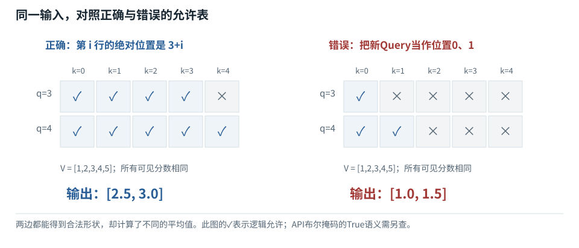
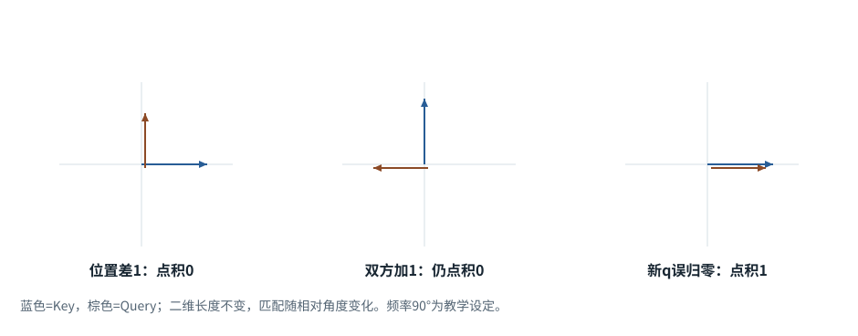
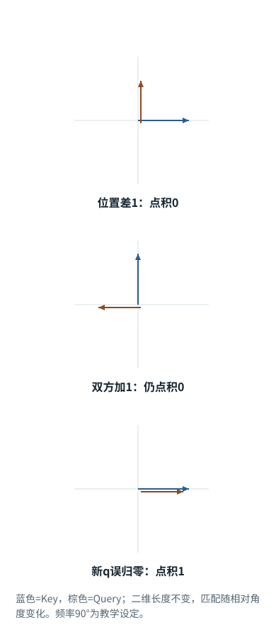
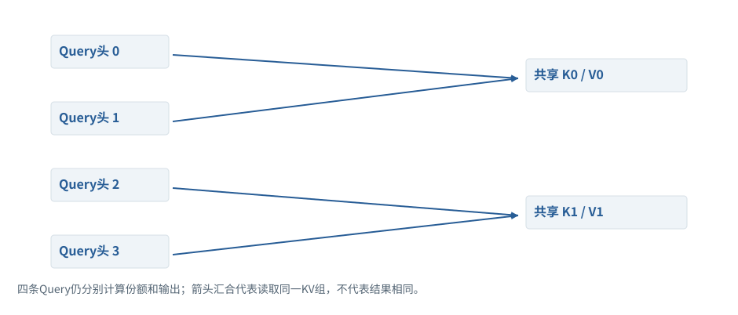
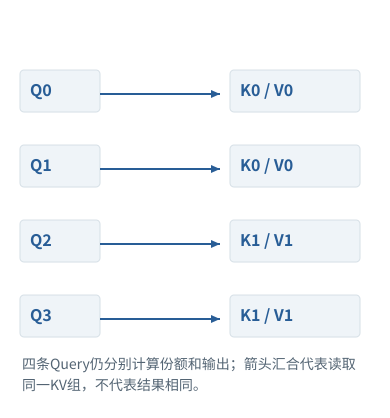
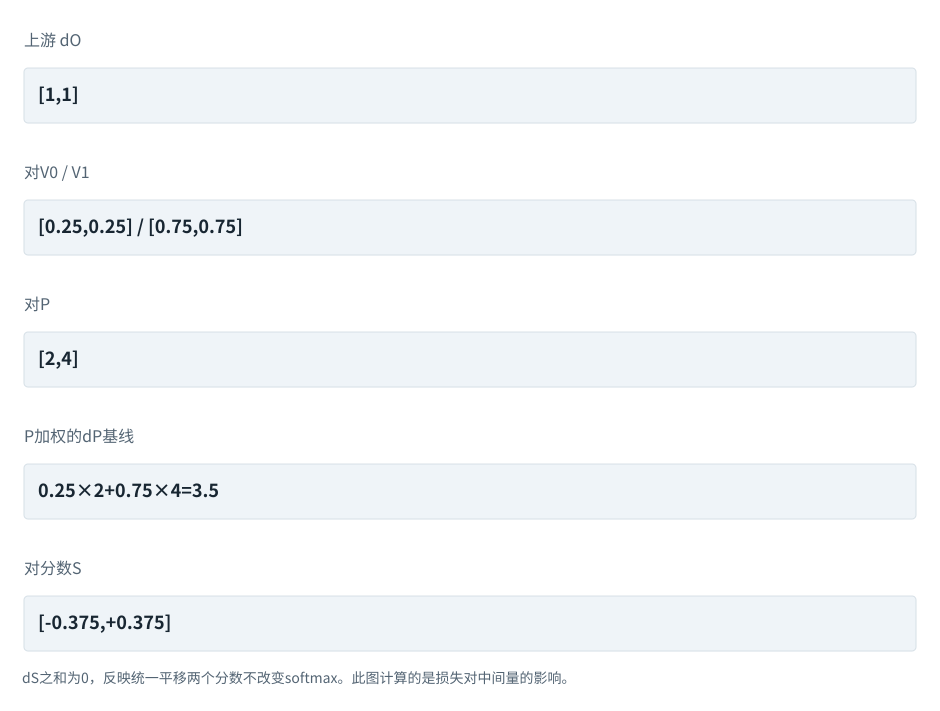
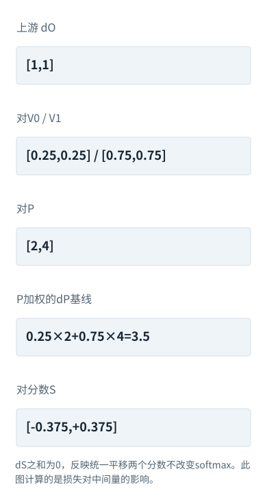

系统篇


<span id="ch03-s0"></span>


# 03｜注意力的深入追问：位置、掩码、多头与反向传播


<span id="section-1"></span>


### 本章预备知识

掩码规定哪些位置可见，位置编码帮助区分顺序，多头把表示分组处理；反向传播则追踪最终误差怎样沿原计算回传。它们解决不同问题，不能靠一张架构图一起猜。

本章各题列出所需基础。可先完成相应基础课，也可通过自检确认掌握程度。

[F08 · reshape、转轴、广播](../foundations/08.md)[F11 · Attention逐步计算](../foundations/11.md)[F12 · Mask不是黑箱](../foundations/12.md)[F13 · 位置编号与RoPE](../foundations/13.md)[F14 · 把Attention装进一层](../foundations/14.md)[F15 · 微积分只学用得上的部分](../foundations/15.md)[F16 · 一次训练从头到尾](../foundations/16.md)

**进入深读前的小检查：**先画3个历史位置后再加2个位置的可见表：新位置3能看0到3，新位置4能看0到4。随后再读非方阵mask与缓存偏移。

术语带虚线时可点击速查。公式中的字母先看定义；不要用猜缩写替代推导。

本章把看起来类似的维度和概念拆开：序列索引、逻辑位置、缓存槽位不是一回事；Q头数、KV头数也不是一回事。理解这些差别，才能解释“[shape](../glossary.md#g010 "各个轴分别有多长，不是数据内容。 例：内容[[1,2],[3,4]]的形状是[2,2]。")完全对，生成却错了”的故障。


<span id="visual-reading"></span>


<span id="topic-1"></span>


## 沿着对象与状态理解本章

先在可见性表里选一个查询行，决定哪些Key位置允许参与；再看如何缩放和混合。多头改变表示的分组方式，位置旋转改变Q/K的比较，反向传播计算参数的影响，三者不是同一个步骤。

下方图解的固定输入在“输入与适用条件”中声明。它用于解释本章机制，不与本章其他独立例子的数值暗中接续。


<span id="visual-F12"></span>

<span id="topic-2"></span>

<span id="topic-3"></span>

<span id="topic-4"></span>

<span id="topic-5"></span>

<span id="topic-6"></span>

<span id="topic-7"></span>


相关动态过程：[Mask是可见性表，不是额外语义](../visual/F12.md)。本节下文继续展示更具体的计算与工程边界。

继续看相关机制：[F13 · 位置怎样进入数值计算](../visual/F13.md)[O01 · GQA/MQA：减少的是K/V组数](../visual/O01.md)[F15 · 梯度像坡度，学习率像迈步大小](../visual/F17.md)


<span id="Q009"></span>


## Q009｜因果mask、padding mask、分块解码mask到底如何构造？

这题先认识什么因果掩码禁止未来位置，填充掩码排除占位项；有旧缓存时，查询行数和可读列数不同，不能照抄方阵三角表。

[F04 · 组批和补齐](../foundations/04.md)[F12 · Mask不是黑箱](../foundations/12.md)[F19 · KV Cache从零解释](../foundations/19.md)


<span id="ch03-s2"></span>


### 核心回答

因果mask禁止读取未来位置；[padding mask](../glossary.md#g079 "排除补齐项作为有效内容的标记。 例：PAD向量全0仍不保证其softmax权重自动为0。")排除没有实际内容的补齐位置；分块解码还要把新块的局部索引映射到已有前缀后的全局位置。判断某个键可否被读取，应看逻辑位置和有效性，而不是只画一个左上角三角形。[[TR]](../sources.md#src-TR "来源说明")[[CACHE]](../sources.md#src-CACHE "来源说明")


<span id="ch03-s3"></span>


### 先看完整输入，再看缓存场景

一个4-[Token](../glossary.md#g027 "模型分词器使用的片段单位。 例：可能是词、词的一部分、标点或部分字节。")序列，行是查询位置，列是键位置，1表示允许读取：

```
       k0 k1 k2 k3
q0     1  0  0  0
q1     1  1  0  0
q2     1  1  1  0
q3     1  1  1  1
```

这里下三角是因为查询与键从相同的全局位置0开始。现在已有3个Token的缓存，新来2个Token。Q长度是2，K长度是5；新查询的全局位置是3与4，正确mask为：

```
       old0 old1 old2 new3 new4
new3     1    1    1    1    0
new4     1    1    1    1    1
```

通式是`key_position ≤ past_length + local_query_index`。如果直接创建`tril(ones(2,5))`，第一行只会看old0，第二行只会看old0与old1，历史的大部分被错误遮住。它仍是一个合法的2×5矩阵，所以不会靠shape检查暴露问题。

再加入[padding](../glossary.md#g035 "给短序列增加占位项，使指定组织方式可用。 例：[4,2]右补齐为[4,2,0]。")。两条序列长度分别为3和5，组批时短序列补齐。被补齐的键位置不应获得注意力权重；padding查询位置可能仍被算子计算，但不应作为有效答案或训练目标使用。左padding时，数组下标和真实Token位置更容易分离，位置编号应服从模型与实现约定，不能只用数组下标。


<span id="mechanism-Q009"></span>


<span id="topic-8"></span>


### 缓存解码的掩码要按绝对位置填，不能照抄小三角

**本例条件：**独立缓存例：旧位置0、1、2已处理，新Query位于3、4；Key覆盖0—4。下图“可读=1”只表示逻辑允许关系，再按目标API转换。

Query行
:   正在算哪个位置的新表示。

Key列
:   可以向哪个历史位置取信息。

绝对位置
:   在完整序列中的序号，而非本次小批里的行号。

**缓存解码的掩码要按绝对位置填，不能照抄小三角**



本图仅使用当前算例声明的输入；具体公式、来源和边界见紧邻正文。

[SVG图源](../../diagrams/rendered/Q009-fb2c38d32406.svg) · [原算例数据：Q009](../../diagrams/source/mechanism-cases.json)

核对完整输入与结果

本图使用的数据与条件

| Query绝对位置 | Key 0／1／2／3／4 | 说明 |
| --- | --- | --- |
| 3 | 1 1 1 1 0 | 读历史与自己，不读未来4 |
| 4 | 1 1 1 1 1 | 最后一行可以读全前缀 |
| 错误的局部三角 | 1 0 0 0 0 / 1 1 0 0 0 | 把局部行号0/1误当绝对位置 |

#### 怎样把图中的变化读明白

先在纸上写出每个Query的真实位置，再逐列判断key\_pos≤query\_pos。这里只需比较两个整数，不必先记框架参数名。

有PAD时还要同时满足Key是真实内容；因果约束与padding约束是逻辑“并且”，不是二选一。

PyTorch SDPA布尔True表示参与，部分MHA掩码True表示屏蔽。图中的1不是跨接口通用写法，调用前必须转换。

**不要混淆：**张量[2,5]形状完全正确，错误小三角仍会悄悄漏读历史。因此形状测试之外必须测试允许表和输出。

机制依据：[[TR]](../sources.md#src-TR) [[CACHE]](../sources.md#src-CACHE) [[SDPA-213]](../mechanisms/sources.md#source-SDPA-213)。本例数字和宿主场景为明确给定的教学设定，不是商业模型输出或生产性能测量。


<span id="worked-Q009"></span>


运行示例 · Q009


<span id="topic-9"></span>


### 把因果、padding与loss mask画在同一个序列上

**输入与条件。**批内第二句是 `[你,爱,PAD]`。三个位置有效性为 `[1,1,0]`；采用右补齐，真实Token位置0、1。

| 步骤与对象 | 内部动作 | 中间结果 / 新状态 |
| --- | --- | --- |
| 1查询位置0 | 因果限制只许看Key0 | 可见 `[1,0,0]`。 |
| 2查询位置1 | 可看Key0、1 | 可见 `[1,1,0]`。 |
| 3PAD查询位置2 | 其输出不用于这句话的预测/训练 | 实现可计算后丢弃，也可有显式跳过策略。 |
| 4训练标签 | 假设只评价前两个有效预测位置 | loss mask是 `[1,1,0]`，它控制计分，不自动控制attention。 |
| 5有缓存时 | 3个历史+2个新Token | 新的注意力表是2×5，行位置为3、4，不是0、1。 |

**把过程连起来。**三个mask都可能长得像0/1表，但分别限制能读什么、哪些数据是真实输入、哪些位置参与评分。

**边界与反例。**0/1在这里是本例“可见/不可见”的说明符；具体库的布尔mask可能约定相反。

依据与适用范围：[[SDPA]](../example-sources.md#ex-src-SDPA) [[CACHE]](../example-sources.md#ex-src-CACHE)。示例输入和场景由本书明确设定。


<span id="worked-X07"></span>


运行示例 · X07


<span id="topic-10"></span>


### 同一张“允许访问表”，不同接口的布尔值为什么相反

**输入与条件。**两个Token的因果可见关系是：第0行只能看第0列；第1行可看两列。先定义语义允许表[[真,假],[真,真]]。

| 步骤与对象 | 内部动作 | 中间结果 / 新状态 |
| --- | --- | --- |
| 1先写语义 | 真表示“本例希望允许访问” | 这个定义独立于任何API。 |
| 2传入scaled\_dot\_product\_attention | 按该接口文档，布尔True表示参与注意力 | 直接传[[True,False],[True,True]]。 |
| 3传入MultiheadAttention的attn\_mask | 该接口布尔True表示禁止访问 | 必须传反表[[False,True],[False,False]]。 |
| 4加性掩码表达 | 允许处加0，禁止处加−∞ | 本例为[[0,−∞],[0,0]]；仍需核对接口接受的dtype、形状与设备。 |

**把过程连起来。**不要把另一篇代码里的True直接抄到新接口。先画语义表，再按文档转换，最后做未来Token扰动测试。

**边界与反例。**此处对照的是所列PyTorch 2.14接口文档。以后版本或其他库必须按其文档重新确认，不能把布尔约定当成通用标准。

[查看本例程序结果](../example-verification.md#result-X07) · [完整可运行代码](../example-verification.md#code)

依据与适用范围：[[SDPA]](../example-sources.md#ex-src-SDPA) [[MHA]](../example-sources.md#ex-src-MHA)。示例输入和场景由本书明确设定。


<span id="ch03-s4"></span>


### 追问：训练时一次输入整段答案，不就是偷看答案吗？

不是，只要每个位置的可见范围正确。位置i的隐藏状态只能读到`x≤i`，拿它预测`x(i+1)`。标签存在于[batch](../glossary.md#g034 "一起组织计算的一组输入。 例：普通样本batch不让不同用户相互读取内容。")里不等于前向可以读取它。多个位置的预测可同时计算，因为正确前缀已经由训练数据提供。若mask删掉，训练loss可能异常漂亮，却学习了不符合部署条件的任务。


<span id="ch03-s5"></span>


### 追问：两份文档拼接训练，只放一个EOS就完全隔离了吗？


<span id="symbol-intro-3"></span>


先认识这里的对象与符号

[BOS / EOS：序列边界标记](../concepts.md#concept-bos-eos)
:   BOS通常表示序列起始，EOS表示结束的特殊Token；具体模型和消息模板可能使用不同名称、数量及结束标记。它们是输入/输出协议中的符号，不是语义正确性的证明。遇到EOS不自动切断两个训练样本之间的注意力；要隔离读取还需mask或实现支持的样本边界。

不一定。[EOS](../glossary.md#g096 "模型约定的一种结束序列Token。 例：与最大输出长度、用户取消是不同结束原因。")是序列内容标记，不自动禁止注意力跨文档边界。若目标是严格隔离样本，需要分段[attention mask](../glossary.md#g077 "规定哪些位置间的读取被允许的约束。 例：接口可能用布尔值或加性负无穷，真假约定要核对。")，并同步处理位置和loss范围。若允许跨文档上下文，则可以有不同策略；关键是明确训练目标，不能把“出现分隔符”当成确定性隔离。


<span id="ch03-s6"></span>


### 追问：如何写一个能抓住mask错误的测试？


<span id="symbol-intro-2"></span>


先认识这里的对象与符号

[Dropout：训练中的随机置零规则](../concepts.md#concept-dropout)
:   常用倒置Dropout在训练时按丢弃概率p随机将元素置零，保留项除以1-p以保持期望量级。评估模式通常关闭这一随机操作；底层函数可能要求调用者显式传p=0。独立例：p=0.5，某值2在一次掩码中被保留则输出4，被丢弃则0。这不是训练把对应模型参数永久删掉。

固定权重、关闭dropout，先保存前缀输出；然后只改变未来Token，前缀对应[logits](../glossary.md#g091 "输出投影给各词表候选的未归一化分数。 例：可以是负数，还不是概率或Token编号。")不应变化。再比较整段、逐Token和多种分块推理的输出，三者应在合理浮点容差内一致。故意移除mask或重置位置，测试应失败；否则测试很可能没有覆盖目标错误。


<span id="engineering-E05"></span>


工程深挖 · E05 · 接续Q009


<span id="engineering-E05-title"></span>


### 布尔mask语义相反，加缓存后is\_causal还可能对齐错边

预备知识：[F11](../foundations/11.md) · [F12](../foundations/12.md) · [F19](../foundations/19.md)。阅读顺序：先确认运行契约，再看反例与修复，最后检验边界。


<span id="engineering-E05-detail-1"></span>


#### 两个正确的API，组合起来仍可能错误

在PyTorch的SDPA里，布尔True表示该位置**允许参与**；在MultiheadAttention的`attn_mask`中，True表示该位置**被禁止**。这不是命名小差异，而是同一块布尔数据直接复用会把可见关系反转。[[SDPA]](../engineering/sources.md#src-SDPA "PyTorch · scaled_dot_product_attention") [[MHA]](../engineering/sources.md#src-MHA "PyTorch · MultiheadAttention")

本地用单位投影把MHA和底层SDPA对齐：向MHA传`~allowed`，向SDPA传`allowed`，输出一致；不给反转则不一致。这种测试专门隔离“掩码含义”，不应与前一节检验投影转置的非对称矩阵测试混用。


<span id="engineering-E05-detail-2"></span>


#### 第二个坑：非方阵的三角形需要绝对位置

缓存已有3个位置，新来2个Query，K/V总长5。新Query的绝对位置是3、4，不是0、1。正确允许表为：

```
            Key位置 0  1  2  3  4
新Query位置3       1  1  1  1  0
新Query位置4       1  1  1  1  1
```

而PyTorch2.10 SDPA的`is_causal=True`对非方阵采用左上对齐，2×5三角表会是`10000 / 11000`。它限制了不该限制的历史；这是有明确版本依据的接口契约，不是“模型忘记上下文”。[[SDPA]](../engineering/sources.md#src-SDPA "PyTorch · scaled_dot_product_attention")


<span id="engineering-E05-detail-3"></span>


#### 数值反例使错误一眼可见

让Q/K都为0，各合法位置分数相同；令V的值为1、2、3、4、5。正确两行平均值为2.5、3.0；左上三角得到1.0、1.5。本书使用真实SDPA执行了这两条路径。

```
q_positions = torch.arange(3, 5)   # 本轮绝对位置
k_positions = torch.arange(5)      # 历史 + 当前
allowed = k_positions[None, :] <= q_positions[:, None]
out = F.scaled_dot_product_attention(q, k, v,
                                     attn_mask=allowed,
                                     dropout_p=0.0)
```

这段是显式绝对位置掩码方案。不要再同时打开与其冲突的自动因果选项。实际模型适配器可能已经处理了偏移，应查调用边界，避免二次修正。[[CACHE]](../engineering/sources.md#src-CACHE "Transformers · Cache explanation")


<span id="engineering-E05-detail-4"></span>


#### 追问：batch里的历史长度不一样怎么办？

不再用一个全局P去生成所有样本的偏移。要结合每条样本的真实可见位置、padding与cache布局。静态缓存的未写槽不能当作已读历史；滑窗还要限制下界。维度broadcast能成功，不等于各样本读取规则相同。


<span id="engineering-E05-detail-5"></span>


#### 追问：换FlashAttention就能修好吗？

不能把底层实现名当成对齐承诺。不同接口可能采用不同因果对齐约定，模型包装层也可能补充偏移。固定一组带缓存的显式允许表，与整段无缓存前向做数值对照，才是可迁移的正确性检查。


<span id="engineering-E05-observations"></span>


#### 本地观察与复核入口

以下为随包程序实际运行记录。数值算子、临时文件／数据库实验与教学逻辑模拟各自的范围，在实验页逐项注明；不能据此声称已测试商业模型或生产环境。


<span id="mechanism-record-E05"></span>


#### E05：怎样读这份结果，而不是只看“通过”

先看每格“允许还是禁止”，再看输出数值。布尔True的语义反转与非方阵因果对齐，是两种不同错误；这里保留各自的独立输入和结果。

实验记录：字段与原值

| 原始字段路径 | 原始值 |
| --- | --- |
| E05-polarity.correct | [[[1.0, 0.0], [0.3302384614944458, 0.6697615385055542]]] |
| E05-polarity.inverted | [[[0.0, 1.0], [0.0, 0.0]]] |
| E05-offset.mask | [[true, true, true, true, false], [true, true, true, true, true]] |
| E05-offset.correct | [2.5, 3.0] |
| E05-offset.upper\_left | [1.0, 1.5] |

这里是实际实验记录，不用条长或箭头伪装成额外证据；完整日志与解释仍保留在本节。

本图整理的是本小节已有的局部实验记录，不把通过局部测试扩展为产品在所有环境下可靠。原测试环境、输入和完整输出仍以本节记录为准。

```
{
  "E05-polarity": {
    "correct": [
      [
        [
          1.0,
          0.0
        ],
        [
          0.3302384614944458,
          0.6697615385055542
        ]
      ]
    ],
    "inverted": [
      [
        [
          0.0,
          1.0
        ],
        [
          0.0,
          0.0
        ]
      ]
    ]
  },
  "E05-offset": {
    "mask": [
      [
        true,
        true,
        true,
        true,
        false
      ],
      [
        true,
        true,
        true,
        true,
        true
      ]
    ],
    "correct": [
      2.5,
      3.0
    ],
    "upper_left": [
      1.0,
      1.5
    ]
  }
}
```

[本条全部结果、验证范围与完整代码 →](../engineering/labs.md#proof-E05)

**自检：**已有3个缓存位置、新来2个位置，为什么直接生成2×5的左上三角表不对？

<details class="quiz-answer"><summary><span class="when-closed">查看参考答案</span><span class="when-open">收起参考答案</span></summary><div class="answer">两行Query的绝对位置是3和4，应分别读前4个和前5个Key；左上三角误当成位置0、1，只读1个和2个Key。必须把缓存偏移纳入可见性。</div></details>

证据核对：2026-10-21。[[SDPA]](../engineering/sources.md#src-SDPA) [[MHA]](../engineering/sources.md#src-MHA) [[CACHE]](../engineering/sources.md#src-CACHE) · [事实、推导与实验的边界](../engineering/sources.md#evidence-levels)


<span id="core-understanding-4"></span>


<span id="core-understanding-4--mc-section-4"></span>


## 追问：Q/K/V为什么会学到不同用途？

结构使Q与K进入匹配分数，V进入被混合的内容。不同计算路径产生不同梯度信号，三张独立参数允许不同特征变换。若人为共享，就给模型加了约束，不再等同原结构。

依据：[tiny\_model.py:178–258](../reference/model-code.md#tiny_model-L178)；[对应参数、前向及梯度记录](../labs/model-values.md)。


<span id="Q010"></span>


## Q010｜RoPE如何让注意力知道位置？为什么缓存位置不能每轮从零开始？

这题先认识什么位置不是Token身份。RoPE将一对坐标旋转与位置相关的角度，使点积中出现相对位置关系，不是把位置数字直接加到词表编号。

[F07 · 模型最常做的算术](../foundations/07.md)[F13 · 位置编号与RoPE](../foundations/13.md)


<span id="ch03-s8"></span>


### 核心回答

[RoPE](../glossary.md#g082 "通过按位置旋转成对坐标来引入位置信息的方法。 例：二维90度旋转把[2,3]变为[-3,2]。")把Q/K每一对分量按位置相关角度旋转，使两位置旋转后点积包含相对位置差。它不是简单把位置整数加到[Token ID](../glossary.md#g028 "某Token在对应词表中的整数地址。 例：[1,2,3]先是编号列表，不是三个语义强度。")上。缓存推理必须保持新旧Token的逻辑位置连续或符合指定位置策略，否则相对关系被改变。[[ROPE]](../sources.md#src-ROPE "来源说明")


<span id="ch03-s9"></span>


### 从二维旋转推导相对位置

对二维向量`x=[a,b]`，位置p与频率θ对应：

```
R(pθ) x = [a cos(pθ) − b sin(pθ), a sin(pθ) + b cos(pθ)]
```

Q在位置p、K在位置t时，点积为`(R(pθ)q)ᵀ(R(tθ)k)`。利用`R(pθ)ᵀ=R(-pθ)`与旋转的组合性质，得到`qᵀR((t-p)θ)k`。因此位置信息通过差`t-p`进入相关性。高维向量按分量对应用不同频率，提供多尺度位置变化。

这并不意味着注意力只依赖位置差：q与k本身仍由文本内容和前层表示决定。RoPE提供相对位置结构，内容匹配仍由学习得到的投影负责。也不能说它让模型对任意长度天然泛化；超过训练分布的相位组合仍可能带来退化。

假设前缀长度P=100，新Token本应在位置100。如果错误地把它的Q/K按位置0旋转，而旧K仍按0到99存储，那么模型读到的“距离”已不是真实距离。张量长度、[dtype](../glossary.md#g041 "规定每个元素如何存储与运算。 例：整数编号与浮点表示通常不是同一dtype。")、缓存拼接轴都可能正确，但logits已经偏离整段前向。


<span id="mechanism-Q010"></span>


<span id="topic-11"></span>


### RoPE保留的是相对角度，不是每轮重新开始的位置

**本例条件：**独立二维旋转例：原始q=k=[1,0]；为便于手算，每增加一个位置旋转90°。真实RoPE用多组频率，本例只解释位置差。

旋转
:   改变方向但保留该二维向量长度。

位置偏移
:   这次Token在完整上下文中的位置。

相对位置
:   查询位置减去Key位置。

**RoPE保留的是相对角度，不是每轮重新开始的位置**





本图仅使用当前算例声明的输入；具体公式、来源和边界见紧邻正文。

[SVG图源](../../diagrams/rendered/Q010-871c152a6442.svg) · [原算例数据：Q010](../../diagrams/source/mechanism-cases.json)

核对完整输入与结果

本图使用的数据与条件

| 条件 | 旋转后的两向量 | 点积 |
| --- | --- | --- |
| q位置1，k位置0 | q=[0,1]；k=[1,0] | 0 |
| 双方都加1 | q位置2=[-1,0]；k位置1=[0,1] | 0 |
| 错误：新q重置为位置0 | q=[1,0]；旧k仍[1,0] | 1：关系被改变 |

#### 怎样把图中的变化读明白

前两行把双方同时移动一格，夹角没变，所以点积没变。这就是相对位置进入匹配的一种直观表现。

缓存中的旧K已经带着它原来的位置。新Token若重置成0，就不是“只是重新编号”，而是改变了新旧向量的相对角度。

真实实现还要区分position\_ids、cache\_position与物理槽位；滑动缓存移动存储槽，不意味着把语义位置也重置。

**不要混淆：**本例90°频率是教学设定，不是现实模型第一个频率的数值；不能把图中的周期4当成真实上下文长度。

机制依据：[[ROPE]](../sources.md#src-ROPE) [[CACHE]](../sources.md#src-CACHE)。本例数字和宿主场景为明确给定的教学设定，不是商业模型输出或生产性能测量。


<span id="worked-Q010"></span>


运行示例 · Q010


<span id="topic-12"></span>


### 相对位置保持与缓存错位：同一组旋转算两遍

**输入与条件。**用二维旋转R(θ)，q=k=[1,0]。设位置m的角度是m×90°，只用于展示相对位置性质。

| 步骤与对象 | 内部动作 | 中间结果 / 新状态 |
| --- | --- | --- |
| 1比较位置0与1 | q0=[1,0]，k1=[0,1] | 点积0。 |
| 2两者整体后移1位 | q1=[0,1]，k2=[−1,0] | 点积仍为0。 |
| 3比较同位置 | q1与k1 | 点积1，说明相对差0与差1不同。 |
| 4缓存正确处理 | 新Token继续采用绝对位置2 | 位置不因为进入新调用而重置。 |
| 5重置反例 | 把位置2误当0 | k2误成[1,0]，与位置0的比较从−1变1。 |

**把过程连起来。**固定频率旋转中共同平移不改变相对角度；错误重置位置则改变模型实际计算。

**边界与反例。**真实RoPE多坐标对、频率与扩展策略需按模型实现；示例不代表所有模型采用90°步长。

依据与适用范围：[[DERIVE]](../example-sources.md#ex-src-DERIVE)。示例输入和场景由本书明确设定。


<span id="ch03-s10"></span>


### 追问：可以把全部位置同时平移吗？

在理想纯RoPE点积中，同时给Q/K位置加同一偏移，会保留相对差。但完整模型可能还有其他位置相关机制、滑窗规则、特殊位置或缩放策略；已旋转的缓存也不能只改一个position counter就完成一致变换。数学上的整体平移性质不能直接当任意缓存截断实现的安全证明。


<span id="ch03-s11"></span>


### 追问：长上下文扩展是怎么做的？

常见思路包括位置插值、频率缩放、特定频段调整和长序列继续训练。它们试图让超出原训练长度的位置模式更接近可学习范围，同时保留局部区分。局部精度与长距离覆盖可能发生取舍，因此需测检索、跨段组合、代码定位等真实任务，不只测“接口是否接受更多Token”。


<span id="ch03-s12"></span>


### 追问：为什么通常旋转Q/K而不是V？

这种设计把相对位置信号主要放到读取权重的计算里，[Value](../glossary.md#g074 "每个可读位置将被加权汇集的内容表示。 例：这里V不是词表大小。")仍提供被混合的内容。不同架构可有其他方案；不能把这个实现选择扩展成数学上所有模型都必须遵守的定理。阅读源码时应检查缓存里保存的是旋转前还是旋转后的K，以及重用时是否重复旋转。


<span id="engineering-E06"></span>


工程深挖 · E06 · 接续Q010


<span id="engineering-E06-title"></span>


### 位置编号、缓存槽位和RoPE：同叫position却不是同一个数

预备知识：[F12](../foundations/12.md) · [F13](../foundations/13.md) · [F19](../foundations/19.md)。阅读顺序：先确认运行契约，再看反例与修复，最后检验边界。


<span id="engineering-E06-detail-1"></span>


#### 先列出三种计数

**逻辑位置**描述Token在模型序列中的位置；**物理缓存槽**描述K/V放在哪个数组格；**有效长度**描述有多少非PAD内容。它们在简单无PAD、无滑窗的例子里恰好相等，但工程中不能由此合并字段。固定版本的Transformers缓存说明专门区分了cache\_position与padding内容。[[CACHE]](../engineering/sources.md#src-CACHE "Transformers · Cache explanation")

例如物理槽0、1是左PAD，槽2、3、4放“我/爱/学习”。某些适配器会把三个有效Token的position\_ids记为0、1、2，而当前缓存物理长度是5。不能拿有效长度3直接覆盖下一缓存写入槽。具体生成器如何表示PAD缓存，必须看其实现；这里是明确说明对象可能不同的教学布局，不是统一模板。


<span id="engineering-E06-detail-2"></span>


#### 位置旋转不能在缓存复用时重复执行

常见RoPE实现先旋转Q/K，缓存旋转后的K。下一轮读取旧K时再按它原先位置旋转一遍，就相当于把角度加了两次。本书二维反例：`[1,0]`旋转90°得到`[0,1]`，再转90°变成`[-1,0]`。形状一模一样，含义完全变了。另一些实现选择缓存未旋转量，则职责相反；**缓存表示格式是契约的一部分**。


<span id="engineering-E06-detail-3"></span>


#### 滑窗不能把绝对位置倒回零

滑窗淘汰旧槽后，存储长度可以保持常数，但下一Token的逻辑位置通常继续增长。若把槽下标当成位置、每次从0重来，会改变位置相位和可见性。更改RoPE缩放配置、位置偏移或适配器也可能让原缓存不再适用。


<span id="engineering-E06-detail-4"></span>


#### 用什么不变量检测这些错误

构造短序列，对比“整段一次前向”和“逐段前向+缓存”的最后位置输出；覆盖无PAD、左PAD、不同长度batch、两Token以上的增量、跨滑窗边界。比较应在同模型参数、相同精度、关闭dropout下进行。差异出现时依次核对Token身份、绝对位置、允许表、写入槽和旋转次数，别直接放宽误差阈值。


<span id="engineering-E06-detail-5"></span>


#### 追问：相同Token前缀为何仍不能共享缓存？

更换模型权重、LoRA、位置配置、图像编码等都会改变K/V；只哈希Token列表不够。vLLM的设计使用前缀依赖与额外哈希信息来标识可复用块。[[PREFIX]](../engineering/sources.md#src-PREFIX "vLLM · Automatic Prefix Caching") 这不表示所有系统都自动帮你处理了外部适配器变化。


<span id="engineering-E06-detail-6"></span>


#### 追问：清空缓存能否“修复”问题？

它是有价值的对照：若整段正确、增量错误，怀疑缓存路径有根据。但永久禁用缓存只是回避症状，可能显著增加成本。找到是哪项身份或位置契约破坏后，修复并保留两条路径的一致性回归测试。


<span id="engineering-E06-observations"></span>


#### 本地观察与复核入口

以下为随包程序实际运行记录。数值算子、临时文件／数据库实验与教学逻辑模拟各自的范围，在实验页逐项注明；不能据此声称已测试商业模型或生产环境。


<span id="mechanism-record-E06"></span>


#### E06：怎样读这份结果，而不是只看“通过”

同一向量旋转一次与两次，其长度可能都没变，方向却变了。错误发生在位置信息被施加的次数或位置，而不是缓存数组长度。

实验记录：字段与原值

| 原始字段路径 | 原始值 |
| --- | --- |
| E06.once | [6.123233995736766e-17, 1.0] |
| E06.twice | [-1.0, 1.2246467991473532e-16] |
| E06.cache\_slots | [0, 1, 2, 3, 4] |
| E06.valid\_positions | [0, 1, 2] |

这里是实际实验记录，不用条长或箭头伪装成额外证据；完整日志与解释仍保留在本节。

本图整理的是本小节已有的局部实验记录，不把通过局部测试扩展为产品在所有环境下可靠。原测试环境、输入和完整输出仍以本节记录为准。

```
{
  "E06": {
    "once": [
      6.123233995736766e-17,
      1.0
    ],
    "twice": [
      -1.0,
      1.2246467991473532e-16
    ],
    "cache_slots": [
      0,
      1,
      2,
      3,
      4
    ],
    "valid_positions": [
      0,
      1,
      2
    ]
  }
}
```

[本条全部结果、验证范围与完整代码 →](../engineering/labs.md#proof-E06)

**自检：**滑窗缓存仍长128，下一Token的RoPE位置是否一定是128？

<details class="quiz-answer"><summary><span class="when-closed">查看参考答案</span><span class="when-open">收起参考答案</span></summary><div class="answer">不一定。缓存保留长度是物理/窗口规模，绝对序列位置可能已经远大于128。应按模型的位置约定持续计数，而非用当前缓存长度替代逻辑位置。</div></details>

证据核对：2026-10-21。[[CACHE]](../engineering/sources.md#src-CACHE) [[PREFIX]](../engineering/sources.md#src-PREFIX) · [事实、推导与实验的边界](../engineering/sources.md#evidence-levels)


<span id="Q011"></span>


## Q011｜MHA、MQA、GQA到底少了什么？是不是把多头删掉了？

这题先认识什么多头把表示分组；MQA/GQA让多个查询头共享较少的K/V头。查多少组和存多少组分开数。

[F08 · reshape、转轴、广播](../foundations/08.md)[F11 · Attention逐步计算](../foundations/11.md)[F19 · KV Cache从零解释](../foundations/19.md)


<span id="ch03-s14"></span>


### 核心回答


<span id="concept-intro-5"></span>


先认识这里的对象与符号

[MHA、MQA、GQA：头怎样共享](../concepts.md#concept-heads)
:   一个注意力头是一套匹配并聚合内容的路径。MHA常让每个Query头有自己的K/V头；MQA让多个Query头共用一组K/V；GQA在两者之间，分组共享。它们是结构选择，不是运行时随便改一个开关。独立形状例：8个Query头、2个K/V头，若均匀分组，每4个Query头共享1组K/V；缓存按K/V头数记账。

[MHA](../glossary.md#g127 "不同查询头与K/V头共享方式的注意力结构。 例：共享更多K/V可减少缓存，但不保证质量完全相同。")通常每个Q头有对应K/V头；[MQA](../glossary.md#g127 "不同查询头与K/V头共享方式的注意力结构。 例：共享更多K/V可减少缓存，但不保证质量完全相同。")让多个Q头共享一组K/V；[GQA](../glossary.md#g127 "不同查询头与K/V头共享方式的注意力结构。 例：共享更多K/V可减少缓存，但不保证质量完全相同。")在两者之间，让一组Q头共享一个K/V头。主要减少K/V投影输出和缓存量，不等于所有查询头变成同一注意力分布。[[GQA]](../sources.md#src-GQA "来源说明")[[CACHE]](../sources.md#src-CACHE "来源说明")


<span id="ch03-s15"></span>


### 逐形状比较


<span id="concept-intro-4"></span>


先认识这里的对象与符号

[d\_k、d\_v、Dh：每行表示的宽度](../concepts.md#concept-dk)
:   d\_k表示一个Query/Key向量有多少个分量；d\_v表示一个Value向量有多少个分量。Dh或d\_h在一些章节中是单头宽度。它们是尺寸整数，不是第k个Key或某个Value数值。形状微例：Q[2,3]、K[5,3]、V[5,4]，则分数[2,5]，输出[2,4]。Q/K配对宽度3，Value宽度4仍合法。

设隐藏维度4096，查询头H=32，每头Dh=128。MHA有32个KV头；GQA假设只有8个KV头；MQA只有1个。忽略bias时：


<span id="concept-intro-1"></span>


先认识这里的对象与符号

[Wq / W\_Q：查询投影参数](../concepts.md#concept-q-projection)
:   这是把输入表示变为Query的参数矩阵，不是Query本身。按本书右乘约定，输入每行d个数、Wq有d行d\_k列，Q=XWq后每行有d\_k个数。下标q表示用途，不表示再乘一个q。同一Wq可处理多个位置；每个位置得到自己的q。F11给出X、Wq和每个乘加结果。

[Wk / W\_K：键投影参数](../concepts.md#concept-k-projection)
:   这是生成Key表示的模型参数表。K=XWk中的X来自当前注意力输入，K是这次算出的结果；Wk不是保存文档关键词或密钥的表。Q与K每行宽度要相同，才能做点积。在F11，x₁=[1,-1]乘Wk得到k₁=[0,1]。不是把原来的Token ID拿来当Key。

[Wv / W\_V：值投影参数](../concepts.md#concept-v-projection)
:   这是从输入生成Value内容向量的模型参数表。V=XWv之后，Attention按读取份额混合V的各行。Value的宽度d\_v可与Query/Key宽度d\_k不同；它不是最终词表答案。F11中同一x₁=[1,-1]乘Wv得到v₁=[0,20]，再参与加权求和。

| 对象 | MHA | GQA（8 KV头） | MQA |
| --- | --- | --- | --- |
| Wq输出宽度 | 4096 | 4096 | 4096 |
| Wk/Wv各自输出宽度 | 4096 | 1024 | 128 |
| 单层K缓存 | `[B,32,T,128]` | `[B,8,T,128]` | `[B,1,T,128]` |
| 每个Q头的注意力权重 | 各自计算 | 各自计算 | 各自计算 |

GQA中可以把Q头0—3分给KV头0、Q头4—7分给KV头1，以此类推。共享K不意味着Q相同；不同Q与同一K点积，仍可产生不同权重。共享V也不意味着输出相同，因为加权比例不同。

缓存空间从32组降为8组，理论上这部分减少为四分之一。但总显存还有权重、激活、工作空间和调度元数据，不会因此整机显存必然减少四倍。QKᵀ和AV仍需服务32个Q头；实际计算效率还依赖kernel如何避免重复加载共享KV。


<span id="mechanism-Q011"></span>


<span id="topic-13"></span>


### GQA保留多个Query，只让它们共享较少的K/V

**本例条件：**独立配置：4个Query头、2个KV头，每头宽度2，历史3个位置；映射为Q0/Q1→KV0，Q2/Q3→KV1。

头
:   并行的一条注意力计算路径。

共享KV
:   两个不同Query读取同一组Key/Value。

输出头数
:   仍有4条Query结果，不会自动变成2。

**GQA保留多个Query，只让它们共享较少的K/V**





本图仅使用当前算例声明的输入；具体公式、来源和边界见紧邻正文。

[SVG图源](../../diagrams/rendered/Q011-173fd5337001.svg) · [原算例数据：Q011](../../diagrams/source/mechanism-cases.json)

核对完整输入与结果

本图使用的数据与条件

| Query头 | 读取哪个KV头 | 独立性 |
| --- | --- | --- |
| Q0 | KV0 | 有自己的Q与份额 |
| Q1 | KV0 | 与Q0不同的Q，可产生不同份额 |
| Q2 | KV1 | 同样独立计算 |
| Q3 | KV1 | 同样独立计算 |
| 缓存计数 | K和V：2×2头×3位置×2数=24数 | MHA四KV头则需48数 |

#### 怎样把图中的变化读明白

共享的是被读取的表示，不是直接复制输出。即便两个Query面对同一组Key，它们问的方向不同，softmax也可能不同。

缓存只保存K/V，所以减少KV头能省缓存；Query投影和四条Query对历史的匹配仍存在。

这是结构约束，不能简单把训练好的任意MHA运行时删掉一半KV头而宣称完全等价。

**不要混淆：**把repeat后的逻辑张量当成真实物理占用，会夸大缓存；反过来，真的复制KV实现又可能抵消预期节省。

机制依据：[[GQA]](../sources.md#src-GQA) [[CACHE]](../sources.md#src-CACHE)。本例数字和宿主场景为明确给定的教学设定，不是商业模型输出或生产性能测量。


<span id="worked-Q011"></span>


运行示例 · Q011


<span id="topic-14"></span>


### 保留4个查询头，但只缓存2组Key/Value

局部核对例：以下输入以本例列出的条件为准，不能把它的中间值接到贯通模型的计算记录中。

**输入与条件。**设B=1、T=3、查询头Hq=4、每头Dh=2。MHA有4个KV头，GQA设2个，MQA设1个。

| 步骤与对象 | 内部动作 | 中间结果 / 新状态 |
| --- | --- | --- |
| 1MHA | K和V各有 `1×4×3×2=24` 个数 | 两份共48数。 |
| 2GQA | K和V各有 `1×2×3×2=12` 个数 | 共24数；查询头仍4个。 |
| 3设分组 | Q头0、1读KV组0；Q头2、3读KV组1 | 每个Q有自己的查询向量，不是删掉两个Q头。 |
| 4MQA | 所有4个Q共用1组KV | 共12数，但每个Q算出的读取份额仍可不同。 |
| 5投影宽度 | 模型宽度8时，GQA的K投影可输出4维 | Q投影仍8维；最终残差宽度不随KV组数自动减半。 |

**把过程连起来。**GQA主要减少K/V投影与状态规模，不等于把注意力的查询头数一起删除。

**边界与反例。**这是常见均匀分组配置；具体模型与内核布局可不同，已有MHA权重不能不经适配直接当GQA使用。

依据与适用范围：[[DERIVE]](../example-sources.md#ex-src-DERIVE)。示例输入和场景由本书明确设定。


<span id="concept-intro-2"></span>


先认识这里的对象与符号

[Query、Key、Value：三种中间数值表示](../concepts.md#concept-qkv)
:   q是接收信息的一行查询表示；k是可读位置提供的一行匹配表示；v是该位置供混合的一行内容表示。大写Q/K/V把多行收集成表。它们由输入与参数计算得到，分别承担打分与提供内容的职责。某个q与两个k点积得到两个分数；softmax得到两个份额；这些份额分别乘两行v，再相加。这里不生成搜索词，也不直接选答案。


<span id="worked-X06"></span>


运行示例 · X06


<span id="topic-15"></span>


### 4个Q头共享2个KV头，究竟怎样配对

局部核对例：以下输入以本例列出的条件为准，不能把它的中间值接到贯通模型的计算记录中。

**输入与条件。**设Q头数4、KV头数2，每头宽度2。采用连续分组：Q0/Q1用KV0，Q2/Q3用KV1。

| 步骤与对象 | 内部动作 | 中间结果 / 新状态 |
| --- | --- | --- |
| 1写清映射 | Q0→KV0，Q1→KV0，Q2→KV1，Q3→KV1 | 共享的是对应的K/V，而不是把四个Query平均。 |
| 2保持Query独立 | Q0=[1,0]、Q1=[0,1]，同一键K0=[2,3] | 点积分别为2和3，即使共享键也可能得到不同注意力权重。 |
| 3计算本体 | 每Token的K和V各有2头×2数 | 共2×2×2=8个数；若4个KV头则16个数。 |
| 4还原输出 | 每个Q头各输出2个数，再按头拼接 | 得到8个数，之后由输出投影映射回模型的隐藏宽度。 |

**把过程连起来。**GQA减少KV存储，但并不把输出头数降成KV头数。要分别跟踪Q头、KV头和输出宽度。

**边界与反例。**组映射、头维度和输出投影依架构决定；本例明确采用连续分组，不讨论某一闭源模型的具体实现。

[查看本例程序结果](../example-verification.md#result-X06) · [完整可运行代码](../example-verification.md#code)

依据与适用范围：[[SDPA]](../example-sources.md#ex-src-SDPA)。示例输入和场景由本书明确设定。


<span id="ch03-s16"></span>


### 追问：能否把一个训练好的MHA模型直接改配置成GQA？


<span id="concept-intro-7"></span>


先认识这里的对象与符号

[checkpoint：必须看保存的对象](../concepts.md#concept-checkpoint)
:   模型检查点保存权重或训练状态；激活检查点保存少量中间节点以便反向时重算；Agent任务检查点保存执行进展。三者同名，但恢复对象完全不同。看到checkpoint先问“恢复参数、重算激活，还是继续任务”。Agent保存摘要不会更新模型权重。

不能只改头数。参数形状、权重组合和学习到的功能会变化。GQA论文研究了从多头检查点转换并继续训练的方式；这不是修改一个配置就获得等价模型。模型部署必须匹配权重与架构。


<span id="ch03-s17"></span>


### 追问：为什么有的GQA代码还把KV重复成H个头？

这可能是为了兼容普通[attention](../glossary.md#g071 "计算查询与可读候选的匹配份额，再加权组合内容。 例：先计算分数和权重，再用权重混合V。")接口而做概念展开。若物理复制长缓存，会抵消内存收益；高效实现应通过映射、视图或专用kernel共享数据。阅读代码时要看实际内存分配与[stride](../glossary.md#g058 "沿某轴移动一个索引时底层存储要跨过的元素间距。 例：转置后的视图可能不连续，后续reshape可能需复制。")，而不是只看注释写了“共享”。


<span id="ch03-s18"></span>


### 追问：MQA缓存最小，为什么不全部用MQA？

共享程度提高会改变表示容量与模型质量，硬件收益也受工作负载影响。GQA是在质量、训练成本与推理资源之间的一种折中。不存在不看模型与任务就永远最优的KV头数。


<span id="Q012"></span>


## Q012｜Attention如何反向传播？为什么自动求导正常不等于模型实现正确？

这题先认识什么反向传播沿前向计算逐步计算梯度；转置用于把输出变化传回输入维度，softmax的不同候选因归一化彼此耦合。

[F07 · 模型最常做的算术](../foundations/07.md)[F09 · 概率、指数与softmax](../foundations/09.md)[F15 · 微积分只学用得上的部分](../foundations/15.md)[F16 · 一次训练从头到尾](../foundations/16.md)


<span id="ch03-s20"></span>


### 核心回答

反向传播把输出误差沿Value内容路径和Q/K权重路径传回。自动求导能忠实计算当前计算图的梯度，却不能知道你的mask、标签或维度是否表达了正确任务。必须把数学梯度检查和语义不变性测试分开。[[TR]](../sources.md#src-TR "来源说明")


<span id="ch03-s21"></span>


### 沿计算图逐步求导


<span id="concept-intro-6"></span>


先认识这里的对象与符号

[∂、∇：偏导与梯度](../concepts.md#concept-gradient)
:   ∂L/∂w询问保持其他独立变量不变时，w小幅改变会让损失L怎样变化。多个参数的这些变化率合成梯度∇L。它们是导数记号，不是把两个普通数直接相除。独立微例：L=w²时，w=3处的梯度为6。最简单更新w←w−η×6中，η是学习率。


<span id="symbol-intro-1"></span>


先认识这里的对象与符号

[G、dQ、dW：反传里的中间梯度](../concepts.md#concept-upstream)
:   G=∂L/∂O通常是后续运算传回的损失对当前输出O的梯度。反传伪代码把∂L/∂Q简写成dQ、∂L/∂W简写成dW；它们形状与被求导的对象对应，不是特征维度d乘Q。先有前向O=AV，再接收G，才能算dV=AᵀG和dA=GVᵀ；dA改变的是份额路径，dV改变的是内容路径。

定义`S=QKᵀ/√d`、`A=softmax(S)`、`O=AV`，设上游梯度`G=∂L/∂O`。先对最后一步矩阵乘法：

```
dV = AᵀG
dA = GVᵀ
```

第一个式子表示某历史Value从所有读取它的查询位置累计误差；第二个式子衡量某个读取权重改变时损失如何变化。接着对[softmax](../glossary.md#g062 "将各分数取指数，再除以所有指数之和。 例：分数[2,1,0]经Softmax后约为[0.6652,0.2447,0.0900]。")，某行概率a与上游g对应：


<span id="concept-intro-3"></span>


先认识这里的对象与符号

[⊙：逐元素乘，不是矩阵乘](../concepts.md#concept-elementwise)
:   逐元素乘把形状对齐后的同位置数相乘，不沿某个维度再求和。公式的并排矩阵或@通常表示矩阵乘，二者不可互换。独立微例：[1,2]⊙[3,4]=[3,8]，点积则为11。门控前馈里的⊙是在每个特征上调节另一路。

```
ds = a ⊙ (g − sum(a ⊙ g))
```

这里减的是整行加权和，不能省略。其结果各分量之和为0，与“给整行分数加常数不改变softmax”的性质一致。最后：

```
dQ = dS K / √d
dK = dSᵀ Q / √d
```

若Q/K/V由同一X投影而来，X梯度是三条支路分别乘投影转置后的和，再加上残差直接回传的梯度。多头的换轴、拼接在反向中要走对应的逆变换。

一个有用的诊断：只让第一位置输出参与损失，在因果mask下，未来K/V不应通过这一损失得到梯度。如果未来位置有非零依赖，可能mask或索引错误。这个测试关注任务语义，不只是数值求导。


<span id="mechanism-Q012"></span>


<span id="topic-16"></span>


### 反向不是把前向箭头倒放，而是把“影响”按依赖分配

**本例条件：**独立单行算例：读取份额P=[0.25,0.75]，V0=[2,0]、V1=[0,4]；输出O=[0.5,3]，损失定义为O两格相加，所以上游梯度dO=[1,1]。

dO
:   损失对输出每格的变化率。

dV
:   内容变化怎样影响损失。

dS
:   softmax之前分数的梯度。

**反向不是把前向箭头倒放，而是把“影响”按依赖分配**





本图仅使用当前算例声明的输入；具体公式、来源和边界见紧邻正文。

[SVG图源](../../diagrams/rendered/Q012-44c51a6c882f.svg) · [原算例数据：Q012](../../diagrams/source/mechanism-cases.json)

核对完整输入与结果

本图使用的数据与条件

| 反向对象 | 计算 | 结果 |
| --- | --- | --- |
| Value路径 | dV\_j=P\_j×dO | dV0=[0.25,0.25]；dV1=[0.75,0.75] |
| 份额路径 | dP\_j=dO·V\_j | [2,4] |
| 加权基线 | ΣP\_j dP\_j | 0.25×2+0.75×4=3.5 |
| 分数路径 | dS\_j=P\_j(dP\_j−3.5) | [-0.375,+0.375] |

#### 怎样把图中的变化读明白

最后一行一负一正：提高第二个分数会给总值更大的V1更多份额，同时挤走V0的份额，所以两项变化彼此耦合。

不能把softmax导数只写成p(1−p)而忽略其他候选；上面的减去加权基线正是把耦合算进去。

自动求导能正确求“你写的程序”的梯度，但若前向把未来位置放进来，它也只会忠实地对错误前向求导。

**不要混淆：**有限差分检查通过只说明梯度跟当前前向一致；还需独立检查掩码、目标和模型语义。

机制依据：[[TR]](../sources.md#src-TR) [[F-AUTOGRAD]](../sources.md#src-F-AUTOGRAD)。本例数字和宿主场景为明确给定的教学设定，不是商业模型输出或生产性能测量。


<span id="worked-Q012"></span>


运行示例 · Q012


<span id="topic-17"></span>


### 对一个查询手算Attention的梯度，再用扰动检查

局部核对例：以下输入以本例列出的条件为准，不能把它的中间值接到贯通模型的计算记录中。

**输入与条件。**Q=[[0.4,−0.2]]；K=[[1,0.5],[−0.5,1]]；V=[[2,−1],[0.5,3]]；两个Key都可见。上游梯度G=[[0.7,−0.3]]，定义标量损失L=sum(O⊙G)。

| 步骤与对象 | 内部动作 | 中间结果 / 新状态 |
| --- | --- | --- |
| 1前向 | 算缩放点积、softmax与混合 | P约 `[0.621278,0.378722]`，O约 `[1.431916,0.514889]`。 |
| 2内容路径 | dV=PᵀG | 两行约 `[0.434894,−0.186383]`、`[0.265106,−0.113617]`。 |
| 3份额路径 | dP=GVᵀ | 得到 `[1.7,−0.55]`。 |
| 4传过softmax | dS=P⊙(dP−sum(P⊙dP)) | 约 `[0.529406,−0.529406]`，和为0。 |
| 5传到Q/K | dQ=dS K/√2，dK=dSᵀ Q/√2 | dQ约 `[0.561520,−0.187173]`。 |
| 6数值检查 | 对Q/K/V的10个坐标逐个±1e−6 | 最大绝对差约1.90e−10，核验当前公式导数一致。 |

**把过程连起来。**梯度分成“改读取份额”和“改被读取内容”两条路径。只验证dV不能证明Q/K学习正确。

**边界与反例。**有限差分能核对本例前向的导数，不能单独证明标签或mask符合任务；因此还需独立的因果反例测试。

[查看本例程序结果](../example-verification.md#result-Q012) · [完整可运行代码](../example-verification.md#code)

依据与适用范围：[[SDPA]](../example-sources.md#ex-src-SDPA)。示例输入和场景由本书明确设定。


<span id="ch03-s22"></span>


### 追问：有限差分怎样检查梯度？

对某输入维度j，把它分别改为`xj+ε`和`xj-ε`，用`[L(x+εej)-L(x-εej)]/(2ε)`近似导数。小矩阵用float64更容易定位错误。ε太大会有截断误差，太小则舍入误差占主导；不能仅通过不断放宽容差让测试通过。


<span id="ch03-s23"></span>


### 追问：有限差分通过，是否证明模型对了？

它证明解析或自动梯度与当前前向函数一致；如果前向错误地允许看未来，两者仍可能一致。还需要标签移动、因果性、整段与缓存一致性等测试。因此“梯度正确”和“目标正确”是不同证据。


<span id="ch03-s24"></span>


### 追问：推理时为什么不需要反向传播？

普通部署生成使用固定参数，只计算条件分布并选择Token，不需要计算损失和更新权重。长推理或多次工具调用增加的是前向计算与输入信息，不自动变成梯度训练。特定在线学习系统可以额外更新参数，但必须显式设计，不能从“模型越来越了解当前任务”推断发生了训练。


<span id="implementation-evidence"></span>


## 从本页解释到可检查的实现

| 要核对什么 | 事实与边界 | 本地依据 |
| --- | --- | --- |
| 前向、损失与更新 | 固定的一层四维教学模型；不是任何商业模型的完整实现。 | [tiny\_model.py · TinyLM](../reference/model-code.md#tiny_model-L33) |
| 独立前向实现 | 使用同一已保存权重，不使用PyTorch；用于复算而非另行训练。 | [reference\_inference.py · forward](../reference/model-code.md#reference_inference-L28) |
| 错误是否能被发现 | 因果性、梯度、标签移位、缓存位置均有正向检查和反例。 | [test\_model.py](../reference/model-code.md#test_model-L1) |
| 初始化的具体数字 | 所有参数均可查看；初值不等于训练后的参数。 | [weights\_initial.json](../reference/model-code.md#weights_initial-L1) |
| 实际运行记录 | 仅来自本地CPU微型实验；不能推出商业能力或GPU性能。 | [run.json 对应的数值记录](../labs/model-values.md) |


<span id="canonical-related"></span>


## 继续阅读与机制对应

| 页面 | 阅读关系 |
| --- | --- |
| [02｜一次Transformer前向：逐张量、逐算子讲明白](02.md) | 上一节：复习本页使用的前置概念 |
| [04｜训练机制：损失、完整反向传播与参数更新](04.md) | 下一节：沿同一课程顺序继续 |
| [F11｜Attention逐步计算：先算相关分数，再混合内容](../foundations/11.md) | 基础课程：先读逐步讲解与统一算例 |

AI系统工程：从基础到内部  
[全书目录](../contents.md) · [术语与符号](../glossary.md) · [参考资料](../sources.md)