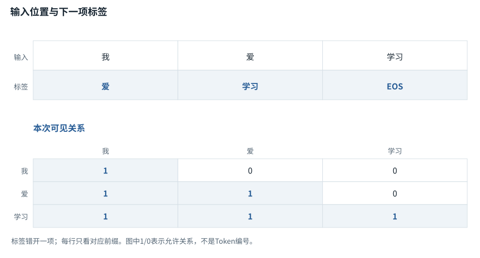
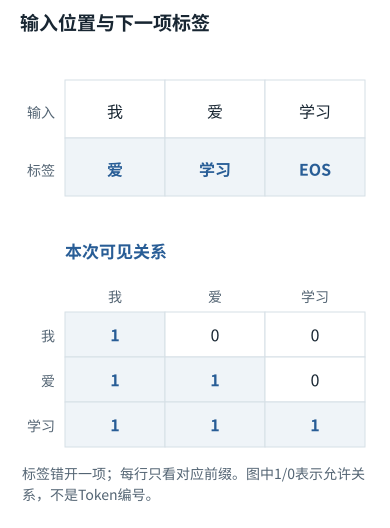
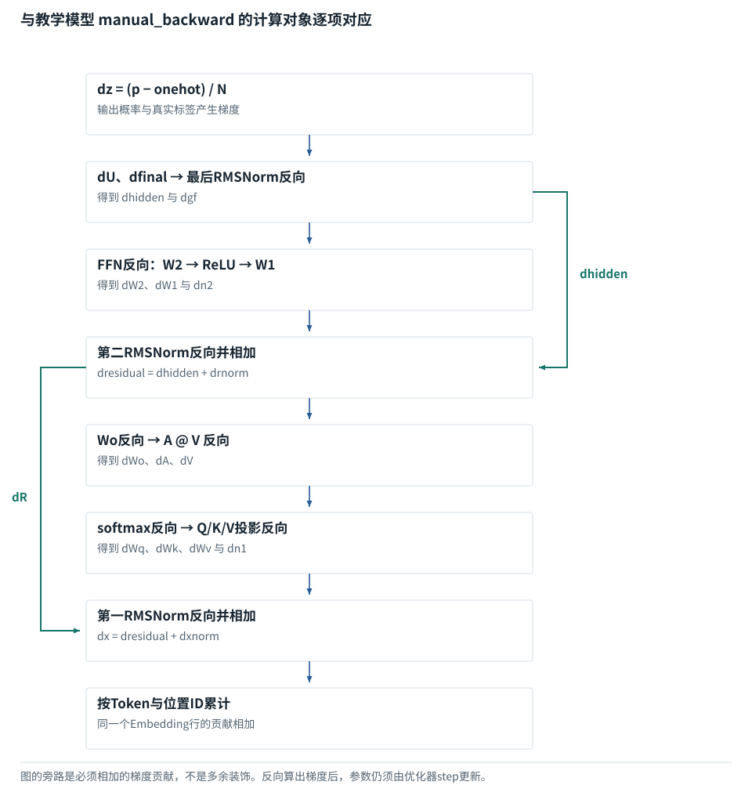
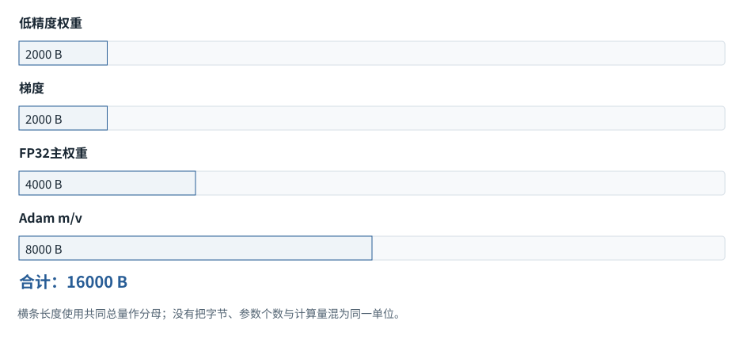
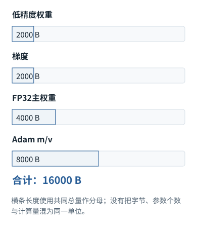

系统篇


<span id="ch05-s0"></span>


# 04｜训练机制：损失、完整反向传播与参数更新


<span id="course-connection"></span>


## 系统机制中的训练：从损失追到每一组参数

基础课程已经把一次训练做完。这里不另开学习路径，而是回到同一次更新前的参数，逐项计算输出头、归一化、FFN、残差、注意力、Embedding的梯度，核对共享参数贡献的累加与AdamW更新边界。实现、记录与负控制相互对应。


<span id="section-1"></span>


### 本章预备知识


<span id="concept-intro-2"></span>


先认识这里的对象与符号

[优化器、Adam及AdamW](../concepts.md#concept-optimizer)
:   优化器把梯度转换为参数更新。Adam还保存每个参数的梯度滑动平均m和平方梯度滑动平均v；它们是训练状态，不是注意力Value。AdamW把权重衰减与自适应梯度更新解耦。独立首步例：g=2、m旧=0、β₁=0.9，则m新=0.2，偏差修正后m\_hat=2。不能把0.2直接当完整更新量。

训练要先定义“希望预测什么”，才有误差和更新方向。梯度是参数小变化对损失的局部影响；Adam保存过去梯度的统计，模型参数、激活、优化器状态是不同存储对象。

本章各题列出所需基础。可先完成相应基础课，也可通过自检确认掌握程度。

[F06 · “放到设备”是什么](../foundations/06.md)[F09 · 概率、指数与softmax](../foundations/09.md)[F15 · 微积分只学用得上的部分](../foundations/15.md)[F16 · 一次训练从头到尾](../foundations/16.md)[F21 · 算得快与装得下](../foundations/21.md)

**进入深读前的小检查：**用x=2、目标4、w=1算预测2、损失2、梯度−4；以步长0.2更新w为1.8，检查误差是否下降。

术语带虚线时可点击速查。公式中的字母先看定义；不要用猜缩写替代推导。

这一章不以“预训练是预测下一个词”结束，而是跟踪一条训练样本怎样形成标签、损失、梯度、优化器状态和新权重。默认讨论自回归Decoder；具体架构和训练配方可改变细节。


<span id="visual-reading"></span>


<span id="topic-1"></span>


## 沿着对象与状态理解本章

训练的一批数据里，输入和正确后继已经给定，因此可以对多个位置一起计算预测误差，但因果mask仍禁止偷看未来。读训练公式时先分清前向、损失、反向与更新；backward并不意味着参数已经改变。

下方图解的固定输入在“输入与适用条件”中声明。它用于解释本章机制，不与本章其他独立例子的数值暗中接续。


<span id="visual-F18"></span>

<span id="topic-2"></span>

<span id="topic-3"></span>

<span id="topic-4"></span>

<span id="topic-5"></span>

<span id="topic-6"></span>

<span id="topic-7"></span>


相关动态过程：[训练：给每个位置一道“下一项”题](../visual/F18.md)。本节下文继续展示更具体的计算与工程边界。

继续看相关机制：[F15 · 梯度像坡度，学习率像迈步大小](../visual/F17.md)[O09 · Activation Checkpointing：少存一点，反向时重算](../visual/O09.md)


<span id="Q017"></span>


## Q017｜Next-token训练到底预测什么？标签如何移动，损失又对哪些位置计算？

这题先认识什么当前位置预测下一位置，训练标签需要相应错位。填充和非目标区域的误差可以屏蔽，但不能把有效条件也一并删掉。

[F03 · 文字为什么要先变成Token编号](../foundations/03.md)[F09 · 概率、指数与softmax](../foundations/09.md)[F16 · 一次训练从头到尾](../foundations/16.md)


<span id="ch05-s2"></span>


### 核心回答


<span id="concept-intro-3"></span>


先认识这里的对象与符号

[RLHF、奖励模型与策略](../concepts.md#concept-rlhf)
:   RLHF泛指利用人类反馈训练行为的流程。奖励模型是对回答等行为打分的模型；策略是实际生成动作的概率模型。两者职责不同，得高奖励不自动等于事实正确。独立例：奖励器偏爱长回答，策略可能学会写长而不更准确；因此奖励判据需要验证。

模型在位置i读取不超过i的前缀，输出位置i+1的分布；训练代码把[logits](../glossary.md#g091 "输出投影给各词表候选的未归一化分数。 例：可以是负数，还不是概率或Token编号。")与右移一位的真实[Token](../glossary.md#g027 "模型分词器使用的片段单位。 例：可能是词、词的一部分、标点或部分字节。")对齐。所有已知前缀能在一次前向中并行处理，因果mask阻止偷看未来。模型最小化真实Token的负对数概率，不是直接比较生成句子和答案的编辑距离。[[TR]](../sources.md#src-TR "来源说明")[[RLHF]](../sources.md#src-RLHF "来源说明")


<span id="ch05-s3"></span>


### 用五个Token走完对齐


<span id="symbol-intro-2"></span>


先认识这里的对象与符号

[BOS / EOS：序列边界标记](../concepts.md#concept-bos-eos)
:   BOS通常表示序列起始，EOS表示结束的特殊Token；具体模型和消息模板可能使用不同名称、数量及结束标记。它们是输入/输出协议中的符号，不是语义正确性的证明。遇到EOS不自动切断两个训练样本之间的注意力；要隔离读取还需mask或实现支持的样本边界。

设训练序列为`[BOS, 我, 爱, 编程, EOS]`。常见实现把整段作为输入，再在计算loss时对齐如下：

| logits位置 | 可见输入 | 应当预测的标签 |
| --- | --- | --- |
| 0 | BOS | 我 |
| 1 | BOS,我 | 爱 |
| 2 | BOS,我,爱 | 编程 |
| 3 | BOS,我,爱,编程 | [EOS](../glossary.md#g096 "模型约定的一种结束序列Token。 例：与最大输出长度、用户取消是不同结束原因。") |

最后位置没有后继标签，通常不计入这一段loss。等价写法是输入直接取前四个Token、标签取后四个Token；不要同时在数据处理和模型内部再移动一次，否则会变成预测后后一个Token。

对位置t，模型得到词表logits `z_t`，转为概率`p_t`，损失是 `ℓ_t = −log p_t[y_t]`。若正确Token概率是0.1，loss约2.3026；若提升到0.8，loss约0.2231。一个[batch](../glossary.md#g034 "一起组织计算的一组输入。 例：普通样本batch不让不同用户相互读取内容。")的loss通常是有效标签位置的平均。这里“有效”由[loss mask](../glossary.md#g080 "规定哪些位置的预测误差计入训练目标。 例：用户文本可被读取，但可不直接计算该段输出损失。")决定，不等于[attention mask](../glossary.md#g077 "规定哪些位置间的读取被允许的约束。 例：接口可能用布尔值或加性负无穷，真假约定要核对。")。

[SFT](../glossary.md#g114 "用指定目标回答做监督微调。 例：属于参数训练，和会话中加载Skill不同。")样本可能是`用户问题 + 助手答案`。有的配方只对助手答案位置计loss，但答案位置仍可注意用户问题。把用户位置的标签设置为ignore，不等于从输入删除问题。数据代码必须同时正确维护角色边界、结束标记、[padding](../glossary.md#g035 "给短序列增加占位项，使指定组织方式可用。 例：[4,2]右补齐为[4,2,0]。")和被忽略标签。[[CHAT]](../sources.md#src-CHAT "来源说明")


<span id="mechanism-Q017"></span>


<span id="topic-8"></span>


### 训练标签右移一格，代表每个位置要回答下一项

**本例条件：**教学完整序列为[我,爱,学习,EOS]。只展示三处监督，不含填充；若另加PAD，它不应自动进入损失分母。

输入位置
:   模型当前位置可见的前缀末尾。

标签
:   该位置希望预测出的下一Token。

有效Token数
:   实际参加损失的预测目标数量。

**训练标签右移一格，代表每个位置要回答下一项**





本图仅使用当前算例声明的输入；具体公式、来源和边界见紧邻正文。

[SVG图源](../../diagrams/rendered/Q017-ccbec0e32656.svg) · [原算例数据：Q017](../../diagrams/source/mechanism-cases.json)

核对完整输入与结果

本图使用的数据与条件

| 输入位置 | 因果可见前缀 | 应预测的标签 |
| --- | --- | --- |
| 位置0：我 | 我 | 爱 |
| 位置1：爱 | 我／爱 | 学习 |
| 位置2：学习 | 我／爱／学习 | EOS |

#### 怎样把图中的变化读明白

第二行不是训练模型“看到爱就说爱”，而是看到前缀“我爱”后提高“学习”的概率。输入和标签同形状，不表示内容要逐格相等。

全部训练文本预先给定，因此三处可以在一次前向中同时算，但掩码仍不让较早位置偷看后面的答案。

若各有效位置损失为1、2、3，平均损失是6/3=2；再加一个被忽略的PAD不能把它变成6/4。

**不要混淆：**分批累积时有效目标数不同，直接平均每批均值会改变权重。应按总损失与总有效目标数归一化。

机制依据：[[TR]](../sources.md#src-TR) [[F-AUTOGRAD]](../sources.md#src-F-AUTOGRAD)。本例数字和宿主场景为明确给定的教学设定，不是商业模型输出或生产性能测量。


<span id="worked-Q017"></span>


运行示例 · Q017


<span id="topic-9"></span>


### 标签移位错误，训练也能看起来很顺利

**输入与条件。**输入序列为 `[BOS,我,爱,学习,EOS]`。正确训练将前四个位置与后四个目标对齐。

| 步骤与对象 | 内部动作 | 中间结果 / 新状态 |
| --- | --- | --- |
| 1正确输入 | `[BOS,我,爱,学习]` | 每个位置只看自己及以前。 |
| 2正确目标 | `[我,爱,学习,EOS]` | 所有目标相对输入移动1位。 |
| 3逐格解释 | 输入“我”所在位置预测“爱” | 不是预测当前位置已经知道的“我”。 |
| 4错误对齐 | 把目标也设为 `[BOS,我,爱,学习]` | 模型可能轻松复制当前输入，损失下降但没学对next-token目标。 |
| 5额外mask | SFT若只训练助手回答 | 用户Prompt可作为输入但不一定参与loss；具体目标策略要明确。 |

**把过程连起来。**损失能下降，只证明某个目标容易优化；必须先核验目标含义。

**边界与反例。**不同训练框架可能在模型内部自动移位，调用者不可再移第二次；这里显示数学对齐而非某个API调用约定。

依据与适用范围：[[CE]](../example-sources.md#ex-src-CE)。示例输入和场景由本书明确设定。


<span id="ch05-s4"></span>


### 追问：为什么训练准确率很好，实际生成仍会跑偏？

训练常用真实前缀，推理使用模型自己的前缀。某一步选错Token后，后续可能进入训练中较少出现的状态；这类训练与生成条件的差异通常称为exposure bias。另一个原因是loss按Token平均，格式、语言流畅性的改善可以掩盖少数高风险事实错误。验证时不能只看训练loss，还要让模型自己生成，并检查完整任务结果。


<span id="ch05-s5"></span>


### 追问：Perplexity能直接比较两个不同Tokenizer的模型吗？

一般不能直接比较。Perplexity通常是`exp(平均Token负对数似然)`；一个[Tokenizer](../glossary.md#g029 "按模型配套规则把文本与Token编号相互转换的工具。 例：不能随意换分词器而保留不相容的模型参数。")把同一文本拆成更多Token，平均的单位已不同。跨Tokenizer比较需要明确按字节、字符或统一评估设置归一化，同时控制数据集。不同语料上的PPL也不能当成同一尺度的综合能力榜。


<span id="ch05-s6"></span>


### 追问：把多个样本拼接训练，插入EOS就能隔离信息吗？

EOS是Token，不自动建立计算上的隔离。若只用普通因果mask，后一个样本仍可看到前一个样本。是否允许这种跨样本关注是训练设计；若要求严格独立，要使用分块attention mask或实现支持的边界机制，同时处理[position IDs](../glossary.md#g081 "表示真实逻辑位置的编号，不是Token身份编号。 例：同一个“爱”出现在位置1或7，Token ID可相同但位置不同。")。把“遇到EOS学会结束”与“显式切断注意力”分开。


<span id="core-value-residual-6"></span>


<span id="core-value-residual-6--mc-section-6"></span>


## 反向时这里为什么出现两条贡献

同一个R会经过直接主路和FFN分支影响最后损失，稍后两种影响会在R处相加。类似地X既走残差，又经N1参与Q/K/V。只保留其中一条梯度，就改变了训练。

依据：[tiny\_model.py:81–84](../reference/model-code.md#tiny_model-L81)；[对应参数、前向及梯度记录](../labs/model-values.md)。


<span id="core-gradient-4"></span>


<span id="core-gradient-4--mc-section-4"></span>


## 用实际输出头U[0,3]计算十个位置的贡献

每个监督位置对U[特征0,候选学习]的梯度贡献

| 对象／位置 | t=0 | t=1 | t=2 | t=3 | t=4 |
| --- | --- | --- | --- | --- | --- |
| 样本0 | -0.002555 | -0.002973 | 0.020956 | 0.009019 | -0.009806 |
| 样本1 | -0.002555 | -0.002527 | 0.014734 | 0.010193 | -0.009308 |

十格相加 = 0.025178163462。已经在Gz里除以有效Token数10，不要再平均一次。

```
G_U[0,3] = Σ_b,t F[b,t,0] × Gz[b,t,3]
         ≈ 0.025178163462
```

```
G_F[0,2,0] = Gz[0,2,:] · U[0,:]
= (0.012514)×(0.1) + (0.008255)×(0) + (0.007788)×(0.3) + (-0.079236)×(0.1) + (0.016672)×(-0.2) + (0.005242)×(-0.2) + (0.013742)×(-0.3) + (0.015023)×(0.3)
≈ -0.008334
```

这解释为什么矩阵形式为 `G_U = flatten(F)ᵀ @ flatten(Gz)`，以及 `G_F=Gz@Uᵀ`。所谓“反向时乘转置”来自索引求和，不是为了口诀而机械转置。

依据：[tiny\_model.py:117–130](../reference/model-code.md#tiny_model-L117)；[对应参数、前向及梯度记录](../labs/model-values.md)。


<span id="Q018"></span>


## Q018｜Loss算出来后，参数怎样更新？为什么AdamW不只是梯度乘学习率？

这题先认识什么梯度指出局部上升方向；优化器沿反方向调整参数。AdamW还维护梯度统计与权重衰减，所以恢复训练不只加载权重。

[F15 · 微积分只学用得上的部分](../foundations/15.md)[F16 · 一次训练从头到尾](../foundations/16.md)


<span id="ch05-s8"></span>


### 核心回答

反向传播按计算图的链式法则，从loss逐层计算参数梯度；优化器用梯度和自身历史状态得到更新量。[AdamW](../glossary.md#g111 "利用梯度一阶与二阶统计的优化器；AdamW独立处理权重衰减。 例：恢复训练时应考虑其状态，不只有模型权重。")维护梯度的一阶、二阶指数移动平均，并把权重衰减与自适应梯度更新解耦。缓存、梯度、优化器状态是不同对象。[[ADAMW]](../sources.md#src-ADAMW "来源说明")


<span id="ch05-s9"></span>


### 从输出投影一直走回Embedding


<span id="concept-intro-1"></span>


先认识这里的对象与符号

[∂、∇：偏导与梯度](../concepts.md#concept-gradient)
:   ∂L/∂w询问保持其他独立变量不变时，w小幅改变会让损失L怎样变化。多个参数的这些变化率合成梯度∇L。它们是导数记号，不是把两个普通数直接相除。独立微例：L=w²时，w=3处的梯度为6。最简单更新w←w−η×6中，η是学习率。

设最终隐藏状态为h，输出矩阵为W，`z=hW`。对[softmax](../glossary.md#g062 "将各分数取指数，再除以所有指数之和。 例：分数[2,1,0]经Softmax后约为[0.6652,0.2447,0.0900]。")交叉熵，`∂ℓ/∂z = p−one_hot(y)`。如果正确类别概率太低，该类别logit的梯度为负；梯度下降会推动其logit上升。这是概率预测变为参数调整的第一步。

接着`∂ℓ/∂W = hᵀ(p−y)`，`∂ℓ/∂h = (p−y)Wᵀ`。后一项继续经过最终归一化、每一层[FFN](../glossary.md#g088 "通常在每个位置应用的前馈子网络。 例：常把宽度先扩展再缩回，带非线性或门控。")、[Attention](../glossary.md#g071 "计算查询与可读候选的匹配份额，再加权组合内容。 例：先计算分数和权重，再用权重混合V。")、残差支路，最后到[Embedding](../glossary.md#g038 "按输入编号取出对应可学习向量的参数表及操作。 例：E形状[6,4]，编号2取E的第2行。")。残差分支的梯度要相加，共享参数被多处使用时梯度也要累加。自动求导做的是这些局部导数的组合，不是在搜索“哪个神经元知道这条事实”。

AdamW的一种常见写法为：

```
m_t = β1 m_(t−1) + (1−β1) g_t
v_t = β2 v_(t−1) + (1−β2) g_t²
m_hat = m_t / (1−β1^t)
v_hat = v_t / (1−β2^t)
θ_t = θ_(t−1) − η m_hat/(sqrt(v_hat)+ε) − η λ θ_(t−1)
```


<span id="concept-intro-5"></span>


先认识这里的对象与符号

[混合精度、loss scaling与主权重](../concepts.md#concept-mixed)
:   混合精度在不同计算或状态中采用不同数值格式。主权重可用较高精度保存更新基准；loss scaling在反传前放大损失，随后再把梯度缩回，降低某些低精度下溢风险。并不是把学习率随意乘大。实际是否需要主权重或loss scaling取决于精度格式、优化器和实现。

平方、除法是逐元素操作。m平滑梯度方向，v估计梯度平方的尺度，偏差修正处理初始状态为零造成的偏差。权重衰减项没有先混入g再被v缩放，因此不同于一般情形下“把L2惩罚加进[Adam](../glossary.md#g111 "利用梯度一阶与二阶统计的优化器；AdamW独立处理权重衰减。 例：恢复训练时应考虑其状态，不只有模型权重。")的loss”。哪些参数衰减、ε放在哪里、混合精度如何维护主权重，要看具体实现。


<span id="mechanism-Q018"></span>


<span id="topic-10"></span>


### AdamW的“历史状态”，与本次梯度分开记账

**本例条件：**独立标量演示：初始w=1，梯度g=2，m=v=0；β1=0.9、β2=0.999、学习率0.1、衰减0.01；忽略ε的微小影响。

m
:   一阶动量，平滑历史梯度。

v
:   二阶动量，平滑梯度平方。

偏差修正
:   补偿从零初始化造成的早期缩小。

AdamW的“历史状态”，与本次梯度分开记账

| 步骤 | 数值 | 含义 |
| --- | --- | --- |
| 更新m | 0.9×0+0.1×2=0.2 | 还不是最终更新幅度 |
| 更新v | 0.999×0+0.001×4=0.004 | 保存平方尺度 |
| 修正 | m̂=2；v̂=4 | 分别除1−β^t |
| 解耦衰减 | 1×(1−0.1×0.01)=0.999 | 与梯度路径分开 |
| 自适应更新 | 0.999−0.1×2/√4=0.899 | 本步最终w |

各行是独立对象或条件的对照，不暗示上一行的结果自动进入下一行。

#### 怎样把图中的变化读明白

不要因为m是0.2，就把参数更新直接写成0.1×0.2。偏差修正和按平方尺度归一化还没做。

m与v属于优化器状态，不是神经网络前向激活。恢复训练只加载w而不加载这些状态，会改变后续轨迹。

混合精度中若放大过loss，裁剪梯度前需先还原尺度；否则裁剪的是放大后的数，不是本来想限制的梯度。

**不要混淆：**上图是第一步、无ε近似；不能把每一步都简化成g/|g|。后续m/v带有历史信息。

机制依据：[[ADAMW]](../sources.md#src-ADAMW) [[F-AUTOGRAD]](../sources.md#src-F-AUTOGRAD)。本例数字和宿主场景为明确给定的教学设定，不是商业模型输出或生产性能测量。


<span id="worked-Q018"></span>


运行示例 · Q018


<span id="topic-11"></span>


### AdamW的第一步，把动量、偏差修正与衰减都算出来

局部核对例：以下输入以本例列出的条件为准，不能把它的中间值接到贯通模型的计算记录中。

**输入与条件。**初始w=1，梯度g=0.2；m0=v0=0；β1=0.9、β2=0.999；学习率0.1，weight\_decay=0.01，ε=1e−8。

| 步骤与对象 | 内部动作 | 中间结果 / 新状态 |
| --- | --- | --- |
| 1更新一阶矩 | m=0.9×0+0.1×0.2 | 0.02。 |
| 2更新二阶矩 | v=0.999×0+0.001×0.2² | 0.00004。 |
| 3偏差修正 | m̂=m/(1−0.9)，v̂=v/(1−0.999) | 分别0.2与0.04。 |
| 4解耦权重衰减 | w先乘(1−lr×wd) | 从1变0.999。 |
| 5归一化梯度更新 | 再减0.1×0.2/(√0.04+1e−8) | 新w约0.899000005。 |
| 6与SGD对照 | 只做w−lr×g | 会得0.98，不是同一个更新规则。 |

**把过程连起来。**AdamW保存历史状态并做归一化与偏差修正；不能只把它描述为“梯度乘学习率”。

**边界与反例。**本例是第一步标量更新，无梯度裁剪、混合精度或调度器；实际实现参数组可有不同衰减。

[查看本例程序结果](../example-verification.md#result-Q018) · [完整可运行代码](../example-verification.md#code)

依据与适用范围：[[ADAMW]](../example-sources.md#ex-src-ADAMW)。示例输入和场景由本书明确设定。


<span id="ch05-s10"></span>


### 追问：梯度清零为什么重要？

很多训练框架默认累积`.grad`。这方便梯度累积，但普通一步一更新若忘记清零，会把前几步的梯度无意叠加。反过来，在每个micro-batch前清零又会破坏有意的累积。正确的位置通常是一个有效优化步开始前或完成后，而不是机械放在所有循环的第一行。


<span id="ch05-s11"></span>


### 追问：梯度裁剪改变了什么？为什么不能修复全部NaN？

全局范数裁剪会在梯度范数超过阈值时，按比例缩小整个梯度向量，限制极大更新。它不修复已发生的非法前向数值、全mask softmax、除零或损坏数据。混合精度下还要在适当时机解除loss scaling后再裁剪，否则阈值单位不对。出现NaN时应定位最早的非法张量，而不是只减小学习率碰运气。


<span id="ch05-s12"></span>


### 追问：恢复训练只加载权重够不够？


<span id="concept-intro-6"></span>


先认识这里的对象与符号

[checkpoint：必须看保存的对象](../concepts.md#concept-checkpoint)
:   模型检查点保存权重或训练状态；激活检查点保存少量中间节点以便反向时重算；Agent任务检查点保存执行进展。三者同名，但恢复对象完全不同。看到checkpoint先问“恢复参数、重算激活，还是继续任务”。Agent保存摘要不会更新模型权重。

继续同一条训练轨迹通常还要恢复优化器m/v、学习率调度器、步数、数据采样位置及随机状态；分布式训练还涉及分片与全局进度。只加载权重可以启动新的优化过程，但不等于无缝续训。推理部署一般不需要优化器状态，这就是训练checkpoint与推理权重包体积可能显著不同的原因。


<span id="engineering-E10"></span>


工程深挖 · E10 · 接续Q018


<span id="engineering-E10-title"></span>


### 混合精度与重计算：顺序错误会让优化器悄悄走错一步

预备知识：[F15](../foundations/15.md) · [F16](../foundations/16.md) · [F21](../foundations/21.md)。阅读顺序：先确认运行契约，再看反例与修复，最后检验边界。


<span id="engineering-E10-detail-1"></span>


#### 缩放梯度是数值措施，不是改变学习率

AMP中的loss scaling先把损失放大，使较小梯度更容易在低精度中表示；更新前应把梯度还原。PyTorch官方示例明确要求在需要检查或裁剪梯度时先unscale，并注意梯度累积期间的时机。[[AMP]](../engineering/sources.md#src-AMP "PyTorch · Automatic Mixed Precision examples")

最小反例：真实梯度10，缩放倍数100，裁剪阈值1。先还原再裁剪，梯度为1；先把1000裁成1，再除100，梯度变0.01。两者都有限、都能更新，但相差100倍。本书CPU测试验证此代数；不把它当成GPU AMP实测。


<span id="engineering-E10-detail-2"></span>


#### 一个更新步应该有明确的生命周期

```
累计本次更新的若干microbatch反向结果
→ 对本优化器unscale一次
→ 检查有限性 / 按目标规则裁剪
→ scaler.step(optimizer)（可能因溢出跳过真正step）
→ 更新scaler状态
→ 按“真正执行的优化步骤”约定推进scheduler
→ 清理梯度，进入下一次更新
```

不同框架对scheduler计步有封装，不能简单断言每个microbatch都应推进。最重要的是记录**看过的样本数、反向次数、尝试更新次数、真正更新次数**四个不同计数。学习率变化而参数没有更新，可能是溢出跳步，不一定是模型不学习。


<span id="engineering-E10-detail-3"></span>


#### 激活检查点会再次运行你的函数

重计算不是从磁盘读快照，而是反向时重新执行部分前向。函数若写文件、增加全局计数、消耗不受控随机数或读取已变化的全局配置，就可能与原前向不一致。官方文档对RNG保存、设备变化和重入模式都有边界说明。[[CHECKPOINT]](../engineering/sources.md#src-CHECKPOINT "PyTorch · torch.utils.checkpoint")

本书实际对`sin(x)*x`使用非重入checkpoint，记录函数被调用超过一次，并核对解析梯度。把“函数执行一次”的监控计数直接当作样本计数就会错误。副作用应尽量移出可重计算的区域。


<span id="engineering-E10-detail-4"></span>


#### 追问：只保存模型权重能恢复训练吗？

能恢复某个推理函数，不一定恢复同一条训练轨迹。优化器动量、scaler、scheduler、随机状态、数据游标与累计到第几个microbatch都可能必要。记录恢复保证等级：继续训练、近似相同训练，还是严格复现；不要都叫“无损恢复”。


<span id="engineering-E10-detail-5"></span>


#### 追问：检查点为什么不是任意函数都能套？

它用重算换激活内存，要求重算保持需要的语义。随机mask的恢复方式、跨设备调用和参数在两次前向之间的变化都需核对。性能上也会增加计算；显存富余且计算受限时可能更慢，收益应在相同batch和目标设备上测量。


<span id="engineering-E10-observations"></span>


#### 本地观察与复核入口

以下为随包程序实际运行记录。数值算子、临时文件／数据库实验与教学逻辑模拟各自的范围，在实验页逐项注明；不能据此声称已测试商业模型或生产环境。


<span id="mechanism-record-E10"></span>


#### E10：怎样读这份结果，而不是只看“通过”

先把梯度还原到真实尺度，再讨论裁剪阈值。重计算还必须保持需要复现的状态一致；这些是训练顺序与副作用问题，不能只检查最后loss是不是有限数。

实验记录：字段与原值

| 原始字段路径 | 原始值 |
| --- | --- |
| E10-checkpoint.calls | 2 |
| E10-checkpoint.gradient | 0.9182168245315552 |
| E10.correct\_unscaled\_clipping | 1.0 |
| E10.wrong\_clip\_then\_unscale | 0.01 |

这里是实际实验记录，不用条长或箭头伪装成额外证据；完整日志与解释仍保留在本节。

本图整理的是本小节已有的局部实验记录，不把通过局部测试扩展为产品在所有环境下可靠。原测试环境、输入和完整输出仍以本节记录为准。

```
{
  "E10-checkpoint": {
    "calls": 2,
    "gradient": 0.9182168245315552
  },
  "E10": {
    "correct_unscaled_clipping": 1.0,
    "wrong_clip_then_unscale": 0.01
  }
}
```

[本条全部结果、验证范围与完整代码 →](../engineering/labs.md#proof-E10)

**自检：**损失缩放100倍后先把梯度裁到1，再unscale，会把真实更新方向的大小变成多少？

<details class="quiz-answer"><summary><span class="when-closed">查看参考答案</span><span class="when-open">收起参考答案</span></summary><div class="answer">若原真实梯度10，缩放后1000裁到1，再除100得到0.01；正确先unscale再裁应为1。裁剪阈值必须定义在真实梯度尺度上。</div></details>

证据核对：2026-10-21。[[AMP]](../engineering/sources.md#src-AMP) [[CHECKPOINT]](../engineering/sources.md#src-CHECKPOINT) · [事实、推导与实验的边界](../engineering/sources.md#evidence-levels)


<span id="core-backward-1"></span>


<span id="core-backward-1--mc-section-1"></span>


## 这一课承接哪一份数值

仍是**更新前的贯通模型**、同一批两句话、十个有效预测目标。这里的每份G都来自F16计算的全批平均loss，不另给一个随意的“上游梯度”。为了不把式子堆成黑箱，先给依赖顺序，再逐个解释局部规则。

箭头描述梯度依赖。某个参数的最终梯度包括所有有效样本、位置和使用路径的贡献。

依据：[tiny\_model.py:110–153](../reference/model-code.md#tiny_model-L110)；[对应参数、前向及梯度记录](../labs/model-values.md)。


<span id="trace-backward"></span>


**完整反向：梯度沿依赖传播，并在分叉处相加**



数据/调用方向以图中连线为准；参数与激活、训练与推理分别标注。

[SVG图源](../../diagrams/rendered/trace-backward-11784ea8145d.svg)

代码路径：[tiny\_model.py:117–153](../reference/model-code.md#tiny_model-L117) · [Mermaid源文件](../diagrams/backward.mmd)。图的排布只表达数据／调用顺序，不代表计算耗时。


<span id="core-backward-2"></span>


<span id="core-backward-2--mc-section-2"></span>


## 第一步：RMSNorm反向不能忘记分母依赖输入

设单行 `y_j=g_j x_j/r`，其中 `r=sqrt(mean(x²)+ε)`，上游为G\_y。先记 `u_j=G_yj g_j`。计算任意输入格x\_i的影响：它一方面直接改变自己的分子，另一方面改变所有输出共享的r。

```
G_xi = u_i/r − x_i × mean_j(u_j x_j) / r³
G_gj = Σ_b,t G_y[b,t,j] × x[b,t,j]/r[b,t]
```

第二项来自 `dr/dx_i=x_i/(d r)` 和 `d(1/r)/dr=−1/r²`，再把所有输出格对该分母的影响加起来。若只写第一项，相当于错误地把r当常量；两者数值和学习方向可能明显不同。

本模型有g1、g2、gf三份独立缩放参数。把此规则分别用在最终norm、FFN前norm、Attention前norm，不能把一处的r或梯度直接拿给另一处。

依据：[tiny\_model.py:110–153](../reference/model-code.md#tiny_model-L110)；[对应参数、前向及梯度记录](../labs/model-values.md)。


<span id="core-backward-3"></span>


<span id="core-backward-3--mc-section-3"></span>


## 第二步：FFN和残差的回传

定义 `u=N2 W1`、`a=ReLU(u)`、`D=aW2`、`H=R+D`：

```
G_D = G_H
G_W2 = aᵀ G_D             （批次和位置先合并）
G_a = G_D W2ᵀ
G_u = G_a ⊙ 1[u>0]
G_W1 = N2ᵀ G_u
G_N2 = G_u W1ᵀ
G_R = G_H + RMSNorm反传(G_N2, R, g2)
```

ReLU的负值支路在此为0；零点导数约定与框架有关，本实现使用PyTorch约定。有限差分应避开正好跨过零点的坐标，不然不光滑性会使对照难解释。

第0条t=2：FFN反向实际中间量

| 对象／位置 | 中间j=0 | 中间j=1 | 中间j=2 | 中间j=3 | 中间j=4 | 中间j=5 | 中间j=6 | 中间j=7 |
| --- | --- | --- | --- | --- | --- | --- | --- | --- |
| G\_a：由W2传回 | -0.001417 | 0.002569 | -0.008794 | -0.007059 | 0.001534 | -0.000307 | 0.000538 | 0.012475 |
| G\_u：ReLU门控后 | -0 | 0 | -0.008794 | -0.007059 | 0 | -0 | 0 | 0 |

展示值经过舍入；后续运算使用未舍入值。


R接收两条贡献

| 对象／位置 | 第0列 | 第1列 | 第2列 | 第3列 |
| --- | --- | --- | --- | --- |
| 主路G\_H | -0.021069 | -0.009957 | 0.035749 | 0.018907 |
| FFN分支经norm回传 | -0.005605 | -0.003453 | 0.003442 | 0.000347 |
| 二者相加=G\_R | -0.026673 | -0.01341 | 0.039191 | 0.019253 |

展示值经过舍入；后续运算使用未舍入值。

依据：[tiny\_model.py:110–153](../reference/model-code.md#tiny_model-L110)；[对应参数、前向及梯度记录](../labs/model-values.md)。


<span id="core-backward-4"></span>


<span id="core-backward-4--mc-section-4"></span>


## 第三步：注意力的内容路径与份额路径分开算

令C=A V，注意力分支Dattn=C Wo，R=X+Dattn：

```
G_Wo = Cᵀ G_R
G_C = G_R Woᵀ
G_A = G_C Vᵀ
G_V = Aᵀ G_C
```

G\_A回答“改变某个读取份额会怎样影响loss”；G\_V回答“改变某个来源位置提供的内容会怎样影响loss”。两条路径都来自同一个混合C，但不能互换。

依据：[tiny\_model.py:110–153](../reference/model-code.md#tiny_model-L110)；[对应参数、前向及梯度记录](../labs/model-values.md)。


<span id="core-backward-5"></span>


<span id="core-backward-5--mc-section-5"></span>


## 第四步：softmax反向为什么会减一项

对一行A=softmax(S)，局部导数为 `∂A_j/∂S_i=A_j(1[i=j]−A_i)`。本行每个输出都依赖每个分数，所以G\_Si要把所有输出的影响加起来：

```
c = Σ_j A_j G_Aj
G_Si = A_i × (G_Ai − c)
```

c是当前行的一个加权平均标量。被掩码位置A=0，因此这条路径梯度为0。它不是对每个格子独立乘 `A(1−A)` 就结束；那样遗漏了非对角项。

第0条t=2：同一行softmax反向

| 对象／位置 | Key位置s=0 | Key位置s=1 | Key位置s=2 | Key位置s=3 | Key位置s=4 |
| --- | --- | --- | --- | --- | --- |
| A：读取份额 | 0.376593 | 0.297862 | 0.325545 | 0 | 0 |
| G\_A：来自内容混合 | -0.003052 | 0.002787 | 0.017435 | 0.020002 | -0.013446 |
| G\_S：softmax反向 | -0.003167 | -0.000765 | 0.003932 | 0 | -0 |

展示值经过舍入；后续运算使用未舍入值。

依据：[tiny\_model.py:110–153](../reference/model-code.md#tiny_model-L110)；[对应参数、前向及梯度记录](../labs/model-values.md)。


<span id="core-backward-6"></span>


<span id="core-backward-6--mc-section-6"></span>


## 第五步：点积、缩放和三张投影参数

由于S=QKᵀ/2：

```
G_Q = G_S K / 2
G_K = G_Sᵀ Q / 2
G_Wq = N1ᵀ G_Q      G_Wk = N1ᵀ G_K      G_Wv = N1ᵀ G_V
G_N1 = G_Q Wqᵀ + G_K Wkᵀ + G_V Wvᵀ
G_X  = G_R + RMSNorm反传(G_N1, X, g1)
```

Q与K的缩放各自沿相应路径只经过一次1/2，不要漏掉，也不要在进入SDPA前后各除一次。

Wq[0,0]：十个使用点的实际梯度贡献

| 对象／位置 | t=0 | t=1 | t=2 | t=3 | t=4 |
| --- | --- | --- | --- | --- | --- |
| 样本0 | 0 | 0.000678 | -0.001021 | -0.000072 | -0.000381 |
| 样本1 | 0 | -0 | -0.001068 | 0.000199 | -0.000553 |

每格=N1[b,t,0]×G\_Q[b,t,0]；十格和=-0.002217527833。

依据：[tiny\_model.py:110–153](../reference/model-code.md#tiny_model-L110)；[对应参数、前向及梯度记录](../labs/model-values.md)。


<span id="core-backward-7"></span>


<span id="core-backward-7--mc-section-7"></span>


## 第六步：Embedding梯度是按地址累加，不是对ID求导

X=E[ids]+P[pos]。输入编号是离散地址，本书不对整数ID求连续导数；对选中参数行的影响可以求导。同一个“爱”编号2在两条样本中出现两次，所以：

参数行E[2]接收到两个位置的梯度

| 对象／位置 | 第0列 | 第1列 | 第2列 | 第3列 |
| --- | --- | --- | --- | --- |
| 样本0的爱位置 | -0.026013 | -0.015401 | 0.032873 | 0.023087 |
| 样本1的爱位置 | -0.023425 | -0.012273 | 0.031569 | 0.023786 |
| 相加写入G\_E[2] | -0.049438 | -0.027674 | 0.064442 | 0.046873 |

展示值经过舍入；后续运算使用未舍入值。

没有在输入中使用的E行不会从查表路径获得数据梯度。但优化器的weight decay是否仍改变它，取决于该参数是否存在梯度张量、分组和实现，不应把“本批没出现”说成“存储中的每个值一定不变”。

依据：[tiny\_model.py:110–153](../reference/model-code.md#tiny_model-L110)；[对应参数、前向及梯度记录](../labs/model-values.md)。


<span id="core-backward-8"></span>


<span id="core-backward-8--mc-section-8"></span>


## 本实验怎么核对，而不是只列公式

`tiny_model.py`中的解析反向不调用autograd求这些梯度；另一路才调用 `loss.backward()`。所有12张参数梯度逐项对比，最大绝对差为 `5.55111512313e-17`。还用中心有限差分检查不同参数坐标。

这证明这些规则在**当前小模型和测试输入**上互相一致；不证明任意新增结构、混合精度或分布式实现也自动正确。

依据：[tiny\_model.py:110–153](../reference/model-code.md#tiny_model-L110)；[对应参数、前向及梯度记录](../labs/model-values.md)。

查看阶段 
<span id="viewer-05-mc-section-2"></span>


### 

默认暂停，最后一步自动停止。图上显示舍入值，记录保留完整精度。图形窄屏可在自身区域滚动；所有数值另有完整可访问表格。


<span id="Q019"></span>


## Q019｜预训练数据进入模型前经历什么？为什么数据质量会变成系统问题？

这题先认识什么训练集用于更新参数，验证集用于选择，测试集用于最终检查。重复与污染会使分数看似提高却不代表泛化。

[F16 · 一次训练从头到尾](../foundations/16.md)[F35 · 评测指标的分母](../foundations/35.md)


<span id="ch05-s14"></span>


### 核心回答

训练不是“把互联网文本喂进去”这么简单。数据获取、许可和隐私处理、清洗、去重、混合采样、Tokenization、分片及训练/验证划分共同决定模型看到的分布。统计量要在处理链的多个阶段观察，不能只记录最终总Token数。[[CHINCHILLA]](../sources.md#src-CHINCHILLA "来源说明")


<span id="ch05-s15"></span>


### 一份文档的完整生命周期

先保存原始来源和采集版本，提取正文；HTML导航、重复页脚、乱码和机器生成垃圾会让梯度反复学习无意义模式。随后进行语言、格式、质量及敏感数据处理。过滤器也会引入选择偏差：过于偏爱某种文风，可能误删专业论坛、口语或稀有语言。

去重至少要区分精确重复、近重复和同源改写。精确hash只能识别相同字节；近重复方法通常基于片段特征或相似性，再配合阈值。阈值过宽会丢掉有价值的独立样本，过窄会保留成批模板。去重不仅节约算力，也影响记忆性与评测污染风险。

接下来按数据源、语言、代码和难度设置采样混合，转换Token并装入训练序列。一个来源原始体积大，不意味着它应有相同训练权重；重复采样会让实际训练分布不同于硬盘上的分布。应记录“每类数据在训练中实际消耗了多少Token”，而不只是下载了多少。

评测集应在可能共享来源的层面隔离。把同一仓库相邻函数随机拆到训练和测试，可能让结果主要反映见过的项目；把某道题的不同网站转载分别放两边，仍可能泄漏。对代码[Agent](../glossary.md#g136 "根据任务与观察调用模型和工具、持续推进的执行系统。 例：不只是一次写得很长的Prompt。")，还应区分模型训练污染、检索库泄漏和测试本身暴露，这三条路径并不相同。


<span id="mechanism-Q019"></span>


<span id="topic-12"></span>


### 一条训练样本怎样带着来源与标签进入计算

**本例条件：**独立数据管线：两份抓取文本其实来自同一文档修订；一个训练样本把完整答案意外混进用户字段。图追踪可审计的数据变换，不报告任何模型成绩。

来源ID
:   区分独立文档与重复转载。

样本边界
:   决定哪些片段组成一次训练输入。

污染
:   评测答案或未来信息进入训练可见范围。

一条训练样本怎样带着来源与标签进入计算

| 管线节点 | 具体对象变化 | 需要留存的证据 |
| --- | --- | --- |
| 去重 | docA/v1与转载A → 一份内容 | 内容指纹与来源映射 |
| 模板化 | user问题 + assistant答案 | 角色边界与模板版本 |
| 切块/打包 | 长样本分成序列窗口 | 是否跨文档可见 |
| 构造标签 | 只对期望目标计损失 | 有效位置掩码 |
| 划分训练与测试 | 同源文档不跨集合泄漏 | 分组键而非随机行号 |

各行是独立对象或条件的对照，不暗示上一行的结果自动进入下一行。

#### 怎样把图中的变化读明白

“洗数据”不是一句抽象建议：每个节点都会改变模型能看到的对象。去重错了，会把一个来源反复加权。

评测划分按行随机并不总是独立：同文档的相邻片段可能一部分训练、一部分测试，让测试看起来异常容易。

要记录原文ID、处理版本和样本ID的对应关系；否则发现坏样本后无法撤销它的派生块。

**不要混淆：**更长的语料列表不等于更多独立信息；语料质量和评测独立性必须单独验证。

机制依据：[[SCALING]](../sources.md#src-SCALING) [[CHINCHILLA]](../sources.md#src-CHINCHILLA)。本例数字和宿主场景为明确给定的教学设定，不是商业模型输出或生产性能测量。


<span id="worked-Q019"></span>


运行示例 · Q019


<span id="topic-13"></span>


### 重复样本怎样把一次评测变成“背过答案”

**输入与条件。**资料有文档A、A的空白格式变体A′、独立文档B。先随机逐文件切分，把A放训练、A′放测试。

| 步骤与对象 | 内部动作 | 中间结果 / 新状态 |
| --- | --- | --- |
| 1原始切分 | 文件名不同 | 看似训练和测试没有同名文件。 |
| 2规范化比较 | 去掉无意义空白后A与A′相同 | 测试已泄露训练内容。 |
| 3按重复簇切分 | 把A/A′作为一组 | 整组只进入一侧，B独立分配。 |
| 4记录处理链 | 原文身份、清洗策略、去重簇、分区 | 后续可追溯数据为何进入训练。 |
| 5评价泛化 | 使用真正未见任务 | 不能用重复样本上的低loss证明新问题能力。 |

**把过程连起来。**数据工程影响模型能力，也影响对能力的判断；去重不是只为节约磁盘。

**边界与反例。**语义近重复需要更细策略；去空白只用于这个明确构造的重复例子，不适合所有代码/文本。

依据与适用范围：[[DERIVE]](../example-sources.md#ex-src-DERIVE)。示例输入和场景由本书明确设定。


<span id="ch05-s16"></span>


### 追问：为什么更多数据可能反而降低某项能力？

训练目标优化的是混合分布上的期望。新增数据改变了比例，可能稀释原有高质量任务，也可能引入矛盾、噪声或风格偏移。总loss下降不保证每个任务子集改善，因此需要分语言、任务和风险类别的验证集。数据规模与质量不能用单一数字相互替代。


<span id="ch05-s17"></span>


### 追问：知识截止日期是数据库里的统一时间戳吗？

通常不是。不同来源被收集和混合的时间不同，训练后还可能进行后训练；模型也可能从工具得到更近事实。对某件事是否知道不能仅靠一个“截止日期”推断。工程系统应把实时事实交给有来源、可更新的检索，而不是依赖模型口头承诺“我知道最新”。


<span id="ch05-s18"></span>


### 追问：训练数据去重与Agent记忆去重可以用同一套办法吗？

目的不同。语料去重主要控制样本分布和污染；记忆去重还要保留事实适用范围、时间、证据和否定关系。“接口需要重试”与“此接口不能自动重试”词面接近却不能合并。可以复用相似度作为候选发现，但不能直接用它裁决知识等价。


<span id="Q020"></span>


## Q020｜训练为什么比推理更吃显存？梯度累积、Checkpoint和分片各节省什么？

这题先认识什么参数是模型长期数字，激活是本次计算结果，优化器状态记录更新统计；三者的数量、精度和生命周期不同。

[F06 · “放到设备”是什么](../foundations/06.md)[F16 · 一次训练从头到尾](../foundations/16.md)[F21 · 算得快与装得下](../foundations/21.md)


<span id="ch05-s20"></span>


### 核心回答

训练除了参数，还要保存梯度、优化器状态和用于反向的激活；推理通常没有这些对象，但长上下文需要KV缓存。不同优化技术针对不同对象，不能把“节省显存”当作同一件事。


<span id="ch05-s21"></span>


### 从对象清单估算，而不是背一个固定倍数

以一个教学配置为例：低精度参数2字节、低精度梯度2字节、[FP32](../glossary.md#g043 "不同的32位或16位浮点格式，范围与精度不一样。 例：FP16和BF16都通常占2字节，但不能视为同一数值格式。")主权重4字节、Adam两个FP32状态8字节，共约16字节/参数，尚不含激活、临时缓冲和通信。某些实现没有独立主权重、梯度为FP32或优化器量化，这个系数就会变。估算时先列对象及[dtype](../glossary.md#g041 "规定每个元素如何存储与运算。 例：整数编号与浮点表示通常不是同一dtype。")，再乘参数量。

激活占用依赖batch、序列长度、层数和内核。标准attention如果显式保存`[B,H,T,T]`会非常昂贵；更省内存的内核避免物化它。[Activation](../glossary.md#g066 "可指层的中间输出，也可指激活函数，需看语境。 例：ReLU把负数变0；激活显存存的是本次中间结果。") checkpointing则不保存部分中间值，反向时重新前向计算，用算力换显存。它与“保存模型checkpoint文件”不是同一个概念。[[FLASH]](../sources.md#src-FLASH "来源说明")


<span id="symbol-intro-1"></span>


先认识这里的对象与符号

[Dropout：训练中的随机置零规则](../concepts.md#concept-dropout)
:   常用倒置Dropout在训练时按丢弃概率p随机将元素置零，保留项除以1-p以保持期望量级。评估模式通常关闭这一随机操作；底层函数可能要求调用者显式传p=0。独立例：p=0.5，某值2在一次掩码中被保留则输出4，被丢弃则0。这不是训练把对应模型参数永久删掉。

梯度累积把大batch切为K个micro-batch，连续反向但延后更新。若每个micro-batch包含相同有效Token数，loss除以K通常能得到对应平均梯度；有效Token数不等时，机械平均各micro-batch平均loss会改变样本权重。应按有效Token总量归一化。Dropout随机性、浮点累加顺序等也会使数值不完全一致。


<span id="concept-intro-7"></span>


先认识这里的对象与符号

[DP、TP、PP、ZeRO与FSDP](../concepts.md#concept-parallel)
:   数据并行让多份模型处理不同样本并同步梯度；张量并行拆分一次算子的参数/计算；流水线并行把不同层放不同设备。ZeRO/FSDP类技术还会切分参数、梯度或优化器状态。它们拆的对象不同：一层矩阵分两块，不等于把两个独立用户任务分给两位Agent。

参数/梯度/优化器分片解决跨设备的冗余；[tensor](../glossary.md#g009 "机器学习程序中用于存放规则排列数值的数据对象。 例：[2,3,4]可读成两张三行四列表。") parallel切分层内矩阵计算；pipeline parallel按层拆分；data parallel处理不同样本后同步梯度。它们可组合，但通信与调度成本不同。第08章继续拆解推理侧的并行。


<span id="mechanism-Q020"></span>


<span id="topic-14"></span>


### 训练显存不是“参数量乘两字节”这一笔账

**本例条件：**独立预算例：1000个参数。假定低精度权重与梯度各2字节、FP32主副本4字节、Adam一二阶状态各4字节。这里只做一种实现的状态估算，不代表所有框架。

持久状态
:   跨训练步骤保留的权重与优化器数据。

激活
:   反向可能需要的前向中间结果。

检查点重算
:   少存部分激活，反向时再次计算。

**训练显存不是“参数量乘两字节”这一笔账**





本图仅使用当前算例声明的输入；具体公式、来源和边界见紧邻正文。

[SVG图源](../../diagrams/rendered/Q020-5ea57ddd3e08.svg) · [原算例数据：Q020](../../diagrams/source/mechanism-cases.json)

核对完整输入与结果

本图使用的数据与条件

| 对象 | 每参数字节 | 1000参数合计 |
| --- | --- | --- |
| 低精度权重 | 2 | 2000 B |
| 低精度梯度 | 2 | 2000 B |
| FP32主权重 | 4 | 4000 B |
| Adam m与v | 4+4 | 8000 B |
| 仅上述合计 | 16 | 16000 B；尚未含激活/临时缓冲 |

#### 怎样把图中的变化读明白

推理只算权重存储时得到2000B，训练本例的持久状态已是16000B。激活、通信缓冲、分配碎片还没加入。

梯度累积把大batch分成几个小batch执行，主要控制峰值激活；它不会让全部参数消失。

激活检查点减少保存的中间量，但需要重算；ZeRO类分片把不同状态分摊到设备上，又引入通信。必须说清省的是哪一笔。

**不要混淆：**精确字节数依dtype、主副本、优化器实现和分片策略而变，16B不是每个训练任务的固定常数。

机制依据：[[ZERO]](../sources.md#src-ZERO) [[F-AUTOGRAD]](../sources.md#src-F-AUTOGRAD)。本例数字和宿主场景为明确给定的教学设定，不是商业模型输出或生产性能测量。


<span id="worked-Q020"></span>


运行示例 · Q020


<span id="topic-15"></span>


### 训练显存：同样100万个参数，额外状态从哪里来

局部核对例：以下输入以本例列出的条件为准，不能把它的中间值接到贯通模型的计算记录中。

**输入与条件。**假设全部使用FP32：100万参数、对应梯度、一阶矩、二阶矩各一份；每个数4字节。

| 步骤与对象 | 内部动作 | 中间结果 / 新状态 |
| --- | --- | --- |
| 1参数 | 1,000,000×4 | 4MB。 |
| 2梯度 | 同样大小 | 再4MB。 |
| 3Adam状态 | m与v各4MB | 再8MB，四类合计16MB。 |
| 4激活 | 反向还需要中间张量或重算材料 | 其占用取决于batch、长度、层数，尚未包含在16MB中。 |
| 5梯度累积 | 小批逐次算、累积梯度再更新 | 减少单次激活峰值，不删除参数和优化器状态。 |
| 6Checkpoint/分片 | 前者少存激活多重算；后者分摊状态 | 代价分别是计算或通信，不能都叫免费省显存。 |

**把过程连起来。**先列对象再算大小，才能判断某项优化究竟减少哪一部分。

**边界与反例。**按十进制MB；真实混合精度、主权重副本、ZeRO实现和工作区会改变账本。

依据与适用范围：[[DERIVE]](../example-sources.md#ex-src-DERIVE)。示例输入和场景由本书明确设定。


<span id="ch05-s22"></span>


### 追问：梯度累积能降低单条长序列的峰值显存吗？

它降低micro-batch数量造成的峰值，但一条序列本身的激活仍要处理。如果batch已经是1，累积更多次不会缩短这条序列。需要更省内存的attention、checkpointing、序列并行、分片或缩短序列等针对性措施。


<span id="ch05-s23"></span>


### 追问：量化到4bit是否意味着训练所有内存都变为四分之一？


<span id="concept-intro-4"></span>


先认识这里的对象与符号

[LoRA、低秩及r](../concepts.md#concept-lora)
:   LoRA用两个较小矩阵的乘积表示一部分权重增量，而不是重新训练整个大矩阵。r是中间维度，限制这个乘积的最大秩。不同资料采用行/列向量约定时，A、B的左右次序可能不同。右乘约定微例：W[4,6]，增量A[4,2]B[2,6]仍为[4,6]；r=2。A在这里不是注意力份额表。

不是。量化通常主要改变底座权重存储，反向激活、适配器、优化器、量化scale和临时反量化计算仍占内存。[QLoRA](../glossary.md#g123 "在量化基础模型上训练低秩适配参数的一类方法。 例：不意味着所有计算都在4位整数中完成。")冻结量化底座、训练低秩适配器，因此不是任意4bit权重都可以直接全参数更新。[[QLORA]](../sources.md#src-QLORA "来源说明")


<span id="ch05-s24"></span>


### 追问：训练学习率越小越安全吗？

小学习率减少单步变化，但也可能在预算内学不动；大batch、累积、warmup和数据变化会改变合适尺度。工程上看梯度范数、更新/权重比例、分任务验证损失和数值异常。训练不稳定不是靠单一“保守参数”就能消除。

本章分布式训练与并行部分的延伸依据：PyTorch张量并行说明与[ZeRO](../glossary.md#g134 "通过分散保存训练状态减少跨设备重复的一类方法。 例：不等于把模型训练目标改变。")原始论文。[[TP]](../sources.md#src-TP "来源说明")[[ZERO]](../sources.md#src-ZERO "来源说明")


<span id="engineering-E09"></span>


工程深挖 · E09 · 接续Q020


<span id="engineering-E09-title"></span>


### 梯度累积的隐蔽偏差：平均的是批次，还是有效Token？

预备知识：[F15](../foundations/15.md) · [F16](../foundations/16.md) · [F35](../foundations/35.md)。阅读顺序：先确认运行契约，再看反例与修复，最后检验边界。


<span id="engineering-E09-detail-1"></span>


#### 这是公开修复过的工程问题

Hugging Face在2024-10-16公开说明了梯度累积的损失归一化问题：不同小批次有效Token数不同时，平均各批平均损失，不等于整批Token损失的平均。这里重新核对的是历史修复依据，**不是声称当前Transformers仍保留该bug**。[[GRAD]](../engineering/sources.md#src-GRAD "Hugging Face · Fixing Gradient Accumulation")

设第j个microbatch（一次显存内处理的小批次）的损失总和为S\_j，有效Token数为n\_j。目标若是全体有效Token同权，就应为`ΣS_j / Σn_j`，而不是`mean(S_j/n_j)`。后者给小批次中的每个Token更大权重。


<span id="engineering-E09-detail-2"></span>


#### 同一组数字说明损失与梯度都会变

取两批：损失和2、3，Token数1、3。正确损失为5/4=1.25，错误均值为(2/1+3/3)/2=1.5。这不是显示精度误差，而是目标函数变了。

本书进一步用真实autograd验证：参数w初值1；第一批只有目标0的一项平方误差，第二批有三个目标2的平方误差。按4个Token平均，梯度为−1；先各批平均再均分，梯度为0。错误实现会判断“这一步不用改”，正确实现会增加w。只检查loss曲线是否平滑完全发现不了。


<span id="engineering-E09-detail-3"></span>


#### 正确的累积需要先知道归一化口径

可以先取得本轮所有小批次的有效Token总数，再对每批的**sum损失除以同一个总数**并反传。若不能预先知道，可累积未经均值缩放的梯度，再按已累计的有效总数进行一致缩放；但这必须与AMP、梯度裁剪、优化器和分布式规约配合，不能在错误缩放之后“补一个常数”了事。

对于默认平均梯度的D个DDP rank，想得到`全局梯度和 / 全局Token数N`，各rank的局部损失和应按`D/N`缩放，经过DDP再除D才是目标。若上层Trainer已经做过这件事，再手动乘D就会重复。这里的代数以默认平均规约为前提；通信hook或框架策略改变时重新推导。


<span id="engineering-E09-detail-4"></span>


#### 固定历史源码怎样落实这个修复

合并提交`c1c7e89620b43f0924148e267a6da5d38450ce1f`的`loss_utils.py`中，提供`num_items_in_batch`时先sum再除分母；CausalLM路径先移动logits/labels。[[HFPR]](../engineering/sources.md#src-HFPR "Transformers PR #34191 与合并后的损失实现") 该函数不会替调用者证明传入计数正确，仍须追踪其是否覆盖本次累计组、是否排除了ignore项、是否与shift后的目标一致。参数名包含batch，不表示它必然是“样本条数”。


<span id="engineering-E09-detail-5"></span>


#### 不等价不只来自分母

即使归一化正确，dropout、BatchNorm、梯度裁剪时机、浮点规约顺序也可能让小批累积与一次大批不逐位相同。验收第一步是关闭随机与跨样本统计，在相同样本上比较梯度；第二步再逐项恢复真实训练因素。不要用“不完全一样是正常的”掩盖分母错误。


<span id="engineering-E09-detail-6"></span>


#### 追问：按样本平均一定错吗？

不一定。若产品目标就是每个样本同权，而不是每个Token同权，样本平均可以合理。错误在于宣称优化的是Token平均目标，却实际优化了另一目标。长短回答是否应同权属于建模决策，要写清并保持训练/评测口径一致。


<span id="engineering-E09-detail-7"></span>


#### 追问：一个microbatch全被ignore\_index遮住怎么办？

其有效数为0。该批sum可为0，但不可独立算0/0再累积。全局有效数为0时应跳过或报数据错误，并处理scheduler/统计计数；不要制造NaN后继续更新。


<span id="engineering-E09-observations"></span>


#### 本地观察与复核入口

以下为随包程序实际运行记录。数值算子、临时文件／数据库实验与教学逻辑模拟各自的范围，在实验页逐项注明；不能据此声称已测试商业模型或生产环境。


<span id="mechanism-record-E09"></span>


#### E09：怎样读这份结果，而不是只看“通过”

有效Token数不同的微批，必须按目标规定的总分母归一化。不同梯度结果表示优化的目标已经改变，并非仅是浮点误差。

实验记录：字段与原值

| 原始字段路径 | 原始值 |
| --- | --- |
| E09-xent.full\_gradient | [[0.33608508110046387, -0.33608511090278625], [-0.21314038336277008, 0.2131403535604477]] |
| E09-xent.sum\_normalized\_gradient | [[0.33608508110046387, -0.33608511090278625], [-0.21314038336277008, 0.2131403535604477]] |
| E09-xent.mean\_of\_means\_gradient | [[0.06571647524833679, -0.06571649014949799], [-0.4587741494178772, 0.4587740898132324]] |
| E09-xent.loss | 0.8043063879013062 |
| E09-ddp.rank\_sum\_gradients | [2.0, -6.0] |
| E09-ddp.counts | [1, 3] |
| E09-ddp.correct | -1.0 |
| E09-ddp.wrong | 0.0 |
| E09-ddp.scope | "algebra simulation; no distributed process group launched" |

这里是实际实验记录，不用条长或箭头伪装成额外证据；完整日志与解释仍保留在本节。

本图整理的是本小节已有的局部实验记录，不把通过局部测试扩展为产品在所有环境下可靠。原测试环境、输入和完整输出仍以本节记录为准。

```
{
  "E09-xent": {
    "full_gradient": [
      [
        0.33608508110046387,
        -0.33608511090278625
      ],
      [
        -0.21314038336277008,
        0.2131403535604477
      ]
    ],
    "sum_normalized_gradient": [
      [
        0.33608508110046387,
        -0.33608511090278625
      ],
      [
        -0.21314038336277008,
        0.2131403535604477
      ]
    ],
    "mean_of_means_gradient": [
      [
        0.06571647524833679,
        -0.06571649014949799
      ],
      [
        -0.4587741494178772,
        0.4587740898132324
      ]
    ],
    "loss": 0.8043063879013062
  },
  "E09-ddp": {
    "rank_sum_gradients": [
      2.0,
      -6.0
    ],
    "counts": [
      1,
      3
    ],
    "correct": -1.0,
    "wrong": 0.0,
    "scope": "algebra simulation; no distributed process group launched"
  }
}
```

[本条全部结果、验证范围与完整代码 →](../engineering/labs.md#proof-E09)

**自检：**两批有效Token数分别1和3，局部梯度和2与−6。默认两rank平均梯度时如何得到全局Token平均？

<details class="quiz-answer"><summary><span class="when-closed">查看参考答案</span><span class="when-open">收起参考答案</span></summary><div class="answer">全局N=4，D=2；各rank按D/N=1/2缩放局部梯度和，得到1和−3，再平均为−1。各rank先除自己的Token数会得到2和−2，平均成0，目标已改变。</div></details>

证据核对：2026-10-21。[[GRAD]](../engineering/sources.md#src-GRAD) [[AMP]](../engineering/sources.md#src-AMP) [[HFPR]](../engineering/sources.md#src-HFPR) · [事实、推导与实验的边界](../engineering/sources.md#evidence-levels)

**把residual写成N1+attn\_delta，与本模型一致吗？**

<details class="quiz-answer"><summary>查看参考答案</summary><div class="answer">不一致。pre-norm分支的输入经过归一化，但残差主路是原X。即便两者形状相同，数值和反向路径仍不同。</div></details>

**把G\_N1只写成G\_Q Wqᵀ会漏掉什么？**

<details class="quiz-answer"><summary>查看参考答案</summary><div class="answer">漏掉输入通过K和V影响loss的两条路径。还要在更前面的X处加回残差直达路径。参数共享和分支求和是反向最容易悄悄算错的地方。</div></details>


<span id="implementation-evidence"></span>


## 从本页解释到可检查的实现

| 要核对什么 | 事实与边界 | 本地依据 |
| --- | --- | --- |
| 前向、损失与更新 | 固定的一层四维教学模型；不是任何商业模型的完整实现。 | [tiny\_model.py · TinyLM](../reference/model-code.md#tiny_model-L33) |
| 独立前向实现 | 使用同一已保存权重，不使用PyTorch；用于复算而非另行训练。 | [reference\_inference.py · forward](../reference/model-code.md#reference_inference-L28) |
| 错误是否能被发现 | 因果性、梯度、标签移位、缓存位置均有正向检查和反例。 | [test\_model.py](../reference/model-code.md#test_model-L1) |
| 初始化的具体数字 | 所有参数均可查看；初值不等于训练后的参数。 | [weights\_initial.json](../reference/model-code.md#weights_initial-L1) |
| 实际运行记录 | 仅来自本地CPU微型实验；不能推出商业能力或GPU性能。 | [run.json 对应的数值记录](../labs/model-values.md) |


<span id="canonical-related"></span>


## 继续阅读与机制对应

| 页面 | 阅读关系 |
| --- | --- |
| [03｜注意力的深入追问：位置、掩码、多头与反向传播](03.md) | 上一节：复习本页使用的前置概念 |
| [05｜后训练与模型定制：目标、结构和参数适配](05.md) | 下一节：沿同一课程顺序继续 |
| [F16｜一次训练从头到尾：标签、损失、更新、验证与保存](../foundations/16.md) | 基础课程：先读逐步讲解与统一算例 |

AI系统工程：从基础到内部  
[全书目录](../contents.md) · [术语与符号](../glossary.md) · [参考资料](../sources.md)