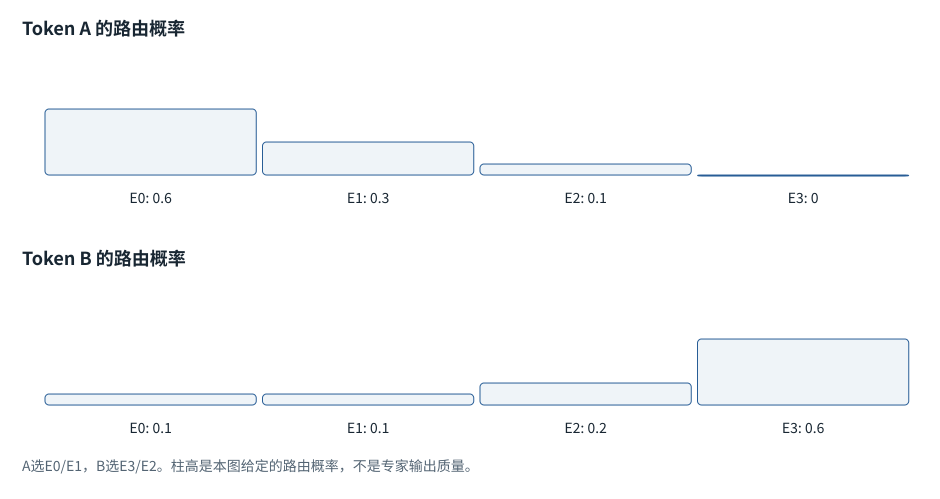
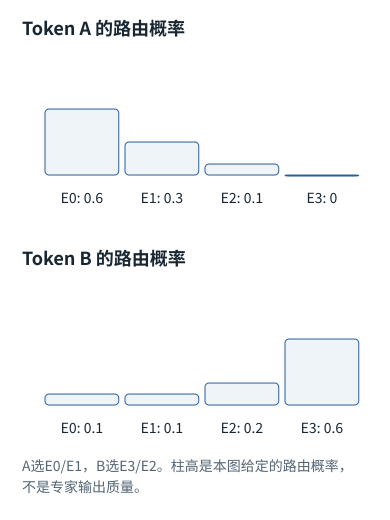

系统篇


<span id="ch06-s0"></span>


# 05｜后训练与模型定制：目标、结构和参数适配


<span id="section-1"></span>


### 本章预备知识


<span id="concept-intro-5"></span>


先认识这里的对象与符号

[LoRA、低秩及r](../concepts.md#concept-lora)
:   LoRA用两个较小矩阵的乘积表示一部分权重增量，而不是重新训练整个大矩阵。r是中间维度，限制这个乘积的最大秩。不同资料采用行/列向量约定时，A、B的左右次序可能不同。右乘约定微例：W[4,6]，增量A[4,2]B[2,6]仍为[4,6]；r=2。A在这里不是注意力份额表。

SFT提供目标答案，偏好训练比较回答，强化学习用奖励改善策略。低秩、量化和专家结构讨论参数怎样组织与计算，不是把知识库加入上下文。

本章各题列出所需基础。可先完成相应基础课，也可通过自检确认掌握程度。

[F07 · 模型最常做的算术](../foundations/07.md)[F09 · 概率、指数与softmax](../foundations/09.md)[F16 · 一次训练从头到尾](../foundations/16.md)[F17 · 后训练的前置数学](../foundations/17.md)[F20 · 低秩、量化、专家](../foundations/20.md)

**进入深读前的小检查：**先用两种回答的概率比算一个偏好分数，再区别“权重变少”“权重字节变少”“每次激活的权重变少”。

术语带虚线时可点击速查。公式中的字母先看定义；不要用猜缩写替代推导。

这一章区分“给模型新资料”“让模型改变行为”和“降低模型运行成本”。三者可能配合，但训练目标、改动对象和验证方法完全不同。


<span id="visual-reading"></span>


<span id="topic-1"></span>


## 沿着对象与状态理解本章

先回答每种方法改变什么：后训练改变模型行为分布，LoRA限制可训练增量，量化改变数值表示，MoE改变激活的子网络。它们不是同一个“变小按钮”，因此收益不能只用参数总数衡量。

下方图解的固定输入在“输入与适用条件”中声明。它用于解释本章机制，不与本章其他独立例子的数值暗中接续。


<span id="visual-F20"></span>

<span id="topic-2"></span>

<span id="topic-3"></span>

<span id="topic-4"></span>

<span id="topic-5"></span>

<span id="topic-6"></span>

<span id="topic-7"></span>


相关动态过程：[省参数、省位数、少激活不是同一种优化](../visual/F20.md)。本节下文继续展示更具体的计算与工程边界。

继续看相关机制：[F17 · 后训练改变行为，奖励不是事实裁判](../visual/F19.md)[O02 · 量化：省存储，也引入近似](../visual/O02.md)[O03 · LoRA：冻结大表，学习小增量](../visual/O03.md)[O08 · MoE：每个Token选部分计算路径](../visual/O08.md)


<span id="Q021"></span>


## Q021｜SFT、RLHF、DPO分别怎样改变模型？DPO公式在比较什么？

这题先认识什么SFT模仿目标输出，RLHF用反馈优化策略，DPO直接比较偏好相对概率；它们都涉及训练，不是运行时加一段提示。

[F16 · 一次训练从头到尾](../foundations/16.md)[F17 · 后训练的前置数学](../foundations/17.md)


<span id="ch06-s2"></span>


### 核心回答


<span id="concept-intro-3"></span>


先认识这里的对象与符号

[RLHF、奖励模型与策略](../concepts.md#concept-rlhf)
:   RLHF泛指利用人类反馈训练行为的流程。奖励模型是对回答等行为打分的模型；策略是实际生成动作的概率模型。两者职责不同，得高奖励不自动等于事实正确。独立例：奖励器偏爱长回答，策略可能学会写长而不更准确；因此奖励判据需要验证。

[SFT](../glossary.md#g114 "用指定目标回答做监督微调。 例：属于参数训练，和会话中加载Skill不同。")用目标回答做监督学习；[RLHF](../glossary.md#g115 "利用人类或AI反馈进行强化学习式后训练的方法族。 例：反馈来源和目标都需核对，不能仅看缩写。")通常学习或使用奖励信号，再优化策略；[DPO](../glossary.md#g118 "以偏好对比较策略相对参考模型概率的训练方法。 例：要算完整回答条件概率，不只看最后一个Token。")直接从同一问题下偏好回答对构造训练目标，不必在每个训练步骤运行完整的在线强化学习循环。它们优化行为分布，不构成事实真理的保证。[[RLHF]](../sources.md#src-RLHF "来源说明")[[DPO]](../sources.md#src-DPO "来源说明")


<span id="ch06-s3"></span>


### 从同一个问题的两份回答展开

给问题x，偏好回答y⁺，不偏好回答y⁻。SFT只拿一份理想输出，逐[Token](../glossary.md#g027 "模型分词器使用的片段单位。 例：可能是词、词的一部分、标点或部分字节。")提高其概率。它没有直接告诉模型“另一份回答为什么更差”；这类区别由示例分布间接体现。

奖励模型可用回答对训练，令`r(x,y⁺)>r(x,y⁻)`。策略优化时，模型生成回答，再根据奖励更新，同时常用与参考策略的偏离惩罚避免剧烈漂移。奖励模型只近似人的偏好或任务标准，可能奖励表面特征。

DPO的一种标准目标为：


<span id="concept-intro-1"></span>


先认识这里的对象与符号

[sigmoid：把单个数映射到0与1之间](../concepts.md#concept-sigmoid)
:   函数规则是sigmoid(x)=1/(1+exp(-x))。它逐个数计算，不要求同一行结果的总和为1，所以不能用它直接代替多候选softmax。独立微例：sigmoid(0)=0.5；分别算两个0，得到[0.5,0.5]只是巧合，输入[1,1]的两项之和就大于1。

[π、π\_ref与β：偏好目标的符号](../concepts.md#concept-beta-policy)
:   在策略与偏好优化中，π表示条件概率策略，π\_ref表示固定参考策略；β是控制目标尺度或约束强度的设置系数。完整回答的概率由各Token条件概率构成。这里π不是圆周率，β不是LayerNorm的偏移参数。DPO式子的w/l是偏好与非偏好答案标记，不是权重w与层数L。

```
Δ = [log πθ(y⁺|x) − log πref(y⁺|x)]
  − [log πθ(y⁻|x) − log πref(y⁻|x)]
L = −log sigmoid(β Δ)
```

回答概率是答案Token条件概率的乘积，实践里用[log](../glossary.md#g061 "指数的反向函数；本书未注明底时通常指自然对数。 例：ln(1)=0，ln(2)约0.6931。")概率求和。目标推动偏好回答相对参考模型的优势大于不偏好回答的优势，不是简单把y⁺设为1、y⁻设为0。参考模型提供锚点，β控制目标中的尺度，并与相应推导的正则化强度相关。

假设当前模型与参考模型对两份回答的相对log增益都为0，则Δ=0，loss约0.693。若偏好回答相对增益更大，Δ增大，loss下降。这个目标仍依赖数据质量：若标注者偏爱长篇奉承，训练会把这种偏好当成信号。


<span id="mechanism-Q021"></span>


<span id="topic-8"></span>


### DPO比较的是“相对参考模型的偏好提升”

**本例条件：**独立一对回答：好回答y+与差回答y−针对同一问题。参考模型给序列概率0.2、0.1，当前模型为0.3、0.1；β=1。为看清公式，这些概率为教学设定。

序列概率
:   整段目标在同一条件下的概率，实际通常用对数累计。

参考模型
:   提供相对变化的基线。

偏好边际
:   好回答的相对提升减去差回答的相对提升。

DPO比较的是“相对参考模型的偏好提升”

| 对象 | 计算 | 结果 |
| --- | --- | --- |
| 好回答的相对变化 | ln(0.3/0.2) | ln1.5 ≈ 0.405465 |
| 差回答的相对变化 | ln(0.1/0.1) | 0 |
| 偏好边际 | 0.405465−0 | 0.405465 |
| sigmoid与loss | σ(0.405465)=0.6；−ln0.6 | 约0.510826 |

各行是独立对象或条件的对照，不暗示上一行的结果自动进入下一行。

#### 怎样把图中的变化读明白

不能只比较当前模型0.3和0.1的大小。公式还问：相对参考模型，两者分别变了多少。

若好坏回答都相对参考模型乘同一倍数，两项对数提升相同，边际相减为0，不会凭共同提升取得额外偏好优势。

偏好标签表达选择倾向，并不自动证明答案真实正确。数据收集与评测仍需要事实依据。

**不要混淆：**教学序列概率只为展示比值；真实训练要处理长度、有效Token、数值稳定与参考分布，不能直接乘很多小概率。

机制依据：[[DPO]](../sources.md#src-DPO) [[RLHF]](../sources.md#src-RLHF)。本例数字和宿主场景为明确给定的教学设定，不是商业模型输出或生产性能测量。


<span id="worked-Q021"></span>


运行示例 · Q021


<span id="topic-9"></span>


### 同一对回答，SFT与DPO看的训练信号不同

**输入与条件。**问题x有好回答A和差回答B。假设整段概率与参考概率采用F17的教学值，β=1。

| 步骤与对象 | 内部动作 | 中间结果 / 新状态 |
| --- | --- | --- |
| 1SFT样本 | 只用(x,A) | 最大化A的条件似然，不必有B。 |
| 2偏好样本 | 用(x,A优于B) | 提供两个回答间的相对判断。 |
| 3DPO比较 | 计算ln(0.6/0.3)−ln(0.2/0.2) | 间隔ln2，损失ln1.5≈0.405465。 |
| 4经典RLHF路径 | 先用偏好训练奖励模型，再用它反馈策略更新 | 与直接优化这对概率比的DPO不是同一训练管线。 |
| 5错误标签反例 | 若偏好标签实际把错误回答选为A | 目标可能强化错误偏好，公式正确不能修复坏标注。 |

**把过程连起来。**训练方法改变的首先是监督信号和优化目标，不是给模型外挂一份跨会话数据库。

**边界与反例。**数值只解释标准DPO单样本目标；RLHF有多种变体，不能由此概括所有后训练系统。

[查看本例程序结果](../example-verification.md#result-Q021) · [完整可运行代码](../example-verification.md#code)

依据与适用范围：[[DPO]](../example-sources.md#ex-src-DPO)。示例输入和场景由本书明确设定。


<span id="ch06-s4"></span>


### 追问：DPO是不是完全不需要奖励？

它不必显式训练并调用一个独立标量奖励模型，但仍需要偏好信号，也可从目标推导出隐式奖励关系。“无需奖励模型”不等于“无需质量判断”。同样，离线偏好数据不能覆盖策略优化后所有新分布。


<span id="ch06-s5"></span>


### 追问：SFT会让模型记住全部新业务事实吗？

可能学习部分事实，但难以提供逐条更新、删除和来源追溯。经常变化的制度或源码更适合版本化检索；稳定输出格式、分类边界、工具选择风格可考虑SFT。定制决策应先区分知识缺失、行为不稳定、工具不足还是任务说明不清。


<span id="ch06-s6"></span>


### 追问：偏好训练为什么可能让回答更讨喜但不更正确？

评价者容易把流畅、自信、长度或语气当作质量代理。模型优化代理后，可能出现“看起来专业”的错误。训练数据与评测需同时包含正确性、引用支持、允许拒答和任务完成情况，而不能只问“你更喜欢哪一段”。


<span id="engineering-E11"></span>


工程深挖 · E11 · 接续Q021


<span id="engineering-E11-title"></span>


### DPO真正比较的不是“好答案概率”，而是相对参考策略的改变量

预备知识：[F16](../foundations/16.md) · [F17](../foundations/17.md)。阅读顺序：先确认运行契约，再看反例与修复，最后检验边界。


<span id="engineering-E11-detail-1"></span>


#### 先认清四个对数概率

对同一问题x，有偏好回答y+与被拒回答y−；当前策略πθ和冻结参考策略πref各对两份回答打分。DPO的核心量是`β[(log πθ(y+|x)−log πθ(y−|x))−(log πref(y+|x)−log πref(y−|x))]`。π是概率模型，β是控制目标尺度的系数；这里的log概率通常由回答Token条件概率连乘取log，成为逐Tokenlog概率之和。[[DPO]](../engineering/sources.md#src-DPO "Rafailov et al. · Direct Preference Optimization")

因此“当前模型给好答案更高概率”还不足以解释更新。教学例中当前两项为−2、−4，参考两项为−1、−3；两者偏好间距都是2，校正后margin是0，损失为ln2≈0.693147。只看当前间距2会误判学习程度。


<span id="engineering-E11-detail-2"></span>


#### 标签掩码决定你究竟在优化什么

应核对prompt部分是否排除、回答从哪个Token开始、EOS是否计入、padding是否计入、两条路径是否使用相同模板和截断规则。若把prompt也加入序列打分，在某些设置下其公共项可能抵消，但别把这种理想抵消当作代码许可：padding、截断和分批差异可破坏它，并制造不必要计算。

尤其不能把`mean(token logp)`与`sum(token logp)`随意替换。前者带来长度归一化，已不是同一个目标；长短回答比较会变化。可以设计不同目标，但必须说明是变体并重新验证，而不能声称只是“为了数值稳定”。


<span id="engineering-E11-detail-3"></span>


#### 缓存参考概率也需要版本身份

参考策略固定，因而预计算可减少训练成本；但缓存必须绑定参考权重、tokenizer、模板、回答文本、截断和mask规则。只用样本ID作为key，文本修订后还读旧logp，会把不相干的参考概率带进梯度。缓存成功命中不等于缓存有效。


<span id="engineering-E11-detail-4"></span>


#### 追问：偏好胜出就等于事实正确吗？

不是。偏好数据可能奖励篇幅、语气或迎合，而不是事实。验证时应同时检查偏好指标、任务可执行结果、拒答行为和长度分布。论文目标描述的是如何利用成对偏好，不提供“任何偏好标签都可靠”的保证。


<span id="engineering-E11-detail-5"></span>


#### 追问：β调大只是学得更快吗？

不能直接当学习率。它改变margin进入logistic损失的尺度，也关联参考约束的建模含义；与优化器学习率控制对象不同。调参时记录对数概率间距、长度与饱和程度，避免只看一条训练loss。


<span id="engineering-E11-observations"></span>


#### 本地观察与复核入口

以下为随包程序实际运行记录。数值算子、临时文件／数据库实验与教学逻辑模拟各自的范围，在实验页逐项注明；不能据此声称已测试商业模型或生产环境。


<span id="mechanism-record-E11"></span>


#### E11：怎样读这份结果，而不是只看“通过”

当前策略和参考策略的差值若相同，相减后的margin就是零；即使优选回答的绝对概率很高，偏好目标也没有获得相对改善。

实验记录：字段与原值

| 原始字段路径 | 原始值 |
| --- | --- |
| E11.policy\_gap | 2.0 |
| E11.reference\_gap | 2.0 |
| E11.margin | 0.0 |
| E11.loss | 0.6931471805599453 |

这里是实际实验记录，不用条长或箭头伪装成额外证据；完整日志与解释仍保留在本节。

本图整理的是本小节已有的局部实验记录，不把通过局部测试扩展为产品在所有环境下可靠。原测试环境、输入和完整输出仍以本节记录为准。

```
{
  "E11": {
    "policy_gap": 2.0,
    "reference_gap": 2.0,
    "margin": 0.0,
    "loss": 0.6931471805599453
  }
}
```

[本条全部结果、验证范围与完整代码 →](../engineering/labs.md#proof-E11)

**自检：**当前与参考策略对好坏回答的log概率差都为2，DPO的校正margin是多少？

<details class="quiz-answer"><summary><span class="when-closed">查看参考答案</span><span class="when-open">收起参考答案</span></summary><div class="answer">两项间距相减为0，再乘β仍是0。损失为−log(sigmoid(0))=ln2，而不是只根据当前间距2判断。</div></details>

证据核对：2026-10-21。[[DPO]](../engineering/sources.md#src-DPO) [[CHAT]](../engineering/sources.md#src-CHAT) · [事实、推导与实验的边界](../engineering/sources.md#evidence-levels)


<span id="Q022"></span>


## Q022｜推理模型为什么常用强化学习？PPO、GRPO和过程监督有什么不同？

这题先认识什么策略是对动作的概率分布，概率比比较新旧策略对同一动作的支持，KL衡量分布偏离；这些量不是回答正确率。

[F09 · 概率、指数与softmax](../foundations/09.md)[F17 · 后训练的前置数学](../foundations/17.md)


<span id="ch06-s8"></span>


### 核心回答


<span id="concept-intro-4"></span>


先认识这里的对象与符号

[PPO、GRPO、advantage](../concepts.md#concept-ppo)
:   这些是策略优化相关概念。PPO常用新旧动作概率比和裁剪来限制更新；GRPO类方法使用组内奖励比较构造优势。优势是相对基线的表现，不是答案正确概率。独立原始差值例：奖励[0,1,1]，减组均值2/3得到[-2/3,1/3,1/3]。算法还可能再归一化，不能直接混用。

当任务结果可验证时，可以对模型生成的解答轨迹给予奖励，鼓励更有效的多步推理。[PPO](../glossary.md#g120 "不同策略优化方法，使用概率比及估计信号等控制更新。 例：先懂策略、奖励、基线和相对变化，再读具体公式。")是一类受约束的策略更新方法；[GRPO](../glossary.md#g120 "不同策略优化方法，使用概率比及估计信号等控制更新。 例：先懂策略、奖励、基线和相对变化，再读具体公式。")使用一组候选的相对奖励构建优势估计，减少对单独价值模型的依赖。过程监督评价中间步骤，结果监督评价最终结果；不同方法可组合，不能视为所有推理模型的统一实现。[[R1]](../sources.md#src-R1 "来源说明")


<span id="ch06-s9"></span>


### 一轮可验证任务训练的逻辑

以有隐藏测试的代码题为例：固定题目，当前策略采样若干程序，运行隔离测试，得到通过情况、超时或非法操作等结果；把结果转换为奖励，再计算序列或Token的策略梯度。只有在模型参数更新后，才是训练。把错误日志重新塞给模型修一遍只是推理时反馈，不等于RL。

PPO常对新旧策略概率比`r_t=πθ(a_t|s_t)/πold(a_t|s_t)`使用裁剪目标，限制单次更新走得过远。优势A表示这次动作相对基线好多少，不是原始奖励本身。价值估计、KL项、裁剪范围和归一化都会影响训练。

GRPO用同题一组回答奖励的均值和标准差进行相对比较，常见简化优势为`A_i=(R_i−mean(R))/(std(R)+ε)`。它解释了“同题比较”的作用：去掉题目难度的一部分影响，突出组内优劣。但全组奖励相同，组内信号可能非常弱；这不是调大训练步数就必然解决的问题。

结果奖励清晰、成本较低，但一份错误推理可能偶然得到正确答案；过程奖励提供更细的信用分配，却需要可靠中间步骤评价，容易把不常见但正确的路线误判为错。长轨迹还带来计算成本和奖励作弊风险。


<span id="mechanism-Q022"></span>


<span id="topic-10"></span>


### 组内奖励只是相对比较，不是绝对正确证明

**本例条件：**独立GRPO直觉例：同一题生成3个候选，验证器奖励为[0,1,1]。只计算去均值的相对奖励，不把它当完整GRPO实现。

组
:   同一道题的多个候选，而非任意不同题混一起。

奖励
:   验证器产生的训练信号。

优势
:   相对基线更好还是更差的方向信号。

组内奖励只是相对比较，不是绝对正确证明

| 候选 | 奖励−组均值2/3 | 解释 |
| --- | --- | --- |
| A | −2/3 | 低于组内平均 |
| B | +1/3 | 高于组内平均 |
| C | +1/3 | 高于组内平均 |
| 另一组全为0 | [0,0,0]−0=[0,0,0] | 没有组内差异信号 |

各行是独立对象或条件的对照，不暗示上一行的结果自动进入下一行。

#### 怎样把图中的变化读明白

奖励为1只说明通过了当前验证器定义的条件。验证器若漏测边界，两个高奖励候选仍可能有同一个缺陷。

完整算法还可能有尺度标准化、概率比裁剪和KL等项；这里把减基线单独拿出来，是为了先理解方向而不是假装复现训练。

全相同奖励组不能凭空产生区分候选的相对信号；采样多样性、验证质量和任务难度都会影响训练。

**不要混淆：**把过程监督、结果奖励和推理时搜索混成一个流程，会把“训练改参数”与“推理多试答案”混淆。

机制依据：[[R1]](../sources.md#src-R1) [[RLHF]](../sources.md#src-RLHF)。本例数字和宿主场景为明确给定的教学设定，不是商业模型输出或生产性能测量。


<span id="worked-Q022"></span>


运行示例 · Q022


<span id="topic-11"></span>


### 四条候选轨迹的奖励怎样变成相对优势

**输入与条件。**同一题生成4条候选轨迹，验证器奖励 `[0,0,1,1]`。取总体标准差、忽略稳定项ε，只演示组内标准化。

| 步骤与对象 | 内部动作 | 中间结果 / 新状态 |
| --- | --- | --- |
| 1组均值 | 四个奖励平均 | 0.5。 |
| 2组标准差 | 每项与均值差±0.5 | 标准差0.5。 |
| 3标准化 | (奖励−均值)/标准差 | 优势为 `[−1,−1,1,1]`。 |
| 4同分反例 | 奖励全部 `[1,1,1,1]` | 标准差0，需实现定义稳定处理，不能直接除0。 |
| 5过程监督对照 | 若两条最终成功轨迹中一条有错误中间步骤 | 只看最终奖励无法区分；过程评分会增加另一种信号。 |
| 6目标差异 | PPO还可有价值估计与裁剪概率比 | 不要把“做了标准化”就称为完整GRPO或PPO实现。 |

**把过程连起来。**奖励是输入监督，优势是相对当前基准的改进信号；它们不是模型答案正确的先验保证。

**边界与反例。**仅展示组内标准化这个子步骤，不提供完整强化学习训练，不复现论文报告的收益。

依据与适用范围：[[DERIVE]](../example-sources.md#ex-src-DERIVE)。示例输入和场景由本书明确设定。


<span id="ch06-s10"></span>


### 追问：模型输出更长的思考，是否说明训练更成功？

长度只是中间行为。成功标准应是相同资源条件下任务正确率和可靠性是否提高。模型可能反复自问、无效搜索，或者把简短任务复杂化。推理预算应与难度匹配；不是所有问题都值得多路径采样。


<span id="ch06-s11"></span>


### 追问：怎样出现Reward Hacking？

当奖励只检测公开测试，模型可能针对测试特征投机，而没有满足真实需求；只奖励格式，则可以产出结构完美的空答案。应隔离隐藏验证、使用多种独立检查并观察分布外表现。不能把奖励分数本身当作任务真值。


<span id="ch06-s12"></span>


### 追问：Self-consistency与训练的区别是什么？

Self-consistency在推理时采样多条路径，再按答案一致性聚合；参数通常不变。它能降低某些随机推理错误，但若样本共享同一错误前提，多数票仍会错误。增加票数增加成本，也不能把模型之间的相关错误变成独立证据。


<span id="Q023"></span>


## Q023｜MoE为什么总参数很多却只激活一部分？Router实际做什么？

这题先认识什么专家是可选的参数子网络；路由选择本次使用哪几个。总参数、激活参数和数据搬运量不能混算。

[F10 · 神经网络最小模型](../foundations/10.md)[F20 · 低秩、量化、专家](../foundations/20.md)[F21 · 算得快与装得下](../foundations/21.md)


<span id="ch06-s14"></span>


### 核心回答


<span id="concept-intro-2"></span>


先认识这里的对象与符号

[MoE、专家与路由器](../concepts.md#concept-moe)
:   MoE是包含多套子网络的模型结构；路由器为当前Token表示选择或加权少数专家。专家通常是数值子网络，不是被赋予“数学老师”等提示词的聊天Agent。独立例：有4个专家，每Token选2个，表示某次只激活其中2条专家路径；仍需保存模型设计要求的参数与路由状态。

[MoE](../glossary.md#g126 "根据输入选择部分专家子网络参与计算的架构。 例：总参数与本次激活参数分开统计。")在某些层把一个[FFN](../glossary.md#g088 "通常在每个位置应用的前馈子网络。 例：常把宽度先扩展再缩回，带非线性或门控。")替换为多个专家网络，对每个Token用路由器选择少量专家计算，再按权重合并结果。通常[attention](../glossary.md#g071 "计算查询与可读候选的匹配份额，再加权组合内容。 例：先计算分数和权重，再用权重混合V。")等共享部分仍会执行。总参数决定存储与容量，激活参数更接近单Token计算量，但不能仅凭激活参数推断延迟。[[V3]](../sources.md#src-V3 "来源说明")


<span id="ch06-s15"></span>


### 看一个简化的Top-2 MoE层

输入Token隐藏向量`h∈R^d`，router计算`g=hW_r`，得到E个专家分数。选Top-2索引a、b，并对选中分数归一化为权重w\_a、w\_b；分别计算专家FFN `f_a(h)`、`f_b(h)`，返回`w_a f_a(h)+w_b f_b(h)`。实际模型可能有共享专家、不同归一化、负载平衡或更复杂路由，不能套用同一个公式描述全部MoE。

一个[batch](../glossary.md#g034 "一起组织计算的一组输入。 例：普通样本batch不让不同用户相互读取内容。")内不同Token选不同专家。实现要先分组Token，把它们发送给对应专家，执行矩阵乘，再把输出归还原位置。这会产生dispatch/combine和可能的跨卡all-to-all通信。专家数量再多，如果某个专家收到了多数Token，就会成为瓶颈。


<span id="concept-intro-6"></span>


先认识这里的对象与符号

[FLOPs与FLOP/s：数量与速率](../concepts.md#concept-flops)
:   FLOPs通常表示浮点运算数量；FLOP/s表示每秒的运算速率。论文或厂商对乘加计一次还是两次可能不同，需要固定口径。不能只用总运算量除理论峰值就承诺真实耗时：搬运、排队、通信和实际利用率也有成本。

负载均衡并不等于语义均衡。训练会用辅助目标、容量限制或其他机制减少拥塞，但每种做法都有代价：丢弃超额Token可能损害质量，过强均衡可能干扰最佳专家选择，通信也可能吞掉理论节省的[FLOPs](../glossary.md#g129 "浮点运算次数的一种计数指标。 例：计算少可能仍因内存搬运而慢。")。


<span id="mechanism-Q023"></span>


<span id="topic-12"></span>


### MoE的路由结果，要跟着每个Token逐个看

**本例条件：**独立4专家例：每个Token选2个专家。Token A路由概率[0.6,0.3,0.1,0]，Token B为[0.1,0.1,0.2,0.6]；本图选择后按保留项重新归一化。

专家
:   一组子网络参数，不是人类专业身份。

top-2
:   每个Token选路由得分最高的两个。

负载
:   某专家此次接到多少Token。

**MoE的路由结果，要跟着每个Token逐个看**





本图仅使用当前算例声明的输入；具体公式、来源和边界见紧邻正文。

[SVG图源](../../diagrams/rendered/Q023-3f09a9350c43.svg) · [原算例数据：Q023](../../diagrams/source/mechanism-cases.json)

核对完整输入与结果

本图使用的数据与条件

| Token | 选中专家与组合权重 | 没有发生什么 |
| --- | --- | --- |
| A | E0、E1；权重2/3、1/3 | E2、E3不做此Token专家计算 |
| B | E3、E2；权重0.75、0.25 | 不是复制A的路由 |
| 两个Token合看 | 四组专家都可能被访问 | “每Token激活少”不等于只需存两组参数 |

#### 怎样把图中的变化读明白

先按每一行选专家，再汇总各专家的负载。平均每个Token只走两条路，不保证每个设备负载平均。

组合的是专家产生的向量，不是把它们生成的中文回答投票。专家并不天然有“数学”“情感”等可读标签。

更多总参数可提高容量，但权重存储、路由通信与负载不均都可能成为新成本。

**不要混淆：**top-k后是否重新归一化、容量限制与丢弃策略依具体实现；本图已固定一种规则，不推广为所有MoE。

机制依据：[[V3]](../sources.md#src-V3)。本例数字和宿主场景为明确给定的教学设定，不是商业模型输出或生产性能测量。


<span id="worked-Q023"></span>


运行示例 · Q023


<span id="topic-13"></span>


### MoE路由选两个专家，结果怎样合成

**输入与条件。**三专家门控原概率 `[0.6,0.3,0.1]`。本例top-2后重新归一化；专家0输出 `[2,0]`，专家1输出 `[0,3]`。

| 步骤与对象 | 内部动作 | 中间结果 / 新状态 |
| --- | --- | --- |
| 1取top-2 | 选专家0和1 | 不执行专家2。 |
| 2重归一化 | 选中概率和0.9 | 新权重为2/3和1/3。 |
| 3计算专家输出 | 两条分支独立变换当前Token | 得到给定的两个向量。 |
| 4合并 | (2/3)[2,0]+(1/3)[0,3] | 输出 `[4/3,1]`。 |
| 5负载反例 | 一批100个Token都选专家0 | 即使总参数很多，也可能造成同一设备拥堵，需要考虑路由负载与容量。 |

**把过程连起来。**总专家参数量、每Token激活参数量和执行时瓶颈是三个不同量。

**边界与反例。**专家输出是教学给定，容量溢出处理与权重归一化依模型实现而定，不把此配置说成统一标准。

依据与适用范围：[[DERIVE]](../example-sources.md#ex-src-DERIVE)。示例输入和场景由本书明确设定。


<span id="ch06-s16"></span>


### 追问：专家是不是“数学专家、法律专家、代码专家”？

名称容易误导。专家是参数块，路由由训练形成，可能出现专业化模式，但不是天然对应人类命名学科。不能仅看某个Token去了哪个专家，就宣称模型给它分配了一个可解释职业角色。MoE专家也不是带独立工具和任务记忆的子[Agent](../glossary.md#g136 "根据任务与观察调用模型和工具、持续推进的执行系统。 例：不只是一次写得很长的Prompt。")。


<span id="ch06-s17"></span>


### 追问：推理时只加载被选中的专家就行吗？

后续Token会选择不同专家，选择前未必知道需要谁。专家offload可以节约显存，但会引入传输与预取问题；低延迟服务通常需仔细规划权重驻留和设备分布。激活参数少不等于整个模型文件小。


<span id="ch06-s18"></span>


### 追问：Router与Agent的模型路由有什么区别？

MoE router是模型内部、Token粒度的可训练计算；Agent路由通常在请求或子任务粒度选择一个完整模型、工具或技能。二者预算、训练方法和失败模式不同。不要把“MoE已经路由”当作不需要Agent任务分派的理由。


<span id="Q024"></span>


## Q024｜LoRA、QLoRA、量化、蒸馏怎样选择？它们到底改了什么？

这题先认识什么低秩用较小矩阵表达更新；量化减少每个权重占用的位数；蒸馏用教师信号训练学生。减少字节不必然减少全部计算。

[F07 · 模型最常做的算术](../foundations/07.md)[F16 · 一次训练从头到尾](../foundations/16.md)[F20 · 低秩、量化、专家](../foundations/20.md)


<span id="ch06-s20"></span>


### 核心回答

[LoRA](../glossary.md#g122 "用低秩参数增量适配原权重的微调方法。 例：ΔW=AB，训练A和B而非全部基础权重。")冻结大部分底座参数，用低秩增量学习任务变化；[QLoRA](../glossary.md#g123 "在量化基础模型上训练低秩适配参数的一类方法。 例：不意味着所有计算都在4位整数中完成。")把底座以低比特存储并训练适配器；量化用更少位数近似权重或激活；蒸馏让学生学习教师输出或分布。四者目的可重叠，但不是同义词。[[LORA]](../sources.md#src-LORA "来源说明")[[QLORA]](../sources.md#src-QLORA "来源说明")


<span id="ch06-s21"></span>


### LoRA的尺寸与梯度流

若原线性层`W∈R^(d_out×d_in)`，增加`ΔW=sBA`，其中`A∈R^(r×d_in)`、`B∈R^(d_out×r)`、r远小于两侧维数，计算`y=Wx+sB(Ax)`。可训练参数从`d_out*d_in`变成`r*(d_in+d_out)`。例如4096×4096矩阵有16,777,216参数，r=16时A+B仅131,072，约为1/128。

底座不更新不意味着无需反向经过底座。为了求下游适配器或更早层的梯度，仍要沿计算链反传并保存或重算激活。很多实现让一个低秩矩阵随机初始化、另一个置零，使初始增量为零；若两个都为零，初始梯度路径可能退化。

普通均匀量化可概括为`q=clip(round(w/s)+z)`，恢复近似值`ŵ=s(q−z)`。scale和[zero](../glossary.md#g134 "通过分散保存训练状态减少跨设备重复的一类方法。 例：不等于把模型训练目标改变。") point要存储；分组或通道级量化可降低误差，但增加元数据。低bit是表示方式，计算内核是否真正以低bit加速、是否要反量化到更高精度，决定实际速度。

蒸馏可以使用教师生成的高质量答案，也可让学生匹配soft targets。学生不是复制全部教师参数，而是在容量和训练分布约束下逼近特定行为。验证必须包含未用于蒸馏的任务；教师错误也会被传递。


<span id="concept-intro-7"></span>


先认识这里的对象与符号

[Schema与Structured Outputs](../concepts.md#concept-schema)
:   Schema是一份字段和类型等结构规则；结构化输出机制让模型更容易返回符合规则的数据。字段合法仍不等于目标文件存在、已授权或业务正确。独立例：要求path为字符串；{"path":3}类型不合规则，{"path":"missing.py"}虽结构合规则仍可能找不到文件。


<span id="mechanism-Q024"></span>


<span id="topic-14"></span>


### LoRA、量化和蒸馏，分别改变不同对象

**本例条件：**独立尺寸例：原矩阵W为8×8，共64个数；LoRA秩r=2，增量A为8×2，B为2×8；量化演示从32bit改8bit，仅计算裸数据。

冻结
:   训练时不更新这一参数对象。

低秩增量
:   用AB产生一份受约束的修改量。

量化
:   用更少位数近似保存数值。

LoRA、量化和蒸馏，分别改变不同对象

| 方案 | 实际改变 | 没有省掉的部分 |
| --- | --- | --- |
| LoRA | 训练A与B共16+16=32个数 | 原W的64个数仍在 |
| W从FP32到INT8 | 裸W从256B到64B | 还需尺度、元数据与算子支持 |
| QLoRA思路 | 量化基座 + 训练适配参数 | 激活和训练计算不全是低位数 |
| 蒸馏 | 用教师信号训练另一学生模型 | 需要新训练和独立质量验证 |

各行是独立对象或条件的对照，不暗示上一行的结果自动进入下一行。

#### 怎样把图中的变化读明白

这些措施可以组合，因为作用对象不同。不能把“少训练32个参数”和“少存192字节”直接相加成一个百分比。

LoRA低秩只约束修改量，不要求原W本身低秩；把W直接替成AB会丢掉基座。

量化节省存储不保证任意硬件都更快；若需要频繁解量化且缺少高效核，端到端延迟可能没有改善。

**不要混淆：**这里忽略量化尺度和偏置等开销，因此4倍是裸权重字节对照，不是完整服务显存或速度倍数。

机制依据：[[LORA]](../sources.md#src-LORA) [[QLORA]](../sources.md#src-QLORA)。本例数字和宿主场景为明确给定的教学设定，不是商业模型输出或生产性能测量。


<span id="worked-Q024"></span>


运行示例 · Q024


<span id="topic-15"></span>


### 把“知识过期”和“输出格式错误”分开选干预手段

**输入与条件。**系统有两个失败：A不知道昨天改成5秒的新配置；B明明拿到正确配置却总输出错误字段名。

| 步骤与对象 | 内部动作 | 中间结果 / 新状态 |
| --- | --- | --- |
| 1检查A | 错误来自缺新源码 | 先检索当前版本，不通过微调记住一天一变的配置。 |
| 2检查B | 证据正确，输出结构不合约定 | 先试清晰schema、提示与校验，持续稳定需求再考虑微调。 |
| 3LoRA小账本 | 1000×1000增量，秩r=8 | 全矩阵100万参数，分解为1000×8和8×1000，共1.6万，不含基础W。 |
| 4量化小算例 | x=0.26，步长0.1 | round后为3，恢复0.3；省表示成本但引入误差。 |
| 5蒸馏选择 | 让小模型拟合教师分布 | 需要评测任务保持程度，不等于复制教师全部能力。 |

**把过程连起来。**先定位失败发生在数据、接口、行为还是计算资源，再选RAG、约束输出、适配或压缩。

**边界与反例。**参数账本是原理计算，不是训练时间或精度收益预测；QLoRA等完整方案还含量化与训练细节。

依据与适用范围：[[DERIVE]](../example-sources.md#ex-src-DERIVE)。示例输入和场景由本书明确设定。


<span id="ch06-s22"></span>


### 追问：LoRA能否无损合并进W？

在支持的普通线性层与精度设置下可计算`W'=W+sBA`，省去额外支路；数学上与同一线性增量等价，浮点和重新量化仍可能引入差异。多个适配器直接相加也不保证业务行为不冲突。动态切换适配器时，应把适配器身份纳入缓存和版本管理。


<span id="ch06-s23"></span>


### 追问：该优先微调还是RAG？

先看错误来自哪里。最新事实缺失用检索；格式或决策风格稳定性不足可用示例与微调；工具不会执行应改[Harness](../glossary.md#g137 "组织模型输入、工具、状态、权限和反馈的外围程序。 例：模型提出读文件，Harness执行并回填结果。")；大量无关上下文应改选择。若不定位根因就微调，可能把易过期知识烙进参数，仍解决不了工具或数据权限问题。


<span id="ch06-s24"></span>


### 追问：如何判断量化有没有损害实际Agent能力？

不仅测静态文本困惑度，还要测结构化参数、长上下文证据利用、代码回归、工具选择与多轮稳定性。个别logit的微小改变可导致分支选择不同，进而放大到整段任务。应在相同Harness下做配对评测，并保留高精度回退路径，而不是只比较显存下降比例。


<span id="engineering-E12"></span>


工程深挖 · E12 · 接续Q024


<span id="engineering-E12-title"></span>


### LoRA第一步A梯度为零，可能是设计正常，不是反传断了

预备知识：[F15](../foundations/15.md) · [F20](../foundations/20.md)。阅读顺序：先确认运行契约，再看反例与修复，最后检验边界。


<span id="engineering-E12-detail-1"></span>


#### 参数命名先固定，避免AB/BA混淆

本节使用行向量约定：`y=xW+xAB`，A形状`[in,r]`，B形状`[r,out]`，省略缩放常数。PEFT参考初始化让一侧随机、一侧为零，以便增量初始不改变基座输出；列向量实现常把乘法写成BA。比较代码时按形状和零初始化哪一侧确认，不按字母顺序猜。[[LORA]](../engineering/sources.md#src-LORA "PEFT · LoRA conceptual guide")


<span id="engineering-E12-detail-2"></span>


#### 梯度为什么暂时不对称

设输出梯度为G。对A的梯度要经过B的转置；若B=0，这条梯度在第一步就是0。对B的梯度经过xA，A非零时通常不为0。第一次更新B后，第二步A才可能收到非零梯度。

本地真实autograd反例：x=[1,2]，A=[[1],[2]]，B=[[0,0]]，目标=[1,1]，平方误差和。xA=5，初始增量=[0,0]，A梯度=[[0],[0]]，B梯度=[[-10,-10]]。这比看到grad为0就立即修改初始化更有判断力。


<span id="engineering-E12-detail-3"></span>


#### 什么时候确实是bug

若多个更新步后两侧都没有变化，检查：是否在优化器参数组内、是否被意外detach、是否选中了正确模块、该batch是否走过该路径、是否被AMP溢出跳步、学习率是否为0。不同初始化方案不一定有零B，因此先核对配置再拿本节现象判断。


<span id="engineering-E12-detail-4"></span>


#### 合并、量化与缓存需要一起考虑

合并LoRA是把增量加回基座权重的一种部署方式；低精度权重的量化/反量化、再量化可能使“先合并后量化”和“量化基座+独立适配器”不数值等价。更换适配器会改变K/V，旧前缀缓存不能仅因Token相同就沿用。前缀缓存设计需要纳入适配器等额外身份信息。[[PREFIX]](../engineering/sources.md#src-PREFIX "vLLM · Automatic Prefix Caching")


<span id="engineering-E12-detail-5"></span>


#### 追问：冻结基座意味着不需要存基座吗？

不意味着。前向仍依赖W，反向给增量路径计算梯度也仍需相关激活。节省的是训练参数、梯度和优化器状态的一部分，不是所有模型内存。报告显存时把权重、激活、梯度、优化器、缓存分开。


<span id="engineering-E12-detail-6"></span>


#### 追问：增量秩小，为什么仍能有用但不保证等于全量微调？

它限制参数更新的表达空间，却可能恰好覆盖任务所需的重要方向。是否足够依赖任务、目标模块、rank与数据。不要把“参数更少”推成“能力无损”，应以同预算验证集和任务失败类型比较。


<span id="engineering-E12-observations"></span>


#### 本地观察与复核入口

以下为随包程序实际运行记录。数值算子、临时文件／数据库实验与教学逻辑模拟各自的范围，在实验页逐项注明；不能据此声称已测试商业模型或生产环境。


<span id="mechanism-record-E12"></span>


#### E12：怎样读这份结果，而不是只看“通过”

初始化时低秩乘积的一侧为零，会让另一侧首步梯度为零。应同时检查另一参数的梯度和下一步更新，不把单个零数组立即判为反向断路。

实验记录：字段与原值

| 原始字段路径 | 原始值 |
| --- | --- |
| E12.A\_gradient | [[0.0], [0.0]] |
| E12.B\_gradient | [[-10.0, -10.0]] |
| E12.delta\_initial | [[0.0, 0.0]] |

这里是实际实验记录，不用条长或箭头伪装成额外证据；完整日志与解释仍保留在本节。

本图整理的是本小节已有的局部实验记录，不把通过局部测试扩展为产品在所有环境下可靠。原测试环境、输入和完整输出仍以本节记录为准。

```
{
  "E12": {
    "A_gradient": [
      [
        0.0
      ],
      [
        0.0
      ]
    ],
    "B_gradient": [
      [
        -10.0,
        -10.0
      ]
    ],
    "delta_initial": [
      [
        0.0,
        0.0
      ]
    ]
  }
}
```

[本条全部结果、验证范围与完整代码 →](../engineering/labs.md#proof-E12)

**自检：**零初始化B时A第一步没有梯度，应马上认为代码错误吗？

<details class="quiz-answer"><summary><span class="when-closed">查看参考答案</span><span class="when-open">收起参考答案</span></summary><div class="answer">不应。A的梯度经过B，B=0时第一步可为0；B先更新后A可能获得梯度。应联合检查两侧、后续步骤与初始化方案。</div></details>

证据核对：2026-10-21。[[LORA]](../engineering/sources.md#src-LORA) [[PREFIX]](../engineering/sources.md#src-PREFIX) · [事实、推导与实验的边界](../engineering/sources.md#evidence-levels)


<span id="core-understanding-10"></span>


<span id="core-understanding-10--mc-section-10"></span>


## 追问：为什么训练完成后还可能胡说？

训练目标是数据条件下的预测或偏好，不是对真实世界所有事实的形式化证明。数据不足、泛化限制、目标错配、检索缺失和解码策略都会影响输出。贯通模型仅拟合两条序列，更不能用它推断真实问答能力。

依据：[tiny\_model.py:178–258](../reference/model-code.md#tiny_model-L178)；[对应参数、前向及梯度记录](../labs/model-values.md)。


<span id="implementation-evidence"></span>


## 从本页解释到可检查的实现

| 要核对什么 | 事实与边界 | 本地依据 |
| --- | --- | --- |
| 前向、损失与更新 | 固定的一层四维教学模型；不是任何商业模型的完整实现。 | [tiny\_model.py · TinyLM](../reference/model-code.md#tiny_model-L33) |
| 独立前向实现 | 使用同一已保存权重，不使用PyTorch；用于复算而非另行训练。 | [reference\_inference.py · forward](../reference/model-code.md#reference_inference-L28) |
| 错误是否能被发现 | 因果性、梯度、标签移位、缓存位置均有正向检查和反例。 | [test\_model.py](../reference/model-code.md#test_model-L1) |
| 初始化的具体数字 | 所有参数均可查看；初值不等于训练后的参数。 | [weights\_initial.json](../reference/model-code.md#weights_initial-L1) |
| 实际运行记录 | 仅来自本地CPU微型实验；不能推出商业能力或GPU性能。 | [run.json 对应的数值记录](../labs/model-values.md) |


<span id="canonical-related"></span>


## 继续阅读与机制对应

| 页面 | 阅读关系 |
| --- | --- |
| [04｜训练机制：损失、完整反向传播与参数更新](04.md) | 上一节：复习本页使用的前置概念 |
| [06｜推理机制：加载、解码策略与连续生成](06.md) | 下一节：沿同一课程顺序继续 |
| [F17｜后训练：监督微调、偏好、奖励与参数适配](../foundations/17.md) | 基础课程：先读逐步讲解与统一算例 |

AI系统工程：从基础到内部  
[全书目录](../contents.md) · [术语与符号](../glossary.md) · [参考资料](../sources.md)