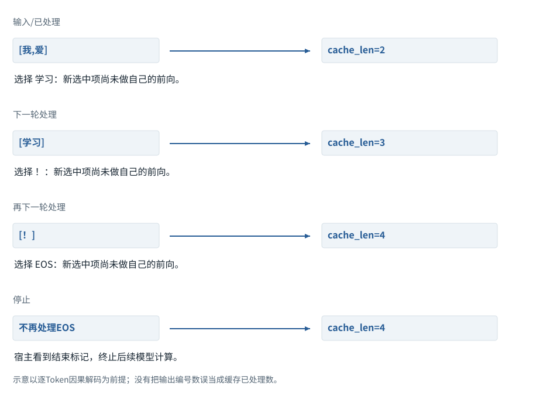
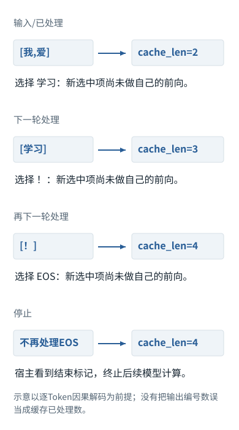

系统篇


<span id="ch04-s0"></span>


# 06｜推理机制：加载、解码策略与连续生成


<span id="course-connection"></span>


## 系统机制中的推理：先守住基线，再改变选择策略

这里使用基础课程保存的同一训练产物。完整重算、带缓存生成、温度与候选筛选属于不同层：前两项验证计算是否等价，后两项会改变选择分布。每个对照显式声明哪些变量固定，不能把不同温度或不同权重的结果当作缓存错误。


<span id="section-1"></span>


### 本章预备知识

推理分为先处理已有输入，再逐个产生新Token。输出分数不是词表编号，概率也不是答案正确率；采样从分布中选编号，解码再把编号变成文字。

本章各题列出所需基础。可先完成相应基础课，也可通过自检确认掌握程度。

[F09 · 概率、指数与softmax](../foundations/09.md)[F14 · 把Attention装进一层](../foundations/14.md)[F18 · 从最后一排数到一个Token，再到一句回答](../foundations/18.md)[F19 · KV Cache从零解释](../foundations/19.md)[F21 · 算得快与装得下](../foundations/21.md)

**进入深读前的小检查：**用同一组logits分别取最大值与按概率抽样，解释两者为什么可以产生不同结果；再解释为什么实际生成长度不一定等于最大预算。

术语带虚线时可点击速查。公式中的字母先看定义；不要用猜缩写替代推导。

理解生成过程要同时跟踪两条线：模型此刻预测哪个位置，以及服务此刻已经缓存到哪个位置。很多关于首[Token](../glossary.md#g027 "模型分词器使用的片段单位。 例：可能是词、词的一部分、标点或部分字节。")、输出长度、推理缓存的误解都来自把两条线混为一谈。

本章用F18—F19保存的训练结果理解前向与缓存，再用明确独立的三候选分数比较采样策略。章末的七词表动画仅为结构对照，不属于贯通模型。

继续看相关机制：[F09 · Softmax不是直接把分数除以它们的和](../visual/F09.md)[F19 · KV Cache：留下算过的，不省掉该读的](../visual/F16.md)[O07 · 推测解码：草稿可以快，但必须正确校验](../visual/O07.md)


<span id="Q013"></span>


## Q013｜Prefill与Decode有什么区别？第一个输出Token何时产生？

这题先认识什么prefill先处理已经知道的前缀，decode利用它生成新Token。两阶段都用模型参数，只是输入组织和可复用结果不同。

[F18 · 从最后一排数到一个Token，再到一句回答](../foundations/18.md)[F19 · KV Cache从零解释](../foundations/19.md)


<span id="ch04-s2"></span>


### 核心回答

[Prefill](../glossary.md#g098 "处理当前已经知道的一段输入前缀。 例：得到各层表示及可复用的K/V。")处理整个已知输入前缀并建立各层缓存；输入最后一个位置的[logits](../glossary.md#g091 "输出投影给各词表候选的未归一化分数。 例：可以是负数，还不是概率或Token编号。")已经能够预测第一个新Token。采样得到这个Token后，下一次Decode才把它作为输入经过全部层，预测再下一个Token。输出不是先一次性想好再分段发送。[[CACHE]](../sources.md#src-CACHE "来源说明")[[TR]](../sources.md#src-TR "来源说明")


<span id="ch04-s3"></span>


### 按时间和位置走完三步生成

假设Prompt是`x0,x1,x2,x3`，长度P=4。我们要生成`y0,y1,y2`。

| 时刻 | 本次输入网络的Token | 本次计算位置 | 结束后KV包含 | 用哪个输出选下一Token |
| --- | --- | --- | --- | --- |
| Prefill | x0…x3 | 0…3 | x0…x3 | 位置3的logits采样y0 |
| Decode 1 | y0 | 4 | x0…x3,y0 | 位置4的logits采样y1 |
| Decode 2 | y1 | 5 | x0…x3,y0,y1 | 位置5的logits采样y2 |

表里已经采样出y2，但y2还没有作为输入经过网络；此时缓存还不包含它。若继续生成，下一步才处理y2。这种“一步偏移”会影响缓存长度、停止条件和恢复逻辑。不要把“已经输出几个Token”直接当“已经有几个输出Token进入KV”。具体服务可能封装这些步骤，但底层条件依赖仍存在。

为什么Prefill能把多个位置一起算？因为输入Token已经全部已知，各层通过矩阵运算同时处理多个位置，再用因果mask禁止未来依赖。为什么标准Decode不能一口气算出后面100个真实Token？因为y1依赖采样出来的y0，y2又依赖y1；未选出的Token还不知道，无法直接作为下一层输入。


<span id="concept-intro-1"></span>


先认识这里的对象与符号

[Query、Key、Value：三种中间数值表示](../concepts.md#concept-qkv)
:   q是接收信息的一行查询表示；k是可读位置提供的一行匹配表示；v是该位置供混合的一行内容表示。大写Q/K/V把多行收集成表。它们由输入与参数计算得到，分别承担打分与提供内容的职责。某个q与两个k点积得到两个分数；softmax得到两个份额；这些份额分别乘两行v，再相加。这里不生成搜索词，也不直接选答案。

生成时所有模型层仍要执行。KV缓存省的是旧位置的重复计算，不是新Token只经过最后一层。每个新位置在第l层都有自己的Q/K/V，并从该层历史缓存读取信息。


<span id="mechanism-Q013"></span>


<span id="topic-8"></span>


### 刚选出的Token，还没进入自己的那一轮计算

**本例条件：**教学序列先输入[我,爱]，随后人为规定解码器依次选择[学习,！,EOS]。图只核对时间与缓存长度，不把这个选择序列冒充训练结果。

已处理
:   这个Token已通过Embedding与全部层。

已选择
:   从上一轮分布选中，但未必做过自己的前向。

缓存长度
:   已经处理的历史位置数。

**刚选出的Token，还没进入自己的那一轮计算**





本图仅使用当前算例声明的输入；具体公式、来源和边界见紧邻正文。

[SVG图源](../../diagrams/rendered/Q013-29eab8f366b9.svg) · [原算例数据：Q013](../../diagrams/source/mechanism-cases.json)

核对完整输入与结果

本图使用的数据与条件

| 时刻 | 本次送入模型 | 前向结束后的状态 |
| --- | --- | --- |
| Prefill | 我、爱 | 缓存2；选出学习 |
| Decode 1 | 学习 | 缓存3；选出！ |
| Decode 2 | ！ | 缓存4；选出EOS |
| 停止检查 | EOS不再送入模型 | 缓存保持4；终止续写 |

#### 怎样把图中的变化读明白

第一行结束时界面可能已经显示“学习”，但缓存仍只有“我、爱”。选择与处理发生在相邻两轮之间。

下一轮只送“学习”时，旧信息从各层KV中来；并不是模型只看这一个Token就猜下一个。

EOS被选中后通常直接停止，本例没有再把EOS处理一轮。输出数量、可见文字数量和缓存长度因此可能不同。

**不要混淆：**把新Token计入缓存后又把它当新输入送一次，会重复追加；必须用实际处理日志，而非屏幕字数更新位置。

机制依据：[[CACHE]](../sources.md#src-CACHE) [[GENERATION]](../sources.md#src-GENERATION)。本例数字和宿主场景为明确给定的教学设定，不是商业模型输出或生产性能测量。


<span id="worked-Q013"></span>


运行示例 · Q013


<span id="topic-9"></span>


### Prompt长3，再生成2个Token，逐轮列出长度

**输入与条件。**请求只需生成两个新Token，原Prompt是 `[1,2,3]`。选出的Token依次为4、5，这是教学给定输出。

| 步骤与对象 | 内部动作 | 中间结果 / 新状态 |
| --- | --- | --- |
| 1Prefill输入 | [1,2,3] | 本轮算3个位置，缓存长3。 |
| 2Prefill末尾预测 | 选择4 | 可见序列长4，已计算缓存仍长3。 |
| 3Decode输入 | 仅输入[4]并带KV | 缓存长4，避免把1、2、3再算一遍。 |
| 4Decode末尾预测 | 选择5 | 已生成2个新Token，达到本例max\_new\_tokens=2。 |
| 5停止 | 不再处理5 | 最终可见序列长5、缓存长4；这不是少算错误，而是最后Token无需再用于下一次预测。 |

**把过程连起来。**第一个输出来自Prefill最后有效位置的logits；后面每次Decode消费刚生成而尚未处理的Token。

**边界与反例。**某些服务会在内部继续处理或管理缓存；这里是明确停止策略下的最小生成循环。

依据与适用范围：[[CACHE]](../example-sources.md#ex-src-CACHE)。示例输入和场景由本书明确设定。


<span id="ch04-s4"></span>


### 追问：训练为什么能够并行预测一整段？


<span id="concept-intro-2"></span>


先认识这里的对象与符号

[标签、teacher forcing与shift](../concepts.md#concept-labels)
:   标签是要比较的正确目标；下一Token训练让输入位置对准后一Token。Teacher forcing使用数据中的真实前缀计算，而非用刚采样的结果替换它。独立例：完整序列[a,b,c,d]，可用输入[a,b,c]对标签[b,c,d]。接口已做移位时不能外面再移一次。

训练使用真实前缀进行teacher forcing，位置i的目标已知，可以同时计算不同位置的条件概率。推理时使用自己生成的前缀，前一个选择会改变后续输入。这也是训练分布与生成分布可能存在差异的来源之一，不代表训练时复制标签就能获得可靠推理。


<span id="ch04-s5"></span>


### 追问：每次Decode只输入一个Token，模型如何知道完整问题？

这个Token通过每层Q读取该层历史K/V，而这些缓存包含对原始前缀的上下文化计算。输入张量短不代表条件信息短。若缓存丢失，服务就需要重建前缀或使用其他受支持状态，不能只给一个孤立Token而期待同样分布。


<span id="ch04-s6"></span>


### 追问：流式显示是否意味着每个屏幕字符对应一次Decode？

不一定。Token可覆盖多个字符或不完整字节，服务可能批量发送增量，网络chunk也与Token边界无关。可见文字还可能不包含内部推理Token。UI显示粒度、网络事件粒度和模型Token生成粒度必须分开。


<span id="engineering-E07"></span>


工程深挖 · E07 · 接续Q013


<span id="engineering-E07-title"></span>


### 给了attention\_mask，为什么右补齐生成仍可能读错logits？

预备知识：[F04](../foundations/04.md) · [F12](../foundations/12.md) · [F18](../foundations/18.md)。阅读顺序：先确认运行契约，再看反例与修复，最后检验边界。


<span id="engineering-E07-detail-1"></span>


#### 掩码与输出采样地址解决不同问题

attention\_mask限制Key侧读取；`logits[:, -1, :]`选的是输出张量最后一列。这两步没有逻辑蕴含关系。右补齐时最后一列可能对应PAD查询，掩码并不会自动把索引−1改成最后有效Token。Transformers的decoder-only生成教程因此要求相应路径使用左补齐。[[GENERATE]](../engineering/sources.md#src-GENERATE "Transformers · LLM generation tutorial")

本地固定两条序列的有效表为`[1,1,0]`与`[1,1,1]`，最后有效索引应为1、2。构造候选分数后，正确选取得到类别`[1,1]`，无条件取末列得到`[0,1]`。这证明错误来自地址选择，不是softmax算错。


<span id="engineering-E07-detail-2"></span>


#### 不要把长度减一写成万能公式

`mask.sum(-1)-1`只对“有效项从0开始连续排布”的右补齐布局给出最后有效索引。左补齐`[0,1,1]`的和为2，但最后有效下标是2而不是1。更通用的检查是用位置索引与有效标记求最后有效位置；真实生成器还要同时正确处理位置编码和缓存。

```
positions = torch.arange(T).expand(B, T)
last_valid = positions.masked_fill(~valid, -1).max(dim=-1).values
if (last_valid < 0).any():
    raise ValueError('empty effective input')
next_logits = logits[torch.arange(B), last_valid]
```

这是教学自定义采样逻辑，不是建议绕过库的prepare\_inputs\_for\_generation。接入现成generate时优先遵守该模型支持的padding约定。


<span id="engineering-E07-detail-3"></span>


#### EOS作为PAD，为什么不会一开始就结束？

某些decoder-only模型缺少独立PAD，推理可把EOS用作左侧补齐项。**输入中出现该ID**与**本轮新生成该ID触发停止**是不同事件；有效mask决定输入角色。训练时更危险：如果按“所有ID等于EOS的地方都置−100”清标签，会同时擦掉真正需要学习的结束目标。应按padding位置而不是仅按ID值区分。[[GENERATE]](../engineering/sources.md#src-GENERATE "Transformers · LLM generation tutorial")


<span id="engineering-E07-detail-4"></span>


#### 追问：单条输入正常、batch后异常，先查什么？

先检查左右padding、真实长度、最后有效位置、position\_ids、EOS/PAD共用和缓存偏移。把同一个样本单独跑与混入长短batch跑作对照，比直接归咎GPU非确定性更有定位力。不要让合成测试所有句子等长，否则这些bug永远不会出现。


<span id="engineering-E07-detail-5"></span>


#### 追问：右补齐永远不能用于decoder模型吗？

不是。训练和自定义前向可以正确使用右补齐，只要掩码、标签和输出索引一致。问题发生在具体生成代码假设最后张量列是有效末位时；把某调用链约定扩大成模型数学定律，会产生新的误解。


<span id="engineering-E07-observations"></span>


#### 本地观察与复核入口

以下为随包程序实际运行记录。数值算子、临时文件／数据库实验与教学逻辑模拟各自的范围，在实验页逐项注明；不能据此声称已测试商业模型或生产环境。


<span id="mechanism-record-E07"></span>


#### E07：怎样读这份结果，而不是只看“通过”

mask控制读取关系，但最终从哪个位置取logits是另一步。索引记录指出每条样本最后一个真实位置，不能统一取被PAD占据的数组末尾。

实验记录：字段与原值

| 原始字段路径 | 原始值 |
| --- | --- |
| E07.indices | [1, 2] |
| E07.correct | [1, 1] |
| E07.last\_column | [0, 1] |

这里是实际实验记录，不用条长或箭头伪装成额外证据；完整日志与解释仍保留在本节。

本图整理的是本小节已有的局部实验记录，不把通过局部测试扩展为产品在所有环境下可靠。原测试环境、输入和完整输出仍以本节记录为准。

```
{
  "E07": {
    "indices": [
      1,
      2
    ],
    "correct": [
      1,
      1
    ],
    "last_column": [
      0,
      1
    ]
  }
}
```

[本条全部结果、验证范围与完整代码 →](../engineering/labs.md#proof-E07)

**自检：**mask=[0,1,1]时，用sum(mask)-1取得最后有效Token会得到什么错误？

<details class="quiz-answer"><summary><span class="when-closed">查看参考答案</span><span class="when-open">收起参考答案</span></summary><div class="answer">和为2，减一得到1，但实际最后有效位置是2。该公式隐含右补齐假设；左补齐或稀疏有效位置必须按索引与mask求末位。</div></details>

证据核对：2026-10-21。[[GENERATE]](../engineering/sources.md#src-GENERATE) [[CACHE]](../engineering/sources.md#src-CACHE) · [事实、推导与实验的边界](../engineering/sources.md#evidence-levels)


<span id="core-understanding-6"></span>


<span id="core-understanding-6--mc-section-6"></span>


## 追问：为什么训练多个位置可并行，生成仍逐个来？

训练所有真实前缀已知，各行在mask约束下可同时计算；生成下一轮输入来自这轮实际选择，还不存在。不要把训练每位置一行logits误解成一次预测未来多个未知词。

依据：[tiny\_model.py:178–258](../reference/model-code.md#tiny_model-L178)；[对应参数、前向及梯度记录](../labs/model-values.md)。


<span id="Q014"></span>


## Q014｜Temperature、Top-k、Top-p怎样改变输出？为什么温度为0也不等于百分之百复现？

这题先认识什么温度先改分数尺度，top-k按个数筛选，top-p按累计概率筛选；筛完还需归一化，抽到哪个不是永远固定的。

[F09 · 概率、指数与softmax](../foundations/09.md)[F18 · 从最后一排数到一个Token，再到一句回答](../foundations/18.md)


<span id="ch04-s8"></span>


### 核心回答


<span id="concept-intro-3"></span>


先认识这里的对象与符号

[Top-k、Top-p与重新归一化](../concepts.md#concept-topk)
:   Top-k保留概率最高的k项；Top-p按概率降序保留累计概率达到阈值的候选前缀。用于抽样时，被保留的候选需按剩余总质量重新归一化。这里k是候选数量，p是累计概率阈值；不是注意力Key表K，也不是表示维度d\_k。

模型先给词表logits，解码策略再把它们变成候选分布并选择Token。温度缩放尖锐程度，[Top-k](../glossary.md#g095 "分别按候选个数或累计概率保留候选的策略。 例：筛选后通常还要重新归一化。")限制候选数量，[Top-p](../glossary.md#g095 "分别按候选个数或累计概率保留候选的策略。 例：筛选后通常还要重新归一化。")限制高概率候选的累计概率范围。它们影响探索和多样性，不为事实正确性提供保证。[[GENERATION]](../sources.md#src-GENERATION "来源说明")


<span id="ch04-s9"></span>


### 用同一组logits比较

假设三个候选的logits为`[2,1,0]`，按`softmax(z/τ)`得到：

| 温度τ | 候选A | 候选B | 候选C |
| --- | --- | --- | --- |
| 0.5 | 0.8668 | 0.1173 | 0.0159 |
| 1 | 0.6652 | 0.2447 | 0.0900 |
| 2 | 0.5065 | 0.3072 | 0.1863 |

温度降低让已有最大项更占优势，并没有重新核验A是否真实。若最高概率项恰好是流畅的错误说法，低温只是更稳定地输出它。

Top-k先保留概率最大的k项，再归一化。Top-p先按概率排序，取累计概率达到阈值的最小前缀集合，再归一化。例如概率`[0.55,0.25,0.15,0.05]`、p=0.8，常见实现保留前两项；p=0.9则还要保留第三项。边界、最少保留数量及与其他处理器的先后顺序要看实现。

温度为0在[API](../glossary.md#g139 "程序之间约定输入、输出与行为的接口。 例：不是人类界面的按钮本身。")中通常表示某种贪心选择约定，不是直接计算除以0。贪心每步选择最大logit，是局部决策；它不保证整段序列的全局概率最大，更不保证任务质量最佳。Beam Search探索多个候选前缀，但对开放式回答也可能导致重复或不自然，不能把搜索宽度当万能质量旋钮。


<span id="mechanism-Q014"></span>


<span id="topic-10"></span>


### 同一分数，不同采样处理顺序会给出不同候选集合

**本例条件：**始终使用A/B/C分数[2,1,0]。基准温度1；对照仅把温度改成2。Top-p阈值为0.8，按降序选取累计达到阈值的最小集合，再重新归一化。

温度τ
:   先把logits除以τ；不是乘概率。

Top-p
:   按当前分布累计概率选候选集合。

重新归一化
:   删除候选后剩余概率再除以剩余总和。

同一分数，不同采样处理顺序会给出不同候选集合

| 路线 | softmax概率 | Top-p=0.8保留哪些 |
| --- | --- | --- |
| τ=1 | [0.665241,0.244728,0.090031] | A+B=0.909969 → 保留A,B |
| τ=2 | [0.506480,0.307196,0.186324] | A+B=0.813676 → 保留A,B |
| 若阈值改为0.9，独立对照 | τ=1时AB够；τ=2时AB不够 | 前者2项，后者3项 |

各行是独立对象或条件的对照，不暗示上一行的结果自动进入下一行。

#### 怎样把图中的变化读明白

先看最后一行：相同logits，仅温度不同，Top-p的候选数量就可能不同。因此不能一会儿按原概率筛选、一会儿按温度后的概率筛选，却声称是同一算法。

保留A、B后，还要重新归一化。τ=1时A约0.731059、B约0.268941，不继续使用总和不足1的原概率。

贪心选择只取最大项；温度零通常是接口选择贪心模式的约定，不是把公式真的除以0。

**不要混淆：**随机种子相同也不能抹掉不同候选处理顺序、并行数值误差或服务配置差异。不要把低温度当成完整复现方案。

机制依据：[[GENERATION]](../sources.md#src-GENERATION)。本例数字和宿主场景为明确给定的教学设定，不是商业模型输出或生产性能测量。


<span id="worked-Q014"></span>


运行示例 · Q014


<span id="topic-11"></span>


### 相同logits经过温度、Top-k和Top-p后怎样重新分配

**输入与条件。**logits=[2,1,0]。**温度1为基线；温度2只作独立对照。下面Top-k、Top-p两步分别回到温度1的基线分布重新开始，各自过滤并归一化，不是把上一行结果继续输入下一行。**

| 步骤与对象 | 内部动作 | 中间结果 / 新状态 |
| --- | --- | --- |
| 1温度1 | softmax原分数 | 约 `[0.665241,0.244728,0.090031]`。 |
| 2温度2 | softmax([1,0.5,0]) | 约 `[0.506480,0.307196,0.186324]`，更分散。 |
| 3Top-k=2 | 回到温度1的基线 `[0.665241,0.244728,0.090031]`，只做Top-k=2；保留前两个，丢第三个 | 重归一化为 `[0.731059,0.268941,0]`。 |
| 4Top-p=0.8 | 再次独立回到温度1的原概率（不接续Top-k），按降序累计0.665241、0.909969 | 必须保留前两个，不能只留第一项。 |
| 5故意改变实现 | 先过滤再温度缩放，或不同相等值排序 | 可能改变边界集合，所以要记录完整生成配置。 |

**把过程连起来。**温度改变候选相对概率；Top-k/p改变支持集合。注意本表第2、3、4行是独立对照，不是连续执行。关闭抽样也不消除底层浮点与服务差异。

**边界与反例。**不把“温度0”代入除法；贪心是单独策略。显示值舍入，计算使用完整精度。

[查看本例程序结果](../example-verification.md#result-Q014) · [完整可运行代码](../example-verification.md#code)

依据与适用范围：[[DERIVE]](../example-sources.md#ex-src-DERIVE)。示例输入和场景由本书明确设定。


<span id="ch04-s10"></span>


### 追问：固定seed为什么仍可能不同？

seed控制随机采样的一部分。模型版本、请求模板、工具内容、并行kernel、浮点归约次序及服务配置变化，仍可能改变logits。靠近并列的候选可能因微小数值差异换位；一旦某个Token变了，后续前缀也变，差异会放大。应先固定可控制条件，再讨论可复现程度。


<span id="ch04-s11"></span>


### 追问：重复惩罚能解决复读吗？

它可调整已出现Token的选择倾向，但复读也可能来自Prompt、停止条件、训练分布或任务本身。代码中重复符号和变量可能是正确输出，惩罚过强会破坏代码。先确认复读是内容问题还是协议循环，再选择解码或[Harness](../glossary.md#g137 "组织模型输入、工具、状态、权限和反馈的外围程序。 例：模型提出读文件，Harness执行并回填结果。")修复。


<span id="ch04-s12"></span>


### 追问：是否应该同时调很多采样参数？

不宜从多个维度同时改起，否则很难归因。先选任务所需的输出稳定性与探索程度，固定基线，再改一个关键参数并观察真实成功率。API和模型对参数支持不同，不能把某个开放模型示例原样套给全部推理服务。


<span id="engineering-E08"></span>


工程深挖 · E08 · 接续Q014


<span id="engineering-E08-title"></span>


### 温度、Top-p、禁词：为什么“参数都一样”也可能不是同一采样算法？

预备知识：[F09](../foundations/09.md) · [F18](../foundations/18.md)。阅读顺序：先确认运行契约，再看反例与修复，最后检验边界。


<span id="engineering-E08-detail-1"></span>


#### 要比较顺序，不只比较参数值

生成的选择器往往是一串分数处理器：重复惩罚、约束掩码、温度、Top-k/Top-p、再归一化和抽样。它们不是天然可交换的函数。版本升级若更改顺序、默认值或继承的generation\_config，即使你手写的两个参数相同，也可能执行不同策略。需要记录**生效配置与实际处理顺序**。[[GENERATE]](../engineering/sources.md#src-GENERATE "Transformers · LLM generation tutorial")


<span id="engineering-E08-detail-2"></span>


#### 固定[2,1,0]，看一次非交换反例

本例不更换F09的候选或分数。温度1下概率约`[0.665241,0.244728,0.090031]`。若Top-p阈值0.6，第一项已够，只保留A。若先把温度改为2，概率约`[0.506480,0.307196,0.186324]`，阈值0.6需要保留A与B。

所以“先温度后Top-p”与“先按原分布截断再升温”有不同候选集合。后一种若已只剩A，再升温也不会把被丢掉的B召回。这是数学反例，不是说所有库都使用错误顺序。调试时输出每个处理器后的有限候选数量、top项和概率和。


<span id="engineering-E08-detail-3"></span>


#### 约束把所有候选禁掉怎么办

结构化语法、禁词、长度和EOS规则可能同时作用。某一步全是负无穷时，不能继续普通softmax然后把NaN变成0后抽样。应明确：允许回退哪个约束、是否终止为失败、是否请求重新生成。约束优先级是产品策略；静默突破权限或语法规则不应作为数值兜底。


<span id="engineering-E08-detail-4"></span>


#### 精度误差与策略差异要分开

若两个候选分数非常接近，浮点后端差异可能改变argmax；若输入本就相差很大仍大量偏离，优先检查张量、掩码与处理器。PyTorch说明融合注意力的数值结果可因后端而略不同。[[SDPA]](../engineering/sources.md#src-SDPA "PyTorch · scaled_dot_product_attention") 不要把任何结果不一致都叫“随机”，也不要要求所有硬件输出字符串逐字相同才能算正确。


<span id="engineering-E08-detail-5"></span>


#### 追问：temperature=0等于softmax除以0吗？

不能这么实现。产品通常用它表达确定性选择或单独分支；数学上的除0不是合法温度缩放。接入API时查该模型对0的允许性及含义；自己实现时显式argmax并定义并列最大时的规则。


<span id="engineering-E08-detail-6"></span>


#### 追问：怎样给采样模块写稳定测试？

分别测试候选集合、分布归一化、给定随机数的区间选择，以及频率统计是否落在合理范围。固定随机种子用于重放，但不要把一次抽样恰好选A当作分布正确证明。跨实现分布对照与确定性单步算例比整句快照更易定位。


<span id="engineering-E08-observations"></span>


#### 本地观察与复核入口

以下为随包程序实际运行记录。数值算子、临时文件／数据库实验与教学逻辑模拟各自的范围，在实验页逐项注明；不能据此声称已测试商业模型或生产环境。


<span id="mechanism-record-E08"></span>


#### E08：怎样读这份结果，而不是只看“通过”

各概率向量共享原始logits，但温度或筛选顺序不同。先核对被改动的条件，再比较保留候选集合；相同参数名并不能保证相同算法顺序。

实验记录：字段与原值

| 原始字段路径 | 原始值 |
| --- | --- |
| E08.p\_temperature1 | [0.6652409557748218, 0.24472847105479764, 0.09003057317038046] |
| E08.p\_temperature2 | [0.506480391055654, 0.3071958857184984, 0.1863237232258476] |
| E08.top\_p | 0.6 |
| E08.keep\_before\_temperature | [0] |
| E08.keep\_after\_temperature | [0, 1] |

这里是实际实验记录，不用条长或箭头伪装成额外证据；完整日志与解释仍保留在本节。

本图整理的是本小节已有的局部实验记录，不把通过局部测试扩展为产品在所有环境下可靠。原测试环境、输入和完整输出仍以本节记录为准。

```
{
  "E08": {
    "p_temperature1": [
      0.6652409557748218,
      0.24472847105479764,
      0.09003057317038046
    ],
    "p_temperature2": [
      0.506480391055654,
      0.3071958857184984,
      0.1863237232258476
    ],
    "top_p": 0.6,
    "keep_before_temperature": [
      0
    ],
    "keep_after_temperature": [
      0,
      1
    ]
  }
}
```

[本条全部结果、验证范围与完整代码 →](../engineering/labs.md#proof-E08)

**自检：**Top-p=0.6，分数[2,1,0]，为什么先温度2再截断会留下两项？

<details class="quiz-answer"><summary><span class="when-closed">查看参考答案</span><span class="when-open">收起参考答案</span></summary><div class="answer">升温后A概率约0.50648，不足0.6，需加B；原温度1时A约0.66524已够。截断后的候选集合不能靠后续温度恢复。</div></details>

证据核对：2026-10-21。[[GENERATE]](../engineering/sources.md#src-GENERATE) [[SDPA]](../engineering/sources.md#src-SDPA) · [事实、推导与实验的边界](../engineering/sources.md#evidence-levels)


<span id="core-decoding-1"></span>


<span id="core-decoding-1--mc-section-1"></span>


## 模型分数和解码策略是两个层次

模型训练后固定地给当前前缀产生logits；生成器决定怎么把它变成下一项。基础课程F18—F19固定贪心；本课使用**独立三候选算例**说明策略，不把它当成贯通模型的真实概率。候选A/B/C的分数固定 `[2,1,0]`，与基础softmax章节的约定一致。

依据：[tiny\_model.py:156–175](../reference/model-code.md#tiny_model-L156)；[对应参数、前向及梯度记录](../labs/model-values.md)。


<span id="core-decoding-2"></span>


<span id="core-decoding-2--mc-section-2"></span>


## 先完整算出基准概率

```
分数 z = [2,1,0]
减最大值后 = [0,−1,−2]
指数 = [1,0.367879441,0.135335283]
总和 = 1.503214724
p = [0.665240956,0.244728471,0.090030573]
```

贪心选A。抽样用0—1均匀随机数u，按累计区间选择：A `[0,0.665240956)`；B `[0.665240956,0.909969427)`；C其余。u=0.70落在B。选择B不表示算法错误，它正是在按分布允许非最大项。

依据：[tiny\_model.py:156–175](../reference/model-code.md#tiny_model-L156)；[对应参数、前向及梯度记录](../labs/model-values.md)。


<span id="core-decoding-3"></span>


<span id="core-decoding-3--mc-section-3"></span>


## 温度改变的是哪一步

温度τ>0时先算 `z/τ` 再softmax。τ=2把分数改为[1,0.5,0]，分布更平缓；τ=0.5改为[4,2,0]，更尖锐。它不更新参数，也不增加事实证据。“温度越低越正确”没有一般保证。

τ=0通常被产品解释为某种确定性选择设置，不能把数学式直接除0。本例贪心直接取argmax，不用除0模拟。

依据：[tiny\_model.py:156–175](../reference/model-code.md#tiny_model-L156)；[对应参数、前向及梯度记录](../labs/model-values.md)。


<span id="core-decoding-4"></span>


<span id="core-decoding-4--mc-section-4"></span>


## Top-k与Top-p不是同一个筛选

Top-k保留分数最高的k个候选，再在这些候选中归一化。k=2时基准A/B保留，概率变为约[0.731058579,0.268941421,0]。

Top-p先按概率由大到小排序，选择累计达到阈值的最小候选集，再归一化。阈值0.8时，A不足0.8，加B后超过，因此保留A/B。阈值0.6则只保留A。阈值不是“只保留单项概率大于p的词”。

独立三候选对照：每一步都说清输入

| 步骤 / 对象 | 本步实际变化 |
| --- | --- |
| 原始模型分数 | 固定[2,1,0]，不从其他章节拿未说明的logits。 |
| 可选温度 | 除以τ；本基准τ=1，因此分数不变。 |
| 可选筛选 | k=2时保留A/B，C设为不允许；重新归一化。 |
| 选择 | 贪心取A；按筛选后的概率抽样时，u=0.70也落入A，而不是原始分布的B。 |

同一个随机数遇到不同分布会选不同项。不能把筛选前区间沿用到筛选后。

依据：[tiny\_model.py:156–175](../reference/model-code.md#tiny_model-L156)；[对应参数、前向及梯度记录](../labs/model-values.md)。


<span id="core-decoding-5"></span>


<span id="core-decoding-5--mc-section-5"></span>


## 处理顺序为什么重要

先改变温度再执行Top-p，会改变达到累计阈值所需候选数量。先做重复惩罚、约束筛选或长度处理，也会改变后面的分布。实现必须写明顺序；仅记录“temperature=1、top\_p=0.8”仍可能不足以复现所有产品行为。

依据：[tiny\_model.py:156–175](../reference/model-code.md#tiny_model-L156)；[对应参数、前向及梯度记录](../labs/model-values.md)。


<span id="core-decoding-6"></span>


<span id="core-decoding-6--mc-section-6"></span>


## 四种停止原因分开记录

EOS是模型选择了结束Token；长度上限是宿主不再允许生成；停止字符串是在解码文本中匹配规则；取消是外部请求停止。停止字符串可能跨Token和网络分片，需要缓冲边界。模型响应完成也不一定等于Agent任务完成，例如输出工具调用后还需要执行和回填。

流式显示拆成三层：模型选Token、分词器将编号解码为字符/字节、网络将消息分片传输。一个汉字出现不保证恰好对应一个Token或一个SSE事件。

依据：[tiny\_model.py:156–175](../reference/model-code.md#tiny_model-L156)；[对应参数、前向及梯度记录](../labs/model-values.md)。


<span id="Q015"></span>


## Q015｜模型怎么知道答案结束？EOS、停止字符串、长度限制和工具调用结束有什么区别？

这题先认识什么结束Token、文本停止串、输出长度上限和取消信号来自不同机制；最终停止还需结合返回状态判断是否真的完成。

[F18 · 从最后一排数到一个Token，再到一句回答](../foundations/18.md)[F23 · API与流式协议](../foundations/23.md)


<span id="ch04-s14"></span>


### 核心回答

结束可能来自模型采样到结束标记，也可能由服务达到长度上限、命中停止条件、产生需要交给工具处理的输出、取消或异常而终止。**“不再收到文字”不等于“答案完整”，更不等于“任务完成”。**[[GENERATION]](../sources.md#src-GENERATION "来源说明")[[STREAM]](../sources.md#src-STREAM "来源说明")[[TOOLS]](../sources.md#src-TOOLS "来源说明")


<span id="ch04-s15"></span>


### 四层结束语义


<span id="symbol-intro-1"></span>


先认识这里的对象与符号

[BOS / EOS：序列边界标记](../concepts.md#concept-bos-eos)
:   BOS通常表示序列起始，EOS表示结束的特殊Token；具体模型和消息模板可能使用不同名称、数量及结束标记。它们是输入/输出协议中的符号，不是语义正确性的证明。遇到EOS不自动切断两个训练样本之间的注意力；要隔离读取还需mask或实现支持的样本边界。

第一层是Token序列结束。模型可对[EOS](../glossary.md#g096 "模型约定的一种结束序列Token。 例：与最大输出长度、用户取消是不同结束原因。")或消息结束Token给概率并采样，具体标记取决于模板。结束标记也经过训练，不是一个知道所有用户要求都已满足的独立证明器。


<span id="symbol-intro-2"></span>


先认识这里的对象与符号

[JSON：结构化文本，不是执行动作](../concepts.md#concept-json)
:   JSON是一种用对象、数组、字符串、数字等表达数据的文本格式。花括号对象把字段名映射到值，方括号数组保留项目顺序。解析JSON只得到数据，不会自动执行其中的工具名称。独立例：{"path":"a.py","limit":3}有两个字段；"3"是字符串而3是数值，Schema可以要求其中一种。

第二层是模型响应结束。服务可能因为最大输出预算终止；这种情况常有incomplete或长度相关状态。半截[JSON](../glossary.md#g140 "表达对象、数组、字符串、数值等结构化数据的文本格式。 例：合法JSON不保证字段内容在业务上合法。")、未闭合代码块或未完成工具参数不能因连接关闭就当作有效结果。停止字符串一般由解码或服务后处理检测，有可能跨多个Token，需要维护边界。


<span id="concept-intro-4"></span>


先认识这里的对象与符号

[call\_id、item\_id、request\_id](../concepts.md#concept-identifiers)
:   这些是不同层对象的标识：工具调用、输出项、请求或响应。用来把增量和结果配回正确对象，不是模型输入的Token ID，也不天然是业务幂等键。两次read\_file可分别有c1与c2；结果返回顺序颠倒时仍按调用标识配对，而不是按工具名称猜。

第三层是工具交接。模型生成一个完整调用项后，当前推理可能暂停，把控制交给宿主。工具完成后追加结果，再发起下一次推理。它是一个循环中的阶段完成，不是用户任务完成。返回`call_id`就是为了关联哪个调用得到了哪个结果。

第四层是业务完成。编码任务的结果主要是当前文件和测试证据，而不是一段“已修复”的文字。若最终回答出现但测试未运行、文件仍未写入、外部操作结果未知，任务依然可能没有完成。


<span id="mechanism-Q015"></span>


<span id="topic-12"></span>


### “输出停止”与“任务成功”要画在不同状态线上

**本例条件：**独立工具任务：模型先要求写入文件，再需要测试验证。下面列出几种停止事件，它们不是同一条时间线上的连续步骤。

响应结束
:   本次模型输出不再继续到来。

工具完成
:   获准动作已产生可核验结果。

任务完成
:   用户要求的验收条件已成立。

“输出停止”与“任务成功”要画在不同状态线上

| 观察到的事件 | 你能够确认 | 你不能据此确认 |
| --- | --- | --- |
| 出现EOS | 本次序列选择了终止标记 | 文件一定已正确修改 |
| 达到max\_output\_tokens | 生成预算用完 | JSON完整、答案正确 |
| 工具参数生成完 | 可以尝试解析/校验 | 工具已经执行 |
| 测试通过并绑定当前版本 | 本组检查对当前工件有效 | 没覆盖的需求也自动满足 |

各行是独立对象或条件的对照，不暗示上一行的结果自动进入下一行。

#### 怎样把图中的变化读明白

把“模型结束、工具结束、任务完成”设成不同字段，才能避免结束标记触发假成功。

长度限制可能把JSON截在半个字段，应该记录不完整而不是把收到的文本强行当合法调用。

工具调用响应结束后，外层Agent仍可能要执行、回填、再次调用模型。内外两种循环的停止条件不同。

**不要混淆：**取消请求不证明远端副作用已取消；取消后仍应核对在途操作状态。

机制依据：[[TOOLS]](../sources.md#src-TOOLS) [[STREAM]](../sources.md#src-STREAM) [[GENERATION]](../sources.md#src-GENERATION)。本例数字和宿主场景为明确给定的教学设定，不是商业模型输出或生产性能测量。


<span id="worked-Q015"></span>


运行示例 · Q015


<span id="topic-13"></span>


### 四种停止信号在同一段输出中意味着不同事情

局部核对例：以下输入以本例列出的条件为准，不能把它的中间值接到贯通模型的计算记录中。

**输入与条件。**教学生成器可能输出文字、EOS或一个工具调用。用户要读文件并解释结果，限制最多100个新Token。

| 步骤与对象 | 内部动作 | 中间结果 / 新状态 |
| --- | --- | --- |
| 1EOS | 模型选择了结束Token | 文本生成可结束；宿主还需确认业务任务是否完成。 |
| 2停止字符串 | 输出匹配预先配置的字符串“END” | 是界面/服务截断约定，不是模型天然的任务证明。 |
| 3长度上限 | 第100个新Token后仍没有结束 | 标记达到限制或不完整，不能伪装成自然完成。 |
| 4工具调用完成 | 完整产出read\_file参数 | 只是模型暂停把控制交给执行器，整个用户任务并未结束。 |
| 5收到工具结果 | 重新进入模型循环 | 才能解释文件；工具参数生成完不能直接向用户宣称读到了内容。 |

**把过程连起来。**生成阶段结束、工具调用项结束、用户任务完成是三种不同边界。

**边界与反例。**具体API的结束原因字段不同；示例描述语义，不绑定所有接口都使用相同字段名。

依据与适用范围：[[TOOLS]](../example-sources.md#ex-src-TOOLS)。示例输入和场景由本书明确设定。


<span id="ch04-s16"></span>


### 追问：输出被截断后，直接说“继续”安全吗？

对纯文字可以尝试，但必须防止重复和结构损坏。对工具调用不能把半截参数拼成一个未经完整校验的动作直接执行；对写操作还要核对是否已有副作用。结构化状态应从协议支持的续接方式恢复，而不是依赖模型凭记忆补上缺失字段。


<span id="ch04-s17"></span>


### 追问：为什么有时“回答很短”仍花了很多输出预算？

推理型服务可能包含不可见于最终答案的推理Token，且接口对它们的预算和使用量有专门语义。最终可见字符数不能代表全部模型输出计算。要读实际usage字段和响应状态，而不是从聊天气泡长度估计账单或上下文余量。


<span id="ch04-s18"></span>


### 追问：合理的完成检查是否会让简单任务复杂化？

检查应与任务对应。解释概念不需要跑测试；修改一行配置只需相关验证；有外部副作用的任务才需要更明确的确认与对账。原则是验证用户真正关心的结果，不是为所有任务套上同一套重型工作流。


<span id="independent-generation-animation"></span>


## 独立结构对照：另一台七词表微型模型

本节主线使用F16训练保存的八词表模型：输入[6,1,2]，结束编号为7。下面的独立结构演示使用另一台七词表模型、EOS编号6和不同前向结构；它只用于对照生成时序，不能把概率、编号或缓存长度接到前面的训练记录。首次阅读可以直接跳过此对照。


<span id="visual-F15"></span>

<span id="topic-2"></span>

<span id="topic-3"></span>

<span id="topic-4"></span>

<span id="topic-5"></span>

<span id="topic-6"></span>

<span id="topic-7"></span>


相关动态过程：[一次输入如何连着预测，直到结束](../visual/F15.md)。本节下文继续展示更具体的计算与工程边界。


<span id="Q016"></span>


## Q016｜推理模型“多想一会儿”到底发生了什么？与多Agent、CoT有什么关系？

这题先认识什么推理计算预算可能超出最终展示答案长度。更多计算是否有用，应看任务成功率而非只看回答有多长。

[F18 · 从最后一排数到一个Token，再到一句回答](../foundations/18.md)[F17 · 后训练的前置数学](../foundations/17.md)[F35 · 评测指标的分母](../foundations/35.md)


<span id="ch04-s20"></span>


### 核心回答

推理型模型可通过额外推理时计算改善某些任务表现；具体内部机制与状态公开程度因产品而异。普通多轮[Agent](../glossary.md#g136 "根据任务与观察调用模型和工具、持续推进的执行系统。 例：不只是一次写得很长的Prompt。")则通过外部工具和多次模型调用增加信息与执行步骤。CoT、搜索、自洽、多Agent和推理预算处在不同层，不能统称为“多想”。[[REASON]](../sources.md#src-REASON "来源说明")[[R1]](../sources.md#src-R1 "来源说明")[[REACT]](../sources.md#src-REACT "来源说明")


<span id="ch04-s21"></span>


### 区分四种额外计算

第一种是在同一次生成中产生更多中间推理。后续Token可利用前面的中间结果，但错误也可能延续。增加长度不自动保证有效推理，模型训练方式和任务结构都重要。

第二种是重复采样多个答案，再通过一致性或验证器选择。它使用多条生成路径，需要可靠聚合；若每条都依赖同一个错误事实，多数票仍错。程序可验证题和开放研究题的聚合难度完全不同。

第三种是搜索候选状态，例如Tree of Thoughts类方法显式生成、评价、保留或剪枝。其收益依赖评价器能否识别更好分支，且分支数与深度会增加成本。没有可靠评价器，搜索可能把正确路径过早剪掉。

第四种是Agent调用外部工具：读当前源码、运行测试、查询数据库。这不是单纯增加内部推理，而是引入模型原本没有的新证据。对“当前代码为什么失败”，一次正确的测试或读取可能比增加十倍无证据推理更有效。


<span id="mechanism-Q016"></span>


<span id="topic-14"></span>


### 内部推理预算、外部搜索和多Agent不在同一层

**本例条件：**独立设计比较：都要修复一个测试失败。图中一次“模型请求”与一次“工具执行”分别计数，不猜测闭源模型内部Token内容。

内部推理计算
:   模型服务在一次请求内消耗的推理资源。

外部观察
:   工具执行带回的新事实。

多Agent
:   多个外围执行上下文及其交接。

内部推理预算、外部搜索和多Agent不在同一层

| 方式 | 可以新增什么 | 仍然缺什么 |
| --- | --- | --- |
| 同一次请求增加推理预算 | 更多内部计算机会 | 未读文件不会自动出现 |
| 读文件再发第二次请求 | 新增实际源码证据 | 仍需要推断与验证 |
| 并行委派两个子任务 | 不同检索方向可并行 | 交接、合并与权限仍由宿主管理 |

各行是独立对象或条件的对照，不暗示上一行的结果自动进入下一行。

#### 怎样把图中的变化读明白

如果失败来自漏发测试日志，内部多算几步不等于获取那份日志。先定位缺的是证据还是计算能力。

两次模型请求之间有工具执行，信息集合发生了变化；一次请求内生成更长文本不具备这种外部事实增量。

可观察指标包括请求次数、服务报告的用量、工具结果和成功率；不能把模型写的自我解释当作真实内部执行记录。

**不要混淆：**要求模型输出冗长“思考过程”既不是可靠内部可观测性，也不保证质量提升。

机制依据：[[REASON]](../sources.md#src-REASON) [[REACT]](../sources.md#src-REACT) [[MULTI]](../sources.md#src-MULTI)。本例数字和宿主场景为明确给定的教学设定，不是商业模型输出或生产性能测量。


<span id="worked-Q016"></span>


运行示例 · Q016


<span id="topic-15"></span>


### 更多推理、外部搜索和多Agent：同一问题的三种增加工作量

局部核对例：以下输入以本例列出的条件为准，不能把它的中间值接到贯通模型的计算记录中。

**输入与条件。**任务是找出测试失败原因。候选原因有“配置错”和“测试环境错”，当前缺运行环境信息。

| 步骤与对象 | 内部动作 | 中间结果 / 新状态 |
| --- | --- | --- |
| 1增加模型计算 | 同一上下文内让推理模型投入更多推理预算 | 可能更认真比较已有线索，但缺失的环境变量不会凭空出现。 |
| 2增加外部证据 | 工具读取环境与依赖版本 | 新事实可能排除“配置错”。 |
| 3增加Agent | 一个读配置，一个读环境 | 只有两部分确实可独立调查时才可能有并行收益。 |
| 4记录成本 | 分别比较模型计算、工具调用与交接开销 | 不能把它们都写成“多想一会儿”。 |
| 5验证收益 | 用相同失败案例和结果标准对照 | 多生成文字不等于根因更准确。 |

**把过程连起来。**内部推理预算、外部信息和多Agent编排分别改变计算、证据和组织方式。

**边界与反例。**没有声称可见文本等于模型内部推理，也没有公开或编造任何隐藏推理过程。

依据与适用范围：[[DERIVE]](../example-sources.md#ex-src-DERIVE)。示例输入和场景由本书明确设定。


<span id="worked-X03"></span>


运行示例 · X03


<span id="topic-16"></span>


### 贪心第一步最好，不等于两步序列概率最大

局部核对例：以下输入以本例列出的条件为准，不能把它的中间值接到贯通模型的计算记录中。

**输入与条件。**第一步P(A)=0.6、P(B)=0.4。若已选A，第二步P(E|A)=0.51、P(F|A)=0.49；若已选B，P(D|B)=0.99、P(F|B)=0.01。只比较固定长度2。

| 步骤与对象 | 内部动作 | 中间结果 / 新状态 |
| --- | --- | --- |
| 1贪心选择 | 第一步先选A，再选E | AE联合概率0.6×0.51=0.306。 |
| 2保留两个前缀 | 宽度2的束在第一步保留A和B | 第二步必须分别使用各自条件概率，不能混用。 |
| 3展开四条路径 | AE=0.306，AF=0.294，BD=0.396，BF=0.004 | 两步内最高的是BD，而不是贪心得到的AE。 |
| 4观察代价 | 保留两条前缀就要维护对应状态 | 缓存、候选扩展与排序增加；这个两步例子没有证明固定束宽能找任意长度的全局最优。 |

**把过程连起来。**生成策略改变怎样选择模型给出的概率，不会凭空改变模型本身的条件概率。

**边界与反例。**固定长度避免了EOS与长度惩罚；这些机制加入后，排序目标必须重新明确。

[查看本例程序结果](../example-verification.md#result-X03) · [完整可运行代码](../example-verification.md#code)

依据与适用范围：[[DERIVE]](../example-sources.md#ex-src-DERIVE)。示例输入和场景由本书明确设定。


<span id="ch04-s22"></span>


### 追问：推理Token是不是模型真实思维的完整记录？

不能这样推断。可见的解释、推理摘要与模型内部计算不是一一对应的完整审计轨迹。隐藏内容的具体形式和训练机制可能未公开。工程诊断优先用可观察输入、工具、输出、状态与测试，不能把一段自述当作全部因果解释。


<span id="ch04-s23"></span>


### 追问：复杂任务是不是一定选择最高推理强度？

先看瓶颈。证据缺失、工具不可用、权限错误不会因强度更高而自动解决。高强度可能适合复杂推导或方案比较，但会增加延迟与成本；需在同类真实任务上衡量增益。低风险简单任务通常不应为了“严谨”而机械增加推理与多轮Review。


<span id="ch04-s24"></span>


### 追问：模型在当前对话中纠正错误，算学习了吗？

可以称上下文内适应或行为修正，但普通推理并没有因此更新参数。结束会话后能否保留，取决于外部记忆或训练系统。把反馈写入历史、持久化经验和微调权重是三种不同操作，需要分别设计存储、权限和验证。

**筛选后剩余概率总和0.91，是否可以直接在[0,1)抽样，不重新归一化？**

<details class="quiz-answer"><summary>查看参考答案</summary><div class="answer">不可以按原样使用完整单位区间；候选概率需要重新归一化，或等价地在正确总质量区间采样。否则尾部随机数没有对应候选或产生偏差。</div></details>


<span id="implementation-evidence"></span>


## 从本页解释到可检查的实现

| 要核对什么 | 事实与边界 | 本地依据 |
| --- | --- | --- |
| 前向、损失与更新 | 固定的一层四维教学模型；不是任何商业模型的完整实现。 | [tiny\_model.py · TinyLM](../reference/model-code.md#tiny_model-L33) |
| 独立前向实现 | 使用同一已保存权重，不使用PyTorch；用于复算而非另行训练。 | [reference\_inference.py · forward](../reference/model-code.md#reference_inference-L28) |
| 错误是否能被发现 | 因果性、梯度、标签移位、缓存位置均有正向检查和反例。 | [test\_model.py](../reference/model-code.md#test_model-L1) |
| 初始化的具体数字 | 所有参数均可查看；初值不等于训练后的参数。 | [weights\_initial.json](../reference/model-code.md#weights_initial-L1) |
| 实际运行记录 | 仅来自本地CPU微型实验；不能推出商业能力或GPU性能。 | [run.json 对应的数值记录](../labs/model-values.md) |


<span id="canonical-related"></span>


## 继续阅读与机制对应

| 页面 | 阅读关系 |
| --- | --- |
| [05｜后训练与模型定制：目标、结构和参数适配](05.md) | 上一节：复习本页使用的前置概念 |
| [07｜KV Cache、FlashAttention与PagedAttention的内部过程](07.md) | 下一节：沿同一课程顺序继续 |
| [F18｜加载训练结果：逐个预测、选择与停止](../foundations/18.md) | 基础课程：先读逐步讲解与统一算例 |

AI系统工程：从基础到内部  
[全书目录](../contents.md) · [术语与符号](../glossary.md) · [参考资料](../sources.md)