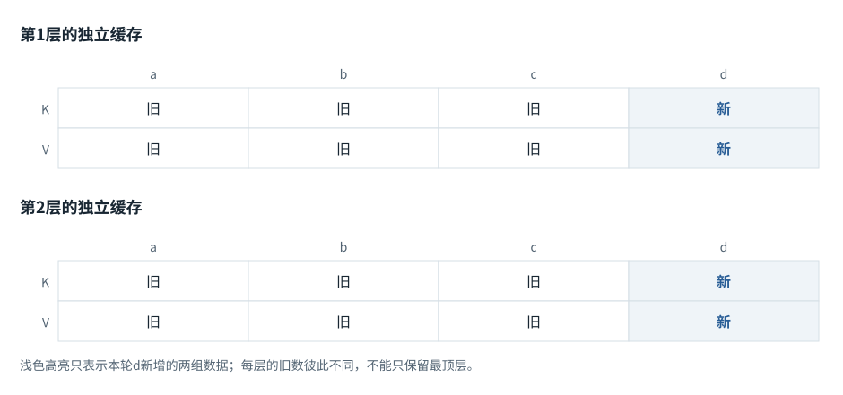
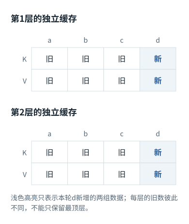
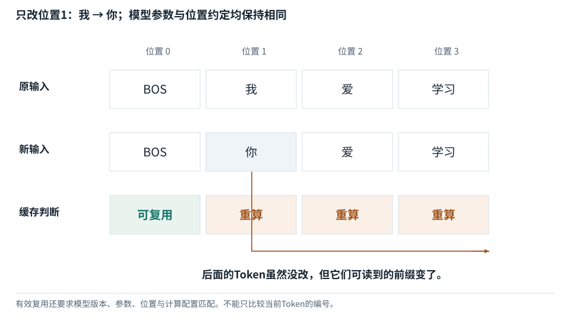
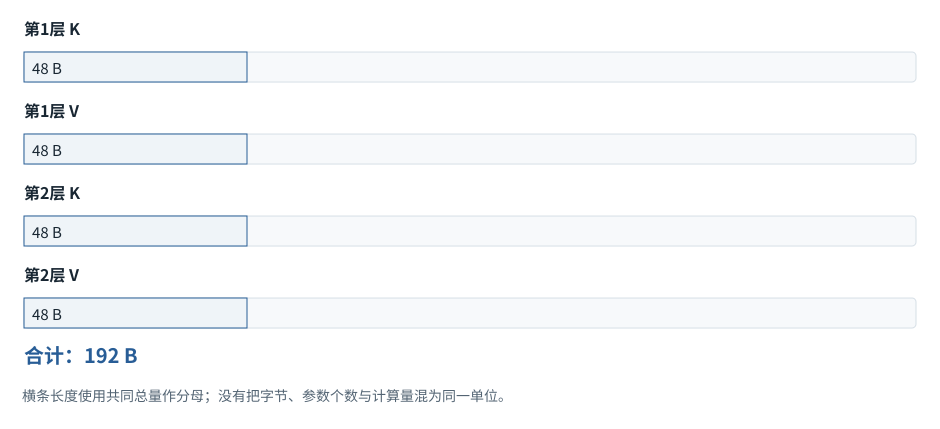
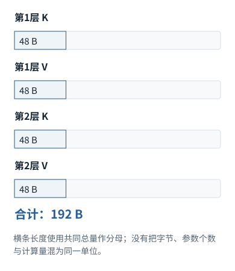
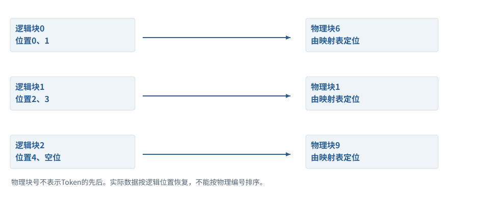
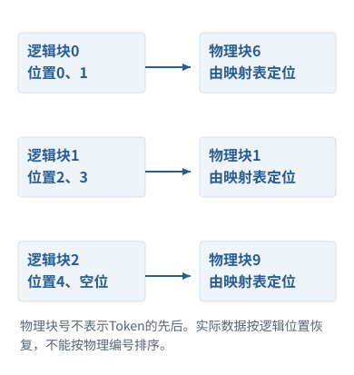

系统篇


<span id="ch07-s0"></span>


# 07｜KV Cache、FlashAttention与PagedAttention的内部过程


<span id="section-1"></span>


### 本章预备知识


<span id="concept-intro-7"></span>


先认识这里的对象与符号

[FlashAttention：改变中间数据存取方式](../concepts.md#concept-flash)
:   通过分块和在线归一化等方式，避免把完整注意力分数/权重矩阵长期写到较慢显存；目标仍是同一个注意力运算，浮点舍入可随运算次序变化。它不是把Token永久压缩，也不是跳过所有Key。区分“不把整张表落显存”与“没有进行这些数学计算”。

[PagedAttention：分页管理K/V存储](../concepts.md#concept-paged)
:   把逻辑连续的K/V序列存到多个物理块，通过块表定位。它主要改变存储管理与共享方式，不把注意力公式替换成另一种语义算法。独立例：逻辑位置0—3在物理块7、4—7在块2；逻辑第4个位置不必物理紧跟第3个位置。

缓存保留可复用的旧计算；FlashAttention减少中间数据搬运；分页缓存改变存储管理。三者都可能改善效率，但不是同一个算法，更不能都理解为压缩语义。

本章各题列出所需基础。可先完成相应基础课，也可通过自检确认掌握程度。

[F06 · “放到设备”是什么](../foundations/06.md)[F07 · 模型最常做的算术](../foundations/07.md)[F08 · reshape、转轴、广播](../foundations/08.md)[F11 · Attention逐步计算](../foundations/11.md)[F12 · Mask不是黑箱](../foundations/12.md)[F13 · 位置编号与RoPE](../foundations/13.md)[F19 · KV Cache从零解释](../foundations/19.md)[F21 · 算得快与装得下](../foundations/21.md)

**进入深读前的小检查：**对一层3个位置、每行4个数的K和V，先数24个数。再乘层数和每数的字节数，最后讨论是不是还保留全部历史。

术语带虚线时可点击速查。公式中的字母先看定义；不要用猜缩写替代推导。

这是容易被一句话带过、也最值得逐步推导的部分。先回答“哪些计算真的不会变”，再回答“怎么少搬数据”和“怎么分配内存”。三类优化不能混淆。


<span id="visual-reading"></span>


<span id="topic-1"></span>


## 沿着对象与状态理解本章

这里有三个不同的存储问题：KV缓存跨轮保留历史；FlashAttention安排单次注意力的中间读写；PagedAttention管理物理缓存块。动画分别给出具体数据，避免将三种节约误认为都减少了相同计算。

下方图解的固定输入在“输入与适用条件”中声明。它用于解释本章机制，不与本章其他独立例子的数值暗中接续。


<span id="visual-O04"></span>

<span id="topic-2"></span>

<span id="topic-3"></span>

<span id="topic-4"></span>

<span id="topic-5"></span>

<span id="topic-6"></span>

<span id="topic-7"></span>


相关动态过程：[FlashAttention：一边读一边累计，不攒整张表](../visual/O04.md)。本节下文继续展示更具体的计算与工程边界。

继续看相关机制：[F19 · KV Cache：留下算过的，不省掉该读的](../visual/F16.md)[O01 · GQA/MQA：减少的是K/V组数](../visual/O01.md)[O05 · PagedAttention：逻辑连续，物理可以分块](../visual/O05.md)


<span id="Q025"></span>


## Q025｜为什么历史K/V可以缓存，而Q通常不缓存？请给出逐层解释。

这题先认识什么因果前提下旧位置不读取新位置，所以旧层K/V可复用。修改历史、模型或位置定义会破坏这个前提。

[F11 · Attention逐步计算](../foundations/11.md)[F12 · Mask不是黑箱](../foundations/12.md)[F13 · 位置编号与RoPE](../foundations/13.md)[F19 · KV Cache从零解释](../foundations/19.md)


<span id="ch07-s2"></span>


### 核心回答

因果Decoder中，旧位置的隐藏状态只依赖它及其之前的[Token](../glossary.md#g027 "模型分词器使用的片段单位。 例：可能是词、词的一部分、标点或部分字节。")；追加新Token不会改变这些旧状态。因此每层旧位置投影得到的K/V也不变。新位置只需要自己的Q，去查询该层历史K/V；旧Q产生的旧输出已经算完，通常无需再次使用。[[CACHE]](../sources.md#src-CACHE "来源说明")[[TR]](../sources.md#src-TR "来源说明")


<span id="ch07-s3"></span>


### 不是一句“缓存历史”就足够

用归纳法看。第0层的旧Token [embedding](../glossary.md#g038 "按输入编号取出对应可学习向量的参数表及操作。 例：E形状[6,4]，编号2取E的第2行。")和位置编码不变。假设第l层输入在旧位置不变，由于因果mask禁止看新增位置，旧位置的[attention](../glossary.md#g071 "计算查询与可读候选的匹配份额，再加权组合内容。 例：先计算分数和权重，再用权重混合V。")输入集合不变，attention输出也不变；[FFN](../glossary.md#g088 "通常在每个位置应用的前馈子网络。 例：常把宽度先扩展再缩回，带非线性或门控。")和归一化作用于原有相同输入，残差结果不变。因此第l+1层旧状态不变，归纳成立。


<span id="concept-intro-2"></span>


先认识这里的对象与符号

[Wo / W\_O：注意力输出投影](../concepts.md#concept-wo)
:   把各注意力头输出拼接后，再转换成主网络需要宽度的参数矩阵。它仍是一张系数表，不是softmax的份额，也不是词表输出头Wout。若两个头各输出2个数，拼接宽度4；右乘形状[4,6]的Wo，可得到6个数以匹配残差宽度。此为独立形状例。

生成新Token时，它在第l层先得到该层归一化状态，计算`q_new,k_new,v_new`，把新的K/V附加到该层缓存，执行`q_new @ K_allᵀ`、[softmax](../glossary.md#g062 "将各分数取指数，再除以所有指数之和。 例：分数[2,1,0]经Softmax后约为[0.6652,0.2447,0.0900]。")和加权求和，再通过Wo、残差、FFN进入下一层。直到全部层算完，才得到预测再下一个Token的[logits](../glossary.md#g091 "输出投影给各词表候选的未归一化分数。 例：可以是负数，还不是概率或Token编号。")。缓存不是一份跨层共享的文本向量，而是**每一层独立的K/V数组**。


<span id="concept-intro-4"></span>


先认识这里的对象与符号

[d\_k、d\_v、Dh：每行表示的宽度](../concepts.md#concept-dk)
:   d\_k表示一个Query/Key向量有多少个分量；d\_v表示一个Value向量有多少个分量。Dh或d\_h在一些章节中是单头宽度。它们是尺寸整数，不是第k个Key或某个Value数值。形状微例：Q[2,3]、K[5,3]、V[5,4]，则分数[2,5]，输出[2,4]。Q/K配对宽度3，Value宽度4仍合法。

若只保存最顶层K/V，下一Token在底层找不到所需历史表示。若保存旧Q，没有K/V，旧Q也不能让新位置恢复历史内容。常见缓存布局为K/V各`[B,H_kv,T,Dh]`，内核可能采用不同内存排布，但语义轴不应混淆。


<span id="concept-intro-1"></span>


先认识这里的对象与符号

[Query、Key、Value：三种中间数值表示](../concepts.md#concept-qkv)
:   q是接收信息的一行查询表示；k是可读位置提供的一行匹配表示；v是该位置供混合的一行内容表示。大写Q/K/V把多行收集成表。它们由输入与参数计算得到，分别承担打分与提供内容的职责。某个q与两个k点积得到两个分数；softmax得到两个份额；这些份额分别乘两行v，再相加。这里不生成搜索词，也不直接选答案。


<span id="mechanism-Q025"></span>


<span id="topic-8"></span>


### 旧K/V为什么能复用：新Token不能反向改变旧前缀

**本例条件：**独立两层、严格因果、推理模式例：先处理a,b,c，再输入d。参数、旧前缀、位置规则不变；每层缓存保存自己的K/V。

因果依赖
:   位置c的计算只能依赖a,b,c。

逐层缓存
:   第一层和第二层保存的不是同一组数。

新Query
:   只负责本轮新位置的读取。

**旧K/V为什么能复用：新Token不能反向改变旧前缀**





本图仅使用当前算例声明的输入；具体公式、来源和边界见紧邻正文。

[SVG图源](../../diagrams/rendered/Q025-4823f008d8c8.svg) · [原算例数据：Q025](../../diagrams/source/mechanism-cases.json)

核对完整输入与结果

本图使用的数据与条件

| 层与时间 | 仍然可复用 | 必须新计算 |
| --- | --- | --- |
| 第1层追加d | K/V(a,b,c) | Q/K/V(d) |
| 第2层追加d | 本层K/V(a,b,c) | 由第1层新d得到本层Q/K/V(d) |
| 完成本轮 | 两层历史各增长到4位置 | 仅用最新末位置预测下一项 |
| 若把b换掉 | a之前可保留的范围另行核对 | b及受其影响的后缀需重算 |

#### 怎样把图中的变化读明白

证明从第一层向后做：旧位置看不到新d，因此第一层旧表示不变；第二层的旧输入也就不变，逐层成立。

旧Q主要用于计算旧位置的输出。当前只要求d的新输出，不需要再用旧Q发起读取，所以通常缓存K/V而不是Q。

模型参数、模板或旧位置改变会破坏复用前提。“同一个会话”不是缓存有效性的数学条件。

**不要混淆：**双向注意力中旧位置可能看见新增内容，不能无条件套用这条因果缓存论证。

机制依据：[[CACHE]](../sources.md#src-CACHE) [[TR]](../sources.md#src-TR) [[CACHE-HF]](../mechanisms/sources.md#source-CACHE-HF)。本例数字和宿主场景为明确给定的教学设定，不是商业模型输出或生产性能测量。


<span id="worked-Q025"></span>


运行示例 · Q025


<span id="topic-9"></span>


### 用因果依赖逐层证明旧K/V为什么不变

**输入与条件。**两层模型先处理Token A、B，再追加C。所有层都是固定权重的因果层，归一化与FFN不跨位置混合。

| 步骤与对象 | 内部动作 | 中间结果 / 新状态 |
| --- | --- | --- |
| 1第0层输入 | A、B的Embedding和位置未变 | 旧输入相同。 |
| 2第0层可见集合 | A只看A，B只看A/B | 追加C不在旧查询可见范围内。 |
| 3第0层结果 | 旧输入和可见集合都不变 | A、B的第0层输出不变。 |
| 4第1层输入 | 来自第0层旧结果 | 因此第1层A、B的K/V也不变。 |
| 5新C的过程 | 在每层只算C的Q/K/V，并查该层A/B缓存 | 不是只查顶层。 |
| 6反例 | 把B改成D后仍复用B及其后缓存 | 因果依赖前提已破坏，需要从改动处重算。 |

**把过程连起来。**缓存成立是依赖关系结论，不是因为历史发生过就自动永久有效。

**边界与反例。**双向模型、跨位置统计或动态位置变换需另行证明；本例限标准固定因果层。

依据与适用范围：[[CACHE]](../example-sources.md#ex-src-CACHE)。示例输入和场景由本书明确设定。


<span id="ch07-s4"></span>


### 追问：编辑Prompt第100个Token后，哪些缓存还能用？


<span id="concept-intro-8"></span>


先认识这里的对象与符号

[Schema与Structured Outputs](../concepts.md#concept-schema)
:   Schema是一份字段和类型等结构规则；结构化输出机制让模型更容易返回符合规则的数据。字段合法仍不等于目标文件存在、已授权或业务正确。独立例：要求path为字符串；{"path":3}类型不合规则，{"path":"missing.py"}虽结构合规则仍可能找不到文件。

在相同权重、模板、位置与运行约束下，第0至99个Token对应的缓存仍可能复用；第100个及其后继依赖已改变，需要重算。这里说的是模型实际Token前缀，不是人眼看到的相同字符。更换系统指令、工具[schema](../glossary.md#g141 "对数据字段及类型等结构的约束描述。 例：path是字符串，不表示可以读取任意路径。")、adapter或位置规则可能在更早处改变前缀。不能只把编辑的那个Token缓存改掉，而保留其后所有上下文化状态。


<span id="ch07-s5"></span>


### 追问：为什么训练通常不直接复用跨优化步的KV？

权重更新后，原K/V不再是新参数对原前缀的计算结果；而且训练需要相应计算图和梯度。将旧缓存用于新权重前向会破坏目标一致性。推理时`no_grad`和固定参数是常见缓存前提，不应把推理优化直接套到普通训练循环。


<span id="ch07-s6"></span>


### 追问：哪些模型不能按这个证明直接缓存？

双向编码器中旧位置可依赖后面Token，追加输入会改变旧状态；某些跨Token归一化、动态位置变换或修改历史的架构也需另行分析。滑动窗口、循环状态和混合模型有各自状态机制。本章证明适用于固定前缀、固定参数的标准因果层，不能由此断言所有模型都有同样缓存。


<span id="engineering-E13"></span>


工程深挖 · E13 · 接续Q025


<span id="engineering-E13-title"></span>


### 缓存共享的两个危险：身份不完整与可变对象别名

预备知识：[F19](../foundations/19.md) · [F24](../foundations/24.md) · [F33](../foundations/33.md)。阅读顺序：先确认运行契约，再看反例与修复，最后检验边界。


<span id="engineering-E13-detail-1"></span>


#### 缓存命中必须证明“算过的是同一个函数”

K/V来自前缀和模型计算，不是Token字符串的固有属性。同样Token在不同权重、适配器、位置配置、多模态特征下可得到不同K/V。vLLM块缓存设计采用前缀链与额外身份信息，并提供按请求盐限制信任域复用。[[PREFIX]](../engineering/sources.md#src-PREFIX "vLLM · Automatic Prefix Caching")

因此缓存key不是“今天这个问题的字符串哈希”就够。至少明确计算身份、精确前缀、表示布局和有效位置；服务端已在namespace隔离的字段不必重复放每个key，但**隔离条件必须真实存在**。租户盐限制共享不是认证系统，不能因为知道盐就获得数据访问权限。


<span id="engineering-E13-detail-2"></span>


#### 共享内存如何制造跨请求污染

教学程序`prefix=[1,2,3]; a=prefix; b=prefix`让两请求持有同一个可变列表。A追加4后，B也“看到”4。真实KV是更大块数组，但别名问题相同：共享的完整前缀可以只读复用，可追加的尾块需要按实现做copy-on-write、独占或引用管理。

本书用真实Python对象复现该问题，再用独立尾副本使B仍为[1,2,3]。这个实验解释可变共享风险，不声称复现vLLM某个bug。完整块共享、未满块追加与释放的生命周期应分别验证。


<span id="engineering-E13-detail-3"></span>


#### 无法仅靠哈希解决的问题

即便key正确，仍可能发生过期指针、块被回收后继续读、写者遗漏锁、布局改版而消费者未更新。哈希碰撞是另一个层面；加密哈希可以降低碰撞风险，但不能修复引用计数和并发竞态。


<span id="engineering-E13-detail-4"></span>


#### 追问：为什么缓存通常强调连续前缀？

自回归层中某位置的表示依赖之前可见内容。中间改一个Token后，后续很多位置即使ID没变，其K/V也可能改变。只复用“相同片段”而不考虑前缀依赖会错误；需要证明依赖上下文相同，而非只找到一段重复文字。[[CACHE]](../engineering/sources.md#src-CACHE "Transformers · Cache explanation")


<span id="engineering-E13-detail-5"></span>


#### 追问：共享前缀有安全副作用吗？

可能。命中与未命中的响应时间差可能泄露共享状态存在性；vLLM的cache\_salt就是一种按信任域隔离设计。它带来共享率与隔离的取舍。不要把性能优化天然视为与安全无关，也不要声称单一盐解决了所有侧信道。


<span id="engineering-E13-detail-6"></span>


#### 排障证据

记录命中长度、计算身份、块引用生命周期和缓存关闭时的对照结果。敏感Prompt不应为诊断直接明文写日志。出现跨请求不一致时优先复现“两个分支共享前缀、各自追加不同Token”，而不是只跑单请求顺序生成。


<span id="engineering-E13-observations"></span>


#### 本地观察与复核入口

以下为随包程序实际运行记录。数值算子、临时文件／数据库实验与教学逻辑模拟各自的范围，在实验页逐项注明；不能据此声称已测试商业模型或生产环境。


<span id="mechanism-record-E13"></span>


#### E13：怎样读这份结果，而不是只看“通过”

首先核对缓存键是否包含模型、适配器、前缀及位置等身份，再检查两个请求是否意外共享可变对象。键相同不该复用、对象别名导致串写，是两类独立的缓存错误。

实验记录：字段与原值

| 原始字段路径 | 原始值 |
| --- | --- |
| E13.aliased\_b | [1, 2, 3, 4] |
| E13.copy\_on\_write\_b | [1, 2, 3] |
| E13.keys\_differ | true |

这里是实际实验记录，不用条长或箭头伪装成额外证据；完整日志与解释仍保留在本节。

本图整理的是本小节已有的局部实验记录，不把通过局部测试扩展为产品在所有环境下可靠。原测试环境、输入和完整输出仍以本节记录为准。

```
{
  "E13": {
    "aliased_b": [
      1,
      2,
      3,
      4
    ],
    "copy_on_write_b": [
      1,
      2,
      3
    ],
    "keys_differ": true
  }
}
```

[本条全部结果、验证范围与完整代码 →](../engineering/labs.md#proof-E13)

**自检：**Token序列相同但LoRA不同，是否能直接复用同一KV？

<details class="quiz-answer"><summary><span class="when-closed">查看参考答案</span><span class="when-open">收起参考答案</span></summary><div class="answer">不能仅凭Token相同判断。适配器改变投影或前层表示，可改变K/V；缓存身份需体现适配器或由服务明确隔离相应计算空间。</div></details>

证据核对：2026-10-21。[[PREFIX]](../engineering/sources.md#src-PREFIX) [[CACHE]](../engineering/sources.md#src-CACHE) · [事实、推导与实验的边界](../engineering/sources.md#evidence-levels)


<span id="core-api-boundaries-1"></span>


<span id="core-api-boundaries-1--mc-section-1"></span>


## 从手算走到API，先核对接口语义

公式描述目标计算；API还规定张量布局、mask约定、缩放、dropout与位置等细节。很多错误不导致异常，只让结果偏掉。本课用明确的小反例检查，而不是靠生成一句“看起来正常”的文字判断。

依据：[tiny\_model.py:53–80](../reference/model-code.md#tiny_model-L53)；[对应参数、前向及梯度记录](../labs/model-values.md)。


<span id="core-api-boundaries-2"></span>


<span id="core-api-boundaries-2--mc-section-2"></span>


## 非方阵自动因果掩码可能对齐错误

独立反例：已有3个历史位置，新Query有2行，总Key有5行。把q/k设为0，所有允许分数相等；Value取[1,2,3,4,5]，这样输出就是允许项的平均值。

正确绝对位置mask第一行读1—4得到2.5，第二行读1—5得到3.0。若错误用局部左上三角，第一行只读1，第二行读1、2，得到1.0和1.5。两者shape完全一样。

允许表差异会直接改变结果

| 对象／位置 | Key0 | Key1 | Key2 | Key3 | Key4 |
| --- | --- | --- | --- | --- | --- |
| 正确q位置3 → 2.5 | 1 | 1 | 1 | 1 | 0 |
| 正确q位置4 → 3.0 | 1 | 1 | 1 | 1 | 1 |
| 错位局部行0 → 1.0 | 1 | 0 | 0 | 0 | 0 |
| 错位局部行1 → 1.5 | 1 | 1 | 0 | 0 | 0 |

展示值经过舍入；后续运算使用未舍入值。

PyTorch 2.10 SDPA的非方阵 `is_causal=True`采用相应左上对齐约定，不能在所有带缓存情形下直接套用。本实验使用显式正确mask，并与上述负控制对照。

依据：[tiny\_model.py:53–80](../reference/model-code.md#tiny_model-L53)；[对应参数、前向及梯度记录](../labs/model-values.md)。


<span id="trace-cache-invalid"></span>


**输入前缀改变会使后缀缓存失效**



数据/调用方向以图中连线为准；参数与激活、训练与推理分别标注。

[SVG图源](../../diagrams/rendered/trace-cache-invalid-a891275d164b.svg)

依据：[tiny\_model.py:58–80](../reference/model-code.md#tiny_model-L58)；[test\_model.py:132–149](../reference/model-code.md#test_model-L132)。[Mermaid源文件](../diagrams/cache-invalid.mmd)。


<span id="core-api-boundaries-3"></span>


<span id="core-api-boundaries-3--mc-section-3"></span>


## 两个mask，三个位置概念

attention mask控制可读Key；loss mask控制训练哪些目标被评分。position\_ids控制位置编码，cache槽位是存储排列，二者在有左PAD、滑动窗口或分页时不一定是同一个数字。

本M无PAD的缓存长度可直接用来产生新绝对位置；把这条方便条件推广到所有生产模型会出错。左补齐时常需要按有效Token累计产生语义位置，具体仍由模型接口决定。

依据：[tiny\_model.py:53–80](../reference/model-code.md#tiny_model-L53)；[对应参数、前向及梯度记录](../labs/model-values.md)。


<span id="core-api-boundaries-4"></span>


<span id="core-api-boundaries-4--mc-section-4"></span>


## 最后一个“物理位置”不一定是最后一个“有效Token”

如果批中某句右补了PAD，直接用logits[:,−1]可能取到占位项。不能说反正masked了所以结果一样：PAD位置仍可能有自己的Query和输出。常见生成接口因此要求适当左补齐或正确追踪长度。本模型测试显式比较有效最后位置与物理最后位置，并拒绝把它们混同。

依据：[tiny\_model.py:53–80](../reference/model-code.md#tiny_model-L53)；[对应参数、前向及梯度记录](../labs/model-values.md)。


<span id="core-api-boundaries-5"></span>


<span id="core-api-boundaries-5--mc-section-5"></span>


## 缩放一次、softmax一次、shift一次

手写QKᵀ已除sqrt(d)后再交给会自动缩放的API，可能除两次。把softmax概率交给期望logits的CE，做了另一种损失。数据准备shift后再让模型内部shift，目标错开两位。三个问题都常常“能跑”，所以必须对照具体一格数值。

依据：[tiny\_model.py:53–80](../reference/model-code.md#tiny_model-L53)；[对应参数、前向及梯度记录](../labs/model-values.md)。


<span id="core-api-boundaries-6"></span>


<span id="core-api-boundaries-6--mc-section-6"></span>


## 训练模式的陷阱不是只有Dropout

本M没有Dropout，但真实模型还可能有缓存开关、随机重计算、混合精度、非确定内核和不同注意力实现。`.eval()`、无梯度上下文、`dropout_p=0`和权重冻结不是同一个开关。每个需要实际确认它控制哪一步。

依据：[tiny\_model.py:53–80](../reference/model-code.md#tiny_model-L53)；[对应参数、前向及梯度记录](../labs/model-values.md)。


<span id="core-api-boundaries-7"></span>


<span id="core-api-boundaries-7--mc-section-7"></span>


## 全遮蔽、过期缓存和边界长度

所有Key都不允许时，本实现直接报错；加载新参数后继续旧缓存，测试会观察到与完整前向不一致；新输入超出位置表长度8，本模型拒绝越界。没有用“截断掉就行”掩盖这些语义问题。

| 测试输入 | 应满足的性质 | 故意破坏的方式 |
| --- | --- | --- |
| 同一前缀，修改未来 | 前缀logits不变 | 关闭因果mask |
| 相同序列，缓存vs全量 | 最后logits近似一致 | 重置新Token的位置 |
| 相同权重和输入 | 相同条件下重现 | 混入旧版本KV |
| 输入/目标错开一项 | 监督下一Token | 重复shift |
| 相同概率来源 | CE与手算负log一致 | 先softmax再CE |

依据：[tiny\_model.py:53–80](../reference/model-code.md#tiny_model-L53)；[对应参数、前向及梯度记录](../labs/model-values.md)。


<span id="core-understanding-8"></span>


<span id="core-understanding-8--mc-section-8"></span>


## 追问：为什么旧KV能复用，旧梯度图却不能无限复用？

KV复用依赖固定参数和因果前缀；训练step改变参数，旧激活与新参数不再同一次计算条件。反向还受图保存、生命周期和是否保留图等约束。把推理缓存概念套到普通全序列训练会遗漏这些前提。

依据：[tiny\_model.py:178–258](../reference/model-code.md#tiny_model-L178)；[对应参数、前向及梯度记录](../labs/model-values.md)。


<span id="Q026"></span>


## Q026｜KV缓存到底节约多少计算，又占多少显存？

这题先认识什么缓存总量要数K和V两份、层数、位置数、KV头数、每头宽度与元素字节数。不要用查询头数代替共享后的KV头数。

[F02 · 一排数、一张表和一叠表](../foundations/02.md)[F06 · “放到设备”是什么](../foundations/06.md)[F19 · KV Cache从零解释](../foundations/19.md)


<span id="ch07-s8"></span>


### 核心回答

它避免对整个历史反复执行投影、FFN和旧查询的attention；新查询仍需读取历史K/V。一次decode的attention仍随已缓存长度增长，整个生成过程也不是无条件线性。显存由层数、[batch](../glossary.md#g034 "一起组织计算的一组输入。 例：普通样本batch不让不同用户相互读取内容。")、KV头数、长度、头维度和[dtype](../glossary.md#g041 "规定每个元素如何存储与运算。 例：整数编号与浮点表示通常不是同一dtype。")决定。


<span id="ch07-s9"></span>


### 把复杂度拆开


<span id="symbol-intro-1"></span>


先认识这里的对象与符号

[O(·)：随规模增长的数量级](../concepts.md#concept-big-o)
:   大O用于表达规模增长时的上界量级，常省略常数及较小项。必须说明哪些变量在增大、是在算单步还是整个序列。这里O不是注意力输出矩阵。长度翻倍时，主项T²会变四倍，但实际耗时还受固定开销、内存和硬件利用率影响，不能仅用大O承诺测速结果。

设模型宽度d、前缀P、生成M个Token。忽略常数，单层对长度T全量前向的线性投影/FFN约`O(Td²)`，attention约`O(T²d)`。没有缓存，每生成一步都重做越来越长的前缀。

使用缓存后，[Prefill](../glossary.md#g098 "处理当前已经知道的一段输入前缀。 例：得到各层表示及可复用的K/V。")仍处理P个位置；每个decode只做新Token的投影/FFN约`O(d²)`，以及新Q对T个K/V的attention约`O(Td)`。M步attention合计近似`O((PM+M²)d)`，另有`O(Md²)`的层内计算。相比反复全量前向大幅减少，但不能表述为“KV让attention从平方永远变成线性”。讨论复杂度必须说明是单步还是整段、固定P还是P与M一起增长。

缓存字节数的常用估算是：

```
KV bytes = 2 × L × B × T × H_kv × Dh × bytes_per_element
```

前面的2来自K和V。教学例：L=32，B=1，T=32768，H\_kv=8，Dh=128，[FP16](../glossary.md#g043 "不同的32位或16位浮点格式，范围与精度不一样。 例：FP16和BF16都通常占2字节，但不能视为同一数值格式。")每元素2字节，结果是4GiB；每多一个Token约增加128KiB。若改为32个KV头而其他不变，就是16GiB。这个估算不包括权重、页面碎片、workspace和服务元数据。实际设备能接多少并发不能只拿总显存除以这个数字。


<span id="concept-intro-5"></span>


先认识这里的对象与符号

[MHA、MQA、GQA：头怎样共享](../concepts.md#concept-heads)
:   一个注意力头是一套匹配并聚合内容的路径。MHA常让每个Query头有自己的K/V头；MQA让多个Query头共用一组K/V；GQA在两者之间，分组共享。它们是结构选择，不是运行时随便改一个开关。独立形状例：8个Query头、2个K/V头，若均匀分组，每4个Query头共享1组K/V；缓存按K/V头数记账。


<span id="mechanism-Q026"></span>


<span id="topic-10"></span>


### 缓存用字节计数，计算节省另算一笔

**本例条件：**独立配置：batch=1、层数2、KV头数2、历史长度3、每头宽度4，每数2字节。K和V各一份；不含缓存块元数据和对齐。

L
:   层数。

Hkv
:   真正保存的KV头数，不是Query头数。

T
:   已处理、实际占缓存的历史位置数。

**缓存用字节计数，计算节省另算一笔**





本图仅使用当前算例声明的输入；具体公式、来源和边界见紧邻正文。

[SVG图源](../../diagrams/rendered/Q026-582f2e25556a.svg) · [原算例数据：Q026](../../diagrams/source/mechanism-cases.json)

核对完整输入与结果

本图使用的数据与条件

| 范围 | 元素数 | 字节数 |
| --- | --- | --- |
| 一层的K | 1×2×3×4=24 | 48 B |
| 一层K+V | 2×24=48 | 96 B |
| 两层K+V | 2×48=96 | 192 B |
| 历史长度变为4 | 1×2层×2×2头×4位置×4=128 | 256 B；增加64 B |

#### 怎样把图中的变化读明白

逐个因子说出含义，比直接背公式更能避免把Query头数填进KV头数。最后乘每数的字节数。

缓存减少旧位置的投影和层内重算，但新Query仍需读取历史Key/Value。序列越长，读缓存的工作通常也越多。

因此“开启缓存后生成每个Token耗时完全恒定”不是正确结论；缓存占用还会限制同时服务的请求数。

**不要混淆：**上述是裸张量大小；真实显存还包括参数、临时张量、分页、碎片和框架开销，不能用192B推算整个模型内存。

机制依据：[[CACHE]](../sources.md#src-CACHE) [[GQA]](../sources.md#src-GQA) [[CACHE-HF]](../mechanisms/sources.md#source-CACHE-HF)。本例数字和宿主场景为明确给定的教学设定，不是商业模型输出或生产性能测量。


<span id="worked-Q026"></span>


运行示例 · Q026


<span id="topic-11"></span>


### 把一条长上下文的K/V字节数从单位算出来

局部核对例：以下输入以本例列出的条件为准，不能把它的中间值接到贯通模型的计算记录中。

**输入与条件。**L=32层，B=1，T=32768，Hkv=8，Dh=128，FP16每数2字节。

| 步骤与对象 | 内部动作 | 中间结果 / 新状态 |
| --- | --- | --- |
| 1一份K | 32×1×32768×8×128个数 | 1,073,741,824个元素。 |
| 2换字节 | K元素数×2 | 2,147,483,648字节，即2GiB。 |
| 3加V | K和V大小相同 | 合计4GiB。 |
| 4增一个Token | 2×32×1×8×128×2 | 131,072字节，即128KiB。 |
| 5改MHA对照 | KV头从8增到32，其余不变 | 缓存16GiB，但这不是整个模型显存。 |

**把过程连起来。**公式前面的2来自K/V两份，最后的2来自FP16字节数，二者不能混在一起忘记。

**边界与反例。**按GiB=2³⁰计算；不含权重、页表碎片、工作区和服务开销。

[查看本例程序结果](../example-verification.md#result-Q026) · [完整可运行代码](../example-verification.md#code)

依据与适用范围：[[CACHE]](../example-sources.md#ex-src-CACHE)。示例输入和场景由本书明确设定。


<span id="ch07-s10"></span>


### 追问：为什么长上下文decode可能受显存带宽限制？

新查询计算量相对有限，却需要逐层读取大量历史K/V；若计算强度低，搬运速度限制总时间。增加batch可以提高某些权重读取的复用，但也增加KV总量与服务延迟。[GPU](../glossary.md#g045 "适合大规模并行数值运算的处理器。 例：数据搬到GPU不改变编号语义，但消耗时间和显存。")峰值算力高不意味着单请求长上下文一定更快，需看实际内核和内存访问。


<span id="ch07-s11"></span>


### 追问：KV量化与权重量化是同一种优化吗？

量化对象不同。权重量化主要减少模型参数存储和读取；KV量化主要减少随上下文与并发增长的动态状态。K的误差改变attention分数，V的误差改变聚合结果，两者都可能影响长程信息利用。应评测不同长度和任务，而不只看短答案质量。


<span id="ch07-s12"></span>


### 追问：Prompt Cache与KV Cache什么关系？

KV是计算状态形式；Prompt Cache是服务对重复前缀复用计算的一种产品/系统能力，底层可能利用KV等状态。缓存命中需要满足服务规则，并非会话持久化就自然命中。[API](../glossary.md#g139 "程序之间约定输入、输出与行为的接口。 例：不是人类界面的按钮本身。")里的cached tokens计费与具体KV物理驻留不是一一可见映射。[[PCACHE]](../sources.md#src-PCACHE "来源说明")


<span id="Q027"></span>


## Q027｜FlashAttention为什么省内存？不存完整注意力矩阵怎样算softmax？

这题先认识什么FlashAttention仍计算同一注意力目标，主要避免把巨大中间矩阵写回显存。理解在线归一化前先会softmax最大值平移。

[F07 · 模型最常做的算术](../foundations/07.md)[F09 · 概率、指数与softmax](../foundations/09.md)[F11 · Attention逐步计算](../foundations/11.md)[F21 · 算得快与装得下](../foundations/21.md)


<span id="ch07-s14"></span>


### 核心回答

[FlashAttention](../glossary.md#g131 "通过分块和更有效内存访问计算注意力的一类实现。 例：不是稀疏注意力，也不是把旧历史摘要掉。")把attention计算按块组织，利用更快的片上存储，避免将完整T×T分数和概率矩阵反复写回高带宽显存。它用在线softmax维护每个查询的归一化统计，计算的是同一类精确attention，不是删除低权重项的近似检索。[[FLASH]](../sources.md#src-FLASH "来源说明")


<span id="ch07-s15"></span>


### 推导在线softmax合并

对一个固定查询，一批分数为s\_j、值向量为v\_j。维护三个量：当前最大值m，指数和l，以及未归一化加权和u。


<span id="concept-intro-3"></span>


先认识这里的对象与符号

[Σ：按下标逐项求和](../concepts.md#concept-sum)
:   Σ是加法的简写。下标指出哪项在变化；没有被求和的下标保持不变。它不是一个额外参数，也不表示把数组拼在一起。独立微例：Σᵢ xᵢyᵢ，x=[1,2]、y=[3,4]，就是1×3+2×4=11。

```
m = max(s_j)
l = Σ exp(s_j−m)
u = Σ exp(s_j−m) v_j
最终输出 o = u/l
```

旧块统计为`m_old,l_old,u_old`，新块分数最大值为m\_b。令`m_new=max(m_old,m_b)`，则：

```
α = exp(m_old−m_new)
l_new = α l_old + Σnew exp(s_j−m_new)
u_new = α u_old + Σnew exp(s_j−m_new) v_j
```

关键是当最大值变化时，旧统计必须同步缩放。否则不同块使用不同归一化基准，结果就不等于全量softmax。对每个查询遍历K/V块，最后除以l即可。矩阵内核会并行处理查询块，并融合mask、缩放等操作；训练反向可根据保存的少量统计重新计算所需块，而非保存全部概率矩阵。

举例：旧块只有分数1和值2，则m=1,l=1,u=2。新块分数3、值10，合并后m=3，l=[exp](../glossary.md#g060 "指数函数，将数值转换为正数；e约2.71828。 例：exp(0)=1，exp(ln2)=2。")(−2)+1，u=2exp(−2)+10，输出约9.0464。若忘记给旧u乘exp(−2)，输出会明显错误。


<span id="mechanism-Q027"></span>


<span id="topic-12"></span>


### 不存完整softmax表，也能把前后块合成同一答案

**本例条件：**独立标量Value例：分数s=[0,ln2]，值v=[10,20]。分别处理一项；保存运行最大值m、指数和l、加权和o，最后输出o/l。

m
:   当前已看部分的最大分数。

l
:   以当前m为基准的指数和。

o
:   同一基准下指数乘Value的和。

不存完整softmax表，也能把前后块合成同一答案

| 处理状态 | m / l / o | 解释 |
| --- | --- | --- |
| 块1：s=0,v=10 | 0 / 1 / 10 | 先有一个候选 |
| 加入块2，m变ln2 | 旧l缩半=0.5；旧o缩半=5 | 换基准时两份统计一起缩放 |
| 合并第二项 | ln2 / 1.5 / 25 | 新项指数1，贡献20 |
| 输出 | 25/1.5=16.666667 | 等于(10×1+20×2)/(1+2) |

各行是独立对象或条件的对照，不暗示上一行的结果自动进入下一行。

#### 怎样把图中的变化读明白

最容易漏的是第二行：最大值变了，旧指数统计也必须改到同一基准。只加新项而不缩放旧项，最后就不是同一个softmax。

l只要一个标量，o按Value宽度保存一排数，不必把每个位置的完整概率都写到外部显存。

FlashAttention利用分块和在线归一化减少IO；这不表示少看几个Token，也不等于近似稀疏注意力。

**不要混淆：**本例证明合并恒等式，不是GPU性能测量；实际速度取决于核实现、形状、dtype和硬件。

机制依据：[[FLASH]](../sources.md#src-FLASH) [[TR]](../sources.md#src-TR)。本例数字和宿主场景为明确给定的教学设定，不是商业模型输出或生产性能测量。


<span id="worked-Q027"></span>


运行示例 · Q027


<span id="topic-13"></span>


### 两块分数如何不存完整概率表也得到同一结果

局部核对例：以下输入以本例列出的条件为准，不能把它的中间值接到贯通模型的计算记录中。

**输入与条件。**固定一个查询，第一块只含score=1、value=2；第二块score=3、value=10。维护最大值m、指数和l、未归一化加权和u。

| 步骤与对象 | 内部动作 | 中间结果 / 新状态 |
| --- | --- | --- |
| 1读第1块 | m=1，l=exp(0)=1，u=2 | 临时输出2。 |
| 2读第2块 | 新最大值m=3 | 旧统计需乘exp(1−3)=exp(−2)。 |
| 3合并归一化分母 | l=exp(−2)+1 | 约1.135335。 |
| 4合并加权分子 | u=2exp(−2)+10 | 约10.270671。 |
| 5最后相除 | u/l | 约9.046377，与对[1,3]做全量softmax再加权相同。 |
| 6错误对照 | 只更新m却不给旧u、l缩放 | 不同块不在同一指数基准，结果错误。 |

**把过程连起来。**在线统计保留的是计算所需的充分数值状态，不是对文本做摘要。FlashAttention用分块与融合减少中间读写。

**边界与反例。**这只实现一个查询的在线softmax核心，不是GPU FlashAttention内核，也不证明任何加速倍数。

[查看本例程序结果](../example-verification.md#result-Q027) · [完整可运行代码](../example-verification.md#code)

依据与适用范围：[[FLASH]](../example-sources.md#ex-src-FLASH)。示例输入和场景由本书明确设定。


<span id="ch07-s16"></span>


### 追问：既然是精确算法，结果为什么可能不逐bit相同？


<span id="concept-intro-6"></span>


先认识这里的对象与符号

[LoRA、低秩及r](../concepts.md#concept-lora)
:   LoRA用两个较小矩阵的乘积表示一部分权重增量，而不是重新训练整个大矩阵。r是中间维度，限制这个乘积的最大秩。不同资料采用行/列向量约定时，A、B的左右次序可能不同。右乘约定微例：W[4,6]，增量A[4,2]B[2,6]仍为[4,6]；r=2。A在这里不是注意力份额表。

实数数学上等价，浮点加法次序、累加精度和内核融合会造成微小误差。“exact attention”主要是区别于稀疏/低秩近似，不是保证不同硬件逐bit一致。验证应设置合理数值容差，并区分随机性与数值舍入。


<span id="ch07-s17"></span>


### 追问：FlashAttention能代替KV Cache吗？

不能。前者优化一次attention如何计算与搬数据，后者避免下一步重算历史状态。两者通常互补。没有KV的快速attention仍会重复计算；有KV但低效内核仍可能搬运过多数据。


<span id="ch07-s18"></span>


### 追问：它是否把时间复杂度从O(T²)变成O(T)？

标准密集attention的配对数量仍是平方量级，只是减少内存流量和中间存储。不同硬件/长度下加速比不同。把论文的某个实验加速倍数直接搬到自己的模型与GPU是不严谨的，应分Prefill/Decode做实际基准。


<span id="engineering-E14"></span>


工程深挖 · E14 · 接续Q027


<span id="engineering-E14-title"></span>


### 在线softmax为什么必须重标定旧累积量，而不是平均各块答案？

预备知识：[F09](../foundations/09.md) · [F11](../foundations/11.md) · [F21](../foundations/21.md)。阅读顺序：先确认运行契约，再看反例与修复，最后检验边界。


<span id="engineering-E14-detail-1"></span>


#### 真正困难的地方不是“把大矩阵切小”

分块后仍要得到同一行softmax的全局归一化结果。每块独立softmax再平均，等价于强迫各块总权重相等；原本分数很高的块和很低的块被同等对待。FlashAttention一类精确注意力实现需要维护跨块归一化统计，而不是改变注意力目标。不同内核最终仍可能有浮点舍入差异。[[SDPA]](../engineering/sources.md#src-SDPA "PyTorch · scaled_dot_product_attention")


<span id="engineering-E14-detail-2"></span>


#### 跟踪三个累积对象

对已经处理的分数s与Value v，维护：m=当前最大分数，l=Σexp(s−m)，o=Σexp(s−m)v。o是未归一化内容和，不是最终输出。新块最大值让基准变成m′时，旧项都要乘`exp(m−m′)`，因为它们原来按旧基准计数。

```
m′ = max(m, 新块最大值)
l′ = exp(m−m′)·l + Σ新块 exp(s−m′)
o′ = exp(m−m′)·o + Σ新块 exp(s−m′)·v
最后输出 = o′ / l′
```

若只更新最大值而不缩放旧l/o，就把不同计量基准的数直接相加，得到错误分布。这是归一化状态的不变量，不是实现细节可以随便省略。


<span id="engineering-E14-detail-3"></span>


#### 固定高分数反例

使用分数[1000,1001,1008,1007]，Value依次[1,0]、[0,1]、[2,0]、[0,2]。全行结果约[1.461030,0.538059]。分别归一化两块再平均得到[0.865529,0.634471]，明显不等价。

本书程序以块长1、2、3、4分别累计，均与全行稳定softmax在1e−12范围内相符。测试故意用跨块最大值显著增长的输入；若所有块最大值相同，遗漏重标定的错误可能被掩盖。


<span id="engineering-E14-detail-4"></span>


#### 掩码和混合精度还要额外检查

含全遮蔽块时不能把无穷差变成NaN；须明确这块不贡献统计。最终全遮蔽行仍按E04处理。FP16/BF16输入时中间统计使用何种精度，会影响结果和代价；不要从本书Python双精度结果推断GPU逐位相同。


<span id="engineering-E14-detail-5"></span>


#### 追问：正确分块一定更快吗？

不。CPU小数组上的解释性实现可能更慢。加速依赖设备存储层级、并行组织和内核融合；正确性验证与性能基准是两个任务。报告要同时列设备、dtype、长度、batch、掩码、前后向与内存，而不是只报一个“快几倍”。[[SCHED]](../engineering/sources.md#src-SCHED "vLLM · Optimization and Tuning")


<span id="engineering-E14-detail-6"></span>


#### 追问：既然不保存完整权重，反向怎么求梯度？

实现可保留必要统计并在反向重算局部块，换取更低中间存储。必须查看所用内核保存了什么和如何恢复；“没有大矩阵”不等于没有足够梯度信息，也不等于反向无需额外计算。


<span id="engineering-E14-observations"></span>


#### 本地观察与复核入口

以下为随包程序实际运行记录。数值算子、临时文件／数据库实验与教学逻辑模拟各自的范围，在实验页逐项注明；不能据此声称已测试商业模型或生产环境。


<span id="mechanism-record-E14"></span>


#### E14：怎样读这份结果，而不是只看“通过”

不同块的指数可能使用不同最大值作为基准。合并前要把旧的分母和加权和一起换到新基准；直接平均块答案会忽略每块实际概率质量。

实验记录：字段与原值

| 原始字段路径 | 原始值 |
| --- | --- |
| E14.correct | [1.461030113080697, 0.5380588357249021] |
| E14.wrong\_block\_average | [0.8655292893150024, 0.6344707106849976] |

这里是实际实验记录，不用条长或箭头伪装成额外证据；完整日志与解释仍保留在本节。

本图整理的是本小节已有的局部实验记录，不把通过局部测试扩展为产品在所有环境下可靠。原测试环境、输入和完整输出仍以本节记录为准。

```
{
  "E14": {
    "correct": [
      1.461030113080697,
      0.5380588357249021
    ],
    "wrong_block_average": [
      0.8655292893150024,
      0.6344707106849976
    ]
  }
}
```

[本条全部结果、验证范围与完整代码 →](../engineering/labs.md#proof-E14)

**自检：**新块把最大分数从1提高到10时，旧l/o是否可以原样保留？

<details class="quiz-answer"><summary><span class="when-closed">查看参考答案</span><span class="when-open">收起参考答案</span></summary><div class="answer">不能。旧累积量按exp(s−1)计数，新块按exp(s−10)计数；必须将旧l/o乘exp(1−10)，统一基准后再相加。</div></details>

证据核对：2026-10-21。[[SDPA]](../engineering/sources.md#src-SDPA) [[SCHED]](../engineering/sources.md#src-SCHED) · [事实、推导与实验的边界](../engineering/sources.md#evidence-levels)


<span id="Q028"></span>


## Q028｜PagedAttention的“分页”具体分页什么？为什么能提升并发？

这题先认识什么分页让逻辑连续的缓存放在物理分块中；页表记录映射，共享前缀要考虑写时复制。它不是删除历史Token的摘要。

[F06 · “放到设备”是什么](../foundations/06.md)[F19 · KV Cache从零解释](../foundations/19.md)[F21 · 算得快与装得下](../foundations/21.md)


<span id="ch07-s20"></span>


### 核心回答

分页把每条序列逻辑上连续的KV分为固定大小块，映射到物理KV块池。序列增长时按需分配，不必预留一大段连续显存；多个请求和共享前缀可以更灵活地使用内存。它主要改变KV的存储管理与访问映射，不改变模型看到的Token顺序。[[PAGED]](../sources.md#src-PAGED "来源说明")


<span id="ch07-s21"></span>


### 一个块大小为4的例子

请求A已有10个Token，需要3个逻辑块。块表可能是`A:[7,2,19]`，分别指向物理块7、2、19。逻辑位置5位于逻辑块1、块内偏移1，实际访问物理块2的偏移1。A再追加第11、12个Token可填满块19；第13个Token才需要新块。

请求B可以使用物理块3、15，完全不必与A连续。请求结束时释放引用，块回到池中。最后一个块可能有内部碎片，但通常比每请求按最大长度预留大段空间更可控。内核借助块表按逻辑序列访问K/V，必须保持位置、长度和mask正确。

若A、B有完全相同前缀，可在满足实现规则时共享前缀块并增加引用计数。对共享的未满末块写入新Token时可能需要copy-on-write；否则A的追加会污染B。前缀哈希也必须包含足以区分模型、Token前缀、适配器等有效身份的信息，不能只按人类输入文本共享。


<span id="mechanism-Q028"></span>


<span id="topic-14"></span>


### 分页改变物理存放，不改变Token的逻辑次序

**本例条件：**独立KV分配例：每块容纳2个位置，序列有5个位置；逻辑块0/1/2分别映射物理块6/1/9。

逻辑位置
:   Token在这条序列里的顺序。

物理块
:   显存里实际可分配的存储单元。

块内偏移
:   一个Token在当前块的第几格。

**分页改变物理存放，不改变Token的逻辑次序**





本图仅使用当前算例声明的输入；具体公式、来源和边界见紧邻正文。

[SVG图源](../../diagrams/rendered/Q028-63a59c0b3045.svg) · [原算例数据：Q028](../../diagrams/source/mechanism-cases.json)

核对完整输入与结果

本图使用的数据与条件

| Token位置 | 逻辑块 + 块内偏移 | 物理地址示意 |
| --- | --- | --- |
| 0 | 0 + 0 | 物理块6，第0格 |
| 1 | 0 + 1 | 物理块6，第1格 |
| 2 | 1 + 0 | 物理块1，第0格 |
| 3 | 1 + 1 | 物理块1，第1格 |
| 4 | 2 + 0 | 物理块9，第0格；另一格闲置 |

#### 怎样把图中的变化读明白

按位置2读取时，先算整除2得到逻辑块1，再查映射得到物理块1。物理编号小并不表示它更早。

这条序列不需要占一整段连续大空间；结束后可以按块释放。共享前缀还需要引用计数和写时复制等语义。

分页主要改内存管理。位置规则、可见范围和Key/Value内容仍必须对应原序列，不能因为存储分散而重排Token。

**不要混淆：**最后一块只用了半块，仍有内部碎片。分页不是零浪费，也不是用普通磁盘交换代替显存。

机制依据：[[PAGED]](../sources.md#src-PAGED)。本例数字和宿主场景为明确给定的教学设定，不是商业模型输出或生产性能测量。


<span id="worked-Q028"></span>


运行示例 · Q028


<span id="topic-15"></span>


### 页表把逻辑位置5映射到哪个物理格子

局部核对例：以下输入以本例列出的条件为准，不能把它的中间值接到贯通模型的计算记录中。

**输入与条件。**每块容纳4个Token。请求A已有10个位置0—9，逻辑块映射为 `[7,2,19]`。

| 步骤与对象 | 内部动作 | 中间结果 / 新状态 |
| --- | --- | --- |
| 1定位逻辑块 | 位置5整除4 | 逻辑块1。 |
| 2定位偏移 | 5模4 | 块内偏移1。 |
| 3查页表 | A的逻辑块1对应物理块2 | 访问物理块2、偏移1，而不是物理位置5。 |
| 4追加两个Token | 新位置10、11 | 填满物理块19的偏移2、3。 |
| 5再追加位置12 | 进入第4个逻辑块 | 这时才分配新块。 |
| 6共享反例 | A/B共享未满末块后各写不同Token | 需按实现复制共享块或分离写入，不能互相覆盖。 |

**把过程连起来。**页表改变存放位置，不改变模型逻辑上的Token顺序与因果位置。

**边界与反例。**物理块号是假想编号；块大小、共享粒度、内核访问策略依实现而定。

依据与适用范围：[[PAGED]](../example-sources.md#ex-src-PAGED)。示例输入和场景由本书明确设定。


<span id="ch07-s22"></span>


### 追问：为什么块越小不一定越好？

小块减少尾部碎片，却增加块表、寻址和管理成本；大块减少元数据但浪费更多尾部空间。最佳大小取决于长度分布、内核和设备。分页不是免费的操作系统魔法，而是具体数据布局的取舍。


<span id="ch07-s23"></span>


### 追问：内存不够时，服务可以怎样处理？

可以暂停/抢占部分请求、把状态移到其他存储、重新计算前缀，或拒绝新请求。每种策略影响尾延迟和吞吐。单纯提高最大并发可能触发反复换出/重算，导致整体速度变差。应观察KV占用、抢占次数、排队时间和成功完成率。


<span id="ch07-s24"></span>


### 追问：PagedAttention是否等于Prefix Caching？

分页提供适合共享与管理的基础设施，前缀缓存决定何时识别、保留和复用相同前缀。二者相关但不同；可以分页却不跨请求缓存，也可以用其他内存管理方式实现前缀复用。不要把一个机制的收益都归给另一个名字。

**一项测试与同一个错误实现计算出的“预期值”一致，能证明正确吗？**

<details class="quiz-answer"><summary>查看参考答案</summary><div class="answer">不能。预期值要有独立依据。本包采用手写解析反向、autograd、有限差分与标准库前向多条路径，并加入故意错位的负控制，但覆盖仍限于明确测试的结构与输入。</div></details>


<span id="implementation-evidence"></span>


## 从本页解释到可检查的实现

| 要核对什么 | 事实与边界 | 本地依据 |
| --- | --- | --- |
| 前向、损失与更新 | 固定的一层四维教学模型；不是任何商业模型的完整实现。 | [tiny\_model.py · TinyLM](../reference/model-code.md#tiny_model-L33) |
| 独立前向实现 | 使用同一已保存权重，不使用PyTorch；用于复算而非另行训练。 | [reference\_inference.py · forward](../reference/model-code.md#reference_inference-L28) |
| 错误是否能被发现 | 因果性、梯度、标签移位、缓存位置均有正向检查和反例。 | [test\_model.py](../reference/model-code.md#test_model-L1) |
| 初始化的具体数字 | 所有参数均可查看；初值不等于训练后的参数。 | [weights\_initial.json](../reference/model-code.md#weights_initial-L1) |
| 实际运行记录 | 仅来自本地CPU微型实验；不能推出商业能力或GPU性能。 | [run.json 对应的数值记录](../labs/model-values.md) |


<span id="canonical-related"></span>


## 继续阅读与机制对应

| 页面 | 阅读关系 |
| --- | --- |
| [06｜推理机制：加载、解码策略与连续生成](06.md) | 上一节：复习本页使用的前置概念 |
| [08｜推理服务：调度、吞吐、延迟和并行](08.md) | 下一节：沿同一课程顺序继续 |
| [F19｜KV缓存：在同一结果下复用历史计算](../foundations/19.md) | 基础课程：先读逐步讲解与统一算例 |

AI系统工程：从基础到内部  
[全书目录](../contents.md) · [术语与符号](../glossary.md) · [参考资料](../sources.md)