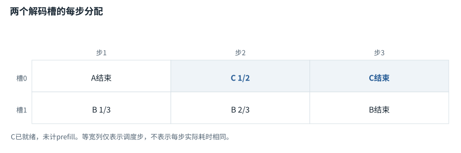
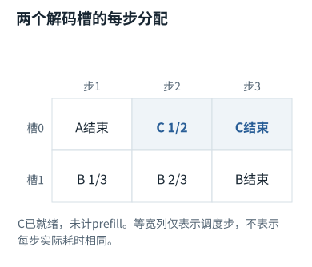
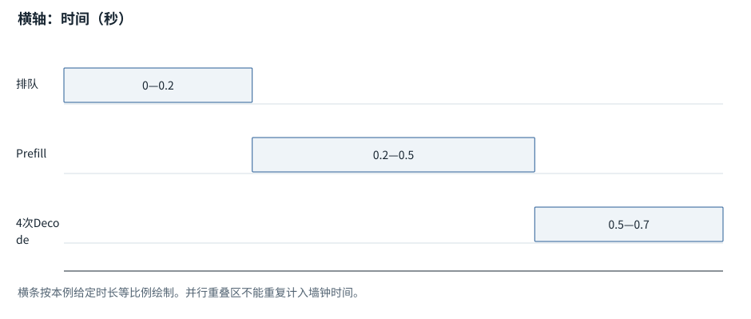
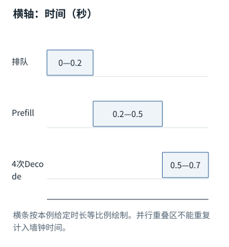
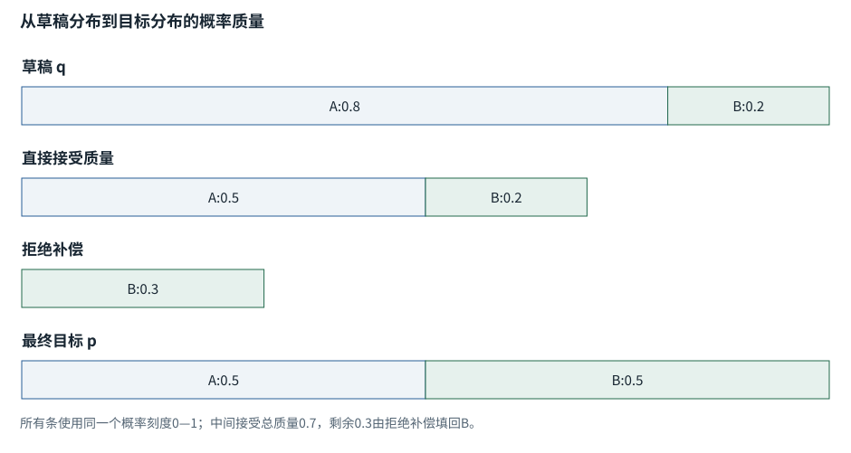
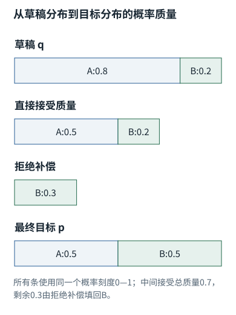

系统篇


<span id="ch08-s0"></span>


# 08｜推理服务：调度、吞吐、延迟和并行


<span id="section-1"></span>


### 本章预备知识

服务性能不只有每秒生成多少Token，还包含排队、首字、工具以及恢复时间。并行可能省墙钟时间，也可能增加通信；吞吐更高不保证每一个人的响应更快。

本章各题列出所需基础。可先完成相应基础课，也可通过自检确认掌握程度。

[F06 · “放到设备”是什么](../foundations/06.md)[F09 · 概率、指数与softmax](../foundations/09.md)[F19 · KV Cache从零解释](../foundations/19.md)[F20 · 低秩、量化、专家](../foundations/20.md)[F21 · 算得快与装得下](../foundations/21.md)[F38 · 看懂生产运行](../foundations/38.md)

**进入深读前的小检查：**把串行任务2+3+4+1改成2+max(3,4)+1，再加入4的协调开销，亲自看并行如何从有利变成不利。

术语带虚线时可点击速查。公式中的字母先看定义；不要用猜缩写替代推导。

模型前向只是服务的一部分。一个请求在队列等待多久、与谁一起执行、KV是否被抢占、输出何时返回，都会决定用户感受到的速度。


<span id="visual-reading"></span>


<span id="topic-1"></span>


## 沿着对象与状态理解本章

先把单个请求的等待时间和整个服务的吞吐分开。下图用相同服务槽位、相同请求长度比较静态组批与连续组批；每步耗时被明确理想化，后面的真实调度仍要加入prefill、队列与设备测量。

下方图解的固定输入在“输入与适用条件”中声明。它用于解释本章机制，不与本章其他独立例子的数值暗中接续。


<span id="visual-O06"></span>

<span id="topic-2"></span>

<span id="topic-3"></span>

<span id="topic-4"></span>

<span id="topic-5"></span>

<span id="topic-6"></span>

<span id="topic-7"></span>


相关动态过程：[连续组批：有座位空出来，就接下一位](../visual/O06.md)。本节下文继续展示更具体的计算与工程边界。

继续看相关机制：[F21 · 算得慢，可能是东西搬得慢](../visual/F21.md)[O05 · PagedAttention：逻辑连续，物理可以分块](../visual/O05.md)[O12 · 模型路由：便宜一次，不一定便宜一项成功任务](../visual/O12.md)


<span id="Q029"></span>


## Q029｜Continuous Batching与普通Batch有什么区别？Prefill为什么会干扰Decode？

这题先认识什么动态组批在生成步骤间调整活跃请求；等待凑批与硬件利用率是取舍，不是固定batch总能最快。

[F04 · 组批和补齐](../foundations/04.md)[F19 · KV Cache从零解释](../foundations/19.md)[F21 · 算得快与装得下](../foundations/21.md)[F38 · 看懂生产运行](../foundations/38.md)


<span id="ch08-s2"></span>


### 核心回答

普通静态[batch](../glossary.md#g034 "一起组织计算的一组输入。 例：普通样本batch不让不同用户相互读取内容。")常等待一组请求全部结束再换下一组；continuous batching在生成迭代之间动态移出完成请求、加入新请求，提高设备利用率。长[Prefill](../glossary.md#g098 "处理当前已经知道的一段输入前缀。 例：得到各层表示及可复用的K/V。")计算与短Decode迭代争用设备，需要调度策略权衡首[Token](../glossary.md#g027 "模型分词器使用的片段单位。 例：可能是词、词的一部分、标点或部分字节。")延迟、后续Token间隔和总体吞吐。[[PAGED]](../sources.md#src-PAGED "来源说明")


<span id="ch08-s3"></span>


### 跟踪四个请求

A需要生成100Token，B只需5Token。静态batch中B很快完成，但A未结束时可能占着固定batch位置。迭代级调度在B结束后让C进入；C先完成Prefill，再参与后续Decode。若D携带超长Prompt突然进入，一次性Prefill可能占用较长[GPU](../glossary.md#g045 "适合大规模并行数值运算的处理器。 例：数据搬到GPU不改变编号语义，但消耗时间和显存。")时间，使A/C的Token输出停顿。

Chunked prefill把D的输入分块处理，使调度器可在块间安排已有请求Decode。这降低某些阻塞，但D建立完整前缀需要更多轮调度，调度和缓存管理也更复杂。具体引擎怎样融合prefill与decode、每轮Token预算多少，是版本和配置行为，而非所有服务统一算法。

调度器常同时受最大batch Token数、KV容量、队列优先级和请求长度约束。只按请求个数限流不够：一个100Token请求和一个100kToken请求的资源成本很不同。还要防止短任务一直插队使长任务饥饿。


<span id="mechanism-Q029"></span>


<span id="topic-8"></span>


### 连续组批把空出来的槽给新请求，但调度步不等于等长时间

**本例条件：**独立离散调度例：两个decode槽；A还需1个Token，B还需3个Token，C已就绪且需2个Token。本图仅按调度步比较，不模拟prefill耗时。

槽
:   某次调度可一起处理的一条序列位置。

完成
:   满足这条请求的停止条件。

连续加入
:   不必等待同批所有请求都结束。

**连续组批把空出来的槽给新请求，但调度步不等于等长时间**





本图仅使用当前算例声明的输入；具体公式、来源和边界见紧邻正文。

[SVG图源](../../diagrams/rendered/Q029-c6cdde06764d.svg) · [原算例数据：Q029](../../diagrams/source/mechanism-cases.json)

核对完整输入与结果

本图使用的数据与条件

| 调度步 | 槽0 | 槽1 |
| --- | --- | --- |
| 1 | A生成最后一项，结束 | B生成1/3 |
| 2 | C加入，生成1/2 | B生成2/3 |
| 3 | C生成2/2，结束 | B生成3/3，结束 |

#### 怎样把图中的变化读明白

固定整批策略在A结束后可能让槽0等B；连续组批让C利用这个空档，提高设备利用率。

这里故意把C设为已经完成prefill，否则加入C还要处理长输入，可能挤占正在decode的B。真实调度要处理这种干扰。

比较性能要同时看吞吐、首Token等待与每Token间隔；总体多做了任务，某个短请求仍可能被排队拖慢。

**不要混淆：**图中三步等高是示意，不表示每步毫秒数相同，更不是产品实测的加速倍率。

机制依据：[[PAGED]](../sources.md#src-PAGED) [[CACHE]](../sources.md#src-CACHE)。本例数字和宿主场景为明确给定的教学设定，不是商业模型输出或生产性能测量。


<span id="worked-Q029"></span>


运行示例 · Q029


<span id="topic-9"></span>


### 请求B结束后，下一轮怎样把空位交给C

**输入与条件。**教学调度器最多同时放2个请求。A还要生成3个Token，B还要1个，C在队列里。每个decode轮每条活跃请求最多生成1个Token。

| 步骤与对象 | 内部动作 | 中间结果 / 新状态 |
| --- | --- | --- |
| 1第1轮 | 处理A和B | A剩2个，B生成完并退出。 |
| 2轮间调度 | 释放B的请求槽位和不再需要的缓存 | C可以进入，不必等A结束。 |
| 3第2轮 | 处理A及已完成prefill的C | A剩1个，C取得自己的第1个输出。 |
| 4长输入反例 | 若C的prefill一次占用很长时间 | A的下一个输出可能等待，形成prefill对decode的干扰。 |
| 5切块选择 | 把C的prefill分段，并在合适边界调度 | 可控制等待，但会引入调度与吞吐取舍。 |

**把过程连起来。**连续批处理更新的是轮间活跃请求集合，不能把不同请求的历史上下文混到一起。

**边界与反例。**轮次示例省略硬件耗时与prefill实现，不能直接据此计算真实吞吐。切块与优先级不是无条件收益。

依据与适用范围：[[CACHE]](../example-sources.md#ex-src-CACHE) [[PAGED]](../example-sources.md#ex-src-PAGED)。示例输入和场景由本书明确设定。


<span id="ch08-s4"></span>


### 追问：吞吐高是否意味着单个用户更快？


<span id="concept-intro-4"></span>


先认识这里的对象与符号

[TTFT、TPOT、p95与吞吐](../concepts.md#concept-latency)
:   TTFT是请求到首个输出Token的延迟；TPOT描述后续每Token时间的统计；p95是某窗口里约95%观测不超过的分位数；吞吐是单位时间完成量。要说明计时起止。首字快不代表任务快：工具执行可能还要很久。理论峰值吞吐也不等于某个用户的延迟。

不一定。更大batch可能提高总Token/s，但增加排队与每步等待。在线交互通常重视[TTFT](../glossary.md#g198 "首个Token延迟，以及95%样本不超过的分位数等运行指标。 例：平均值正常仍可能尾延迟很差。")和Token间隔的尾分位数；离线批处理更重视单位成本和总吞吐。必须先确定服务目标，再选择调度参数。


<span id="ch08-s5"></span>


### 追问：能否一次把所有请求Prefill完再Decode？

这样可能减少某些调度复杂度，却会让已准备好的请求等待后续长输入。相反，完全优先Decode又会让新请求长期没有首Token。调度是在有限算力与KV容量下分配等待，不存在对所有负载都最优的一条固定规则。


<span id="ch08-s6"></span>


### 追问：为什么客户端重试可能让服务更慢？

若超时请求在服务器仍运行，客户端重试可能创建重复任务，增加队列和KV负担，再造成更多超时。需要明确请求身份、取消语义和服务端去重能力，使用退避与总截止时间。重试不是免费的容错按钮。


<span id="engineering-E15"></span>


工程深挖 · E15 · 接续Q029


<span id="engineering-E15-title"></span>


### 吞吐下降但GPU很忙：可能是KV抢占重算，而不是算力不够

预备知识：[F19](../foundations/19.md) · [F21](../foundations/21.md) · [F38](../foundations/38.md)。阅读顺序：先确认运行契约，再看反例与修复，最后检验边界。


<span id="engineering-E15-detail-1"></span>


#### 请求数不是缓存容量的充分指标

同样3个请求，长度[4,4,3]占11个位置；下一步每个追加1个就变成14。若容量只有12，当前“放得下”不代表下一步也放得下。真实容量还乘层数、K/V头数、每头宽度、dtype，并受分页、前缀共享和其他显存占用影响。

vLLM官方调优文档明确讨论KV不足时的抢占和重算，它可保持系统推进，但增加端到端延迟。[[SCHED]](../engineering/sources.md#src-SCHED "vLLM · Optimization and Tuning") 这是检查服务时应该看的具体机制，不应把每次高延迟都归为“模型推理慢”。


<span id="engineering-E15-detail-2"></span>


#### 看见哪个现象，就沿哪个因果链追

若请求到达后长时间无首Token，先拆排队、prefill和首次输出；若已经开始输出却频繁卡顿，看decode调度、抢占计数、当前活跃Token与重算。若GPU利用率高但有效输出低，重复prefill可能吞掉工作量。只看tokens/s总量也可能把重算成本隐藏起来。


<span id="engineering-E15-detail-3"></span>


#### 分块prefill不是无代价魔法

长Prompt一次占住设备，会拖累已有流式请求。把prefill切块可与decode交错，当前vLLM设计描述了相关优先策略。[[SCHED]](../engineering/sources.md#src-SCHED "vLLM · Optimization and Tuning") 但块太小增加调度开销，过度偏向decode又会让新长请求TTFT变差。至少同时看TTFT、token间延迟、完成请求吞吐和尾部等待；不能用一个均值优化所有体验。


<span id="engineering-E15-detail-4"></span>


#### 操作顺序与验证

先固定负载中的输入长度/输出长度分布、到达率和取消率，记录容量与抢占；再改变一个预算或并发参数。增加GPU内存利用率、减少并发、调整Token预算、扩大并行各有风险，不应同时全改后只说“变快了”。将OOM、超时和失败请求留在分母中。


<span id="engineering-E15-detail-5"></span>


#### 追问：直接提高max\_num\_seqs会更快吗？

它提高可并发上限，不凭空增加KV容量或带宽；过高反而触发抢占。若原来设备空闲，有可能提升吞吐；若已经受缓存限制，可能变差。用实际活跃Token与容量，而非请求数的表面增长判断。


<span id="engineering-E15-detail-6"></span>


#### 追问：前缀缓存命中是否减少每个decode步骤读取历史？

它减少重复构建前缀K/V的工作；新Query通常仍需读取相关历史K/V。缓存不把长上下文注意力变成常数时间。历史越长，存储与读取仍是关键资源。[[PREFIX]](../engineering/sources.md#src-PREFIX "vLLM · Automatic Prefix Caching")


<span id="engineering-E15-observations"></span>


#### 本地观察与复核入口

以下为随包程序实际运行记录。数值算子、临时文件／数据库实验与教学逻辑模拟各自的范围，在实验页逐项注明；不能据此声称已测试商业模型或生产环境。


<span id="mechanism-record-E15"></span>


#### E15：怎样读这份结果，而不是只看“通过”

把请求追加后的总位置需求与容量比较。装不下后发生的抢占和重算会消耗算力，所以GPU忙不意味着所有工作都在推进有效输出。

实验记录：字段与原值

| 原始字段路径 | 原始值 |
| --- | --- |
| E15.capacity\_positions | 12 |
| E15.before | 11 |
| E15.after | 14 |
| E15.requests | 3 |

这里是实际实验记录，不用条长或箭头伪装成额外证据；完整日志与解释仍保留在本节。

本图整理的是本小节已有的局部实验记录，不把通过局部测试扩展为产品在所有环境下可靠。原测试环境、输入和完整输出仍以本节记录为准。

```
{
  "E15": {
    "capacity_positions": 12,
    "before": 11,
    "after": 14,
    "requests": 3
  }
}
```

[本条全部结果、验证范围与完整代码 →](../engineering/labs.md#proof-E15)

**自检：**3个请求当前总长度11、容量12，每请求再长1，为什么不能凭“只有3个请求”判断安全？

<details class="quiz-answer"><summary><span class="when-closed">查看参考答案</span><span class="when-open">收起参考答案</span></summary><div class="answer">未来总位置变14，超出容量。内存取决于活跃Token及每TokenKV大小、共享与分页等，不仅是请求数。应考虑生成增长与调度预算。</div></details>

证据核对：2026-10-21。[[SCHED]](../engineering/sources.md#src-SCHED) [[PREFIX]](../engineering/sources.md#src-PREFIX) · [事实、推导与实验的边界](../engineering/sources.md#evidence-levels)


<span id="core-resources-1"></span>


<span id="core-resources-1--mc-section-1"></span>


## 四张账先分开

参数存储、临时激活、梯度/优化器状态、KV缓存是不同对象。训练常为反向保存激活并维护梯度和Adam状态；生成推理通常不需要优化器状态，但长上下文可能占大量KV。

对于贯通模型，236个float64参数的原始数值为1888字节；同大小梯度再1888字节，Adam m/v各一份再3776字节。这只是数组记账，不包括激活、框架对象、allocator和临时内存，更不是实测进程RSS。

适用边界：贯通模型只执行随包配置中的结构；本节对后训练或现代结构的说明依据[对应原始论文与官方接口资料](../reference/model-sources.md)，不代表本地训练已经实现这些扩展。


<span id="core-resources-2"></span>


<span id="core-resources-2--mc-section-2"></span>


## KV Cache：用内存换历史重复计算

它保存已算的历史K/V，前提是相应前缀和参数有效。长上下文缓存增长会增加显存与读取量。不要只看每步输入1个新Token，就以为读取工作量也与历史长度无关。

适用边界：贯通模型只执行随包配置中的结构；本节对后训练或现代结构的说明依据[对应原始论文与官方接口资料](../reference/model-sources.md)，不代表本地训练已经实现这些扩展。


<span id="core-resources-3"></span>


<span id="core-resources-3--mc-section-3"></span>


## FlashAttention：不改变目标，改变中间存取

常规概念实现显式形成整张T×T分数和权重；分块算法在更适合的存储层处理局部块，维护在线softmax统计，避免反复把大中间表写回显存。它不是Top-k稀疏注意力，也不是“只看几个位置”。

独立在线统计公式：已有最大值m、指数和l、加权Value和o；新块最大值m\_b，取m'=max(m,m\_b)，旧统计先乘exp(m−m')，新块贡献按exp(s−m')累加。最后o/l与全量softmax加权结果对应。若只直接拼接各块的局部概率，不重新协调归一化常数，就会算错。

适用边界：贯通模型只执行随包配置中的结构；本节对后训练或现代结构的说明依据[对应原始论文与官方接口资料](../reference/model-sources.md)，不代表本地训练已经实现这些扩展。


<span id="core-resources-4"></span>


<span id="core-resources-4--mc-section-4"></span>


## PagedAttention与连续组批：管理存储和调度

分页管理把逻辑连续的KV切成物理块，减少为不同增长长度预留连续空间造成的浪费；并非改变Attention数学定义。连续组批可在请求完成时让新请求加入，提高设备利用；它同时引入调度、prefill/decode干扰和尾延迟取舍。

适用边界：贯通模型只执行随包配置中的结构；本节对后训练或现代结构的说明依据[对应原始论文与官方接口资料](../reference/model-sources.md)，不代表本地训练已经实现这些扩展。


<span id="core-resources-5"></span>


<span id="core-resources-5--mc-section-5"></span>


## 量化：近似需要可测的误差

独立例：scale=0.1，x=0.26，舍入到q=3，还原0.3，误差0.04。遇到超出可表示范围还要裁剪，误差不再只有舍入那么小。权重、激活和KV量化各影响不同对象，不能以“4bit模型”推断全部运行内存均4bit。

量化不保证一定更快：低精度内核、反量化、矩阵尺寸和硬件支持决定实际收益。质量也应在目标任务上评测，不能只观察一个微型点积误差。

适用边界：贯通模型只执行随包配置中的结构；本节对后训练或现代结构的说明依据[对应原始论文与官方接口资料](../reference/model-sources.md)，不代表本地训练已经实现这些扩展。


<span id="core-resources-6"></span>


<span id="core-resources-6--mc-section-6"></span>


## 激活检查点：方向恰好与KV缓存相反

训练时少保存某些前向激活，反向需要时重算，属于用计算换内存；KV缓存则用内存换重复推理计算。重算必须匹配原前向的随机状态和副作用语义，不能在重算函数里顺便多写一次外部文件或重复更新状态。

适用边界：贯通模型只执行随包配置中的结构；本节对后训练或现代结构的说明依据[对应原始论文与官方接口资料](../reference/model-sources.md)，不代表本地训练已经实现这些扩展。


<span id="core-resources-7"></span>


<span id="core-resources-7--mc-section-7"></span>


## 推测解码：草稿必须验证才能保持目标分布

独立概率对照：草稿分布q提出候选，目标分布p决定接受比例min(1,p/q)。被拒绝时从经归一化的正部分 `(p−q)₊`补采，配合正确流程才能保持目标分布。直接接受草稿的多个Token不具备这种保证。

验证开销、草稿速度、接受率决定收益；不是多给一个小模型就必然更快。完整算法还要明确已接受前缀、拒绝点后缓存回退以及额外目标Token的处理。

| 优化 | 主要省什么 | 可能新增的代价 | 先怎样验证 |
| --- | --- | --- | --- |
| KV缓存 | 历史重复表示计算 | 缓存内存、过期与位置错误 | 缓存vs全量logits一致 |
| FlashAttention | 大中间表读写 | 内核限制、浮点次序差 | 相同输入下容差比较＋目标硬件计时 |
| 分页/组批 | 碎片与空闲 | 调度和尾延迟 | 长度分布下的内存与延迟指标 |
| 量化 | 存储/可能带宽 | 近似误差、裁剪、反量化 | 目标任务质量＋实际内核性能 |
| LoRA | 可训练参数状态 | 适配容量限制、合并部署 | 同数据对照质量与显存 |
| 激活检查点 | 训练激活存储 | 重计算与随机一致性 | 梯度一致＋训练显存/时间 |
| 推测解码 | 目标逐步串行开销 | 草稿成本、低接受率 | 分布/序列边界正确＋吞吐实测 |

适用边界：贯通模型只执行随包配置中的结构；本节对后训练或现代结构的说明依据[对应原始论文与官方接口资料](../reference/model-sources.md)，不代表本地训练已经实现这些扩展。


<span id="core-resources-8"></span>


<span id="core-resources-8--mc-section-8"></span>


## 本书没有做哪些性能结论

贯通模型只在CPU运行，时间太短、规模太小，不能代表GPU部署性能。图中的形状和字节数用于说明公式；“能省多少秒”必须依托相应硬件和负载实测。本包验证部分数值等价或状态边界，不把它冒充生产速度结论。

适用边界：贯通模型只执行随包配置中的结构；本节对后训练或现代结构的说明依据[对应原始论文与官方接口资料](../reference/model-sources.md)，不代表本地训练已经实现这些扩展。


<span id="Q030"></span>


## Q030｜TTFT、TPOT、端到端延迟怎样拆？怎样用Roofline定位瓶颈？

这题先认识什么算术强度比较计算量与搬运量，带宽上限与计算上限不同。首字延迟和后续每Token延迟要分开诊断。

[F06 · “放到设备”是什么](../foundations/06.md)[F07 · 模型最常做的算术](../foundations/07.md)[F21 · 算得快与装得下](../foundations/21.md)[F38 · 看懂生产运行](../foundations/38.md)


<span id="ch08-s8"></span>


### 核心回答

TTFT是请求到首个输出Token的时间，包含排队和Prefill等；TPOT描述后续Token生成平均或分位延迟；任务总耗时还包含检索、工具和多轮调用。Roofline用计算量与数据搬运量估计计算受限还是带宽受限，但只是上界模型，不代替实测。


<span id="ch08-s9"></span>


### 写出一条请求的时间账

```
用户任务时间 = 上下文准备 + 检索/工具 + 网络与排队
             + Prefill + 各Decode步 + 后处理与验证
```

在单次生成中，可粗略写`T ≈ T_queue + T_prefill + M*t_decode`，但实际decode步耗时会随长度、batch变化，并可能夹杂抢占。首Token可能来自Prefill的最终[logits](../glossary.md#g091 "输出投影给各词表候选的未归一化分数。 例：可以是负数，还不是概率或Token编号。")，不应重复多算一个完整Decode。流式传输改善感知等待，但不会自动减少总计算。


<span id="concept-intro-1"></span>


先认识这里的对象与符号

[HBM、SRAM与带宽](../concepts.md#concept-memory-hardware)
:   HBM在此指GPU较大容量的高带宽显存；SRAM相关片上存储通常更小、访问更近。带宽是一段时间能搬多少字节；算术强度是计算量相对于数据搬运量的比值。独立记账：执行100次运算搬10字节，约10次运算/字节。它不是实际硬件性能测量。

Roofline的简化估算：给F次浮点操作、R字节内存传输、设备有效算力C和带宽B，则时间不低于`max(F/C,R/B)`。如果算术强度`F/R`小于硬件C/B，更可能受带宽约束。Prefill大矩阵乘通常更能利用算力；低batch decode常有大量权重/KV读取，可能更受带宽影响。实际还受通信、调度、kernel启动和缓存命中影响。

教学例：某步需读取20GB数据，有效带宽1TB/s，仅搬运下界就是约20ms；即使理论算力翻倍，也不一定改善这一项。这个例子是单位推算，不是任何产品实测。


<span id="mechanism-Q030"></span>


<span id="topic-10"></span>


### 先拆等待、首项、后续项，再问为什么慢

**本例条件：**独立计时例：排队0.2秒，prefill到首Token0.3秒，之后还有4个Token、每个0.05秒。忽略网络与显示开销。

TTFT
:   从请求开始到首个Token的时间。

TPOT
:   后续Token间隔的口径，须说明是否含网络。

端到端
:   从提交到最后结果的总耗时。

**先拆等待、首项、后续项，再问为什么慢**





本图仅使用当前算例声明的输入；具体公式、来源和边界见紧邻正文。

[SVG图源](../../diagrams/rendered/Q030-e4bb663006e3.svg) · [原算例数据：Q030](../../diagrams/source/mechanism-cases.json)

核对完整输入与结果

本图使用的数据与条件

| 区段 | 开始→结束 | 贡献 |
| --- | --- | --- |
| 排队 | 0.00→0.20 s | 0.20 s |
| Prefill | 0.20→0.50 s | 0.30 s |
| 4次Decode | 0.50→0.70 s | 4×0.05=0.20 s |
| 指标 | TTFT=0.50 s；总计=0.70 s | 不能把TPOT当整个请求延迟 |

#### 怎样把图中的变化读明白

若用户抱怨很久没有第一个字，先看前两段；只优化后续decode，可能对这种体验没有帮助。

算力与带宽下界也要分开：计算量/算力和移动字节/带宽只能给粗略约束，不是把峰值FLOPS直接换成实际耗时。

Trace应包含排队，不然模型调用内部看似很快，却无法解释用户端慢。

**不要混淆：**一次日志的时间线只解释该次请求；要做容量规划还需并发分布、长度分布与尾延迟。

机制依据：[[SRE]](../sources.md#src-SRE) [[LATENCY]](../sources.md#src-LATENCY)。本例数字和宿主场景为明确给定的教学设定，不是商业模型输出或生产性能测量。


<span id="worked-Q030"></span>


运行示例 · Q030


<span id="topic-11"></span>


### 首字慢、后续快和总任务慢可以同时发生

局部核对例：以下输入以本例列出的条件为准，不能把它的中间值接到贯通模型的计算记录中。

**输入与条件。**假设一次请求排队40ms、prefill 60ms，随后第1个Token还需20ms，后续每个Token间隔20ms，共输出4个Token。

| 步骤与对象 | 内部动作 | 中间结果 / 新状态 |
| --- | --- | --- |
| 1首Token时刻 | 40+60+20 | TTFT=120ms。 |
| 2全部完成 | 120+3×20 | 总生成延迟180ms。 |
| 3每步间隔 | 只看后续3个间隔 | TPOT=20ms，不等于180/4。 |
| 4工具加入 | 生成结束后还等待数据库800ms | 用户任务延迟至少980ms，改善decode未必最有效。 |
| 5定位反例 | TTFT从120变500，后续间隔仍20 | 优先分开检查排队和prefill，不把所有延迟归因于模型输出速度。 |

**把过程连起来。**先确定测量起止点，再比较延迟；服务时间、排队时间、工具时间不能相互替代。

**边界与反例。**数值是确定的教学时间线，不是硬件基准。不同平台TTFT计时起点可能包含不同网络环节。

依据与适用范围：[[DERIVE]](../example-sources.md#ex-src-DERIVE)。示例输入和场景由本书明确设定。


<span id="ch08-s10"></span>


### 追问：减少输入Token一定比减少输出Token更省时间吗？

不一定。输入可在Prefill中并行处理，输出存在自回归依赖；短输出节省多步decode常很有效。但超长输入带来的Prefill与后续KV读取也可能占主导。还要考虑缓存命中：删改前缀可能使本可复用的内容重算。优化应对照实际[trace](../glossary.md#g197 "一次任务的执行轨迹与其中有开始结束的操作跨度。 例：并行跨度的耗时不能直接全加成墙钟时间。")，而不是只数总Token。


<span id="ch08-s11"></span>


### 追问：为什么平均延迟下降，用户仍抱怨？

可能[P95](../glossary.md#g198 "首个Token延迟，以及95%样本不超过的分位数等运行指标。 例：平均值正常仍可能尾延迟很差。")/P99恶化，长任务被抢占，或者工具偶发超时。平均值掩盖尾部和不同请求类型。应分上下文长度、输出长度、工具类型、缓存命中、租户/地区等切片，但注意样本量和隐私。


<span id="ch08-s12"></span>


### 追问：哪些优化只是把工作移到了别处？

离线预计算、缓存预热、额外压缩模型、并行检索都可能降低交互等待，但增加后台计算、存储或其他请求负担。应统计成功任务总成本与资源占用，而不只看某个局部[span](../glossary.md#g197 "一次任务的执行轨迹与其中有开始结束的操作跨度。 例：并行跨度的耗时不能直接全加成墙钟时间。")变短。


<span id="Q031"></span>


## Q031｜Speculative Decoding为什么能更快，还能保持目标分布？

这题先认识什么草稿先提候选，目标模型验证。保持目标分布需正确的接受概率与拒绝后修正，不是只看两模型是否同意。

[F09 · 概率、指数与softmax](../foundations/09.md)[F18 · 从最后一排数到一个Token，再到一句回答](../foundations/18.md)[F21 · 算得快与装得下](../foundations/21.md)


<span id="ch08-s14"></span>


### 核心回答

先由便宜草稿模型提出多个候选Token，再由目标模型一次验证这些位置；接受足够多草稿时可减少目标模型的串行调用。标准随机推测解码使用接受概率和拒绝后的残差采样，使最终分布与目标采样分布一致，而不是盲目采用草稿。[[SPECULATIVE]](../sources.md#src-SPECULATIVE "来源说明")


<span id="ch08-s15"></span>


### 从单步分布推导正确性

目标分布p，草稿分布q，先采样`x~q`，以`min(1,p(x)/q(x))`接受。于是接受路径落到x的概率为`min(p(x),q(x))`。剩余目标质量为`max(p(x)−q(x),0)`；拒绝时从这一残差归一化分布采样，就补回目标缺口。

例：`p=[0.6,0.3,0.1]`，`q=[0.4,0.4,0.2]`，三个候选接受率分别为`[1,0.75,0.5]`，接受质量为`[0.4,0.3,0.1]`，总拒绝概率0.2；残差全在第一个候选，所以最终仍是`[0.6,0.3,0.1]`。本包计算脚本核对了这个等式。

多Token情况下，草稿按自己的已生成前缀提出K个Token，目标模型并行算这些条件位置的分布。按顺序检查，遇到第一次拒绝后不能继续沿用后面的草稿，因为条件前缀已经改变。必须回滚对应缓存并从修正位置继续。全部接受时还可利用目标分布生成额外Token，具体协议取决于实现。


<span id="mechanism-Q031"></span>


<span id="topic-12"></span>


### 拒绝草稿时的补偿，才保证目标分布不被带偏

**本例条件：**独立两候选分布：草稿q=[0.8,0.2]，目标p=[0.5,0.5]。一次候选按q提出，再以min(1,p/q)接受；拒绝时从归一化max(p−q,0)补采样。

接受质量
:   提出概率乘接受概率。

残差
:   目标比草稿缺少的概率质量。

同分布
:   最终分布相同，不承诺同一随机种子逐Token一致。

**拒绝草稿时的补偿，才保证目标分布不被带偏**





本图仅使用当前算例声明的输入；具体公式、来源和边界见紧邻正文。

[SVG图源](../../diagrams/rendered/Q031-33a94be314b9.svg) · [原算例数据：Q031](../../diagrams/source/mechanism-cases.json)

核对完整输入与结果

本图使用的数据与条件

| 候选 | 直接接受质量 | 拒绝补偿后的总质量 |
| --- | --- | --- |
| A | 0.8×(0.5/0.8)=0.5 | 0.5 |
| B | 0.2×1=0.2 | 再补A被拒绝的0.3 → 0.5 |
| 残差分布 | max(p−q,0)=[0,0.3] | 归一化后只能选B |

#### 怎样把图中的变化读明白

只看接受步骤，B还只有0.2，距离目标0.5差0.3。拒绝补偿正好把草稿过度给A的那部分转回缺少的B。

若拒绝后直接按原目标p再抽，会错误地又给A一部分概率，因此不是同一保证。

真实推测解码把多个候选交给目标模型批量验证；收益还依赖接受率与验证成本。这里只核对单步概率守恒。

**不要混淆：**省去修正采样可能更简单，却会改变生成分布；不能同时声称“任意拒绝处理”和“严格保留目标分布”。

机制依据：[[SPECULATIVE]](../sources.md#src-SPECULATIVE)。本例数字和宿主场景为明确给定的教学设定，不是商业模型输出或生产性能测量。


<span id="worked-Q031"></span>


运行示例 · Q031


<span id="topic-13"></span>


### 草稿错了仍可保持目标分布：三种Token逐项对账

局部核对例：以下输入以本例列出的条件为准，不能把它的中间值接到贯通模型的计算记录中。

**输入与条件。**目标分布p=[0.6,0.3,0.1]，草稿分布q=[0.2,0.5,0.3]。这里只研究一个草稿位置，不把一整段并行验证省略成同一个公式。

| 步骤与对象 | 内部动作 | 中间结果 / 新状态 |
| --- | --- | --- |
| 1接收概率 | 分别计算min(1,p/q) | 得到[1,0.6,1/3]。 |
| 2直接接收质量 | q乘各自接收概率 | 得到[0.2,0.3,0.1]，合计0.6。 |
| 3拒绝总质量 | 1−0.6 | 0.4。 |
| 4拒绝后重采样 | 按max(p−q,0)归一化 | 只有第1项有0.4，重采样分布为[1,0,0]。 |
| 5最终质量 | 直接接收质量加0.4乘重采样分布 | 得到[0.6,0.3,0.1]，恰好还原p。 |
| 6错误对照 | 拒绝后直接从p采样 | 结果为[0.44,0.42,0.14]，反而不等于p。 |

**把过程连起来。**分布保持来自“接收规则＋残差分布”共同成立，不是只要有大模型验收就自然成立。

**边界与反例。**这是单位置精确算例，不含草稿生成开销、全段验收调度和加速收益；q为0的分量需要正确处理支持集。

[查看本例程序结果](../example-verification.md#result-Q031) · [完整可运行代码](../example-verification.md#code)

依据与适用范围：[[SPEC]](../example-sources.md#ex-src-SPEC)。示例输入和场景由本书明确设定。


<span id="ch08-s16"></span>


### 追问：为什么草稿越长不一定越快？

草稿生成本身有成本，后面的Token更可能在前面拒绝后作废；验证长块也消耗计算和KV。最佳长度取决于接受率、草稿/目标速度和硬件。任务分布变化可能让一个原本有效的草稿模型失去优势。


<span id="ch08-s17"></span>


### 追问：温度、Top-p应在哪个分布上处理？


<span id="concept-intro-3"></span>


先认识这里的对象与符号

[Top-k、Top-p与重新归一化](../concepts.md#concept-topk)
:   Top-k保留概率最高的k项；Top-p按概率降序保留累计概率达到阈值的候选前缀。用于抽样时，被保留的候选需按剩余总质量重新归一化。这里k是候选数量，p是累计概率阈值；不是注意力Key表K，也不是表示维度d\_k。

接受与残差公式必须对应实际希望采样的目标分布，以及实际草稿分布。若目标已应用[Top-p](../glossary.md#g095 "分别按候选个数或累计概率保留候选的策略。 例：筛选后通常还要重新归一化。")但比值还使用原始[softmax](../glossary.md#g062 "将各分数取指数，再除以所有指数之和。 例：分数[2,1,0]经Softmax后约为[0.6652,0.2447,0.0900]。")，就可能破坏分布一致性。贪心推测有相应更简单的匹配规则，不能把随机采样公式和贪心验证随意混用。


<span id="ch08-s18"></span>


### 追问：保持分布为什么不保证逐字输出与普通生成一样？

相同分布不意味着用同一随机种子得到同一路径。随机数消耗顺序、浮点和实现可能不同。正确承诺是算法条件下的分布等价，而不是任意设置下字符串逐bit一致，更不是答案事实完全正确。


<span id="engineering-E16"></span>


工程深挖 · E16 · 接续Q031


<span id="engineering-E16-title"></span>


### 推测采样拒绝草稿后，为什么不能直接按目标分布再抽一次？

预备知识：[F09](../foundations/09.md) · [F18](../foundations/18.md)。阅读顺序：先确认运行契约，再看反例与修复，最后检验边界。


<span id="engineering-E16-detail-1"></span>


#### 分布保持是算法约束，不是草稿正确率高就够

设目标模型分布为p，草稿分布为q，草稿提出x后以`min(1,p(x)/q(x))`接受。若拒绝，需要按与`max(p−q,0)`成正比的残差分布重采样；还要正确处理支持集与总和。这里讨论随机推测采样，不是逐Token贪心验证。原始研究描述的是保持目标分布的精确采样方法。[[SPEC]](../engineering/sources.md#src-SPEC "Leviathan et al. · Fast Inference from Transformers via Speculative Decoding")


<span id="engineering-E16-detail-2"></span>


#### 只用两个候选就能揭穿错误

固定p=[0.8,0.2]，q=[0.2,0.8]。A草稿概率0.2，总被接受；B草稿概率0.8，只以0.25接受，接受质量0.2。已接受部分因此为[A:0.2,B:0.2]，剩余拒绝概率0.6。

正确残差为[0.6,0]归一化，即全给A，所以最终为[0.8,0.2]。若拒绝后直接按p抽，最终A为0.2+0.6×0.8=0.68，B为0.2+0.6×0.2=0.32。它仍是一份合法分布，但已经不是目标模型。程序枚举概率质量验证这两个结果，不依赖随机抽样误差。


<span id="engineering-E16-detail-3"></span>


#### 多Token草稿还带来状态回滚

若草稿提出k个Token、只接受前r个，目标KV与草稿KV必须裁到正确前缀，再处理替代Token。不能把拒绝后面的草稿K/V留在可见缓存中。若用多Token批验证，需核对每个位置预测的是哪一个后继Token，避免off-by-one。


<span id="engineering-E16-detail-4"></span>


#### 加速收益从哪里来，又何时消失

目标模型可以并行验证若干已知草稿位置，减少昂贵串行轮次。但草稿生成也要成本，接受率低、目标验证开销大或batch调度不适合时可能没收益。正确性证明只涉及分布，不自动证明延迟变好。需要在相同目标分布与任务约束下比较真实吞吐和延迟。


<span id="engineering-E16-detail-5"></span>


#### 追问：只比较最终句子一致就能验收吗？

对随机采样不行，两次同分布本来就可生成不同句子。应先用有限词表做精确概率质量校验，再测经验分布，另核对缓存裁剪与停止。贪心模式则采用其专门的等价性条件，不能混用验证规则。


<span id="engineering-E16-detail-6"></span>


#### 追问：q(x)=0时p/q怎么办？

草稿不可能按q提出该x，接受比只需在草稿支持集上的实际提议点计算；目标中草稿覆盖不了的质量通过残差等校正处理。实现仍应对浮点下溢和无效概率做明确检查，不把除零nan继续传下去。


<span id="engineering-E16-observations"></span>


#### 本地观察与复核入口

以下为随包程序实际运行记录。数值算子、临时文件／数据库实验与教学逻辑模拟各自的范围，在实验页逐项注明；不能据此声称已测试商业模型或生产环境。


<span id="mechanism-record-E16"></span>


#### E16：怎样读这份结果，而不是只看“通过”

分别看目标分布、草稿分布和拒绝后的补偿质量。这里的输入只属于E16，不沿用其他推测解码小例子；补偿分布必须补回缺失质量，而不是再次无条件抽目标分布。

实验记录：字段与原值

| 原始字段路径 | 原始值 |
| --- | --- |
| E16.target | [0.8, 0.2] |
| E16.draft | [0.2, 0.8] |
| E16.accepted\_mass | [0.2, 0.2] |
| E16.rejection\_mass | 0.6 |
| E16.residual | [1.0, 0.0] |
| E16.correct | [0.8, 0.2] |
| E16.wrong\_redraw\_p | [0.6799999999999999, 0.32] |

这里是实际实验记录，不用条长或箭头伪装成额外证据；完整日志与解释仍保留在本节。

本图整理的是本小节已有的局部实验记录，不把通过局部测试扩展为产品在所有环境下可靠。原测试环境、输入和完整输出仍以本节记录为准。

```
{
  "E16": {
    "target": [
      0.8,
      0.2
    ],
    "draft": [
      0.2,
      0.8
    ],
    "accepted_mass": [
      0.2,
      0.2
    ],
    "rejection_mass": 0.6,
    "residual": [
      1.0,
      0.0
    ],
    "correct": [
      0.8,
      0.2
    ],
    "wrong_redraw_p": [
      0.6799999999999999,
      0.32
    ]
  }
}
```

[本条全部结果、验证范围与完整代码 →](../engineering/labs.md#proof-E16)

**自检：**p=[0.8,0.2]、q=[0.2,0.8]，拒绝后错误地按p重抽，最终A概率是多少？

<details class="quiz-answer"><summary><span class="when-closed">查看参考答案</span><span class="when-open">收起参考答案</span></summary><div class="answer">接受A质量0.2，拒绝总质量0.6；错误重抽贡献0.6×0.8=0.48，总计0.68，不是0.8。正确残差把拒绝质量全部给A。</div></details>

证据核对：2026-10-21。[[SPEC]](../engineering/sources.md#src-SPEC) · [事实、推导与实验的边界](../engineering/sources.md#evidence-levels)


<span id="Q032"></span>


## Q032｜DP、TP、PP、ZeRO和Prefill/Decode分离分别切什么？

这题先认识什么数据并行复制模型处理不同样本；张量并行拆运算；流水线拆层；状态分片降低重复存储。通信也是成本。

[F06 · “放到设备”是什么](../foundations/06.md)[F07 · 模型最常做的算术](../foundations/07.md)[F16 · 一次训练从头到尾](../foundations/16.md)[F21 · 算得快与装得下](../foundations/21.md)


<span id="ch08-s20"></span>


### 核心回答


<span id="concept-intro-2"></span>


先认识这里的对象与符号

[DP、TP、PP、ZeRO与FSDP](../concepts.md#concept-parallel)
:   数据并行让多份模型处理不同样本并同步梯度；张量并行拆分一次算子的参数/计算；流水线并行把不同层放不同设备。ZeRO/FSDP类技术还会切分参数、梯度或优化器状态。它们拆的对象不同：一层矩阵分两块，不等于把两个独立用户任务分给两位Agent。

Data Parallel复制模型处理不同数据；[Tensor](../glossary.md#g009 "机器学习程序中用于存放规则排列数值的数据对象。 例：[2,3,4]可读成两张三行四列表。") Parallel拆层内张量计算；Pipeline Parallel按层分段；[ZeRO](../glossary.md#g134 "通过分散保存训练状态减少跨设备重复的一类方法。 例：不等于把模型训练目标改变。")类技术拆分训练状态冗余；Prefill/Decode分离让不同资源承担两种推理阶段。它们作用的对象和通信模式不同，不应只背“把模型分到多卡”。


<span id="ch08-s21"></span>


### 用一次前向说明TP与PP

一个大线性层`Y=XW`可以按W的输出列拆到多个设备，各卡计算部分输出；后续层若需要完整Y，就要通信或配套分片布局。另一种按输入维度拆分会产生多个部分和，需要归约。[attention](../glossary.md#g071 "计算查询与可读候选的匹配份额，再加权组合内容。 例：先计算分数和权重，再用权重混合V。")头、[FFN](../glossary.md#g088 "通常在每个位置应用的前馈子网络。 例：常把宽度先扩展再缩回，带非线性或门控。")中间维度如何切分决定何时all-reduce/all-gather，而非所有层都把结果简单拼接即可。

PP把前几层放设备A、后几层放B。一个micro-batch先经过A，再把激活送到B；多个micro-batch可形成流水线，但启动/结束存在气泡。阶段计算量不平衡会让快设备等待慢设备；推理单条自回归序列还需在每Token重新穿过各阶段。

DP适合有多请求/多样本时并行处理；若单个模型装不下一卡，纯DP并不能解决。训练时各副本需同步梯度；推理时独立副本通常可独立服务请求。ZeRO/FSDP把优化器、梯度乃至参数分片，减少训练副本冗余，但在计算需要时要通信获取相应部分。

Prefill/Decode分离在Prefill设备算完后把KV等必要状态送给Decode设备。资源可分别针对吞吐/带宽优化，但KV传输可能很大：第07章例子一条32k序列就是4GiB。若网络慢、上下文短或请求量小，分离收益可能被传输与排队抵消。


<span id="mechanism-Q032"></span>


<span id="topic-14"></span>


### 分布式的“切开”，要先指明切的是样本、矩阵还是状态

**本例条件：**独立两设备示意。网络含层L0—L3，一个矩阵W可按列切成W左/W右；图中均为逻辑职责，不给没有硬件测量的加速倍数。

DP
:   数据并行：不同设备处理不同样本。

TP
:   张量并行：同一次算子的矩阵分片。

PP
:   流水并行：不同设备承担不同层。

分布式的“切开”，要先指明切的是样本、矩阵还是状态

| 方式 | 设备0 / 设备1 | 新增协作 |
| --- | --- | --- |
| DP | 完整模型+样本A / 完整模型+样本B | 训练时汇总梯度 |
| TP | X×W左 / X×W右 | 拼接或规约中间结果 |
| PP | L0、L1 / L2、L3 | 传激活；可能出现等待空泡 |
| ZeRO式状态分片 | 持有一部分参数/梯度/优化器状态 | 用到时通信与重建 |
| Prefill/Decode分离 | 长输入处理 / 后续逐步生成 | 传递KV状态并管理排队 |

各行是独立对象或条件的对照，不暗示上一行的结果自动进入下一行。

#### 怎样把图中的变化读明白

DP不一定让单条请求的同一步更快，它更自然地增加独立样本处理能力。TP才拆同一次算子，但多了通信。

PP让设备分别放不同层，可分担容量；单一微批仍要先过前层再过后层，多微批才有流水重叠。

同一系统可以组合这些策略，但每加一层划分都要追踪数据移动和同步。只有矩阵尺寸没有网络带宽，很难判断净收益。

**不要混淆：**“两张卡”不能直接推断“两倍速度”；如果新增通信超过省下的计算，甚至会更慢。

机制依据：[[TP]](../sources.md#src-TP) [[ZERO]](../sources.md#src-ZERO) [[PAGED]](../sources.md#src-PAGED)。本例数字和宿主场景为明确给定的教学设定，不是商业模型输出或生产性能测量。


<span id="worked-Q032"></span>


运行示例 · Q032


<span id="topic-15"></span>


### 同样两张设备，DP、TP与PP各自切开什么

局部核对例：以下输入以本例列出的条件为准，不能把它的中间值接到贯通模型的计算记录中。

**输入与条件。**一个示意网络有4层，每层权重占100MB；不计算激活、梯度和优化器。两条输入A、B，两张设备。

| 步骤与对象 | 内部动作 | 中间结果 / 新状态 |
| --- | --- | --- |
| 1数据并行DP | 两张设备各放全部4层 | 权重各400MB，一张处理A，一张处理B；训练时还需同步梯度。 |
| 2张量并行TP | 每层的矩阵计算分给两张设备 | 理想均分时权重各200MB，但层内要交换或归约中间结果。 |
| 3流水线并行PP | 设备0放第1—2层，设备1放第3—4层 | 权重各200MB，层间传激活，微批安排不佳会有空闲气泡。 |
| 4ZeRO区别 | 切分优化器、梯度或参数的副本 | 不等于简单把4层一分为二，不同阶段通信不同。 |
| 5推理解耦 | prefill和decode放在不同执行资源 | 还必须转移或共享正确的KV状态，不能只移交一个请求编号。 |

**把过程连起来。**并行名字背后是切数据、切矩阵、切层或切状态；画出每张设备实际持有什么才能估算收益。

**边界与反例。**权重均分只作账本示例；实际模型有不可均分模块、通信拓扑、复制与额外缓存。

依据与适用范围：[[DERIVE]](../example-sources.md#ex-src-DERIVE)。示例输入和场景由本书明确设定。


<span id="ch08-s22"></span>


### 追问：更多GPU为什么反而慢？

单卡计算变少，但同步、传输和调度增加；小模型或小batch可能通信占主导。跨节点与同机互联带宽差别很大。需要比较真实任务的加速比和每成功任务成本，而不是用GPU数量当能力指标。


<span id="ch08-s23"></span>


### 追问：TP度改变为什么可能影响复现？

分片与归约改变浮点加法顺序，微小logit变化可能改变临界Token选择。还可能使用不同内核。测正确性应区分数值容差、生成分布、任务结果三层，不宜要求所有并行拓扑逐字完全一致。


<span id="ch08-s24"></span>


### 追问：应用工程师需要实现这些内核吗？

不一定，但需要知道配置影响哪个瓶颈。例如[API](../glossary.md#g139 "程序之间约定输入、输出与行为的接口。 例：不是人类界面的按钮本身。")延迟由远程工具占主导，研究TP不会解决；本地部署KV耗尽，就应看上下文、并发和状态管理。深入原理的目的，是能正确定位边界而非把所有层都自己重写。

本章分布式训练与并行部分的延伸依据：PyTorch张量并行说明与ZeRO原始论文。[[TP]](../sources.md#src-TP "来源说明")[[ZERO]](../sources.md#src-ZERO "来源说明")


<span id="core-diagnosis-1"></span>


<span id="core-diagnosis-1--mc-section-1"></span>


## 先问错发生在哪一个边界

“模型输出不对”不足以直接定位是学习率、Attention还是采样。先确认输入和权重身份，再检查共享前向，接着判断训练专属步骤或生成专属步骤。一次改十个地方，会让正确修复也难以归因。

由可核验事实逐层缩小问题

| 步骤 / 对象 | 本步实际变化 |
| --- | --- |
| 输入与配置 | 编号与词表对应吗？标签shift一次吗？padding与position定义清楚吗？ |
| 共通前向 | 每层shape、mask、softmax轴与有限值正确吗？前缀是否因果不变？ |
| 训练链路 | loss分母是什么？解析/数值梯度能对上吗？backward后参数未变，step后是否改变？ |
| 保存与加载 | 重载参数指纹一致吗？配置与词表是否同版本？ |
| 推理链路 | 取的是最后有效位置吗？缓存和全量一致吗？选择/停止规则是否一致？ |

这个顺序依赖可测对象，不依赖模型自己宣称“我已经检查过”。

依据：[tiny\_model.py:53–98](../reference/model-code.md#tiny_model-L53)；[对应参数、前向及梯度记录](../labs/model-values.md)。


<span id="core-diagnosis-2"></span>


<span id="core-diagnosis-2--mc-section-2"></span>


## 常见症状与最小反例

| 症状 | 优先怀疑 | 先做哪一个小检查 |
| --- | --- | --- |
| loss不下降 | 标签/分母/梯度/step缺失 | 固定一批数据，确认loss定义、梯度非空及step后权重改变 |
| loss异常很低但生成差 | 偷看未来/目标泄漏 | 改变未来Token，比较前缀logits；核对shift与mask |
| 单条正确，组批错误 | 跨样本混合/PAD/最后位置 | 单条vs批次同样本logits对照 |
| 缓存比全量差 | 位置重置/旧缓存/非方阵mask | 逐轮记录输入位置、cache长度和最大logit差 |
| 前向对上但训练差 | 梯度分支/共享参数累加 | 固定参数点做解析反向和有限差分 |
| eval后仍随机 | Dropout函数参数/采样/内核 | 先固定贪心、禁dropout、记录同输入同权重 |
| 更新后重载不一致 | 错文件/配置/转置/词表 | 对照参数指纹与完整配置，不只检查文件名 |
| 长度结束被当完整回答 | 停止原因丢失 | 保存stop\_reason，不从文本流畅推断任务完成 |

依据：[tiny\_model.py:53–98](../reference/model-code.md#tiny_model-L53)；[对应参数、前向及梯度记录](../labs/model-values.md)。


<span id="core-diagnosis-3"></span>


<span id="core-diagnosis-3--mc-section-3"></span>


## 为什么“梯度不为0”远远不够

错误分母、漏残差路径或错误mask，都可能产生非零梯度并让某些loss下降。测试应检查具体值、关系和独立对照，而不仅看有没有.grad。

本包的梯度比较在同一初值和批次上逐参数进行；手写反向使用数学规则，autograd用框架记录，有限差分通过真实前向差值估算。三者互补，但若所有方法都使用同一个错误训练目标，也可能一致，因此输入与目标语义仍需人工解释。

依据：[tiny\_model.py:53–98](../reference/model-code.md#tiny_model-L53)；[对应参数、前向及梯度记录](../labs/model-values.md)。


<span id="core-diagnosis-4"></span>


<span id="core-diagnosis-4--mc-section-4"></span>


## 为什么需要负控制

正确实现通过一个测试，可能只是断言过弱。故意关causal mask、用错误缓存位置、重复softmax或混入过期KV后，测试应当观察到差异。这样能证明测试至少能识别这些具体故障。

本书的坏实现仅用于临时本地对照，不会保存成默认模型或混进正式权重。报告里明确哪个是故意错误路径，避免读者把错误公式当推荐方法。

依据：[tiny\_model.py:53–98](../reference/model-code.md#tiny_model-L53)；[对应参数、前向及梯度记录](../labs/model-values.md)。


<span id="core-diagnosis-5"></span>


<span id="core-diagnosis-5--mc-section-5"></span>


## 数值容差怎么选择

float64 CPU有利于对照，但不是所有值都要逐位相同。softmax、归一化和矩阵累加的次序改变可能造成小舍入差；float16/bfloat16或融合内核差异可能更大。应同时看绝对误差、相对误差、数值量级和任务结果，并考虑ReLU折点等不光滑位置。

禁止把NaN都替换为0后宣布测试通过。先确认全遮蔽、溢出、除零、数据污染等原因。断言finite本身是定位起点，不是完整修复。

依据：[tiny\_model.py:53–98](../reference/model-code.md#tiny_model-L53)；[对应参数、前向及梯度记录](../labs/model-values.md)。


<span id="core-diagnosis-6"></span>


<span id="core-diagnosis-6--mc-section-6"></span>


## 如何阅读随包结果

`data/run.json`是一次实跑得到的全链路记录；`weights_*.json`是可重载参数；`tests.json`与日志记录本轮测试；`reference_result.json`来自标准库独立前向。页面中展示六位小数是阅读选择，程序继续使用完整精度。

依据：[tiny\_model.py:53–98](../reference/model-code.md#tiny_model-L53)；[对应参数、前向及梯度记录](../labs/model-values.md)。


<span id="core-understanding-11"></span>


<span id="core-understanding-11--mc-section-11"></span>


## 追问：哪些变化可以声称保持相同计算目标？

在条件满足时，因果KV缓存、正确的分块精确注意力和存储分页可以保持相同目标，允许实现造成的浮点差异；量化引入近似；Top-k/温度改变解码分布；GQA/FFN替换改变架构；LoRA训练改变参数。先辨别类型，才知道应该用一致性、任务质量还是系统性能评测。

依据：[tiny\_model.py:178–258](../reference/model-code.md#tiny_model-L178)；[对应参数、前向及梯度记录](../labs/model-values.md)。


<span id="core-understanding-13"></span>


<span id="core-understanding-13--mc-section-13"></span>


## 完整验收题

依据：[tiny\_model.py:178–258](../reference/model-code.md#tiny_model-L178)；[对应参数、前向及梯度记录](../labs/model-values.md)。

**显存不够，使用no\_grad与激活检查点是否是一回事？**

<details class="quiz-answer"><summary>查看参考答案</summary><div class="answer">不是。训练必须保留或重建求导链；no_grad关闭必要记录会破坏训练。激活检查点通过反向前重算恢复必要中间值，目标仍是正确梯度。</div></details>

**测试发现缓存与完整计算差异很小，可以直接忽略吗？**

<details class="quiz-answer"><summary>查看参考答案</summary><div class="answer">先看误差量级、精度、内核和候选分数间距。若两候选几乎并列，小误差可能改变贪心结果；若是位置或mask错位，再小也应解释来源。容差要有条件，不能统一一句“浮点误差”。</div></details>

**验收1：用本书的具体词表，把“我爱学习！”变成训练输入和标签，说明哪里防止偷看未来。**

<details class="quiz-answer"><summary>查看参考答案</summary><div class="answer">完整[6,1,2,3,5,7]；输入[6,1,2,3,5]，目标[1,2,3,5,7]。第t行注意力只允许s≤t，标签不进入该行前向；逐位置norm与FFN不跨未来混合。</div></details>

**验收2：从loss写出到Wq[0,0]的依赖，不允许只说“自动求导”。**

<details class="quiz-answer"><summary>查看参考答案</summary><div class="answer">L→Gz=(p−onehot)/10→U反传到最终F→RMSNorm到H→残差/FFN合流到R→Wo到mix→G_A→softmax到G_S→缩放点积到G_Q→Σ_b,t N1[b,t,0]G_Q[b,t,0]。还要为更早输入合并K/V和残差路径；本初值的G_Wq[0,0]约−0.002217527833。</div></details>

**验收3：第一次选中学习后，为什么缓存长度3而序列长度4？**

<details class="quiz-answer"><summary>查看参考答案</summary><div class="answer">第一次只前向处理BOS、我、爱三个位置。学习只是从输出分布选出的编号，尚未作为输入经过E/P和层计算。下一轮处理它时才追加它的K/V。</div></details>

**验收4：本次400步loss约0.13948，为什么不应一看到非零就继续强迫它降到0？**

<details class="quiz-answer"><summary>查看参考答案</summary><div class="answer">BOS相同前缀对应等频我/你，十题平均的不可消除歧义下界为ln2/5≈0.138629。需要理解数据与目标，不是所有非零loss都来自实现错误。</div></details>

**验收5：模型在GPU上速度提升30%，CPU小模型前向相同，能否证明部署无回归？**

<details class="quiz-answer"><summary>查看参考答案</summary><div class="answer">不能。需要核对目标硬件的数值行为、实际批次和长度分布、缓存和模式、质量与尾延迟等。CPU教学一致性只验证相应机制，不是生产质量或速度保证。</div></details>


<span id="implementation-evidence"></span>


## 从本页解释到可检查的实现

| 要核对什么 | 事实与边界 | 本地依据 |
| --- | --- | --- |
| 前向、损失与更新 | 固定的一层四维教学模型；不是任何商业模型的完整实现。 | [tiny\_model.py · TinyLM](../reference/model-code.md#tiny_model-L33) |
| 独立前向实现 | 使用同一已保存权重，不使用PyTorch；用于复算而非另行训练。 | [reference\_inference.py · forward](../reference/model-code.md#reference_inference-L28) |
| 错误是否能被发现 | 因果性、梯度、标签移位、缓存位置均有正向检查和反例。 | [test\_model.py](../reference/model-code.md#test_model-L1) |
| 初始化的具体数字 | 所有参数均可查看；初值不等于训练后的参数。 | [weights\_initial.json](../reference/model-code.md#weights_initial-L1) |
| 实际运行记录 | 仅来自本地CPU微型实验；不能推出商业能力或GPU性能。 | [run.json 对应的数值记录](../labs/model-values.md) |


<span id="canonical-related"></span>


## 继续阅读与机制对应

| 页面 | 阅读关系 |
| --- | --- |
| [07｜KV Cache、FlashAttention与PagedAttention的内部过程](07.md) | 上一节：复习本页使用的前置概念 |
| [09｜Agent一次任务的完整循环：谁在思考，谁在执行](09.md) | 下一节：沿同一课程顺序继续 |
| [F21｜算得快与装得下：复杂度、带宽、批处理和并行](../foundations/21.md) | 基础课程：先读逐步讲解与统一算例 |

AI系统工程：从基础到内部  
[全书目录](../contents.md) · [术语与符号](../glossary.md) · [参考资料](../sources.md)