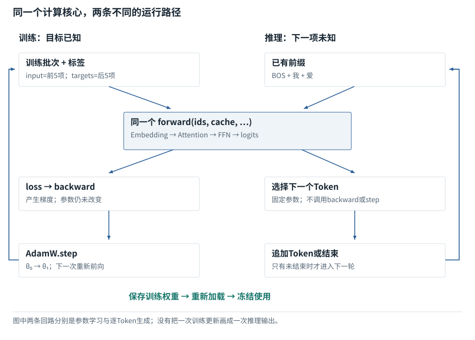

基础篇

# F01｜模型的生命周期：对象、参数、训练与推理

从具体对象与小例子开始，理解计算过程与适用条件。

## 共同的计算，先训练，再推理

**共通前向之后，训练与推理走向不同的状态变化**

数据/调用方向以图中连线为准；参数与激活、训练与推理分别标注。

[SVG图源](../../diagrams/rendered/trace-lifecycle-e3b5a2cb4e1c.svg)

代码路径：[tiny\_model.py:33–258](../reference/model-code.md#tiny_model-L33) · [Mermaid源文件](../diagrams/lifecycle.mmd)。图的排布只表达数据／调用顺序，不代表计算耗时。

模型最初只是参数和运算规则。基础课程先解释这些数字如何前向计算，再解释用标签计算损失、反向传播并更新参数，最后加载训练结果逐个生成。推理阶段仍执行前向，但不沿损失回传梯度，也不更新参数。Agent、工具和检索在这条模型链之外，后续另有对应基础课。

起点只默认你会加减乘除；不默认学过线性代数、微积分或机器学习。术语从此处开始建立。

动态图解 · F01

## 一句话经过了哪些不同的对象

输入框中的文字，什么时候才变成模型能计算的东西？

可以把这条路理解成“翻译格式”，但不是不断翻译成另一种人类语言。文字先成为编号，再成为数值表示；模型输出又被解释成文字或工具请求。磁盘文件在这条链外，只有宿主读取后把内容放进请求，模型才有机会使用它。

**宿主**调用模型、访问工具、管理任务的普通程序。

**模型参数**已经加载的计算系数；本图中的普通推理不更新它们。

**中间表示**模型对本次输入实际算出来的数字，不是秘密中文草稿。

**输入与适用条件：**教学文字为“我爱”；此图只区分对象，不给这句话编造商业模型的真实Token编号或答案。完整的小模型逐轮生成见F18。

按对象与证据阅读这段过程

| 观察点 | 本步含义 | 状态 / 范围 |
| --- | --- | --- |
| 用户文字 | 此时只有字符。界面里能读到“我爱”，不等于神经网络已经处理了它。 | 参见本步解释 |
| 宿主组织请求 | 宿主选择要发送的信息。没有选入请求的文件，不会因为位于同一台电脑而自动进入模型。 | 参见本步解释 |
| 分词编号 | 教学分词器给两个片段编号。编号1和2只表示词表项目，不携带“谁更重要”的大小关系。 | 参见本步解释 |
| 查表成为向量 | 编号被当作行号，取出向量。查表已经属于模型表示计算，不是到Attention才第一次进入模型。 | 参见本步解释 |
| 模型计算下一项 | 同样的参数作用于这次向量，得到候选分数。这步改变的是临时结果，不是训练好的参数。 | 参见本步解释 |
| 宿主处理输出 | 如果输出是工具请求，必须由宿主执行并拿回结果；模型提议本身不能证明环境已经改变。 | 参见本步解释 |

### 为什么需要

分清对象，才能查出“没提供信息”和“提供了却没用好”两类不同故障。

### 怎样实现

分别追踪用户文字、实际请求、模型输出、工具结果四份记录。

### 可能的代价与误解

把一段流畅回答当作文件已被修改的证据，会跳过真实执行与验证。

### 如何判断是否做对

用一个从未发送的测试文件提问，检查宿主是否真的读过它。

[全部步骤与解释](../visual/F01.md)[F03 · 文字、字节、Token、编号是四件事](../visual/F03.md)[F05 · Embedding是查一行，不是把编号转二进制](../visual/F05.md)[F22 · 把一个Agent任务拆成真正发生的几轮](../visual/F22.md)

机制来源：[[AGENT]](../visual/sources.md#s-AGENT)。数值和运行场景为本书明确设定的教学例；资料出处不代替本页中文解释。

## 从信息对象认识AI系统

理解一个AI系统的运行，首先要知道每一步处理的**是什么东西**。输入框里的文字、发给服务器的请求、模型内部的数字、磁盘上的代码文件，并不是同一个对象。它们会互相转换，但不能把名称混用。

**关键区别：**聊天窗口写下的只是一部分；是否附上源码、工具定义和历史由外围程序决定。

**容易误解：**不能因为模型说“已阅读”就认定真实文件已经被它读到。

先看一个没有数学门槛的任务：“读一下文件，告诉我函数为什么报错。”编辑器可以直接把你选中的代码附在请求里，也可以只发送问题，等模型提出读文件要求后再读。这两种情况最后都可能给出答案，但取证过程不同。

| 你碰到的东西 | 它是什么 | 举例 |
| --- | --- | --- |
| 文本 | 人能阅读的一串字符 | “读取函数foo” |
| 请求 | 程序组织的信息包 | 问题、历史、工具说明放在一起 |
| 编号 | 用于找到某个条目的整数 | 编号17代表词表里的一个文本片段 |
| 一组数 | 模型计算中使用的表示 | `[0.2,-0.4,0.7]` |
| 参数 | 训练时调整、推理时通常固定的一组数 | 决定如何变换输入的权重 |
| 文件 | 外部环境中的真实内容 | 磁盘上的`app.py` |
| 状态 | 系统记录的当前进展 | “已读取，尚未修改” |

这里的“对象”只是**当前被处理的信息或实体**，不要求你先学面向对象编程。

## 模型不是一位住在电脑里、直接看见所有文件的人

**模型**可以先理解为一个很大的、由许多数字和计算规则组成的函数。函数就是“给定输入，按规则产生输出的东西”。例如规则“输入乘2”，给3便得6；语言模型复杂得多，但输入输出仍由实际计算连接。

模型不是一位住在电脑里、直接看见所有文件的人：逐项辨别

|  |  |
| --- | --- |
| 方案／对象 A | 用户输入：修复报错 |
| 方案／对象 B | 模型内部：数值运算 |
| 方案／对象 C | 工具执行：真实读文件 |

**关键区别：**这里有三种不同对象：用户意图、模型计算和外部环境的真实变化。

**容易误解：**模型输出“已修改”不等于磁盘文件实际变化。

**推理**是使用已有参数计算输出；**训练**是根据例子和误差调整参数。普通聊天时把新信息放入本轮输入，不等于永久改写模型参数。你后来再问它，能否继续知道，取决于历史或外部记忆是否再次提供。

**Agent宿主程序**是调用模型、读取文件、执行命令、保存状态的外围程序。模型可以输出“请调用读取文件工具”，宿主检查参数和权限后才真正读取，再把结果交给模型。这里先认识这条关系，具体协议在F22以后展开。

## 本书到底在解释什么

“模型推理”这个词容易同时指两件事：一是运行已有模型产生输出的 **inference**，二是解决复杂问题时的多步 **reasoning**。本书首先讲第一件事：文字怎样真正经过数值计算，训练又怎样把参数变成可用的参数。长思考、工具调用和搜索策略都建立在它上面，不能替代这层计算。

大语言模型不是一份固定答案目录，也不是一次聊天临时写出的程序。先把它看成一个函数：输入一串编号，依据许多参数表做运算，输出每个候选编号的分数。**结构说明怎么算，参数决定算出什么，当前输入决定这次处理谁。**

依据：[tiny\_model.py:178–244](../reference/model-code.md#tiny_model-L178)；[对应参数、前向及梯度记录](../labs/model-values.md)。

## 三件事不能混为一件

| 概念 | 本书中的具体对象 | 什么时候改变 |
| --- | --- | --- |
| 结构 | 1层因果Decoder、4维表示、1个注意力头、8维前馈层 | 建模型时确定；改变结构往往要重新匹配权重 |
| 参数 θ | Embedding表E、位置表P、Wq/Wk/Wv等，共236个数 | 训练的优化器步骤会改；普通推理保持不变 |
| 临时结果 | 当前输入算出的Q/K/V、隐藏状态、分数、概率 | 输入不同，或参数版本不同，结果就可能不同 |

举一个暂不属于语言模型的标量暖身：规则是 `y=w×x`。结构是“相乘”，参数是w，输入是x。w=2时，x=3得到6；w=4时，相同x得到12。只改输入不等于学了新参数；只算出了结果也不等于完成训练。

依据：[tiny\_model.py:178–244](../reference/model-code.md#tiny_model-L178)；[对应参数、前向及梯度记录](../labs/model-values.md)。

## 为什么要先讲共通计算，再讲训练，最后讲推理

训练本身也需要一次前向计算。没有先解释乘法、归一化、注意力和输出分数，就无法解释预测哪里错了。但“学习前向”并不等于“已经进入推理章节”。

本书的顺序是：**认识数据与参数 → 用初始参数做一遍共通前向 → 根据真实标签计算损失 → 算梯度并更新参数 → 保存训练产物 → 加载训练产物 → 逐Token推理**。前向计算是两条路径共用的发动机；损失、反向传播和优化器属于训练路径；采样、停止和KV缓存属于这里的推理路径。

依据：[tiny\_model.py:178–244](../reference/model-code.md#tiny_model-L178)；[对应参数、前向及梯度记录](../labs/model-values.md)。

## 训练时“预测”与推理时“预测”哪里不同

两者都可以产生下一Token分数。训练时，教材已经知道正确的下一项，可以评价分数是否把概率给对了对象；推理时，没有标准答案告诉你下一项该是什么，只能按分布或选择规则产生结果。

训练通常不需要先把每个位置抽成文字再求损失。直接拿连续可微的logits计算交叉熵，梯度才能沿计算图回传。`argmax`选中的整数不是这个标准训练目标的必要输入。

依据：[tiny\_model.py:178–244](../reference/model-code.md#tiny_model-L178)；[对应参数、前向及梯度记录](../labs/model-values.md)。

## 贯通算例固定哪一个模型

我们使用 **贯通模型**，它是一层很小的、可实际训练的因果语言模型。它不是GPT、Llama或任何商业系统的缩小参数副本。它的目标是让每张表能完整展示，让训练、反向与推理能够对上同一份文件。

它有8项词表、4维隐藏表示、1个注意力头、8维ReLU前馈层、3处RMSNorm和学习式绝对位置。无偏置、无Dropout，不共享输入Embedding与输出头权重。先采用这些选择，是为了减少首次理解时同时出现的变量；之后会单独比较RoPE、GQA、SwiGLU和Dropout，**不会偷偷把主算例换成另一种架构**。

依据：[tiny\_model.py:178–244](../reference/model-code.md#tiny_model-L178)；[对应参数、前向及梯度记录](../labs/model-values.md)。

## 这里的“学会”只意味着什么

训练语料只有“我爱学习！”和“你爱学习！”两条固定序列。这足够验证损失、梯度、更新、保存、加载与续写的链路，不足以评价自然语言理解、泛化、事实性或安全性。看到生成结果正确，要同时问：模型是否只是拟合了这两条序列？本实验答案是：它主要用于演示这样的拟合。

依据：[tiny\_model.py:178–244](../reference/model-code.md#tiny_model-L178)；[对应参数、前向及梯度记录](../labs/model-values.md)。

## 用三个容易混淆的句子检查边界

“模型说文件已修改”只是一份输出；“文件内容确实改变”是环境事实；“新文件通过对应测试”又是一份验证事实。第三件事不能从第一件事推出。把这些对象分开，你才能理解为什么Agent需要工具结果和测试，而不是只靠它自我确认。

**关键区别：**想证明Bug修好，必须接上环境检查；语言输出本身不是测试结果。

**容易误解：**测试的版本必须是最终提交或交付的代码版本。

同理，“请求包含了一段材料”不保证模型正确利用它；“有一个会话编号”不保证旧消息永远都在；“缓存存在”不保证其内容适合当前模型和当前任务。

## 本书的数字是怎么来的

后文用很小的词表和向量做手算。**词表**是文本片段与整数编号的对照表；**向量**先理解为有顺序的一排数，下一课正式解释。为了看清运算，教材会人为给数字，它们不是某款商业模型的参数或真实语义。

本书的数字是怎么来的：逐项辨别

|  |  |
| --- | --- |
| 对象一 | 片段“我”→编号1 |
| 对象二 | 编号1→可学习向量 |
| 对象三 | 隐藏层继续加工向量 |

**关键区别：**编号是索引，向量是运算材料，后续隐藏状态又是另一种表示。

**容易误解：**不要拿Token编号的大小表示语义强弱。

例如写“我→1、爱→2”，只说明本教材演示用这样的编号。现实分词器可能把一个字拆成多个片段，也可能把多个字符合成一个片段。不能把教学编号搬进实际模型。

## 阅读准备

默认你会加减乘除、能阅读普通程序式步骤；不默认你会线性代数、微积分、概率论或深度学习。前置课会在用到它们以前介绍必要部分。代码是帮助核对过程的第二种表达，不运行代码也可以读完正文。

**关键区别：**数学基础从小例子逐层增加，不需要一开始背大型模型公式。

**容易误解：**未认识的符号先看对象和单位，再看公式。

接下来的次序是：先认识数字怎样摆放，再看文字如何获得编号，接着看几条输入怎样放在一起，以及一个编号怎样被换成一排数。读完这些基础概念，示例中的`[2,128,4096]`就不再是一串无来由的符号。

运行示例 · F01

### 同一句“读取配置”，在四个对象中各是什么

局部核对例：以下输入以本例列出的条件为准，不能把它的中间值接到贯通模型的计算记录中。

**输入与条件。**假设仓库有一个文件 `config.txt`，真实内容是 `timeout=3`。用户要求：“告诉我超时值。”模型和文件之间并没有天然连接。

| 步骤与对象 | 内部动作 | 中间结果 / 新状态 |
| --- | --- | --- |
| 1用户输入 | 界面接到“告诉我超时值” | 这是一条任务，不是文件内容。 |
| 2组装请求 | 宿主提供任务和 `read_file(path)` 的说明 | 模型此时知道怎样提出读取请求，但还不知道文件里写什么。 |
| 3模型输出 | 产生调用提议 `read_file("config.txt")` | 提议是一份数据，文件尚未因此被读取。 |
| 4工具执行 | 程序读取磁盘，返回 `timeout=3` | 新事实第一次由外部环境进入任务。 |
| 5再调用模型 | 把原问题、调用记录和结果一起提交 | 模型可以回答“配置中的超时值为3”；本例没有说明单位，不能擅自补“秒”。 |

**把过程连起来。**文字、模型计算、工具调用提议和磁盘操作是四个不同对象。跟踪谁产生了每份数据，就能判断有没有证据。

**边界与反例。**这是按接口职责构造的执行示例，不是一次真实商业模型请求。文件里的数字若没有单位，答案也不能替它添加单位。

依据与适用范围：[[TOOLS]](../example-sources.md#ex-src-TOOLS)。示例输入和场景由本书明确设定。

## 课后自检

**自检 1**

**模型输出“已删除”是否证明文件不存在？**

查看参考答案收起参考答案

不能。要检查宿主是否执行，以及目标文件的真实状态。文字、动作和验证结果不是同一对象。

**自检 2**

**本轮告诉模型一个事实，参数一定改变了吗？**

查看参考答案收起参考答案

没有这个保证。常规推理使用已有参数；新事实通常存在输入上下文中。参数更新要经过另外的训练过程。

### 延伸阅读：相关系统问题

[01｜输入究竟是什么：从用户的一句话到模型张量](../chapters/01.md)  
[09｜Agent一次任务的完整循环：谁在思考，谁在执行](../chapters/09.md)

机制依据：[[F-TENSOR]](../sources.md#src-F-TENSOR)[[CHAT]](../sources.md#src-CHAT)[[TOOLS]](../sources.md#src-TOOLS)。本节数值与情景除另注外均为原创教学示例；来源不代替中文讲解。

**模型从一个问题中读到新知识，下一次是否一定永久记得？**

查看参考答案

不一定。普通推理没有更新参数；新知识只有留在当前上下文、外部记忆或以后再次被提供时才能继续利用。训练参数更新是另一条明确的流程。

## 从本页解释到可检查的实现

| 要核对什么 | 事实与边界 | 本地依据 |
| --- | --- | --- |
| 前向、损失与更新 | 固定的一层四维教学模型；不是任何商业模型的完整实现。 | [tiny\_model.py · TinyLM](../reference/model-code.md#tiny_model-L33) |
| 独立前向实现 | 使用同一已保存权重，不使用PyTorch；用于复算而非另行训练。 | [reference\_inference.py · forward](../reference/model-code.md#reference_inference-L28) |
| 错误是否能被发现 | 因果性、梯度、标签移位、缓存位置均有正向检查和反例。 | [test\_model.py](../reference/model-code.md#test_model-L1) |
| 初始化的具体数字 | 所有参数均可查看；初值不等于训练后的参数。 | [weights\_initial.json](../reference/model-code.md#weights_initial-L1) |
| 实际运行记录 | 仅来自本地CPU微型实验；不能推出商业能力或GPU性能。 | [run.json 对应的数值记录](../labs/model-values.md) |

## 继续阅读与机制对应

| 页面 | 阅读关系 |
| --- | --- |
| [F02｜一排数、一张表和一叠表：读懂张量与形状](02.md) | 下一节：沿同一课程顺序继续 |
| [01｜输入究竟是什么：从用户的一句话到模型张量](../chapters/01.md) | 系统机制：用源码、反例和条件深入核对 |

AI系统工程：从基础到内部  
[全书目录](../contents.md) · [术语与符号](../glossary.md) · [参考资料](../sources.md)