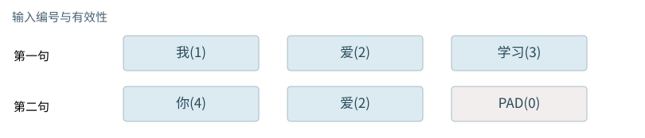

基础篇


<span id="foundations-04-s0"></span>


# F04｜从多句话到训练批次：组批、补齐与标签位置

从具体对象与小例子开始，理解计算过程与适用条件。


<span id="course-connection"></span>


## 先区分两个输入场景

“我爱学习”和“你爱”的长短句只用于理解补齐，PAD并不增加真实文字。贯通训练固定使用“我爱学习！”和“你爱学习！”两条完整样本，并加入BOS/EOS；它们长度相同。下面会明确列出完整样本、输入和标签，绝不把补齐示例的编号当作另一套模型的训练记录。

本节会用到

[F02 · 一排数、一张表和一叠表](02.md)[F03 · 文字为什么要先变成Token编号](03.md)


<span id="visual-F04"></span>


动态图解 · F04


<span id="topic-1"></span>


## 组批没有把两句话混成一句

为了整齐补上的PAD，会不会被模型误当成内容？

组批像把几张试卷一起送进机器，但每张试卷仍单独计算。补齐让它们占用同样多的位置；有效位置表让模型知道哪些格子只是空位。整齐的数组形状不能替代真实长度信息。

**B**本批几条输入。

**T**数组为每条输入安排了多少位置。

**PAD**占位符，不是原文中新增的词。

**输入与适用条件：**B=2，T=3，右侧补齐。可见性、取输出位置必须与这一约定一致。


<span id="topic-2"></span>


### 1 / 4 · 长度不同

停留时间 4.2秒7秒1.5秒

步骤 第1步，共4步

窄屏可左右滑动图形，或点击“放大图形”。文字解释紧随图后。


第一句三个位置，第二句两个位置。两句话仍各自独立。

`本步状态由图形与说明共同给出。`

默认静止。用“下一步”看完解释再继续；播放到最后一步自动停止。键盘聚焦播放器后，可用左右键逐步查看、空格播放/暂停。图中颜色辅助区分，含义同时用文字注明。

JavaScript未启用；第一帧仍可阅读。完整图解页下方列出全部步骤说明。


<span id="topic-3"></span>


### 为什么需要

许多张量运算要求规则形状，组批可提高设备利用。


<span id="topic-4"></span>


### 怎样实现

短句补位，同时携带真实长度和匹配的mask；生成接口的左右补齐要求应另行核对。


<span id="topic-5"></span>


### 可能的代价与误解

只补0却不屏蔽；或者无条件取最后一列，都可能改变短句结果。


<span id="topic-6"></span>


### 如何判断是否做对

把同一句分别单独推理和混合长度组批，核对其有效位置输出。

[全部步骤与解释](../visual/F04.md)[F12 · Mask是可见性表，不是额外语义](../visual/F12.md)[O06 · 连续组批：有座位空出来，就接下一位](../visual/O06.md)

机制来源：[[PADDING]](../visual/sources.md#s-PADDING) [[SDPA]](../visual/sources.md#s-SDPA)。数值和运行场景为本书明确设定的教学例；资料出处不代替本页中文解释。


<span id="foundations-04-s1"></span>


## “组批”就是让若干条输入一起处理

一次只处理“我爱学习”，是单条输入。把“我爱学习”和“你爱”放在同一次计算中，叫一个**批次（batch）**。本批有2条，**批大小B=2**。


<span id="fdiag-04-01"></span>


**关键区别：**组批是把多条输入组织在同一次设备运算里；不是把两条句子接成一句话。

**容易误解：**同批的不同用户输入不能因此共享注意力上下文。

它们还是两条独立输入，不是把第二句话接到第一句话后面。批轴提供“一起调度”的组织方式，标准独立样本计算不让两条样本互相读取内容。尤其不能因为组批就把不同用户的上下文混起来。

上一课的两条编号是：

```
第0条：[1,2,3]      长度3
第1条：[4,2]        长度2
```

如果要放成规则的矩形表，每一行需一样长。我们把本批安排的长度设为T=3，给第二条补一个占位编号0：

```
input_ids = [[1,2,3],
             [4,2,0]]
shape     = [2,3]
```

**Padding（补齐）**是在短输入中增加占位项，不是在原话中补出有意义的新内容。编号0在本教材恰好是PAD；真实模型的PAD编号可能不同，也可能需要按模型配置处理。


<span id="foundations-04-s2"></span>


## 真实长度与安排长度不是一回事

第二条真实长度仍是2，表里安排了3个位置。若生产系统把本批都补到128，形状就会是`[2,128]`；这不证明两条原话都含128个Token。


<span id="fdiag-04-02"></span>


**关键区别：**把短句补到相同长度，得到[[1,2,3],[4,2,0]]。

**容易误解：**PAD是占位，不是原句里的文字。


<span id="fboard-04-02"></span>


逐格算清：两句话组批后，哪里是真实内容，哪里只是占位



步骤 1第一句“我／爱／学习”有三个真实Token：编号[1,2,3]。

步骤 2第二句“你／爱”只有两个真实Token：编号[4,2]。

步骤 3为组批补一个PAD，得到[4,2,0]；PAD不属于原文。

步骤 4有效位置标记分别是[1,1,1]与[1,1,0]。

第二行原文只有“你／爱”，末尾PAD帮助对齐计算形状，不计入真实Token长度。

数值除特别标注外来自本章已明确设定的教学条件；示意图表达算法结构，不代表商业模型参数或实时GPU执行速度。

为了告诉后续计算哪些位置是真实内容，另配一张标记表：

```
is_real = [[1,1,1],
           [1,1,0]]
```

这里1表示真实位置，0表示填充位置。这是后面**padding mask（填充掩码）**的基础。“掩码”先理解成决定某项能不能参与运算的标记；完整的注意力掩码要到F12再把行列关系讲清。


<span id="core-training-data-2"></span>


<span id="core-training-data-2--mc-section-2"></span>


## 两句话怎样变成十道训练题

完整样本各有6项：

```
第0条：[6,1,2,3,5,7] = BOS 我 爱 学习 ！ EOS
第1条：[6,4,2,3,5,7] = BOS 你 爱 学习 ！ EOS
```

输入拿前五项，标签拿后五项。本模型**只在数据准备时移动一次**：

input\_ids：送入前向计算的编号

| 对象／位置 | t=0 | t=1 | t=2 | t=3 | t=4 |
| --- | --- | --- | --- | --- | --- |
| 第0条 | 6 | 1 | 2 | 3 | 5 |
| 第1条 | 6 | 4 | 2 | 3 | 5 |

整数表，不是Embedding，也不是概率。


targets：各输入位置需要预测的下一项

| 对象／位置 | t=0 | t=1 | t=2 | t=3 | t=4 |
| --- | --- | --- | --- | --- | --- |
| 第0条 | 1 | 2 | 3 | 5 | 7 |
| 第1条 | 4 | 2 | 3 | 5 | 7 |

标签不作为同位置的输入；它在前向得到分数后才参与损失计算。

| 输入位置 | 允许使用的前缀 | 监督目标 |
| --- | --- | --- |
| t=0 | BOS | 我（另一条样本为你） |
| t=1 | BOS 我 | 爱 |
| t=2 | BOS 我 爱 | 学习 |
| t=3 | BOS 我 爱 学习 | ！ |
| t=4 | BOS 我 爱 学习 ！ | EOS |

依据：[tiny\_model.py:14–21](../reference/model-code.md#tiny_model-L14)；[对应参数、前向及梯度记录](../labs/model-values.md)。


<span id="foundations-04-s3"></span>


## 补左边和补右边有什么区别

右补齐把第二行写成`[4,2,0]`；左补齐会写成`[0,4,2]`。两者都能表达“你爱”，但真实位置所在列不同。


<span id="fdiag-04-03"></span>


补左边和补右边有什么区别：逐项辨别

|  |  |
| --- | --- |
| 方案／对象 A | 真实长度：[3,2] |
| 方案／对象 B | 张量安排长度：3 |
| 方案／对象 C | 有效位置：111／110 |

**关键区别：**真实有效长度与占位后的数组宽度都要保留；掩码依赖有效位置。

**容易误解：**数组有3列不代表第二句有3个真实Token。

如果程序总取“最后一列的预测”继续生成，右补齐行的最后一列是PAD，就可能取错位置。因此某些解码流程要求左补齐，或者必须按真实长度选取最后一个有效位置。**哪种策略正确取决于生成代码和模型约定**，不能只把一侧称为普适最佳方案。

本书基础算例用右补齐，因为对初读者直观；若用于生成，明确取每行最后一个有效位置，不能直接照抄`[:, -1]`。


<span id="foundations-04-s4"></span>


## 补齐不等于截断，更不等于上下文压缩

补齐增加占位；**截断**删掉过长输入的部分内容；**摘要压缩**尝试用较短描述替代较长历史。删除真实内容可能让规则或证据消失，补齐本身没有这个目的。


<span id="fdiag-04-04"></span>


补齐不等于截断，更不等于上下文压缩：逐项辨别

|  |  |
| --- | --- |
| 方案／对象 A | 右补齐：4,2,0 |
| 方案／对象 B | 左补齐：0,4,2 |
| 方案／对象 C | 位置与读出位置不同 |

**关键区别：**补齐方向改变有效Token在数组中的下标，解码时需要相应处理。

**容易误解：**不该盲目取最后一列当成最后有效Token。

组批也不总要把所有请求凑成同一个长方形。高性能推理可以采用长度分组或变长组织方式。本课用普通密集表解释形状，不把它包装成所有服务的真实内部存储。


<span id="foundations-04-s5"></span>


## 为什么组批可能快，也可能让一个人等更久

同一套参数能够在多条输入上一起运算，可能更充分利用硬件。但为了凑够一批而等待，会增加某条请求的等待时间。还有一个浪费：把长度2和长度1000的两条都补到1000，会产生许多填充位置。


<span id="fdiag-04-05"></span>


为什么组批可能快，也可能让一个人等更久：逐项辨别

|  |  |
| --- | --- |
| 对象一 | Padding：补占位 |
| 对象二 | Truncation：丢一段内容 |
| 对象三 | Compaction：保留摘要 |

**关键区别：**三个操作都可能改变输入长度，但丢失信息的机制完全不同。

**容易误解：**不要把“短了”就统一称为压缩。

因此B、T不是越大越好。B说明并行组织了多少条，T影响每条安排多少位置；后续还要结合硬件、缓存和队列讨论。现在只需要能从实际输入写出编号表和有效位置表。


<span id="worked-F04"></span>


运行示例 · F04


<span id="topic-7"></span>


### 为什么“你爱”最后有个0，但没有多出一个词

局部核对例：以下输入以本例列出的条件为准，不能把它的中间值接到贯通模型的计算记录中。

**输入与条件。**第一句“我爱学习”是 `[1,2,3]`；第二句“你爱”是 `[4,2]`。希望把它们放进同一个两行表。

| 步骤与对象 | 内部动作 | 中间结果 / 新状态 |
| --- | --- | --- |
| 1比较长度 | 两句分别有3和2个Token | 统一安排长度3，不能把真实长度都改记成3。 |
| 2右补齐 | 第二行末尾放PAD编号0 | ID表为 `[[1,2,3],[4,2,0]]`。 |
| 3记录有效性 | 第一行全真，第二行末尾是假 | 有效位置表为 `[[1,1,1],[1,1,0]]`。 |
| 4预测时选位置 | 第一句取下标2，第二句取下标1 | 第二行下标2是PAD，不能把它当“爱”的位置。 |
| 5计算利用率 | 6个安排位置里有5个真实Token | 占位比例为 `1/6`；变长批处理可有其他实现，不必都填成矩形。 |

**把过程连起来。**0表示为了整齐而占的格子，并不是给“你爱”添加了新的文字；真实Token与占位必须一直能区分。

**边界与反例。**某些现成生成器要求左补齐；本例解释右补齐的对象语义，不承诺所有生成API都自动选择最后有效位置。

依据与适用范围：[[DERIVE]](../example-sources.md#ex-src-DERIVE)。示例输入和场景由本书明确设定。


<span id="self-check"></span>


## 课后自检

**自检 1**

**长度分别为4和2的两条输入右补齐到4，编号表是什么形状？有几个PAD？**

<details class="quiz-answer"><summary><span class="when-closed">查看参考答案</span><span class="when-open">收起参考答案</span></summary><div class="answer">形状[2,4]，第二条增加2个PAD。真实Token总数是6，表里安排8个位置。</div></details>

**自检 2**

**把两个用户输入组成一批，就让它们共享语义上下文吗？**

<details class="quiz-answer"><summary><span class="when-closed">查看参考答案</span><span class="when-open">收起参考答案</span></summary><div class="answer">不应如此。普通batch是独立样本的计算组织。跨样本共享上下文是另一件事，不能由组批推出。</div></details>


<span id="section-7"></span>


### 延伸阅读：相关系统问题

[01｜输入究竟是什么：从用户的一句话到模型张量](../chapters/01.md)

机制依据：[[F-PADDING]](../sources.md#src-F-PADDING)[[F-TENSOR]](../sources.md#src-F-TENSOR)。本节数值与情景除另注外均为原创教学示例；来源不代替中文讲解。


<span id="implementation-evidence"></span>


## 从本页解释到可检查的实现

| 要核对什么 | 事实与边界 | 本地依据 |
| --- | --- | --- |
| 前向、损失与更新 | 固定的一层四维教学模型；不是任何商业模型的完整实现。 | [tiny\_model.py · TinyLM](../reference/model-code.md#tiny_model-L33) |
| 独立前向实现 | 使用同一已保存权重，不使用PyTorch；用于复算而非另行训练。 | [reference\_inference.py · forward](../reference/model-code.md#reference_inference-L28) |
| 错误是否能被发现 | 因果性、梯度、标签移位、缓存位置均有正向检查和反例。 | [test\_model.py](../reference/model-code.md#test_model-L1) |
| 初始化的具体数字 | 所有参数均可查看；初值不等于训练后的参数。 | [weights\_initial.json](../reference/model-code.md#weights_initial-L1) |
| 实际运行记录 | 仅来自本地CPU微型实验；不能推出商业能力或GPU性能。 | [run.json 对应的数值记录](../labs/model-values.md) |


<span id="canonical-related"></span>


## 继续阅读与机制对应

| 页面 | 阅读关系 |
| --- | --- |
| [F03｜文字怎样成为编号：分词、词表与序列边界](03.md) | 上一节：复习本页使用的前置概念 |
| [F05｜Embedding与位置：从编号查表到模型输入](05.md) | 下一节：沿同一课程顺序继续 |
| [01｜输入究竟是什么：从用户的一句话到模型张量](../chapters/01.md) | 系统机制：用源码、反例和条件深入核对 |

AI系统工程：从基础到内部  
[全书目录](../contents.md) · [术语与符号](../glossary.md) · [参考资料](../sources.md)