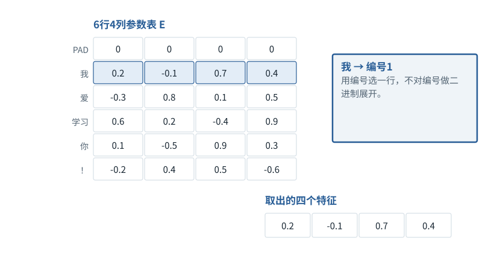
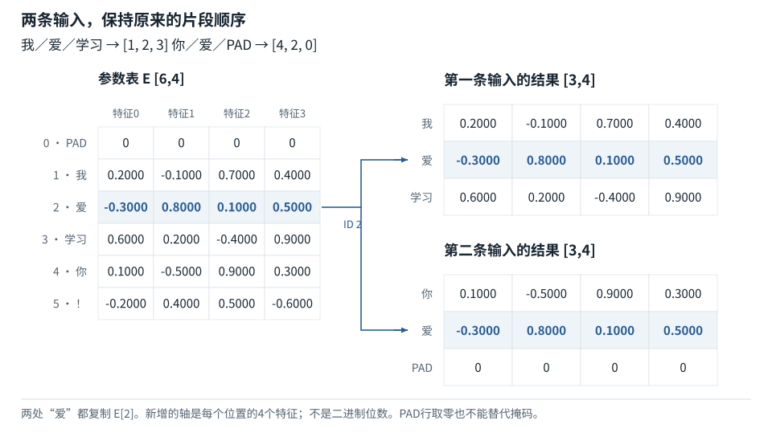
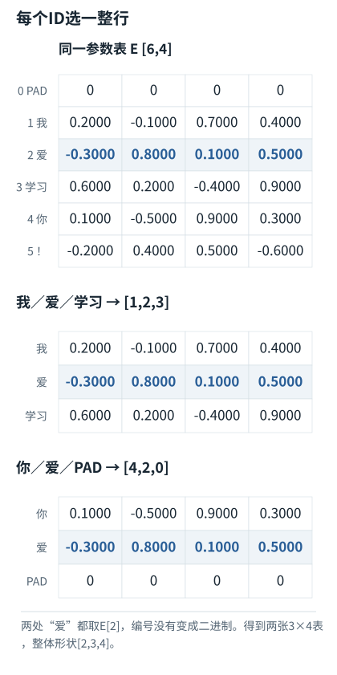

基础篇


<span id="foundations-05-s0"></span>


# F05｜Embedding与位置：从编号查表到模型输入

从具体对象与小例子开始，理解计算过程与适用条件。


<span id="course-connection"></span>


## 地址、初始向量与位置相加是三步

前面局部查表例只展示普通文本与PAD。完整的贯通模型在同样0—5号词表项后增加6号BOS和7号EOS，前六行Embedding数值不变。先按词表地址取E，再按位置地址取P，最后逐特征相加得到X；编号本身不参与两表的相加。完整八行参数表及同一“爱”位置的计算都在本节内。

本节会用到

[F02 · 一排数、一张表和一叠表](02.md)[F03 · 文字为什么要先变成Token编号](03.md)[F04 · 组批和补齐](04.md)


<span id="visual-F05"></span>


动态图解 · F05


<span id="topic-1"></span>


## Embedding是查一行，不是把编号转二进制

一组浮点数怎样替代一个Token编号？

词表编号像目录的页码；Embedding像打开那一页看到的数值卡。页码2并不会通过“转成0010”得到语义。模型取到的是参数表里事先存好的小数和负数，后续层再根据上下文加工它。

**E**Embedding参数表：每行对应一个词表项。

**查表**以整数编号选择一整行。

**上下文化**同一初始向量经过不同上下文后得到不同表示。

**输入与适用条件：**完全沿用F05正文6×4小数参数表。图示的维度是特征宽度，不是二进制位数。


<span id="topic-2"></span>


### 1 / 5 · 为“我”取第1行

停留时间 4.2秒7秒1.5秒

步骤 第1步，共5步

窄屏可左右滑动图形，或点击“放大图形”。文字解释紧随图后。



编号1定位Embedding表的第1行，得到[0.2, -0.1, 0.7, 0.4]。这一行用来表示本例Token“我”，不会因为同批还有其他句子而改为另一行。

`E[1] = [0.2, -0.1, 0.7, 0.4]`

默认静止。用“下一步”看完解释再继续；播放到最后一步自动停止。键盘聚焦播放器后，可用左右键逐步查看、空格播放/暂停。图中颜色辅助区分，含义同时用文字注明。

JavaScript未启用；第一帧仍可阅读。完整图解页下方列出全部步骤说明。


<span id="topic-3"></span>


### 为什么需要

编号方便定位项目，但直接比较编号大小不能表达任务所需关系。


<span id="topic-4"></span>


### 怎样实现

为每项取出可训练的向量，再交给后续运算。


<span id="topic-5"></span>


### 可能的代价与误解

误把0/1教学矩阵当成所有Embedding的格式；误以为同一个词在所有层都不变。


<span id="topic-6"></span>


### 如何判断是否做对

逐项检查原文、编号、取表行号、输出行顺序四者一一对应。

[全部步骤与解释](../visual/F05.md)[F02 · 新增一个轴，究竟多了什么](../visual/F02.md)[F11 · Q/K/V：先算从哪读，再算读进多少](../visual/F11.md)

机制来源：[[EMBED]](../visual/sources.md#s-EMBED)。数值和运行场景为本书明确设定的教学例；资料出处不代替本页中文解释。


<span id="foundations-05-s1"></span>


## 为什么不能直接拿“编号大小”理解文字

模型需要一种可以进行加权、组合、比较和更新的数字表示。编号1只是一个地址；它与编号4相差3没有语言意义。最常见的输入方式是准备一张可学习的数字表，让每个词表编号对应一排数。这张表叫**Embedding矩阵（嵌入矩阵）**，记作E。


<span id="fdiag-05-01"></span>


为什么不能直接拿“编号大小”理解文字：逐项辨别

|  |  |
| --- | --- |
| 方案／对象 A | Token编号2 |
| 方案／对象 B | 二进制存储0010 |
| 方案／对象 C | 向量[-0.3,0.8,0.1,0.5] |

**关键区别：**三个写法服务不同目的：找词表行、机器存储整数、作为神经网络特征。

**容易误解：**Embedding不是把整数展开成几个0/1二进制位。

**可学习**的意思是训练时这些数会被调整；普通推理时通常从训练好的参数中读取，不是看到一句新话才临时生成一张表。Embedding查表本身就是模型的一个层，不是某个额外联网检索服务。


<span id="representation-comparison"></span>


<span id="topic-7"></span>


### 先搞清三种表示：二进制、One-hot、Embedding

这三者都可能写成数字，却**不是相同的计算步骤**。假设本教材把“爱”编成Token编号`2`，词表共有6项。

| 写法 | 具体结果 | 表达的内容 |
| --- | --- | --- |
| 整数在内存中的二进制形式 | `00000010`（用8位保存整数2） | 电脑怎么存储数字；不是模型的语义向量 |
| One-hot（独热）向量 | `[0,0,1,0,0,0]`（6个位置中只有第2号为1） | 用一个0/1指示数组标明“选中编号2” |
| Embedding向量 | `[-0.3,0.8,0.1,0.5]`（模型参数表的第2行） | 供后续神经网络计算的4个实数；通常由训练形成 |

**One-hot也不是一般意义的二进制数：**它的长度取决于词表有多少项；当词表变大，One-hot会更长。而整数2的二进制表示取决于整数存储格式。

**One-hot与Embedding确实有数学联系：**如果把One-hot当作一行数字，并与6行4列的Embedding矩阵相乘，结果恰好选出第2行。这称为一种等价的数学表达；实际实现通常直接按编号查表，不需要真的先生成那6个0/1再做矩阵乘法。

本教材接下来的Embedding数值**特意包含小数与负数**。这才便于理解：新增的轴表示每个Token对应多少个数值特征，绝不是“把编号展开成多少个二进制位”。


<span id="foundations-05-s2"></span>


## 用6行4列的表，表示“我爱学习”和“你爱”

沿用6项教学词表，指定每个片段用4个数表示，写作d=4。下面的数字是人为构造的**浮点数**，有正数、负数和小数，只用来解释运算，并不代表“我”“你”的真实含义：


<span id="fdiag-05-02"></span>


**关键区别：**取编号1得到“我”的四个特征，编号2得到“爱”的四个特征，依次按原顺序排列。

**容易误解：**两个相同Token的初始查表结果可以相同，但后续上下文化状态可能不同。


<span id="fboard-05-02"></span>


**编号选行；两个“爱”取得同一行参数**





输入和数值沿用本节固定算例。先按对象/位置对齐，再检查图中对应关系。

[SVG图源](../../diagrams/rendered/foundation-fboard-05-02-71d4c86400c0.svg)

| ID | 片段 | 特征0 | 特征1 | 特征2 | 特征3 |
| --- | --- | --- | --- | --- | --- |
| 0 | PAD | 0.0 | 0.0 | 0.0 | 0.0 |
| 1 | 我 | 0.2 | -0.1 | 0.7 | 0.4 |
| 2 | 爱 | -0.3 | 0.8 | 0.1 | 0.5 |
| 3 | 学习 | 0.6 | 0.2 | -0.4 | 0.9 |
| 4 | 你 | 0.1 | -0.5 | 0.9 | 0.3 |
| 5 | ！ | -0.2 | 0.4 | 0.5 | -0.6 |

这张Embedding表记作`E`，形状为`[6,4]`：**6行是词表中可以查找的6个编号；4列表示每个编号对应4个数**。查表时，不是随机取三行，而是按两句话里各个文本片段的编号，依次取出对应的行。

**先认清两条编号序列分别代表哪句话：**

第一句话是**“我爱学习”**。本教材把它分成三个Token：**“我／爱／学习”**，编码成编号序列`[1,2,3]`。

第二句话是**“你爱”**。它分成两个Token：**“你／爱”**，原始编号是`[4,2]`；为了与第一句话组批，末尾补一个`PAD（编号0）`，所以计算时写成`[4,2,0]`。**PAD是占位，不是“你爱”的第三个词。**

接下来做的Embedding查表，就是把这些Token编号逐个换成可供神经网络计算的数字向量。也可以把它理解为**为两句话的每个Token生成初始数值表示**；但不是把整句话压缩成一个向量。


<span id="topic-8"></span>


### 第一句话：“我爱学习”怎样查表

先前的编号`[1,2,3]`不是无意义的三个孤立数字，而是依次对应**“我”“爱”“学习”**。查表过程逐项如下：

| 原文Token | 对应编号 | 从E中查找 | 取出的4个数字 |
| --- | --- | --- | --- |
| **我** | `1` | `E[1]` | `[0.2,-0.1,0.7,0.4]` |
| **爱** | `2` | `E[2]` | `[-0.3,0.8,0.1,0.5]` |
| **学习** | `3` | `E[3]` | `[0.6,0.2,-0.4,0.9]` |

按照“我 → 爱 → 学习”的原有顺序，把三排数放在一起，就得到**“我爱学习”的初始Embedding表示**：

```
原文：“我”   “爱”   “学习”
编号：  1      2       3

“我”   → [0.2,-0.1,0.7,0.4]
“爱”   → [-0.3,0.8,0.1,0.5]
“学习” → [0.6,0.2,-0.4,0.9]

第一句话的结果：
[[0.2,-0.1,0.7,0.4],
 [-0.3,0.8,0.1,0.5],
 [0.6,0.2,-0.4,0.9]]       shape=[3,4]  （3个Token，每个4个数）
```


<span id="topic-9"></span>


### 第二句话：“你爱”怎样查表

第二句话的**真实文本只有“你／爱”两个Token**，对应编号`[4,2]`。组批时加入的`0`代表PAD，因此要依次查`E[4]`、`E[2]`、`E[0]`：

| 原文Token / 占位 | 对应编号 | 从E中查找 | 取出的4个数字 |
| --- | --- | --- | --- |
| **你** | `4` | `E[4]` | `[0.1,-0.5,0.9,0.3]` |
| **爱** | `2` | `E[2]` | `[-0.3,0.8,0.1,0.5]` |
| **PAD（非原文）** | `0` | `E[0]` | `[0,0,0,0]` |

同样按位置排列，得到的是**“你爱”的两个Token表示，加上一个供组批使用的PAD占位表示**：

```
原文：“你”   “爱”              （只有2个Token）
编号：  4      2       0(PAD)  （补齐后安排3个位置）

“你”   → [0.1,-0.5,0.9,0.3]
“爱”   → [-0.3,0.8,0.1,0.5]
PAD    → [0,0,0,0]  （只是占位，不属于“你爱”）

第二句话的结果：
[[0.1,-0.5,0.9,0.3],
 [-0.3,0.8,0.1,0.5],
 [0,0,0,0]]       shape=[3,4]  （2个Token + 1个PAD，每位置4个数）
```

**把两句话的结果放在一起：**第一张三行四列代表“我爱学习”的三个Token；第二张三行四列代表“你爱”的两个Token和一个PAD。现在有**2张表，每张3行，每行4个数**，所以结果`H`的形状是`[2,3,4]`。

这里要区分两步：**文字 → Token编号**是分词器的编码；**Token编号 → Embedding向量**是模型内的查表表示。到这一步，每个位置有一排数，但还没有把整句话算成一个能直接代表完整句意的向量，也没有生成回答。两个句子都包含“爱”（编号2），所以它们在同一张表里**最初查到的都是`[-0.3,0.8,0.1,0.5]`**；后续网络会根据位置和上下文更新各自的表示。

用一句可执行的定义表示：**H中某条输入、某个位置的一排数，等于E中该位置Token编号所指向的那一行。**PAD行虽然在这张教学表里恰好全为零，也仍然需要按照后续掩码规则处理。


<span id="foundations-05-s3"></span>


## 为什么从两个轴变成三个轴

注意，原来的输入是**两条句子，每条安排3个Token位置**，所以它有两个轴：`[2,3]`。此时每个位置只存一个编号，例如第一句话的第2个位置是编号`2`（“爱”）。


<span id="fdiag-05-03"></span>


**关键区别：**新增最后一轴，是每个位置不再只保存一个编号，而保存一排长度为4的数。

**容易误解：**没有多出Token，也不是引入一个新句子。

查表后，这个位置不再只存编号2，而是存放`E[2]=[-0.3,0.8,0.1,0.5]`，即**4个可用于计算的数**。第一句话仍有3个位置，两句话仍有2条；改变的是**每个位置存什么**，所以增加“位置内部的第几个数”这个索引方向：

```
[B,T] --逐编号查E--> [B,T,d]
```

请按真实对象读这三个下标：`H[第几句话, 第几个Token位置, 第几个特征]`。例如`H[0,1,0]=-0.3`，是第一句话“我爱学习”中“爱”这个Token的初始向量的第1个数；`H[1,1,0]=-0.3`则是第二句话“你爱”里的“爱”。两者初始查同一行，后续结合上下文才可能不同。

**“多一个轴”不是增加了一种新文本，也不是把一个整数复制4次。**二进制位只描述数字的存储；One-hot的6个位置用来指定词表项；Embedding新增的4个特征来自所选表的4列。这三种“长度”不能混同。补齐改变位置数T；Embedding改变每个位置的表示宽度d。

再看一个更大规模的例子：`B=2,T=128,d=4096`：有2条输入，每条安排128个位置；每个位置的一个编号被换成4096个数，因此得到2张128行4096列的表。形状是`[2,128,4096]`，不是再生成了4096个Token。


<span id="core-understanding-2"></span>


<span id="core-understanding-2--mc-section-2"></span>


## 追问：Embedding是“编码”为二进制吗？

不是。Token ID是离散地址；Embedding是按地址取一排可学习浮点数。二进制是计算机存储这些整数或浮点数的底层方式，不是查表新增特征轴的原因。训练中E收到的是选中行的梯度，整数ID本身不在本目标下求连续导数。

依据：[tiny\_model.py:178–258](../reference/model-code.md#tiny_model-L178)；[对应参数、前向及梯度记录](../labs/model-values.md)。


<span id="foundations-05-s4"></span>


## 隐藏维度到底“隐藏”了什么

**隐藏表示**指网络内部产生、不是直接提供给用户的中间数字表示；**隐藏维度d**是这种表示每个位置的宽度。隐藏不意味着神秘、加密或私人思考记录。


<span id="fdiag-05-04"></span>


隐藏维度到底“隐藏”了什么：逐项辨别

|  |  |
| --- | --- |
| 对象一 | 词表项数量V |
| 对象二 | 隐藏维度d |
| 对象三 | 总表大小V×d |

**关键区别：**V决定参数表有多少行，d决定每行多少特征；与实际输入长度T不同。

**容易误解：**V、T、d不能互换，也不能把d当成词表长度。

这一排数的各列通常没有人工指定的名称，不能擅自说第一维表示“动物”、第二维表示“快乐”。它们共同参与预测，可能以分布式方式表示多种信息。为了教学我们把列叫特征0到特征3，而不是捏造语义标签。

同一Token在标准固定查表中通常取同一行；经过位置处理和读取上下文的后续层，表示才会因句子不同而改变。输入Embedding、上下文化隐藏状态、整篇文档检索向量都可能是“一排数”，但来源、训练目标和用途不同。


<span id="foundations-05-s5"></span>


## PAD行是零，就能不用mask吗

不能由此保证。即使Value是零，若它参与概率归一化，仍可能分走注意力权重；位置处理、偏置等也可能让后续值不再为零。PAD是否参与，必须按掩码和损失约定处理。这里的零行是教学选择，不是完整隔离机制。


<span id="fdiag-05-05"></span>


PAD行是零，就能不用mask吗：逐项辨别

|  |  |
| --- | --- |
| 方案／对象 A | PAD向量全为0 |
| 方案／对象 B | 注意力仍会给位置打分 |
| 方案／对象 C | 需要位置掩码 |

**关键区别：**初始数值为0不保证经过投影、归一化后自动保持“没有贡献”。

**容易误解：**不能因为Padding行是零，就删除attention mask和loss mask。

**计算边界：**不能说查完Embedding“才进入神经网络”。查表层已是模型运算的一部分；更准确的边界是：此前主要做请求组织和编号转换，从Embedding开始进入模型的数值表示与后续网络计算。


<span id="worked-F05"></span>


运行示例 · F05


<span id="topic-10"></span>


### 一整句话怎样逐位置取出Embedding

局部核对例：以下输入以本例列出的条件为准，不能把它的中间值接到贯通模型的计算记录中。

**输入与条件。**沿用本书六行四列浮点Embedding表。`[1,2,3]`代表“我／爱／学习”，`[4,2,0]`代表“你／爱／PAD”。下面每一行都保留文字标签。

| 步骤与对象 | 内部动作 | 中间结果 / 新状态 |
| --- | --- | --- |
| 1表示“我爱学习”第1片段 | `我 → ID 1 → E[1]` | 得到 `[0.2,-0.1,0.7,0.4]`。 |
| 2表示“我爱学习”第2片段 | `爱 → ID 2 → E[2]` | 得到 `[-0.3,0.8,0.1,0.5]`。 |
| 3表示“我爱学习”第3片段 | `学习 → ID 3 → E[3]` | 得到 `[0.6,0.2,-0.4,0.9]`；三排数合起来表示整句的三个初始Token。 |
| 4表示“你爱” | `你 → E[4]`，`爱 → E[2]` | 得到 `[0.1,-0.5,0.9,0.3]` 和 `[-0.3,0.8,0.1,0.5]`。 |
| 5处理占位 | `PAD → E[0]` | 本例取 `[0,0,0,0]`，仍需有效位置限制。 |
| 6检查形状 | 每个编号被替换为一排4个数 | `[2,3] → [2,3,4]`；最后一个轴选某个Token的第几个特征。 |

**把过程连起来。**Embedding不是把整数编译成二进制。这里的“爱”在两句中的初始向量相同；经过上下文计算后，它们的隐藏状态可以不同。

**边界与反例。**这些小数是教学参数，没有给每一列指定“情感”“词性”等人类意义，也不是训练后模型的真实权重。

[查看本例程序结果](../example-verification.md#result-F05) · [完整可运行代码](../example-verification.md#code)

依据与适用范围：[[EMBED]](../example-sources.md#ex-src-EMBED)。示例输入和场景由本书明确设定。


<span id="integrated-input-bridge"></span>


## 接入完整训练样本：增加序列边界，再加入位置表示

上面已用“我爱学习／你爱”的三位置表把查表、特征轴和PAD讲完整。现在切换到后续训练统一使用的两条等长完整句子：“我爱学习！”与“你爱学习！”。新增BOS/EOS后，训练输入各取前五项；前六个词表条目的初始向量不变。以下使用八行E与五个输入位置，不再将[2,3,4]当作这一阶段的形状。


<span id="core-parameters-1"></span>


<span id="core-parameters-1--mc-section-1"></span>


## 没训练之前，也能做运算

初始参数通常来自某种初始化分布，不是模型已经理解了词义。为便于复算，本书把Embedding前六行设成固定小数，其余矩阵由固定种子23产生小数。这样每次都能得到相同的初始前向和梯度。**人为指定的是初值，不是把答案直接塞进训练后的输出头。**

初始Embedding参数 E，形状[8,4]

| 对象／位置 | 特征0 | 特征1 | 特征2 | 特征3 |
| --- | --- | --- | --- | --- |
| 0 · PAD | 0 | 0 | 0 | 0 |
| 1 · 我 | 0.2 | -0.1 | 0.7 | 0.4 |
| 2 · 爱 | -0.3 | 0.8 | 0.1 | 0.5 |
| 3 · 学习 | 0.6 | 0.2 | -0.4 | 0.9 |
| 4 · 你 | 0.1 | -0.5 | 0.9 | 0.3 |
| 5 · ！ | -0.2 | 0.4 | 0.5 | -0.6 |
| 6 · BOS | 0.4 | -0.2 | 0.3 | 0.1 |
| 7 · EOS | 0.1 | 0.2 | -0.3 | 0.4 |

展示值经过舍入；后续运算使用未舍入值。

依据：[tiny\_model.py:33–46](../reference/model-code.md#tiny_model-L33)；[对应参数、前向及梯度记录](../labs/model-values.md)。


<span id="core-parameters-3"></span>


<span id="core-parameters-3--mc-section-3"></span>


## 输入表示X怎样真正出现

第0条样本t=2处是“爱”，ID=2；其语义位置是2。分别取E[2]和P[2]，对应特征相加：

同一个位置的输入构成

| 对象／位置 | 特征0 | 特征1 | 特征2 | 特征3 |
| --- | --- | --- | --- | --- |
| E[ID=2] | -0.3 | 0.8 | 0.1 | 0.5 |
| P[position=2] | 0.1 | 0 | -0.1 | -0.05 |
| X[0,2]=E[2]+P[2] | -0.2 | 0.8 | 0 | 0.45 |

展示值经过舍入；后续运算使用未舍入值。

这次相加既不是查编号2的二进制，也没有增加Token数量。结果仍是一排4个浮点数。把整个批次做完，X形状 `[2,5,4]`。

地址与内容：两张表相加，而不是两种编号相加

| 步骤 / 对象 | 本步实际变化 |
| --- | --- |
| Token地址 | input\_ids[0,2]=2 → 取E的第2行。 |
| 位置地址 | position\_ids[0,2]=2 → 取P的第2行。两者这次同为2只是巧合。 |
| 数值结果 | E[2]+P[2]=[-0.2, 0.8, 0, 0.45]。 |
| 后续用途 | X经过第一处RMSNorm，才送入Wq/Wk/Wv。 |

其他位置中Token编号与位置编号通常不同，例如t=0的BOS编号为6。

依据：[tiny\_model.py:33–46](../reference/model-code.md#tiny_model-L33)；[对应参数、前向及梯度记录](../labs/model-values.md)。


<span id="trace-lookup"></span>


一个“爱”怎样成为当前位置的四个输入特征

| 检查对象 / 步骤 | 实际内容 |
| --- | --- |
| 词表地址 | input\_ids[0,2]=2 → E[2]=[-0.3,0.8,0.1,0.5] |
| 位置地址 | position\_ids[0,2]=2 → P[2]=[0.1,0,-0.1,-0.05] |
| 逐特征相加 | X[0,2]=[-0.2,0.8,0,0.45]；没有改变Token数量。 |
| 下一步归一化 | RMSNorm沿4个特征计算；输入不直接当作Q。 |

代码路径：[tiny\_model.py:58–64](../reference/model-code.md#tiny_model-L58) · [Mermaid源文件](../diagrams/lookup.mmd)。图的排布只表达数据／调用顺序，不代表计算耗时。


<span id="self-check"></span>


## 课后自检

**自检 1**

**E形状[100,8]，输入ID形状[3,7]，查表结果是什么？**

<details class="quiz-answer"><summary><span class="when-closed">查看参考答案</span><span class="when-open">收起参考答案</span></summary><div class="answer">结果[3,7,8]，共168个数。E有100行是词表容量，不等于本次输入有100个位置。</div></details>

**自检 2**

**同一个“爱”出现在两句话里，为什么以后表示可能不同？**

<details class="quiz-answer"><summary><span class="when-closed">查看参考答案</span><span class="when-open">收起参考答案</span></summary><div class="answer">初始固定查表可相同；随后加入位置信息并通过注意力使用不同上下文，所以后续隐藏状态可能不同。</div></details>

**自检 3**

**“爱”的编号为2、词表6项、Embedding宽度4：它的二进制存储、One-hot和Embedding分别是什么？为什么查表后会多一个轴？**

<details class="quiz-answer"><summary><span class="when-closed">查看参考答案</span><span class="when-open">收起参考答案</span></summary><div class="answer">整数2若按8位保存，可写成<code>00000010</code>；One-hot是<code>[0,0,1,0,0,0]</code>；本例Embedding为<code>[-0.3,0.8,0.1,0.5]</code>。前两个是编号的存储或标识方式，第三个是参数表里选中的一排4个可训练数。输入每个位置原本只放1个编号，查表后每位置放4个数，才使<code>[2,3]</code>变成<code>[2,3,4]</code>。新增轴不是二进制位数或Token数。</div></details>


<span id="section-7"></span>


### 延伸阅读：相关系统问题

[01｜输入究竟是什么：从用户的一句话到模型张量](../chapters/01.md)

机制依据：[[F-EMBED]](../sources.md#src-F-EMBED)[[TR]](../sources.md#src-TR)。本节数值与情景除另注外均为原创教学示例；来源不代替中文讲解。


<span id="implementation-evidence"></span>


## 从本页解释到可检查的实现

| 要核对什么 | 事实与边界 | 本地依据 |
| --- | --- | --- |
| 前向、损失与更新 | 固定的一层四维教学模型；不是任何商业模型的完整实现。 | [tiny\_model.py · TinyLM](../reference/model-code.md#tiny_model-L33) |
| 独立前向实现 | 使用同一已保存权重，不使用PyTorch；用于复算而非另行训练。 | [reference\_inference.py · forward](../reference/model-code.md#reference_inference-L28) |
| 错误是否能被发现 | 因果性、梯度、标签移位、缓存位置均有正向检查和反例。 | [test\_model.py](../reference/model-code.md#test_model-L1) |
| 初始化的具体数字 | 所有参数均可查看；初值不等于训练后的参数。 | [weights\_initial.json](../reference/model-code.md#weights_initial-L1) |
| 实际运行记录 | 仅来自本地CPU微型实验；不能推出商业能力或GPU性能。 | [run.json 对应的数值记录](../labs/model-values.md) |


<span id="canonical-related"></span>


## 继续阅读与机制对应

| 页面 | 阅读关系 |
| --- | --- |
| [F04｜从多句话到训练批次：组批、补齐与标签位置](04.md) | 上一节：复习本页使用的前置概念 |
| [F06｜“放到设备”是什么：数据类型、内存、CPU与GPU](06.md) | 下一节：沿同一课程顺序继续 |
| [01｜输入究竟是什么：从用户的一句话到模型张量](../chapters/01.md) | 系统机制：用源码、反例和条件深入核对 |

AI系统工程：从基础到内部  
[全书目录](../contents.md) · [术语与符号](../glossary.md) · [参考资料](../sources.md)