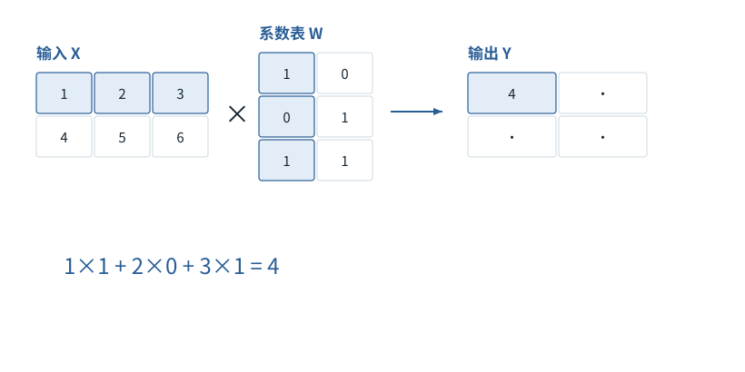

基础篇


<span id="foundations-07-s0"></span>


# F07｜模型最常做的算术：加权求和、点积与矩阵乘法

从具体对象与小例子开始，理解计算过程与适用条件。

本节会用到

[F02 · 一排数、一张表和一叠表](02.md)[F05 · Embedding查表](05.md)


<span id="visual-F07"></span>


动态图解 · F07


<span id="topic-1"></span>


## 矩阵乘法像逐格填写配方结果

一个输出格子的数，到底从哪些输入格子来？

不要先背形状规则。先盯住一个输出格子：它只拿输入的一行、系数表的一列。每对数字相乘，再把乘积加起来。把同样的动作重复到所有输出格子，就得到整张结果表。

**点积**两排等长数字按位置相乘后求和。

**参数表W**控制输入各分量怎样被组合的系数。

**线性投影**这里指每行乘W，不必降低维度。

**输入与适用条件：**沿用本节“矩阵乘法”主算例X=[[1,2,3],[4,5,6]]，W=[[1,0],[0,1],[1,1]]；不是后文的独立两维算例。


<span id="topic-2"></span>


### 1 / 4 · 填输出的第0行第0列

停留时间 4.2秒7秒1.5秒

步骤 第1步，共4步

窄屏可左右滑动图形，或点击“放大图形”。文字解释紧随图后。



选择X的第0行和W的第0列，沿三个特征一一配对、相乘，再相加。其他输出格子各算各的，不能混用另一行。

`Y[0,0] = 4`

1×1 + 2×0 + 3×1 = 4

默认静止。用“下一步”看完解释再继续；播放到最后一步自动停止。键盘聚焦播放器后，可用左右键逐步查看、空格播放/暂停。图中颜色辅助区分，含义同时用文字注明。

JavaScript未启用；第一帧仍可阅读。完整图解页下方列出全部步骤说明。


<span id="topic-3"></span>


### 为什么需要

用批量算子同时处理许多同类乘加，但每个格子的数学定义没有变化。


<span id="topic-4"></span>


### 怎样实现

先把一个格子算对，再利用矩阵库和GPU处理整张表。


<span id="topic-5"></span>


### 可能的代价与误解

形状正确仍可能取错轴、误用逐元素乘法。


<span id="topic-6"></span>


### 如何判断是否做对

四个结果应依次是4、5、10、11，再与代码的矩阵乘对照。

[全部步骤与解释](../visual/F07.md)[F08 · 改摆法与改数值，分开看](../visual/F08.md)[F11 · Q/K/V：先算从哪读，再算读进多少](../visual/F11.md)

机制来源：[[LINEAR]](../visual/sources.md#s-LINEAR)。数值和运行场景为本书明确设定的教学例；资料出处不代替本页中文解释。


<span id="foundations-07-s1"></span>


## 从你已经会的平均数开始

2和6的普通平均是`(2+6)/2=4`，也能写成`0.5×2+0.5×6`。如果你认为第二个数应占更大比例，可以写成`0.25×2+0.75×6=5`，这叫**加权平均**。权重非负并且总和为1时，它表达“各占多少比例”。


<span id="fdiag-07-01"></span>


**关键区别：**先分别乘权重，再相加：0.25×2+0.75×6=5。权重是贡献比例。

**容易误解：**只有非负且总和1的权重才适合解释成“占比”。

对于两排数`[2,0]`和`[0,4]`，仍按对应位置计算：

```
0.25×[2,0] + 0.75×[0,4]
= [0.25×2+0.75×0, 0.25×0+0.75×4]
= [0.5,3]
```

得到的仍是一排数，没有选出一句文字。这会直接用在Attention中。


<span id="foundations-07-s2"></span>


## 点积是怎样把两排数变成一个数

**点积（dot product）**要求两排数一样长：把对应位置相乘，再加起来。


<span id="fdiag-07-02"></span>


**关键区别：**计算1×4+2×5+3×6，最后得到的是一个数。

**容易误解：**点积不是把每个位置单独保留成三排结果。

```
[1,2,3] · [4,5,6]
= 1×4 + 2×5 + 3×6
= 32
```


<span id="concept-intro-1"></span>


先认识这里的对象与符号

[Σ：按下标逐项求和](../concepts.md#concept-sum)
:   Σ是加法的简写。下标指出哪项在变化；没有被求和的下标保持不变。它不是一个额外参数，也不表示把数组拼在一起。独立微例：Σᵢ xᵢyᵢ，x=[1,2]、y=[3,4]，就是1×3+2×4=11。

公式`Σ_i x_i y_i`只是把上面三次乘法与加法写成通用规则。点积结果是一个标量，而不是三排数。它可以用于比较方向或产生分数，但原始点积也受向量长度影响，不能无条件说它就是纯粹的语义相似度。


<span id="foundations-07-s3"></span>


## 矩阵乘法是“一次做很多个点积”

**本段先给两个对象起名：**X是当前输入数字表；W是决定如何组合这些数字的系数表。这里先手动指定W，F10再说明它在模型里怎样成为可训练参数。字母只标识对象，没有增加新的算术操作。


<span id="fdiag-07-03"></span>


**关键区别：**X的一行与W的一列配对，填入Y一个格子；重复后得到2行2列。

**容易误解：**内侧维度必须相同，矩阵乘法不等于按格相乘。


<span id="fboard-07-03"></span>


逐格算清：矩阵乘法：一个输出格子怎样从行和列得到

![第一行[1,2,3]和第一列[1,0,1]点积得到Y[0,0]等于4](../figures/a6c4c217b6c28914.svg)

步骤 1取输入X第0行：[1,2,3]。

步骤 2取W第0列：[1,0,1]。

步骤 3对应位置相乘并相加：1×1+2×0+3×1=4。

步骤 4因此Y[0,0]=4；逐格重复得到Y=[[4,5],[10,11]]。

先只算蓝色格子Y[0,0]：1×1+2×0+3×1=4。换到下一行或下一列，用同样方法填写其余格子。

数值除特别标注外来自本章已明确设定的教学条件；示意图表达算法结构，不代表商业模型参数或实时GPU执行速度。

设两张表：

```
X = [[1,2,3],       W = [[1,0],
     [4,5,6]]           [0,1],
                         [1,1]]
X形状[2,3]         W形状[3,2]
```

计算`Y=XW`：Y的每个格子，用X的一行与W的一列做点积。

```
Y[0,0] = [1,2,3]·[1,0,1] = 4
Y[0,1] = [1,2,3]·[0,1,1] = 5
Y[1,0] = [4,5,6]·[1,0,1] = 10
Y[1,1] = [4,5,6]·[0,1,1] = 11
所以Y = [[4,5],[10,11]]，形状[2,2]
```

内侧尺寸必须匹配：`[m,n]×[n,p]→[m,p]`。m是第一张表的行数，n是每次点积配对的长度，p是输出列数。这里没有“把所有数字随便相乘”的自由。


<span id="foundations-07-s4"></span>


## 一个Token从4096个数变成另外4096个数，究竟是什么动作

若输入一排数x长4096，乘一个`[4096,4096]`权重矩阵，每一输出列都对输入4096个数加权求和。输出还是4096个数，但数值和组合方式变了。这个过程常称**线性投影**；“投影”在这里不必等同三维物体投影到墙上，也不一定降低维度。


<span id="fdiag-07-04"></span>


**关键区别：**每个输出特征来自4096个输入特征的加权组合；数量可以不变，但内容已变。

**容易误解：**“投影”不必把维度变小。

在多条输入的情况下，常把最后一个轴视为特征轴。同一W作用到每个位置，因此`[B,T,d]×[d,k]→[B,T,k]`。它改变每个位置的宽度，不直接混合两条样本或相邻Token。


<span id="foundations-07-s5"></span>


## 转置怎样帮助“一排数分别与多行比较”

**转置（transpose）**是把一张表的行列交换。比如：


<span id="fdiag-07-05"></span>


**关键区别：**转置后每个Key都变成一列，方便一个Query一次与全部Key做点积。

**容易误解：**ᵀ在Kᵀ中表示转置，不是序列长度T。

```
K = [[1,2],       Kᵀ = [[1,3,5],
     [3,4],             [2,4,6]]
     [5,6]]
```

K在这段**只是给三行待比较数字起的表名**，原来有3行，每行2个数。另有一排待比较数字q，长度也是2；想让q分别与K的3行做点积，可以将K转成2行3列，于是`[1,2]×[2,3]→[1,3]`，一次得到三个比较分数。到F11，才会把这种接收方表示和候选表示分别引入为Query和Key，并完整解释它们的参数来源。

注意上标`ᵀ`是转置，不是序列长度T；`Kᵀ`也不是K的T次方。


<span id="foundations-07-s6"></span>


## 矩阵乘与逐元素乘不能混

在常见Python数值库里，`@`表示矩阵乘，`*`常表示对应格子逐元素相乘。对两个2×2矩阵，这两种操作都能运行且输出2×2，但结果完全不同。**形状对了只是必要检查，不代表运算含义对了。**

读公式时依次问：输入每个轴是什么、操作按哪条轴进行、输出每格怎么计算、得到的是分数还是特征。这个办法比只记“QKV都是矩阵”更可靠。


<span id="concept-intro-2"></span>


先认识这里的对象与符号

[⊙：逐元素乘，不是矩阵乘](../concepts.md#concept-elementwise)
:   逐元素乘把形状对齐后的同位置数相乘，不沿某个维度再求和。公式的并排矩阵或@通常表示矩阵乘，二者不可互换。独立微例：[1,2]⊙[3,4]=[3,8]，点积则为11。门控前馈里的⊙是在每个特征上调节另一路。


<span id="worked-F07"></span>


运行示例 · F07


<span id="topic-7"></span>


### 用同一张表区分点积、矩阵乘法与逐元素乘法

独立的矩阵乘法对照：下面换用一排两维输入，不沿用上方三列X；本表内部始终使用这里给定的x和W。**输入与条件。**设一排输入 `x=[1,2]`，权重矩阵 `W=[[3,4],[5,6]]`。行向量乘矩阵意味着用W的每一列分别计算一个新特征。

| 步骤与对象 | 内部动作 | 中间结果 / 新状态 |
| --- | --- | --- |
| 1取第1列 | `[1,2]·[3,5]` | `1×3+2×5=13`。 |
| 2取第2列 | `[1,2]·[4,6]` | `1×4+2×6=16`。 |
| 3合成输出 | 把两个点积并排 | 得到 `[13,16]`；这是 `xW`。 |
| 4逐元素对照 | `[1,2]⊙[3,5]` | 得到 `[3,10]`，尚未求和，不能拿它替代点积13。 |
| 5两条输入 | 把 `x2=[0,1]` 也放进来 | `[[1,2],[0,1]]W=[[13,16],[5,6]]`，每个位置都用相同权重。 |

**把过程连起来。**矩阵乘法没有神秘新动作，它是按规定配对并重复“乘后相加”。形状合法并不保证轴的语义正确。

**边界与反例。**权重是构造的，不含训练语义。本例用行向量约定；采用列向量时公式需一致转置。

依据与适用范围：[[DERIVE]](../example-sources.md#ex-src-DERIVE)。示例输入和场景由本书明确设定。


<span id="self-check"></span>


## 课后自检

**自检 1**

**形状[2,3]能直接矩阵乘[4,5]吗？**

<details class="quiz-answer"><summary><span class="when-closed">查看参考答案</span><span class="when-open">收起参考答案</span></summary><div class="answer">按普通矩阵乘规则不能，内侧3和4不匹配。需要先确认设计，而不是任意reshape到能跑。</div></details>

**自检 2**

**0.2×[1,5]+0.8×[6,0]等于什么？**

<details class="quiz-answer"><summary><span class="when-closed">查看参考答案</span><span class="when-open">收起参考答案</span></summary><div class="answer">第一格0.2+4.8=5，第二格1+0=1，所以是[5,1]。</div></details>


<span id="section-8"></span>


### 延伸阅读：相关系统问题

[02｜一次Transformer前向：逐张量、逐算子讲明白](../chapters/02.md)  
[05｜后训练与模型定制：目标、结构和参数适配](../chapters/05.md)  
[07｜KV Cache、FlashAttention与PagedAttention的内部过程](../chapters/07.md)  
[15｜检索离线链路：文档怎样变成可查询索引](../chapters/15.md)  
[28｜研究深水区与系统综合判断](../chapters/28.md)

机制依据：[[F-LINALG]](../sources.md#src-F-LINALG)[[TR]](../sources.md#src-TR)。本节数值与情景除另注外均为原创教学示例；来源不代替中文讲解。


<span id="canonical-related"></span>


## 继续阅读与机制对应

| 页面 | 阅读关系 |
| --- | --- |
| [F06｜“放到设备”是什么：数据类型、内存、CPU与GPU](06.md) | 上一节：复习本页使用的前置概念 |
| [F08｜reshape、转轴、广播：形状变了，内容未必算过](08.md) | 下一节：沿同一课程顺序继续 |
| [02｜一次Transformer前向：逐张量、逐算子讲明白](../chapters/02.md) | 系统机制：用源码、反例和条件深入核对 |

AI系统工程：从基础到内部  
[全书目录](../contents.md) · [术语与符号](../glossary.md) · [参考资料](../sources.md)