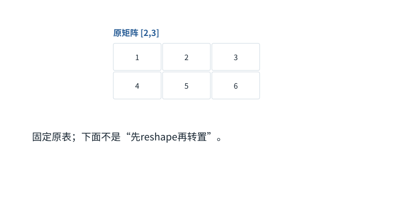

基础篇


<span id="foundations-08-s0"></span>


# F08｜reshape、转轴、广播：形状变了，内容未必算过

从具体对象与小例子开始，理解计算过程与适用条件。

本节会用到

[F02 · 一排数、一张表和一叠表](02.md)[F07 · 模型最常做的算术](07.md)


<span id="visual-F08"></span>


动态图解 · F08


<span id="topic-1"></span>


## 改摆法与改数值，分开看

reshape、转置、广播为什么不能互换？

把矩阵想成带地址的格子。reshape改变分组读法；转置改变行列地址对应；广播配合加法等运算改变数值。三者最后可能有相似形状，却不能据此当成同一过程。

**reshape**保持规定的元素遍历顺序，按另一形状分组。

**转置**原第i行第j列映射到新第j行第i列。

**广播**使小张量沿允许的轴参与大张量运算。

**输入与适用条件：**四帧中的三个对照操作都从原矩阵[[1,2,3],[4,5,6]]开始；每帧明确重置，而不是接力计算。


<span id="topic-2"></span>


### 1 / 4 · 原来的两行

停留时间 4.2秒7秒1.5秒

步骤 第1步，共4步

窄屏可左右滑动图形，或点击“放大图形”。文字解释紧随图后。



六个数的行优先顺序是1,2,3,4,5,6。接下来进行两种独立操作，均从这张原表出发。

`本步状态由图形与说明共同给出。`

默认静止。用“下一步”看完解释再继续；播放到最后一步自动停止。键盘聚焦播放器后，可用左右键逐步查看、空格播放/暂停。图中颜色辅助区分，含义同时用文字注明。

JavaScript未启用；第一帧仍可阅读。完整图解页下方列出全部步骤说明。


<span id="topic-3"></span>


### 为什么需要

形状操作把数据组织成算子需要的格式，减少不必要复制可提高效率。


<span id="topic-4"></span>


### 怎样实现

跟踪下标、步幅和连续性；需要复制时不能只凭“看起来是视图”判断。


<span id="topic-5"></span>


### 可能的代价与误解

把转置后的结果当原表继续相加，会得到另一组数却可能不报错。


<span id="topic-6"></span>


### 如何判断是否做对

对固定整数表逐格比对结果，并检查是否发生内存复制。

[全部步骤与解释](../visual/F08.md)[F07 · 矩阵乘法像逐格填写配方结果](../visual/F07.md)[F12 · Mask是可见性表，不是额外语义](../visual/F12.md)

机制来源：[[TENSOR]](../visual/sources.md#s-TENSOR)。数值和运行场景为本书明确设定的教学例；资料出处不代替本页中文解释。


<span id="foundations-08-s1"></span>


## 为什么深度学习代码里反复改变形状

有些操作需要“一张长表”，有些操作需要“多个头各一张表”。同一批数字可以用不同形状组织，但**组织数据**与**学习新特征**不是同一件事。若不分清，你会把一次reshape误读成模型又推理了一次。


<span id="fdiag-08-01"></span>


为什么深度学习代码里反复改变形状：逐项辨别

|  |  |
| --- | --- |
| 对象一 | 值的排列 |
| 对象二 | 张量shape |
| 对象三 | 内存步幅stride |

**关键区别：**shape说明逻辑轴长；stride说明移动一个下标时底层地址跳多少。

**容易误解：**逻辑上变形成功不等于物理内存重新排序。


<span id="foundations-08-s2"></span>


## reshape是重新分组，不是交换行列

把`[[1,2,3],[4,5,6]]`按行看成数字序列1、2、3、4、5、6，再改为3行2列，可以得到：


<span id="fdiag-08-02"></span>


**关键区别：**reshape改变分组规则，默认并未做把行列相互交换的运算。

**容易误解：**视图能否零拷贝由连续性和stride决定。

```
reshape为[3,2]：[[1,2],
                 [3,4],
                 [5,6]]
```

而同一原矩阵的转置是：

```
transpose后：  [[1,4],
                 [2,5],
                 [3,6]]
```

两个结果形状都为`[3,2]`，内容位置却不一样。前者重分组，后者交换“原行”和“原列”的身份。这是许多Attention实现错误的来源。

reshape前后元素数必须一致。12个数可以排成`[3,4]`或`[2,2,3]`，不能不丢不补地排成`[5,5]`。代码里的`-1`有时表示让库按总数推算这一轴，不是负数长度。


<span id="foundations-08-s3"></span>


## 多头只是把特征轴分组吗

假设每个位置宽度d=4，有2个头，每头宽度2。投影后的`[B,T,4]`可以重排成`[B,T,2,2]`，再交换T轴与头轴，成为`[B,2,T,2]`，方便每个头独立计算。


<span id="fdiag-08-03"></span>


多头只是把特征轴分组吗：逐项辨别

|  |  |
| --- | --- |
| 方案／对象 A | reshape重新分组 |
| 方案／对象 B | transpose交换行列 |
| 方案／对象 C | 结果可以shape相同但值不同 |

**关键区别：**对[[1,2],[3,4]]，转置是[[1,3],[2,4]]，不是原样重新分组。

**容易误解：**不能用“输出形状相同”判定两个算子等价。

这里“头”指一套Attention中的分组计算单元；具体内容来自已经学习好的投影权重。不是把原始文本分成两半，也不是头0天然负责中文、头1天然负责代码。

为了区分，记`H=2`为头数、`d_h=2`为每头宽度，`d=H×d_h=4`。代码经常用`reshape`后再`transpose`或`permute`（交换若干轴），两个步骤有各自作用。


<span id="foundations-08-s4"></span>


## 广播：用一个小对象作用到许多位置

假设X有2行3列，每行都要加偏置`[10,20,30]`。不必手工复制两行偏置，库可以按**广播（broadcasting）**规则把这排数应用到每一行：


<span id="fdiag-08-04"></span>


**关键区别：**多头拆分首先是轴重组；真正信息交互发生在各头的注意力运算里。

**容易误解：**拆分并不会自动让两个头读取不同位置或产生Attention分数。

```
[[1,2,3],   + [10,20,30] = [[11,22,33],
 [4,5,6]]                    [14,25,36]]
```

常见广播规则从最右轴对齐：长度相同或某一方长度为1时可匹配。`[2,3]`与`[3]`可以；`[2,3]`与`[2]`通常不可以。若你要每行加不同的一个数，应把后者组织成`[2,1]`。

注意力分数可能是`[B,H,T,T]`，某些mask可以带长度为1的头轴来广播，表达“所有头共用这个限制”。但某种形状能广播，不代表语义正确，仍需检查轴身份。


<span id="foundations-08-s5"></span>


## 内存布局与视图只需先懂一个原则

张量除了shape，还可用**步长（stride）**描述沿某轴前进一步在底层存储中跳多远。转轴有时只改变这份说明而不搬动全部数据，这样的结果可能是原数据的**视图（view）**。


<span id="fdiag-08-05"></span>


**关键区别：**广播把同一排偏置应用到每行，随后逐元素相加。

**容易误解：**广播与矩阵乘法不同，某轴需能对齐或长度为1。

因此某些操作要求内存连续排列，有时需要复制后才能执行；修改共享存储的视图还可能影响原对象。不要把“代码看起来只是换shape”当作一定免费，也不要无条件认为它一定复制。

**squeeze**通常移除长度为1的轴，**unsqueeze**增加长度为1的轴。若B恰好为1，随手squeeze可能把批轴也删掉，后续代码在B=1能跑、B=2却失败。显式指定轴比猜形状安全。


<span id="worked-F08"></span>


运行示例 · F08


<span id="topic-7"></span>


### reshape与转置：同样四个数为何会形成不同排列

**输入与条件。**原矩阵是 `A=[[1,2],[3,4]]`，行优先顺序为 `1,2,3,4`。**下面第1—4行是从同一原矩阵A分别出发的四个独立对照，不是把上一行结果直接输入下一行。**

| 步骤与对象 | 内部动作 | 中间结果 / 新状态 |
| --- | --- | --- |
| 1展平再reshape | 按原顺序放成一行 | 得到 `[[1,2,3,4]]`，只改分组。 |
| 2转置 | 旧 `(行,列)` 换为新 `(列,行)` | 得到 `[[1,3],[2,4]]`，元素对应位置真的交换。 |
| 3加偏置 | 重新从原矩阵 `A` 出发（不是从步骤2的转置结果出发），每行加 `[10,20]` | 得到 `[[11,22],[13,24]]`，这是广播后的数值运算。 |
| 4拆两个头 | 重新从 `A` 按行展平的 `[1,2,3,4]` 出发，按连续组切开 | 得到头0 `[1,2]`、头1 `[3,4]`；还需保持位置轴与头轴对应。 |
| 5反例检查 | 想把6个数reshape为 `[2,4]` | 目标要8个数，元素总数不等，应拒绝。 |

**把过程连起来。**这四行是独立对照，不是连续流水线；不能因为新旧形状相同就认为计算相同。如果真的把“转置A”接着“每行加[10,20]”，结果应是 `[[11,23],[12,24]]`，而非上表第3行的 `[[11,22],[13,24]]`。

**边界与反例。**视图是否零拷贝取决于底层步幅和连续性；本例描述逻辑元素排列，不承诺具体框架是否复制。

依据与适用范围：[[DERIVE]](../example-sources.md#ex-src-DERIVE)。示例输入和场景由本书明确设定。


<span id="self-check"></span>


## 课后自检

**自检 1**

**reshape[2,3]到[3,2]与转置一定一样吗？**

<details class="quiz-answer"><summary><span class="when-closed">查看参考答案</span><span class="when-open">收起参考答案</span></summary><div class="answer">不一样。两者可能具有同样的输出形状，但每个元素所在位置不同，正文1到6的例子就是反例。</div></details>

**自检 2**

**X为[2,3]，给每行分别加10和20，应把偏置组织成什么？**

<details class="quiz-answer"><summary><span class="when-closed">查看参考答案</span><span class="when-open">收起参考答案</span></summary><div class="answer">[2,1]，即[[10],[20]]，让每行的一个数沿列轴广播。</div></details>


<span id="section-7"></span>


### 延伸阅读：相关系统问题

[02｜一次Transformer前向：逐张量、逐算子讲明白](../chapters/02.md)  
[03｜注意力的深入追问：位置、掩码、多头与反向传播](../chapters/03.md)  
[07｜KV Cache、FlashAttention与PagedAttention的内部过程](../chapters/07.md)

机制依据：[[F-TENSOR]](../sources.md#src-F-TENSOR)[[F-LINALG]](../sources.md#src-F-LINALG)。本节数值与情景除另注外均为原创教学示例；来源不代替中文讲解。


<span id="canonical-related"></span>


## 继续阅读与机制对应

| 页面 | 阅读关系 |
| --- | --- |
| [F07｜模型最常做的算术：加权求和、点积与矩阵乘法](07.md) | 上一节：复习本页使用的前置概念 |
| [F09｜概率、指数与softmax：把分数变成比例](09.md) | 下一节：沿同一课程顺序继续 |
| [02｜一次Transformer前向：逐张量、逐算子讲明白](../chapters/02.md) | 系统机制：用源码、反例和条件深入核对 |

AI系统工程：从基础到内部  
[全书目录](../contents.md) · [术语与符号](../glossary.md) · [参考资料](../sources.md)