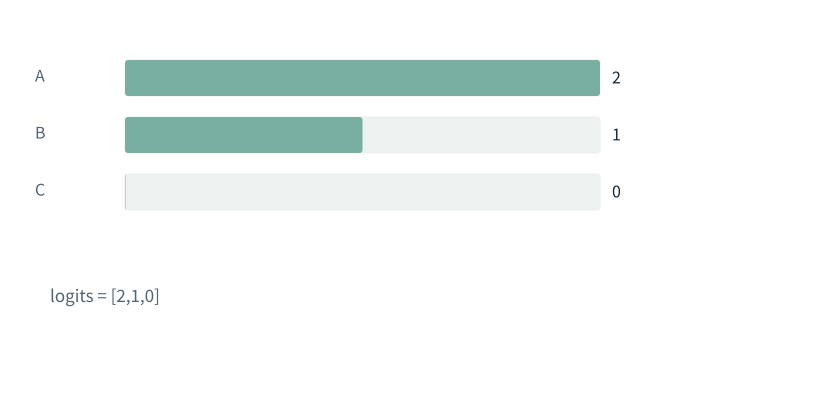
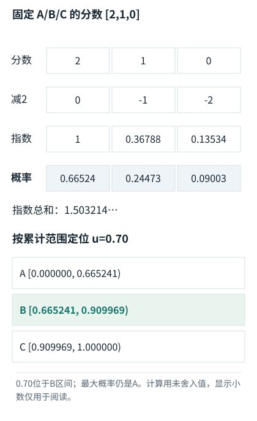

基础篇


<span id="foundations-09-s0"></span>


# F09｜概率、指数与softmax：把分数变成比例

从具体对象与小例子开始，理解计算过程与适用条件。

本节会用到

[F02 · 一排数、一张表和一叠表](02.md)[F07 · 模型最常做的算术](07.md)


<span id="visual-F09"></span>


动态图解 · F09


<span id="topic-1"></span>


## Softmax不是直接把分数除以它们的和

怎样从同一组三个分数，一步不跳走到抽样？

先把分数变成正的相对强度，再除以总量，就能读成候选份额。减最大值像把刻度原点一起移动；所有项的相对差值不变。最后按概率抽样还包含一次选择动作，概率本身不是选出的答案。

**logits**转换前的分数，可正可负。

**指数exp**这里计算e的指定次方。

**归一化**把各项除以共同总和，使总量为1。

**输入与适用条件：**全程固定候选A/B/C、分数[2,1,0]、温度1、不做Top-k/Top-p裁剪；只在最后给定u=0.70。


<span id="topic-2"></span>


### 1 / 5 · 分数不是份额

停留时间 4.2秒7秒1.5秒

步骤 第1步，共5步

窄屏可左右滑动图形，或点击“放大图形”。文字解释紧随图后。



候选A、B、C的原分数是2、1、0。2不是200%，它只是尚未转换的分数。

`logits = [2,1,0]`

logits = [2,1,0]

默认静止。用“下一步”看完解释再继续；播放到最后一步自动停止。键盘聚焦播放器后，可用左右键逐步查看、空格播放/暂停。图中颜色辅助区分，含义同时用文字注明。

JavaScript未启用；第一帧仍可阅读。完整图解页下方列出全部步骤说明。


<span id="topic-3"></span>


### 为什么需要

需要把任意分数变成可比较的份额，并避免大指数溢出。


<span id="topic-4"></span>


### 怎样实现

先减最大值、取指数、求和、归一化，再按明确规则选项。


<span id="topic-5"></span>


### 可能的代价与误解

这不是整句答案正确率；中间显示的四舍五入数不应反复拿去算下一步。


<span id="topic-6"></span>


### 如何判断是否做对

与未平移的精确计算比较概率；概率和为1，u=0.70应选B。

[全部步骤与解释](../visual/F09.md)[F11 · Q/K/V：先算从哪读，再算读进多少](../visual/F11.md)[F18 · 一次输入如何连着预测，直到结束](../visual/F15.md)[O07 · 推测解码：草稿可以快，但必须正确校验](../visual/O07.md)

机制来源：[[SOFTMAX]](../visual/sources.md#s-SOFTMAX)。数值和运行场景为本书明确设定的教学例；资料出处不代替本页中文解释。


<span id="foundations-09-s1"></span>


## 分数不是概率

本章从头到尾只使用**同一组三个候选Token**：候选A、B、C，模型分别给它们打分`[2,1,0]`。这些值叫**logits（未归一化分数）**，不是概率：例如2不能读成200%，三个数相加也不等于1。实际logits也可能是负数，但为了方便核对，本章始终使用`[2,1,0]`。


<span id="fdiag-09-01"></span>


分数不是概率：逐项辨别

|  |  |
| --- | --- |
| 方案／对象 A | 分数[2,1,0] |
| 方案／对象 B | 概率必须非负 |
| 方案／对象 C | 三项总和=1 |

**关键区别：**logits可为任意实数，概率是满足总和约束的比例，不可直接混读。

**容易误解：**分数2不是200%概率。

**概率**在这里表示模型为候选分配的比例：每项不小于0，总和为1。0.2表示20%。它是模型在当前条件下的预测，不自动等于现实中答案正确的概率。


<span id="foundations-09-s2"></span>


## 先学指数和对数需要的那一点

`2³=8`是指数；`exp(x)`是`e^x`，底数e约为2.71828。指数把任意实数转成正数：exp(0)=1，exp(1)约2.718，exp(-1)约0.368。


<span id="fdiag-09-02"></span>


先学指数和对数需要的那一点：逐项辨别

|  |  |
| --- | --- |
| 对象一 | exp(0)=1 |
| 对象二 | exp(1)≈2.718 |
| 对象三 | exp(-1)≈0.368 |

**关键区别：**指数函数把正负分数转成正数，再用于归一化。

**容易误解：**exp会放大高分差距，不能当普通线性比例。

**自然对数ln**是反过来问“e的几次方等于这个正数”。所以ln(1)=0，ln(e)=1。`ln(2)`约0.693，`ln(3)`约1.099。后面的损失函数会用到对数，现在先认识它与指数互为反操作。


<span id="foundations-09-s3"></span>


## softmax一步不跳地算

**Softmax**把模型给三个候选的分数转成三项概率。**从这里到本章的抽样示例，输入始终是`[2,1,0]`，并没有换另一组数据。**逐步计算如下。计算机通常先减去最大值以避免指数过大，具体原因下一节会证明。


<span id="fdiag-09-03"></span>


**关键区别：**指数[1,0.3679,0.1353]总和1.5032；各项除以总和。

**容易误解：**本节固定使用[2,1,0]；独立对照会在输入条件中另行声明。


<span id="fboard-09-03"></span>


**同一组[2,1,0]：分数、概率与抽样区间**

![同一组分数 [2,1,0]，从计算到抽样](../figures/17e2bb7203a74420.svg)



输入和数值沿用本节固定算例。先按对象/位置对齐，再检查图中对应关系。

[SVG图源](../../diagrams/rendered/foundation-fboard-09-03-a7054aed922c.svg)

```
① 候选Token：       A          B          C
② 原始分数 z：     2          1          0
③ 减最大值2：      0         -1         -2
④ 分别取指数：     1      0.367879   0.135335
⑤ 指数求总和：     S = 1 + 0.367879 + 0.135335 ≈ 1.503215
⑥ 各自除以 S：  0.665241   0.244728   0.090031
⑦ 累计概率：    0.665241   0.909969   1.000000

抽样时取一个位于 [0,1) 的随机数，例如 u=0.70：
  A 区间：[0,       0.665241)
  B 区间：[0.665241,0.909969)   ← 0.70 落在这里
  C 区间：[0.909969,1)
所以本次抽中 B；但每次随机数可能不同。
表格只显示6位小数，程序使用更高精度的内部值。
```


<span id="concept-intro-1"></span>


先认识这里的对象与符号

[Σ：按下标逐项求和](../concepts.md#concept-sum)
:   Σ是加法的简写。下标指出哪项在变化；没有被求和的下标保持不变。它不是一个额外参数，也不表示把数组拼在一起。独立微例：Σᵢ xᵢyᵢ，x=[1,2]、y=[3,4]，就是1×3+2×4=11。

通用写法是`p_i = exp(z_i) / Σ_j exp(z_j)`。i指当前候选，j遍历全部候选，Σ表示求和。**分母相同，因此所有项会一起竞争比例**。

若A的分数增大而B、C不变，Softmax归一化后B、C的概率就会下降，因为三者共享同一个分母。这也解释了注意力中的一个工程细节：**仅把补齐位置（PAD）的Embedding设为零，不保证它不影响注意力**。若它仍是可访问的Key位置，就可能参与注意力的Softmax分母；应通过合适的Attention Mask排除无效位置。这里说的是**注意力Softmax**，不是当前三个候选Token的生成概率。


<span id="foundations-09-s4"></span>


## 为什么要减最大值

很大的指数可能超出有限精度能表示的范围。可以把所有分数减去同一个最大值m，再算softmax：


<span id="fdiag-09-04"></span>


**关键区别：**指数平移对应公共倍数，归一化时会约掉，因此数值更稳定。

**容易误解：**减最大值不是重新排序候选或人为提高某项概率。

```
exp(z_i-m) / Σ exp(z_j-m)
= [exp(z_i)/exp(m)] / [Σexp(z_j)/exp(m)]
= exp(z_i) / Σexp(z_j)
```

分子分母的共同因子抵消，因此数学上结果不变，却能避免指数过大。用**同一组分数[2,1,0]**核对：不减最大值时，指数为`[7.389056,2.718282,1]`，总和约`11.107338`；逐项相除，仍是约`[0.665241,0.244728,0.090031]`。减最大值不是“删掉最大候选”，也不会改动原来的概率。


<span id="foundations-09-s5"></span>


## 取最大与按概率抽样不是一回事

**argmax**选择分数或概率最大的候选；**采样（sampling）**按概率随机抽一个。概率为`[0.665241,0.244728,0.090031]`时，argmax总选第一项A；按上述概率采样时，也可能选B或C。例如随机数0.70选中B。这解释了为什么同一分布可以产生不同文字。


<span id="fdiag-09-05"></span>


取最大与按概率抽样不是一回事：逐项辨别

|  |  |
| --- | --- |
| 方案／对象 A | Argmax总选A |
| 方案／对象 B | 按分布抽样可能选B |
| 方案／对象 C | 概率[0.6652,0.2447,0.0900] |

**关键区别：**随机数0.70落入B的累计区间，所以这次选B并不矛盾。

**容易误解：**概率最大的项不是每次抽样都必然选中的项。

**Temperature（温度）**是在softmax前把分数除以正数τ。τ较小常使分布更集中，较大更分散。τ=0不能真的执行除零；接口若用0表示贪心，是另外的处理约定。


<span id="concept-intro-2"></span>


先认识这里的对象与符号

[Top-k、Top-p与重新归一化](../concepts.md#concept-topk)
:   Top-k保留概率最高的k项；Top-p按概率降序保留累计概率达到阈值的候选前缀。用于抽样时，被保留的候选需按剩余总质量重新归一化。这里k是候选数量，p是累计概率阈值；不是注意力Key表K，也不是表示维度d\_k。

**Top-k**保留前k项；**Top-p**通常保留累计概率达到门槛的最小高概率候选集合，再在其中归一化采样。p是阈值而非Token数量。这些策略在生成时改变候选选择，不会让错误的矩阵计算变正确。


<span id="foundations-09-s6"></span>


## 同一个softmax在两处出现

Attention中的softmax把“对输入各位置的分数”变为聚合权重；最后输出的softmax把“对词表各候选的分数”变为下一Token概率。算法可以相同，但归一化的轴、候选集合和用途不同，不能把注意力权重当作最终答案置信度。


<span id="worked-F09"></span>


运行示例 · F09


<span id="topic-7"></span>


### 三个分数怎样一步步变成抽样概率

**输入与条件。**继续沿用本章**唯一的三个候选A、B、C**，对应分数仍为`[2,1,0]`。下面的表是前面逐项计算的**同数据核对表**，不是另一道换了分数的题。

| 步骤与对象 | 内部动作 | 中间结果 / 新状态 |
| --- | --- | --- |
| 1平移分数 | 减去最大值2 | 得到 `[0,-1,-2]`，保持相对差值。 |
| 2取指数 | 逐项计算exp | 约 `[1,0.367879,0.135335]`。 |
| 3求总和 | 把指数相加 | 约1.503215。 |
| 4各除总和 | 归一化 | 约 `[0.665241,0.244728,0.090031]`，和为1。 |
| 5按区间取样 | 把[0,1)分成三段 | 分段为A:[0,0.665241)，B:[0.665241,0.909969)，C:[0.909969,1)。随机数0.70落入B区间，所以选择B；argmax则选择A。 |

**把过程连起来。**此表与上方“Softmax一步不跳地算”完全对应：分数、指数、分母和概率没有变化。减最大值不会改变数学上的概率；抽样也允许选中非最大项。这里的概率是模型对下一Token的预测分布，不是整句回答真实正确的概率。

**边界与反例。**使用未舍入数计算，表格只展示有限小数；随机数0.70是人为给定的示例输入。

[查看本例程序结果](../example-verification.md#result-F09) · [完整可运行代码](../example-verification.md#code)

依据与适用范围：[[SDPA]](../example-sources.md#ex-src-SDPA)。示例输入和场景由本书明确设定。


<span id="self-check"></span>


## 课后自检

**自检 1**

**分数[0,0]经softmax是什么？**

<details class="quiz-answer"><summary><span class="when-closed">查看参考答案</span><span class="when-open">收起参考答案</span></summary><div class="answer">指数为[1,1]，总和2，结果[0.5,0.5]。</div></details>

**自检 2**

**三个候选概率为[0.2,0.3,0.5]，模型给第三项0.5是否表示答案有50%真实正确？**

<details class="quiz-answer"><summary><span class="when-closed">查看参考答案</span><span class="when-open">收起参考答案</span></summary><div class="answer">不能这样推断。这是下一候选的模型分配概率，不是已校准的整份答案事实正确率。</div></details>


<span id="section-8"></span>


### 延伸阅读：相关系统问题

[01｜输入究竟是什么：从用户的一句话到模型张量](../chapters/01.md)  
[02｜一次Transformer前向：逐张量、逐算子讲明白](../chapters/02.md)  
[06｜推理机制：加载、解码策略与连续生成](../chapters/06.md)  
[04｜训练机制：损失、完整反向传播与参数更新](../chapters/04.md)  
[05｜后训练与模型定制：目标、结构和参数适配](../chapters/05.md)

机制依据：[[F-PROB]](../sources.md#src-F-PROB)[[TR]](../sources.md#src-TR)。本节数值与情景除另注外均为原创教学示例；来源不代替中文讲解。


<span id="canonical-related"></span>


## 继续阅读与机制对应

| 页面 | 阅读关系 |
| --- | --- |
| [F08｜reshape、转轴、广播：形状变了，内容未必算过](08.md) | 上一节：复习本页使用的前置概念 |
| [F10｜参数、前向与归一化：同一输入如何变成可用表示](10.md) | 下一节：沿同一课程顺序继续 |
| [02｜一次Transformer前向：逐张量、逐算子讲明白](../chapters/02.md) | 系统机制：用源码、反例和条件深入核对 |

AI系统工程：从基础到内部  
[全书目录](../contents.md) · [术语与符号](../glossary.md) · [参考资料](../sources.md)