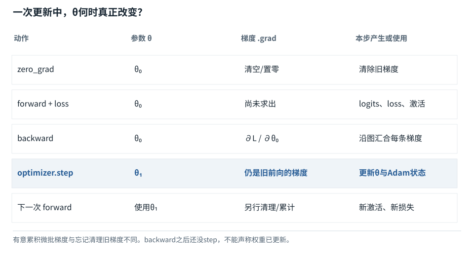

基础篇


<span id="foundations-10-s0"></span>


# F10｜参数、前向与归一化：同一输入如何变成可用表示

从具体对象与小例子开始，理解计算过程与适用条件。


<span id="course-connection"></span>


## 参数先有定义，运算才有来源

先用小网络认识输入、参数和中间结果；再列出贯通模型全部12组参数；最后计算同一位置的RMSNorm。下一节的Q/K/V直接使用这里得到的N1。这里还没有训练，只是在初始化参数下完成一次可以检查的前向。

本节会用到

[F05 · Embedding查表](05.md)[F07 · 模型最常做的算术](07.md)[F09 · 概率、指数与softmax](09.md)


<span id="visual-F10"></span>


动态图解 · F10


<span id="topic-1"></span>


## 网络层是在重组数值，不是在生成隐藏句子

为什么多层之间还要放一个非线性函数？

第一层把输入组合成一排中间数，再经过规则改变它，最后第二层继续组合。若所有层都只是线性变换，多层可以合并为一次线性变换；非线性使它不再等同于一张更大的线性表。这里的“过滤”仅指ReLU数值规则，不能解释成模型理解了哪些词重要。

**ReLU**负数变0，非负数保持原值。

**隐藏状态**两层之间为本次输入算出的向量。

**参数**W、偏置等控制运算的固定系数。

**输入与适用条件：**沿用F10两层向量例：x=[1,2]，W1=[[1,−1],[1,1]]，b1=[0,−2]，W2=[2,1]。最后一帧是明确的去ReLU对照。


<span id="topic-2"></span>


### 1 / 6 · 固定输入与参数

停留时间 4.2秒7秒1.5秒

步骤 第1步，共6步

窄屏可左右滑动图形，或点击“放大图形”。文字解释紧随图后。


先标出输入和系数表的身份。一次推理里的W不是根据x现写出来的。

`本步状态由图形与说明共同给出。`

默认静止。用“下一步”看完解释再继续；播放到最后一步自动停止。键盘聚焦播放器后，可用左右键逐步查看、空格播放/暂停。图中颜色辅助区分，含义同时用文字注明。

JavaScript未启用；第一帧仍可阅读。完整图解页下方列出全部步骤说明。


<span id="topic-3"></span>


### 为什么需要

多层和非线性提高表达能力，但不能凭层数预测质量。


<span id="topic-4"></span>


### 怎样实现

看每个算子的输入、输出和参数，逐层记录中间值。


<span id="topic-5"></span>


### 可能的代价与误解

混淆激活值与参数，容易误以为每次提问都训练模型。


<span id="topic-6"></span>


### 如何判断是否做对

正常前向的输出6；去ReLU独立对照输出5。

[全部步骤与解释](../visual/F10.md)[F11 · Q/K/V：先算从哪读，再算读进多少](../visual/F11.md)[F14 · 一层Transformer不是只有Attention](../visual/F14.md)

机制来源：[[LINEAR]](../visual/sources.md#s-LINEAR) [[AUTOGRAD]](../visual/sources.md#s-AUTOGRAD)。数值和运行场景为本书明确设定的教学例；资料出处不代替本页中文解释。


<span id="foundations-10-s1"></span>


## 从一条可调的规则认识“模型”

考虑`y=w×x+b`。x是每次变化的输入，w与b是决定计算规则的数。若w=2、b=1，输入3得到7。把w改为4，相同输入变成13。


<span id="fdiag-10-01"></span>


**关键区别：**参数决定可调的映射规则；推理时通常使用已有参数。

**容易误解：**输入变化不意味着模型刚完成了参数训练。

**参数**是像w、b这样可以通过训练调整的数；**超参数**是训练或结构的设置，例如一层宽度、学习率、批大小，通常不通过同一梯度步骤自动学出；**激活值或中间表示**是某次前向算出来的临时数，如这次得到的7。

用户新输入改变的是x；正常推理并不因此自动改变w。


<span id="parameter-matrix-basics"></span>


## 从一个系数w到一张参数表W

上面的w=2只有一个数；当输入和输出各有多个特征时，要存下许多个系数，把它们排成矩阵W。**小写w常表示单个参数，大写W常表示整张参数表。** 写W1、W2是在区分第1段和第2段变换，不是把W乘1或乘2。


<span id="fdiag-10-02"></span>


**关键区别：**“参数表”存的是训练得到的系数；本次输入乘加得到中间值。

**容易误解：**W与h不是同一种对象：W是参数，h是本轮激活值。

偏置b也是一组参数，不过它在矩阵乘法后执行逐格相加。X和隐藏状态h是每次输入计算产生的数；W和b决定这些数怎样变换。正常推理从权重文件加载W、b后使用它们，不会因为某个用户输入变化就自动执行训练更新。

接下来先使用同一组给定参数算前向。等F15—F16建立“损失、梯度、优化器”的概念后，再解释参数如何被调整。**理解参数是系数表，并不要求先把训练算法全部学完。**


<span id="core-parameters-2"></span>


<span id="core-parameters-2--mc-section-2"></span>


## 把所有参数列全，避免W突然出现

| 参数名 | 形状 | 个数 | 干什么 |
| --- | --- | --- | --- |
| E | [8,4] | 32 | 用词表编号取初始Token表示 |
| P | [8,4] | 32 | 用绝对位置0—7取位置表示 |
| Wq / Wk / Wv / Wo | 各[4,4] | 64 | 生成Query/Key/Value和注意力输出投影 |
| W1、W2 | [4,8]、[8,4] | 64 | 把每位置的4特征扩到8，再变回4 |
| g1、g2、gf | 各[4] | 12 | 三处RMSNorm的逐特征可学习缩放 |
| U | [4,8] | 32 | 把最后4特征变成8项词表分数 |
| 合计 | 12张参数表或向量 | 236 | 不含输入、缓存、梯度和优化器状态 |

为什么U不是Wo？Wo把注意力的结果变回4维隐藏表示；U把最后隐藏表示变成8项词表分数。都是“输出投影”，输出对象不同。为什么P有8行？本模型最多表示位置0—7，不是词表也有8项才碰巧共享同一表；E与P是两份不同的参数。

依据：[tiny\_model.py:33–46](../reference/model-code.md#tiny_model-L33)；[对应参数、前向及梯度记录](../labs/model-values.md)。


<span id="trace-parameter-states"></span>


**参数和梯度分开：只有optimizer.step改变θ**



数据/调用方向以图中连线为准；参数与激活、训练与推理分别标注。

[SVG图源](../../diagrams/rendered/trace-parameter-states-e9c144e33578.svg)

代码路径：[tiny\_model.py:33–219](../reference/model-code.md#tiny_model-L33) · [Mermaid源文件](../diagrams/parameter-states.mmd)。图的排布只表达数据／调用顺序，不代表计算耗时。


<span id="core-parameters-4"></span>


<span id="core-parameters-4--mc-section-4"></span>


## 所有位置共享参数，为什么输出仍不同

同一个Wq用于所有B×T行，但每行输入不一样，所以Query不同。这种共享让模型不需要给每一个位置重新保存一整套Wq。P的行则由位置选择；E的行由Token身份选择。共享参数的多个使用点在训练反向时会把梯度**相加**，系统机制中的对应推导会追到这一点。

依据：[tiny\_model.py:33–46](../reference/model-code.md#tiny_model-L33)；[对应参数、前向及梯度记录](../labs/model-values.md)。


<span id="foundations-10-s2"></span>


## 一个有两层的完整数值例子

输入x=`[1,2]`，第一层矩阵W1和偏置b1为：


<span id="fdiag-10-03"></span>


**关键区别：**先乘矩阵，再加偏置，再经过非线性。每一步需要保留正确的运算顺序。

**容易误解：**不应把每层写成直接“输入→答案”，省略中间状态。

```
W1 = [[1,-1],[1,1]]     b1 = [0,-2]
xW1 = [1×1+2×1, 1×(-1)+2×1] = [3,1]
xW1+b1 = [3,-1]
```

然后应用**ReLU激活函数**：每个数若小于0就换成0，否则保留。于是得到隐藏表示h=`[3,0]`。

第二层用W2=`[[2],[1]]`，结果`hW2=3×2+0×1=6`。这一次从输入到输出的计算叫**前向传播（forward pass）**，也可简称前向。

所谓“层”，不是屏幕上一个抽象方框，而是一组按规则变换数据的运算。一个复杂模型将许多层串起来，上一步结果成为下一步输入。


<span id="foundations-10-s3"></span>


## 为什么中间需要非线性函数

如果一直只乘矩阵、加偏置，多个线性或仿射变换可以合并成一个，层数增加并不自动带来不同类型的表达能力。ReLU这类不能用单一线性变换表示的操作提供**非线性**，让网络能表示更复杂的关系。


<span id="fdiag-10-04"></span>


为什么中间需要非线性函数：逐项辨别

|  |  |
| --- | --- |
| 方案／对象 A | 线性层叠加 |
| 方案／对象 B | 中间插入ReLU |
| 方案／对象 C | 可表达不同函数形状 |

**关键区别：**没有非线性的多个线性层可以合并成一次仿射变换，表达能力受到限制。

**容易误解：**ReLU不是“只为了把负数删掉”的任意装饰。


<span id="concept-intro-1"></span>


先认识这里的对象与符号

[SiLU：输入乘一份门控系数](../concepts.md#concept-silu)
:   SiLU(x)=x×sigmoid(x)。先把x映射到0与1之间，再乘回x本身，形成非线性。负数不会像ReLU那样一律变为0。独立微例：SiLU(0)=0；SiLU(1)约0.731059；SiLU(-1)约-0.268941。

[GELU：按输入大小平滑调节](../concepts.md#concept-gelu)
:   常用定义是GELU(x)=xΦ(x)，Φ是标准正态分布的累计概率函数。它让负输入和正输入受到不同程度的保留，并不是随机抽样。实现也可能采用近似公式。独立微例：Φ(0)=0.5，所以GELU(0)=0。这里Φ不是模型可学习的参数表。

实际Transformer常用GELU、SiLU或带门的前馈结构。先懂“为什么要有非线性”，再去读具体函数，不必在第一次遇到名字时就背全部公式。


<span id="foundations-10-s4"></span>


## 隐藏状态不是隐藏的中文草稿

上例h=`[3,0]`是一次计算结果，不是一句被藏起来的“我想到了答案”。语言模型里，一个Token通过某层后得到的一排数也叫隐藏状态。它会携带对后续计算有用的信息，但不能直接把每个坐标翻译成一句中文解释。


<span id="fdiag-10-05"></span>


隐藏状态不是隐藏的中文草稿：逐项辨别

|  |  |
| --- | --- |
| 方案／对象 A | 隐藏状态：运行中算出 |
| 方案／对象 B | 模型权重：训练后保存 |
| 方案／对象 C | 输出文字：经解码得到 |

**关键区别：**内部数值表示、固定参数和人能看到的句子属于不同阶段。

**容易误解：**不能把隐藏状态解释成“模型已经写好的中文草稿”。

d表示每个位置的隐藏宽度；L常表示层数；参数总量与所有矩阵的尺寸和共享方式有关。d=4096不代表只有4096个参数。仅一个`4096×4096`矩阵就有16,777,216个格子。


<span id="foundations-10-s5"></span>


## 权重共享和参数冻结

同一个W可以作用于同批每条输入、每个Token位置，叫共享权重。它不意味着共享各位置的计算结果。输入不同，中间状态仍不同。

“冻结参数”表示训练时不更新某些参数；“推理使用固定权重”表示本次计算不执行更新。某些模型服务会在别的时间训练新版本，但不能把普通对话中纠错等同在线训练。


<span id="core-normalization-1"></span>


<span id="core-normalization-1--mc-section-1"></span>


## 为什么注意力前面先处理一排数

隐藏状态的数值尺度会变化。归一化层按每个位置内部的特征统计量调整尺度，让后续模块面对较受控的输入；它不把这一排变成概率，也不让四个数相加等于1。RMSNorm的归一化范围是**特征轴**，不是整条句子，更不是整个批次。

本模型采用pre-norm：先对X做RMSNorm，再送入注意力；保留的残差主路仍是原X，不把它直接替换为归一化后的值。

依据：[tiny\_model.py:48–51](../reference/model-code.md#tiny_model-L48)；[对应参数、前向及梯度记录](../labs/model-values.md)。


<span id="core-normalization-2"></span>


<span id="core-normalization-2--mc-section-2"></span>


## 对“爱”这一行完整算一次

固定 `x=[-0.2, 0.8, 0, 0.45]`，d=4，ε=0.00001，初始缩放g1全是1。

1. 四个数分别平方。
2. 相加再除以4，得到平方的平均值。
3. 加ε，再开平方，得到r。
4. 每个原值除以r，再乘对应可学习缩放g1[j]。

RMSNorm逐格计算

| 对象／位置 | j=0 | j=1 | j=2 | j=3 |
| --- | --- | --- | --- | --- |
| 原始x | -0.2 | 0.8 | 0 | 0.45 |
| 逐格x² | 0.04 | 0.64 | 0 | 0.2025 |
| 归一化输出N1 | -0.425787 | 1.70315 | 0 | 0.958022 |

展示值经过舍入；后续运算使用未舍入值。

```
mean(x²) = (0.04 + 0.64 + 0 + 0.2025) / 4
         = 0.220625
r = sqrt(mean(x²)+0.00001) = 0.469718001
N1[j] = g1[j] × x[j] / r
```

r是本次输入算出的中间值；ε是为数值稳定设置的常数；g1是参与训练的参数。三者来源不同。下一次换输入，r会重新算；普通推理不会因为r变化就更新g1。

依据：[tiny\_model.py:48–51](../reference/model-code.md#tiny_model-L48)；[对应参数、前向及梯度记录](../labs/model-values.md)。


<span id="core-normalization-3"></span>


<span id="core-normalization-3--mc-section-3"></span>


## LayerNorm的“均值、方差”多做了什么

下面是**独立的二数对照**，只为比较统计规则，不接续贯通模型。固定输入 `[1,3]`，不再改成另一组数。均值μ=2，偏差是[-1,1]，平方偏差[1,1]，总体方差是平均值1；标准差在不加ε时为1。

LayerNorm先减μ，再除 `sqrt(var+ε)`，初始gamma=1、beta=0时约为[-0.999995,0.999995]。RMSNorm不减均值，平方平均为5，结果约为[0.447213,1.341639]。这解释了为什么RMSNorm后可以仍全为正；它并没有承诺零均值。

同一输入[1,3]，两种规则不是同一个运算


<span id="core-normalization-3--mc-section-4"></span>


#### LayerNorm

[1,3] → 减均值2 → [-1,1] → 除sqrt(1+ε) → 再乘gamma、加beta。


<span id="core-normalization-3--mc-section-5"></span>


#### RMSNorm

[1,3] → 计算sqrt((1²+3²)/2+ε) → 用原值去除 → 再乘g。

这里ε统一为1e-5。贯通模型只采用RMSNorm，LayerNorm数据仅作为独立对照。

依据：[tiny\_model.py:48–51](../reference/model-code.md#tiny_model-L48)；[对应参数、前向及梯度记录](../labs/model-values.md)。


<span id="core-normalization-4"></span>


<span id="core-normalization-4--mc-section-6"></span>


## 为什么不能把它当作softmax

softmax在候选轴上产生非负份额，和为1；RMSNorm允许负数，也不要求和为1。Attention行softmax按可见Key分配读取份额；输出softmax按词表候选分配预测概率。它们都可能叫“归一化”，目标和轴却完全不同。

依据：[tiny\_model.py:48–51](../reference/model-code.md#tiny_model-L48)；[对应参数、前向及梯度记录](../labs/model-values.md)。


<span id="core-normalization-5"></span>


<span id="core-normalization-5--mc-section-7"></span>


## 训练与推理是否重新计算统计量

本模型两者都按每个位置当前的四个特征计算r。RMSNorm和LayerNorm不依赖类似BatchNorm的跨样本运行均值。`.eval()`不代表它们停止算统计量，只代表切换那些**确实具有训练／评估行为差别**的模块模式。

反向时r也依赖x，不能把它当常量只算 `g/r`。系统机制中的对应推导会解释梯度里为什么多出一项。先牢记：x影响自己的分子，也影响所有特征共享的分母。

依据：[tiny\_model.py:48–51](../reference/model-code.md#tiny_model-L48)；[对应参数、前向及梯度记录](../labs/model-values.md)。


<span id="core-understanding-9"></span>


<span id="core-understanding-9--mc-section-9"></span>


## 追问：LayerNorm、RMSNorm和softmax都是归一化，为什么不可交换？

归一化的轴、统计量与输出性质不同。norm处理每位置的隐藏特征尺度；softmax把位置分数或候选分数转成和为1的非负分布。把它们互换，既改变前向也改变梯度。

依据：[tiny\_model.py:178–258](../reference/model-code.md#tiny_model-L178)；[对应参数、前向及梯度记录](../labs/model-values.md)。


<span id="foundations-10-s6"></span>


## 为什么教材可以先给权重再讲训练

为了看懂内部运行，先拿已知权重走完前向。权重如何从大量例子中得到，放在F15—F17说明。好比先理解一个已有计算器怎样算结果，再理解它如何被设计出来。

小模型数值例子能证明你理解了运算，但它没有经过语言数据训练，不能生成有意义的回答。不要把手算网络称为“复现大模型智能”。


<span id="worked-F10"></span>


运行示例 · F10


<span id="topic-7"></span>


### 固定参数做前向，与学习参数是两件事

局部核对例：以下输入以本例列出的条件为准，不能把它的中间值接到贯通模型的计算记录中。

**输入与条件。**一个小网络：输入x，第一层 `h=max(0,2x−3)`，第二层 `y=4h+1`。参数2、−3、4、1预先给定。

| 步骤与对象 | 内部动作 | 中间结果 / 新状态 |
| --- | --- | --- |
| 1输入x=1 | 算 `2×1−3=−1` | ReLU把负数变为0，因此h=0。 |
| 2走到输出 | 算 `4×0+1` | y=1。 |
| 3另一次输入x=2 | 算 `2×2−3=1` | h=1，输出y=5。 |
| 4观察共享参数 | 两次使用同一组2、−3、4、1 | 结果改变来自输入改变，不是网络刚刚更新了权重。 |
| 5假设训练目标 | x=2时希望y接近4 | 还要计算损失和梯度，才能决定参数往哪边更新。 |

**把过程连起来。**前向是在已有规则下算结果；训练是在目标和误差指导下改规则。中间的h是数值，不是一段隐藏中文解释。

**边界与反例。**ReLU示例只是两层标量网络，不是完整Transformer；选择小网络是为了把每一步都算清。

依据与适用范围：[[DERIVE]](../example-sources.md#ex-src-DERIVE)。示例输入和场景由本书明确设定。


<span id="self-check"></span>


## 课后自检

**自检 1**

**输入x变化时，w一定跟着变化吗？**

<details class="quiz-answer"><summary><span class="when-closed">查看参考答案</span><span class="when-open">收起参考答案</span></summary><div class="answer">推理中通常不会。w是已有参数，变化的是中间状态和输出。训练才会根据损失更新参数。</div></details>

**自检 2**

**在正文二维网络x=[1,2]、第一层未激活值[3,-1]、第二层W2=[[2],[1]]中，去掉ReLU后输出是多少？（不是标量运行示例。）**

<details class="quiz-answer"><summary><span class="when-closed">查看参考答案</span><span class="when-open">收起参考答案</span></summary><div class="answer">隐藏值为[3,-1]，第二层得到3×2+(-1)×1=5。这说明激活函数实际改变了运算。</div></details>


<span id="section-8"></span>


### 延伸阅读：相关系统问题

[02｜一次Transformer前向：逐张量、逐算子讲明白](../chapters/02.md)

机制依据：[[F-LINALG]](../sources.md#src-F-LINALG)[[F-AUTOGRAD]](../sources.md#src-F-AUTOGRAD)[[TR]](../sources.md#src-TR)。本节数值与情景除另注外均为原创教学示例；来源不代替中文讲解。

**把每条样本的全部T×d个数一起求RMS，和每位置沿d求RMS一样吗？**

<details class="quiz-answer"><summary>查看参考答案</summary><div class="answer">不一样。前者使一个位置的尺度受到其他位置、甚至未来内容影响，改变了模型结构和因果性质。本模型每条样本、每个位置分别沿四个特征求统计量。</div></details>


<span id="implementation-evidence"></span>


## 从本页解释到可检查的实现

| 要核对什么 | 事实与边界 | 本地依据 |
| --- | --- | --- |
| 前向、损失与更新 | 固定的一层四维教学模型；不是任何商业模型的完整实现。 | [tiny\_model.py · TinyLM](../reference/model-code.md#tiny_model-L33) |
| 独立前向实现 | 使用同一已保存权重，不使用PyTorch；用于复算而非另行训练。 | [reference\_inference.py · forward](../reference/model-code.md#reference_inference-L28) |
| 错误是否能被发现 | 因果性、梯度、标签移位、缓存位置均有正向检查和反例。 | [test\_model.py](../reference/model-code.md#test_model-L1) |
| 初始化的具体数字 | 所有参数均可查看；初值不等于训练后的参数。 | [weights\_initial.json](../reference/model-code.md#weights_initial-L1) |
| 实际运行记录 | 仅来自本地CPU微型实验；不能推出商业能力或GPU性能。 | [run.json 对应的数值记录](../labs/model-values.md) |


<span id="canonical-related"></span>


## 继续阅读与机制对应

| 页面 | 阅读关系 |
| --- | --- |
| [F09｜概率、指数与softmax：把分数变成比例](09.md) | 上一节：复习本页使用的前置概念 |
| [F11｜Attention逐步计算：先算相关分数，再混合内容](11.md) | 下一节：沿同一课程顺序继续 |
| [02｜一次Transformer前向：逐张量、逐算子讲明白](../chapters/02.md) | 系统机制：用源码、反例和条件深入核对 |

AI系统工程：从基础到内部  
[全书目录](../contents.md) · [术语与符号](../glossary.md) · [参考资料](../sources.md)