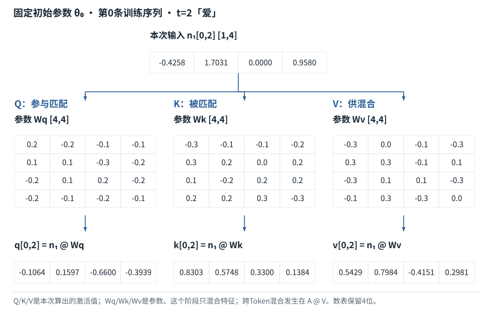
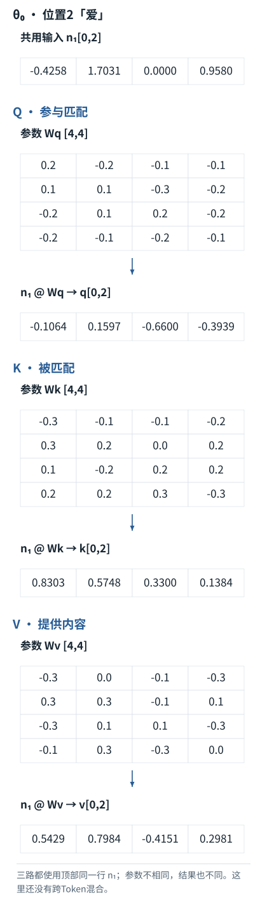
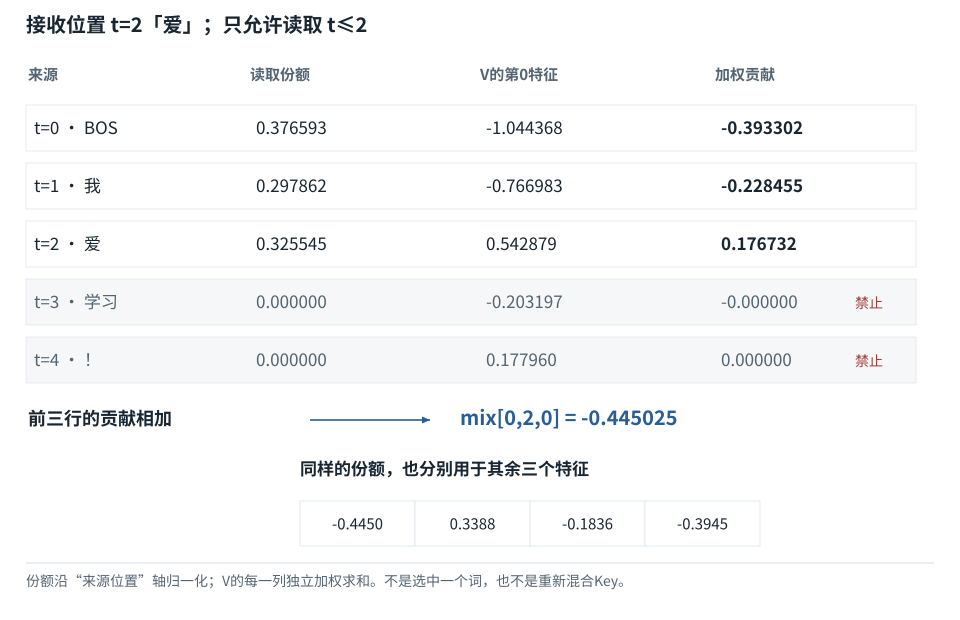

<span id="section-8"></span>

<span id="qkv-lab-heading"></span>

<span id="qkv-parameter-lab"></span>

<span id="fboard-11-06"></span>

<span id="fdiag-11-06"></span>

<span id="foundations-11-s3"></span>

<span id="fdiag-11-05"></span>

<span id="foundations-11-concept-5"></span>

<span id="fdiag-11-04"></span>

<span id="fdiag-11-03"></span>

<span id="foundations-11-concept-3"></span>

<span id="fdiag-11-02"></span>

<span id="foundations-11-concept-2"></span>

<span id="fdiag-11-01"></span>

<span id="visual-F11"></span>

<span id="foundations-11-s0"></span>


# F11｜Attention逐步计算：先算相关分数，再混合内容

从具体对象与小例子开始，理解计算过程与适用条件。

沿同一个四维贯通模型，把当前输入、三张参数表、读取份额和混合结果接成一条完整计算链。这里仍使用初始化参数，训练更新在后面的基础课程中进行。


<span id="attention-objects"></span>


## 本节先确定六个对象

输入 `X=E[input_ids]+P[position_ids]` 是“Token表示＋位置表示”；`N1=RMSNorm(X)` 是上一课已经计算过的归一化结果。`Wq、Wk、Wv` 是三张不同的可训练系数表，形状均为 `[4,4]`。用同一行N1分别乘它们，才产生本次运行的Q、K、V。参数表不是当前读到哪些位置的份额；份额要等Q与K匹配后另算。

下面固定第0条训练输入 `[BOS,我,爱,学习,！]`，观察位置2“爱”。这一行只能读取0、1、2三个位置；“学习”和“！”在张量中，但不允许被当前位置偷看。所有数值来自同一份初始化权重，不与二维演示或训练后的权重混用。


<span id="foundations-11-s1"></span>


## 它想解决什么问题

一个Token先由Embedding表换成一排数，但这还不够。“苹果很好吃”和“苹果发布了电脑”需要结合不同上下文。**注意力（Attention）是一段数值运算：为当前位置计算它应从哪些可读位置取得多少信息，再按这些份额混合信息。** 它不是模型的眼睛，也不是另外三个会说话的智能体。

先抓住两件事：**匹配时用什么来打分；打完分后实际拿什么来混合。** Query、Key、Value就是在这两件事里承担不同职责的数字。下面先给它们的来源，再算完整过程。[来源：注意力原论文的机制说明](../concepts.md#source-attention)。


<span id="foundations-11-s2"></span>


## Query、Key、Value各做哪一件事

现在把名字与对象连起来：

| 名字 | 是什么对象 | 在当前计算中的职责 | 不是什么 |
| --- | --- | --- | --- |
| **Query，查询向量q** | 当前接收信息的位置生成的一排数 | 分别与各位置的Key比较，为“读多少”打分 | 不是用户输入的问句，也不是搜索字符串 |
| **Key，键向量k** | 每个可读位置生成的一排数 | 接受Query的比较，为这个位置提供匹配特征 | 不是密钥，也不是从文字里直接摘出的关键词 |
| **Value，值向量v** | 每个可读位置生成的另一排数 | 在份额确定后，提供真正参与加权求和的内容 | 不是标准答案，也不是最终输出Token |

同一个位置可以**同时当接收者和信息提供者**。例如计算位置2“爱”的新表示时，用它的Query比较BOS、“我”和“爱”的Key，再按所得份额混合这三个位置的Value。

**小写q、k、v是一行；大写Q、K、V是把所有位置各自的行摆成的表。** 贯通模型中每张表形状为[2,5,4]：两条样本、五个位置、每个位置四个特征。它们是同一份N1经过不同参数变换得到的中间表示。

因此，三条计算是：

```
Q = N1 @ Wq     归一化表示 × 查询参数表 → 所有位置的查询表示
K = N1 @ Wk     归一化表示 × 键参数表   → 所有位置的匹配表示
V = N1 @ Wv     归一化表示 × 值参数表   → 所有位置的内容表示
```

“分成三套参数”不意味着数学上不允许它们恰好相等。某些教学特例会设成相同矩阵；有些研究结构也会共享参数。但**一般的分开设计允许三条路径学到不同变换**。数值是否相同、是否共享，必须看该例子或模型的具体设定。


<span id="core-qkv-1"></span>


<span id="core-qkv-1--mc-section-1"></span>


## 进入这一步时手里到底有什么

我们已经有整批X，并在F10的RMSNorm算例算出第一处归一化N1。现在并没有用户问题字符串“Query”、数据库键“Key”，也没有最终回答“Value”；手里只有数表。为了计算“当前位置读取哪些位置、取回哪些特征”，模型把同一N1分别乘三张参数表。

| 对象 | 来源 | 形状 | 作用 |
| --- | --- | --- | --- |
| Wq | 初始化后参与训练的参数 | [4,4] | 把当前特征变成Query |
| Wk | 另一份独立参数 | [4,4] | 把可读位置特征变成Key |
| Wv | 第三份独立参数 | [4,4] | 把可读位置特征变成Value |
| Q / K / V | N1分别乘上述参数的本次结果 | 各[2,5,4] | 分别用于打分、被比较、提供混合内容 |

参数下标q、k、v只是用途名称，不表示再乘一个小写字母。**这里Q=N1Wq，不是把未经归一化的X直接乘Wq。** 某些概念公式把“送入注意力的表示”统称X，容易让读者误认为它一定是原始Embedding；本书始终明确是哪张表。

依据：[tiny\_model.py:63–66](../reference/model-code.md#tiny_model-L63)；[对应参数、前向及梯度记录](../labs/model-values.md)。


<span id="core-qkv-2"></span>


<span id="core-qkv-2--mc-section-2"></span>


## 三张参数表完全展开

Wq：Query参数

| 对象／位置 | 第0列 | 第1列 | 第2列 | 第3列 |
| --- | --- | --- | --- | --- |
| 第0行 | 0.2 | -0.2 | -0.1 | -0.1 |
| 第1行 | 0.1 | 0.1 | -0.3 | -0.2 |
| 第2行 | -0.2 | 0.1 | 0.2 | -0.2 |
| 第3行 | -0.2 | -0.1 | -0.2 | -0.1 |

展示值经过舍入；后续运算使用未舍入值。


Wk：Key参数

| 对象／位置 | 第0列 | 第1列 | 第2列 | 第3列 |
| --- | --- | --- | --- | --- |
| 第0行 | -0.3 | -0.1 | -0.1 | -0.2 |
| 第1行 | 0.3 | 0.2 | 0 | 0.2 |
| 第2行 | 0.1 | -0.2 | 0.2 | 0.2 |
| 第3行 | 0.2 | 0.2 | 0.3 | -0.3 |

展示值经过舍入；后续运算使用未舍入值。


Wv：Value参数

| 对象／位置 | 第0列 | 第1列 | 第2列 | 第3列 |
| --- | --- | --- | --- | --- |
| 第0行 | -0.3 | 0 | -0.1 | -0.3 |
| 第1行 | 0.3 | 0.3 | -0.1 | 0.1 |
| 第2行 | -0.3 | 0.1 | 0.1 | -0.3 |
| 第3行 | -0.1 | 0.3 | -0.3 | 0 |

展示值经过舍入；后续运算使用未舍入值。

依据：[tiny\_model.py:63–66](../reference/model-code.md#tiny_model-L63)；[对应参数、前向及梯度记录](../labs/model-values.md)。


<span id="core-qkv-3"></span>


<span id="core-qkv-3--mc-section-3"></span>


## 同一个“爱”，前三种结果都算出来


<span id="diagram-qkv-initial"></span>


**同一行N₁，三张参数表，三个不同结果**





这里使用四维贯通模型的初始参数θ₀，第0条训练输入的位置2“爱”。与本节数表相同，不与二维独立算例混用。

[SVG图源](../../diagrams/rendered/core-qkv-actual-e26bc05748f4.svg) · [run.json：initial\_trace / initial\_parameters](../../labs/model/data/run.json)

当前一排N1=`[-0.425787, 1.70315, 0, 0.958022]`。先逐项计算每张参数表的第0列，再按同样规则计算其余三列：

```
q[0] = N1[0,2,:] · Wq[:,0]
= (-0.425787)×(0.2) + (1.70315)×(0.1) + (0)×(-0.2) + (0.958022)×(-0.2)
≈ -0.106447
```

```
k[0] = N1[0,2,:] · Wk[:,0]
= (-0.425787)×(-0.3) + (1.70315)×(0.3) + (0)×(0.1) + (0.958022)×(0.2)
≈ 0.830285
```

```
v[0] = N1[0,2,:] · Wv[:,0]
= (-0.425787)×(-0.3) + (1.70315)×(0.3) + (0)×(-0.3) + (0.958022)×(-0.1)
≈ 0.542879
```

同一位置t=2的三排结果

| 对象／位置 | 特征0 | 特征1 | 特征2 | 特征3 |
| --- | --- | --- | --- | --- |
| q：用于发起匹配 | -0.106447 | 0.15967 | -0.65997 | -0.393853 |
| k：用于接受匹配 | 0.830285 | 0.574813 | 0.329985 | 0.138381 |
| v：供后续混合的内容 | 0.542879 | 0.798351 | -0.415143 | 0.298051 |

展示值经过舍入；后续运算使用未舍入值。

依据：[tiny\_model.py:63–66](../reference/model-code.md#tiny_model-L63)；[对应参数、前向及梯度记录](../labs/model-values.md)。


<span id="core-qkv-4"></span>


<span id="core-qkv-4--mc-section-4"></span>


## 为什么不是把原来一排数复制三份

三张参数表不同，乘出来的特征组合就不同。模型可以分别学习：哪些特征适合判断相关性，哪些特征适合传递信息。**分工由计算路径确定；具体数值的作用由训练形成**，不是工程师给某一维硬编码“语法”“主语”“情绪”。

“q像一个请求、k像被查对象的匹配标签、v像可读取内容”只解释分工。实际并没有先生成中文搜索词，也不是查字符串完全相同的数据库键。接下来先用点积得到连续分数，再按份额混合多个Value，不是只取一条命中结果。

依据：[tiny\_model.py:63–66](../reference/model-code.md#tiny_model-L63)；[对应参数、前向及梯度记录](../labs/model-values.md)。


<span id="core-qkv-5"></span>


<span id="core-qkv-5--mc-section-5"></span>


## 一行与整张表的区别

在第0条样本的t=2行，一个q会与本样本所有可见k比较。另一方面，其他位置也各有自己的q；把所有q堆起来才叫Q。Q/K/V的批次轴不能互相串线：第0句不能读第1句。单头形状先记为 `[B,T,d]`，引入多头时会显式拆成 `[B,H,T,d_head]`。

第一条样本的所有Query，行是输入位置

| 对象／位置 | 第0列 | 第1列 | 第2列 | 第3列 |
| --- | --- | --- | --- | --- |
| t=0 · BOS | -0.098525 | -0.315281 | 0.275871 | -0.177345 |
| t=1 · 我 | -0.50294 | 0.012573 | 0.226323 | -0.414925 |
| t=2 · 爱 | -0.106447 | 0.15967 | -0.65997 | -0.393853 |
| t=3 · 学习 | 0.067732 | -0.397928 | -0.634992 | -0.211664 |
| t=4 · ！ | -0.062809 | 0.450135 | 0.293111 | -0.24077 |

展示值经过舍入；后续运算使用未舍入值。

依据：[tiny\_model.py:63–66](../reference/model-code.md#tiny_model-L63)；[对应参数、前向及梯度记录](../labs/model-values.md)。


<span id="core-qkv-6"></span>


<span id="core-qkv-6--mc-section-6"></span>


## Self-Attention的self指什么

它表示Q、K、V来自同一条序列的表示，不表示每个位置只能看自己。因果Decoder里只能看自己及更早位置，来自额外的causal mask。交叉注意力可以让Q来自一段序列、K/V来自另一段，数据来源关系不同，不应拿本模型的缓存证明无条件套用。

依据：[tiny\_model.py:63–66](../reference/model-code.md#tiny_model-L63)；[对应参数、前向及梯度记录](../labs/model-values.md)。


<span id="core-attention-weights-1"></span>


<span id="core-attention-weights-1--mc-section-1"></span>


## 两种“轴”先摆到桌面上

当前位置t=2的q有4个特征。每个可见k也有4个特征。**四个特征沿着特征轴点积，得到一个位置对的分数；不同位置对形成一行分数，再沿Key位置轴做softmax。** 这两个求和范围不同。

第一条输入的五个位置是BOS、我、爱、学习、！。第2行正在为前缀“BOS 我 爱”构造表示，允许读取s=0、1、2，禁止s=3、4。

当前位置q与各Key逐项比较

| 对象／位置 | 未缩放点积 | 除以sqrt(4) | 是否允许 | 最终读取份额 |
| --- | --- | --- | --- | --- |
| t=0 · BOS | 0.022444 | 0.011222 | 1 | 0.376593 |
| t=1 · 我 | -0.446627 | -0.223314 | 1 | 0.297862 |
| t=2 · 爱 | -0.268883 | -0.134441 | 1 | 0.325545 |
| t=3 · 学习 | 0.194938 | 0.097469 | 0 | 0 |
| t=4 · ！ | -0.405498 | -0.202749 | 0 | 0 |

展示值经过舍入；后续运算使用未舍入值。

依据：[tiny\_model.py:68–80](../reference/model-code.md#tiny_model-L68)；[对应参数、前向及梯度记录](../labs/model-values.md)。


<span id="core-attention-weights-2"></span>


<span id="core-attention-weights-2--mc-section-2"></span>


## 第一个分数不是猜出来的

```
dot(q[t=2], k[s=0])
= (-0.106447)×(-0.532036) + (0.15967)×(-0.453216) + (-0.65997)×(0.177345) + (-0.393853)×(-0.394101)
≈ 0.022444
```

四项乘积相加之后再除以2。除以sqrt(d\_key)用于控制随维度增长的点积分数尺度；它不是把分数直接变成概率。真实网络并不总严格满足独立同分布的直觉推导条件，但此实现仍按明确公式缩放一次。

依据：[tiny\_model.py:68–80](../reference/model-code.md#tiny_model-L68)；[对应参数、前向及梯度记录](../labs/model-values.md)。


<span id="core-attention-weights-3"></span>


<span id="core-attention-weights-3--mc-section-3"></span>


## 先屏蔽未来，再归一化

本模型允许表定义为 `allowed[t,s] = (s≤t)`。禁止项的分数设为负无穷，使其指数贡献为0。不是把禁止分数乘0：如果把它变为0，`exp(0)=1`，反而仍然会分到份额。

第一条样本的因果允许表

| 对象／位置 | s=0 · BOS | s=1 · 我 | s=2 · 爱 | s=3 · 学习 | s=4 · ！ |
| --- | --- | --- | --- | --- | --- |
| t=0 · BOS | 1 | 0 | 0 | 0 | 0 |
| t=1 · 我 | 1 | 1 | 0 | 0 | 0 |
| t=2 · 爱 | 1 | 1 | 1 | 0 | 0 |
| t=3 · 学习 | 1 | 1 | 1 | 1 | 0 |
| t=4 · ！ | 1 | 1 | 1 | 1 | 1 |

1=允许，0=禁止；行是接收信息的Query位置，列是可读取的Key位置。

依据：[tiny\_model.py:68–80](../reference/model-code.md#tiny_model-L68)；[对应参数、前向及梯度记录](../labs/model-values.md)。


<span id="core-attention-weights-4"></span>


<span id="core-attention-weights-4--mc-section-4"></span>


## 用同一行分数完整计算softmax

下面只保留三个允许项；未来项的概率为0，不计入分母。

```
s = [0.011221844, -0.223313519, -0.134441498]
m = max(s) = 0.011221844
s−m = [0, -0.234535363, -0.145663343]
exp(s−m) = [1, 0.790938263, 0.864448677]
总和 = 2.655386941
A[t=2,0:3] = [0.376592949, 0.297861774, 0.325545277]
```

减去同一个m不会改变概率，因为分子分母都被乘上 `exp(−m)`，可以约掉；它会避免很大正分数取指数时溢出。不要把这步理解成让原始分数“更可信”。

依据：[tiny\_model.py:68–80](../reference/model-code.md#tiny_model-L68)；[对应参数、前向及梯度记录](../labs/model-values.md)。


<span id="trace-attention-row"></span>


**同一位置的输出：由可见来源的Value贡献相加**



数据/调用方向以图中连线为准；参数与激活、训练与推理分别标注。

[SVG图源](../../diagrams/rendered/trace-attention-row-2484d89e29ee.svg)

代码路径：[tiny\_model.py:64–82](../reference/model-code.md#tiny_model-L64) · [Mermaid源文件](../diagrams/attention-row.mmd)。图的排布只表达数据／调用顺序，不代表计算耗时。


<span id="core-attention-weights-5"></span>


<span id="core-attention-weights-5--mc-section-5"></span>


## 份额回答的是“从哪里读”，不是“答案是什么”

本行有三个非零份额，对应BOS、我、爱三处Value。它没有对词表8个候选作选择，也不表示模型回答正确的置信度。要预测“学习”，还必须经过混合、输出投影、残差、前馈、最终归一化和词表头。

当前注意力行的数据来源

| 步骤 / 对象 | 本步实际变化 |
| --- | --- |
| 输入 | 一个q[t=2]，与同句s=0..4的k分别比较。 |
| 缩放与屏蔽 | 点积除2；s=3、4禁止，分数置−∞。 |
| 转成份额 | 允许项归一化得到[0.376593, 0.297862, 0.325545]，未来两项为0。 |
| 下一步 | 这五个位置份额按列对齐五行Value，求加权和。 |

每一行独立归一化。整个5×5表的总和不是1，而是5。

依据：[tiny\_model.py:68–80](../reference/model-code.md#tiny_model-L68)；[对应参数、前向及梯度记录](../labs/model-values.md)。


<span id="core-attention-weights-6"></span>


<span id="core-attention-weights-6--mc-section-6"></span>


## 初学阶段就要知道的两个错误边界

若一整行全被遮蔽，普通softmax实现会遇到全−∞导致的未定义数值。不要期待“自动变成全0”是所有接口共同保证；本实现明确拒绝这种输入。

不同库的布尔mask约定可能相反。此处True是允许，PyTorch SDPA也采用此约定；其他接口可能True代表禁止。请先用一个很小的两位置反例确认，再把大张量交进去。系统机制中的对应推导会验证非方阵缓存掩码的另一种错位。

依据：[tiny\_model.py:68–80](../reference/model-code.md#tiny_model-L68)；[对应参数、前向及梯度记录](../labs/model-values.md)。


<span id="core-value-residual-1"></span>


<span id="core-value-residual-1--mc-section-1"></span>


## 现在不是再查一次Embedding

我们已经有由N1×Wv生成的Value表，以及本节刚算出的读取份额A。**参与混合的是当前层的Value，不是最初的Token编号，也不是原始汉字。** 每行Value宽4；为一个Query混合后仍然宽4。

第一条样本的Value表

| 对象／位置 | 第0列 | 第1列 | 第2列 | 第3列 |
| --- | --- | --- | --- | --- |
| t=0 · BOS | -1.044368 | -0.07882 | -0.059115 | -0.807907 |
| t=1 · 我 | -0.766983 | 0.364631 | -0.088014 | -0.628675 |
| t=2 · 爱 | 0.542879 | 0.798351 | -0.415143 | 0.298051 |
| t=3 · 学习 | -0.203197 | 0.499527 | -0.660391 | -0.118532 |
| t=4 · ！ | 0.17796 | 0.031405 | 0.450135 | -0.104682 |

展示值经过舍入；后续运算使用未舍入值。

依据：[tiny\_model.py:81–84](../reference/model-code.md#tiny_model-L81)；[对应参数、前向及梯度记录](../labs/model-values.md)。


<span id="core-value-residual-2"></span>


<span id="core-value-residual-2--mc-section-2"></span>


## 每个输出特征都按相同的份额混合

对t=2，五个位置份额是 `[0.376593, 0.297862, 0.325545, 0, 0]`。求混合输出第j格：

```
mix[t,j] = A[t,0]×V[0,j] + A[t,1]×V[1,j]
         + A[t,2]×V[2,j] + A[t,3]×V[3,j] + A[t,4]×V[4,j]
```

份额按来源位置s排列；第j格则在每行Value中取相同特征j。禁止位置的份额为0，因此它们的Value这次没有贡献。

t=2：每个来源位置对四个输出特征的贡献

| 对象／位置 | 输出特征j=0 | 输出特征j=1 | 输出特征j=2 | 输出特征j=3 |
| --- | --- | --- | --- | --- |
| t=0 · BOS | -0.393302 | -0.029683 | -0.022262 | -0.304252 |
| t=1 · 我 | -0.228455 | 0.10861 | -0.026216 | -0.187258 |
| t=2 · 爱 | 0.176732 | 0.2599 | -0.135148 | 0.097029 |
| t=3 · 学习 | -0 | 0 | -0 | -0 |
| t=4 · ！ | 0 | 0 | 0 | -0 |
| 逐列相加 → mix | -0.445025 | 0.338826 | -0.183626 | -0.394481 |

展示值经过舍入；后续运算使用未舍入值。

```
mix[0,2,0]：把五个位置对第0特征的贡献相加
= (0.376593)×(-1.044368) + (0.297862)×(-0.766983) + (0.325545)×(0.542879) + (0)×(-0.203197) + (0)×(0.17796)
≈ -0.445025
```

依据：[tiny\_model.py:81–84](../reference/model-code.md#tiny_model-L81)；[对应参数、前向及梯度记录](../labs/model-values.md)。


<span id="core-value-residual-3"></span>


<span id="core-value-residual-3--mc-section-3"></span>


## 为什么结果不是“选中了某个词”

只要多个份额非零，多个位置就可能共同贡献；Value有正有负，一个特征也可能相互抵消。最大的份额不等于最大的绝对数值贡献，更不能单独解释最终答案原因。这里得到的是新的四维数值表示，不是一个离散Token。

依据：[tiny\_model.py:81–84](../reference/model-code.md#tiny_model-L81)；[对应参数、前向及梯度记录](../labs/model-values.md)。


<span id="foundations-11-s5"></span>


## self并不是“只看自己”

贯通模型的Q、K、V都从同一条序列的N1产生，所以叫**Self-Attention，自注意力**。每个位置仍可以读取规则允许的其他位置。“self”说来源，不说只能看自己。

**Cross-Attention，交叉注意力**则可以让Query来自一份序列、Key和Value来自另一份。例如翻译系统用正在生成的目标侧表示，读取源句编码器提供的表示。这里的两份输入是另一种结构，不能偷偷代入上面的同X公式。

**Decoder**是负责逐步生成后续Token的一类网络结构；**Encoder**是把给定输入转换成表示的一类结构。这里只认识它们的职责，具体网络结构在系统篇展开。因果读取规则来自生成任务的设计，不是英文字母Q/K/V自带的功能。


<span id="foundations-11-concept-9"></span>


## 为什么需要三套表示，而不是直接拿X比较和混合

若只用原X匹配、也直接混合X，相当于限制匹配特征与被读取内容的变换方式。三套投影让模型可以分别学习“怎样接收”“怎样被匹配”“提供什么内容”。这是一种表达能力与参数量之间的设计选择，不是声称任何任务数学上都必须三张互不相同的表。

可以沿本例做两次**明确分开的对照**，每次都从本节基准恢复：

| 对照 | 保持不变 | 只改变什么 | 可预测的影响 |
| --- | --- | --- | --- |
| 改被读取内容 | X、Wq、Wk | 把Wv整体乘2 | 当前Q/K与读取份额不变，当前O整体乘2 |
| 改匹配规则 | X、Wk、Wv | 修改Wq中的一个系数 | Query可能变化，份额与混合结果也可能变化 |

“份额不变”仅指当前这一次注意力分支；改变输出后，后面的层仍可能跟着变化。**不能把局部对照扩大成整模型其他部分永远不受影响。**

训练时，误差会沿“O→A与V→Q与K→各张W”的计算依赖传回，调整系数。到F15的梯度与F16的优化器，就会看到怎样算更新量。现在只要先区分：**W保存可以学到的规则；Q/K/V保存这些规则作用在本次输入后的结果。**


<span id="foundations-11-s6"></span>


## 再进入多头、缩放和源码之前

**一个头**就是一套“Query/Key匹配，再混合Value”的计算路径。**多头**使用多组这样的路径，并把结果组合；不是模型同时开了多个聊天窗口。各头结果并排后，还可乘另一张参数表`Wo`，把混合结果转换回主网络需要的宽度。Wo是注意力输出投影，不是最后给词表候选打分的语言模型输出头。

除以`√d_k`是在控制点积分数的尺度。推导要用方差，F14会先解释这一统计量；它不是softmax的必要定义，也不是改变候选数量。为了逐步学习，本节先把它当作本例固定的缩放规则，再在Q007追问它的理由。

有些库的高级Attention接口把投影前的输入也命名为`query/key/value`，内部才乘W；另一些底层接口直接接收已经投影后的Q/K/V。**同名不代表处于同一计算阶段。** 读源码前要看接口是否负责投影，避免自己先乘一次W、库里又乘一次。PyTorch的线性层还把参数存成`[输出宽度,输入宽度]`并在计算时转置；本书手算采用`[输入宽度,输出宽度]`右乘约定，两者转置后可以表达同一变换。[接口与形状依据](../concepts.md#source-mha)。

以上数值使用未舍入结果继续计算；页面小数只作显示。可用本节的参数实验观察中间值，也可运行随包的`concepts/verify_concepts.py`复算。它验证教学算式与前提，不证明真实模型已学会中文。


<span id="independent-two-dimensional-check"></span>


## 独立二维校验：不是上面四维模型的下一步


<span id="foundations-11-s4"></span>


## 二维对照的整张矩阵公式

下面重新设定一个独立的二维模型，无归一化、无位置表示。固定X=[[1,1],[1,-1]]，Wq=[[0.5,0.5],[-0.5,0.5]]，Wk=[[0.5,0.5],[0.5,-0.5]]，Wv=[[5,10],[5,-10]]；由这些新条件计算两个接收位置。它不接续上面的四维运行：

```
Q = [[0,1],        K = [[1,0],        V = [[10,0],
     [1,0]]             [0,1]]             [0,20]]

QKᵀ = [[0,1],     行：接收信息的位置（Query）
       [1,0]]     列：提供信息的位置（Key）
```

上标`ᵀ`表示转置：让K的原来每一行成为一列，以便一次计算所有“Query行与Key行”的点积。它不是序列长度T，也不是K的某次方。

第0号“我”不能读未来的“爱”。给禁止的分数位置加负无穷，记为`−∞`，它的指数按极限取0。给允许的位置加0。把这种**加性掩码表**命名为M：

```
M = [[0,−∞],      第0行只能读“我”
     [0, 0]]      第1行能读“我”和“爱”

S = QKᵀ/√2 + M = [[0,−∞],
                   [0.7071067812,0]]
A = 每行softmax(S) ≈ [[1,0],
                      [0.6697615493,0.3302384507]]
O = AV ≈ [[10,0],
          [6.6976154933,6.6047690135]]
```

S是**分数表**，A是**读取份额表**，O是**混合后的输出表**。它们都是本次计算结果，不是另外加载的模型参数。第0行只有一个合法位置，份额是1，输出自然就是自己的Value。

所有动作合起来，才写成这条简式：

```
Q=XWq，K=XWk，V=XWv
O=softmax(QKᵀ/√d_k + M)V
```

| 符号 | 对象身份 | 本例形状 | 本次推理中如何获得 |
| --- | --- | --- | --- |
| X | 本次输入表示 | `[2,2]` | 上一步提供 |
| Wq/Wk/Wv | 三张投影参数表 | 各`[2,2]` | 本例预设；实际加载训练好的参数 |
| Q/K/V | 三套中间表示 | 各`[2,2]` | X分别乘对应的W |
| M | 可读位置约束 | `[2,2]` | 根据序列、位置和读取规则构造 |
| S | 每行对每列的分数 | `[2,2]` | Q与K点积、缩放、加M |
| A | 每行的读取份额 | `[2,2]` | 对S沿Key列做softmax |
| O | 每个接收位置的新表示 | `[2,2]` | A乘V |

本例所有形状刚好相同，**不能据此认定所有对象可互换**。一般单头设有n个查询、m个Key，Q为`[n,d_k]`、K为`[m,d_k]`、V为`[m,d_v]`，则分数与份额为`[n,m]`、输出为`[n,d_v]`。`d_v`是每个Value有几个数，不必等于`d_k`；Query和Key的长度才需要配对做点积。

下面只用两个特征检查“打分—份额—混合”的局部机制。它的输入和参数由本例单独给出，输出不能接到上面的四维数表中。


<span id="worked-F11"></span>


运行示例 · F11


<span id="topic-1"></span>


### 从两段内容到一个混合向量，而不是选中一句话

**输入与条件。**本表仅核对刚列出的二维对照，不沿用四维贯通模型。X=[[1,1],[1,-1]]；Wq=[[0.5,0.5],[-0.5,0.5]]；Wk=[[0.5,0.5],[0.5,-0.5]]；Wv=[[5,10],[5,-10]]。由它们算出q₁=[1,0]、k₀=[1,0]、k₁=[0,1]、v₀=[10,0]、v₁=[0,20]；计算“爱”位置时两个位置均可读。

| 步骤与对象 | 内部动作 | 中间结果 / 新状态 |
| --- | --- | --- |
| 1匹配 | 分别算q与两个Key的点积 | 得到 `[1,0]`。 |
| 2缩放 | 两个分数都除以√2 | 约 `[0.707107,0]`。 |
| 3归一化 | 对两个可见位置做softmax | 约 `[0.669762,0.330238]`。 |
| 4混合第1个特征 | 用两份Value的第1格加权 | `0.6697615493×10+0.3302384507×0≈6.697615`。 |
| 5混合第2个特征 | 用两份Value的第2格加权 | `0.6697615493×0+0.3302384507×20≈6.604769`。 |
| 6得到输出 | 把两格放一起 | 约 `[6.697615,6.604769]`，不是任何一份原始Value。 |

**把过程连起来。**匹配分数决定读取份额，Value决定混合什么。只改Value时，读取份额可以完全不变，但输出会变。

**边界与反例。**本例为单头、两位置、无偏置、无位置旋转的教学注意力，不是训练好的语言模型。所有Q/K/V由同一X和三张参数表实际相乘得到。改变任一参数或输入，应从对应步骤重新计算。

依据与适用范围：[[SDPA]](../example-sources.md#ex-src-SDPA)。示例输入和场景由本书明确设定。


<span id="self-check"></span>


## 课后自检

**自检 1**

**Q与K点积得到的是什么，V负责什么？**

<details class="quiz-answer"><summary><span class="when-closed">查看参考答案</span><span class="when-open">收起参考答案</span></summary><div class="answer">点积得到对可读位置的分数；V提供按归一化权重聚合的内容向量。</div></details>

**自检 2**

**两个Key分数完全相同且均可读，权重是什么？**

<details class="quiz-answer"><summary><span class="when-closed">查看参考答案</span><span class="when-open">收起参考答案</span></summary><div class="answer">各0.5。输出是两份Value的逐维平均，不是随机任选一个Value。</div></details>

**自检 3**

**Wq与Q到底哪个存的是模型参数？**

<details class="quiz-answer"><summary><span class="when-closed">查看参考答案</span><span class="when-open">收起参考答案</span></summary><div class="answer">Wq存乘法系数。Q是把本次X乘Wq得到的中间表示。普通推理更换输入会改变Q，但不会因此执行Wq的训练更新。</div></details>

**自检 4**

**本例x₁=[1,-1]怎样产生v₁=[0,20]？**

<details class="quiz-answer"><summary><span class="when-closed">查看参考答案</span><span class="when-open">收起参考答案</span></summary><div class="answer">使用固定Wv=[[5,10],[5,-10]]：第一格1×5+(-1)×5=0；第二格1×10+(-1)×(-10)=20。这一步只加工该位置，没有混合其他Token。</div></details>

**自检 5**

**Q、K的每行宽度必须等于V的每行宽度吗？**

<details class="quiz-answer"><summary><span class="when-closed">查看参考答案</span><span class="when-open">收起参考答案</span></summary><div class="answer">不必。Q与K需要相同宽度以计算点积；K与V需要对应同样的可读位置。V可有另一宽度d_v，聚合结果也有d_v个特征。</div></details>

机制依据：[[TR]](../sources.md#src-TR)。本节数值与情景除另注外均为原创教学示例；来源不代替中文讲解。

**修改Wv而保持Wq/Wk和输入不变，当前这一层的读取份额一定改变吗？**

<details class="quiz-answer"><summary>查看参考答案</summary><div class="answer">当前注意力分数仅由Q和K形成，所以该层这次的份额不变；Value和混合输出会改变。多层网络的后续层输入可能随之变化，因此不能扩张成“最终所有注意力都不变”。</div></details>

**Attention表5行每行份额加起来都是1，总表求和是否应该也是1？**

<details class="quiz-answer"><summary>查看参考答案</summary><div class="answer">不是，五行分别对应五个Query的独立分布，总表和为5。若错误地在整张表上归一化，位置之间会互相竞争总预算，计算已经变了。</div></details>


<span id="implementation-evidence"></span>


## 从本页解释到可检查的实现

| 要核对什么 | 事实与边界 | 本地依据 |
| --- | --- | --- |
| 前向、损失与更新 | 固定的一层四维教学模型；不是任何商业模型的完整实现。 | [tiny\_model.py · TinyLM](../reference/model-code.md#tiny_model-L33) |
| 独立前向实现 | 使用同一已保存权重，不使用PyTorch；用于复算而非另行训练。 | [reference\_inference.py · forward](../reference/model-code.md#reference_inference-L28) |
| 错误是否能被发现 | 因果性、梯度、标签移位、缓存位置均有正向检查和反例。 | [test\_model.py](../reference/model-code.md#test_model-L1) |
| 初始化的具体数字 | 所有参数均可查看；初值不等于训练后的参数。 | [weights\_initial.json](../reference/model-code.md#weights_initial-L1) |
| 实际运行记录 | 仅来自本地CPU微型实验；不能推出商业能力或GPU性能。 | [run.json 对应的数值记录](../labs/model-values.md) |


<span id="canonical-related"></span>


## 继续阅读与机制对应

| 页面 | 阅读关系 |
| --- | --- |
| [F10｜参数、前向与归一化：同一输入如何变成可用表示](10.md) | 上一节：复习本页使用的前置概念 |
| [F12｜Mask不是黑箱：把“谁能看谁”写成一张表](12.md) | 下一节：沿同一课程顺序继续 |
| [03｜注意力的深入追问：位置、掩码、多头与反向传播](../chapters/03.md) | 系统机制：用源码、反例和条件深入核对 |

AI系统工程：从基础到内部  
[全书目录](../contents.md) · [术语与符号](../glossary.md) · [参考资料](../sources.md)