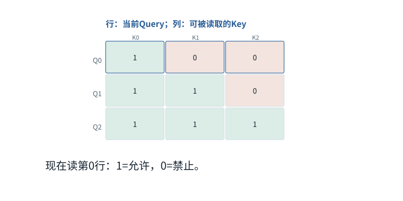
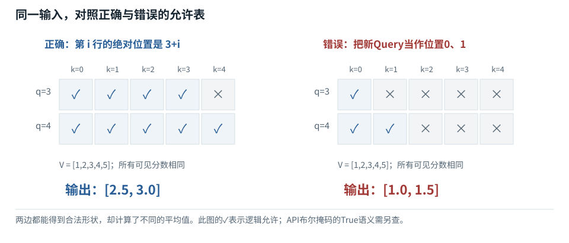

基础篇


<span id="foundations-12-s0"></span>


# F12｜Mask不是黑箱：把“谁能看谁”写成一张表

从具体对象与小例子开始，理解计算过程与适用条件。

本节会用到

[F04 · 组批和补齐](04.md)[F09 · 概率、指数与softmax](09.md)[F11 · Attention逐步计算](11.md)


<span id="visual-F12"></span>


动态图解 · F12


<span id="topic-1"></span>


## Mask是可见性表，不是额外语义

怎样防止读到未来，或者把PAD读成内容？

把注意力的分数表看成一张“谁可以读谁”的座位表。行代表接收者，列代表提供者；禁止格子不能参与概率分母。因果限制、PAD限制可以同时存在，但一个负责时间顺序，一个负责有效内容，不能互相替代。

**因果**当前位置不读取将来位置。

**加性mask**允许处加0，禁止处用−∞等价地排除。

**绝对位置**加上历史前缀后的位置，而不是当前小批次中的行号。

**输入与适用条件：**前3帧用3个有效位置；第4帧是明确的屏蔽数值对照；第5帧另设past=3、new=2展示缓存偏移。图内始终标出当前条件。


<span id="topic-2"></span>


### 1 / 5 · 处理绝对位置0

停留时间 4.2秒7秒1.5秒

步骤 第1步，共5步

窄屏可左右滑动图形，或点击“放大图形”。文字解释紧随图后。



位置不是数字大小比赛。因果规则只允许当前查询读取自己和更早的Key；后面的位置即使已经在训练输入数组中，也不能读。

`允许Key位置 ≤ 0`

默认静止。用“下一步”看完解释再继续；播放到最后一步自动停止。键盘聚焦播放器后，可用左右键逐步查看、空格播放/暂停。图中颜色辅助区分，含义同时用文字注明。

JavaScript未启用；第一帧仍可阅读。完整图解页下方列出全部步骤说明。


<span id="topic-3"></span>


### 为什么需要

防止训练偷看目标，并排除只为组批存在的填充内容。


<span id="topic-4"></span>


### 怎样实现

先按实际位置和有效长度构造关系，再核对所用API布尔mask语义。


<span id="topic-5"></span>


### 可能的代价与误解

不同API的True可能表示允许或禁止；全行无可见Key还需明确策略，不能直接做普通softmax。


<span id="topic-6"></span>


### 如何判断是否做对

用能暴露未来泄漏的数据，比较正确掩码与故意写错偏移的结果。

[全部步骤与解释](../visual/F12.md)[F04 · 组批没有把两句话混成一句](../visual/F04.md)[F19 · KV Cache：留下算过的，不省掉该读的](../visual/F16.md)

机制来源：[[SDPA]](../visual/sources.md#s-SDPA)。数值和运行场景为本书明确设定的教学例；资料出处不代替本页中文解释。


<span id="foundations-12-s1"></span>


## 先给掩码一个不神秘的定义

**Mask（掩码）**是一份控制哪些元素允许参与某项运算的标记。在注意力里，一行是一个查询位置，一列是一个被读取位置。因此一个格子回答“这一行能不能读这一列”。


<span id="fdiag-12-01"></span>


先给掩码一个不神秘的定义：逐项辨别

|  |  |
| --- | --- |
| 对象一 | Mask是规则表 |
| 对象二 | 注意力分数是模型计算 |
| 对象三 | Value是被混入的内容 |

**关键区别：**Mask不代表新的语义，而是限制哪些位置的分数能参与softmax。

**容易误解：**把Mask当作新的词向量，会混淆规则和内容。

填充标记、注意力可读关系、训练损失计分位置都可能被称为mask，但用途不同。看见mask这个词，先问它控制什么，而不是只背一组0和1。


<span id="foundations-12-s2"></span>


## 因果限制怎样防止读未来

三个位置0、1、2，在自回归训练和推理所用的因果注意力中，常见允许关系是：


<span id="fdiag-12-02"></span>


**关键区别：**因果掩码形成下三角“可见性表”，阻止未来信息泄漏。

**容易误解：**真实缓存时必须按绝对位置对齐，而不是机械复用左上三角。

| 查询位置＼Key位置 | 0 | 1 | 2 |
| --- | --- | --- | --- |
| 0 | 允许 | 禁止 | 禁止 |
| 1 | 允许 | 允许 | 禁止 |
| 2 | 允许 | 允许 | 允许 |

叫“因果”是因为当前位置不能依赖尚未发生的后续Token，不是在声称模型学到了现实世界的因果关系。训练时整段答案可以一起送入；掩码限制每个位置只能利用前缀，目标通常是预测下一个Token。


<span id="core-training-data-3"></span>


<span id="core-training-data-3--mc-section-3"></span>


## 为什么完整句子都在内存里，却没有偷看答案

把所有输入位置一次送入设备，是为了并行计算。因果掩码规定第t行只能读到 `s≤t` 的Key。在预测“学习”的t=2行，t=3的“学习”虽然在同一批张量里，但**不能通过注意力被这一行读取**。逐位置的RMSNorm和FFN也不横跨位置混合，因此没有从这些模块绕路偷看未来。

同一时间准备好数据，不等于每个位置都能读取全部数据

| 步骤 / 对象 | 本步实际变化 |
| --- | --- |
| 可见输入 | 在t=2：BOS／我／爱。 |
| 被禁止读取 | 在t=3、4：“学习／！”是未来输入位置。掩码把对应注意力分数设为−∞。 |
| 用于评分的标签 | targets[0,2]=3（学习）。它只在损失阶段用来选中一个候选概率。 |
| 结果 | 前向产生8项分数；损失评价第3项的概率高不高。 |

训练数据完整是宿主知道；某个位置是否可读是模型计算的约束。

依据：[tiny\_model.py:14–21](../reference/model-code.md#tiny_model-L14)；[对应参数、前向及梯度记录](../labs/model-values.md)。


<span id="core-training-data-5"></span>


<span id="core-training-data-5--mc-section-5"></span>


## PAD、attention mask和loss mask不要合并

本书两条训练输入都长5，暂时没有PAD。为了处理不同长度，另一个实现可以补齐：这时需要三件事分别正确——不读补齐Key、正确记录语义位置、不把补齐标签算入损失。**不给PAD算损失，并不自动禁止其他Token读取PAD。**

本实现用 `ignore_index=-100` 忽略损失标签；-100不是词表项，不能拿它去查Embedding。不同库可能在内部自动shift标签，使用它们时应读接口约定，不能把已shift的标签再shift一次。

依据：[tiny\_model.py:14–21](../reference/model-code.md#tiny_model-L14)；[对应参数、前向及梯度记录](../labs/model-values.md)。


<span id="foundations-12-s3"></span>


## 填充限制与因果限制怎样合在一起

继续用第二条输入`[4,2,0]`。前两个位置是真实内容，第三个是PAD。对真实查询0、1，可读取列必须同时满足“不是PAD”和“不在未来”。它们的关系为：


<span id="fdiag-12-03"></span>


填充限制与因果限制怎样合在一起：逐项辨别

|  |  |
| --- | --- |
| 方案／对象 A | 有效Token：1,1,1 |
| 方案／对象 B | PAD位置：1,1,0 |
| 方案／对象 C | 因果与PAD限制取交集 |

**关键区别：**两个掩码限制的原因不同，可以同时存在。

**容易误解：**允许的集合是两者同时允许，不是相加后自动扩大范围。

```
query0 -> key0允许，key1禁止，key2禁止
query1 -> key0允许，key1允许，key2禁止
```

PAD查询行本身不是本次有意义的输出，不用它继续生成，也不让其预测计入正常损失。实际内核怎样避免全屏蔽行的数值问题，要遵守接口语义，不能盲目把整行都填负无穷。

批量输入还有样本边界；第0条不能因为同在一个batch就读到第1条。若将多个样本拼在一条序列中，需要另行处理跨样本可读关系，单独插一个结束Token不天然形成矩阵隔离。


<span id="foundations-12-s4"></span>


## “禁止”具体怎样改变softmax

一个常见数学表达是在禁止位置的分数加上负无穷，使其指数为0；允许位置加0，保留原分数，然后对一行归一化。


<span id="fdiag-12-04"></span>


**关键区别：**被禁止项的exp变0，剩下项再重新归一化。

**容易误解：**所有项都被禁止时会有无效归一化风险，必须特殊处理。

若先对所有位置softmax，再把禁止项清零而不重新归一化，剩余权重总和会小于1，通常不是原本要的注意力。

全行没有任何允许项时，softmax没有正常的有限候选可归一化，朴素计算可能出现**NaN**，即“不是有效数值”。工程实现要明确处理或避免这种行，而不是让NaN悄悄传下去。

不同API可能用布尔True表示允许，也可能表示屏蔽；也可能接受加性浮点mask。**不要把本文1=允许直接当成任何库的通用布尔约定。**


<span id="foundations-12-s5"></span>


## 已有缓存时，表为什么不再是小正方形


<span id="concept-intro-1"></span>


先认识这里的对象与符号

[Query、Key、Value：三种中间数值表示](../concepts.md#concept-qkv)
:   q是接收信息的一行查询表示；k是可读位置提供的一行匹配表示；v是该位置供混合的一行内容表示。大写Q/K/V把多行收集成表。它们由输入与参数计算得到，分别承担打分与提供内容的职责。某个q与两个k点积得到两个分数；softmax得到两个份额；这些份额分别乘两行v，再相加。这里不生成搜索词，也不直接选答案。

先把缓存理解为“之前算好的中间结果”，详细内容在F19。假设已有3个历史位置，新算2个位置。这次只有2个Query，但可以读5个Key：


<span id="fdiag-12-05"></span>


**关键区别：**每个新Query可看它自己的绝对位置及更早位置；不是只看左上角2×2。

**容易误解：**形状正确也可能错位，尤其是Q长度与K长度不同时。


<span id="fboard-12-05"></span>


**缓存解码的允许表：比较绝对位置，不比较局部行号**



输入和数值沿用本节固定算例。先按对象/位置对齐，再检查图中对应关系。

[SVG图源](../../diagrams/rendered/foundation-fboard-12-05-fb2c38d32406.svg)

```
新位置3：[允许，允许，允许，允许，禁止]
新位置4：[允许，允许，允许，允许，允许]
```

因此表是`[2,5]`。第一行并不是只能读第一列，因为它的真实位置已经是3。规则是“Key逻辑位置不大于当前Query逻辑位置”，不是简单在一个2×5表左上角画小三角。


<span id="foundations-12-s6"></span>


## Loss mask又是什么

训练样本含问题与回答时，可能只给回答部分的下一Token预测计损失。**loss mask**决定哪些预测被评分；**attention mask**决定读取哪些条件。不给用户问题计损失，不意味着模型不能读用户问题。

这一差异以后用于解释训练：模型可以借助问题预测答案，即使问题本身不是本批直接评分的目标。


<span id="worked-F12"></span>


运行示例 · F12


<span id="topic-7"></span>


### 3个历史位置加2个新位置，掩码怎样展开

局部核对例：以下输入以本例列出的条件为准，不能把它的中间值接到贯通模型的计算记录中。

**输入与条件。**历史位置为0、1、2；新输入为位置3、4。现在只有2个查询，但共有5个Key可比较。这里用“能读/禁读”避免不同API的布尔极性混淆。

| 步骤与对象 | 内部动作 | 中间结果 / 新状态 |
| --- | --- | --- |
| 1列出列 | Key列标为0、1、2、3、4 | 所有列均包含真实位置，不是五个新输入。 |
| 2第1个新查询 | 绝对位置3只能看≤3的位置 | `[能读,能读,能读,能读,禁读]`。 |
| 3第2个新查询 | 绝对位置4能看≤4的位置 | `[能读,能读,能读,能读,能读]`。 |
| 4修改分数 | 把禁读列分数设为负无穷再softmax | 该列权重变0；不能只把原始分数乘0。 |
| 5错误对照 | 对2×5表直接套左上角小三角 | 第1行只能读位置0，错误丢掉历史位置1、2和当前位置3。 |

**把过程连起来。**因果判断比较绝对位置，不能拿新块中的第几行直接当全序列位置。

**边界与反例。**全被屏蔽的一行没有标准softmax分布，教学程序明确拒绝；生产核可能有自己的约定。

依据与适用范围：[[SDPA]](../example-sources.md#ex-src-SDPA) [[CACHE]](../example-sources.md#ex-src-CACHE)。示例输入和场景由本书明确设定。


<span id="core-understanding-5"></span>


<span id="core-understanding-5--mc-section-5"></span>


## 追问：训练已知道答案，为什么还要因果mask？

知道答案的是训练数据与损失计算；负责某一位置预测的前向不能读取它应预测的未来Token。否则训练会依赖推理时拿不到的信息，低loss不代表真实自回归预测好。

依据：[tiny\_model.py:178–258](../reference/model-code.md#tiny_model-L178)；[对应参数、前向及梯度记录](../labs/model-values.md)。


<span id="self-check"></span>


## 课后自检

**自检 1**

**已经有2个历史Token，只新增1个Token，新的Query应能读几个Key？**

<details class="quiz-answer"><summary><span class="when-closed">查看参考答案</span><span class="when-open">收起参考答案</span></summary><div class="answer">在无额外窗口或填充限制的因果设定下，可读3个：2个历史和当前自己。</div></details>

**自检 2**

**只对助手答案算损失，是否应把用户问题在attention里屏蔽？**

<details class="quiz-answer"><summary><span class="when-closed">查看参考答案</span><span class="when-open">收起参考答案</span></summary><div class="answer">不应由此前提推出。答案需要用户问题作为条件。计分范围和读取范围不同。</div></details>


<span id="section-8"></span>


### 延伸阅读：相关系统问题

[03｜注意力的深入追问：位置、掩码、多头与反向传播](../chapters/03.md)  
[07｜KV Cache、FlashAttention与PagedAttention的内部过程](../chapters/07.md)

机制依据：[[TR]](../sources.md#src-TR)[[F-PADDING]](../sources.md#src-F-PADDING)[[F-CACHE]](../sources.md#src-F-CACHE)。本节数值与情景除另注外均为原创教学示例；来源不代替中文讲解。


<span id="implementation-evidence"></span>


## 从本页解释到可检查的实现

| 要核对什么 | 事实与边界 | 本地依据 |
| --- | --- | --- |
| 前向、损失与更新 | 固定的一层四维教学模型；不是任何商业模型的完整实现。 | [tiny\_model.py · TinyLM](../reference/model-code.md#tiny_model-L33) |
| 独立前向实现 | 使用同一已保存权重，不使用PyTorch；用于复算而非另行训练。 | [reference\_inference.py · forward](../reference/model-code.md#reference_inference-L28) |
| 错误是否能被发现 | 因果性、梯度、标签移位、缓存位置均有正向检查和反例。 | [test\_model.py](../reference/model-code.md#test_model-L1) |
| 初始化的具体数字 | 所有参数均可查看；初值不等于训练后的参数。 | [weights\_initial.json](../reference/model-code.md#weights_initial-L1) |
| 实际运行记录 | 仅来自本地CPU微型实验；不能推出商业能力或GPU性能。 | [run.json 对应的数值记录](../labs/model-values.md) |


<span id="canonical-related"></span>


## 继续阅读与机制对应

| 页面 | 阅读关系 |
| --- | --- |
| [F11｜Attention逐步计算：先算相关分数，再混合内容](11.md) | 上一节：复习本页使用的前置概念 |
| [F13｜位置编号与RoPE：先懂位置，再懂旋转](13.md) | 下一节：沿同一课程顺序继续 |
| [03｜注意力的深入追问：位置、掩码、多头与反向传播](../chapters/03.md) | 系统机制：用源码、反例和条件深入核对 |

AI系统工程：从基础到内部  
[全书目录](../contents.md) · [术语与符号](../glossary.md) · [参考资料](../sources.md)