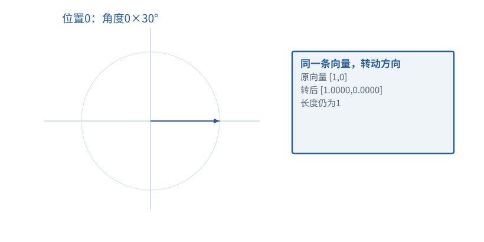

基础篇


<span id="foundations-13-s0"></span>


# F13｜位置编号与RoPE：先懂位置，再懂旋转

从具体对象与小例子开始，理解计算过程与适用条件。

本节会用到

[F07 · 模型最常做的算术](07.md)[F11 · Attention逐步计算](11.md)[F12 · Mask不是黑箱](12.md)


<span id="visual-F13"></span>


动态图解 · F13


<span id="topic-1"></span>


## 位置怎样进入数值计算

同一个Token出现在不同位置，为什么还需要额外处理？

Embedding先告诉模型“这是什么片段”，位置机制再让匹配计算知道“它出现在哪里”。旋转不是为了画圆好看：改变方向会改变后续点积；两者共同旋转保持角差，展示了相对位置怎样进入比较。

**旋转**改变二维向量方向、保持长度的运算。

**sin/cos**描述给定转角下的坐标分量。

**RoPE**给Q/K成对分量施加依位置而变的旋转。

**输入与适用条件：**独立二维说明图：初始向量[1,0]，教学频率每位置30°；不是商业模型实际RoPE频率。


<span id="topic-2"></span>


### 1 / 5 · 位置0旋转到0度

停留时间 4.2秒7秒1.5秒

步骤 第1步，共5步

窄屏可左右滑动图形，或点击“放大图形”。文字解释紧随图后。



这只是二维旋转的教学频率。实际RoPE对Q/K成对分量使用不同频率；作用在匹配表示上，不是简单把位置编号加到Token ID。

`本步状态由图形与说明共同给出。`

R(0°)[1,0]=[1.0000,0.0000]

默认静止。用“下一步”看完解释再继续；播放到最后一步自动停止。键盘聚焦播放器后，可用左右键逐步查看、空格播放/暂停。图中颜色辅助区分，含义同时用文字注明。

JavaScript未启用；第一帧仍可阅读。完整图解页下方列出全部步骤说明。


<span id="topic-3"></span>


### 为什么需要

让顺序信息参与匹配，而不把词表编号当成位置编码。


<span id="topic-4"></span>


### 怎样实现

给正确绝对位置施加对应旋转；缓存中的已旋转Key应按同一约定使用。


<span id="topic-5"></span>


### 可能的代价与误解

每轮位置清零或把历史Key重复旋转，会使缓存结果偏离全量计算。


<span id="topic-6"></span>


### 如何判断是否做对

检查旋转保持长度、共同平移角度保持点积；再做缓存一致性测试。

[全部步骤与解释](../visual/F13.md)[F11 · Q/K/V：先算从哪读，再算读进多少](../visual/F11.md)[F19 · KV Cache：留下算过的，不省掉该读的](../visual/F16.md)

机制来源：[[ROPE]](../visual/sources.md#s-ROPE)。数值和运行场景为本书明确设定的教学例；资料出处不代替本页中文解释。


<span id="foundations-13-s1"></span>


## Token是谁，和它出现在第几位，是两个问题

“我爱你”和“你爱我”使用类似的片段，但顺序不同。Token ID标识它是词表哪一项；**position ID（位置编号）**标识它在序列中的逻辑位置。


<span id="fdiag-13-01"></span>


Token是谁，和它出现在第几位，是两个问题：逐项辨别

|  |  |
| --- | --- |
| 对象一 | Token ID：是哪一项 |
| 对象二 | Position ID：位于第几位 |
| 对象三 | 向量：这一位的数值表示 |

**关键区别：**“谁”和“在哪里”是两类信息，模型需要把它们结合起来处理。

**容易误解：**相同Token在不同位置不必产生相同注意力行为。

对本书的`[1,2,3]`，常用的位置编号是`[0,1,2]`。对左补齐`[0,4,2]`，数组列号为0、1、2，而两个真实Token的逻辑位置可以是0、1。PAD位置怎样填写由实现约定，不能用未经处理的列号替代全部位置逻辑。

位置编号不必是一段交给用户看的文本；它可能作为单独参数传入，也可能由模型代码根据输入长度和缓存推算。


<span id="foundations-13-s2"></span>


## 为什么不能只靠查Embedding

相同Token按固定表查到同一排数。若一个没有任何位置机制的注意力系统只是对集合进行比较和聚合，它不能一般地编码所有顺序差异。因果mask提供部分先后约束，但并不能因此省掉模型设计中的位置机制。


<span id="fdiag-13-02"></span>


为什么不能只靠查Embedding：逐项辨别

|  |  |
| --- | --- |
| 方案／对象 A | 仅按Token身份查表 |
| 方案／对象 B | 不区分先后顺序 |
| 方案／对象 C | “AB”与“BA”难以按序表达 |

**关键区别：**没有位置信息时，纯内容匹配不能完整表达词序差异。

**容易误解：**并非所有位置编码都通过简单加法写入Embedding。

一种方案给每个位置准备额外向量，并与Token表示相加；另一种常用机制RoPE将位置作用到Q/K上。不同模型使用不同设计，不能把两种操作拼成“所有模型先相加再旋转”。


<span id="foundations-13-s3"></span>


## 只用平面上的点认识sin与cos

把向量`[x,y]`想作从原点到平面点的箭头。把箭头逆时针转90度，`[1,0]`变成`[0,1]`，`[0,1]`变成`[-1,0]`，长度不变。


<span id="fdiag-13-03"></span>


**关键区别：**RoPE可先用平面旋转理解：长度不变，但方向随位置改变。

**容易误解：**实际RoPE作用于Q/K的成对维度，不是旋转屏幕上的文字。

角度也可用**弧度**表示：π弧度等于180度，π/2等于90度。cos与sin是描述旋转关系的函数；在单位圆上，旋转θ后的水平、竖直坐标分别是cosθ、sinθ。

任意二维向量的旋转公式为：

```
x' = x cosθ − y sinθ
y' = x sinθ + y cosθ
```

θ=0时cos=1、sin=0，所以不变；θ=π/2时cos=0、sin=1，所以变成`[-y,x]`。现在你已经能读懂RoPE最基本的二维操作，而不必先修完整三角函数课程。


<span id="foundations-13-s4"></span>


## RoPE怎样用位置改变匹配

RoPE可把一排特征按两个一组拆开，对不同组使用不同频率；位置越靠后，按对应频率旋转的角度就不同。例如某一组在位置m用角度mθ，在位置n用nθ。


<span id="fdiag-13-04"></span>


**关键区别：**旋转能让位置差异进入匹配分数，而不必改变Value的全部内容。

**容易误解：**不能把RoPE直接当成一个独立的“记忆库”。

**这里新增的R不是模型的可学习投影W。** R(α)是由角度α直接构造的二维旋转矩阵：

```
R(α) = [[cosα, -sinα],
        [sinα,  cosα]]
```

本段把两个坐标写成一列，使用R乘该列；若把同一对坐标写成行向量，等价写法是右乘R(α)ᵀ。转置不能漏。α表示实际旋转角度，θ可表示每个位置增加的角度，mθ和nθ分别属于位置m、n；π在这里是圆周率，不是后训练中的策略概率符号。

旋转后的Q、K再做点积，包含与两者相对位置差有关的关系。用矩阵R表示旋转，可以写成`R(mθ)ᵀ R(nθ)=R((n−m)θ)`。左边是先比较两次旋转，右边说它等效包含角度差。

这不是说位置只剩距离、内容被丢掉了。原始Q和K仍在，旋转调制了内容匹配；实际公式包含它们的分量。


<span id="foundations-13-s5"></span>


## 为什么缓存位置不能每次从0开始

前缀已经处理3个位置0、1、2，下一Token的逻辑位置应继续为3。如果把它误写为0，Q/K的旋转角会错，与缓存历史的相对关系也会错。


<span id="fdiag-13-05"></span>


**关键区别：**缓存继续生成时，位置编号与历史长度必须一致。

**容易误解：**每轮从位置0重新计数会破坏新旧K/V的一致性。

在典型RoPE缓存实现里，历史K可能已经按原位置旋转后保存。读取它不应再对同一份已旋转结果盲目旋转一次。缓存保存的是哪个阶段的表示，必须读具体接口约定。


<span id="foundations-13-s6"></span>


## 位置编号、缓存槽和模型窗口不能混

缓存槽是数据存在容器中的位置；逻辑位置是Token在序列中的位置；允许上下文长度是模型或服务的限制。滑动窗口丢弃早期缓存后，逻辑位置也未必重置为0。

把上下文最大长度从32K改成128K不会自动保证模型在新长度上表现正确。位置缩放、训练长度分布、数值与任务评测都有关。这里的基础目标是读懂“位置参与哪一步”，而不是靠配置数字推断有效能力。


<span id="worked-F13"></span>


运行示例 · F13


<span id="topic-7"></span>


### 把位置旋转看成可以画在方格纸上的坐标变化

**输入与条件。**先用一对二维坐标演示旋转，规定教学角度：位置0为0°，位置1为90°。真实RoPE通常对不同坐标对使用不同频率，此处只隔离一对。

| 步骤与对象 | 内部动作 | 中间结果 / 新状态 |
| --- | --- | --- |
| 1位置0 | 把 `[1,0]` 旋转0° | 仍是 `[1,0]`。 |
| 2位置1 | 用 `(x,y)→(−y,x)` 旋转90° | `[1,0]` 变为 `[0,1]`。 |
| 3比较位置 | 位置1的Q与位置0的K点积 | `[0,1]·[1,0]=0`。 |
| 4同位置比较 | 两者都在位置1 | `[0,1]·[0,1]=1`；位置差改变了匹配。 |
| 5缓存错误对照 | 新Token本应在位置1，却从0编号 | 它的Q误成 `[1,0]`，与历史K的点积变成1，不再是0。 |

**把过程连起来。**旋转没有把“第几个”附加成一个新词，而是在匹配坐标中表达位置关系。位置编号必须连续且与缓存一致。

**边界与反例。**90°用于手算，不是把所有模型的RoPE频率设置成90°；范数在旋转中保持不变。

依据与适用范围：[[DERIVE]](../example-sources.md#ex-src-DERIVE)。示例输入和场景由本书明确设定。


<span id="self-check"></span>


## 课后自检

**自检 1**

**二维向量[2,3]逆时针旋转90度变成什么？**

<details class="quiz-answer"><summary><span class="when-closed">查看参考答案</span><span class="when-open">收起参考答案</span></summary><div class="answer">代入cos=0、sin=1，得到[-3,2]。长度平方仍是13。</div></details>

**自检 2**

**缓存已有5个真实Token，零起始编号的新Token通常是什么位置？**

<details class="quiz-answer"><summary><span class="when-closed">查看参考答案</span><span class="when-open">收起参考答案</span></summary><div class="answer">在连续位置的基本设定下是5，而不是0。具体带填充或滑动窗口时按接口逻辑处理。</div></details>


<span id="section-8"></span>


### 延伸阅读：相关系统问题

[03｜注意力的深入追问：位置、掩码、多头与反向传播](../chapters/03.md)  
[07｜KV Cache、FlashAttention与PagedAttention的内部过程](../chapters/07.md)

机制依据：[[ROPE]](../sources.md#src-ROPE)[[TR]](../sources.md#src-TR)[[F-CACHE]](../sources.md#src-F-CACHE)。本节数值与情景除另注外均为原创教学示例；来源不代替中文讲解。


<span id="canonical-related"></span>


## 继续阅读与机制对应

| 页面 | 阅读关系 |
| --- | --- |
| [F12｜Mask不是黑箱：把“谁能看谁”写成一张表](12.md) | 上一节：复习本页使用的前置概念 |
| [F14｜完成一次前向：残差、前馈网络与词表分数](14.md) | 下一节：沿同一课程顺序继续 |
| [03｜注意力的深入追问：位置、掩码、多头与反向传播](../chapters/03.md) | 系统机制：用源码、反例和条件深入核对 |

AI系统工程：从基础到内部  
[全书目录](../contents.md) · [术语与符号](../glossary.md) · [参考资料](../sources.md)