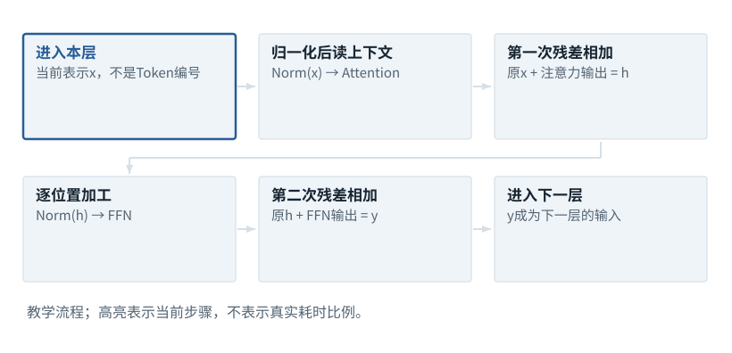
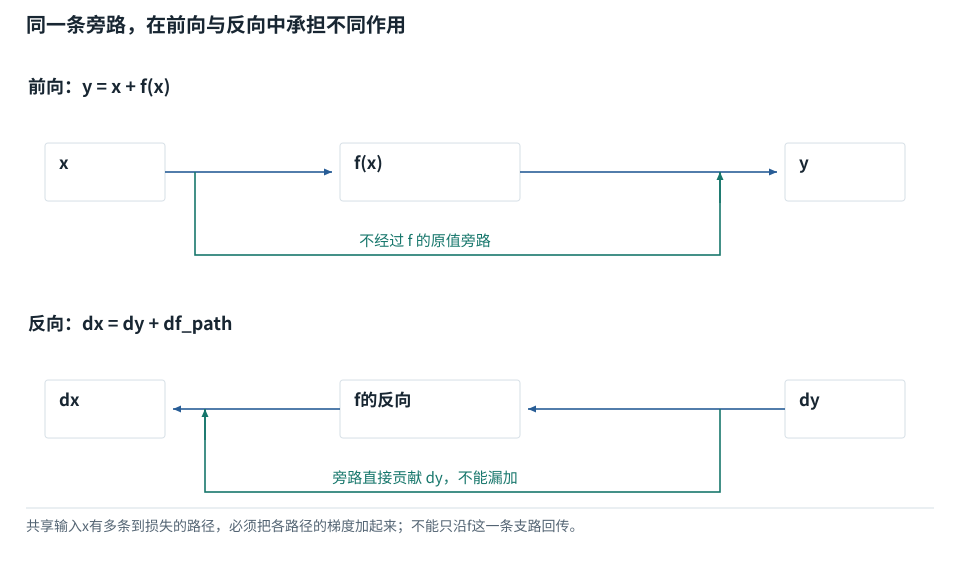

基础篇


<span id="foundations-14-s0"></span>


# F14｜完成一次前向：残差、前馈网络与词表分数

从具体对象与小例子开始，理解计算过程与适用条件。


<span id="course-connection"></span>


## 共通前向在本节闭合

注意力把不同位置的信息混合，Wo把结果变回隐藏宽度，残差保留原路径；FFN只加工每个位置的特征。经过最后归一化和词表输出头，得到八个候选分数。此时不选词、不改参数：训练时这些分数先交给损失函数，推理时才交给选择策略。

本节会用到

[F10 · 神经网络最小模型](10.md)[F11 · Attention逐步计算](11.md)[F13 · 位置编号与RoPE](13.md)


<span id="visual-F14"></span>


动态图解 · F14


<span id="topic-1"></span>


## 一层Transformer不是只有Attention

读其他位置之后，为什么还要残差、归一化和FFN？

可以把一层分成“从上下文取信息”和“在本位置加工信息”两段。残差提供原表示的直接通路，新的计算提供增量；归一化整理每行数值尺度，但不是把语义洗成一样。前馈网络通常对每个位置分别计算，不再像Attention那样直接跨位置加权。

**残差**把子层输入与子层输出相加。

**Norm**本例指按每行特征进行的归一化。

**FFN**带非线性的逐位置前馈网络。

**输入与适用条件：**展示常见pre-norm结构的运算依赖，不假定所有Transformer采用相同顺序。完整模型数值见已有贯通算例。


<span id="topic-2"></span>


### 1 / 6 · 进入本层

停留时间 4.2秒7秒1.5秒

步骤 第1步，共6步

窄屏可左右滑动图形，或点击“放大图形”。文字解释紧随图后。



上一层已经加工过的表示也可以作为x，不能每一层都回到最初Embedding。

`本步状态由图形与说明共同给出。`

默认静止。用“下一步”看完解释再继续；播放到最后一步自动停止。键盘聚焦播放器后，可用左右键逐步查看、空格播放/暂停。图中颜色辅助区分，含义同时用文字注明。

JavaScript未启用；第一帧仍可阅读。完整图解页下方列出全部步骤说明。


<span id="topic-3"></span>


### 为什么需要

深层网络需要稳定的数值与梯度通路，同时具备上下文读取和局部变换能力。


<span id="topic-4"></span>


### 怎样实现

明确本模型的pre-norm/post-norm约定，逐个算子跟踪来源与去向。


<span id="topic-5"></span>


### 可能的代价与误解

把LayerNorm与RMSNorm视为同一公式，或忘记γ/β/ε，会得到不同结果。


<span id="topic-6"></span>


### 如何判断是否做对

比较每个子层前后张量形状与实际数值；任何替换都需重新验证输出与训练稳定性。

[全部步骤与解释](../visual/F14.md)[F11 · Q/K/V：先算从哪读，再算读进多少](../visual/F11.md)[F15 · 梯度像坡度，学习率像迈步大小](../visual/F17.md)[O01 · GQA/MQA：减少的是K/V组数](../visual/O01.md)

机制来源：[[ATTN]](../visual/sources.md#s-ATTN) [[NORM]](../visual/sources.md#s-NORM)。数值和运行场景为本书明确设定的教学例；资料出处不代替本页中文解释。


<span id="foundations-14-s1"></span>


## 先把一层写成两段，而不是一大堆缩写


<span id="block-object-map"></span>


### 先对照这段流程里出现的对象

**Decoder层**是一段用于构成生成网络的计算；**子层**是其中的注意力或前馈部分。**输出投影**是注意力结果再乘一张Wo参数表，以便回到残差需要的宽度，不是把它直接解成文字。下面X、R、Y都代表临时数组：X是输入，R是第一次相加的结果，Y是第二次相加的结果。**Norm**表示规范化函数，它的具体逐格算式紧接在下文定义。


<span id="concept-intro-5"></span>


先认识这里的对象与符号

[pre-norm / post-norm：归一化放在何处](../concepts.md#concept-prenorm)
:   pre-norm是先规范化再进入子层，残差从原输入直接相加；post-norm是子层结果与原输入相加之后再规范化。这描述运算顺序，不是训练前后两个阶段。独立结构对照：x+F(Norm(x)) 与 Norm(x+F(x))一般不相等。F代表这里被包裹的子层函数。

一种常见的pre-norm Decoder层可这样读：先归一化输入，再算Attention，把结果加回原输入；再归一化，经过前馈网络，再加回去。


<span id="fdiag-14-01"></span>


**关键区别：**Transformer层既有跨位置读取，也有逐位置的非线性变换。

**容易误解：**注意力不是整层网络的全部。

```
原输入X
  -> 归一化 -> Attention -> 输出投影
  -> 与X相加，得到R
R -> 归一化 -> 前馈网络
  -> 与R相加，得到本层输出Y
```

**pre-norm**表示归一化在子层变换之前。其他架构可能使用不同位置或变体，本课给一个具体模型骨架，不声称全部网络顺序相同。


<span id="foundations-14-s2"></span>


## 残差连接：保留一条直接通路

**残差（residual）连接**就是`输出=输入+变换结果`。输入`[1,2]`，本段变换结果`[0.3,-0.1]`，相加得到`[1.3,1.9]`。


<span id="fdiag-14-02"></span>


**关键区别：**顺序因模型结构而异；通过残差把原通路和新计算的调整合并。

**容易误解：**Pre-Norm与Post-Norm不是一个固定不变的顺序。

这样子层可以学习在已有表示上如何调整，而不必每次从零重建一切。它也影响反向传播的通路；详细梯度在F15。相加要求维度兼容，因此Attention通常经输出投影回到原隐藏宽度d。

残差不是把“原话”保存一份中文副本，而是在数字表示上相加。


<span id="core-value-residual-4"></span>


<span id="core-value-residual-4--mc-section-4"></span>


## Wo为什么还要再乘一次

本模型只有一头，因此混合结果直接右乘Wo[4,4]。多头时通常先拼各头输出再投影。Wo负责把注意力输出变换为主网络使用的特征组合；本模型宽度仍4，但数值重新组合了。

注意力输出投影参数Wo

| 对象／位置 | 第0列 | 第1列 | 第2列 | 第3列 |
| --- | --- | --- | --- | --- |
| 第0行 | 0.3 | 0.1 | -0.2 | 0.3 |
| 第1行 | -0.3 | -0.1 | -0.1 | 0.3 |
| 第2行 | 0.3 | 0.3 | -0.1 | -0.3 |
| 第3行 | -0.2 | 0 | 0.3 | 0.1 |

展示值经过舍入；后续运算使用未舍入值。

```
attn_delta[0,2,0] = mix[0,2,:] · Wo[:,0]
= (-0.445025)×(0.3) + (0.338826)×(-0.3) + (-0.183626)×(0.3) + (-0.394481)×(-0.2)
≈ -0.211347
```

依据：[tiny\_model.py:81–84](../reference/model-code.md#tiny_model-L81)；[对应参数、前向及梯度记录](../labs/model-values.md)。


<span id="core-value-residual-5"></span>


<span id="core-value-residual-5--mc-section-5"></span>


## 第一条残差：保留原X再加更新量

第0条样本t=2的第一条残差

| 对象／位置 | 特征0 | 特征1 | 特征2 | 特征3 |
| --- | --- | --- | --- | --- |
| 原始主路X | -0.2 | 0.8 | 0 | 0.45 |
| 注意力分支attn\_delta | -0.211347 | -0.133473 | -0.044859 | -0.01622 |
| R=X+attn\_delta | -0.411347 | 0.666527 | -0.044859 | 0.43378 |

展示值经过舍入；后续运算使用未舍入值。

残差不是把两份Token列表拼接，也不是换成平均值。它是同形状的对应格子相加。主路保留一个直接路径，分支提供调整；这有助于深层网络的信息与梯度传播，但不是“加入残差后就永远稳定”的保证。

**这两个相加对象必须看清**



虽然注意力分支使用归一化后的N1，残差主路加的是X。

[SVG图源](../../diagrams/rendered/model-residual-4baffe2ba19d.svg) · 数据来自本包 TinyLM 实现与 run.json。

依据：[tiny\_model.py:81–84](../reference/model-code.md#tiny_model-L81)；[对应参数、前向及梯度记录](../labs/model-values.md)。


<span id="foundations-14-s3"></span>


## 均值、方差和标准差从两个数算起


<span id="symbol-intro-1"></span>


先认识这里的对象与符号

[σ：看清函数符号与统计量](../concepts.md#concept-sigma)
:   在σ(XW+b)中，σ常泛指这一层选定的非线性函数；具体可以是ReLU等，不能仅凭σ认定是sigmoid。统计公式中σ常指标准差，σ²是方差。它们不是同一对象。独立例：σ若指定为ReLU，σ(-1)=0；若指定为sigmoid，则约0.268941。必须先给函数定义，才能算结果。

对一排数`[1,3]`：**均值**μ=(1+3)/2=2；每项偏离均值为[-1,1]；平方后[1,1]；平均得**方差**σ²=1；开平方得**标准差**σ=1。


<span id="fdiag-14-03"></span>


从[1,3]逐步得到均值、方差与标准差

| 步骤 | 第0格 | 第1格 | 合并结果 |
| --- | --- | --- | --- |
| 原始输入 | 1 | 3 | 两个数 |
| 均值 | (1+3)/2 | | μ=2 |
| 减均值 | 1−2=−1 | 3−2=1 | 偏差[-1,1] |
| 平方偏差 | 1 | 1 | 总体方差=(1+1)/2=1 |
| 标准差 | sqrt(1) | | 1 |

这里统计的是同一排两个特征，不跨样本也不跨Token；计算方差用平均平方偏差，不是原数平方的平均。规范化分母再加入ε。


<span id="fboard-14-03"></span>


同一[1,3]：LayerNorm和RMSNorm的两个分母

| 对象 | LayerNorm | RMSNorm |
| --- | --- | --- |
| 分子 | [1,3]−2=[−1,1] | 原始[1,3] |
| 分母 | sqrt(1+1e−5) | sqrt(5+1e−5) |
| 初始仿射参数为1/0时 | 约[−0.999995,0.999995] | 约[0.447213,1.341639] |

两种输出性质不同，不把它们都称为“把分数变成概率”。

平方是为了不让正负偏差互相抵消，方差描述波动大小。标准差与原数值有同样的量纲。这里按总体平均除以元素数，不能把其他统计场景的除以n−1不加区分地搬来。


<span id="foundations-14-s4"></span>


## LayerNorm实际规范化哪一排数

在典型Transformer中，对每个位置的隐藏特征独立计算均值与方差，再执行：


<span id="fdiag-14-04"></span>


LayerNorm：每一格沿同一特征排计算

仍用[1,3]，不换输入。减均值2后为[−1,1]，除sqrt(1+ε)，再分别乘γ并加β。γ/β是可训练参数，μ/方差是本次输入统计，ε是稳定常数。只有在这里明确改动γ/β时才改变该设置。

```
输入[1,3] → 偏差[−1,1] → 除sqrt(1+1e−5) → 乘[1,1]、加[0,0]
```


<span id="concept-intro-4"></span>


先认识这里的对象与符号

[γ、β、ε：参数与稳定常数要分开](../concepts.md#concept-norm-params)
:   在LayerNorm式子中，γ是一排可学习乘法系数，β是一排可学习加法系数；ε是人为设置的小正数，放在分母相关项中避免除零等问题。计算得到的均值μ、方差σ²又是本次数据的统计量。γ=1、β=0常表示每个特征都用1和0，不是一份输入词义。DPO里的β另指目标函数系数，不能套用这里的意思。

```
标准化值_i = (x_i − μ) / sqrt(σ² + ε)
输出_i = γ_i × 标准化值_i + β_i
```

ε是很小的正数，防止除以0等问题；γ、β是可学习的缩放与偏移参数。先忽略很小ε并设γ=1、β=0，上例`[1,3]`变成`[-1,1]`。

关键是**按每个Token的特征轴计算**，不是把本批所有句子所有Token一起求均值。若你改变归一化范围，模型行为和缓存可复用的前提都会改变。


<span id="concept-intro-3"></span>


先认识这里的对象与符号

[Norm、LayerNorm、RMSNorm：不是概率归一化](../concepts.md#concept-norm)
:   Norm在层公式中表示一个规范化函数。LayerNorm通常按一个Token的特征减均值、除标准差，再缩放平移；RMSNorm通常不减均值，按均方根缩放。它们不等于softmax。独立微例，忽略稳定分母用的小正数ε与可学缩放：LayerNorm([1,3])=[-1,1]；RMSNorm([1,3])=[1/√5,3/√5]。

**RMSNorm**常用均方根`r=sqrt(mean(x_i²)+ε)`缩放，不减均值。对[1,3]，忽略ε，r=√5，结果约[0.4472,1.3416]，与LayerNorm不同。名称都含Norm，不等于同一个操作。


<span id="foundations-14-s5"></span>


## FFN到底做了什么

**前馈网络FFN**通常对每个位置独立做“升维线性变换→非线性→降维线性变换”。例如d=4，中间宽度8，再回到4：`[B,T,4]→[B,T,8]→[B,T,4]`。


<span id="fdiag-14-05"></span>


FFN：同一位置扩宽、激活，再压回

以下明确是独立二维FFN例，不接续上方LayerNorm的统计输入。x=[1,−1]，W1=[[1,0,1],[0,1,1]]，所以xW1=[1,−1,0]。ReLU后[1,0,0]。W2=[[1,0],[0,1],[1,1]]，压回得到[1,0]。若再接残差，x+[1,0]=[2,−1]。

```
2个输入特征 → W1：3个组合 → ReLU：负值置0 → W2：2个输出特征 → 对应残差相加
```

FFN本身不读取其他Token；它处理的输入已可包含Attention聚合的上下文。完整四维模型计算见完成一次前向：残差、前馈网络与词表分数。

它不在这个步骤中直接对不同Token求和，但输入已经由Attention带入上下文，因此它能处理混合后的信息。它不是没有作用的装饰层，也不能简单认定是可按条目查询的事实数据库。


<span id="concept-intro-2"></span>


先认识这里的对象与符号

[sigmoid：把单个数映射到0与1之间](../concepts.md#concept-sigmoid)
:   函数规则是sigmoid(x)=1/(1+exp(-x))。它逐个数计算，不要求同一行结果的总和为1，所以不能用它直接代替多候选softmax。独立微例：sigmoid(0)=0.5；分别算两个0，得到[0.5,0.5]只是巧合，输入[1,1]的两项之和就大于1。

[SiLU：输入乘一份门控系数](../concepts.md#concept-silu)
:   SiLU(x)=x×sigmoid(x)。先把x映射到0与1之间，再乘回x本身，形成非线性。负数不会像ReLU那样一律变为0。独立微例：SiLU(0)=0；SiLU(1)约0.731059；SiLU(-1)约-0.268941。

[SwiGLU、Wg/Wu/Wd：两路变换再合成](../concepts.md#concept-swiglu)
:   这是门控前馈结构。Wg生成要过SiLU的一路，Wu生成另一条内容路径，两路逐元素相乘，再用Wd映回原宽度。这些W是三组参数，不是三个Agent。读(SiLU(XWg)⊙XWu)Wd时，先算XWg和XWu，再SiLU，再⊙，最后乘Wd。每个位置独立用同一组参数。

**SiLU(x)=x×sigmoid(x)**，其中sigmoid(x)=1/(1+exp(-x))。**SwiGLU**类门控结构用一个分支调节另一个分支，常含逐元素乘。这和矩阵乘不同，回看F07即可区分。


<span id="core-ffn-1"></span>


<span id="core-ffn-1--mc-section-1"></span>


## FFN负责哪种信息加工

注意力把不同位置的信息混合，FFN则对**每个位置自己的特征**做同一套非线性加工。它没有新的跨Token分数表。多个位置可以同时运算，但共享同一W1、W2。

本模型先算第二处RMSNorm：N2=RMSNorm(R,g2)。第0条t=2的R为 `[-0.411347, 0.666527, -0.044859, 0.43378]`，分母r2=`0.448241601`，得到N2=`[-0.91769, 1.486982, -0.100079, 0.967737]`。统计规则与本书对应的基础小节相同，只是输入和参数g2不同。

依据：[tiny\_model.py:84–90](../reference/model-code.md#tiny_model-L84)；[对应参数、前向及梯度记录](../labs/model-values.md)。


<span id="core-ffn-2"></span>


<span id="core-ffn-2--mc-section-2"></span>


## 为什么4个数先扩成8个

W1有4行8列，N2右乘它，得到8种特征组合。宽度8不代表新增了8个Token，而是同一位置的内部工作宽度变大了。之后经非线性再用W2[8,4]回到主路的4维。

W1：[4,8]，生成8个中间特征

| 对象／位置 | 第0列 | 第1列 | 第2列 | 第3列 | 第4列 | 第5列 | 第6列 | 第7列 |
| --- | --- | --- | --- | --- | --- | --- | --- | --- |
| 第0行 | 0.2 | -0.1 | -0.1 | 0.2 | -0.2 | -0.3 | 0.3 | 0.1 |
| 第1行 | -0.1 | 0 | 0.3 | 0.3 | -0.3 | -0.2 | -0.3 | -0.3 |
| 第2行 | 0.1 | 0.2 | -0.2 | 0 | 0 | 0 | -0.3 | -0.3 |
| 第3行 | 0.2 | -0.1 | 0.3 | -0.1 | -0.2 | 0 | 0.1 | -0.2 |

展示值经过舍入；后续运算使用未舍入值。


W2：[8,4]，将激活后8维映射回4维

| 对象／位置 | 第0列 | 第1列 | 第2列 | 第3列 |
| --- | --- | --- | --- | --- |
| 第0行 | -0.3 | -0.3 | -0.3 | 0 |
| 第1行 | 0.1 | 0.1 | 0 | 0.3 |
| 第2行 | 0.3 | 0.1 | -0.2 | 0.3 |
| 第3行 | 0.1 | -0.2 | -0.3 | 0.2 |
| 第4行 | -0.2 | 0.1 | -0.1 | 0.1 |
| 第5行 | 0 | 0.2 | 0.1 | -0.1 |
| 第6行 | -0.2 | 0.2 | -0.1 | 0.1 |
| 第7行 | -0.3 | 0.1 | 0.2 | 0 |

展示值经过舍入；后续运算使用未舍入值。

```
ff_pre[0,2,0] = N2[0,2,:] · W1[:,0]
= (-0.91769)×(0.2) + (1.486982)×(-0.1) + (-0.100079)×(0.1) + (0.967737)×(0.2)
≈ -0.148697
```

依据：[tiny\_model.py:84–90](../reference/model-code.md#tiny_model-L84)；[对应参数、前向及梯度记录](../labs/model-values.md)。


<span id="core-ffn-3"></span>


<span id="core-ffn-3--mc-section-3"></span>


## 这次ReLU到底改了哪几格

ReLU逐格执行 `max(0,u)`：正数不变，负数归零。本例不随机选择哪些格子，也没有学习一个ReLU参数。

同一位置的8个前馈中间值

| 对象／位置 | 中间j=0 | 中间j=1 | 中间j=2 | 中间j=3 | 中间j=4 | 中间j=5 | 中间j=6 | 中间j=7 |
| --- | --- | --- | --- | --- | --- | --- | --- | --- |
| u=N2×W1 | -0.148697 | -0.02502 | 0.8482 | 0.165783 | -0.456104 | -0.022089 | -0.594604 | -0.701387 |
| a=ReLU(u) | 0 | 0 | 0.8482 | 0.165783 | 0 | 0 | 0 | 0 |

展示值经过舍入；后续运算使用未舍入值。

```
ff_delta[0,2,0] = ff_act[0,2,:] · W2[:,0]
= (0)×(-0.3) + (0)×(0.1) + (0.8482)×(0.3) + (0.165783)×(0.1) + (0)×(-0.2) + (0)×(0) + (0)×(-0.2) + (0)×(-0.3)
≈ 0.271038
```

依据：[tiny\_model.py:84–90](../reference/model-code.md#tiny_model-L84)；[对应参数、前向及梯度记录](../labs/model-values.md)。


<span id="core-ffn-4"></span>


<span id="core-ffn-4--mc-section-4"></span>


## 第二条残差从R出发

第0条t=2的FFN残差

| 对象／位置 | 特征0 | 特征1 | 特征2 | 特征3 |
| --- | --- | --- | --- | --- |
| 主路R | -0.411347 | 0.666527 | -0.044859 | 0.43378 |
| 分支ff\_delta | 0.271038 | 0.051663 | -0.219375 | 0.287617 |
| H=R+ff\_delta | -0.140309 | 0.718191 | -0.264234 | 0.721397 |

展示值经过舍入；后续运算使用未舍入值。

注意这次主路是第一条残差结果R，不是最早的Embedding，不是N2，也不是mix。H是这一层结束的隐藏表示。本模型只有一层；多层时H会作为下一层输入，再重复各层自己参数控制的计算。

用本模型的实际数据追踪FFN

| 步骤 / 对象 | 本步实际变化 |
| --- | --- |
| 输入本位置R | [-0.411347, 0.666527, -0.044859, 0.43378] |
| 第二处RMSNorm | [-0.91769, 1.486982, -0.100079, 0.967737] |
| 扩展与激活 | 4维 → W1 → 8维；ReLU保留2个正值，其余归零。 |
| 压回与残差 | 8维 → W2 → [0.271038, 0.051663, -0.219375, 0.287617]；加R得到H。 |

图中全过程仍然是同一个样本、同一个位置，参数没有在前向中更新。

依据：[tiny\_model.py:84–90](../reference/model-code.md#tiny_model-L84)；[对应参数、前向及梯度记录](../labs/model-values.md)。


<span id="core-ffn-5"></span>


<span id="core-ffn-5--mc-section-5"></span>


## 为什么实际模型可能用SwiGLU而不是ReLU

非线性和门控的设计会影响表达能力和计算特性。SwiGLU有两路投影与逐元素乘，不能直接把本课ReLU结果改名就得到它。系统机制中的对应推导会单独画出公式与维度关系。先把这一份结构算通，再对比其他结构，避免把不同模型的步骤拼成一个不存在的网络。

依据：[tiny\_model.py:84–90](../reference/model-code.md#tiny_model-L84)；[对应参数、前向及梯度记录](../labs/model-values.md)。


<span id="core-ffn-6"></span>


<span id="core-ffn-6--mc-section-6"></span>


## 一个容易产生“似懂非懂”的点

FFN按位置计算，不等于它对上下文一无所知。输入R已经包含注意力带来的上下文信息，所以FFN在处理的是**含上下文的当前表示**。它自己不新增跨位置读取，但可以对已聚合特征进行非线性加工。

依据：[tiny\_model.py:84–90](../reference/model-code.md#tiny_model-L84)；[对应参数、前向及梯度记录](../labs/model-values.md)。


<span id="foundations-14-s6"></span>


## 多层如何连起来

第0层输出作为第1层输入，各层通常有不同参数。每个Token位置的宽度d可以保持不变，但表示内容不断变换。深层的K/V来自深层输入，不是复制第一层缓存。

“32层、4096宽”分别描述深度与每位置宽度，不能读成32个独立聊天Agent。模型最后通常还有归一化和词表输出投影，下一课就从这里走到文字。


<span id="worked-F14"></span>


运行示例 · F14


<span id="topic-7"></span>


### 归一化、残差和前馈分别改变哪份数

**输入与条件。**当前位置输入 `x=[1,3]`。先手算无仿射参数的LayerNorm，临时令ε=0且本例方差非零；再独立给一份注意力增量 `[0.5,-0.5]`。

| 步骤与对象 | 内部动作 | 中间结果 / 新状态 |
| --- | --- | --- |
| 1算平均 | `(1+3)/2` | 均值2。 |
| 2算方差 | `((1−2)²+(3−2)²)/2` | 方差1，标准差1，归一化为 `[-1,1]`。 |
| 3残差相加 | 原x加给定增量 | `[1,3]+[0.5,-0.5]=[1.5,2.5]`；不是覆盖原x。 |
| 4前馈演示 | 对 `[-1,1]` 应用ReLU再乘0.5 | 得到 `[0,0.5]`，展示逐位置非线性。 |
| 5再加残差 | 把前馈增量加到当前状态 | 若当前状态为 `[1.5,2.5]`，结果为 `[1.5,3.0]`。 |

**把过程连起来。**Norm、Attention分支、残差和FFN有不同角色。当前例中的给定增量用于隔离各动作；整层自洽计算见系统篇Q005。

**边界与反例。**实际LayerNorm使用正ε并可含可训练缩放/平移。此例不是完整注意力前向，也不能据此删除实际模型组件。

依据与适用范围：[[DERIVE]](../example-sources.md#ex-src-DERIVE)。示例输入和场景由本书明确设定。


<span id="concept-intro-1"></span>


先认识这里的对象与符号

[I：单位矩阵](../concepts.md#concept-identity)
:   I在矩阵公式里通常是单位矩阵：对角线为1，其他位置为0。尺寸合适时，向量或矩阵乘I保持数值不变。Wq=Wk=I是人为选择的特例，不能推断真实模型的投影都相同。独立微例：I=[[1,0],[0,1]]，[3,-2]I=[3,-2]。这里I不是字母i表示的位置下标。


<span id="worked-X02"></span>


运行示例 · X02


<span id="topic-8"></span>


### 同样的[1,3]，LayerNorm、RMSNorm和SwiGLU分别做什么

局部核对例：以下输入以本例列出的条件为准，不能把它的中间值接到贯通模型的计算记录中。

**输入与条件。**先只看一个位置上的两个特征 `[1,3]`。LayerNorm和RMSNorm都取ε=0.00001、缩放参数全为1；LayerNorm的平移参数为0。门控示例另把三个投影都设为单位矩阵。

| 步骤与对象 | 内部动作 | 中间结果 / 新状态 |
| --- | --- | --- |
| 1LayerNorm的均值与方差 | 均值=(1+3)/2=2，方差=((1−2)²+(3−2)²)/2=1 | 分母sqrt(1+ε)，输出约[-0.999995,0.999995]。 |
| 2RMSNorm的均方根 | 均方=(1²+3²)/2=5，不减均值 | 输出约[0.447213,1.341639]，两项仍为正。 |
| 3先算SiLU | SiLU(x)=x/(1+exp(−x)) | SiLU(1)≈0.731059，SiLU(3)≈2.857722；它不是“把负数全部删掉”。 |
| 4独立门控例 | 用[1,2]，单位投影下SwiGLU为SiLU(x)逐元素乘x | 得到[0.731059,3.523188]。这里没有再乘0.25；完整模型案例单独指定了该输出投影。 |

**把过程连起来。**归一化、激活和门控不是一回事。每一步要写明作用在哪个轴、是否减均值、有没有可训练缩放与投影。

**边界与反例。**这些数值只对应显式指定的参数。SiLU和SwiGLU是逐元素计算与投影的组合，不包含跨Token注意力。

[查看本例程序结果](../example-verification.md#result-X02) · [完整可运行代码](../example-verification.md#code)

依据与适用范围：[[LN]](../example-sources.md#ex-src-LN) [[GLU]](../example-sources.md#ex-src-GLU)。示例输入和场景由本书明确设定。


<span id="core-output-head-1"></span>


<span id="core-output-head-1--mc-section-1"></span>


## 隐藏表示H仍然不是文字

每个位置的H只有4个数，而词表有8项。需要一个明确的映射，把四个特征组合成八个候选分数。本模型先做最终RMSNorm，再右乘参数U[4,8]。**候选的列顺序严格沿词表编号0—7。**

当前位置从H到词表头输入F

| 对象／位置 | 特征0 | 特征1 | 特征2 | 特征3 |
| --- | --- | --- | --- | --- |
| H[0,2,:] | -0.140309 | 0.718191 | -0.264234 | 0.721397 |
| F=RMSNorm(H,gf) | -0.264479 | 1.353778 | -0.498077 | 1.359821 |

本行最终RMS分母 rf=0.530508525。初始gf均为1。


输出头U：[4,8]，每列对应一个词表候选

| 对象／位置 | 0 PAD | 1 我 | 2 爱 | 3 学习 | 4 你 | 5 ！ | 6 BOS | 7 EOS |
| --- | --- | --- | --- | --- | --- | --- | --- | --- |
| 输入特征j=0 | 0.1 | 0 | 0.3 | 0.1 | -0.2 | -0.2 | -0.3 | 0.3 |
| 输入特征j=1 | 0.1 | -0.2 | 0.1 | 0.3 | 0.3 | -0.3 | -0.1 | 0.1 |
| 输入特征j=2 | -0.1 | -0.3 | 0.2 | -0.3 | 0.3 | -0.1 | 0.2 | -0.3 |
| 输入特征j=3 | 0 | -0.1 | -0.2 | 0.1 | 0.1 | -0.3 | 0.3 | 0.1 |

展示值经过舍入；后续运算使用未舍入值。

依据：[tiny\_model.py:89–98](../reference/model-code.md#tiny_model-L89)；[对应参数、前向及梯度记录](../labs/model-values.md)。


<span id="core-output-head-2"></span>


<span id="core-output-head-2--mc-section-2"></span>


## 用“学习”列算出一个分数

目标“学习”编号3，所以要取U第3列，不是取隐藏状态第3格当概率：

```
z[0,2,3] = F[0,2,:] · U[:,3]
= (-0.264479)×(0.1) + (1.353778)×(0.3) + (-0.498077)×(-0.3) + (1.359821)×(0.1)
≈ 0.665091
```

对八列都做一遍，才得到完整的词表logits。logit可以是负数，不必落在0—1之间。它表明本模型当前如何比较候选，而不是外部事实正确性的百分数。

第0条t=2：八个候选的初始分数与概率

| 对象／位置 | 0 PAD | 1 我 | 2 爱 | 3 学习 | 4 你 | 5 ！ | 6 BOS | 7 EOS |
| --- | --- | --- | --- | --- | --- | --- | --- | --- |
| logits z | 0.158738 | -0.257314 | -0.315546 | 0.665091 | 0.445588 | -0.711376 | 0.252297 | 0.341439 |
| p=softmax(z) | 0.125143 | 0.08255 | 0.07788 | 0.207641 | 0.166718 | 0.052423 | 0.137416 | 0.150229 |

展示值经过舍入；后续运算使用未舍入值。

依据：[tiny\_model.py:89–98](../reference/model-code.md#tiny_model-L89)；[对应参数、前向及梯度记录](../labs/model-values.md)。


<span id="core-output-head-3"></span>


<span id="core-output-head-3--mc-section-3"></span>


## 与注意力小节的softmax有什么不同

算法都是“指数除以指数和”，但对象不同。F11对同一个Query的可见位置做softmax，行宽是Key数量；这里对同一个位置的8个词表候选做softmax。前者得到用于混合Value的份额，后者得到用于训练评分或推理选择的预测分布。

同样是概率状的一排数，用途不能互换


<span id="core-output-head-3--mc-section-4"></span>


#### Attention份额

索引是来源位置s；结果A[0,2,s]乘Value，形成内部表示。


<span id="core-output-head-3--mc-section-5"></span>


#### 词表预测概率

索引是词表编号v；结果p[0,2,v]在训练中与标签3比较，在推理中用于选择下一Token。

两者不能当作整句回答的已校准事实置信度。

依据：[tiny\_model.py:89–98](../reference/model-code.md#tiny_model-L89)；[对应参数、前向及梯度记录](../labs/model-values.md)。


<span id="core-output-head-4"></span>


<span id="core-output-head-4--mc-section-6"></span>


## 训练为何保留所有位置的分数

训练输入五个位置，每个位置对应一项下一Token标签，因此得到 `[B,T,Vocab]=[2,5,8]` 的logits。第0行BOS对应目标“我”或“你”；t=2“爱”对应目标“学习”。我们不只训练最后位置。

推理只需要“接在整个已知前缀后面”的下一分布，因此取最后一个**有效输入位置**的分数。没有有效位置追踪时，右补齐批次直接取 `[:,−1,:]` 会选到PAD位置；错误仍可能输出合法概率，必须按语义检查。

依据：[tiny\_model.py:89–98](../reference/model-code.md#tiny_model-L89)；[对应参数、前向及梯度记录](../labs/model-values.md)。


<span id="core-output-head-5"></span>


<span id="core-output-head-5--mc-section-7"></span>


## 为什么这里还不选择一个词

当前仍处在共通前向和训练准备阶段，初始参数很差。本行目标“学习”的概率为 `0.207640683`。系统机制的前向章节汇总完整数表；基础篇的训练章节随后用这个概率计算损失，让学习信号回到U和更早的参数。此处做argmax只能看初始模型偏向谁，不能代替损失或更新。

依据：[tiny\_model.py:89–98](../reference/model-code.md#tiny_model-L89)；[对应参数、前向及梯度记录](../labs/model-values.md)。

查看阶段 
<span id="viewer-14-mc-section-2"></span>


### 

默认暂停，最后一步自动停止。图上显示舍入值，记录保留完整精度。图形窄屏可在自身区域滚动；所有数值另有完整可访问表格。


<span id="core-output-head-6"></span>


<span id="core-output-head-6--mc-section-8"></span>


## softmax应不应该先交给CrossEntropyLoss

在本实现中不应该。PyTorch的CrossEntropyLoss接收原始logits，并在内部用稳定形式结合log-softmax与目标损失。若先把logits变成概率，再把这些概率当作新的分数输入交叉熵，就又做了一遍softmax，训练目标改变。教材展示概率是为了读懂，不代表代码必须把概率作为该API的输入。

依据：[tiny\_model.py:89–98](../reference/model-code.md#tiny_model-L89)；[对应参数、前向及梯度记录](../labs/model-values.md)。


<span id="self-check"></span>


## 课后自检

**自检 1**

**对[2,4]按LayerNorm的中心化、单位方差计算，忽略ε与可学习缩放偏移，得到什么？**

<details class="quiz-answer"><summary><span class="when-closed">查看参考答案</span><span class="when-open">收起参考答案</span></summary><div class="answer">均值3，方差1，结果[-1,1]。</div></details>

**自检 2**

**FFN把d=4升到8再降回4，会让Token数量翻倍吗？**

<details class="quiz-answer"><summary><span class="when-closed">查看参考答案</span><span class="when-open">收起参考答案</span></summary><div class="answer">不会。改变的是每个位置内部特征宽度，位置数T不因此改变。</div></details>


<span id="section-8"></span>


### 延伸阅读：相关系统问题

[02｜一次Transformer前向：逐张量、逐算子讲明白](../chapters/02.md)  
[03｜注意力的深入追问：位置、掩码、多头与反向传播](../chapters/03.md)  
[06｜推理机制：加载、解码策略与连续生成](../chapters/06.md)  
[27｜事实可靠性、多模态与可解释性：能力边界在哪里](../chapters/27.md)

机制依据：[[TR]](../sources.md#src-TR)。本节数值与情景除另注外均为原创教学示例；来源不代替中文讲解。

**只有W1和W2，不做ReLU，是否还能称为同一个模型？**

<details class="quiz-answer"><summary>查看参考答案</summary><div class="answer">不是同一个计算函数。没有非线性时两次线性变换可以合并为一张W1W2，不能再产生ReLU造成的输入相关开关效果。</div></details>

**Wq和U都可能生成四列以上的数，如何判断哪一个是最终候选分数？**

<details class="quiz-answer"><summary>查看参考答案</summary><div class="answer">看参数的用途、来源与列轴定义。U的输出列严格对应词表项；Wq的输出列对应Query特征。维度相同也不能替代这种语义判断。</div></details>


<span id="implementation-evidence"></span>


## 从本页解释到可检查的实现

| 要核对什么 | 事实与边界 | 本地依据 |
| --- | --- | --- |
| 前向、损失与更新 | 固定的一层四维教学模型；不是任何商业模型的完整实现。 | [tiny\_model.py · TinyLM](../reference/model-code.md#tiny_model-L33) |
| 独立前向实现 | 使用同一已保存权重，不使用PyTorch；用于复算而非另行训练。 | [reference\_inference.py · forward](../reference/model-code.md#reference_inference-L28) |
| 错误是否能被发现 | 因果性、梯度、标签移位、缓存位置均有正向检查和反例。 | [test\_model.py](../reference/model-code.md#test_model-L1) |
| 初始化的具体数字 | 所有参数均可查看；初值不等于训练后的参数。 | [weights\_initial.json](../reference/model-code.md#weights_initial-L1) |
| 实际运行记录 | 仅来自本地CPU微型实验；不能推出商业能力或GPU性能。 | [run.json 对应的数值记录](../labs/model-values.md) |


<span id="canonical-related"></span>


## 继续阅读与机制对应

| 页面 | 阅读关系 |
| --- | --- |
| [F13｜位置编号与RoPE：先懂位置，再懂旋转](13.md) | 上一节：复习本页使用的前置概念 |
| [F15｜导数、梯度与链式法则：训练怎样找到调整方向](15.md) | 下一节：沿同一课程顺序继续 |
| [02｜一次Transformer前向：逐张量、逐算子讲明白](../chapters/02.md) | 系统机制：用源码、反例和条件深入核对 |

AI系统工程：从基础到内部  
[全书目录](../contents.md) · [术语与符号](../glossary.md) · [参考资料](../sources.md)