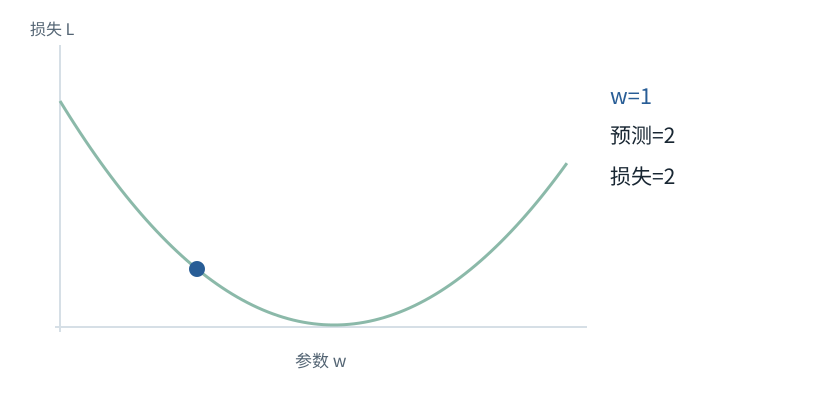
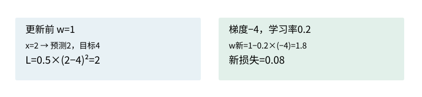

基础篇


<span id="foundations-17-s0"></span>


# F15｜导数、梯度与链式法则：训练怎样找到调整方向

从具体对象与小例子开始，理解计算过程与适用条件。


<span id="course-connection"></span>


## 训练前先学会读“变化率”

本课只需要先理解一个参数怎样影响一个损失。标量例的学习率与目标由例内单独固定，不能把它的更新结果接到236参数的贯通模型。真正整层的梯度会在下一课训练过程中说明用途，并在系统机制的训练章节逐项推导。

本节会用到

[F07 · 模型最常做的算术](07.md)[F09 · 概率、指数与softmax](09.md)[F10 · 神经网络最小模型](10.md)


<span id="visual-F17"></span>


动态图解 · F15


<span id="topic-1"></span>


## 梯度像坡度，学习率像迈步大小

为什么“梯度下降”有时让参数增大？

想象你站在损失曲线上，想往低处走。梯度给的是当前局部坡度；更新用它的相反方向。坡度为负时，往右走会更低，所以减去负梯度使参数增加。它只保证足够小的局部方向信息，不保证任意大一步都正确。

**损失**衡量当前预测偏离目标的数。

**梯度**参数轻微增加时损失的局部变化率。

**学习率**沿更新方向迈多大一步的系数。

**输入与适用条件：**沿用主算例x=2、目标4、w=1、平方误差损失。前三帧学习率0.2；最后一帧明确重置w=1并只改学习率为0.6。


<span id="topic-2"></span>


### 1 / 4 · 预测偏小，但参数还没变

停留时间 4.2秒7秒1.5秒

步骤 第1步，共4步

窄屏可左右滑动图形，或点击“放大图形”。文字解释紧随图后。



x=2，目标4，初始w=1，因此预测2，损失2。先有可测的误差，才谈如何更新。

`w=1.0；L=2.0`

L=0.5×(2w−4)²；dL/dw=(2w−4)×2

默认静止。用“下一步”看完解释再继续；播放到最后一步自动停止。键盘聚焦播放器后，可用左右键逐步查看、空格播放/暂停。图中颜色辅助区分，含义同时用文字注明。

JavaScript未启用；第一帧仍可阅读。完整图解页下方列出全部步骤说明。


<span id="topic-3"></span>


### 为什么需要

需要系统地调整大量参数，而不是逐项猜一个新数。


<span id="topic-4"></span>


### 怎样实现

前向算损失，反向传播求梯度，优化器更新，然后重新前向核验。


<span id="topic-5"></span>


### 可能的代价与误解

过大步长、错误梯度或错误累计方式都可能让损失上升；降低训练损失不等于提升未见数据表现。


<span id="topic-6"></span>


### 如何判断是否做对

这里基准损失2→0.08；大步长反例2→3.92，并用有限差分核对梯度−4。

[全部步骤与解释](../visual/F17.md)[F16 · 训练：给每个位置一道“下一项”题](../visual/F18.md)[O09 · Activation Checkpointing：少存一点，反向时重算](../visual/O09.md)

机制来源：[[AUTOGRAD]](../visual/sources.md#s-AUTOGRAD)。数值和运行场景为本书明确设定的教学例；资料出处不代替本页中文解释。


<span id="foundations-17-s1"></span>


## 导数是在问：稍微改一下输入，结果怎样变

对`f(x)=x²`，x=3时结果9。把x改到3.01，结果9.0601；结果增加0.0601，输入增加0.01，比例约6.01。


<span id="fdiag-17-01"></span>


**关键区别：**用很小改变量的“结果变化/输入变化”去接近局部导数。

**容易误解：**一次大跨度的斜率不能直接当作任意位置的导数。

当改动越来越小时，这个比例趋近6，称为f在x=3处的**导数**。公式`df/dx=2x`表达“x平方对x的局部变化率”。它不是新的输入变量，也不是直接把f除以x。

**局部**很重要：在3附近的变化率，不代表把x从3变100还能用同一个斜率精确预测。


<span id="foundations-17-s2"></span>


## 参数训练为什么需要变化率

模型给出预测，我们用一个数衡量它离目标多远，叫**损失loss**。训练希望找到能降低损失的参数。梯度告诉我们：每个参数小幅增加时，损失会往哪个方向变、多快变。


<span id="fdiag-17-02"></span>


参数训练为什么需要变化率：逐项辨别

|  |  |
| --- | --- |
| 对象一 | 预测y |
| 对象二 | 目标值y\* |
| 对象三 | 损失L(y,y\*) |

**关键区别：**训练目标不是最大化预测数值，而是使损失按定义减小。

**容易误解：**必须先定义损失，才有“哪个方向更好”。


<span id="concept-intro-1"></span>


先认识这里的对象与符号

[∂、∇：偏导与梯度](../concepts.md#concept-gradient)
:   ∂L/∂w询问保持其他独立变量不变时，w小幅改变会让损失L怎样变化。多个参数的这些变化率合成梯度∇L。它们是导数记号，不是把两个普通数直接相除。独立微例：L=w²时，w=3处的梯度为6。最简单更新w←w−η×6中，η是学习率。

只有一个参数时就是导数；很多参数时，把对各参数的局部变化率排在一起叫**梯度（gradient）**。符号`∂L/∂w`表示只改变w、其余参数暂时保持不变时损失L的变化率。


<span id="foundations-17-s3"></span>


## 用一个参数手算一次完整更新

模型`预测=w×x`，给x=2，目标y=4，初始w=1。预测为2。定义损失`L=0.5×(预测−目标)²`，得到`0.5×(-2)²=2`。


<span id="fdiag-17-03"></span>


**关键区别：**损失从2降到0.08；负梯度让参数向增加的方向更新。

**容易误解：**“梯度下降”不表示所有参数数值一定下降。


<span id="fboard-17-03"></span>


逐格算清：梯度下降：同一个输入，改参数后损失变小



步骤 1初始w=1、输入x=2、目标为4，预测为2。

步骤 2平方损失L=0.5×(2−4)²=2，梯度为−4。

步骤 3学习率0.2，更新w=1−0.2×(−4)=1.8。

步骤 4新预测3.6，新损失0.08；这是本例的下降结果。

在这组教学数字里，梯度为负说明适当增大w能降低损失；梯度下降不表示参数数值一定变小。

数值除特别标注外来自本章已明确设定的教学条件；示意图表达算法结构，不代表商业模型参数或实时GPU执行速度。

现在沿链条算变化率：

```
w -> 预测=w×2 -> 差值=预测−4 -> 损失=0.5×差值²
损失对预测的变化率 = 预测−4 = -2
预测对w的变化率    = x = 2
损失对w的变化率    = -2×2 = -4
```

这就是**链式法则**：每一小段的变化率相乘，把影响传回前面的参数。

设**学习率η=0.2**，即每次沿梯度方向调整多大一步。采用最简单的梯度下降：

```
w新 = w旧 − η×梯度 = 1 − 0.2×(-4) = 1.8
新预测 = 1.8×2 = 3.6
新损失 = 0.5×(3.6−4)² = 0.08
```

损失从2降到0.08。注意梯度为负，减去负数使w增加；“梯度下降”不是说每个参数都减小。


<span id="core-gradient-1"></span>


<span id="core-gradient-1--mc-section-1"></span>


## 先读懂“损失对某个数的变化率”

`∂L/∂w`在问：其他独立参数暂时不动，只把w增加一点，L会怎样变化？它不是把L除以w，也不是新参数值。正梯度说明局部增加w会增加损失；负梯度说明局部增加w会降低损失。

**独立标量暖身，暂不使用贯通模型：** 预测 `ŷ=2w`，目标4，损失 `L=0.5(ŷ−4)²`。w=1时ŷ=2，L=2。损失对ŷ的变化率是ŷ−4=−2，ŷ对w的变化率是2，两段相乘得到−4。学习率0.2时 `w←1−0.2×(−4)=1.8`，新损失0.08。这个例子只解释链式法则，不替换M的AdamW训练。

依据：[tiny\_model.py:117–130](../reference/model-code.md#tiny_model-L117)；[对应参数、前向及梯度记录](../labs/model-values.md)。


<span id="core-gradient-2"></span>


<span id="core-gradient-2--mc-section-2"></span>


## 从一个数推广到一张表

若中间表Z的每个格子都影响总损失，就把各格变化率按同样形状放起来，记作 `G_Z=∂L/∂Z`。本书不用“dZ”同时表示前向的微小改变量和存储的梯度，避免混淆。

这里先建立梯度表Gz的记号。下一节F16会从十个正确标签和实际平均loss算出Gz[2,5,8]；系统机制第04章再用那份真实梯度逐组回传。此处不要求提前知道尚未讲解的交叉熵求导。

依据：[tiny\_model.py:117–130](../reference/model-code.md#tiny_model-L117)；[对应参数、前向及梯度记录](../labs/model-values.md)。


<span id="core-gradient-3"></span>


<span id="core-gradient-3--mc-section-3"></span>


## 先只看一个乘积，再看求和

对单行 `z_v=Σⱼ F_j U_jv`：若改U[j,v]，仅这一项改变，变化率是F\_j；如果改F\_j，八个候选都可能改变，需把它们各自损失影响相加。因此：

```
∂L/∂U[j,v] = Σ_b Σ_t F[b,t,j] × Gz[b,t,v]
G_F[b,t,j] = Σ_v Gz[b,t,v] × U[j,v]
```

第一式沿样本与位置把共享参数的所有使用点相加；第二式沿词表候选把影响汇回同一个隐藏特征。二者的累加轴不同。

依据：[tiny\_model.py:117–130](../reference/model-code.md#tiny_model-L117)；[对应参数、前向及梯度记录](../labs/model-values.md)。


<span id="core-gradient-5"></span>


<span id="core-gradient-5--mc-section-5"></span>


## 相加、复用和分支怎样传梯度

若 `H=R+D`，R和D对H各有直接导数1，因此G\_H分别传到两路。若R又是D的输入，最终R收到“主路直达”与“穿过D分支”两份贡献，必须相加。

若一参数被两处使用，也要把各路径的影响累加。重复Token使用同一Embedding行、多个位置共用W、多个loss依赖同一位置，都是这种关系。自动求导会沿图处理这些复用关系，不是“每个参数只跟一个Token学一次”。

从loss开始，梯度每一步都有来源

| 步骤 / 对象 | 本步实际变化 |
| --- | --- |
| 标量目标 | 十题平均L=2.244673168。 |
| 词表梯度 | Gz=(p−onehot)/10，先有实际数值再往回传。 |
| 输出参数梯度 | 每个F×Gz贡献累加到共享U。 |
| 隐藏梯度 | G\_F=Gz×Uᵀ，继续穿过最终归一化、残差与FFN。 |

反向方向与数据依赖相反；它不意味着把整段前向代码倒序执行就会自动得到正确导数。

依据：[tiny\_model.py:117–130](../reference/model-code.md#tiny_model-L117)；[对应参数、前向及梯度记录](../labs/model-values.md)。


<span id="core-gradient-6"></span>


<span id="core-gradient-6--mc-section-6"></span>


## 自动求导、有限差分和反向传播的关系

自动求导框架保存运算依赖并应用局部导数规则；反向传播是计算这些影响的一种高效方式。有限差分则实际比较 `L(w+δ)` 与 `L(w−δ)`，用除以2δ估计导数，适合小模型核对，不适合用来训练十亿参数。

这三者不是三套不同训练目标。随包程序先手写全模型解析反向，再与PyTorch autograd逐张参数比对，还对选中参数作有限差分。它们必须在同一结构、同一输入、同一loss分母、同一参数快照下比较。

依据：[tiny\_model.py:117–130](../reference/model-code.md#tiny_model-L117)；[对应参数、前向及梯度记录](../labs/model-values.md)。


<span id="foundations-17-s4"></span>


## 反向传播与优化器不是同一个步骤


<span id="concept-intro-2"></span>


先认识这里的对象与符号

[优化器、Adam及AdamW](../concepts.md#concept-optimizer)
:   优化器把梯度转换为参数更新。Adam还保存每个参数的梯度滑动平均m和平方梯度滑动平均v；它们是训练状态，不是注意力Value。AdamW把权重衰减与自适应梯度更新解耦。独立首步例：g=2、m旧=0、β₁=0.9，则m新=0.2，偏差修正后m\_hat=2。不能把0.2直接当完整更新量。

**反向传播backpropagation**按计算依赖反向计算各参数梯度；**优化器optimizer**拿到梯度后按规则更新参数。运行`backward`并不必然已经完成参数更新。


<span id="fdiag-17-04"></span>


**关键区别：**反向传播计算变化率，参数更新发生在优化器步骤。

**容易误解：**调用backward不一定等于已经修改权重。

**计算图**是一份记录哪些运算产生哪些结果的依赖关系。自动求导系统依据这份关系应用已知导数规则，不是对每个参数实际试无数次微小扰动。

同一个参数被多处使用时，各使用路径对总损失的影响要合并。如果代码意外切断了计算图，或忘记清除上轮累积梯度，梯度可能不符合本次训练意图。


<span id="foundations-17-s5"></span>


## 有限差分怎样核对解析梯度

可以近似计算`[L(w+ε)−L(w−ε)]/(2ε)`，其中ε是很小正数，比较它与反向传播得到的梯度。这叫**有限差分检查**。


<span id="fdiag-17-05"></span>


**关键区别：**用数值扰动验证导数公式，适合小模型与调试。

**容易误解：**ε太小会受浮点误差影响，太大则不够局部。

它适合小规模调试，不适合为十亿参数逐个计算。ε太大，近似不够局部；太小，浮点舍入误差变重要。ReLU在折点处也要特别处理。因此“两个数不完全一样”不必然是错，要选合理输入与容差。


<span id="foundations-17-s6"></span>


## 为什么会梯度消失或爆炸

链条上乘了很多小于1的变化率，传回去可能越来越小；乘了很多大于1的变化率，可能越来越大。网络结构、归一化、初始化和优化策略都影响这种现象。

这些是实际计算与数值问题，不是“模型懒得学习”。认识这一点，再读更深的Attention反向推导和训练稳定性，才知道公式试图解决什么。


<span id="worked-F17"></span>


运行示例 · F15


<span id="topic-7"></span>


### 算一次梯度，再看损失是否真的下降

**输入与条件。**这是**独立的训练算例**，不沿用本节前面“目标y=4、损失含0.5”的示例条件。这里模型为 `y=w×2`，希望y=6；初始w=1。损失明确设为 `(y−6)²`（不乘0.5），学习率0.1。

| 步骤与对象 | 内部动作 | 中间结果 / 新状态 |
| --- | --- | --- |
| 1先前向 | y=1×2=2 | 损失 `(2−6)²=16`。 |
| 2从损失对y求导 | `2(y−6)` | 得到−8，说明y增大一点有利于降低损失。 |
| 3沿乘法传回w | `dy/dw=2` | 梯度 `dL/dw=−8×2=−16`。 |
| 4更新参数 | `w_new=1−0.1×(−16)` | w变2.6。 |
| 5重新前向 | y=5.2 | 新损失 `(5.2−6)²=0.64`，确实比16小。 |

**把过程连起来。**反向传播求“改哪里、往哪边改”的局部信息；优化器执行参数更新。两者不是同一动作。

**边界与反例。**换太大的学习率可能越过最优点使损失变大，本例下降不是所有步都下降的保证。

依据与适用范围：[[DERIVE]](../example-sources.md#ex-src-DERIVE)。示例输入和场景由本书明确设定。


<span id="self-check"></span>


## 课后自检

**自检 1**

**梯度为-4，使用w←w−0.1×梯度，会增加还是减少w？**

<details class="quiz-answer"><summary><span class="when-closed">查看参考答案</span><span class="when-open">收起参考答案</span></summary><div class="answer">增加0.4。梯度的符号指向损失上升方向，下降更新取相反方向。</div></details>

**自检 2**

**反向传播算出梯度后，参数一定已改变吗？**

<details class="quiz-answer"><summary><span class="when-closed">查看参考答案</span><span class="when-open">收起参考答案</span></summary><div class="answer">不一定。还需要执行优化器更新；计算梯度与修改参数是两个动作。</div></details>


<span id="section-8"></span>


### 延伸阅读：相关系统问题

[03｜注意力的深入追问：位置、掩码、多头与反向传播](../chapters/03.md)  
[04｜训练机制：损失、完整反向传播与参数更新](../chapters/04.md)  
[27｜事实可靠性、多模态与可解释性：能力边界在哪里](../chapters/27.md)

机制依据：[[F-CALC]](../sources.md#src-F-CALC)[[F-AUTOGRAD]](../sources.md#src-F-AUTOGRAD)。本节数值与情景除另注外均为原创教学示例；来源不代替中文讲解。

**运行loss.backward()后，模型参数已经变了吗？**

<details class="quiz-answer"><summary>查看参考答案</summary><div class="answer">没有。它计算并累积梯度。只有之后optimizer.step()等更新操作才改变参数。反过来，忘记清空梯度可能让多个步骤的梯度意外累积。</div></details>


<span id="implementation-evidence"></span>


## 从本页解释到可检查的实现

| 要核对什么 | 事实与边界 | 本地依据 |
| --- | --- | --- |
| 前向、损失与更新 | 固定的一层四维教学模型；不是任何商业模型的完整实现。 | [tiny\_model.py · TinyLM](../reference/model-code.md#tiny_model-L33) |
| 独立前向实现 | 使用同一已保存权重，不使用PyTorch；用于复算而非另行训练。 | [reference\_inference.py · forward](../reference/model-code.md#reference_inference-L28) |
| 错误是否能被发现 | 因果性、梯度、标签移位、缓存位置均有正向检查和反例。 | [test\_model.py](../reference/model-code.md#test_model-L1) |
| 初始化的具体数字 | 所有参数均可查看；初值不等于训练后的参数。 | [weights\_initial.json](../reference/model-code.md#weights_initial-L1) |
| 实际运行记录 | 仅来自本地CPU微型实验；不能推出商业能力或GPU性能。 | [run.json 对应的数值记录](../labs/model-values.md) |


<span id="canonical-related"></span>


## 继续阅读与机制对应

| 页面 | 阅读关系 |
| --- | --- |
| [F14｜完成一次前向：残差、前馈网络与词表分数](14.md) | 上一节：复习本页使用的前置概念 |
| [F16｜一次训练从头到尾：标签、损失、更新、验证与保存](16.md) | 下一节：沿同一课程顺序继续 |
| [04｜训练机制：损失、完整反向传播与参数更新](../chapters/04.md) | 系统机制：用源码、反例和条件深入核对 |

AI系统工程：从基础到内部  
[全书目录](../contents.md) · [术语与符号](../glossary.md) · [参考资料](../sources.md)