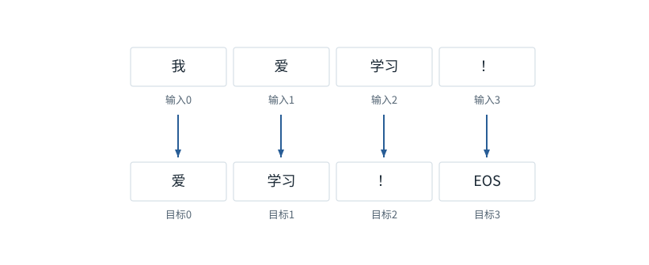
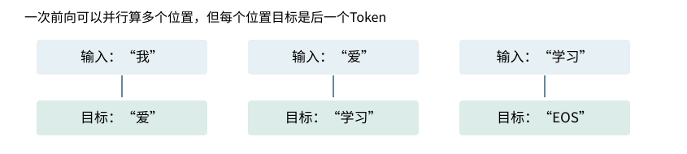
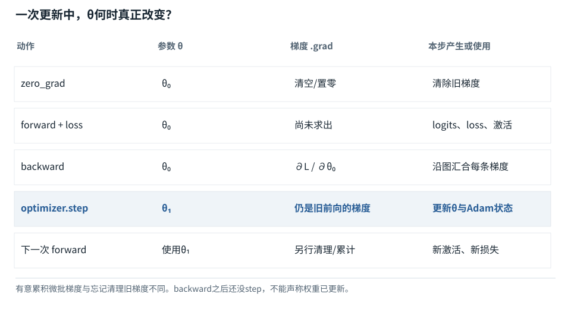

基础篇


<span id="foundations-18-s0"></span>


# F16｜一次训练从头到尾：标签、损失、更新、验证与保存

从具体对象与小例子开始，理解计算过程与适用条件。


<span id="course-connection"></span>


## 把已经会算的前向变成一次真实训练

沿用同一八项词表、同一两条样本和同一初始化参数：先对齐十个目标，再算平均损失，得到梯度，执行AdamW更新，检查训练与验证模式，最后保存权重。这里的每次更新都来自随包程序，不是换一张“训练后看起来合理”的参数表。

本节会用到

[F09 · 概率、指数与softmax](09.md)[F18 · 从最后一排数到一个Token，再到一句回答](18.md)[F15 · 微积分只学用得上的部分](15.md)


<span id="visual-F18"></span>


动态图解 · F16


<span id="topic-1"></span>


## 训练：给每个位置一道“下一项”题

为什么训练看完整句，生成却只能往前走？

训练时答案放在试卷的评分区，所以各位置的题目可以同时准备；mask负责不让模型读到自己的答案。生成时后续Token还未决定，下一题的前缀依赖本题选择。两者共享因果预测目标，但已知信息不同。

**标签**用于评分的真实下一Token。

**交叉熵**本例为真实目标概率的负对数。

**有效目标数**实际参与评分的位置数，不必等于补齐长度。

**输入与适用条件：**标签对齐使用5项序列；单位置交叉熵与PAD平均分别是明确独立的小例，不假称那些概率来自对齐图的模型。


<span id="topic-2"></span>


### 1 / 5 · 把输入和目标错开一格

停留时间 4.2秒7秒1.5秒

步骤 第1步，共5步

窄屏可左右滑动图形，或点击“放大图形”。文字解释紧随图后。



完整教学序列为“我／爱／学习／！／EOS”。输入用前四项，目标用后四项。每个输入位置预测的是其后一个真实Token。

`输入=[1,2,3,5]；目标=[2,3,5,6]`

默认静止。用“下一步”看完解释再继续；播放到最后一步自动停止。键盘聚焦播放器后，可用左右键逐步查看、空格播放/暂停。图中颜色辅助区分，含义同时用文字注明。

JavaScript未启用；第一帧仍可阅读。完整图解页下方列出全部步骤说明。


<span id="topic-3"></span>


### 为什么需要

用清晰的预测任务，把参数更新与语言序列关系连接。


<span id="topic-4"></span>


### 怎样实现

正确移动标签、限制可见性、屏蔽无效目标、按有效数归一化。


<span id="topic-5"></span>


### 可能的代价与误解

偷看未来会产生漂亮但虚假的训练成绩；训练样本重复或泄漏也会高估泛化。


<span id="topic-6"></span>


### 如何判断是否做对

用极小固定序列验证每个输入位置和目标位置，再验证PAD不影响有效损失。

[全部步骤与解释](../visual/F18.md)[F12 · Mask是可见性表，不是额外语义](../visual/F12.md)[F15 · 梯度像坡度，学习率像迈步大小](../visual/F17.md)

机制来源：[[CE]](../visual/sources.md#s-CE) [[AUTOGRAD]](../visual/sources.md#s-AUTOGRAD)。数值和运行场景为本书明确设定的教学例；资料出处不代替本页中文解释。


<span id="foundations-18-s1"></span>


## 先把“要预测什么”对齐

有一段Token序列`[a,b,c,d]`。下一Token训练可以组织为：


<span id="fdiag-18-01"></span>


**关键区别：**训练时目标向右移动一个Token，模型不能靠看未来标签偷答案。

**容易误解：**输入位置与监督目标位置的对齐错误会训练到错误任务。


<span id="fboard-18-01"></span>


逐格算清：训练数据右移一位：每个位置预测下一项



步骤 1位置“我”用于预测下一项“爱”。

步骤 2位置“爱”用于预测下一项“学习”。

步骤 3位置“学习”用于预测结束标记EOS。

步骤 4模型训练时可并行算各位置，但因果mask不允许偷看未来输入。

目标不等于输入编号本身；训练把下一Token作为监督信号，通过因果Mask避免偷看未来。

数值除特别标注外来自本章已明确设定的教学条件；示意图表达算法结构，不代表商业模型参数或实时GPU执行速度。

```
输入位置：a  b  c
目标标签：b  c  d
```


<span id="concept-intro-4"></span>


先认识这里的对象与符号

[标签、teacher forcing与shift](../concepts.md#concept-labels)
:   标签是要比较的正确目标；下一Token训练让输入位置对准后一Token。Teacher forcing使用数据中的真实前缀计算，而非用刚采样的结果替换它。独立例：完整序列[a,b,c,d]，可用输入[a,b,c]对标签[b,c,d]。接口已做移位时不能外面再移一次。

a所在位置根据a预测b，b所在位置根据ab预测c，c所在位置根据abc预测d。**标签label**是本次要比较的正确答案；**teacher forcing**是在训练中使用数据里的真实前缀，而不是总用模型自己刚生成的前缀。

为什么不是输入a就预测a？因为这个目标会变成拷贝已知输入，而不是学习接下来出现什么。实际模型API可能内部移动标签；外部代码再次移动会错两位，必须确认责任边界。


<span id="core-training-data-4"></span>


<span id="core-training-data-4--mc-section-4"></span>


## Teacher forcing到底“喂”了什么

训练第t个位置时，用数据集中的真实前缀，而不是让模型先抽出一个词再把自己的错误接着喂下去。这种用真实历史作为条件的训练方式叫teacher forcing。它允许一批并行计算许多位置的损失。

推理时没有真实下一词，只能用刚选择的结果继续。因此训练低损失不能自动证明长篇生成稳定：模型推理遇到的前缀可能是自己产生的错误组合，已经偏离训练分布。

依据：[tiny\_model.py:14–21](../reference/model-code.md#tiny_model-L14)；[对应参数、前向及梯度记录](../labs/model-values.md)。


<span id="core-training-data-6"></span>


<span id="core-training-data-6--mc-section-6"></span>


## 只有两句话，为什么最终损失也不可能是0

两条样本的输入第0位置都是BOS，但一个目标是“我”，另一个是“你”。同样输入、同样参数，模型不可能给出两份互相矛盾的确定分布。最合适的分配是各0.5；这两题合计损失为 `2×ln2`，分摊到十题是 `ln2/5≈0.138629`。后面看到训练损失停在这一数量级，应先理解数据的歧义，而不是立即判断优化器坏了。

依据：[tiny\_model.py:14–21](../reference/model-code.md#tiny_model-L14)；[对应参数、前向及梯度记录](../labs/model-values.md)。


<span id="foundations-18-s2"></span>


## 交叉熵从一个正确候选开始

假设正确下一Token是c，模型给它概率0.8。一种常用损失是`−ln(0.8)≈0.2231`。若只给0.2，则`−ln(0.2)≈1.6094`，错误更大。


<span id="fdiag-18-02"></span>


**关键区别：**正确项概率越低，惩罚越大；损失衡量模型对正确项分配的概率。

**容易误解：**交叉熵不是“分数直接减正确标签编号”。

这种对正确目标的负对数概率，是单一正确标签下的**交叉熵损失**。概率越接近1，损失越接近0；给真实标签的概率越小，惩罚越大。


<span id="concept-intro-1"></span>


先认识这里的对象与符号

[Σ：按下标逐项求和](../concepts.md#concept-sum)
:   Σ是加法的简写。下标指出哪项在变化；没有被求和的下标保持不变。它不是一个额外参数，也不表示把数组拼在一起。独立微例：Σᵢ xᵢyᵢ，x=[1,2]、y=[3,4]，就是1×3+2×4=11。

若正确候选用**one-hot**表示，即词表长度的一排0里只有正确项为1，记作y，那么通式是`L=−Σ_i y_i ln p_i`。因为其他y\_i为0，最后只留下正确项。


<span id="concept-intro-3"></span>


先认识这里的对象与符号

[∂、∇：偏导与梯度](../concepts.md#concept-gradient)
:   ∂L/∂w询问保持其他独立变量不变时，w小幅改变会让损失L怎样变化。多个参数的这些变化率合成梯度∇L。它们是导数记号，不是把两个普通数直接相除。独立微例：L=w²时，w=3处的梯度为6。最简单更新w←w−η×6中，η是学习率。

对softmax前分数z的导数简化为`∂L/∂z_i=p_i−y_i`。这解释了为什么训练会推动正确项分数提高、错误项分数下降；再经输出矩阵与各层反传到前面的参数。


<span id="foundations-18-s3"></span>


## 多位置与填充怎样评分

对每个有效目标位置算损失，然后求和或平均。PAD位置通常不应当成真实语言目标；指令微调还可能只对助手输出部分计分。这就是loss mask。


<span id="fdiag-18-03"></span>


多位置与填充怎样评分：逐项辨别

|  |  |
| --- | --- |
| 方案／对象 A | 有效位置有3个 |
| 方案／对象 B | PAD或忽略标签不计数 |
| 方案／对象 C | 分母应为有效Token总数 |

**关键区别：**跨微批或分布式累积时，应按总有效Token数归一化。

**容易误解：**分别算每批平均再无权平均，在长度不等时可能改变目标。

如果每批真实长度不同，按样本平均和按有效Token平均可能得到不同权重。报告loss时，要知道分母是什么。不能只看数字变小就断言学习更好。

**困惑度perplexity**常为平均负对数似然的指数。只有分词、数据和计分条件可比时才适合直接比较，不是任意两个模型的统一聪明指数。


<span id="core-training-loss-1"></span>


<span id="core-training-loss-1--mc-section-1"></span>


## 训练目标不是“分数越大越好”

F14的输出头为每个位置都产生8个候选分数。若只把所有分数都加大，softmax概率不会改变，模型并没有更会预测。训练需要的是：在每个真实前缀条件下，把更多概率分给**对应的真实下一Token**。

第0条t=2标签是3“学习”，预测概率为 `0.207640682556`。该题负对数损失为：

```
ℓ[0,2] = −ln(p[0,2,3])
       = −ln(0.207640682556)
       ≈ 1.57194618082
```

概率越接近1，负对数越接近0；概率越接近0，惩罚越大。独立对照：正确候选0.5时损失ln2≈0.693147；0.1时约2.302585。这是对训练目标的评分，不是直接评价整段文字的事实质量。

依据：[tiny\_model.py:101–107](../reference/model-code.md#tiny_model-L101)；[对应参数、前向及梯度记录](../labs/model-values.md)。


<span id="core-training-loss-2"></span>


<span id="core-training-loss-2--mc-section-2"></span>


## 十个位置如何合成一个loss

| 样本 | 输入位置与当前Token | 真实下一Token | 该目标概率 | 该题损失 |
| --- | --- | --- | --- | --- |
| 0 | t=0 · BOS | 1 · 我 | 0.128321769 | 2.053214345 |
| 0 | t=1 · 我 | 2 · 爱 | 0.129720965 | 2.042369561 |
| 0 | t=2 · 爱 | 3 · 学习 | 0.207640683 | 1.571946181 |
| 0 | t=3 · 学习 | 5 · ！ | 0.064054914 | 2.748014539 |
| 0 | t=4 · ！ | 7 · EOS | 0.059646979 | 2.819311775 |
| 1 | t=0 · BOS | 4 · 你 | 0.119500374 | 2.124435777 |
| 1 | t=1 · 你 | 2 · 爱 | 0.139301592 | 1.971113968 |
| 1 | t=2 · 爱 | 3 · 学习 | 0.212009436 | 1.551124494 |
| 1 | t=3 · 学习 | 5 · ！ | 0.063174864 | 2.761848785 |
| 1 | t=4 · ！ | 7 · EOS | 0.060606553 | 2.803352254 |

```
有效监督位置数 N = 2×5 = 10
L = (ℓ[0,0]+…+ℓ[0,4]+ℓ[1,0]+…+ℓ[1,4]) / 10
  = 22.446731679464 / 10
  = 2.244673167946
```

分母是有效Token目标数量，不是词表8，不是每句6项，也不是两条样本这个数字本身。若有被忽略标签，应先按mask确定有效项，分子分母一起排除；N=0时本实现拒绝更新，避免除零或不合理梯度。

依据：[tiny\_model.py:101–107](../reference/model-code.md#tiny_model-L101)；[对应参数、前向及梯度记录](../labs/model-values.md)。


<span id="trace-loss"></span>


十个位置的评分怎样变成一个训练目标

| 检查对象 / 步骤 | 实际内容 |
| --- | --- |
| 预测对象 | 每个位置有8个logits，目标是下一Token编号。 |
| 评分而非抽样 | 从softmax分布取正确标签的概率p\_y，计算−ln p\_y。 |
| 遮掉忽略目标 | targets==-100的项不参与和，也不参与分母。 |
| 统一分母 | 本批共10个有效目标；总损失=sum(loss\_i)/10。 |
| 传回梯度 | 每行logits梯度=(p−onehot)/10，随后传到参数。 |

代码路径：[tiny\_model.py:101–124](../reference/model-code.md#tiny_model-L101) · [Mermaid源文件](../diagrams/loss.mmd)。图的排布只表达数据／调用顺序，不代表计算耗时。


<span id="core-training-loss-3"></span>


<span id="core-training-loss-3--mc-section-3"></span>


## 交叉熵公式为什么可以写成logsumexp

设某一行logits为z，目标编号为y：

```
pᵧ = exp(zᵧ) / Σⱼ exp(zⱼ)
−ln(pᵧ) = −ln(exp(zᵧ)) + ln(Σⱼ exp(zⱼ))
        = −zᵧ + logsumexp(z)
```

`logsumexp(z)`不是“各logit取log后相加”，而是先把各logit取指数、相加、再取log。为了稳定，实际写成 `m+ln(Σ exp(z−m))`，m=max(z)。这保留了与softmax相同的平移不变性，也避免先算出极小概率再取log导致的数值问题。

依据：[tiny\_model.py:101–107](../reference/model-code.md#tiny_model-L101)；[对应参数、前向及梯度记录](../labs/model-values.md)。


<span id="core-training-loss-4"></span>


<span id="core-training-loss-4--mc-section-4"></span>


## 为什么梯度会变成p−onehot，不能只背结论

对某个分数zⱼ，第一项 `−zᵧ` 的导数是：如果j=y则−1，否则0。第二项对zⱼ的导数：先对ln求导得到 `1/Σ exp(z)`，再对指数和求导得到 `exp(zⱼ)`，相乘正是pⱼ。

因此某一道题对zⱼ的导数为 `pⱼ−1[j=y]`。本训练loss是十题平均，每题再乘1/10。这里的onehot只为表达“哪一列是真实目标”，不是Token Embedding，也不要求代码先显式构造它。

第0条t=2：从概率到logits的梯度

| 对象／位置 | 0 PAD | 1 我 | 2 爱 | 3 学习 | 4 你 | 5 ！ | 6 BOS | 7 EOS |
| --- | --- | --- | --- | --- | --- | --- | --- | --- |
| p：八项预测概率 | 0.125143 | 0.08255 | 0.07788 | 0.207641 | 0.166718 | 0.052423 | 0.137416 | 0.150229 |
| onehot(y=3) | 0 | 0 | 0 | 1 | 0 | 0 | 0 | 0 |
| Gz=(p−onehot)/10 | 0.012514 | 0.008255 | 0.007788 | -0.079236 | 0.016672 | 0.005242 | 0.013742 | 0.015023 |

展示值经过舍入；后续运算使用未舍入值。

正确候选那一格梯度为负，做梯度下降会倾向于提高它的logit；其他格通常为正，倾向于降低它们。但实际调整的是共享参数，不是直接永久修改这一行logit。不同训练题对同一参数的梯度还会叠加。

依据：[tiny\_model.py:101–107](../reference/model-code.md#tiny_model-L101)；[对应参数、前向及梯度记录](../labs/model-values.md)。


<span id="core-training-loss-5"></span>


<span id="core-training-loss-5--mc-section-5"></span>


## logits平移与梯度行和有什么关系

本行Gz加起来应为0：概率和1，onehot和1，相减再除N仍为0。若把所有logits同时增加同一个数，概率不变，损失不变，因此沿“全1方向”的变化率为0。它是很好的数值自检，但通过它不能证明整个模型实现正确。

依据：[tiny\_model.py:101–107](../reference/model-code.md#tiny_model-L101)；[对应参数、前向及梯度记录](../labs/model-values.md)。


<span id="core-training-loss-6"></span>


<span id="core-training-loss-6--mc-section-6"></span>


## 参数尚未更新

到这里得到了标量loss和对logits的局部梯度。要让Wq、Embedding等变化，还要把这份影响沿前向依赖传播回去。完整反向链在系统机制的训练章节中，从输出头一直追到Embedding；本节接着检查优化器怎样使用这些梯度。

依据：[tiny\_model.py:101–107](../reference/model-code.md#tiny_model-L101)；[对应参数、前向及梯度记录](../labs/model-values.md)。


<span id="foundations-18-s4"></span>


## 把一个优化步写完整

```
取一批训练样本
-> 准备输入、标签与mask
-> 用现有参数前向计算概率
-> 计算损失
-> 反向传播得到梯度
-> 按训练意图合并或清理梯度
-> 优化器更新参数
-> 进入下一批
```

**梯度累积**是先对若干小批计算并累积梯度，再更新一次，以模拟更大的有效批次；它不让单条超长输入的激活存储自动消失。梯度如何缩放必须与损失平均方式对应。


<span id="fdiag-18-04"></span>


**关键区别：**训练一次更新有明确顺序；累积梯度时清零与缩放尤其重要。

**容易误解：**零梯度与更新参数不要在步骤图中互换。


<span id="foundations-18-s5"></span>


## Adam为什么会保存额外状态


<span id="concept-intro-2"></span>


**本节的训练记号：**g是当前参数的梯度；m是梯度的滑动平均；v是平方梯度的滑动平均；β₁、β₂是设置的平滑系数；t是优化步编号；帽子记号如m̂表示经过偏差修正。这里的小写v不是Attention的Value，β也不是LayerNorm中的偏移参数。m/v会随训练步骤更新并占用额外存储；它们不是本次输入的Token特征。


<span id="fdiag-18-05"></span>


Adam为什么会保存额外状态：逐项辨别

|  |  |
| --- | --- |
| 对象一 | 一阶动量m |
| 对象二 | 二阶矩v |
| 对象三 | 偏差修正后的更新量 |

**关键区别：**Adam维护梯度历史统计，不只是直接减去本轮梯度。

**容易误解：**Adam附加状态会增加训练内存，不能只按权重字节估算。


<span id="concept-intro-5"></span>


先认识这里的对象与符号

[优化器、Adam及AdamW](../concepts.md#concept-optimizer)
:   优化器把梯度转换为参数更新。Adam还保存每个参数的梯度滑动平均m和平方梯度滑动平均v；它们是训练状态，不是注意力Value。AdamW把权重衰减与自适应梯度更新解耦。独立首步例：g=2、m旧=0、β₁=0.9，则m新=0.2，偏差修正后m\_hat=2。不能把0.2直接当完整更新量。

最简单梯度下降只用当前梯度g。**Adam**还保存梯度的平滑平均m和平方梯度的平滑平均v，帮助调整各参数步幅。示意式为：

```
m新 = β1×m旧 + (1−β1)×g
v新 = β2×v旧 + (1−β2)×g²
```

β是0到1之间的平滑系数，不是模型学到的词义。因为初值常为0，开始时平均偏小，所以会做**偏差修正**。例如首步g=2、β1=0.9：m=0.2，除以1−0.9得到修正后的2。

随后用修正m除以修正v的平方根再更新。**AdamW**把权重衰减作为解耦操作处理。完整公式在高级章节；本课先解释“为什么要多存m和v”，这也说明训练显存不能只算权重。


<span id="core-optimizer-1"></span>


<span id="core-optimizer-1--mc-section-1"></span>


## 先说明哪个阶段真的改变了模型

loss.backward计算梯度；optimizer.step应用更新。它们通常是两个调用。若只是算了梯度却没step，生成行为不会因为“模型看过答案”就自动变化。

最简单的SGD规则是 `w_new=w_old−ηg`，η是学习率、g是当前参数梯度。负g使w增加，正g使w减少；“下降”说的是试图降低loss，不是所有参数都必须变小。

依据：[tiny\_model.py:195–219](../reference/model-code.md#tiny_model-L195)；[对应参数、前向及梯度记录](../labs/model-values.md)。


<span id="trace-one-update"></span>


**一次训练更新的状态边界**



数据/调用方向以图中连线为准；参数与激活、训练与推理分别标注。

[SVG图源](../../diagrams/rendered/trace-one-update-e9c144e33578.svg)

代码路径：[tiny\_model.py:195–219](../reference/model-code.md#tiny_model-L195) · [Mermaid源文件](../diagrams/one-update.mmd)。图的排布只表达数据／调用顺序，不代表计算耗时。


<span id="core-optimizer-2"></span>


<span id="core-optimizer-2--mc-section-2"></span>


## 独立SGD对照：只看更新规则的差别

仍使用初始Wq[0,0]=0.2和刚算出的梯度 `-0.002217527833`。若做一个学习率0.03的SGD单格对照，结果为 `0.200066525835`。**这不是本实验实际训练的第一步**，也不能把它接到后面的AdamW历史。

实际训练选用AdamW：学习率0.03，β1=0.9，β2=0.999，ε=1e−8，weight\_decay=0.01。全部参数放在同一组，是便于教学的选择；生产训练常对某些参数采用不同decay分组，不能把这里的配置叫通用最佳值。

依据：[tiny\_model.py:195–219](../reference/model-code.md#tiny_model-L195)；[对应参数、前向及梯度记录](../labs/model-values.md)。


<span id="core-optimizer-3"></span>


<span id="core-optimizer-3--mc-section-3"></span>


## AdamW多保存了哪两张表

每个参数格都对应两个历史状态：m为梯度的指数移动平均；v为梯度平方的指数移动平均。β越接近1，通常保留历史越多。v保存的是平方梯度，不是参数方差，也不是Value矩阵。

```
m_t = β1 m_(t−1) + (1−β1) g_t
v_t = β2 v_(t−1) + (1−β2) g_t²
m̂_t = m_t / (1−β1^t)
v̂_t = v_t / (1−β2^t)
w_t = (1−ηλ) w_(t−1) − η m̂_t / (sqrt(v̂_t)+ε)
```

m/v起始为0，早期平均偏向0，偏差修正分母用于抵消这个初始化影响。ε防止分母为0。decoupled weight decay独立缩小参数，不是先把λw加进梯度后再算m/v；那会成为不同算法。

依据：[tiny\_model.py:195–219](../reference/model-code.md#tiny_model-L195)；[对应参数、前向及梯度记录](../labs/model-values.md)。


<span id="core-optimizer-4"></span>


<span id="core-optimizer-4--mc-section-4"></span>


## 把Wq[0,0]的前两步写全

| 步 | 旧w | 本批g | 新m | 新v | m̂ | v̂ | decay扣除 | 自适应扣除 | 新w |
| --- | --- | --- | --- | --- | --- | --- | --- | --- | --- |
| 1 | 0.2 | -0.002217527833 | -0.000221752783 | 0.000000004917 | -0.002217527833 | 0.00000491743 | 0.00006 | -0.029999864715 | 0.229939864715 |
| 2 | 0.229939864715 | -0.000412844762 | -0.000240861981 | 0.000000005083 | -0.001267694638 | 0.000002542748 | 0.000068981959 | -0.02384962375 | 0.253720506505 |

第一步m̂恰好等于当前g，v̂恰好等于g²；因g为负，自适应“扣除”是负数，所以w增大约0.03，同时被decay略微缩小。由此可以理解：Adam第一步的幅度不等于η直接乘原梯度。

第二步的梯度来自**所有参数更新一次后重新前向和反向**，不是把第一步g复用。只改Wq一个格子、其他参数不变，得到的下一步梯度也不再是表里的实验值。

依据：[tiny\_model.py:195–219](../reference/model-code.md#tiny_model-L195)；[对应参数、前向及梯度记录](../labs/model-values.md)。


<span id="core-optimizer-5"></span>


<span id="core-optimizer-5--mc-section-5"></span>


## 参数更新后，临时结果要重新计算

第一步更新后整批loss由 `2.244673168` 降为 `1.980760052`。下次Q/K/V、RMS分母、份额、logits都要用新参数重新算；旧计算图不能直接当作新参数的反向记录。

梯度累积是有意让多个微批贡献合并；它与忘记清梯度导致的意外累积要区分。

依据：[tiny\_model.py:195–219](../reference/model-code.md#tiny_model-L195)；[对应参数、前向及梯度记录](../labs/model-values.md)。


<span id="core-optimizer-6"></span>


<span id="core-optimizer-6--mc-section-6"></span>


## 学习率、梯度裁剪与AMP分别做什么

学习率控制优化器更新步幅；梯度裁剪限制梯度整体幅度；混合精度改变数值表示与计算。在AMP损失缩放下，应按官方流程先unscale再裁剪，否则阈值作用在被人为放大的梯度上。

贯通模型用CPU float64，没有启用AMP或裁剪。这里说明生产边界，不把未运行的GPU过程包装成实验结果。

依据：[tiny\_model.py:195–219](../reference/model-code.md#tiny_model-L195)；[对应参数、前向及梯度记录](../labs/model-values.md)。


<span id="foundations-18-s6"></span>


## 学会训练不等于已经学会泛化

**训练集**用于更新参数；**验证集**用于选择方案与调参；**测试集**用于相对独立地评估。把测试答案放进训练或反复按测试结果调Prompt，会污染评估。

在固定小序列上loss降很低，只说明这个训练过程学会了该分布，不能据此声称模型能理解任意语言。真正工程结果还要看新任务、新数据、稳定性和成本。


<span id="symbol-intro-1"></span>


先认识这里的对象与符号

[BOS / EOS：序列边界标记](../concepts.md#concept-bos-eos)
:   BOS通常表示序列起始，EOS表示结束的特殊Token；具体模型和消息模板可能使用不同名称、数量及结束标记。它们是输入/输出协议中的符号，不是语义正确性的证明。遇到EOS不自动切断两个训练样本之间的注意力；要隔离读取还需mask或实现支持的样本边界。


<span id="worked-F18"></span>


运行示例 · F16


<span id="topic-7"></span>


### 把三个训练位置逐一评分，不让PAD混入平均数

局部核对例：以下输入以本例列出的条件为准，不能把它的中间值接到贯通模型的计算记录中。

**输入与条件。**真实序列是“我／爱／学习／EOS”，输入 `[1,2,3]` 对应目标 `[2,3,EOS]`。假设三个正确目标的预测概率分别为0.8、0.5、0.25。

| 步骤与对象 | 内部动作 | 中间结果 / 新状态 |
| --- | --- | --- |
| 1第1位置 | 看到“我”，目标是“爱” | 损失 `−ln(0.8)≈0.223144`。 |
| 2第2位置 | 看到“我爱”，目标是“学习” | 损失 `−ln(0.5)≈0.693147`。 |
| 3第3位置 | 看到“我爱学习”，目标是EOS | 损失 `−ln(0.25)≈1.386294`。 |
| 4合并有效位置 | 三项相加再除3 | 平均约0.767528，不是先平均概率再取负对数。 |
| 5补齐对照 | 若后面还有2个PAD且不计分 | 仍除以3；除以5会把损失假装压低。 |

**把过程连起来。**训练标签向后错一位，含义就从“预测下一个Token”变成另一目标。损失下降也不能证明对齐正确。

**边界与反例。**使用自然对数；概率是构造的。表中结果由程序计算，未训练真实模型。

[查看本例程序结果](../example-verification.md#result-F18) · [完整可运行代码](../example-verification.md#code)

依据与适用范围：[[CE]](../example-sources.md#ex-src-CE)。示例输入和场景由本书明确设定。


<span id="worked-X12"></span>


运行示例 · X12


<span id="topic-8"></span>


### padding位置不计损失，分母也必须一起变

局部核对例：以下输入以本例列出的条件为准，不能把它的中间值接到贯通模型的计算记录中。

**输入与条件。**安排4个预测位置，其中1个是PAD。3个有效标签的正确Token概率分别为0.8、0.5、0.25；不使用样本权重。

| 步骤与对象 | 内部动作 | 中间结果 / 新状态 |
| --- | --- | --- |
| 1逐项算负对数 | −ln0.8≈0.223144，−ln0.5≈0.693147，−ln0.25≈1.386294 | 有效损失和≈2.302585。 |
| 2排除PAD | PAD不贡献loss，也不贡献有效数量 | 有效数量是3，而不是安排位置数4。 |
| 3求均值 | 2.302585/3 | 平均loss≈0.767528。 |
| 4反例 | 只把PAD的loss置零，却仍除以4 | 得到0.575646，数值变小但模型没有变好。 |
| 5接到变长批次 | 不同补齐比例若用错分母 | 仅改变组批策略，就可能使训练曲线产生虚假的改善。 |

**把过程连起来。**忽略标签不只是“让那一格等于0”，还要保持聚合与归一化口径正确。

**边界与反例。**这里采用无权重有效标签均值；带类别权重、样本权重或自定义归约的实现，分母可能另有定义。

[查看本例程序结果](../example-verification.md#result-X12) · [完整可运行代码](../example-verification.md#code)

依据与适用范围：[[CE]](../example-sources.md#ex-src-CE)。示例输入和场景由本书明确设定。


<span id="core-training-run-1"></span>


<span id="core-training-run-1--mc-section-1"></span>


## 不是演示一遍公式就宣布学会

现在把数据准备、前向、损失、反向和AdamW放进真实循环。实验固定两条序列，每步都用这同一小批；不做隐藏的数据增强，不把预先写好的续写规则当模型输出。

下面是核心调用逻辑摘录（TinyLM、MODEL\_SPEC、jval和数据准备见同一源码）；完整可运行源码在[本地程序页](../labs/model-run.md#tiny-model)，而非只给伪代码：

```
model = TinyLM()                  # 固定初始化
optimizer = torch.optim.AdamW(model.parameters(), lr=0.03,
    betas=(0.9,0.999), eps=1e-8, weight_decay=0.01, foreach=False)
for update in range(400):
    optimizer.zero_grad(set_to_none=True)
    logits, _ = model(input_ids)
    loss, per_token_loss = training_loss(logits, targets)
    loss.backward()
    optimizer.step()
payload = dict(spec=MODEL_SPEC, parameters=jval(model.state_dict()))
Path("weights_trained.json").write_text(json.dumps(payload, ensure_ascii=False))
```

训练贯通模型需要PyTorch；普通离线阅读不需要。另有只用Python标准库的前向推理程序，可以直接读取保存的数表核对生成，不必安装PyTorch。

依据：[tiny\_model.py:178–258](../reference/model-code.md#tiny_model-L178)；[对应参数、前向及梯度记录](../labs/model-values.md)。


<span id="core-training-run-2"></span>


<span id="core-training-run-2--mc-section-2"></span>


## 实际损失轨迹

| 已更新次数 | 更新前loss | 更新后loss |
| --- | --- | --- |
| 1 | 2.244673168 | 1.980760052 |
| 2 | 1.980760052 | 1.801085962 |
| 3 | 1.801085962 | 1.644078845 |
| 5 | 1.507865394 | 1.400386442 |
| 10 | 1.075646708 | 0.988778456 |
| 20 | 0.413979766 | 0.374535984 |
| 50 | 0.146300503 | 0.14593552 |
| 100 | 0.141768302 | 0.141744283 |
| 200 | 0.140339617 | 0.140331248 |
| 300 | 0.139766206 | 0.139762371 |
| 400 | 0.139480792 | 0.139478689 |

这不是累计loss平均曲线，而是在这些指定步数记录本批当前loss。它下降只说明拟合这两条训练样本的目标在改善；没有独立自然语言测试集，不能据此说它具备真实中文理解或泛化。

依据：[tiny\_model.py:178–258](../reference/model-code.md#tiny_model-L178)；[对应参数、前向及梯度记录](../labs/model-values.md)。


<span id="core-training-run-3"></span>


<span id="core-training-run-3--mc-section-3"></span>


## 为什么停在0.139附近，而不是0

本节前面的数据分析已指出BOS后存在等频“我/你”两种目标，下界是 `0.138629436`。最终实际loss是 `0.139478689`，二者接近。其他位置基本被拟合，BOS处仍需要保留两种可能。

最终每个监督位置的损失

| 对象／位置 | t=0 | t=1 | t=2 | t=3 | t=4 |
| --- | --- | --- | --- | --- | --- |
| 样本0 | 0.693984 | 0.000845 | 0.000627 | 0.001197 | 0.000869 |
| 样本1 | 0.693725 | 0.000845 | 0.000628 | 0.001197 | 0.000869 |

展示值经过舍入；后续运算使用未舍入值。

这里“下界”针对这份数据、这种单一条件分布目标与足够表达能力。不要把log2/5当成所有语言模型训练的标准损失。

依据：[tiny\_model.py:178–258](../reference/model-code.md#tiny_model-L178)；[对应参数、前向及梯度记录](../labs/model-values.md)。


<span id="core-training-run-4"></span>


<span id="core-training-run-4--mc-section-4"></span>


## 训练究竟改变了哪些对象

同一个“爱”的Embedding参数行，训练前后对照

| 对象／位置 | 第0列 | 第1列 | 第2列 | 第3列 |
| --- | --- | --- | --- | --- |
| 初始化E[2] | -0.3 | 0.8 | 0.1 | 0.5 |
| 400步后E[2] | -0.414025 | 0.897638 | -0.20476 | 0.536392 |

展示值经过舍入；后续运算使用未舍入值。


同一张Wq，训练后数表

| 对象／位置 | 第0列 | 第1列 | 第2列 | 第3列 |
| --- | --- | --- | --- | --- |
| 第0行 | 0.129018 | 0.100182 | -0.076768 | -0.234102 |
| 第1行 | -0.141993 | -0.196386 | -0.505352 | -0.217822 |
| 第2行 | -0.298288 | -0.237539 | 0.04572 | -0.107482 |
| 第3行 | -0.213746 | 0.30527 | -0.196299 | -0.111055 |

展示值经过舍入；后续运算使用未舍入值。

同一个输入经过这些参数会产生不同Q/K/V、概率。并不是给Token编号2改了一个新编号，也不是只把最后答案写进某个独立记忆格。

依据：[tiny\_model.py:178–258](../reference/model-code.md#tiny_model-L178)；[对应参数、前向及梯度记录](../labs/model-values.md)。


<span id="core-training-run-5"></span>


<span id="core-training-run-5--mc-section-5"></span>


## 保存训练产物：权重必须配什么

本包保存 `weights_initial.json` 和 `weights_trained.json`，包含模型配置与参数数组。选择JSON是为了可检查每个数字，并让标准库推理也能加载；不是建议大规模模型用JSON代替高效权重格式。

实际部署至少核对词表/分词器、特殊Token、层数与宽度、位置机制、归一化ε、权重命名及转置约定。参数形状恰好相同但词表顺序不同，系统可能运行却输出错误文字。

依据：[tiny\_model.py:178–258](../reference/model-code.md#tiny_model-L178)；[对应参数、前向及梯度记录](../labs/model-values.md)。


<span id="core-training-run-6"></span>


<span id="core-training-run-6--mc-section-6"></span>


## 可复现不等于跨所有机器逐位一致

本次实测环境：Python `3.13.5`、PyTorch `2.10.0+cpu`、CPU、float64、单线程、固定种子23与确定性设置。不同平台、精度和内核可能有舍入差异，应按合理容差核对。

随包记录初始和最终参数指纹、逐步loss、参数更新、全量前向中间表、解析反向及自动求导差异。指纹用来确认比较的是哪份权重，不证明它具备什么能力。

依据：[tiny\_model.py:178–258](../reference/model-code.md#tiny_model-L178)；[对应参数、前向及梯度记录](../labs/model-values.md)。


<span id="core-training-run-7"></span>


<span id="core-training-run-7--mc-section-7"></span>


## 从训练跨入推理必须过一道真实边界

后面的生成从**保存文件重新加载**参数，不直接在内存中沿用带训练状态的对象，也不根据预期答案改概率。本实验还用不依赖PyTorch的另一份前向程序复算，减少两端共用同一错误而互相“验证通过”的风险。

依据：[tiny\_model.py:178–258](../reference/model-code.md#tiny_model-L178)；[对应参数、前向及梯度记录](../labs/model-values.md)。


<span id="core-validation-1"></span>


<span id="core-validation-1--mc-section-1"></span>


## 先区分训练、验证与推理三种使用方式

训练有标签、求梯度、更新参数；验证也可有标签并计算loss，但不更新参数；生成推理通常没有标签，按前缀选下一Token。它们都可调用同一个前向函数。

| 行为 | 训练 | 验证loss | 生成推理 |
| --- | --- | --- | --- |
| 输入来源 | 真实训练前缀 | 验证样本真实前缀 | 用户前缀＋已生成内容 |
| 标签 | 有 | 有 | 通常没有 |
| loss | 用于优化 | 用于评估 | 不是生成所必需 |
| 梯度与step | 需要 | 通常禁用 | 通常禁用 |
| 模型模式 | 一般train | 一般eval | 一般eval |
| KV缓存 | 常规全序列训练通常不用 | 取决于评估方式 | 逐步生成常用 |

依据：[tiny\_model.py:101–107](../reference/model-code.md#tiny_model-L101)；[对应参数、前向及梯度记录](../labs/model-values.md)。


<span id="core-validation-2"></span>


<span id="core-validation-2--mc-section-2"></span>


## eval()不等于关闭梯度

`model.eval()`切换模块的training标志，例如Dropout不再随机丢弃，BatchNorm改用相应评估行为。它不是autograd开关。`torch.no_grad()`和`torch.inference_mode()`控制梯度记录或更严格的推理优化；它们也不会自动把所有模块切到eval。

本模型无Dropout、无BatchNorm，因此train/eval数值一致，不代表真实模型都一致。随包另有独立Dropout测试：只加no\_grad仍会随机置零；eval可使Dropout行为变为恒等；eval下仍能开启梯度计算。

依据：[tiny\_model.py:101–107](../reference/model-code.md#tiny_model-L101)；[对应参数、前向及梯度记录](../labs/model-values.md)。


<span id="core-validation-3"></span>


<span id="core-validation-3--mc-section-3"></span>


## Dropout为什么会改变“相同输入同样输出”

独立规则：训练时以概率p置零部分激活，保留项通常按1/(1−p)缩放，使期望不变。评估时不再随机置零，也不继续放大。不能拿一次随机前向与无Dropout前向要求逐格一致。

SDPA是函数接口，它的dropout\_p由调用者传入。即使外层模块处于eval，也需要传正确的0值来禁用它，不能假设函数自动读取外层状态。

依据：[tiny\_model.py:101–107](../reference/model-code.md#tiny_model-L101)；[对应参数、前向及梯度记录](../labs/model-values.md)。


<span id="core-validation-4"></span>


<span id="core-validation-4--mc-section-4"></span>


## 梯度累积为什么常在分母出错

独立损失例：微批A有效2题，总损失4，平均2；微批B有效8题，总损失8，平均1。全体10题正确平均为 `(4+8)/10=1.2`；平均两个均值则 `(2+1)/2=1.5`。对应梯度的相对权重也被改变。

分子与分母必须对应同一组有效目标

| 步骤 / 对象 | 本步实际变化 |
| --- | --- |
| 微批A | 2个有效Token；损失总和4。 |
| 微批B | 8个有效Token；损失总和8。 |
| 正确合并 | 分子4+8，分母2+8，平均1.2。 |
| 错误合并 | 先各自平均，再等权平均2和1，得到1.5。 |

这是独立算术对照，不是贯通模型某一实际训练步的loss。

分布式训练还要知道梯度同步是求和还是平均、框架是否已经做了缩放。不要多除一次世界大小或累积步数。Hugging Face曾公开解释过此类梯度累积归一化修复；教材将它作为历史教训，不宣称当前库仍存在该缺陷。

依据：[tiny\_model.py:101–107](../reference/model-code.md#tiny_model-L101)；[对应参数、前向及梯度记录](../labs/model-values.md)。


<span id="core-validation-5"></span>


<span id="core-validation-5--mc-section-5"></span>


## 验证什么，才能知道模型没有偷看

固定一个前缀，改变更晚Token，前缀位置的logits应不变；同一条样本单独跑与放进独立批次，结果应一致；交换批次顺序，结果应相应交换。它们检查因果和样本隔离，不评价语义能力。

本模型的负控制会故意关闭因果mask，确认“未来改变不影响前缀”的测试能抓住错误。只有正确实现通过还不够：还要知道测试遇到坏实现时会失败。

依据：[tiny\_model.py:101–107](../reference/model-code.md#tiny_model-L101)；[对应参数、前向及梯度记录](../labs/model-values.md)。


<span id="core-validation-6"></span>


<span id="core-validation-6--mc-section-6"></span>


## 验证集、过拟合和本实验边界

正式训练应有隔离的验证任务、数据泄漏控制、目标域评测和可复现数据处理。贯通模型反复使用两句话，没有可信的泛化成绩。本书不把同样两句话的续写准确率包装成验证集成功率。

依据：[tiny\_model.py:101–107](../reference/model-code.md#tiny_model-L101)；[对应参数、前向及梯度记录](../labs/model-values.md)。


<span id="core-understanding-3"></span>


<span id="core-understanding-3--mc-section-3"></span>


## 追问：参数W到底怎样被语言数据“教会”？

一句话形成多个真实前缀和下一Token标签。当前W影响前向的概率，交叉熵评价标签概率，反向链式法则计算每个W格子对这个loss的局部影响，优化器根据这些影响逐步更新。没有某个单独步骤把词义文字直接写成一列标签。

依据：[tiny\_model.py:178–258](../reference/model-code.md#tiny_model-L178)；[对应参数、前向及梯度记录](../labs/model-values.md)。


<span id="self-check"></span>


## 课后自检

**自检 1**

**正确项概率从0.25升到0.5，负对数损失是上升还是下降？**

<details class="quiz-answer"><summary><span class="when-closed">查看参考答案</span><span class="when-open">收起参考答案</span></summary><div class="answer">下降，从约1.3863降到0.6931。这里使用自然对数。</div></details>

**自检 2**

**为什么恢复训练可能还需优化器状态而不只是权重？**

<details class="quiz-answer"><summary><span class="when-closed">查看参考答案</span><span class="when-open">收起参考答案</span></summary><div class="answer">Adam等优化器保存历史平滑量，此外步数和学习率状态也会影响后续更新。只恢复权重未必延续同一训练轨迹。</div></details>


<span id="section-8"></span>


### 延伸阅读：相关系统问题

[01｜输入究竟是什么：从用户的一句话到模型张量](../chapters/01.md)  
[03｜注意力的深入追问：位置、掩码、多头与反向传播](../chapters/03.md)  
[04｜训练机制：损失、完整反向传播与参数更新](../chapters/04.md)  
[05｜后训练与模型定制：目标、结构和参数适配](../chapters/05.md)  
[28｜研究深水区与系统综合判断](../chapters/28.md)

机制依据：[[F-AUTOGRAD]](../sources.md#src-F-AUTOGRAD)[[ADAMW]](../sources.md#src-ADAMW)[[RLHF]](../sources.md#src-RLHF)。本节数值与情景除另注外均为原创教学示例；来源不代替中文讲解。

**可以让input\_ids和targets完全相同，并去掉shift吗？**

<details class="quiz-answer"><summary>查看参考答案</summary><div class="answer">那会主要训练“给当前Token预测它自己”，不是本书要学的下一Token条件概率。必须明确输入位置、可见前缀和目标位置的关系；shift通常只做一次。</div></details>

**若两个微批分别有2和8个有效Token，直接平均两个微批的平均loss是否等于总共10题的平均？**

<details class="quiz-answer"><summary>查看参考答案</summary><div class="answer">一般不等。正确是把两批的有效损失总和相加再除10；两批平均值应按2/10与8/10加权。等权平均会让短微批每个Token占更大权重。</div></details>

**保存模型参数就能精确续训AdamW吗？**

<details class="quiz-answer"><summary>查看参考答案</summary><div class="answer">通常不够。还要保存优化器m/v、步数、调度器、必要随机状态和数据进度等。只有推理加载时可以不需要这些训练状态。</div></details>

**训练集loss降低、同样两句能续写，能否证明部署到其他句子也会成功？**

<details class="quiz-answer"><summary>查看参考答案</summary><div class="answer">不能。这个实验没有一般语言的训练覆盖和独立评测；它用于验证计算和文件生命周期，而不是证明泛化。</div></details>

**为了省内存，在真实训练前向套no\_grad，再对loss.backward()，能否正常学习全部参数？**

<details class="quiz-answer"><summary>查看参考答案</summary><div class="answer">通常不能；所需计算图已被禁用，梯度链路断开。省训练显存应使用明确的混合精度、检查点或分片等方法，并验证梯度，而不是直接关闭必要的求导。</div></details>


<span id="implementation-evidence"></span>


## 从本页解释到可检查的实现

| 要核对什么 | 事实与边界 | 本地依据 |
| --- | --- | --- |
| 前向、损失与更新 | 固定的一层四维教学模型；不是任何商业模型的完整实现。 | [tiny\_model.py · TinyLM](../reference/model-code.md#tiny_model-L33) |
| 独立前向实现 | 使用同一已保存权重，不使用PyTorch；用于复算而非另行训练。 | [reference\_inference.py · forward](../reference/model-code.md#reference_inference-L28) |
| 错误是否能被发现 | 因果性、梯度、标签移位、缓存位置均有正向检查和反例。 | [test\_model.py](../reference/model-code.md#test_model-L1) |
| 初始化的具体数字 | 所有参数均可查看；初值不等于训练后的参数。 | [weights\_initial.json](../reference/model-code.md#weights_initial-L1) |
| 实际运行记录 | 仅来自本地CPU微型实验；不能推出商业能力或GPU性能。 | [run.json 对应的数值记录](../labs/model-values.md) |


<span id="canonical-related"></span>


## 继续阅读与机制对应

| 页面 | 阅读关系 |
| --- | --- |
| [F15｜导数、梯度与链式法则：训练怎样找到调整方向](15.md) | 上一节：复习本页使用的前置概念 |
| [F17｜后训练：监督微调、偏好、奖励与参数适配](17.md) | 下一节：沿同一课程顺序继续 |
| [04｜训练机制：损失、完整反向传播与参数更新](../chapters/04.md) | 系统机制：用源码、反例和条件深入核对 |

AI系统工程：从基础到内部  
[全书目录](../contents.md) · [术语与符号](../glossary.md) · [参考资料](../sources.md)