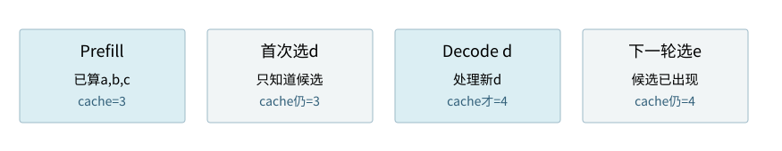
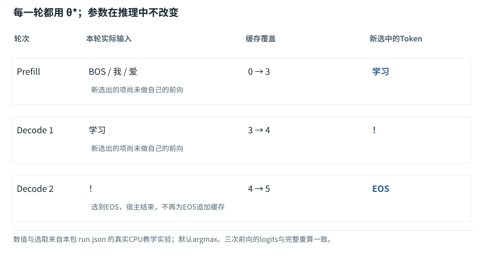

基础篇


<span id="foundations-15-s0"></span>


# F18｜加载训练结果：逐个预测、选择与停止

从具体对象与小例子开始，理解计算过程与适用条件。


<span id="course-connection"></span>


## 推理必须接住前面保存的训练产物

先加载基础课程训练得到的权重和配置，再处理[BOS,我,爱]。第一轮选出“学习”，第二轮才把“学习”作为输入；处理“！”后选出EOS。当前先用每轮完整重算作为正确基线，下一课再用同权重的KV缓存进行对照，不改变问题或换参数。

本节会用到

[F09 · 概率、指数与softmax](09.md)[F14 · 把Attention装进一层](14.md)


<span id="foundations-15-s1"></span>


## 最后一层还不是文字

本段仅复习输出头的线性计算：h=[1,2]与2×6权重表是独立算术例，不是已保存的四维、八词表模型。之后“现在才进入推理路径”才开始加载真实训练结果；对应的八项logits逐轮完整列出。


<span id="concept-intro-1"></span>


先认识这里的对象与符号

[Wout、LM head：词表打分参数](../concepts.md#concept-wout)
:   把最后隐藏表示转换为每个词表候选分数的参数层。输入宽度d，词表有Vocab项，右乘的参数形状是[d,Vocab]。生成概率需再对这些分数归一化。注意力Wo输出的是隐藏特征；Wout输出的是词表候选分数。名字都含output，输出对象却不同。

网络处理完输入后，每个位置得到一排d个数。为了生成文字，要给词表每个候选打分。这一步叫**输出投影**或语言模型输出头。


<span id="fdiag-15-01"></span>


**关键区别：**输出层是把内部特征投影到词表候选，而不是直接从隐藏向量打印中文字。

**容易误解：**logits不是概率，仍需选择或采样。

假设最后一个有效位置的隐藏状态h=`[1,2]`，词表只有6项，使用一个2行6列的教学权重：

```
Wout = [[0,1,0,1,-1,0],
        [0,0,1,1, 0,-1]]
hWout = [0,1,2,3,-1,-2]
```

输入宽度2变成6个候选分数。取最大会得到编号3。这里的数字与前面字符映射都只是演示，不代表这个没有训练的网络真正理解了中文。


<span id="core-loading-1"></span>


<span id="core-loading-1--mc-section-1"></span>


## 现在才进入推理路径

F15—F17已经解释梯度、完成训练和验证，并区分了后训练。现在丢开训练循环，读入 `weights_trained.json`，重建相同结构并拷贝参数。我们使用的是θ\*，不再是本书对应的基础小节的初值θ₀，也不在每轮聊天时重跑400次更新。

训练和推理共享同一前向计算，但推理没有targets、loss.backward、optimizer.step。缓存是本次前缀的中间状态，不是另一套训练参数。

依据：[tiny\_model.py:221–242](../reference/model-code.md#tiny_model-L221)；[对应参数、前向及梯度记录](../labs/model-values.md)。


<span id="trace-load"></span>


训练与推理的真实边界：保存后重新加载

| 检查对象 / 步骤 | 实际内容 |
| --- | --- |
| 训练循环 → 磁盘 | 保存spec和parameters，而非只保存一句“训练完成”。 |
| 新模型 → 配置 | 建立相同词表、层数、宽度、位置策略与dtype。 |
| 加载器 → 参数 | load\_state\_dict：键名、形状和数值必须匹配。 |
| 运行模式 → 推理 | eval切换模块模式；inference\_mode关闭求导记录。 |
| 输入 → 模型 | 固定[BOS,我,爱]，先以完整重算生成作为基线。 |

代码路径：[tiny\_model.py:221–244](../reference/model-code.md#tiny_model-L221) · [Mermaid源文件](../diagrams/load.mmd)。图的排布只表达数据／调用顺序，不代表计算耗时。


<span id="core-loading-2"></span>


<span id="core-loading-2--mc-section-2"></span>


## 加载前核对六类信息

| 对象 | 本模型设置 | 错了会发生什么 |
| --- | --- | --- |
| 词表与特殊Token | 0 PAD，6 BOS，7 EOS | 同一编号可能被解成不同文字，或过早/永不停止 |
| 结构 | 1层、4维、1头、FFN8、RMSNorm、ReLU | 权重形状不匹配，或形状可用但计算函数改变 |
| 位置机制 | 可学习P，范围0—7 | 误用RoPE、位置重置或超长访问 |
| 数值与参数约定 | float64，右乘W，无偏置 | 精度差或无意转置导致输出不一致 |
| 模式 | eval＋inference\_mode | 有Dropout的模型可能仍随机变化；图记录占额外内存 |
| 权重身份 | 加载训练后JSON并检查指纹 | 可能误加载初始模型或混用不同版本的层 |

依据：[tiny\_model.py:221–242](../reference/model-code.md#tiny_model-L221)；[对应参数、前向及梯度记录](../labs/model-values.md)。


<span id="core-loading-3"></span>


<span id="core-loading-3--mc-section-3"></span>


## 一条推理请求实际提供什么

本例用户要续写“我爱”，教学分词得到[1,2]，在前面加BOS6，模型实际输入为 `[6,1,2]`。输入位置是[0,1,2]。它不是训练整句 `[6,1,2,3,5]`，**没有提前把“学习！”当作输入**。

同一参数下，两个场景提供的信息不同


<span id="core-loading-3--mc-section-4"></span>


#### 训练第0样本

输入BOS 我 爱 学习 ！，五个位置同时计算；标签为我 爱 学习 ！ EOS。


<span id="core-loading-3--mc-section-5"></span>


#### 此次生成请求

只提供BOS 我 爱；没有真实后缀标签。模型先产生下一Token候选，再自行选择。

训练第2位置和此次前缀最后位置可在因果且模式一致时给出相同条件分布；后续输入来源则不同。

依据：[tiny\_model.py:221–242](../reference/model-code.md#tiny_model-L221)；[对应参数、前向及梯度记录](../labs/model-values.md)。


<span id="core-loading-4"></span>


<span id="core-loading-4--mc-section-6"></span>


## 推理前向不是只执行模型最后一层

新输入编号仍需查E/P、归一化、QKV、注意力、FFN、输出头。一切参数已经训练好，并不意味着这些计算可以跳过。KV缓存只能在满足条件时复用**旧位置的部分计算**，新位置仍要通过各层。

依据：[tiny\_model.py:221–242](../reference/model-code.md#tiny_model-L221)；[对应参数、前向及梯度记录](../labs/model-values.md)。


<span id="core-loading-5"></span>


<span id="core-loading-5--mc-section-7"></span>


## 生成策略是模型之外的一层选择规则

模型返回logits；宿主可以贪心选最大项，也可以按温度和Top-k/Top-p修饰后的分布抽样。相同权重使用不同策略，结果可能不同。本贯通生成先固定贪心，便于逐轮核对；抽样在系统机制中的对应推导独立比较。

模型本身不直接把字符串追加到网页。选出的编号需由分词器解码，宿主再负责显示、截断、工具交接或其他业务动作。推理前向、Token选择、文本解码、用户界面是几个不同边界。

依据：[tiny\_model.py:221–242](../reference/model-code.md#tiny_model-L221)；[对应参数、前向及梯度记录](../labs/model-values.md)。


<span id="core-loading-6"></span>


<span id="core-loading-6--mc-section-8"></span>


## 推理时不更新参数，如何实际确认

随包实验在推理前后计算参数指纹，确认一致；记录所有生成轮次的输入、logits、概率和缓存覆盖。只看到“回答变了”不能推断权重变了，也可能是前缀、位置、抽样随机数、模式或数值内核不同。

依据：[tiny\_model.py:221–242](../reference/model-code.md#tiny_model-L221)；[对应参数、前向及梯度记录](../labs/model-values.md)。


<span id="foundations-15-s2"></span>


## 为什么看最后一个有效位置

自回归语言模型在一个位置上产生的是“接在此前缀之后的下一Token”分布。若输入Token为a、b、c，则c所在位置的最后表示用于预测接下来的d。


<span id="fdiag-15-02"></span>


为什么看最后一个有效位置：逐项辨别

|  |  |
| --- | --- |
| 方案／对象 A | 位置0用于预测后续第1项 |
| 方案／对象 B | 最后有效位置用于预测下一项 |
| 方案／对象 C | PAD不是有效结束位置 |

**关键区别：**自回归模型每个位置预测其后继；当前生成要从最后有效位置读。

**容易误解：**右PAD的Batch里，数组最后一列不一定是最后有效位置。

早先位置也可产生分布，但分别对应更短前缀后的预测。生成当前答案要用最后有效位置，不是任意平均所有位置。带右PAD的batch尤其要选对位置，不能无条件取数组最后一列。


<span id="foundations-15-s3"></span>


## Prefill和Decode只是两种运行阶段

**Prefill（预填充）**是处理已经给定的整段输入，生成各层所需表示及可保留的中间结果。Prefill结束时最后位置已有下一Token分数，所以可以选出第一个输出Token。


<span id="fdiag-15-03"></span>


**关键区别：**一个输出Token的选出，和它被送进模型处理，是前后两个不同事件。

**容易误解：**模型不是一次生成整句再逐字打印。


<span id="fboard-15-03"></span>


逐格算清：“选出来”和“算进缓存”隔着一轮



步骤 1Prefill处理了a、b、c，缓存覆盖3个位置。

步骤 2模型从候选分布选出d，但d还没有通过网络各层。

步骤 3下一次Decode把d真正作为输入处理，缓存才覆盖4个位置。

步骤 4再选出e时，e本身也还未写入缓存。

一次生成步骤结束时刚选出的Token，并不自动已经拥有它自己的每层K/V。程序需要在下一次解码中真正处理它。

数值除特别标注外来自本章已明确设定的教学条件；示意图表达算法结构，不代表商业模型参数或实时GPU执行速度。

**Decode（逐步解码）**是把刚选出的新Token再送入模型，继续预测下一个。因为未来Token尚未选出来，后一个生成步骤依赖前一个结果。

```
已有输入：[a,b,c]
处理a,b,c -> 选出d
再处理d   -> 选出e
再处理e   -> 选出f
```

缓存可帮助“不重复处理全部历史”，但不消除生成之间的依赖。缓存内部在下一课解释。


<span id="core-generation-1"></span>


<span id="core-generation-1--mc-section-1"></span>


## 先采用最直白的正确实现

这一课每轮都把**当前完整前缀**重新输入同一个训练后模型。它浪费重复计算，但逻辑容易核对，可以作为缓存优化的基线。下一课优化时，必须与它在相同条件下对上，而不是只看“生成也挺像”。

依据：[tiny\_model.py:156–175](../reference/model-code.md#tiny_model-L156)；[对应参数、前向及梯度记录](../labs/model-values.md)。


<span id="trace-generation"></span>


**加载前面训练的权重，连续生成直到EOS**



数据/调用方向以图中连线为准；参数与激活、训练与推理分别标注。

[SVG图源](../../diagrams/rendered/trace-generation-40c4f0a0a9b1.svg)

代码路径：[tiny\_model.py:156–175](../reference/model-code.md#tiny_model-L156) · [Mermaid源文件](../diagrams/generation.mmd)。图的排布只表达数据／调用顺序，不代表计算耗时。


<span id="core-generation-2"></span>


<span id="core-generation-2--mc-section-2"></span>


## 第一轮：只处理BOS、我、爱

输入 `[6,1,2]`，位置 `[0,1,2]`。沿前面解释过的同一前向得到3行logits，取最后位置t=2的一行。这里的八项实际值是：

训练后第一轮：词表分数与概率

| 对象／位置 | 0 PAD | 1 我 | 2 爱 | 3 学习 | 4 你 | 5 ！ | 6 BOS | 7 EOS |
| --- | --- | --- | --- | --- | --- | --- | --- | --- |
| logits | 0.493801 | -1.771061 | -8.251135 | 9.167374 | -2.416939 | -0.021964 | 0.599027 | 0.274302 |
| softmax概率 | 0.000171 | 0.000018 | 2.72248e-08 | 0.999373 | 0.000009 | 0.000102 | 0.00019 | 0.000137 |

展示值经过舍入；后续运算使用未舍入值。

最大项是编号3“学习”。此时选择出了一个新编号，它刚从候选中产生，**还没有以自己的输入身份经过本轮前向**。把它追加到序列，得到 `[6,1,2,3]`。

依据：[tiny\_model.py:156–175](../reference/model-code.md#tiny_model-L156)；[对应参数、前向及梯度记录](../labs/model-values.md)。


<span id="core-generation-3"></span>


<span id="core-generation-3--mc-section-3"></span>


## 第二轮：输入里才第一次有“学习”

重新计算完整前缀 `[6,1,2,3]`。最后输入位置现在是t=3，代表“学习”；模型根据此前缀预测后面接什么。选择编号5“！”，再追加得到 `[6,1,2,3,5]`。

依据：[tiny\_model.py:156–175](../reference/model-code.md#tiny_model-L156)；[对应参数、前向及梯度记录](../labs/model-values.md)。

查看阶段 
<span id="viewer-15-mc-section-2"></span>


### 

默认暂停，最后一步自动停止。图上显示舍入值，记录保留完整精度。图形窄屏可在自身区域滚动；所有数值另有完整可访问表格。


<span id="core-generation-4"></span>


<span id="core-generation-4--mc-section-4"></span>


## 第三轮：处理“！”以后预测到EOS

输入完整五项，取t=4的分数，选择编号7EOS。EOS是结束符，通常不作为普通文字显示。这个贯通示例此时停止，不再把EOS送进去预测“EOS后面是什么”。

| 轮次 | 本轮已知前缀 | 实际输入编号（无缓存） | 选中下一项 | 选中项概率 |
| --- | --- | --- | --- | --- |
| 1 | BOS/我/爱 | [6, 1, 2] | 3 · 学习 | 0.99937276 |
| 2 | BOS/我/爱/学习 | [6, 1, 2, 3] | 5 · ！ | 0.998803223 |
| 3 | BOS/我/爱/学习/！ | [6, 1, 2, 3, 5] | 7 · EOS | 0.999131367 |

这是同一份保存后重新加载的模型实际产生的贪心轨迹，不是人工指定下一个Token。

依据：[tiny\_model.py:156–175](../reference/model-code.md#tiny_model-L156)；[对应参数、前向及梯度记录](../labs/model-values.md)。


<span id="core-generation-5"></span>


<span id="core-generation-5--mc-section-5"></span>


## 为什么不把第一轮所有位置预测的词直接拼成答案

训练式前向可以为BOS、我、爱三处各给一行分布，但它们对应不同前缀：BOS后的分布、BOS我后的分布、BOS我爱后的分布。它们不是同一问题的未来第1、2、3个未知词。把三个位置各选一项串起来，属于错误解释输出轴。

只有最后有效位置对应“在当前完整前缀后面”的下一项。下一项选定以后，前缀条件变了，必须根据新条件再算。

依据：[tiny\_model.py:156–175](../reference/model-code.md#tiny_model-L156)；[对应参数、前向及梯度记录](../labs/model-values.md)。


<span id="core-generation-6"></span>


<span id="core-generation-6--mc-section-6"></span>


## 为什么有时生成不一致

本例贪心、无Dropout、固定权重与精度，路径确定。真实系统即便固定seed也可能受并行内核、服务版本等影响；抽样更会刻意引入不同选择。判断退化时应控制权重、输入模板、mask、position、生成参数与数值环境，而不只是比较两段文字。

依据：[tiny\_model.py:156–175](../reference/model-code.md#tiny_model-L156)；[对应参数、前向及梯度记录](../labs/model-values.md)。


<span id="core-generation-7"></span>


<span id="core-generation-7--mc-section-7"></span>


## 停止原因不是成功原因

这个例子遇到EOS结束；若最大新Token数设为2，只会生成“学习！”后因长度限制结束，尚未预测EOS。返回“length”不应伪装成“自然完整完成”。在JSON、代码和工具场景里，截断还可能导致不完整语法或未完成动作。

依据：[tiny\_model.py:156–175](../reference/model-code.md#tiny_model-L156)；[对应参数、前向及梯度记录](../labs/model-values.md)。


<span id="foundations-15-s4"></span>


## 选出来不等于已经处理过

第一步输出d时，模型刚处理过的是a、b、c；d只是从分数中选出的编号，还没有经过自己的Embedding和各层。因此如果缓存保存的是已计算Token的K/V，它此刻只覆盖3个位置，而非4个。


<span id="fdiag-15-04"></span>


**关键区别：**d刚选出尚未作为输入通过各层，下一轮处理d后才会写入对应KV。

**容易误解：**缓存长度不能在采样完的瞬间就无条件加1。

下一步将d作为新输入，才生成d在各层的K/V。这个一位之差决定你是否重复追加输入、是否用错位置和是否错误估计缓存长度。


<span id="foundations-15-s5"></span>


## 生成Token与界面显示字符的关系

输出编号要通过对应分词器解回文本片段。某个Token可能对应几个字符，也可能只提供一个多字节字符的一部分。**流式显示**是让部分结果逐步到达界面，不代表每出现一个汉字就恰好完成一次模型计算。


<span id="fdiag-15-05"></span>


生成Token与界面显示字符的关系：逐项辨别

|  |  |
| --- | --- |
| 方案／对象 A | Token输出编号 |
| 方案／对象 B | Tokenizer解码为文字字节 |
| 方案／对象 C | 界面按字符渐进显示 |

**关键区别：**Token与UTF-8字符及网络分片的边界未必一一对应。

**容易误解：**流式传来半个UTF-8字符不能立即当成完整字符。


<span id="symbol-intro-2"></span>


先认识这里的对象与符号

[JSON：结构化文本，不是执行动作](../concepts.md#concept-json)
:   JSON是一种用对象、数组、字符串、数字等表达数据的文本格式。花括号对象把字段名映射到值，方括号数组保留项目顺序。解析JSON只得到数据，不会自动执行其中的工具名称。独立例：{"path":"a.py","limit":3}有两个字段；"3"是字符串而3是数值，Schema可以要求其中一种。

网络传输也会将数据分成不固定大小的片段，F23会解释为什么半段JSON不能执行。这里先分清生成单位、文本编码单位、网络分片单位。


<span id="foundations-15-s6"></span>


## 它怎样停止


<span id="symbol-intro-1"></span>


先认识这里的对象与符号

[BOS / EOS：序列边界标记](../concepts.md#concept-bos-eos)
:   BOS通常表示序列起始，EOS表示结束的特殊Token；具体模型和消息模板可能使用不同名称、数量及结束标记。它们是输入/输出协议中的符号，不是语义正确性的证明。遇到EOS不自动切断两个训练样本之间的注意力；要隔离读取还需mask或实现支持的样本边界。

模型可以生成特殊**EOS（结束）Token**；宿主也可以设置最大输出长度、停止字符串或接收取消请求。这些只是不同的停止原因，不能都读成“任务成功完成”。

例如达到输出长度上限可能截断JSON；得到工具调用意味着模型希望宿主做下一步，未必是最终回答；用户取消更不意味着工具一定没有完成副作用。


<span id="foundations-15-s7"></span>


## 训练为什么能同时算多个位置

训练时完整样本a、b、c、d已给定，可以同时对a预测b、对ab预测c、对abc预测d，因果mask限制每个位置读取范围。这叫在已知前缀条件下并行计算训练目标，不是提前知道实际推理未来会生成什么。

读到“训练可并行、生成要顺序”时，用这个区别解释，不要以为两者使用了完全无关的语言能力。


<span id="worked-F15"></span>


运行示例 · F18


<span id="topic-7"></span>


### 预测出一个Token，不等于已经把它写入KV缓存

局部核对例：以下输入以本例列出的条件为准，不能把它的中间值接到贯通模型的计算记录中。

**输入与条件。**已处理的Prompt编号是 `[1,2,3]`。模型最后位置输出三候选概率 `[0.6,0.3,0.1]`，候选编号为4、5、EOS；这些是教学给定。

| 步骤与对象 | 内部动作 | 中间结果 / 新状态 |
| --- | --- | --- |
| 1完成Prefill | 处理Prompt的3个位置 | KV中有3个位置，logits预测接下来的Token。 |
| 2选出ID4 | 例如贪心取最大概率 | 输出序列变 `[1,2,3,4]`，但ID4尚未跑前向，KV仍长3。 |
| 3开始Decode | 把新输入 `[4]` 和旧KV送入模型 | 本轮才计算ID4各层K/V，缓存增长到4。 |
| 4再预测ID5 | 读取位置4的输出分布 | 输出序列长度5，KV长4，仍差一个刚选出的Token。 |
| 5停止检查 | 下一轮若选择EOS | 根据生成器规则停止展示；不需要为了展示EOS再虚构一次工具执行。 |

**把过程连起来。**“处理过的Token数”与“已经选出的Token数”在两次调用之间可以相差1。弄错会重复输入或错位缓存。

**边界与反例。**候选概率与Token号是人为给定；这个状态例不声称模型真的生成某段自然语言。

依据与适用范围：[[CACHE]](../example-sources.md#ex-src-CACHE)。示例输入和场景由本书明确设定。


<span id="core-understanding-12"></span>


<span id="core-understanding-12--mc-section-12"></span>


## 训练与推理的最终对照表

| 问题 | 训练阶段 | 推理阶段 |
| --- | --- | --- |
| 参数从哪里来 | 初始化或已有checkpoint后继续学 | 加载选定训练结果 |
| 输入谁决定 | 真实样本前缀 | 用户前缀和模型已选择结果 |
| 前向核心 | Embedding/位置/层/输出头 | 同一结构、相应当前参数 |
| 目标标签 | 损失必需的监督对象 | 生成时通常未知 |
| 是否求梯度 | 需要训练的参数与路径 | 通常禁用 |
| 是否更新 | 优化器step | 普通生成不更新 |
| 缓存/状态 | 激活、梯度、优化器与训练进度 | KV、生成序列、采样与停止状态 |
| 如何判断结果 | loss＋独立验证＋任务指标 | 生成质量＋一致性＋延迟成本等 |

依据：[tiny\_model.py:178–258](../reference/model-code.md#tiny_model-L178)；[对应参数、前向及梯度记录](../labs/model-values.md)。


<span id="independent-generation-animation"></span>


## 独立结构对照：另一台七词表微型模型

本节主线使用F16训练保存的八词表模型：输入[6,1,2]，结束编号为7。下面的独立结构演示使用另一台七词表模型、EOS编号6和不同前向结构；它只用于对照生成时序，不能把概率、编号或缓存长度接到前面的训练记录。首次阅读可以直接跳过此对照。


<span id="visual-F15"></span>


动态图解 · F18


<span id="topic-1"></span>


## 一次输入如何连着预测，直到结束

预测到的Token什么时候显示，什么时候成为下一轮输入？

生成像接一条未完的序列，但不是把整句想好再逐字揭幕。每一轮使用已有前缀产生下一项分布，选择一个Token，把它加入已生成序列，再进行下一轮。使用KV缓存时，程序只把尚未处理的新Token送入模型；历史并没有被丢掉，而是通过每层缓存参与计算。

**Prefill**处理已给定前缀；结束时即可选出第一个输出Token。

**Decode**处理刚选出的Token，并预测再下一个。

**EOS**结束Token；被选中后可停止继续生成。

**贪心选择**每次取最高分候选，不是概率抽样。

**输入与适用条件：**独立、可复算的微型模型：7项教学词表、4维表示、单层单头因果Attention、残差与tanh前馈；省略归一化和位置编码。输出头只用三条指定前缀拟合，目的是演示“学习→！→EOS”，不具有通用语言能力。完整参数与中间值随包提供。


<span id="topic-2"></span>


### 1 / 10 · 输入是“我爱”，还没有输出

停留时间 4.2秒7秒1.5秒

步骤 第1步，共10步

窄屏可左右滑动图形，或点击“放大图形”。文字解释紧随图后。


本例教学分词得到[1,2]。这是一台极小的因果模型；下面的候选分数由程序计算，不是商业模型实测。

`输入=[1,2]；缓存长度=0`

默认静止。用“下一步”看完解释再继续；播放到最后一步自动停止。键盘聚焦播放器后，可用左右键逐步查看、空格播放/暂停。图中颜色辅助区分，含义同时用文字注明。

JavaScript未启用；第一帧仍可阅读。完整图解页下方列出全部步骤说明。


<span id="topic-3"></span>


### 为什么需要

先区分已处理、已选出、待处理三种状态，才能正确实现生成与缓存。


<span id="topic-4"></span>


### 怎样实现

循环中先前向、再选Token、判停止；未停止时只追加新Token作为下一次输入。


<span id="topic-5"></span>


### 可能的代价与误解

把刚选出的Token算进缓存长度，会造成位置偏移、重复追加或漏算；更改模型参数还会让缓存失效。


<span id="topic-6"></span>


### 如何判断是否做对

本图实际算出三轮选择[3,5,6]，缓存长度[2,3,4]；每轮与从头计算整个前缀的结果比较。

[全部步骤与解释](../visual/F15.md)[F03 · 文字、字节、Token、编号是四件事](../visual/F03.md)[F11 · Q/K/V：先算从哪读，再算读进多少](../visual/F11.md)[F19 · KV Cache：留下算过的，不省掉该读的](../visual/F16.md)[O07 · 推测解码：草稿可以快，但必须正确校验](../visual/O07.md)

机制来源：[[CACHE]](../visual/sources.md#s-CACHE) [[GEN]](../visual/sources.md#s-GEN)。数值和运行场景为本书明确设定的教学例；资料出处不代替本页中文解释。


<span id="self-check"></span>


## 课后自检

**自检 1**

**输入长度3，Prefill刚选出第一个新Token，此时已计算位置通常有几个？**

<details class="quiz-answer"><summary><span class="when-closed">查看参考答案</span><span class="when-open">收起参考答案</span></summary><div class="answer">3个。刚选出的Token还要在下一次输入后才形成自己的各层中间结果。</div></details>

**自检 2**

**生成遇到长度上限停止，是否可直接宣告工作完成？**

<details class="quiz-answer"><summary><span class="when-closed">查看参考答案</span><span class="when-open">收起参考答案</span></summary><div class="answer">不行。它只说明停止原因，要另外判断结果是否完整、需求和验证是否满足。</div></details>


<span id="section-9"></span>


### 延伸阅读：相关系统问题

[01｜输入究竟是什么：从用户的一句话到模型张量](../chapters/01.md)  
[06｜推理机制：加载、解码策略与连续生成](../chapters/06.md)  
[09｜Agent一次任务的完整循环：谁在思考，谁在执行](../chapters/09.md)

机制依据：[[GENERATION]](../sources.md#src-GENERATION)[[F-CACHE]](../sources.md#src-F-CACHE)[[TR]](../sources.md#src-TR)。本节数值与情景除另注外均为原创教学示例；来源不代替中文讲解。

**把模型eval了，但还保留optimizer对象，是否必然发生训练？**

<details class="quiz-answer"><summary>查看参考答案</summary><div class="answer">不会。关键在于是否计算所需梯度并执行参数更新。保留一个对象不等于调用它；不过推理部署通常不需要携带优化器状态。</div></details>

**第一轮已经能算出三个位置的logits，为什么不能一次输出三个新Token？**

<details class="quiz-answer"><summary>查看参考答案</summary><div class="answer">因为三行对应三个不同的已知前缀，不是同一个前缀的三个未来位置。第二个未知Token所需的前缀依赖第一个实际选中的Token。</div></details>


<span id="implementation-evidence"></span>


## 从本页解释到可检查的实现

| 要核对什么 | 事实与边界 | 本地依据 |
| --- | --- | --- |
| 前向、损失与更新 | 固定的一层四维教学模型；不是任何商业模型的完整实现。 | [tiny\_model.py · TinyLM](../reference/model-code.md#tiny_model-L33) |
| 独立前向实现 | 使用同一已保存权重，不使用PyTorch；用于复算而非另行训练。 | [reference\_inference.py · forward](../reference/model-code.md#reference_inference-L28) |
| 错误是否能被发现 | 因果性、梯度、标签移位、缓存位置均有正向检查和反例。 | [test\_model.py](../reference/model-code.md#test_model-L1) |
| 初始化的具体数字 | 所有参数均可查看；初值不等于训练后的参数。 | [weights\_initial.json](../reference/model-code.md#weights_initial-L1) |
| 实际运行记录 | 仅来自本地CPU微型实验；不能推出商业能力或GPU性能。 | [run.json 对应的数值记录](../labs/model-values.md) |


<span id="canonical-related"></span>


## 继续阅读与机制对应

| 页面 | 阅读关系 |
| --- | --- |
| [F17｜后训练：监督微调、偏好、奖励与参数适配](17.md) | 上一节：复习本页使用的前置概念 |
| [F19｜KV缓存：在同一结果下复用历史计算](19.md) | 下一节：沿同一课程顺序继续 |
| [06｜推理机制：加载、解码策略与连续生成](../chapters/06.md) | 系统机制：用源码、反例和条件深入核对 |

AI系统工程：从基础到内部  
[全书目录](../contents.md) · [术语与符号](../glossary.md) · [参考资料](../sources.md)