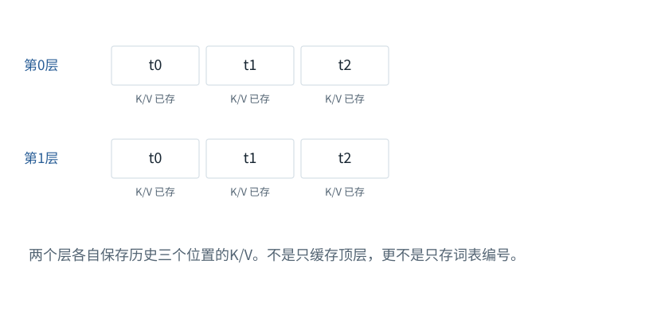
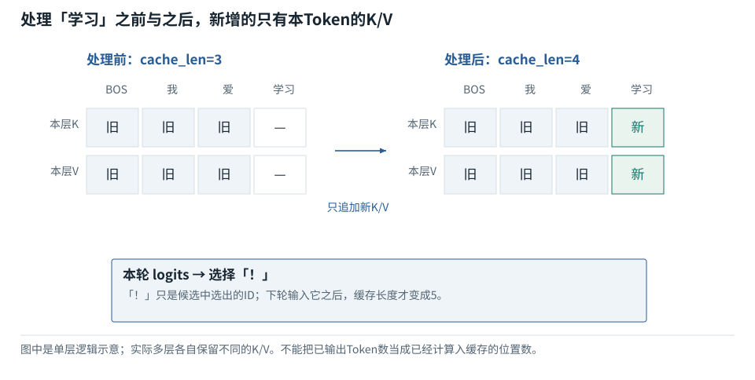
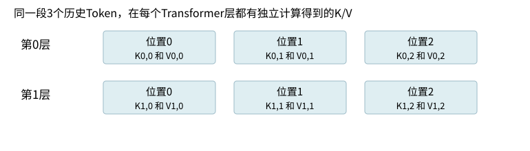

基础篇


<span id="foundations-16-s0"></span>


# F19｜KV缓存：在同一结果下复用历史计算

从具体对象与小例子开始，理解计算过程与适用条件。


<span id="course-connection"></span>


## 缓存是同一推理的等价实现，不是另一种模型

本节固定上一课的输入、已训练权重和选择规则。只改变是否复用已处理位置的K/V，并逐轮比较logits和缓存长度。开头的两层容量小例仅用于计算存储；贯通数值实验仍是一层模型，两者不混成同一张缓存记录。

本节会用到

[F11 · Attention逐步计算](11.md)[F12 · Mask不是黑箱](12.md)[F13 · 位置编号与RoPE](13.md)[F14 · 把Attention装进一层](14.md)[F18 · 从最后一排数到一个Token，再到一句回答](18.md)


<span id="visual-F16"></span>


动态图解 · F19


<span id="topic-1"></span>


## KV Cache：留下算过的，不省掉该读的

为什么少算了很多步骤，下一Token仍能看到历史？

缓存像保存已经整理好的历史资料，而不是每轮把历史丢掉。因果模型中，追加未来位置不会使旧位置突然能看到未来，所以原前缀的K/V可以复用。新位置仍逐层计算，也仍要从允许的历史位置读信息。

**K/V缓存**每层保存已处理位置的Key和Value。

**缓存失效**原来结果的前提改变，不能安全继续复用。

**重算**重新执行此前算过的部分运算。

**输入与适用条件：**本图用两层、三个历史位置演示状态；与F18单层小模型是不同教学结构，图内明确标层数。


<span id="topic-2"></span>


### 1 / 5 · 两层分别保存历史

停留时间 4.2秒7秒1.5秒

步骤 第1步，共5步

窄屏可左右滑动图形，或点击“放大图形”。文字解释紧随图后。



两个层各自保存历史三个位置的K/V。不是只缓存顶层，更不是只存词表编号。

`每层cache_len=3`

默认静止。用“下一步”看完解释再继续；播放到最后一步自动停止。键盘聚焦播放器后，可用左右键逐步查看、空格播放/暂停。图中颜色辅助区分，含义同时用文字注明。

JavaScript未启用；第一帧仍可阅读。完整图解页下方列出全部步骤说明。


<span id="topic-3"></span>


### 为什么需要

减少逐Token生成时对同一前缀的重复投影和逐位置加工。


<span id="topic-4"></span>


### 怎样实现

每层存K/V，下一步只计算新位置，并用正确的位置偏移和可见性关系读取。


<span id="topic-5"></span>


### 可能的代价与误解

内存随序列增长；低精度KV另有近似误差；跨用户共享还要隔离数据与权限。


<span id="topic-6"></span>


### 如何判断是否做对

固定参数和前缀，对比缓存版与全量前向；不要只比较生成的字是否碰巧相同。

[全部步骤与解释](../visual/F16.md)[F12 · Mask是可见性表，不是额外语义](../visual/F12.md)[O01 · GQA/MQA：减少的是K/V组数](../visual/O01.md)[O04 · FlashAttention：一边读一边累计，不攒整张表](../visual/O04.md)

机制来源：[[CACHE]](../visual/sources.md#s-CACHE)。数值和运行场景为本书明确设定的教学例；资料出处不代替本页中文解释。


<span id="foundations-16-s1"></span>


## 先从普通缓存的含义说起

你已经算出2×3=6，下一步再次需要同一个结果，可以保存6再用。**缓存（cache）**就是在条件未变时复用已有计算，避免重复工作。关键不是“保存了”，而是“保存的结果是否仍然对应当前条件”。


<span id="fdiag-16-01"></span>


先从普通缓存的含义说起：逐项辨别

|  |  |
| --- | --- |
| 对象一 | 普通缓存：保留结果 |
| 对象二 | KV缓存：保留每层K/V |
| 对象三 | 长期记忆：保留外部知识 |

**关键区别：**名字都叫缓存或记忆，但保存目标、生命周期和复用条件完全不同。

**容易误解：**KV缓存不是模型“已经学会”这段历史。


<span id="concept-intro-1"></span>


先认识这里的对象与符号

[Query、Key、Value：三种中间数值表示](../concepts.md#concept-qkv)
:   q是接收信息的一行查询表示；k是可读位置提供的一行匹配表示；v是该位置供混合的一行内容表示。大写Q/K/V把多行收集成表。它们由输入与参数计算得到，分别承担打分与提供内容的职责。某个q与两个k点积得到两个分数；softmax得到两个份额；这些份额分别乘两行v，再相加。这里不生成搜索词，也不直接选答案。

注意力中每层为已处理Token计算K和V，后面新Query需要读取这些历史K/V。保存它们，就叫**KV Cache**。


<span id="foundations-16-s2"></span>


## 为什么追加Token通常不改变旧K/V

以固定权重、确定性推理、因果注意力、按Token独立归一化的位置为前提：旧位置i只能读到它自己及之前的内容。你在末尾追加一个新Token，旧位置仍看不到这个未来位置。


<span id="fdiag-16-02"></span>


**关键区别：**在因果条件和位置不变时，旧Token看不到未来，因此旧K/V不必因追加而重算。

**容易误解：**编辑前缀中间内容会让受影响后缀缓存不再可靠。

因此旧位置第0层的输入没变，输出没变；第1层依赖的旧表示也没变，以此类推，每层旧K/V可保持不变。**这是依赖关系带来的可复用，不是模型在心里重新记住了全文。**

如果用了允许旧位置读取新后缀的双向注意力，或者把所有位置一起归一化，就不能直接使用这段论证。


<span id="core-cache-1"></span>


<span id="core-cache-1--mc-section-1"></span>


## 优化前先说明必须保持什么

以F18的“每轮完整重算”为基线，本课使用**完全相同的训练后参数、前缀、位置和贪心规则**。优化的目标是复用历史Key/Value，而不是改输出分布。若缓存路径与完整重算在允许数值误差内不一致，应先排错，不应把它当作合理的“另一个答案”。

依据：[tiny\_model.py:58–91](../reference/model-code.md#tiny_model-L58)；[对应参数、前向及梯度记录](../labs/model-values.md)。


<span id="core-cache-2"></span>


<span id="core-cache-2--mc-section-2"></span>


## 为什么旧位置的K/V可以留下来

因果模型中，旧位置只能看它自己及更早位置。追加新Token不会改变这些旧位置可见的前缀，因此在参数、位置编码、模式等条件固定时，旧位置表示和该层K/V不需要重新计算。

这是带条件的性质：修改历史中一个Token、改模型参数、切换位置设置或允许未来可见，都可能使相应缓存失效。多层每层还要缓存**各自**由本层输入计算的K/V，不能只留最顶层来代替所有层。

依据：[tiny\_model.py:58–91](../reference/model-code.md#tiny_model-L58)；[对应参数、前向及梯度记录](../labs/model-values.md)。


<span id="core-cache-3"></span>


<span id="core-cache-3--mc-section-3"></span>


## 三轮缓存账本

| 轮次 | 本轮输入 | 进入前缓存位置数 | 前向结束缓存位置数 | 本轮选中但尚未处理 |
| --- | --- | --- | --- | --- |
| 1 | [6, 1, 2] | 0 | 3 | 3 学习 |
| 2 | [3] | 3 | 4 | 5 ！ |
| 3 | [5] | 4 | 5 | 7 EOS |

第1轮prefill处理3项，缓存长度3，然后选中学习。第2轮只输入学习，给它绝对位置3，计算它的K/V并接到旧缓存后面，长度4，然后选中！。第3轮只输入！，位置4，缓存长度5，然后选中EOS并停止。**EOS被选中但未再前向，所以最终序列长度6，缓存长度5。**

依据：[tiny\_model.py:58–91](../reference/model-code.md#tiny_model-L58)；[对应参数、前向及梯度记录](../labs/model-values.md)。


<span id="trace-cache"></span>


**已处理的位置和刚选中的Token不是同一状态**



数据/调用方向以图中连线为准；参数与激活、训练与推理分别标注。

[SVG图源](../../diagrams/rendered/trace-cache-da5d801db260.svg)

代码路径：[tiny\_model.py:58–91](../reference/model-code.md#tiny_model-L58) · [Mermaid源文件](../diagrams/cache.mmd)。图的排布只表达数据／调用顺序，不代表计算耗时。


<span id="core-cache-4"></span>


<span id="core-cache-4--mc-section-4"></span>


## 新Query怎样读旧Key和新Key

第2轮只有一个新Query，Q长度1；K/V合并后长度4。注意力分数形状不再是方阵，而是 `[1,4]`（加批次即[1,1,4]）。它需要允许读取位置0—3全部四项。

第3轮同理是一个Query读取五个Key。用传统方阵的左上三角规则直接套 `[1,4]`，可能只允许第一项，结果虽能运行却已经错误。

第2轮缓存路径的实际对象

| 步骤 / 对象 | 本步实际变化 |
| --- | --- |
| 已有缓存 | 上一轮为位置0、1、2算好的K/V，参数仍为同一θ\*。 |
| 本轮输入 | 编号3=学习；position\_id=3，不是重新从0开始。 |
| 追加新K/V | 本轮计算k3/v3，合并成K/V位置0..3。 |
| 当前Query | 只计算q3，它读取K/V的四个位置，得到与完整四项重算相同的最后logits。 |
| 选择下一项 | 选中！；它还没有自己的缓存项。 |

缓存只省去历史重复表示计算；新Token的Embedding、每层计算与输出头仍需执行。

依据：[tiny\_model.py:58–91](../reference/model-code.md#tiny_model-L58)；[对应参数、前向及梯度记录](../labs/model-values.md)。


<span id="core-cache-5"></span>


<span id="core-cache-5--mc-section-5"></span>


## 不只单Token：一次输入两项怎么画mask

独立位置对照：已有3个位置缓存，一次新输入位置3、4，总Key长度5。第一新Query只能读0—3，第二可读0—4：

正确的非方阵允许表

| 对象／位置 | key位置0 | key位置1 | key位置2 | key位置3 | key位置4 |
| --- | --- | --- | --- | --- | --- |
| query绝对位置3 | 1 | 1 | 1 | 1 | 0 |
| query绝对位置4 | 1 | 1 | 1 | 1 | 1 |

只看这两行在新输入小矩阵里的局部行号0/1，会把因果关系放错。

依据：[tiny\_model.py:58–91](../reference/model-code.md#tiny_model-L58)；[对应参数、前向及梯度记录](../labs/model-values.md)。


<span id="core-cache-6"></span>


<span id="core-cache-6--mc-section-6"></span>


## 为什么通常不缓存旧Q

当前生成只需要新位置的输出，用新Q去比较所有需要的K。旧Q的旧输出已经用过，追加Token不要求重新输出它们。故典型自回归缓存保存K/V，不保留旧Q用于每次生成。但算法或输出需求不同可能另有状态，这不是“Q永远不能缓存”的普遍定律。

依据：[tiny\_model.py:58–91](../reference/model-code.md#tiny_model-L58)；[对应参数、前向及梯度记录](../labs/model-values.md)。


<span id="core-cache-7"></span>


<span id="core-cache-7--mc-section-7"></span>


## 省了计算，花了什么

KV体积近似 `2×层数L×批B×KV头数Hkv×缓存长S×每头宽D×每数Bytes`。贯通模型当前层1、批1、头1、S=5、D=4、float64=8字节，K/V原始数值共 `2×1×1×1×5×4×8=320` 字节；不包括Python对象、参数和其他临时内存。

依据：[tiny\_model.py:58–91](../reference/model-code.md#tiny_model-L58)；[对应参数、前向及梯度记录](../labs/model-values.md)。


<span id="core-cache-8"></span>


<span id="core-cache-8--mc-section-8"></span>


## 实测一致性与局限

随包三轮缓存和完整重算的最大logit差为 `[0.0, 0.0, 0.0]`；标准库独立前向与PyTorch结果也在浮点容差内一致。这不是GPU性能基准。是否加速取决于序列长度、内核、调度和硬件；缓存读取本身也可能成为带宽瓶颈。

依据：[tiny\_model.py:58–91](../reference/model-code.md#tiny_model-L58)；[对应参数、前向及梯度记录](../labs/model-values.md)。


<span id="foundations-16-s3"></span>


## 用两层、三个历史位置数清缓存

假设只有两层，每层单头，每个K或V是4个数，已处理3个位置。


<span id="fdiag-16-03"></span>


**关键区别：**KV数据是分层保存的；每层的K/V来自各自的隐藏状态。

**容易误解：**不能只保存最后一层K/V就认为后续层都可复用。


<span id="fboard-16-03"></span>


逐格算清：两层缓存为什么不能只保存一份



步骤 1第0层为历史位置0、1、2各自保存K和V。

步骤 2第1层也为位置0、1、2各自保存K和V。

步骤 3两层的K/V数值来自不同层的表示，不能只留下一份。

步骤 4新Token继续生成时，按层读取相应历史数据。

上层的K/V依赖上层输入表示，不等于直接复用底层的K/V；缓存要逐层保存。

数值除特别标注外来自本章已明确设定的教学条件；示意图表达算法结构，不代表商业模型参数或实时GPU执行速度。

```
第0层：K表[3,4]，V表[3,4]
第1层：K表[3,4]，V表[3,4]
```

共`2层×2种表×3位置×4数=48`个数。若每数4字节，数据本体192字节。

新Token到来时，第0层算出新K/V各一排4个数并追加；第1层在得到新的深层表示后追加自己的一排。它不是只在最顶层加一次缓存。各层参数不同，缓存来源也不同。


<span id="foundations-16-s4"></span>


## 为什么通常不保存历史Q来做后续注意力

新Token的输出需要新Q去匹配历史K，并加权历史V。旧Q已经完成旧位置的查询；预测新位置不需要再用旧Q生成全部旧位置输出，所以通常没有必要为这种增量计算保存所有旧Q。


<span id="fdiag-16-04"></span>


为什么通常不保存历史Q来做后续注意力：逐项辨别

|  |  |
| --- | --- |
| 方案／对象 A | 本轮Query仅用于本轮打分 |
| 方案／对象 B | 历史Key需被新Query比较 |
| 方案／对象 C | 历史Value需被取内容 |

**关键区别：**生成下一Token时要复用的是历史K/V；旧Q通常不再被下一步Query使用。

**容易误解：**“不缓存旧Q”不是绝对不允许，而是通常没必要。

这并不表示Q不重要或永远不能缓存，只是标准因果增量推理里复用历史K/V的收益更直接。


<span id="foundations-16-s5"></span>


## 有缓存为什么仍然不是常数时间

对每个新Token，你仍需计算新表示和投影；新Q还要读取越来越多历史K/V。历史越长，注意力读取与聚合的成本可能越高。KV缓存减少了旧Token在各层的重复前向，不是让长上下文的代价归零。


<span id="fdiag-16-05"></span>


**关键区别：**KV缓存减少重复处理旧Token，但新Token仍要读历史K/V。

**容易误解：**有KV缓存不等于生成每个Token都是常数成本。

也不能把KV缓存叫无损压缩的原文文件。它是特定模型、特定前缀、特定位置约定下的中间数值状态，不是通用可编辑知识库。


<span id="foundations-16-s6"></span>


## 缓存失效什么时候发生

改变权重、适配器或位置设置可能使缓存不再匹配。修改Prompt中间某位置后，该位置及依赖它的后续状态通常需要重算；修改之前的前缀是否能保留，取决于相同模型与输入条件是否仍成立。

对话摘要压缩改变了输入序列，不等于可以原样沿用旧KV。服务端Prompt Cache可能复用相同前缀计算，但它与应用层“写一份摘要”处在不同层面。


<span id="foundations-16-s7"></span>


## 一张表区分三种“记忆”

| 名称 | 保存什么 | 为何保存 |
| --- | --- | --- |
| KV缓存 | 某模型某前缀的各层K/V数值 | 避免重复前向计算 |
| 会话历史或摘要 | 文字、工具结果、任务进展 | 为下一轮提供条件 |
| 长期记忆 | 经筛选的跨会话事实与经验 | 将来按需检索使用 |


<span id="concept-intro-2"></span>


先认识这里的对象与符号

[FlashAttention：改变中间数据存取方式](../concepts.md#concept-flash)
:   通过分块和在线归一化等方式，避免把完整注意力分数/权重矩阵长期写到较慢显存；目标仍是同一个注意力运算，浮点舍入可随运算次序变化。它不是把Token永久压缩，也不是跳过所有Key。区分“不把整张表落显存”与“没有进行这些数学计算”。

[PagedAttention：分页管理K/V存储](../concepts.md#concept-paged)
:   把逻辑连续的K/V序列存到多个物理块，通过块表定位。它主要改变存储管理与共享方式，不把注意力公式替换成另一种语义算法。独立例：逻辑位置0—3在物理块7、4—7在块2；逻辑第4个位置不必物理紧跟第3个位置。

能够解释这张表，再去读FlashAttention、分页缓存和长任务压缩，才能避免把不同层面的优化混成一件事。


<span id="worked-F16"></span>


运行示例 · F19


<span id="topic-7"></span>


### 同一条历史为什么每层都要留一份K/V

局部核对例：以下输入以本例列出的条件为准，不能把它的中间值接到贯通模型的计算记录中。

**输入与条件。**教学模型有2层、1个KV头、每头2个数，已处理3个位置；每个数用FP32的4字节。

| 步骤与对象 | 内部动作 | 中间结果 / 新状态 |
| --- | --- | --- |
| 1数一层K | 3位置×2分量 | 6个数。 |
| 2加一层V | 同样6个数 | 每层K/V共12个数。 |
| 3乘两层 | 每层输入表示不同，投影权重也不同 | 总共24个数，即96字节。 |
| 4追加一个位置 | 两层分别增加K和V各2个数 | 共8个数，即32字节。 |
| 5新查询计算 | 每层新Q都读取该层4个Key | 旧Q不需要重算；但仍要读取历史K/V，不是常数成本。 |

**把过程连起来。**顶层缓存不能替代底层缓存：新Token进入底层时，就已经需要底层历史K/V。

**边界与反例。**本例只数K/V数据本体，忽略元数据。成立条件是固定权重、固定前缀及因果可见性。

[查看本例程序结果](../example-verification.md#result-F16) · [完整可运行代码](../example-verification.md#code)

依据与适用范围：[[CACHE]](../example-sources.md#ex-src-CACHE)。示例输入和场景由本书明确设定。


<span id="core-understanding-7"></span>


<span id="core-understanding-7--mc-section-7"></span>


## 追问：有了缓存，模型是否只看新Token？

它通常只为新Token计算新的位置表示和Query等，但新Query仍读取历史缓存K/V，历史仍参与输出。缓存不是压缩掉全部上下文，也不把历史知识永久写进参数。

依据：[tiny\_model.py:178–258](../reference/model-code.md#tiny_model-L178)；[对应参数、前向及梯度记录](../labs/model-values.md)。


<span id="self-check"></span>


## 课后自检

**自检 1**

**改了Prompt末尾一个Token后，能否无条件复用这一个位置的旧K/V？**

<details class="quiz-answer"><summary><span class="when-closed">查看参考答案</span><span class="when-open">收起参考答案</span></summary><div class="answer">不能。该位置的输入变了，旧K/V不再对应新输入。满足条件的更早前缀可另行判断复用。</div></details>

**自检 2**

**有KV缓存后，新Query还读历史吗？**

<details class="quiz-answer"><summary><span class="when-closed">查看参考答案</span><span class="when-open">收起参考答案</span></summary><div class="answer">要读。它通过历史K计算权重，并聚合历史V；缓存避免的是重新生成这些旧K/V。</div></details>


<span id="section-9"></span>


### 延伸阅读：相关系统问题

[06｜推理机制：加载、解码策略与连续生成](../chapters/06.md)  
[07｜KV Cache、FlashAttention与PagedAttention的内部过程](../chapters/07.md)  
[08｜推理服务：调度、吞吐、延迟和并行](../chapters/08.md)  
[14｜上下文压缩：到底压掉什么，丢失后又如何恢复](../chapters/14.md)  
[28｜研究深水区与系统综合判断](../chapters/28.md)

机制依据：[[F-CACHE]](../sources.md#src-F-CACHE)[[CACHE]](../sources.md#src-CACHE)。本节数值与情景除另注外均为原创教学示例；来源不代替中文讲解。

连续数值案例：[把同样两句话从Embedding一直算到输出概率，再验证KV缓存](../worked-model.md)。适合完成F01—F19后阅读。

**把模型切到新LoRA适配器，旧KV可以无条件继续使用吗？**

<details class="quiz-answer"><summary>查看参考答案</summary><div class="answer">不可以。参数或计算路径改变可能使历史K/V不再对应当前模型。缓存复用必须绑定模型、适配器、前缀、位置和相关运行设置。</div></details>


<span id="implementation-evidence"></span>


## 从本页解释到可检查的实现

| 要核对什么 | 事实与边界 | 本地依据 |
| --- | --- | --- |
| 前向、损失与更新 | 固定的一层四维教学模型；不是任何商业模型的完整实现。 | [tiny\_model.py · TinyLM](../reference/model-code.md#tiny_model-L33) |
| 独立前向实现 | 使用同一已保存权重，不使用PyTorch；用于复算而非另行训练。 | [reference\_inference.py · forward](../reference/model-code.md#reference_inference-L28) |
| 错误是否能被发现 | 因果性、梯度、标签移位、缓存位置均有正向检查和反例。 | [test\_model.py](../reference/model-code.md#test_model-L1) |
| 初始化的具体数字 | 所有参数均可查看；初值不等于训练后的参数。 | [weights\_initial.json](../reference/model-code.md#weights_initial-L1) |
| 实际运行记录 | 仅来自本地CPU微型实验；不能推出商业能力或GPU性能。 | [run.json 对应的数值记录](../labs/model-values.md) |


<span id="canonical-related"></span>


## 继续阅读与机制对应

| 页面 | 阅读关系 |
| --- | --- |
| [F18｜加载训练结果：逐个预测、选择与停止](18.md) | 上一节：复习本页使用的前置概念 |
| [F20｜低秩、量化、专家：先看究竟少算了什么](20.md) | 下一节：沿同一课程顺序继续 |
| [07｜KV Cache、FlashAttention与PagedAttention的内部过程](../chapters/07.md) | 系统机制：用源码、反例和条件深入核对 |

AI系统工程：从基础到内部  
[全书目录](../contents.md) · [术语与符号](../glossary.md) · [参考资料](../sources.md)