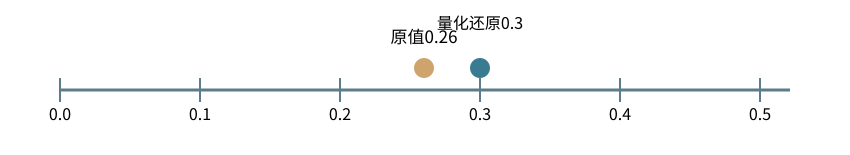

基础篇


<span id="foundations-20-s0"></span>


# F20｜低秩、量化、专家：先看究竟少算了什么

从具体对象与小例子开始，理解计算过程与适用条件。

本节会用到

[F07 · 模型最常做的算术](07.md)[F10 · 神经网络最小模型](10.md)[F16 · 一次训练从头到尾](16.md)[F17 · 后训练的前置数学](17.md)


<span id="visual-F20"></span>


动态图解 · F20


<span id="topic-1"></span>


## 省参数、省位数、少激活不是同一种优化

LoRA、量化、MoE到底各自省了哪一部分？

可以把系统的账分成三本：有多少参数要存、其中多少参数要更新、这次推理实际用到多少计算。LoRA主要减少需要训练的增量参数；量化改变数值存储表示；MoE选择部分专家计算。把它们统称“模型缩小了”会遗漏真正代价。

**低秩增量**用两张较窄矩阵表示权重变化，不是把整套基础权重删掉。

**量化**以有限刻度近似原数，可能有舍入和裁剪误差。

**专家**网络结构中的子网络，不天然对应某个人类专业。

**输入与适用条件：**本图比较技术作用对象；具体数值对照分别在O02量化、O03 LoRA、O08 MoE中声明独立输入。

按对象与证据阅读这段过程

| 观察点 | 本步含义 | 状态 / 范围 |
| --- | --- | --- |
| 原有大权重 | 先说你需要缩小的是哪本账，否则优化指标会错位。 | 参见本步解释 |
| LoRA | 原权重仍存在；训练梯度和优化器状态可只覆盖增量参数等可训练部分。 | 参见本步解释 |
| 量化 | 0.26按0.1刻度近似为0.3；如果任务对误差敏感，需要重新评估。 | 参见本步解释 |
| MoE | 每个Token可能路由到不同专家，通信与负载也随之变化。 | 参见本步解释 |
| 不同的账 | 一个方案可能同时省某本账、增加另一本账，不能用单个参数量概括。 | 参见本步解释 |
| 实际验收 | 用同等任务与硬件条件比较，不能把理论字节数当实际速度。 | 参见本步解释 |


<span id="topic-3"></span>


### 为什么需要

训练资源和推理资源有限，但不同瓶颈需要不同方案。


<span id="topic-4"></span>


### 怎样实现

先区分存储、求导、激活计算，再进入对应技术。


<span id="topic-5"></span>


### 可能的代价与误解

低秩容量有限、低精度有误差、专家路由有不均衡与通信。


<span id="topic-6"></span>


### 如何判断是否做对

分别计量峰值显存、延迟、吞吐、质量和训练可恢复性。

[全部步骤与解释](../visual/F20.md)[O02 · 量化：省存储，也引入近似](../visual/O02.md)[O03 · LoRA：冻结大表，学习小增量](../visual/O03.md)[O08 · MoE：每个Token选部分计算路径](../visual/O08.md)

机制来源：[[LORA]](../visual/sources.md#s-LORA) [[QLORA]](../visual/sources.md#s-QLORA) [[MOE]](../visual/sources.md#s-MOE)。数值和运行场景为本书明确设定的教学例；资料出处不代替本页中文解释。


<span id="foundations-20-s1"></span>


## “低秩”先用一张重复结构的表理解

看矩阵`[[1,2,3],[2,4,6]]`。第二行就是第一行乘2，所以两行不是两个独立方向。可以把它拆成：


<span id="fdiag-20-01"></span>


**关键区别：**只有足够的线性依赖时，低秩才能在小维度下准确表示。

**容易误解：**所有矩阵不一定都能无损变成秩1。

```
A = [[1],[2]]    B = [[1,2,3]]
AB = [[1,2,3],[2,4,6]]
```


<span id="concept-intro-3"></span>


先认识这里的对象与符号

[LoRA、低秩及r](../concepts.md#concept-lora)
:   LoRA用两个较小矩阵的乘积表示一部分权重增量，而不是重新训练整个大矩阵。r是中间维度，限制这个乘积的最大秩。不同资料采用行/列向量约定时，A、B的左右次序可能不同。右乘约定微例：W[4,6]，增量A[4,2]B[2,6]仍为[4,6]；r=2。A在这里不是注意力份额表。

**秩rank**粗略描述矩阵含多少个线性独立方向。上例秩为1。一般不是每张大表都能用很小秩精确表示；低秩近似会限制表示能力。


<span id="foundations-20-s2"></span>


## LoRA改的不是整个基础模型

设已有权重W形状`[d_in,d_out]`。LoRA冻结W，用较小的A=`[d_in,r]`、B=`[r,d_out]`表示一个增量`ΔW=AB`，再用`W+缩放×ΔW`计算。


<span id="fdiag-20-02"></span>


**关键区别：**LoRA保留原W，只学习低秩增量；需要训练的参数从64减至32。

**容易误解：**不等于运行时完全不需要原来的64个权重。

这里r远小于原尺寸时，需要训练的参数由`d_in×d_out`变为`d_in×r+r×d_out`。例如8×8矩阵64个数，r=2时增量32个数。不同文献采用列向量约定时可能写成BA，理解形状比只背字母顺序重要。

这不表示“模型知道的事实都被放在LoRA里”，也不表示训练整个过程只剩这点内存。基础权重、激活和其他状态仍存在。


<span id="foundations-20-s3"></span>


## 量化是在有限刻度上表示数字

**量化quantization**是用更少的数值表示位置近似原始值。一个教学规则是先除以尺度s、四舍五入到整数q，再用s×q近似还原。


<span id="fdiag-20-03"></span>


**关键区别：**量化把连续数值映射到有限刻度，节省存储但引入近似误差。

**容易误解：**实际还可能有裁剪、偏移量与分组尺度。


<span id="fboard-20-03"></span>


逐格算清：量化：0.26被映射到0.3，误差从哪里来



步骤 1选用量化尺度s=0.1，原始值x=0.26。

步骤 2先算x/s=2.6，四舍五入成整数q=3。

步骤 3还原得到q×s=0.3。

步骤 4误差是0.3−0.26=+0.04，低精度表示不等于原值完全不变。

尺度0.1使0.26/0.1=2.6，舍入到整数3，再乘0.1得到0.3；0.04就是这一过程引入的误差。

数值除特别标注外来自本章已明确设定的教学条件；示意图表达算法结构，不代表商业模型参数或实时GPU执行速度。

例如s=0.1，x=0.26，q=round(2.6)=3，还原0.3，误差0.04。实际量化还有范围裁剪、偏移、分组尺度和不同格式，不能拿这个最小例子代替全部实现。

权重量化缩小的是权重表示；KV量化缩小的是缓存表示；激活量化又是另一对象。写“4bit模型”不能自动推断所有运行内存都是4bit。

**QLoRA**组合了量化基础权重与参数高效微调等技术。它不等于把所有参与求导的数都用极低精度存储。


<span id="foundations-20-s4"></span>


## MoE为什么很多参数但只调用部分


<span id="concept-intro-2"></span>


先认识这里的对象与符号

[MoE、专家与路由器](../concepts.md#concept-moe)
:   MoE是包含多套子网络的模型结构；路由器为当前Token表示选择或加权少数专家。专家通常是数值子网络，不是被赋予“数学老师”等提示词的聊天Agent。独立例：有4个专家，每Token选2个，表示某次只激活其中2条专家路径；仍需保存模型设计要求的参数与路由状态。

**MoE（混合专家）**在一些层准备多组可选择的子网络，路由器根据当前Token表示选择部分专家计算，再合并结果。例如有8个专家，每个Token只选择2个。


<span id="fdiag-20-04"></span>


**关键区别：**MoE可增加总参数容量，同时降低每Token激活的专家计算。

**容易误解：**所有专家的参数仍需可用，并可能存在负载不均。

减少的是本次每个Token激活的专家计算，不是系统里完全不需要其他专家的参数。不同Token可以选不同专家，因此服务仍要能获得所需权重；还要处理负载不均和跨设备通信。

“专家”是结构名称，不天然意味着某组就是数学专家、某组就是情感专家。神经网络内部的MoE路由，与Agent根据任务选择另一个模型，是不同层面的路由。


<span id="foundations-20-s5"></span>


## 蒸馏与微调究竟在干什么

**蒸馏distillation**让学生模型学习教师的输出或分布等信号；教师可以提供训练目标，但学生仍需要训练和独立评估。教师的一次回答错误也可能被学进去。


<span id="fdiag-20-05"></span>


蒸馏与微调究竟在干什么：逐项辨别

|  |  |
| --- | --- |
| 方案／对象 A | 蒸馏：学生学教师行为 |
| 方案／对象 B | 微调：在已有模型上再训练 |
| 方案／对象 C | 检索：查询外部最新资料 |

**关键区别：**三个办法解决不同问题；实时事实通常更适合检索而非微调。

**容易误解：**教师答案可能错，蒸馏需要独立验证。

**微调fine-tuning**泛指在已有模型基础上继续训练部分或全部参数。它适合改变稳定的任务行为分布，不通常是同步实时业务事实的第一选择；实时事实更适合版本化检索。


<span id="foundations-20-s6"></span>


## Scaling Laws为什么不是永恒比例表

规模研究尝试拟合参数量、数据量和计算预算与损失之间的关系。在给定架构、数据和训练条件下，可以帮助分配预算。

把一个经验拟合比例当成所有模型的固定法则，会忽视部署成本、重复数据、数据质量和新架构。高级章节保留推导；基础上先懂“总参数、激活参数、训练参数、存储精度”四个量不是一回事。


<span id="concept-intro-1"></span>


先认识这里的对象与符号

[I：单位矩阵](../concepts.md#concept-identity)
:   I在矩阵公式里通常是单位矩阵：对角线为1，其他位置为0。尺寸合适时，向量或矩阵乘I保持数值不变。Wq=Wk=I是人为选择的特例，不能推断真实模型的投影都相同。独立微例：I=[[1,0],[0,1]]，[3,-2]I=[3,-2]。这里I不是字母i表示的位置下标。


<span id="worked-F20"></span>


运行示例 · F20


<span id="topic-7"></span>


### 三种“省参数/省存储”在同一张小表上有什么区别

**输入与条件。**低秩增量取列向量 `A=[[1],[2]]` 和行向量 `B=[[3,4]]`；量化取x=0.26、刻度s=0.1；专家路由有三个候选。

| 步骤与对象 | 内部动作 | 中间结果 / 新状态 |
| --- | --- | --- |
| 1低秩相乘 | 计算AB | 得到 `[[3,4],[6,8]]`；第二行是第一行2倍，因此秩1。 |
| 2加入基础权重 | 设W为2×2单位矩阵 | W+AB=`[[4,4],[6,9]]`；实际LoRA还有缩放约定。 |
| 3量化 | `round(0.26/0.1)` | 整数3，反量化0.3，误差0.04；不是无损改文件格式。 |
| 4选择专家 | 给定门控权重 `[0.6,0.3,0.1]`，只取前2 | 选专家0和1；若本实现重归一化，权重为2/3和1/3。 |
| 5混合输出 | 两专家分别输出 `[2,0]`、`[0,3]` | 结果 `[4/3,1]`；第3专家本次未计算，但参数仍存在。 |

**把过程连起来。**低秩改变可训练增量，量化改变数值表示，MoE改变本次激活哪些子网络。名称相近不代表省的是同一本账。

**边界与反例。**2×2秩1分解有4个参数，与原矩阵一样多，仅演示结构。真正参数节省需维度较大且r足够小；专家归一化是此例明确选定的策略。

依据与适用范围：[[DERIVE]](../example-sources.md#ex-src-DERIVE)。示例输入和场景由本书明确设定。


<span id="worked-X10"></span>


运行示例 · X10


<span id="topic-8"></span>


### 量化不只是舍入，还可能把超范围的数截断

**输入与条件。**人为定义五级量化器：缩放s=0.1，可存整数只有−2、−1、0、1、2。输入为[-0.24,0.03,0.26]。

| 步骤与对象 | 内部动作 | 中间结果 / 新状态 |
| --- | --- | --- |
| 1除缩放 | x/s=[−2.4,0.3,2.6] | 这还不是最终可存整数。 |
| 2四舍五入 | 本例均非恰好半整数，得到[−2,0,3] | 不依赖半整数的不同舍入约定。 |
| 3截断范围 | 最大只能存2 | 编码成为[−2,0,2]，第三项发生裁剪。 |
| 4反量化 | 编码再乘0.1 | 还原[−0.2,0,0.2]，误差[0.04,−0.03,−0.06]。 |
| 5检查原因 | 第三项原本舍入到0.3，但范围不允许 | 裁剪误差和一般舍入误差不能混为一谈。 |

**把过程连起来。**缩放、零点、整数范围、舍入方式和裁剪规则共同定义量化器，少说任何一个都可能无法复现。

**边界与反例。**这是五级教学量化，不是int8真实取值范围；也没有声称这些误差对应某个实际模型的精度损失。

[查看本例程序结果](../example-verification.md#result-X10) · [完整可运行代码](../example-verification.md#code)

依据与适用范围：[[DERIVE]](../example-sources.md#ex-src-DERIVE)。示例输入和场景由本书明确设定。


<span id="self-check"></span>


## 课后自检

**自检 1**

**LoRA冻结基础W，是否意味着前向不再使用W？**

<details class="quiz-answer"><summary><span class="when-closed">查看参考答案</span><span class="when-open">收起参考答案</span></summary><div class="answer">不是。前向通常仍用W及增量；冻结只是不更新W。</div></details>

**自检 2**

**8个专家每Token选2个，是否只需永久存2个专家？**

<details class="quiz-answer"><summary><span class="when-closed">查看参考答案</span><span class="when-open">收起参考答案</span></summary><div class="answer">不能这样推出。不同Token可能选择不同专家，运行环境仍需能够访问所有被选到的参数。</div></details>


<span id="section-8"></span>


### 延伸阅读：相关系统问题

[05｜后训练与模型定制：目标、结构和参数适配](../chapters/05.md)  
[08｜推理服务：调度、吞吐、延迟和并行](../chapters/08.md)  
[28｜研究深水区与系统综合判断](../chapters/28.md)

机制依据：[[LORA]](../sources.md#src-LORA)[[QLORA]](../sources.md#src-QLORA)[[V3]](../sources.md#src-V3)[[CHINCHILLA]](../sources.md#src-CHINCHILLA)。本节数值与情景除另注外均为原创教学示例；来源不代替中文讲解。


<span id="canonical-related"></span>


## 继续阅读与机制对应

| 页面 | 阅读关系 |
| --- | --- |
| [F19｜KV缓存：在同一结果下复用历史计算](19.md) | 上一节：复习本页使用的前置概念 |
| [F21｜算得快与装得下：复杂度、带宽、批处理和并行](21.md) | 下一节：沿同一课程顺序继续 |
| [05｜后训练与模型定制：目标、结构和参数适配](../chapters/05.md) | 系统机制：用源码、反例和条件深入核对 |

AI系统工程：从基础到内部  
[全书目录](../contents.md) · [术语与符号](../glossary.md) · [参考资料](../sources.md)