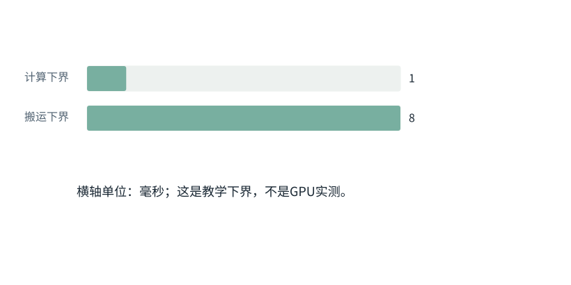

基础篇

# F21｜算得快与装得下：复杂度、带宽、批处理和并行

从具体对象与小例子开始，理解计算过程与适用条件。

本节会用到

[F06 · “放到设备”是什么](06.md)[F07 · 模型最常做的算术](07.md)[F19 · KV Cache从零解释](19.md)[F16 · 一次训练从头到尾](16.md)[F20 · 低秩、量化、专家](20.md)

动态图解 · F21

## 算得慢，可能是东西搬得慢

为什么一块算力更高的GPU，不一定让任务同比变快？

把GPU想成工厂只适合记住一个有限类比：运算像加工，读写像运输。加工设备翻倍但运输仍堵塞，整体不会同比快。真正的分析应回到运算数、搬运字节数、设备速率与测量，而不是只看某个宣传峰值。

**计算量**要做的运算总数。

**带宽**单位时间能搬运的字节数。

**吞吐**单位时间完成多少工作；不同于一条请求要多久。

**通信**数据在设备之间交换产生的成本。

**输入与适用条件：**固定教学任务与理想速率。第二、三帧是各自恢复基准后只改一个因素的独立对照；不宣称真实运行时间。

### 1 / 4 · 先问算力和搬运谁更慢

停留时间 4.2秒7秒1.5秒

步骤 第1步，共4步

窄屏可左右滑动图形，或点击“放大图形”。文字解释紧随图后。

教学任务：1,000,000次浮点运算；8,000,000字节搬运。假定算力10亿次/秒、带宽10亿字节/秒。

`计算=1ms；搬运=8ms`

默认静止。用“下一步”看完解释再继续；播放到最后一步自动停止。键盘聚焦播放器后，可用左右键逐步查看、空格播放/暂停。图中颜色辅助区分，含义同时用文字注明。

JavaScript未启用；第一帧仍可阅读。完整图解页下方列出全部步骤说明。

### 为什么需要

先定位主导瓶颈，才知道该优化矩阵计算、显存读写还是调度。

### 怎样实现

用分账估计指导Profile，再用同任务实测检查。

### 可能的代价与误解

提高吞吐可能增加单请求排队；分片省内存可能增加网络通信。

### 如何判断是否做对

观察端到端时间及各阶段Trace，避免只测某一个最快算子。

[全部步骤与解释](../visual/F21.md)[O04 · FlashAttention：一边读一边累计，不攒整张表](../visual/O04.md)[O05 · PagedAttention：逻辑连续，物理可以分块](../visual/O05.md)[O06 · 连续组批：有座位空出来，就接下一位](../visual/O06.md)[O09 · Activation Checkpointing：少存一点，反向时重算](../visual/O09.md)

机制来源：[[FLASH]](../visual/sources.md#s-FLASH) [[PAGED]](../visual/sources.md#s-PAGED)。数值和运行场景为本书明确设定的教学例；资料出处不代替本页中文解释。

## 先区分三本账

**计算量**是需要做多少次运算；**存储量**是要保存多少数据；**数据移动量**是需要在不同存储层或设备间搬多少数据。少存一些，不一定少算；增加并行，不一定让一个请求更快。

先区分三本账：逐项辨别

|  |  |
| --- | --- |
| 对象一 | 计算量：做多少运算 |
| 对象二 | 存储量：占多少字节 |
| 对象三 | 搬运量：读写多少字节 |

**关键区别：**算得快、装得下、搬得动是三本账，瓶颈可能完全不同。

**容易误解：**减少参数量不一定成比例减少端到端耗时。

先认识这里的对象与符号

[FLOPs与FLOP/s：数量与速率](../concepts.md#concept-flops)
:   FLOPs通常表示浮点运算数量；FLOP/s表示每秒的运算速率。论文或厂商对乘加计一次还是两次可能不同，需要固定口径。不能只用总运算量除理论峰值就承诺真实耗时：搬运、排队、通信和实际利用率也有成本。

**FLOP**常指一次浮点运算；**FLOPS**是每秒浮点运算数量。二者差一个S，却分别是工作量与速率。一次乘加是否计为两次FLOP要看统计约定。

## O(T²)到底是什么意思

**复杂度Big-O**描述输入规模变大时工作量增长的级别。若T个查询都要与T个Key比较，就有T²对关系。T翻倍，关系数变为4倍，因此常说注意力分数部分关于T是二次增长。

**关键区别：**这里说的是注意力分数配对数随长度的增长，不是所有计算都恰好4倍。

**容易误解：**Big-O描述增长级别，不是实际运行秒数。

这不是说某实现必然花T²秒，也不保证端到端时间刚好变4倍，因为硬件、隐藏宽度、内存移动和其他层也参与。写复杂度时应说明哪个变量在增长、其他什么暂时固定。

## 为什么存储足够也可能算不快

硬件有计算能力上限，也有每秒读取数据的**带宽**上限。若每读很多数据只做少量运算，可能被带宽限制；若数据能重复利用而计算很多，可能被计算能力限制。

为什么存储足够也可能算不快：逐项辨别

|  |  |
| --- | --- |
| 方案／对象 A | 计算下界：C/R |
| 方案／对象 B | 带宽下界：M/BW |
| 方案／对象 C | 总耗时至少受较大者约束 |

**关键区别：**想优化前先问真正瓶颈是运算能力还是内存带宽。

**容易误解：**实际还会有排队、调度与同步开销。

逐格算清：Roofline的直觉：时间由哪块短板决定

步骤 1假设计算操作的理论耗时下界是0.01秒。

步骤 2同一任务数据搬运的理论耗时下界是0.10秒。

步骤 3实际耗时至少不小于两者中更大的0.10秒。

步骤 4只把计算速度翻倍，可能仍被数据搬运瓶颈限制。

在这一假想条件下，搬运至少需要0.10秒，单纯把计算速度翻倍不一定明显改变整体耗时。真实测量还需计入排队和同步。

数值除特别标注外来自本章已明确设定的教学条件；示意图表达算法结构，不代表商业模型参数或实时GPU执行速度。

用粗略下界估算：任务做C次运算、移动M字节，计算速率R、带宽BW，耗时至少受到`max(C/R, M/BW)`约束。这类思路属于**Roofline（屋顶线）**分析。实际还有排队和同步开销，不能当精确计时公式。

## FlashAttention省的是什么

先认识这里的对象与符号

[FlashAttention：改变中间数据存取方式](../concepts.md#concept-flash)
:   通过分块和在线归一化等方式，避免把完整注意力分数/权重矩阵长期写到较慢显存；目标仍是同一个注意力运算，浮点舍入可随运算次序变化。它不是把Token永久压缩，也不是跳过所有Key。区分“不把整张表落显存”与“没有进行这些数学计算”。

普通概念实现会显式形成很大的T×T分数或权重表。FlashAttention通过分块等方法，在计算时管理局部块和归一化统计，避免把整张中间表反复存取外部显存。

**关键区别：**FlashAttention重排计算和数据访问，避免反复存取整张注意力矩阵。

**容易误解：**它不是“只读前几个Token”的近似注意力。

它没有简单把精确注意力变成只读几个Token，也不等于KV缓存。前者安排单次注意力计算的读写，后者跨生成步骤复用历史K/V。高级Q027会推导在线softmax，先用“同样目标，换一种中间存储和访问次序”理解它。

## PagedAttention与连续组批

**分页**把缓存切成固定大小的块，用映射表记住每条序列的逻辑块对应哪块物理存储，帮助管理不同长度请求和共享前缀。它与操作系统分页有相似管理思想，但具体对象是KV数据，不是整个程序的所有内存。

**关键区别：**PagedAttention让逻辑位置连续、物理块可分散，降低分配浪费。

**容易误解：**它不等于把整个神经网络都放进操作系统分页。

**连续组批continuous batching**允许某个请求完成后释放位置，再加入新请求，而不是整批必须同步结束。它可以提高资源利用，但prefill、decode、长短请求之间仍要调度。

## 多GPU到底切哪部分

先认识这里的对象与符号

[DP、TP、PP、ZeRO与FSDP](../concepts.md#concept-parallel)
:   数据并行让多份模型处理不同样本并同步梯度；张量并行拆分一次算子的参数/计算；流水线并行把不同层放不同设备。ZeRO/FSDP类技术还会切分参数、梯度或优化器状态。它们拆的对象不同：一层矩阵分两块，不等于把两个独立用户任务分给两位Agent。

| 方法 | 主要分法 | 你需要追踪的代价 |
| --- | --- | --- |
| 数据并行DP | 多份模型处理不同样本 | 训练时同步梯度等 |
| 张量并行TP | 拆矩阵或算子到多个设备 | 层内通信与组合 |
| 流水并行PP | 不同层放不同设备 | 阶段等待与传输 |
| ZeRO类分片 | 分摊训练参数、梯度或优化器状态 | 取用和同步开销 |

更多设备不是无条件加速。如果一次通信时间大于省下的计算时间，可能更慢。训练分片与推理分离服务也不能用同一个名词代替。

## 训练保存、推理缓存与检查点

先认识这里的对象与符号

[checkpoint：必须看保存的对象](../concepts.md#concept-checkpoint)
:   模型检查点保存权重或训练状态；激活检查点保存少量中间节点以便反向时重算；Agent任务检查点保存执行进展。三者同名，但恢复对象完全不同。看到checkpoint先问“恢复参数、重算激活，还是继续任务”。Agent保存摘要不会更新模型权重。

训练为求梯度可能保留激活；**activation checkpointing**保存部分节点、在反向时重算其他部分，用计算换内存。KV缓存则用内存换重复推理计算。它们甚至体现相反的资源取舍。

磁盘上的模型检查点保存恢复所需权重或训练状态；Agent任务检查点保存工作进展。名字都叫checkpoint，保存对象完全不同。

运行示例 · F21

### 先数计算与搬运，再决定是不是GPU算力不够

**输入与条件。**假想操作要做1,000,000次浮点运算，并搬运8,000,000字节。假想设备峰值100GFLOP/s、带宽10GB/s，单位按十进制。

| 步骤与对象 | 内部动作 | 中间结果 / 新状态 |
| --- | --- | --- |
| 1算纯计算下界 | `10^6/10^11`秒 | 0.00001秒，即10微秒。 |
| 2算纯搬运下界 | `8×10^6/10^10`秒 | 0.0008秒，即800微秒。 |
| 3取更大瓶颈 | 理想充分重叠时取max | 至少约800微秒，而不是10微秒。 |
| 4减少搬运 | 若融合操作只需4MB | 搬运下界约400微秒；算力没变也可能更快。 |
| 5改成平方配对 | T从100增到200 | 注意力位置对从10,000变40,000，不是只多一倍。 |

**把过程连起来。**“省内存读写”和“减少数学配对数量”是不同优化。不能看到GPU峰值很高就忽略搬运。

**边界与反例。**这些是理想化下界，不是实际性能；还未计调度、通信、核启动、缓存命中和重叠不足。

依据与适用范围：[[DERIVE]](../example-sources.md#ex-src-DERIVE)。示例输入和场景由本书明确设定。

## 课后自检

**自检 1**

**输入T翻倍，T×T关系数怎样变？是否代表整个系统必然慢4倍？**

查看参考答案收起参考答案

关系数变4倍；端到端耗时还取决于其他计算、硬件和调度，不能直接保证倍率。

**自检 2**

**FlashAttention、KV Cache和量化能互相替代吗？**

查看参考答案收起参考答案

不能。它们分别改变注意力中间计算与读写、历史计算复用和数字表示精度，作用对象不同。

### 延伸阅读：相关系统问题

[06｜推理机制：加载、解码策略与连续生成](../chapters/06.md)  
[04｜训练机制：损失、完整反向传播与参数更新](../chapters/04.md)  
[07｜KV Cache、FlashAttention与PagedAttention的内部过程](../chapters/07.md)  
[08｜推理服务：调度、吞吐、延迟和并行](../chapters/08.md)  
[25｜生产运行：Trace、成本、队列、灰度与回滚](../chapters/25.md)

机制依据：[[FLASH]](../sources.md#src-FLASH)[[PAGED]](../sources.md#src-PAGED)[[TP]](../sources.md#src-TP)[[ZERO]](../sources.md#src-ZERO)[[SRE]](../sources.md#src-SRE)。本节数值与情景除另注外均为原创教学示例；来源不代替中文讲解。

## 继续阅读与机制对应

| 页面 | 阅读关系 |
| --- | --- |
| [F20｜低秩、量化、专家：先看究竟少算了什么](20.md) | 上一节：复习本页使用的前置概念 |
| [F22｜Agent不是另一个神经网络：用一次读文件讲清循环](22.md) | 下一节：沿同一课程顺序继续 |
| [08｜推理服务：调度、吞吐、延迟和并行](../chapters/08.md) | 系统机制：用源码、反例和条件深入核对 |

AI系统工程：从基础到内部  
[全书目录](../contents.md) · [术语与符号](../glossary.md) · [参考资料](../sources.md)