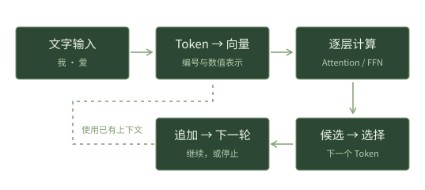
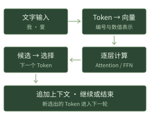

文档/教材概览

# AI 系统工程

从基础到内部：理解大语言模型怎样处理输入与生成输出，掌握智能体如何使用工具、管理上下文与记忆，并以可验证的方法改善工程质量。

[从第一章开始 →](foundations/01.md)[查看完整目录](contents.md)[继续上次阅读](foundations/01.md)

## 循序阅读

六组基础课程。先理解具体对象，再进入机制与工程取舍。

[F01—F06数字与输入表示文字、编号、形状、Embedding 与设备→](foundations/01.md)[F07—F19模型计算与生成矩阵运算、概率、Attention、生成与缓存→](foundations/07.md)[F15—F21训练与计算资源梯度、损失、后训练、量化与并行→](foundations/15.md)[F22—F27智能体执行与上下文请求、工具、协议、状态、上下文构建与压缩→](foundations/22.md)[F28—F34知识、协作与可靠交付检索、代码结构、记忆、多 Agent、恢复与测试→](foundations/28.md)[F35—F40评价与生产运行指标、统计、安全、观测、成本与系统判断→](foundations/35.md)

## 阅读工具

[动态图解逐步观察计算与状态变化](visual-guides.md)[交互实验修改输入，核对中间结果](labs.md)[术语与符号查阅定义与对应课程](glossary.md)[运行示例索引按问题定位完整算例](worked-examples.md)

正文与图解完整展开。  
自检答案按需查看。  
[前言与使用指南 →](preface.md)

## 十二个阅读主题

已有基础时，可以从一个具体问题进入。每个主题保留基础与深入两种本地入口。

主题 01

### Transformer：从表示到网络层

认识数字怎样排列、变换与组合。

[基础讲解 →](foundations/02.md)[深入阅读 →](chapters/02.md)

主题 02

### Attention：分数、权重与信息混合

从点积和加权平均进入注意力计算。

[基础讲解 →](foundations/07.md)[深入阅读 →](chapters/03.md)

主题 03

### LLM：输入、参数与输出

连接文字编码、模型计算和逐Token生成。

[基础讲解 →](foundations/01.md)[深入阅读 →](chapters/01.md)

主题 04

### Agent：模型、工具与执行循环

区分模型提出动作与程序真正执行。

[基础讲解 →](foundations/22.md)[深入阅读 →](chapters/09.md)

主题 05

### Codex：工具路由与上下文生命周期

结合协议基础阅读公开执行链与固定源码。

[基础讲解 →](foundations/23.md)[深入阅读 →](chapters/12.md)

主题 06

### Claude Code：状态与上下文管理

从任务状态理解公开产品机制及配置边界。

[基础讲解 →](foundations/24.md)[深入阅读 →](chapters/12.md)

主题 07

### 上下文工程：每轮输入的构建

解释信息选择、优先级、预算与证据。

[基础讲解 →](foundations/26.md)[深入阅读 →](chapters/13.md)

主题 08

### 上下文压缩：保留、替换与恢复

区分摘要、原始证据和执行状态。

[基础讲解 →](foundations/27.md)[深入阅读 →](chapters/14.md)

主题 09

### 检索工程：从索引到可靠证据

连接分块、召回、排序与条件核验。

[基础讲解 →](foundations/28.md)[深入阅读 →](chapters/16.md)

主题 10

### 记忆架构：事实、经历、流程与时间

理解跨任务信息的存取、冲突和失效。

[基础讲解 →](foundations/31.md)[深入阅读 →](chapters/18.md)

主题 11

### 工程环境：需求、测试与交付

用可检查的约束与反馈提高可靠性。

[基础讲解 →](foundations/34.md)[深入阅读 →](chapters/22.md)

主题 12

### Agent评测：成功、回归与成本

先明确指标分母，再评价方案收益。

[基础讲解 →](foundations/35.md)[深入阅读 →](chapters/23.md)

## 一条输入的旅程

从文字到数值表示，从逐层计算到选择下一 Token，沿流程定位正在阅读的知识。

[打开完整运行演示 →](visual/F15.md)

**一条输入的旅程**[打开完整动画 ↗](visual/F15.md)

先把文字组织成模型可接收的输入。这时，下一段回答还没有产生。

点击阶段，沿流程理解过程导览 · 非运行实测

## 进一步阅读

继续研究内部实现、综合案例与原始研究主题。

### 基础篇

40节课程，从文字、数字与形状，逐步进入模型、协议、检索、状态和评测。配有自检题，参考答案默认隐藏、按需展开。

[从F01开始 →](foundations/01.md) · [逐节图解](foundation-atlas.md)

### 系统篇

28章深入机制，围绕112个主问题展开计算过程、执行时序、实现边界与连续追问。

[进入系统篇 →](chapters/01.md)

### 综合案例与实验

贯穿生成、仓库修复、知识流与系统诊断，配合交互实验和可运行程序核对中间结果。

[查看完整案例 →](walkthroughs/a.md)

### 专题研修与拓展阅读

进一步研究代码实现、故障恢复、应用设计与原始研究主题，可按需要选读。

[专题研修 →](studies/index.md) · [拓展阅读 →](reading-notes/index.md)

[正文图解与细算索引](mechanisms/index.md) · [图解来源与版本范围](mechanisms/sources.md)

**AI 系统工程 · 从基础到内部**  
中文离线教材 · 基础概念、内部机制、工程实践