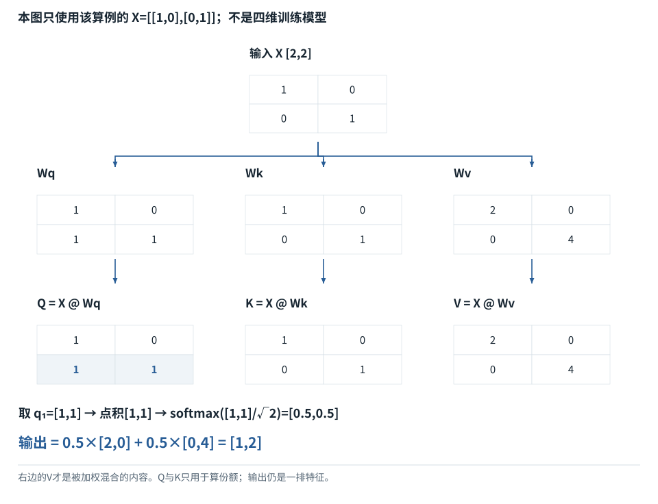

拓展阅读


<span id="section-0"></span>


# 注意力机制，逐步算清

手算 Q、K、V、softmax 和因果掩码。

推荐阅读 02 / 12本地中文导读

对应资料：Attention Is All You Need [[S008]](sources.md#S008)


<span id="visual-reading"></span>


<span id="topic-1"></span>


## 沿着对象与状态理解本章

先在可见性表里选一个查询行，决定哪些Key位置允许参与；再看如何缩放和混合。多头改变表示的分组方式，位置旋转改变Q/K的比较，反向传播计算参数的影响，三者不是同一个步骤。

下方图解的固定输入在“输入与适用条件”中声明。它用于解释本章机制，不与本章其他独立例子的数值暗中接续。


<span id="visual-F12"></span>

<span id="topic-2"></span>

<span id="topic-3"></span>

<span id="topic-4"></span>

<span id="topic-5"></span>

<span id="topic-6"></span>

<span id="topic-7"></span>


相关动态过程：[Mask是可见性表，不是额外语义](../visual/F12.md)。本节下文继续展示更具体的计算与工程边界。

继续看相关机制：[F13 · 位置怎样进入数值计算](../visual/F13.md)[O01 · GQA/MQA：减少的是K/V组数](../visual/O01.md)[F15 · 梯度像坡度，学习率像迈步大小](../visual/F17.md)


<span id="g02-section-1"></span>


## 注意力公式的每个量对应什么


<span id="concept-intro-2"></span>


先认识这里的对象与符号

[Query、Key、Value：三种中间数值表示](../concepts.md#concept-qkv)
:   q是接收信息的一行查询表示；k是可读位置提供的一行匹配表示；v是该位置供混合的一行内容表示。大写Q/K/V把多行收集成表。它们由输入与参数计算得到，分别承担打分与提供内容的职责。某个q与两个k点积得到两个分数；softmax得到两个份额；这些份额分别乘两行v，再相加。这里不生成搜索词，也不直接选答案。

本篇对应《Attention Is All You Need》的核心机制。设三个Token的当前表示为矩阵X，投影得到Q、K、V。Query用来与Key匹配，匹配权重再作用于Value。它是模型内部连续计算，不是外部数据库检索。[[S008]](sources.md#S008)


<span id="concept-intro-1"></span>


先认识这里的对象与符号

[Wq / W\_Q：查询投影参数](../concepts.md#concept-q-projection)
:   这是把输入表示变为Query的参数矩阵，不是Query本身。按本书右乘约定，输入每行d个数、Wq有d行d\_k列，Q=XWq后每行有d\_k个数。下标q表示用途，不表示再乘一个q。同一Wq可处理多个位置；每个位置得到自己的q。F11给出X、Wq和每个乘加结果。

[Wk / W\_K：键投影参数](../concepts.md#concept-k-projection)
:   这是生成Key表示的模型参数表。K=XWk中的X来自当前注意力输入，K是这次算出的结果；Wk不是保存文档关键词或密钥的表。Q与K每行宽度要相同，才能做点积。在F11，x₁=[1,-1]乘Wk得到k₁=[0,1]。不是把原来的Token ID拿来当Key。

[Wv / W\_V：值投影参数](../concepts.md#concept-v-projection)
:   这是从输入生成Value内容向量的模型参数表。V=XWv之后，Attention按读取份额混合V的各行。Value的宽度d\_v可与Query/Key宽度d\_k不同；它不是最终词表答案。F11中同一x₁=[1,-1]乘Wv得到v₁=[0,20]，再参与加权求和。

[d\_k、d\_v、Dh：每行表示的宽度](../concepts.md#concept-dk)
:   d\_k表示一个Query/Key向量有多少个分量；d\_v表示一个Value向量有多少个分量。Dh或d\_h在一些章节中是单头宽度。它们是尺寸整数，不是第k个Key或某个Value数值。形状微例：Q[2,3]、K[5,3]、V[5,4]，则分数[2,5]，输出[2,4]。Q/K配对宽度3，Value宽度4仍合法。

```
Q = X Wq       K = X Wk       V = X Wv
scores = Q Kᵀ / √d_k
weights = softmax(scores + mask)
output = weights V
```

如果X有n行，每行隐藏维度d，Q和K每个头有d\_k维，那么`QKᵀ`是`n×n`。它描述查询位置与被查询位置的配对分数。检查维度是理解公式最有效的方法之一。


<span id="g02-section-2"></span>


## 手算一次组合

以下全部数值为原创教学例子。假设某位置对三个可见位置的分数是`[0,1,2]`。指数约为`[1,2.718,7.389]`，归一化后权重约为`[0.0900,0.2447,0.6652]`。若Value某一维是`[10,20,30]`，该维输出约为25.75。

输出不是直接复制30，而是加权组合。最高权重提供主要贡献，但另外两个仍有作用。真正模型还有多个头、残差和后续层，因此某个注意力最大位置不能完整解释最终回答。


<span id="mechanism-G02"></span>


<span id="topic-8"></span>


### 从同一份X算三条支路，再得到一个具体输出

**本例条件：**独立两位置算例：X=[[1,0],[0,1]]；Wq=[[1,0],[1,1]]，Wk=单位矩阵，Wv=[[2,0],[0,4]]。只计算位置1的因果注意力，两个位置均可见，d\_k=2。

Wq/Wk/Wv
:   固定的乘法系数表，本次前向不更新。

q₁
:   位置1从Wq支路得到的一排数。

读取份额
:   本次输入动态算出的值，不是参数表。

**从同一份X算三条支路，再得到一个具体输出**



本图仅使用当前算例声明的输入；具体公式、来源和边界见紧邻正文。

[SVG图源](../../diagrams/rendered/Q006-3be14f581451.svg) · [原算例数据：Q006](../../diagrams/source/mechanism-cases.json)

核对完整输入与结果

本图使用的数据与条件

| 对象 | 两行数据或当前行 | 下一步用途 |
| --- | --- | --- |
| Q=XWq | [[1,0],[1,1]] | 取q₁=[1,1] |
| K=XWk | [[1,0],[0,1]] | 逐行与q₁点积 |
| V=XWv | [[2,0],[0,4]] | 提供待混合的内容 |
| 缩放后的分数 | [1/√2,1/√2] | 相等→softmax=[0.5,0.5] |
| 位置1输出 | 0.5×[2,0]+0.5×[0,4]=[1,2] | 仍是数值表示，不是文字 |

#### 怎样把图中的变化读明白

X第二行是[0,1]，所以乘Wq等于取Wq第二行[1,1]。这一步把“参数表”和“本次算出的q”连起来。

q₁与两行K的点积都为1，缩放后仍相等，所以各占一半。并不是因为我们事先规定“各读一半”。

份额决定怎么读，V决定读进来什么。只把Wv第二行改成[0,8]，Q/K和份额不变，输出却变成[1,4]。

**不要混淆：**这个单头微型例没有完整模型的多层、位置旋转与输出头；它证明分工和计算，不证明模型理解了句子的语义。

机制依据：[[TR]](../sources.md#src-TR) [[F-LINALG]](../sources.md#src-F-LINALG)。本例数字和宿主场景为明确给定的教学设定，不是商业模型输出或生产性能测量。


<span id="g02-section-3"></span>


## 加上因果掩码会怎样

假设当前位置只能看到前两个位置，第三个分数被掩码设为负无穷。softmax后第三个权重为零，前两个重新归一化为约`[0.269,0.731]`。Value第三项不应影响这个位置的输出。

这提供一个可测试性质：改变未来Value，当前因果输出应保持不变。配套实验用小矩阵验证这一点，不需要训练模型，也不声称复现任何商业模型的内部数值。


<span id="g02-section-4"></span>


## 多头、位置与前馈为什么还需要

不同头使用不同投影，提供多个关系子空间；位置机制提供顺序信息；前馈网络对组合后的特征做非线性处理。它们共同形成表达能力，不能把模型简化成一个相似度矩阵。[[S008]](sources.md#S008)[[S012]](sources.md#S012)


<span id="concept-intro-3"></span>


先认识这里的对象与符号

[MHA、MQA、GQA：头怎样共享](../concepts.md#concept-heads)
:   一个注意力头是一套匹配并聚合内容的路径。MHA常让每个Query头有自己的K/V头；MQA让多个Query头共用一组K/V；GQA在两者之间，分组共享。它们是结构选择，不是运行时随便改一个开关。独立形状例：8个Query头、2个K/V头，若均匀分组，每4个Query头共享1组K/V；缓存按K/V头数记账。

[MoE、专家与路由器](../concepts.md#concept-moe)
:   MoE是包含多套子网络的模型结构；路由器为当前Token表示选择或加权少数专家。专家通常是数值子网络，不是被赋予“数学老师”等提示词的聊天Agent。独立例：有4个专家，每Token选2个，表示某次只激活其中2条专家路径；仍需保存模型设计要求的参数与路由状态。

GQA让多个查询头共享较少KV头，影响缓存成本；MoE改变前馈专家的选择。二者都属于模型内部结构，和外部多个Agent协作不是一回事。[[S013]](sources.md#S013)[[S014]](sources.md#S014)


<span id="g02-section-5"></span>


## 两个常见误解

**“注意力权重就是模型置信度。”**不是。它是某层某头的信息组合权重，并非最终答案正确概率。

**“有注意力就不会遗漏输入。”**不是。计算允许信息交互，不保证训练后的网络对所有复杂约束都可靠使用。长上下文研究必须通过任务表现评价。[[S085]](sources.md#S085)[[S088]](sources.md#S088)

完成本篇后，应能追踪矩阵形状、解释Mask、手算softmax，并知道公式没有承诺哪些能力。

继续深入：[第1章 · 模型内部](chapter-01.md)　或阅读[拓展阅读目录1.3的逐项讲义](chapter-01.md#m-01-03)。所有链接均为本地内容。


<span id="worked-G02"></span>


运行示例 · G02


<span id="topic-9"></span>


### 从两段内容到一个混合向量，而不是选中一句话

**输入与条件。**当前查询 `q=[1,0]`，可见Key为 `k0=[1,0]、k1=[0,1]`，对应Value为 `v0=[10,0]、v1=[0,20]`。每头宽度2。


<span id="mechanism-original-worked-G02"></span>


| 步骤与对象 | 内部动作 | 中间结果 / 新状态 |
| --- | --- | --- |
| 1匹配 | 分别算q与两个Key的点积 | 得到 `[1,0]`。 |
| 2缩放 | 两个分数都除以√2 | 约 `[0.707107,0]`。 |
| 3归一化 | 对两个可见位置做softmax | 约 `[0.669762,0.330238]`。 |
| 4混合第1个特征 | 用两份Value的第1格加权 | `0.6697615493×10+0.3302384507×0≈6.697615`。 |
| 5混合第2个特征 | 用两份Value的第2格加权 | `0.6697615493×0+0.3302384507×20≈6.604769`。 |
| 6得到输出 | 把两格放一起 | 约 `[6.697615,6.604769]`，不是任何一份原始Value。 |

**把过程连起来。**匹配分数决定读取份额，Value决定混合什么。只改Value时，读取份额可以完全不变，但输出会变。

**边界与反例。**直接给Q/K/V以隔离注意力运算；真实网络还需先由输入投影得到它们。

依据与适用范围：[[SDPA]](../example-sources.md#ex-src-SDPA)。示例输入和场景由本书明确设定。

AI系统工程：从基础到内部  
[全书目录](../contents.md) · [术语与符号](../glossary.md) · [参考资料](../sources.md)