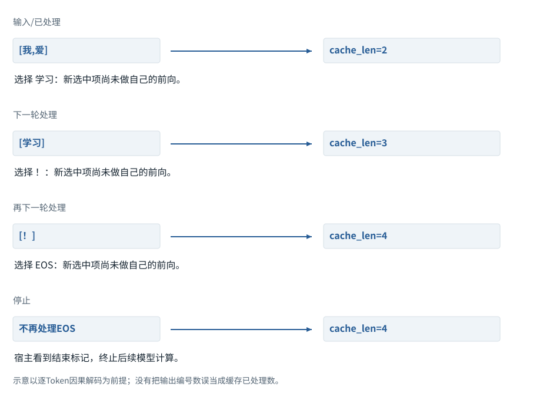
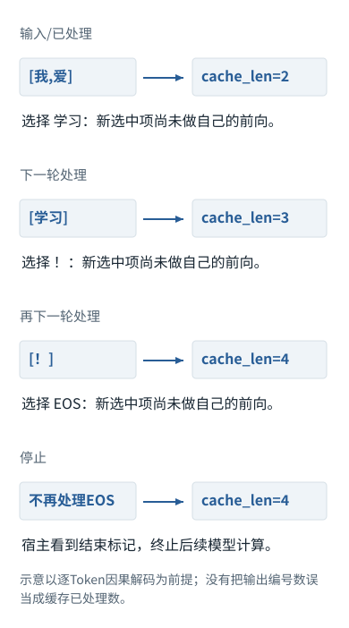

拓展阅读

# LLM 的完整使用链路

把 Tokenizer、模型、训练与推理接口连接起来。

推荐阅读 03 / 12本地中文导读

对应资料：Hugging Face LLM Course [[S001]](sources.md#S001)

## 沿着对象与状态理解本章

先沿着实际对象追踪：用户文字不是消息包，消息包不是Token数组，编号也不是Embedding。把这四种对象分别认出来，后面的shape和API角色才有落点。下图的词表是独立教学约定；不要把它当成所有Tokenizer的真实结果。

下方图解的固定输入在“输入与适用条件”中声明。它用于解释本章机制，不与本章其他独立例子的数值暗中接续。

相关动态过程：[文字、字节、Token、编号是四件事](../visual/F03.md)。本节下文继续展示更具体的计算与工程边界。

继续看相关机制：[F04 · 组批没有把两句话混成一句](../visual/F04.md)[F05 · Embedding是查一行，不是把编号转二进制](../visual/F05.md)[F18 · 一次输入如何连着预测，直到结束](../visual/F15.md)

## 从工具生态建立模型使用全景

本篇对应Hugging Face LLM Course的入门主题。使用一个高层pipeline时，应继续理解编码、模型前向和后处理，避免把接口输出当作不可分析的黑盒。[[S001]](sources.md#S001)[[S001]](sources.md#S001)

Tokenizer负责离散编码；模型参数决定运算；任务头决定输出形式；生成策略决定怎样选择后续Token。分类、Embedding提取与文本生成不是同一任务，即使它们使用相似的Transformer底座。

## 一次输入输出的检查顺序

先确认使用的模型与Tokenizer是否配套，再检查输入长度和特殊Token，然后看模型输出的形状与任务含义，最后检查后处理与停止状态。

原创例子：模型返回一个维度为词表大小的分数向量，它可能是下一Token Logits，而不是整个句子的质量评分。将最大分数当作事实置信度，会从接口理解阶段就产生错误。

### 刚选出的Token，还没进入自己的那一轮计算

**本例条件：**教学序列先输入[我,爱]，随后人为规定解码器依次选择[学习,！,EOS]。图只核对时间与缓存长度，不把这个选择序列冒充训练结果。

已处理
:   这个Token已通过Embedding与全部层。

已选择
:   从上一轮分布选中，但未必做过自己的前向。

缓存长度
:   已经处理的历史位置数。

**刚选出的Token，还没进入自己的那一轮计算**

本图仅使用当前算例声明的输入；具体公式、来源和边界见紧邻正文。

[SVG图源](../../diagrams/rendered/Q013-29eab8f366b9.svg) · [原算例数据：Q013](../../diagrams/source/mechanism-cases.json)

核对完整输入与结果

本图使用的数据与条件

| 时刻 | 本次送入模型 | 前向结束后的状态 |
| --- | --- | --- |
| Prefill | 我、爱 | 缓存2；选出学习 |
| Decode 1 | 学习 | 缓存3；选出！ |
| Decode 2 | ！ | 缓存4；选出EOS |
| 停止检查 | EOS不再送入模型 | 缓存保持4；终止续写 |

#### 怎样把图中的变化读明白

第一行结束时界面可能已经显示“学习”，但缓存仍只有“我、爱”。选择与处理发生在相邻两轮之间。

下一轮只送“学习”时，旧信息从各层KV中来；并不是模型只看这一个Token就猜下一个。

EOS被选中后通常直接停止，本例没有再把EOS处理一轮。输出数量、可见文字数量和缓存长度因此可能不同。

**不要混淆：**把新Token计入缓存后又把它当新输入送一次，会重复追加；必须用实际处理日志，而非屏幕字数更新位置。

机制依据：[[CACHE]](../sources.md#src-CACHE) [[GENERATION]](../sources.md#src-GENERATION)。本例数字和宿主场景为明确给定的教学设定，不是商业模型输出或生产性能测量。

## 训练、微调与推理怎样区分

训练用损失与梯度更新参数；微调在已有参数基础上适应特定目标；推理通常只计算输出，不执行参数学习。少样本示例改变当前输入，不等于微调。[[S024]](sources.md#S024)[[S015]](sources.md#S015)

框架的模型对象可以被用于训练或推理，但运行模式、梯度图和数据用途需要明确。一个模型在聊天后表现不同，可能只是上下文改变；不要自动推断权重已经更新。

## 数据也有生命周期

准备数据要考虑来源、清洗、去重、切分和版本。训练集用于更新，验证集用于开发选择，独立测试集用于评价。反复根据测试集改模型，会让测试失去独立性。[[S022]](sources.md#S022)[[S023]](sources.md#S023)[[S005]](sources.md#S005)

原创例子：同一README的两个近似版本分别进入训练和测试，表面上是不同文件，内容却可能大量重叠。模型成功不一定证明能够理解全新项目。

## 模型为什么还需要Agent

模型接口能生成内容，但不会自动管理工具、权限、执行状态和验收。Agent把这些外围部件连接成循环。一个分类pipeline通常不需要复杂Agent；一个未知Bug调查可能需要多轮取证与行动。[[S003]](sources.md#S003)[[S055]](sources.md#S055)

**练习：**把“判断日志类别”和“修复导致日志出现的Bug”分别画成系统。前者可能是一次编码和分类，后者需要检索、修改、测试和恢复。两者都用LLM，不意味着应该拥有相同架构。

完成本篇后，应该能把一次高层调用拆开，并说明何时只需要模型、何时需要外部执行系统。

继续深入：[第0章 · 全局认知](chapter-00.md)　或阅读[拓展阅读目录0.1的逐项讲义](chapter-00.md#m-00-01)。所有链接均为本地内容。

运行示例 · G03

### 同一句“读取配置”，在四个对象中各是什么

**输入与条件。**假设仓库有一个文件 `config.txt`，真实内容是 `timeout=3`。用户要求：“告诉我超时值。”模型和文件之间并没有天然连接。

| 步骤与对象 | 内部动作 | 中间结果 / 新状态 |
| --- | --- | --- |
| 1用户输入 | 界面接到“告诉我超时值” | 这是一条任务，不是文件内容。 |
| 2组装请求 | 宿主提供任务和 `read_file(path)` 的说明 | 模型此时知道怎样提出读取请求，但还不知道文件里写什么。 |
| 3模型输出 | 产生调用提议 `read_file("config.txt")` | 提议是一份数据，文件尚未因此被读取。 |
| 4工具执行 | 程序读取磁盘，返回 `timeout=3` | 新事实第一次由外部环境进入任务。 |
| 5再调用模型 | 把原问题、调用记录和结果一起提交 | 模型可以回答“配置中的超时值为3”；本例没有说明单位，不能擅自补“秒”。 |

**把过程连起来。**文字、模型计算、工具调用提议和磁盘操作是四个不同对象。跟踪谁产生了每份数据，就能判断有没有证据。

**边界与反例。**这是按接口职责构造的执行示例，不是一次真实商业模型请求。文件里的数字若没有单位，答案也不能替它添加单位。

依据与适用范围：[[TOOLS]](../example-sources.md#ex-src-TOOLS)。示例输入和场景由本书明确设定。

AI系统工程：从基础到内部  
[全书目录](../contents.md) · [术语与符号](../glossary.md) · [参考资料](../sources.md)