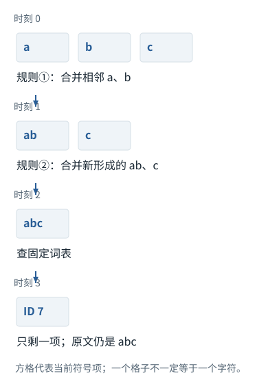
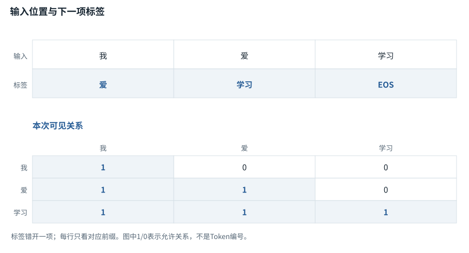
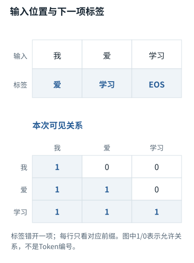

专题研修


<span id="section-0"></span>


# 01｜文本怎样成为概率：Tokenizer、模板、目标函数与梯度

> 本章目标：能够自己写出编码、标签移动、损失计算和梯度检查；能定位“相同一句话，在不同客户端得到不同行为”究竟发生在哪一层。先修：数组、矩阵乘法、导数。实验：[`numerics.py`](../code/numerics.md)、[`train_tiny_lm.py`](../code/train_tiny_lm.md)。


<span id="visual-reading"></span>


<span id="topic-1"></span>


## 沿着对象与状态理解本章

目标函数把“希望出现哪个后继Token”变成可优化数值；先固定标签位置，再区分概率、负对数与梯度。

下方图解的固定输入在“输入与适用条件”中声明。它用于解释本章机制，不与本章其他独立例子的数值暗中接续。

继续看相关机制：[F27 · 压缩要保留行动所依赖的事实](../../visual/F27.md)[F29 · 从两个候选列表，走到可用证据](../../visual/F29.md)


<span id="c01-h1"></span>


## 1. 先分开五种完全不同的对象


<span id="symbol-intro-1"></span>


先认识这里的对象与符号

[JSON：结构化文本，不是执行动作](../../concepts.md#concept-json)
:   JSON是一种用对象、数组、字符串、数字等表达数据的文本格式。花括号对象把字段名映射到值，方括号数组保留项目顺序。解析JSON只得到数据，不会自动执行其中的工具名称。独立例：{"path":"a.py","limit":3}有两个字段；"3"是字符串而3是数值，Schema可以要求其中一种。

用户可见的字符串、客户端消息对象、服务端序列化模板、Token ID序列、模型中的浮点张量，不是同一个对象。客户端可能发送带有`role`和`content`的JSON；服务将角色、工具调用、图像等组织成模型训练时约定的表示，再进行相应编码。开放模型的聊天模板能够直接检查；闭源服务的全部最终模板通常不对客户端公开。不能把API请求日志称为“模型完整的原始输入”。[[N01]](../sources.md#N01 "本地来源与核查范围")[[N13]](../sources.md#N13 "本地来源与核查范围")

例如同样是“读取config.py”，普通用户文本只是在请求一个动作；同一字符串放在工具返回字段中，语义上是外部数据。模板使模型学习角色差异，但角色不是CPU硬件权限位。真正是否允许读取文件，仍要由执行器检查。把角色机制误当成权限机制，是从底层认识错误一路传到工程风险的典型例子。

理解输入时应保存三个层次的可观测证据：应用提交的消息与工具版本、可见的Token用量、工具执行结果。不应伪造不可见的服务端提示或内部推理。调试本地开放模型时，才可以额外对模板渲染结果和精确Token序列逐项比较。


<span id="c01-h2"></span>


## 2. BPE到底在做什么

将UTF-8字节作为初始符号，可以从最细粒度建立可逆编码。训练BPE时统计相邻符号对，选择高频对合并为新符号，重复形成有顺序的合并规则。推理时不是重新统计用户输入决定词表，而是应用已经训练好的规则。实验中的小型实现按规则顺序扫描，相当于一个易读但低效的教学实现；生产实现还需要预切分、特殊Token、缓存和高效数据结构。

假设训练样本反复含有`routing`、`route`、`router`，常见片段可能被压为较少符号。但这不能保证任意新标识符也很省Token。中文字符可能跨多个字节；字节级可逆性保证重建原字节，不保证每个Token都对应完整可显示字符。输出流还可能在UTF-8字符中间截断，所以网络增量解码必须独立维护字节状态，见第07章。


<span id="concept-intro-5"></span>


本书`bpe_train`与`bpe_encode`的验收不是“看起来切得合理”，而是对中英混合、代码、空格、换行做`decode(encode(text)) == text`。缩短重复字符串是第二项性质，不能替代可逆性。编码改变意味着词表、模型输入嵌入、输出层和训练数据解释都可能改变，不是一个能随意热替换的字符串压缩器。


<span id="mechanism-S01-2"></span>


<span id="topic-2"></span>


### BPE的合并次序，决定后面还能合并什么

**本例条件：**独立教学编码器：初始符号为a、b、c；合并优先级固定为①(a,b)→ab，②(ab,c)→abc；词表规定abc的ID为7。不是实际中文分词器。

优先级
:   编码时执行的既定规则顺序。

相邻
:   只有当前序列中紧挨着的两项才可合并。

ID
:   合并完成后查到的词表编号。

**BPE的合并次序，决定后面还能合并什么**




本图仅使用当前算例声明的输入；具体公式、来源和边界见紧邻正文。

[SVG图源](../../../diagrams/rendered/Q002-18f29f417d2f.svg) · [原算例数据：Q002](../../../diagrams/source/mechanism-cases.json)

核对完整输入与结果

本图使用的数据与条件

| 时间 | 当前符号序列 | 可执行的规则 |
| --- | --- | --- |
| 编码开始 | [a] [b] [c] | ①可用；②尚无ab |
| 应用① | [ab] [c] | ②现在才可用 |
| 应用② | [abc] | 没有更高合并 |
| 查词表 | [7] | 编号不由字符代码相加而来 |

#### 怎样把图中的变化读明白

先看第三列：规则②在第一行无法执行，因为当时只有a和b，没有符号ab。第一步改变了下一步的候选对象。

输出[7]含一个Token，但原文字仍有三个字符。Token数和字符数因此不是同一计数。

训练分词器时才统计语料、学习规则；这次编码只执行规则，不因为新输入而临时重训练。

**不要混淆：**若改为只有(b,c)→bc，则同一abc得到[a,bc]。这是更换编码器的对照，不能拿它冒充前一编码器的后续步骤。

机制依据：[[BPE]](../../sources.md#src-BPE) [[UNIGRAM]](../../sources.md#src-UNIGRAM)。本例数字和宿主场景为明确给定的教学设定，不是商业模型输出或生产性能测量。


<span id="c01-h3"></span>


## 3. 自回归目标与训练标签移动

对Token序列`x₀,…,xT`，链式法则给出：


<span id="concept-intro-1"></span>


先认识这里的对象与符号

[Σ：按下标逐项求和](../../concepts.md#concept-sum)
:   Σ是加法的简写。下标指出哪项在变化；没有被求和的下标保持不变。它不是一个额外参数，也不表示把数组拼在一起。独立微例：Σᵢ xᵢyᵢ，x=[1,2]、y=[3,4]，就是1×3+2×4=11。

```
P(x₀,…,xT) = P(x₀) × ∏(t=1…T) P(xt | x₀,…,x(t−1))
训练输入：x₀, x₁, …, x(T−1)
训练标签：x₁, x₂, …, xT
L = −Σt mask(t) log Pθ(x(t+1) | x≤t) / Σt mask(t)
```

训练时一次处理很多位置，各位置通过因果掩码不能看到未来标签；生成时，下一位置的输入必须等前一步采样结果出现。这就是“训练可以按位置并行，标准自回归生成存在时间依赖”的原因。并非训练时模型已经知道所有答案而作弊，关键在于掩码阻止未来信息泄漏。[[N07]](../sources.md#N07 "本地来源与核查范围")

SFT常常只对助手回答位置计损失。这里的`loss mask`和`attention mask`必须区分：前者决定哪些预测误差参与优化，后者决定哪些位置可以被读取。一个用户Token可以不计损失，却仍作为助手回答的条件信息。若把两种mask混为一谈，就可能无意中把用户问题从注意力中遮住。

文档拼接也需要边界策略。两个独立样本直接拼起来，模型可能使用前一个样本预测下一个；这究竟可接受，取决于训练目标。做严格样本隔离时，应同步处理注意力分段、位置、标签与损失，不能只插入一个分隔字符串后便宣称完全隔离。


<span id="mechanism-S01-3"></span>


<span id="topic-3"></span>


### 训练标签右移一格，代表每个位置要回答下一项

**本例条件：**教学完整序列为[我,爱,学习,EOS]。只展示三处监督，不含填充；若另加PAD，它不应自动进入损失分母。

输入位置
:   模型当前位置可见的前缀末尾。

标签
:   该位置希望预测出的下一Token。

有效Token数
:   实际参加损失的预测目标数量。

**训练标签右移一格，代表每个位置要回答下一项**





本图仅使用当前算例声明的输入；具体公式、来源和边界见紧邻正文。

[SVG图源](../../../diagrams/rendered/Q017-ccbec0e32656.svg) · [原算例数据：Q017](../../../diagrams/source/mechanism-cases.json)

核对完整输入与结果

本图使用的数据与条件

| 输入位置 | 因果可见前缀 | 应预测的标签 |
| --- | --- | --- |
| 位置0：我 | 我 | 爱 |
| 位置1：爱 | 我／爱 | 学习 |
| 位置2：学习 | 我／爱／学习 | EOS |

#### 怎样把图中的变化读明白

第二行不是训练模型“看到爱就说爱”，而是看到前缀“我爱”后提高“学习”的概率。输入和标签同形状，不表示内容要逐格相等。

全部训练文本预先给定，因此三处可以在一次前向中同时算，但掩码仍不让较早位置偷看后面的答案。

若各有效位置损失为1、2、3，平均损失是6/3=2；再加一个被忽略的PAD不能把它变成6/4。

**不要混淆：**分批累积时有效目标数不同，直接平均每批均值会改变权重。应按总损失与总有效目标数归一化。

机制依据：[[TR]](../../sources.md#src-TR) [[F-AUTOGRAD]](../../sources.md#src-F-AUTOGRAD)。本例数字和宿主场景为明确给定的教学设定，不是商业模型输出或生产性能测量。


<span id="c01-h4"></span>


## 4. 从Logits到交叉熵，逐步求导

模型最后输出长度为词表大小V的向量z。稳定softmax先减最大值m，因为所有分子分母同时乘`exp(−m)`不改变比例：


<span id="concept-intro-2"></span>


先认识这里的对象与符号

[∂、∇：偏导与梯度](../../concepts.md#concept-gradient)
:   ∂L/∂w询问保持其他独立变量不变时，w小幅改变会让损失L怎样变化。多个参数的这些变化率合成梯度∇L。它们是导数记号，不是把两个普通数直接相除。独立微例：L=w²时，w=3处的梯度为6。最简单更新w←w−η×6中，η是学习率。

```
pi = exp(zi−m) / Σj exp(zj−m)
目标类别为y：L = log Σj exp(zj−m) + m − zy
∂L/∂zi = pi − 1[i=y]
```

导数说明：目标Token的logit获得增大的方向，其余Token按当前概率被压低；这不是把整段答案作为数据库记录存进去。梯度穿过输出投影、前馈层、注意力和输入嵌入，更新大量分布式参数。某条事实是否能稳定复现，还受数据频次、干扰、优化和泛化影响。


<span id="concept-intro-3"></span>


先认识这里的对象与符号

[标签、teacher forcing与shift](../../concepts.md#concept-labels)
:   标签是要比较的正确目标；下一Token训练让输入位置对准后一Token。Teacher forcing使用数据中的真实前缀计算，而非用刚采样的结果替换它。独立例：完整序列[a,b,c,d]，可用输入[a,b,c]对标签[b,c,d]。接口已做移位时不能外面再移一次。

`numerics.cross_entropy`返回损失和解析梯度。有限差分检查每个维度：`(L(z+εei)−L(z−εei))/(2ε)`。如果梯度误差很大，先排查标签移位、求和/平均口径、错误的广播和数值溢出，不要直接调学习率。测试还验证梯度和为零，因为给全部logits加同一常数不改变分布。这是由数学不变性导出的测试，比只比较某个固定浮点数组更有解释力。


<span id="mechanism-S01-4"></span>


<span id="topic-4"></span>


### 交叉熵的梯度为什么是“预测份额减目标份额”

**本例条件：**独立的三候选训练题：logits=[2,1,0]，唯一正确标签为候选B。此处把logits视作可调整的三个变量，仅演示损失局部梯度，不是完整网络的参数更新。

目标向量y
:   正确候选那格为1，其余为0，本例[0,1,0]。

p−y
:   损失对三个logits的导数；不是损失对所有模型参数的导数。

反向传播
:   还要沿输出投影把这个梯度传回网络参数。

交叉熵的梯度为什么是“预测份额减目标份额”

| 候选 | 模型分配p / 目标y | 对logit的梯度 |
| --- | --- | --- |
| A | p=0.665241，y=0 | +0.665241：梯度下降使该分数降低 |
| B | p=0.244728，y=1 | −0.755272：梯度下降使正确候选分数升高 |
| C | p=0.090031，y=0 | +0.090031：该分数也会降低 |
| 这道题的损失 | −ln(0.244728...) | 约1.407606；用未舍入概率计算 |

各行是独立对象或条件的对照，不暗示上一行的结果自动进入下一行。

#### 怎样把图中的变化读明白

把标签B放在第二格后，模型目前只给它约24.47%的份额。交叉熵直接惩罚的是这一个目标概率的对数，但因为三项共享归一化分母，三个logit都受到影响。

对正确候选，p−1为负；沿负梯度更新会增加它的分数。对其他候选，p−0为正；同一次更新会降低它们的分数。三个梯度的和为0，对应“所有分数一起平移不改变概率”。

真实网络通常更新输出矩阵和更早参数，而不是直接把logit保存为长期参数。这里得到的dLogits要继续通过矩阵乘法的链式法则，才能知道每个权重该怎样调整。

**不要混淆：**不要把目标One-hot向量当成输入Embedding，也不要把p−y直接当作Wq的梯度；它属于输出分数这一层。

机制依据：[[TR]](../../sources.md#src-TR) [[F-AUTOGRAD]](../../sources.md#src-F-AUTOGRAD)。本例数字和宿主场景为明确给定的教学设定，不是商业模型输出或生产性能测量。


<span id="c01-h5"></span>


## 5. Embedding不是外部检索向量

输入嵌入矩阵通常形状为`[V,d]`，Token ID执行查表得到`[B,T,d]`。用于文档搜索的Embedding模型则需要把整段文本映射到检索表示，通常使用不同训练目标及池化方法。不能把任意语言模型某层向量直接平均，就断言获得高质量代码检索向量。

输出层可使用独立权重，也可与输入嵌入共享；共享减少参数，但具体架构应查实现。隐藏维度、词表大小以及是否共享，会影响显存估计。例如一个教学假设`V=100000,d=4096`的单矩阵有约4.096亿参数，仅BF16权重约0.819GB（十进制），还未计优化器状态。这是尺寸计算，不是任何商业模型配置。


<span id="mechanism-S01-5"></span>


<span id="topic-5"></span>


### 四种“向量”，按坐标含义而不是外形区分

**本例条件：**沿用教学词表中的“爱”编号2：E[2]=[-0.3,0.8,0.1,0.5]。下面的隐藏状态与输出头是独立小例子，不声称由该四维Embedding完整计算得到。

Token表示
:   一处位置的一排特征。

logits
:   每个词表候选的分数，坐标对应候选。

检索向量
:   为了比较查询与资料而训练或聚合得到的表示。

四种“向量”，按坐标含义而不是外形区分

| 表示 | 一个具体数表 | 坐标到底指什么 |
| --- | --- | --- |
| 初始Embedding | E[2]=[-0.3,0.8,0.1,0.5] | 4个初始特征 |
| 独立隐藏状态例 | h=[1,2] | 2个上下文化特征 |
| 独立输出投影 | h×[[1,0,-1],[0,1,1]]=[1,2,1] | 3个候选分数 |
| 独立均值聚合例 | mean([2,0],[0,2])=[1,1] | 整段资料的一份表示 |

各行是独立对象或条件的对照，不暗示上一行的结果自动进入下一行。

#### 怎样把图中的变化读明白

第二行和第四行虽然都写成两个数，语义也不同：一个对应某个位置，一个对应整段材料。相同形状不保证可互换。

第三行把特征坐标换成候选坐标；softmax只能把这些候选分数变成下一项分布，不能把任意中间向量直接读成词表概率。

检索是否有用要看训练目标及聚合方式，不能只因向量来自某个大模型就假定适合余弦检索。

**不要混淆：**把四维Embedding直接送到一个只接受二维向量的索引会形状错误；即便补成相同维度，语义空间仍可能不匹配。

机制依据：[[TR]](../../sources.md#src-TR) [[DPR]](../../sources.md#src-DPR) [[F-EMBED]](../../sources.md#src-F-EMBED)。本例数字和宿主场景为明确给定的教学设定，不是商业模型输出或生产性能测量。


<span id="c01-h6"></span>


## 6. 输入问题的工程排查顺序


<span id="concept-intro-4"></span>


先认识这里的对象与符号

[Schema与Structured Outputs](../../concepts.md#concept-schema)
:   Schema是一份字段和类型等结构规则；结构化输出机制让模型更容易返回符合规则的数据。字段合法仍不等于目标文件存在、已授权或业务正确。独立例：要求path为字符串；{"path":3}类型不合规则，{"path":"missing.py"}虽结构合规则仍可能找不到文件。

当提示“完全相同”却行为变化，先比较模型标识、模板/系统配置、工具Schema、仓库指令、上下文历史和采样参数。再看缓存与服务是否使用了不同版本。只有这些条件足够一致，才谈模型随机性及数值实现差异。温度设零也不构成跨硬件、跨服务版本的逐位确定性承诺。

提示优化首先应消除目标歧义，明确输出对象与验证条件，而不是堆砌角色形容词。示例的价值是约束任务分布；示例若和真实任务不一致，也会把模型带偏。给出“好代码”的样例而不说明它解决的限制，会诱导风格模仿，不一定形成正确的工程判断。


<span id="worked-S01"></span>


运行示例 · S01


<span id="topic-6"></span>


### 同一“爱”出现两次，Embedding行的梯度怎样累加

**输入与条件。**词表中“爱”编号2，在一个批次的两个位置出现。设两处反传到其Embedding的梯度为[0.1,−0.2]、[0.3,0.4]。


<span id="mechanism-original-worked-S01"></span>


| 步骤与对象 | 内部动作 | 中间结果 / 新状态 |
| --- | --- | --- |
| 1查同一行 | 两处都取表第2行 | 前向值共享参数，不是复制两份独立可训练参数。 |
| 2分别反传 | 各位置形成自己的梯度贡献 | 分别为给定两向量。 |
| 3参数聚合 | 对共享行求和 | 第2行梯度[0.4,0.2]。 |
| 4其他行 | 没有在本次查表出现 | 对纯输入Embedding路径没有此次贡献。 |
| 5更新 | 若学习率0.1，第2行旧值[0.8,0.6] | 新值[0.76,0.58]。 |

**把过程连起来。**共享参数从多个使用位置接收梯度之和；同一词多次出现不意味着模型存多行。

**边界与反例。**这里只计算输入查表路径；若与输出投影权重绑定，其他路径仍可能贡献梯度；padding\_idx等规则依实现。

依据与适用范围：[[EMBED]](../../example-sources.md#ex-src-EMBED)。示例输入和场景由本书明确设定。


<span id="c01-h7"></span>


## 7. 本章验收与答案

问题：助手回答的第一个Token预测依赖用户问题，但用户位置不计SFT损失，是否矛盾？答案：不矛盾。前向仍读取用户表示，反向从助手损失沿计算图传播；损失mask只取消特定预测位置的直接损失项。

问题：把代码路径中每个字符都切成一个Token会更精确吗？答案：可表达精度不等于任务效率。更细切分延长序列，增加注意力与生成成本，也改变训练分布；正确选择要在相同任务上评价，不能只看字符边界。

完成本章后，运行交叉熵有限差分、BPE可逆测试，再故意把训练标签移位取消。损失可能仍下降，但任务变成复制当前位置，不再是下一Token预测。必须能说明目标被换掉，不能把低损失当成成功。

AI系统工程：从基础到内部  
[全书目录](../../contents.md) · [术语与符号](../../glossary.md) · [参考资料](../../sources.md)