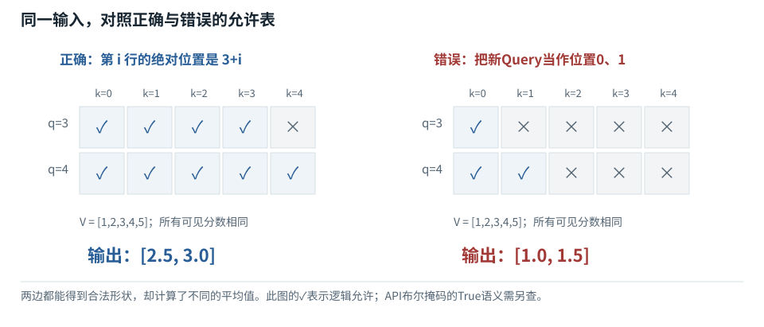
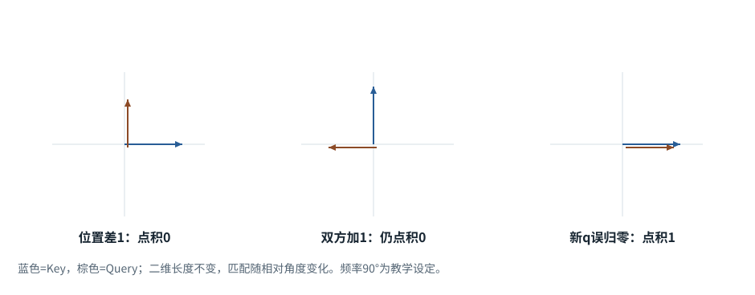
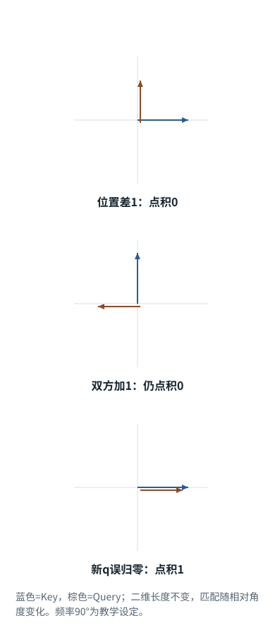
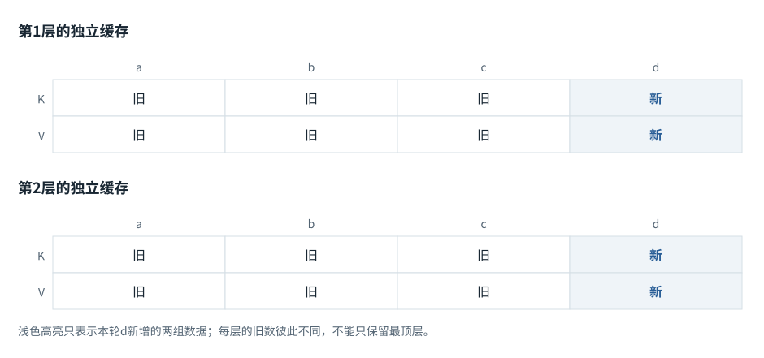
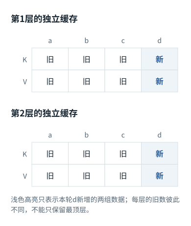
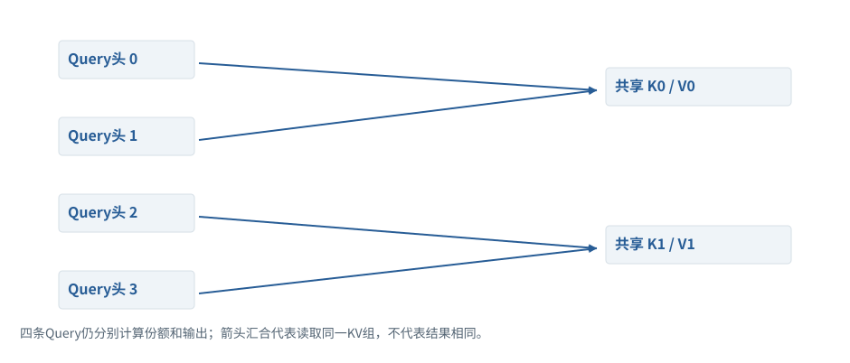
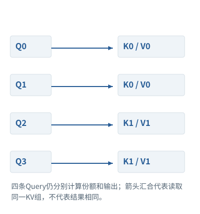

专题研修


<span id="section-0"></span>


# 02｜进入Decoder：张量形状、RoPE、GQA与KV缓存的正确性

> 目标：不用“注意力会关注重要内容”这种比喻，直接解释一次前向计算；能实现和检验整段、逐Token、分块三种推理的一致性。实验：`numerics.Decoder`。


<span id="visual-reading"></span>


<span id="topic-1"></span>


## 沿着对象与状态理解本章

先画每一轴和可见性，再推多头位置变换；缓存正确性首先是前缀和位置条件。

下方图解的固定输入在“输入与适用条件”中声明。它用于解释本章机制，不与本章其他独立例子的数值暗中接续。


<span id="visual-F12"></span>

<span id="topic-2"></span>

<span id="topic-3"></span>

<span id="topic-4"></span>

<span id="topic-5"></span>

<span id="topic-6"></span>

<span id="topic-7"></span>


相关动态过程：[Mask是可见性表，不是额外语义](../../visual/F12.md)。本节下文继续展示更具体的计算与工程边界。

继续看相关机制：[F13 · 位置怎样进入数值计算](../../visual/F13.md)[O01 · GQA/MQA：减少的是K/V组数](../../visual/O01.md)[F15 · 梯度像坡度，学习率像迈步大小](../../visual/F17.md)


<span id="c02-h1"></span>


## 1. 本书实现的架构与原论文不是一回事


<span id="concept-intro-5"></span>


先认识这里的对象与符号

[SwiGLU、Wg/Wu/Wd：两路变换再合成](../../concepts.md#concept-swiglu)
:   这是门控前馈结构。Wg生成要过SiLU的一路，Wu生成另一条内容路径，两路逐元素相乘，再用Wd映回原宽度。这些W是三组参数，不是三个Agent。读(SiLU(XWg)⊙XWu)Wd时，先算XWg和XWu，再SiLU，再⊙，最后乘Wd。每个位置独立用同一组参数。

[Norm、LayerNorm、RMSNorm：不是概率归一化](../../concepts.md#concept-norm)
:   Norm在层公式中表示一个规范化函数。LayerNorm通常按一个Token的特征减均值、除标准差，再缩放平移；RMSNorm通常不减均值，按均方根缩放。它们不等于softmax。独立微例，忽略稳定分母用的小正数ε与可学缩放：LayerNorm([1,3])=[-1,1]；RMSNorm([1,3])=[1/√5,3/√5]。

[MHA、MQA、GQA：头怎样共享](../../concepts.md#concept-heads)
:   一个注意力头是一套匹配并聚合内容的路径。MHA常让每个Query头有自己的K/V头；MQA让多个Query头共用一组K/V；GQA在两者之间，分组共享。它们是结构选择，不是运行时随便改一个开关。独立形状例：8个Query头、2个K/V头，若均匀分组，每4个Query头共享1组K/V；缓存按K/V头数记账。

2017年Transformer论文提出编码器—解码器架构；本书数值实验是现代风格的仅解码器教学模型，采用前置RMSNorm、RoPE、GQA与SwiGLU。组合这些机制是为了暴露常见实现边界，不表示任何某款闭源模型正好使用相同配置。[[N07]](../sources.md#N07 "本地来源与核查范围")[[N08]](../sources.md#N08 "本地来源与核查范围")[[N09]](../sources.md#N09 "本地来源与核查范围")

设批大小B，序列长度T，隐藏宽度d，查询头数h，KV头数g，每头宽度dh=d/h，且h可被g整除。随机初始化实验取`d=16,h=4,g=2`，共两层。小数字允许逐个打印形状，不能据此评估大模型能力。


<span id="concept-intro-1"></span>


先认识这里的对象与符号

[Wq / W\_Q：查询投影参数](../../concepts.md#concept-q-projection)
:   这是把输入表示变为Query的参数矩阵，不是Query本身。按本书右乘约定，输入每行d个数、Wq有d行d\_k列，Q=XWq后每行有d\_k个数。下标q表示用途，不表示再乘一个q。同一Wq可处理多个位置；每个位置得到自己的q。F11给出X、Wq和每个乘加结果。

[Wout、LM head：词表打分参数](../../concepts.md#concept-wout)
:   把最后隐藏表示转换为每个词表候选分数的参数层。输入宽度d，词表有Vocab项，右乘的参数形状是[d,Vocab]。生成概率需再对这些分数归一化。注意力Wo输出的是隐藏特征；Wout输出的是词表候选分数。名字都含output，输出对象却不同。

```
Token IDs                [B,T]
Embedding                [B,T,d]
Q = norm(X) Wq           [B,T,h×dh] → [B,h,T,dh]
K,V                      [B,g,T,dh]
按组供Q头读取的K,V         [B,h,T,dh]（概念视图，不必物理复制）
QKᵀ / √dh                [B,h,T,T]
softmax(scores+mask) V    [B,h,T,dh]
合头与输出投影             [B,T,d]
残差 + 前馈 + 残差          [B,T,d]
词表投影                  [B,T,V]
```

逐行核对形状比背诵组件名称重要。例如错误地在头维求softmax，形状仍合法，却把“从哪些历史位置取信息”变成了“不同头之间竞争”。这样的错误可能不会触发异常，只会悄悄改变模型。


<span id="c02-h2"></span>


## 2. 一层内部到底怎样流动


<span id="concept-intro-3"></span>


先认识这里的对象与符号

[⊙：逐元素乘，不是矩阵乘](../../concepts.md#concept-elementwise)
:   逐元素乘把形状对齐后的同位置数相乘，不沿某个维度再求和。公式的并排矩阵或@通常表示矩阵乘，二者不可互换。独立微例：[1,2]⊙[3,4]=[3,8]，点积则为11。门控前馈里的⊙是在每个特征上调节另一路。

[γ、β、ε：参数与稳定常数要分开](../../concepts.md#concept-norm-params)
:   在LayerNorm式子中，γ是一排可学习乘法系数，β是一排可学习加法系数；ε是人为设置的小正数，放在分母相关项中避免除零等问题。计算得到的均值μ、方差σ²又是本次数据的统计量。γ=1、β=0常表示每个特征都用1和0，不是一份输入词义。DPO里的β另指目标函数系数，不能套用这里的意思。

RMSNorm对最后一维计算均方根：`norm(x)=x/sqrt(mean(x²)+ε) ⊙ γ`。它与减均值的LayerNorm不同。前置归一化的残差结构可写成`u=x+Attn(norm(x))`，`y=u+FFN(norm(u))`。残差为信息与梯度提供直接路径，但不能简单声称保证任意深度训练稳定。


<span id="concept-intro-4"></span>


先认识这里的对象与符号

[sigmoid：把单个数映射到0与1之间](../../concepts.md#concept-sigmoid)
:   函数规则是sigmoid(x)=1/(1+exp(-x))。它逐个数计算，不要求同一行结果的总和为1，所以不能用它直接代替多候选softmax。独立微例：sigmoid(0)=0.5；分别算两个0，得到[0.5,0.5]只是巧合，输入[1,1]的两项之和就大于1。

SwiGLU前馈结构在本实验写为`(silu(uWgate) ⊙ uWup) Wdown`，其中`silu(a)=a×sigmoid(a)`。它对每个位置独立进行非线性变换；注意力负责位置间混合。把前馈层想象成只有检索、没有计算的静态事实库是不准确的，模型行为来自全部层共同作用。

注意力分数除以`√dh`的直觉来自点积方差：若各分量独立、均值零、方差一，点积方差随dh增长；缩放使初始化附近的分数尺度更温和。真实训练后这些假设并不严格成立，但公式不是随便选的装饰项。


<span id="c02-h3"></span>


## 3. 因果掩码的语义与负对照

完整前向时，第i个查询只能看到键位置j≤i。非法位置加负无穷，softmax后权重为零。测试应当改变位置k之后的输入，断言位置k之前输出不变。若把因果掩码删掉，相同测试应该失败；这称为负对照，证明测试有能力抓住目标错误。

全被遮住的一行是特殊情况。对一行全负无穷直接做“减最大值”会出现`−∞−(−∞)`并产生NaN。本书实现显式拒绝这种输入；生产算子可能定义零输出或采取其他约定，但调用方必须知道该契约。不能仅因普通样本可运行，就认为padding和空样本已经处理正确。


<span id="mechanism-S02-3"></span>


<span id="topic-8"></span>


### 缓存解码的掩码要按绝对位置填，不能照抄小三角

**本例条件：**独立缓存例：旧位置0、1、2已处理，新Query位于3、4；Key覆盖0—4。下图“可读=1”只表示逻辑允许关系，再按目标API转换。

Query行
:   正在算哪个位置的新表示。

Key列
:   可以向哪个历史位置取信息。

绝对位置
:   在完整序列中的序号，而非本次小批里的行号。

**缓存解码的掩码要按绝对位置填，不能照抄小三角**



本图仅使用当前算例声明的输入；具体公式、来源和边界见紧邻正文。

[SVG图源](../../../diagrams/rendered/Q009-fb2c38d32406.svg) · [原算例数据：Q009](../../../diagrams/source/mechanism-cases.json)

核对完整输入与结果

本图使用的数据与条件

| Query绝对位置 | Key 0／1／2／3／4 | 说明 |
| --- | --- | --- |
| 3 | 1 1 1 1 0 | 读历史与自己，不读未来4 |
| 4 | 1 1 1 1 1 | 最后一行可以读全前缀 |
| 错误的局部三角 | 1 0 0 0 0 / 1 1 0 0 0 | 把局部行号0/1误当绝对位置 |

#### 怎样把图中的变化读明白

先在纸上写出每个Query的真实位置，再逐列判断key\_pos≤query\_pos。这里只需比较两个整数，不必先记框架参数名。

有PAD时还要同时满足Key是真实内容；因果约束与padding约束是逻辑“并且”，不是二选一。

PyTorch SDPA布尔True表示参与，部分MHA掩码True表示屏蔽。图中的1不是跨接口通用写法，调用前必须转换。

**不要混淆：**张量[2,5]形状完全正确，错误小三角仍会悄悄漏读历史。因此形状测试之外必须测试允许表和输出。

机制依据：[[TR]](../../sources.md#src-TR) [[CACHE]](../../sources.md#src-CACHE) [[SDPA-213]](../../mechanisms/sources.md#source-SDPA-213)。本例数字和宿主场景为明确给定的教学设定，不是商业模型输出或生产性能测量。


<span id="c02-h4"></span>


## 4. RoPE为什么使位置进入相关性

对每对分量`(a,b)`，位置p对应旋转角pθ：

```
R(pθ)[a,b] = [a cos(pθ) − b sin(pθ), a sin(pθ) + b cos(pθ)]
(R(p)q)ᵀ(R(t)k) = qᵀR(t−p)k
```

第二式来自旋转矩阵的正交性与角度相加性质，说明旋转后的点积能含有相对位置差。多个分量对使用不同频率，使位置信号分布在不同尺度。实验检查旋转不改变每一对向量的范数；但范数保持只能证明旋转实现的一部分性质，不证明长上下文外推能力。[[N09]](../sources.md#N09 "本地来源与核查范围")

缓存推理时，已有前缀长度为P，新块长度为C，新块位置必须是`P…P+C−1`。把每次调用位置重置成零，会改变新查询与旧键的相对位置，因此虽然cache长度和张量shape正确，输出仍错误。`wrong_offset=True`故意制造这个错误，数值测试应该检测到。

RoPE扩展并不意味着“把最大位置参数改大就获得可靠长上下文”。位置插值、频率修改、训练长度和数据都会影响行为。对具体模型应使用其受支持的配置，再做长范围信息组合任务，而不只是检查能否接受长输入。


<span id="mechanism-S02-4"></span>


<span id="topic-9"></span>


### RoPE保留的是相对角度，不是每轮重新开始的位置

**本例条件：**独立二维旋转例：原始q=k=[1,0]；为便于手算，每增加一个位置旋转90°。真实RoPE用多组频率，本例只解释位置差。

旋转
:   改变方向但保留该二维向量长度。

位置偏移
:   这次Token在完整上下文中的位置。

相对位置
:   查询位置减去Key位置。

**RoPE保留的是相对角度，不是每轮重新开始的位置**





本图仅使用当前算例声明的输入；具体公式、来源和边界见紧邻正文。

[SVG图源](../../../diagrams/rendered/Q010-871c152a6442.svg) · [原算例数据：Q010](../../../diagrams/source/mechanism-cases.json)

核对完整输入与结果

本图使用的数据与条件

| 条件 | 旋转后的两向量 | 点积 |
| --- | --- | --- |
| q位置1，k位置0 | q=[0,1]；k=[1,0] | 0 |
| 双方都加1 | q位置2=[-1,0]；k位置1=[0,1] | 0 |
| 错误：新q重置为位置0 | q=[1,0]；旧k仍[1,0] | 1：关系被改变 |

#### 怎样把图中的变化读明白

前两行把双方同时移动一格，夹角没变，所以点积没变。这就是相对位置进入匹配的一种直观表现。

缓存中的旧K已经带着它原来的位置。新Token若重置成0，就不是“只是重新编号”，而是改变了新旧向量的相对角度。

真实实现还要区分position\_ids、cache\_position与物理槽位；滑动缓存移动存储槽，不意味着把语义位置也重置。

**不要混淆：**本例90°频率是教学设定，不是现实模型第一个频率的数值；不能把图中的周期4当成真实上下文长度。

机制依据：[[ROPE]](../../sources.md#src-ROPE) [[CACHE]](../../sources.md#src-CACHE)。本例数字和宿主场景为明确给定的教学设定，不是商业模型输出或生产性能测量。


<span id="c02-h5"></span>


## 5. KV缓存究竟缓存了什么


<span id="concept-intro-2"></span>


先认识这里的对象与符号

[Query、Key、Value：三种中间数值表示](../../concepts.md#concept-qkv)
:   q是接收信息的一行查询表示；k是可读位置提供的一行匹配表示；v是该位置供混合的一行内容表示。大写Q/K/V把多行收集成表。它们由输入与参数计算得到，分别承担打分与提供内容的职责。某个q与两个k点积得到两个分数；softmax得到两个份额；这些份额分别乘两行v，再相加。这里不生成搜索词，也不直接选答案。

在因果模型中，追加新Token不会改变旧位置在各层的表示：旧位置不能看到未来。因此旧位置投影后的K、V可以保存，新位置只计算自己的Q、K、V，并读取历史缓存。它缓存的是该层、该前缀、该模型参数下的中间张量，不是一个与输入无关的知识库。

每层新块处理的掩码不是简单C×C三角矩阵，而是C×(P+C)：新块第i行允许键`j≤P+i`。如果套用未对齐的“左上角三角”，就会让新Token看不到本应可见的旧前缀。完整推理、逐Token推理、任意分块推理都应得到容差范围内相同logits。


<span id="concept-intro-6"></span>


先认识这里的对象与符号

[LoRA、低秩及r](../../concepts.md#concept-lora)
:   LoRA用两个较小矩阵的乘积表示一部分权重增量，而不是重新训练整个大矩阵。r是中间维度，限制这个乘积的最大秩。不同资料采用行/列向量约定时，A、B的左右次序可能不同。右乘约定微例：W[4,6]，增量A[4,2]B[2,6]仍为[4,6]；r=2。A在这里不是注意力份额表。

实验中缓存存储旋转后的K和原投影V。另一些架构可能有不同缓存表示，不应套用这个假设。模型权重、LoRA适配器、模板前缀、位置策略变化，都可能使已有cache不能复用；缓存命中条件不是字符串包含相同词语，而是相关计算状态匹配。


<span id="engineering-D01"></span>


工程案例 · D01


<span id="engineering-D01-title"></span>


### 故障实验：为什么无缓存前向正确、增量前向却失真？


<span id="engineering-D01-detail-1"></span>


#### 固定问题，不先改模型

症状是相同已知序列整段前向正确，拆成历史缓存+新Token后结果偏离。候选原因包括投影重复、掩码含义反转、位置偏移、RoPE重复旋转、dropout误开和数值精度。先固定参数、dtype与随机路径，把这些变量逐个隔离，而不是直接调大模型或把容差放宽。

本实验使用PyTorch2.10 CPU，明确不运行GPU融合内核。第一关让高层MHA与SDPA使用同一投影和相同可见关系；第二关让分数全相同，使输出只反映可见Key集合；第三关单独测试位置旋转。每一关都对应一个有辨别力的反例。[[SDPA]](../../engineering/sources.md#src-SDPA "PyTorch · scaled_dot_product_attention") [[MHA]](../../engineering/sources.md#src-MHA "PyTorch · MultiheadAttention")


<span id="engineering-D01-detail-2"></span>


#### 核心观测

缓存P=3，新Query数2，总Key数5；V=1到5。正确显式表输出2.5和3，左上自动因果表输出1和1.5。数值差异完全由可见性决定，不涉及语言能力。若测试只用新Query长度等于Key长度，三角对齐错误会被隐藏。


<span id="engineering-D01-detail-3"></span>


#### 诊断路径为何有效

把Q/K置零会令合法Key权重相同，因此可以手算预期平均值；一旦结果不对，优先看mask，而非投影参数。恢复非零Q/K后再测缩放与softmax；恢复真实形状后再看头映射与缓存布局。这个逐步恢复复杂性的顺序，使每次失败仍可归因。


<span id="engineering-D01-detail-4"></span>


#### 工程验收不能止于本实验

还需覆盖不同padding、滑窗边界、多Token块、分支共享缓存、适配器切换、目标设备精度。固定模型下增量与全量前向应满足定义好的容差，不要求所有设备逐位相等。性能比较另行进行，不能把CPU解释性代码与GPU优化核的速度直接对比。


<span id="engineering-D01-results"></span>


#### 固定实验记录


<span id="mechanism-record-D01"></span>


#### D01：怎样读这份结果，而不是只看“通过”

这组记录分别改变投影、mask、绝对位置等一个条件。按子记录ID核对，不能把不同shape和模型的数组连成一次前向。先找第一处不相等的中间结果，再讨论最终logits。

实验记录：字段与原值

| 原始字段路径 | 原始值 |
| --- | --- |
| E03-linear.correct | [[5.0, 11.0]] |
| E03-linear.wrong | [[7.0, 10.0]] |
| E05-polarity.correct | [[[1.0, 0.0], [0.3302384614944458, 0.6697615385055542]]] |
| E05-polarity.inverted | [[[0.0, 1.0], [0.0, 0.0]]] |
| E05-offset.mask | [[true, true, true, true, false], [true, true, true, true, true]] |
| E05-offset.correct | [2.5, 3.0] |
| E05-offset.upper\_left | [1.0, 1.5] |
| E06.once | [6.123233995736766e-17, 1.0] |
| E06.twice | [-1.0, 1.2246467991473532e-16] |
| E06.cache\_slots | [0, 1, 2, 3, 4] |
| E06.valid\_positions | [0, 1, 2] |

这里是实际实验记录，不用条长或箭头伪装成额外证据；完整日志与解释仍保留在本节。

本图整理的是本小节已有的局部实验记录，不把通过局部测试扩展为产品在所有环境下可靠。原测试环境、输入和完整输出仍以本节记录为准。

```
{
  "E03-linear": {
    "correct": [
      [
        5.0,
        11.0
      ]
    ],
    "wrong": [
      [
        7.0,
        10.0
      ]
    ]
  },
  "E05-polarity": {
    "correct": [
      [
        [
          1.0,
          0.0
        ],
        [
          0.3302384614944458,
          0.6697615385055542
        ]
      ]
    ],
    "inverted": [
      [
        [
          0.0,
          1.0
        ],
        [
          0.0,
          0.0
        ]
      ]
    ]
  },
  "E05-offset": {
    "mask": [
      [
        true,
        true,
        true,
        true,
        false
      ],
      [
        true,
        true,
        true,
        true,
        true
      ]
    ],
    "correct": [
      2.5,
      3.0
    ],
    "upper_left": [
      1.0,
      1.5
    ]
  },
  "E06": {
    "once": [
      6.123233995736766e-17,
      1.0
    ],
    "twice": [
      -1.0,
      1.2246467991473532e-16
    ],
    "cache_slots": [
      0,
      1,
      2,
      3,
      4
    ],
    "valid_positions": [
      0,
      1,
      2
    ]
  }
}
```

关联问题：[E03：投影两次、缩放两次、eval仍随机：同名Attention接口的三种陷阱](../../chapters/02.md#engineering-E03) · [E04：一整行都被遮住时，减最大值为什么仍救不了softmax？](../../chapters/02.md#engineering-E04) · [E05：布尔mask语义相反，加缓存后is\_causal还可能对齐错边](../../chapters/03.md#engineering-E05) · [E06：位置编号、缓存槽位和RoPE：同叫position却不是同一个数](../../chapters/03.md#engineering-E06)

[完整程序与复现方法 →](../../engineering/labs.md#lab-code)


<span id="mechanism-S02-5"></span>


<span id="topic-10"></span>


### 旧K/V为什么能复用：新Token不能反向改变旧前缀

**本例条件：**独立两层、严格因果、推理模式例：先处理a,b,c，再输入d。参数、旧前缀、位置规则不变；每层缓存保存自己的K/V。

因果依赖
:   位置c的计算只能依赖a,b,c。

逐层缓存
:   第一层和第二层保存的不是同一组数。

新Query
:   只负责本轮新位置的读取。

**旧K/V为什么能复用：新Token不能反向改变旧前缀**





本图仅使用当前算例声明的输入；具体公式、来源和边界见紧邻正文。

[SVG图源](../../../diagrams/rendered/Q025-4823f008d8c8.svg) · [原算例数据：Q025](../../../diagrams/source/mechanism-cases.json)

核对完整输入与结果

本图使用的数据与条件

| 层与时间 | 仍然可复用 | 必须新计算 |
| --- | --- | --- |
| 第1层追加d | K/V(a,b,c) | Q/K/V(d) |
| 第2层追加d | 本层K/V(a,b,c) | 由第1层新d得到本层Q/K/V(d) |
| 完成本轮 | 两层历史各增长到4位置 | 仅用最新末位置预测下一项 |
| 若把b换掉 | a之前可保留的范围另行核对 | b及受其影响的后缀需重算 |

#### 怎样把图中的变化读明白

证明从第一层向后做：旧位置看不到新d，因此第一层旧表示不变；第二层的旧输入也就不变，逐层成立。

旧Q主要用于计算旧位置的输出。当前只要求d的新输出，不需要再用旧Q发起读取，所以通常缓存K/V而不是Q。

模型参数、模板或旧位置改变会破坏复用前提。“同一个会话”不是缓存有效性的数学条件。

**不要混淆：**双向注意力中旧位置可能看见新增内容，不能无条件套用这条因果缓存论证。

机制依据：[[CACHE]](../../sources.md#src-CACHE) [[TR]](../../sources.md#src-TR) [[CACHE-HF]](../../mechanisms/sources.md#source-CACHE-HF)。本例数字和宿主场景为明确给定的教学设定，不是商业模型输出或生产性能测量。


<span id="c02-h6"></span>


## 6. GQA减少什么，不减少什么

MHA中每个Q头通常拥有对应K、V头；GQA让一组Q头共享一个K、V头，MQA可看作只有一个KV头的极端。h不变而g减少，缓存与K/V投影输出规模下降，Q头仍可通过不同Q表示产生不同注意分布。[[N08]](../sources.md#N08 "本地来源与核查范围")

KV内存近似为`2×层数×批大小×序列长×KV头数×每头维度×每元素字节`。教学假设32层、1条32768长序列、8个KV头、每头128维、2字节，结果是4GiB；若KV头变成32，则16GiB。这里没有计分页元数据、对齐、碎片、临时buffer或量化尺度，也不是某款服务的实际用量。

代码为了可读性用`repeat`扩展共享KV；高性能实现应避免无意义复制。算法概念减少的内存，可能被天真的张量操作抵消，这正是“懂论文”与“写出有效工程实现”的差距。


<span id="worked-S02"></span>


运行示例 · S02


<span id="topic-11"></span>


### 批内真实长度不同，缓存位置不能只看补齐长度

**输入与条件。**样本A真实长3，B真实长2，右补齐到3。要继续生成时，B的有效历史只有2个Token。


<span id="mechanism-original-worked-S02"></span>


| 步骤与对象 | 内部动作 | 中间结果 / 新状态 |
| --- | --- | --- |
| 1记录长度 | A=3，B=2 | PAD不是有效的历史词。 |
| 2选预测位置 | A取第2位置，B取第1位置 | 错误地都取最后一格会读B的PAD表示。 |
| 3位置编号 | B的新真实Token应延续其有效位置 | 不能因为整批T=3就任意跳过其序列位置。 |
| 4缓存布局 | 某实现可保留PAD槽位，但必须正确mask与跟踪位置 | 物理槽数和语义位置可以不同。 |
| 5验证 | 逐条无padding运行与批处理比较 | 应在声明的推理设定下得到一致有效结果。 |

**把过程连起来。**批处理增加的是实现复杂度，不应改变每条输入独立计算的语义。

**边界与反例。**服务可能用左padding、打包或分页处理；本例不提供所有框架统一的position\_ids公式。

依据与适用范围：[[CACHE]](../../example-sources.md#ex-src-CACHE)。示例输入和场景由本书明确设定。


<span id="mechanism-S02-6"></span>


<span id="topic-12"></span>


### GQA保留多个Query，只让它们共享较少的K/V

**本例条件：**独立配置：4个Query头、2个KV头，每头宽度2，历史3个位置；映射为Q0/Q1→KV0，Q2/Q3→KV1。

头
:   并行的一条注意力计算路径。

共享KV
:   两个不同Query读取同一组Key/Value。

输出头数
:   仍有4条Query结果，不会自动变成2。

**GQA保留多个Query，只让它们共享较少的K/V**





本图仅使用当前算例声明的输入；具体公式、来源和边界见紧邻正文。

[SVG图源](../../../diagrams/rendered/Q011-173fd5337001.svg) · [原算例数据：Q011](../../../diagrams/source/mechanism-cases.json)

核对完整输入与结果

本图使用的数据与条件

| Query头 | 读取哪个KV头 | 独立性 |
| --- | --- | --- |
| Q0 | KV0 | 有自己的Q与份额 |
| Q1 | KV0 | 与Q0不同的Q，可产生不同份额 |
| Q2 | KV1 | 同样独立计算 |
| Q3 | KV1 | 同样独立计算 |
| 缓存计数 | K和V：2×2头×3位置×2数=24数 | MHA四KV头则需48数 |

#### 怎样把图中的变化读明白

共享的是被读取的表示，不是直接复制输出。即便两个Query面对同一组Key，它们问的方向不同，softmax也可能不同。

缓存只保存K/V，所以减少KV头能省缓存；Query投影和四条Query对历史的匹配仍存在。

这是结构约束，不能简单把训练好的任意MHA运行时删掉一半KV头而宣称完全等价。

**不要混淆：**把repeat后的逻辑张量当成真实物理占用，会夸大缓存；反过来，真的复制KV实现又可能抵消预期节省。

机制依据：[[GQA]](../../sources.md#src-GQA) [[CACHE]](../../sources.md#src-CACHE)。本例数字和宿主场景为明确给定的教学设定，不是商业模型输出或生产性能测量。


<span id="c02-h7"></span>


## 7. 实现验收


<span id="symbol-intro-1"></span>


先认识这里的对象与符号

[Concat、split与chunk：拼接与拆分](../../concepts.md#concept-concat)
:   Concat把多份数组沿指定轴连接起来，不把元素相加；split或chunk按规定边界分组。所有未拼接轴需相容。这里chunk指数组块；网络中的chunk则是字节分片。独立例：两头各[2,3]，沿特征轴拼成[2,6]；沿位置轴拼会变[4,3]，语义已经不同。

阅读`Decoder.forward`时应定位：归一化、投影、RoPE的位置、缓存拼接轴、非方形mask、softmax轴、合头顺序、前馈残差。每项都应对应至少一个不变性或负对照。


<span id="symbol-intro-2"></span>


先认识这里的对象与符号

[Dropout：训练中的随机置零规则](../../concepts.md#concept-dropout)
:   常用倒置Dropout在训练时按丢弃概率p随机将元素置零，保留项除以1-p以保持期望量级。评估模式通常关闭这一随机操作；底层函数可能要求调用者显式传p=0。独立例：p=0.5，某值2在一次掩码中被保留则输出4，被丢弃则0。这不是训练把对应模型参数永久删掉。

验收题：若整段和缓存输出不同，先查什么？先检查dropout是否关闭、参数是否一致、位置偏移与mask对齐，再检查dtype和数值容差。不能仅通过放宽容差掩盖逻辑错误。若误差因长度突然增大，还应检查位置上限、cache截断、padding与滑窗规则。高精度教学结果只是基线，低精度核需另外定义可接受误差及最终任务退化范围。

AI系统工程：从基础到内部  
[全书目录](../../contents.md) · [术语与符号](../../glossary.md) · [参考资料](../../sources.md)