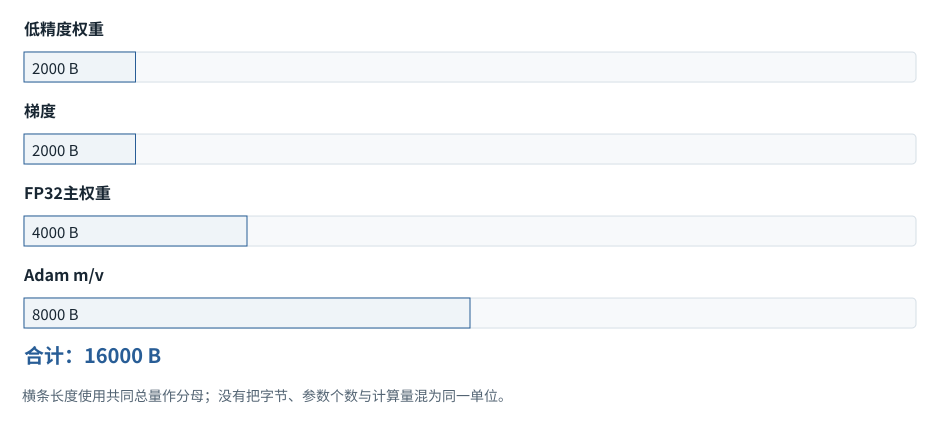
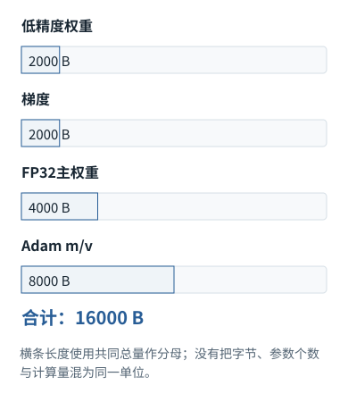

专题研修


<span id="section-0"></span>


# 03｜训练系统内部：数据、优化器、显存与分布式代价

> 目标：读懂训练报告的因果链，能估计资源，能区分优化失败、数据泄漏与目标设计错误。实验：[`train_tiny_lm.py`](../code/train_tiny_lm.md)，是真实训练，但不是大模型能力复现。


<span id="visual-reading"></span>


<span id="topic-1"></span>


## 沿着对象与状态理解本章

显存账必须分参数、梯度、优化器状态、激活与临时工作区；下图先教训练状态如何产生。

下方图解的固定输入在“输入与适用条件”中声明。它用于解释本章机制，不与本章其他独立例子的数值暗中接续。


<span id="visual-F18"></span>

<span id="topic-2"></span>

<span id="topic-3"></span>

<span id="topic-4"></span>

<span id="topic-5"></span>

<span id="topic-6"></span>

<span id="topic-7"></span>


相关动态过程：[训练：给每个位置一道“下一项”题](../../visual/F18.md)。本节下文继续展示更具体的计算与工程边界。

继续看相关机制：[F15 · 梯度像坡度，学习率像迈步大小](../../visual/F17.md)[O09 · Activation Checkpointing：少存一点，反向时重算](../../visual/O09.md)


<span id="c03-h1"></span>


## 1. 数据管线是模型行为的一部分

预训练不是把原始网页直接塞进GPU。需要确定采样范围、清洗与去重策略、编码、序列拼接、长度分布、训练验证划分和可追溯的数据版本。每一步都改变模型实际看到的分布。例如过度删除短行，可能误伤代码；按网页URL去重，可能保留大量镜像；随机按段落划分训练测试，可能把同一文档不同版本分到两侧。

最小数据清单应能回答：样本来自哪一快照、应用了哪些过滤、由何种Tokenizer编码、有效Token计数如何计算、验证集是否在去重前隔离。证明模型会解一道题，必须排除答案或高度相似解法已经泄入训练/检索数据的解释；不能只看最终正确率。

当应用业务数据微调模型，权限与删除责任从原始数据延伸到训练工件。单纯删除数据库中的记录，不代表模型参数已经忘记了这条信息。这也是敏感、频繁变化的业务事实往往应留在权限控制的外部检索层，而不盲目进入训练集的理由。


<span id="c03-h2"></span>


## 2. 一次训练步的具体数据流

```
采样一批序列 → 构造输入/标签/mask → 前向得到logits
→ 稳定交叉熵 → 反向计算梯度 → 梯度累计/同步
→ 反缩放与非有限检查（若使用损失缩放）
→ 梯度裁剪 → 优化器更新 → 清梯度 → 更新训练状态
```


<span id="concept-intro-2"></span>


先认识这里的对象与符号

[优化器、Adam及AdamW](../../concepts.md#concept-optimizer)
:   优化器把梯度转换为参数更新。Adam还保存每个参数的梯度滑动平均m和平方梯度滑动平均v；它们是训练状态，不是注意力Value。AdamW把权重衰减与自适应梯度更新解耦。独立首步例：g=2、m旧=0、β₁=0.9，则m新=0.2，偏差修正后m\_hat=2。不能把0.2直接当完整更新量。

AdamW分别维护梯度的一阶、二阶矩，偏差修正后用于归一化步长；解耦权重衰减是在参数更新中直接施加缩减，不应把它与所有参数统一施加L2惩罚简单等同。不同实现对哪些参数衰减、何时累计、学习率调度都有约定，复现实验要保存这些配置，而不只保存一个学习率数字。

梯度累计将多个microbatch的贡献组合成一次优化更新。等价性取决于损失归一化、随机算子以及调度计步方式。长短序列有效Token数量不同，用“每个microbatch均值的简单均值”可能不同于全体有效Token均值。要先说明优化目标按样本还是按Token加权，再设计累计逻辑。


<span id="mechanism-S03-2"></span>


<span id="topic-8"></span>


### AdamW的“历史状态”，与本次梯度分开记账

**本例条件：**独立标量演示：初始w=1，梯度g=2，m=v=0；β1=0.9、β2=0.999、学习率0.1、衰减0.01；忽略ε的微小影响。

m
:   一阶动量，平滑历史梯度。

v
:   二阶动量，平滑梯度平方。

偏差修正
:   补偿从零初始化造成的早期缩小。

AdamW的“历史状态”，与本次梯度分开记账

| 步骤 | 数值 | 含义 |
| --- | --- | --- |
| 更新m | 0.9×0+0.1×2=0.2 | 还不是最终更新幅度 |
| 更新v | 0.999×0+0.001×4=0.004 | 保存平方尺度 |
| 修正 | m̂=2；v̂=4 | 分别除1−β^t |
| 解耦衰减 | 1×(1−0.1×0.01)=0.999 | 与梯度路径分开 |
| 自适应更新 | 0.999−0.1×2/√4=0.899 | 本步最终w |

各行是独立对象或条件的对照，不暗示上一行的结果自动进入下一行。

#### 怎样把图中的变化读明白

不要因为m是0.2，就把参数更新直接写成0.1×0.2。偏差修正和按平方尺度归一化还没做。

m与v属于优化器状态，不是神经网络前向激活。恢复训练只加载w而不加载这些状态，会改变后续轨迹。

混合精度中若放大过loss，裁剪梯度前需先还原尺度；否则裁剪的是放大后的数，不是本来想限制的梯度。

**不要混淆：**上图是第一步、无ε近似；不能把每一步都简化成g/|g|。后续m/v带有历史信息。

机制依据：[[ADAMW]](../../sources.md#src-ADAMW) [[F-AUTOGRAD]](../../sources.md#src-F-AUTOGRAD)。本例数字和宿主场景为明确给定的教学设定，不是商业模型输出或生产性能测量。


<span id="c03-h3"></span>


## 3. 为什么显存不只是参数量乘2字节


<span id="concept-intro-3"></span>


先认识这里的对象与符号

[混合精度、loss scaling与主权重](../../concepts.md#concept-mixed)
:   混合精度在不同计算或状态中采用不同数值格式。主权重可用较高精度保存更新基准；loss scaling在反传前放大损失，随后再把梯度缩回，降低某些低精度下溢风险。并不是把学习率随意乘大。实际是否需要主权重或loss scaling取决于精度格式、优化器和实现。

训练可能同时持有模型权重、梯度、优化器矩、主权重副本、中间激活、临时算子缓冲和通信buffer。常见混合精度Adam实现中的某些配置可接近每参数16字节的模型状态开销，但这不是普遍常数：是否保留FP32主权重、梯度dtype、分片、量化优化器都会改变它。

估算应写出分项：`M_total = M_weights + M_grads + M_optimizer + M_activations + M_workspace + M_communication`。仅根据“7B×2字节=14GB”判断能否训练是错误的；这至多是某种dtype下的权重存储估计。序列长度增长也会提高激活负担，即使模型参数完全不变。


<span id="concept-intro-4"></span>


先认识这里的对象与符号

[checkpoint：必须看保存的对象](../../concepts.md#concept-checkpoint)
:   模型检查点保存权重或训练状态；激活检查点保存少量中间节点以便反向时重算；Agent任务检查点保存执行进展。三者同名，但恢复对象完全不同。看到checkpoint先问“恢复参数、重算激活，还是继续任务”。Agent保存摘要不会更新模型权重。

激活检查点通过不保存部分中间值、反向时重新计算，换取更低显存。这里的checkpoint是自动求导内存优化，不是Agent任务断点，也不是训练状态持久化。相同英文词在三个系统层次含义不同，必须明确。


<span id="mechanism-S03-3"></span>


<span id="topic-9"></span>


### 训练显存不是“参数量乘两字节”这一笔账

**本例条件：**独立预算例：1000个参数。假定低精度权重与梯度各2字节、FP32主副本4字节、Adam一二阶状态各4字节。这里只做一种实现的状态估算，不代表所有框架。

持久状态
:   跨训练步骤保留的权重与优化器数据。

激活
:   反向可能需要的前向中间结果。

检查点重算
:   少存部分激活，反向时再次计算。

**训练显存不是“参数量乘两字节”这一笔账**





本图仅使用当前算例声明的输入；具体公式、来源和边界见紧邻正文。

[SVG图源](../../../diagrams/rendered/Q020-5ea57ddd3e08.svg) · [原算例数据：Q020](../../../diagrams/source/mechanism-cases.json)

核对完整输入与结果

本图使用的数据与条件

| 对象 | 每参数字节 | 1000参数合计 |
| --- | --- | --- |
| 低精度权重 | 2 | 2000 B |
| 低精度梯度 | 2 | 2000 B |
| FP32主权重 | 4 | 4000 B |
| Adam m与v | 4+4 | 8000 B |
| 仅上述合计 | 16 | 16000 B；尚未含激活/临时缓冲 |

#### 怎样把图中的变化读明白

推理只算权重存储时得到2000B，训练本例的持久状态已是16000B。激活、通信缓冲、分配碎片还没加入。

梯度累积把大batch分成几个小batch执行，主要控制峰值激活；它不会让全部参数消失。

激活检查点减少保存的中间量，但需要重算；ZeRO类分片把不同状态分摊到设备上，又引入通信。必须说清省的是哪一笔。

**不要混淆：**精确字节数依dtype、主副本、优化器实现和分片策略而变，16B不是每个训练任务的固定常数。

机制依据：[[ZERO]](../../sources.md#src-ZERO) [[F-AUTOGRAD]](../../sources.md#src-F-AUTOGRAD)。本例数字和宿主场景为明确给定的教学设定，不是商业模型输出或生产性能测量。


<span id="c03-h4"></span>


## 4. 分布式训练如何划分工作


<span id="concept-intro-1"></span>


先认识这里的对象与符号

[MoE、专家与路由器](../../concepts.md#concept-moe)
:   MoE是包含多套子网络的模型结构；路由器为当前Token表示选择或加权少数专家。专家通常是数值子网络，不是被赋予“数学老师”等提示词的聊天Agent。独立例：有4个专家，每Token选2个，表示某次只激活其中2条专家路径；仍需保存模型设计要求的参数与路由状态。

[DP、TP、PP、ZeRO与FSDP](../../concepts.md#concept-parallel)
:   数据并行让多份模型处理不同样本并同步梯度；张量并行拆分一次算子的参数/计算；流水线并行把不同层放不同设备。ZeRO/FSDP类技术还会切分参数、梯度或优化器状态。它们拆的对象不同：一层矩阵分两块，不等于把两个独立用户任务分给两位Agent。

数据并行让各设备处理不同样本，再同步梯度；张量并行拆分单层矩阵运算，需要层内通信；流水线并行拆分层，microbatch在阶段间流动，会产生流水线空泡；专家并行把MoE专家分配到设备，路由使Token跨设备移动。它们解决不同约束，不能用“多卡等于训练速度线性增加”概括。

选择并行方式时，先确认瓶颈是单卡放不下、矩阵计算量大，还是跨设备网络。把大矩阵切得太细，可能提高通信比例；把流水线阶段切得不均，最慢阶段会限制整体；把专家负载分布忽略，少数热门专家会排队。第06章将从roofline和带宽继续解释这些取舍。

分片优化器状态、梯度、参数能够减少单设备持有状态，但相应引入收集与通信。检查点恢复还需要保存优化器状态、随机数状态、数据位置与调度计数，否则“从同一权重继续”不一定重现同一训练轨迹。生产恢复追求的是明确的恢复语义，不必对所有硬件强求逐位一致。


<span id="engineering-D02"></span>


工程案例 · D02


<span id="engineering-D02-title"></span>


### 真实修复阅读：从梯度累积事故到一份可区分错误目标的测试


<span id="engineering-D02-detail-1"></span>


#### 原始工程证据在哪里

Transformers PR #34191标题为“Fix Gradient Accumulation issue”，已于2024-10-17合并。本节固定查看合并提交中的loss\_utils.py：有num\_items\_in\_batch时，fixed\_cross\_entropy选择sum reduction，再除以调用方给定的数；ForCausalLMLoss先移动预测与标签，再展平。[[HFPR]](../../engineering/sources.md#src-HFPR "Transformers PR #34191 与合并后的损失实现") 这让“按总有效项归一化”的责任可以沿代码边界追踪，而不只是停留在博客结论。[[GRAD]](../../engineering/sources.md#src-GRAD "Hugging Face · Fixing Gradient Accumulation")


<span id="engineering-D02-detail-2"></span>


#### 参数名不能替代计数定义

num\_items\_in\_batch究竟表示样本数、标签数还是跨累积组有效Token数，必须在调用者查清；该小函数不会替调用方证明分母正确。尤其是shift后首尾变化、ignore\_index、不同rank数量和全空批次，可能让计数与真正进入交叉熵的项不一致。


<span id="engineering-D02-detail-3"></span>


#### 本书做了两层验证

第一层平方误差小例让梯度差异达到−1与0，方便手算。第二层实际使用torch.cross\_entropy：同4个样本一次前向的梯度，与分为1项/3项并按同一总数归一化累积的梯度一致；简单平均每批mean则不同。原始梯度矩阵在下方结果中可查看。


<span id="engineering-D02-detail-4"></span>


#### 如何迁移到自己的Trainer

先用单设备、固定小数据、无dropout与无随机增强做大批/累积等价性；再开启AMP、DDP、裁剪和真实数据loader，每次只增加一类因素。若框架已经处理全局分母，不要再次乘world\_size。对非Token同权目标，例如每条对话同权，需另写期望目标，不能照搬这个公式。


<span id="engineering-D02-detail-5"></span>


#### 反证式追问

“loss下降就没问题”不成立：错误目标也能下降。“梯度大致接近即可”也不够：先看差异能否用目标定义解释，再讨论浮点误差。历史PR是问题机制的依据，不是当前版本仍有bug的证据。


<span id="engineering-D02-results"></span>


#### 固定实验记录


<span id="mechanism-record-D02"></span>


#### D02：怎样读这份结果，而不是只看“通过”

逐项比较完整目标、有效Token归一化、错误微批均值和分布式规约。判断的是同一个训练目标是否保持，而不只是loss有没有下降。

实验记录：字段与原值

| 原始字段路径 | 原始值 |
| --- | --- |
| E09.token\_counts | [1, 3] |
| E09.correct\_gradient | -1.0 |
| E09.mean\_of\_means\_gradient | 0.0 |
| E09.scalar\_loss\_counterexample.loss\_sums | [2.0, 3.0] |
| E09.scalar\_loss\_counterexample.counts | [1, 3] |
| E09.scalar\_loss\_counterexample.correct | 1.25 |
| E09.scalar\_loss\_counterexample.wrong | 1.5 |
| E09-xent.full\_gradient | [[0.33608508110046387, -0.33608511090278625], [-0.21314038336277008, 0.2131403535604477]] |
| E09-xent.sum\_normalized\_gradient | [[0.33608508110046387, -0.33608511090278625], [-0.21314038336277008, 0.2131403535604477]] |
| E09-xent.mean\_of\_means\_gradient | [[0.06571647524833679, -0.06571649014949799], [-0.4587741494178772, 0.4587740898132324]] |
| E09-xent.loss | 0.8043063879013062 |
| E09-ddp.rank\_sum\_gradients | [2.0, -6.0] |
| E09-ddp.counts | [1, 3] |
| E09-ddp.correct | -1.0 |
| E09-ddp.wrong | 0.0 |
| E09-ddp.scope | "algebra simulation; no distributed process group launched" |
| E10-checkpoint.calls | 2 |
| E10-checkpoint.gradient | 0.9182168245315552 |

这里是实际实验记录，不用条长或箭头伪装成额外证据；完整日志与解释仍保留在本节。

本图整理的是本小节已有的局部实验记录，不把通过局部测试扩展为产品在所有环境下可靠。原测试环境、输入和完整输出仍以本节记录为准。

```
{
  "E09": {
    "token_counts": [
      1,
      3
    ],
    "correct_gradient": -1.0,
    "mean_of_means_gradient": 0.0,
    "scalar_loss_counterexample": {
      "loss_sums": [
        2.0,
        3.0
      ],
      "counts": [
        1,
        3
      ],
      "correct": 1.25,
      "wrong": 1.5
    }
  },
  "E09-xent": {
    "full_gradient": [
      [
        0.33608508110046387,
        -0.33608511090278625
      ],
      [
        -0.21314038336277008,
        0.2131403535604477
      ]
    ],
    "sum_normalized_gradient": [
      [
        0.33608508110046387,
        -0.33608511090278625
      ],
      [
        -0.21314038336277008,
        0.2131403535604477
      ]
    ],
    "mean_of_means_gradient": [
      [
        0.06571647524833679,
        -0.06571649014949799
      ],
      [
        -0.4587741494178772,
        0.4587740898132324
      ]
    ],
    "loss": 0.8043063879013062
  },
  "E09-ddp": {
    "rank_sum_gradients": [
      2.0,
      -6.0
    ],
    "counts": [
      1,
      3
    ],
    "correct": -1.0,
    "wrong": 0.0,
    "scope": "algebra simulation; no distributed process group launched"
  },
  "E10-checkpoint": {
    "calls": 2,
    "gradient": 0.9182168245315552
  }
}
```

关联问题：[E09：梯度累积的隐蔽偏差：平均的是批次，还是有效Token？](../../chapters/04.md#engineering-E09) · [E10：混合精度与重计算：顺序错误会让优化器悄悄走错一步](../../chapters/04.md#engineering-E10)

[完整程序与复现方法 →](../../engineering/labs.md#lab-code)


<span id="mechanism-S03-4"></span>


<span id="topic-10"></span>


### 分布式的“切开”，要先指明切的是样本、矩阵还是状态

**本例条件：**独立两设备示意。网络含层L0—L3，一个矩阵W可按列切成W左/W右；图中均为逻辑职责，不给没有硬件测量的加速倍数。

DP
:   数据并行：不同设备处理不同样本。

TP
:   张量并行：同一次算子的矩阵分片。

PP
:   流水并行：不同设备承担不同层。

分布式的“切开”，要先指明切的是样本、矩阵还是状态

| 方式 | 设备0 / 设备1 | 新增协作 |
| --- | --- | --- |
| DP | 完整模型+样本A / 完整模型+样本B | 训练时汇总梯度 |
| TP | X×W左 / X×W右 | 拼接或规约中间结果 |
| PP | L0、L1 / L2、L3 | 传激活；可能出现等待空泡 |
| ZeRO式状态分片 | 持有一部分参数/梯度/优化器状态 | 用到时通信与重建 |
| Prefill/Decode分离 | 长输入处理 / 后续逐步生成 | 传递KV状态并管理排队 |

各行是独立对象或条件的对照，不暗示上一行的结果自动进入下一行。

#### 怎样把图中的变化读明白

DP不一定让单条请求的同一步更快，它更自然地增加独立样本处理能力。TP才拆同一次算子，但多了通信。

PP让设备分别放不同层，可分担容量；单一微批仍要先过前层再过后层，多微批才有流水重叠。

同一系统可以组合这些策略，但每加一层划分都要追踪数据移动和同步。只有矩阵尺寸没有网络带宽，很难判断净收益。

**不要混淆：**“两张卡”不能直接推断“两倍速度”；如果新增通信超过省下的计算，甚至会更慢。

机制依据：[[TP]](../../sources.md#src-TP) [[ZERO]](../../sources.md#src-ZERO) [[PAGED]](../../sources.md#src-PAGED)。本例数字和宿主场景为明确给定的教学设定，不是商业模型输出或生产性能测量。


<span id="c03-h5"></span>


## 5. Scaling Laws应该怎样使用

训练损失与参数量、数据量、计算量存在可拟合的经验关系，但它们依赖数据、架构、优化与预算范围。Chinchilla研究讨论了固定训练计算预算下参数与数据的分配；不能把其特定研究设置中的比例当成任何模型、任何语言、任何推理成本下的永恒最优值。[[N37]](../sources.md#N37 "本地来源与核查范围")

还应区分训练计算最优与部署总成本最优。若模型会被调用很多次，花更多训练Token训练一个较小模型，可能换取长期推理成本下降。反过来，一个只做一次探索的模型项目未必值得为推理节省投入大量额外训练。真正的目标函数包含训练、服务和质量收益，而不只是一条损失曲线。

评估报告还要分开训练损失、验证损失与业务成功率。验证交叉熵略有改善，不保证工具调用权限判断也改善；代码通过率提高，可能集中在某类语言。能力扩展必须由分层评测证明，而不是由参数规模推断。


<span id="c03-h6"></span>


## 6. 本书真实训练实验的读法

[`train_tiny_lm.py`](../code/train_tiny_lm.md)包含两层因果Transformer，18,320个参数，CPU训练100步。数据是作者构造的16符号循环序列；任务是学习“下一个符号等于当前符号加一再模16”。这使梯度、mask和更新过程可验证，又不会把实验冒充通用语言模型。

配套运行记录中，训练交叉熵从约2.8468降到0.00345，训练Token准确率达到1.0。它证明这段代码能够沿定义的目标优化并记住/拟合这个简单规则，不证明测试泛化、多步推理或真实编码能力。修改未来输入后，前缀logits误差为零，另行验证因果掩码。

进一步实验不应只增加训练步：把验证序列改成逆序、换符号映射、增加不同规律；比较训练内分布与分布外结果。检查失败来源到底是模型容量、数据覆盖还是任务不可识别。保留训练种子和配置，至少重复几个种子，才能判断某项优化是否只是初始化巧合。


<span id="c03-h7"></span>


## 7. 资深工程师的结论标准

看见“数据更多、模型更强”的报告，应追问有效训练Token、去重与污染、计算预算、部署代价和任务范围。看见“显存不足”，应分解占用，而不是直接缩小batch。看见“loss不下降”，应先检查标签、mask、梯度、学习率与数值，再改变架构。每一项排查必须对应可观察变量，这才是训练系统内部的理解。


<span id="symbol-intro-1"></span>


先认识这里的对象与符号

[BatchNorm：跨样本统计不同于LayerNorm](../../concepts.md#concept-batchnorm)
:   BatchNorm常对同一特征/通道，沿批次和适用空间轴计算统计量；LayerNorm沿指定的样本内部特征维度计算。BatchNorm的训练与评估可使用不同来源的统计，具体还取决于配置。只见Norm这个词，不能把不同规范化层的统计轴混用；两个独立用户不应该因此共享会话上下文。


<span id="worked-S03"></span>


运行示例 · S03


<span id="topic-11"></span>


### 四个微批累积梯度，为什么不一定等于四倍学习率

**输入与条件。**有效批包含4个等大微批，损失按样本平均；各微批一个参数的平均梯度分别为1、2、3、4。


<span id="mechanism-original-worked-S03"></span>


| 步骤与对象 | 内部动作 | 中间结果 / 新状态 |
| --- | --- | --- |
| 1目标梯度 | 完整有效批的平均 | (1+2+3+4)/4=2.5。 |
| 2直接累积错误 | 每次平均损失反传但不除4 | 梯度和10，放大4倍。 |
| 3正确缩放 | 每个微批损失先除4 | 累计2.5。 |
| 4更新时机 | 四次backward后一次step | 不是每个微批都更新后再把结果当同一个大批。 |
| 5等价边界 | 含跨样本BatchNorm、随机层或不同优化器步数 | 数值与动力学可能不同，不能无条件声称完全等价。 |

**把过程连起来。**累积梯度必须明确损失归约分母、微批大小和优化器更新次数。

**边界与反例。**不等大微批需要按样本或有效Token数量加权，不应仍机械除微批个数。

依据与适用范围：[[DERIVE]](../../example-sources.md#ex-src-DERIVE)。示例输入和场景由本书明确设定。


<span id="worked-X05"></span>


运行示例 · X05


<span id="topic-12"></span>


### 用1000个参数算清ZeRO究竟分摊哪份状态

**输入与条件。**假设全部使用FP32：1000个参数P占4000字节，梯度G占4000字节，Adam的一阶和二阶矩合计8000字节。两张设备均匀分摊；只计算这三类状态。


<span id="mechanism-original-worked-X05"></span>


| 步骤与对象 | 内部动作 | 中间结果 / 新状态 |
| --- | --- | --- |
| 1普通数据并行 | 每张设备各有P、G、两个矩 | 每张4000+4000+8000=16000字节。 |
| 2ZeRO-1式分摊 | 仅优化器状态均分两张设备 | 每张4000+4000+4000=12000字节。 |
| 3ZeRO-2式分摊 | 梯度与优化器状态均分，参数复制 | 每张4000+2000+4000=10000字节。 |
| 4ZeRO-3式分摊 | 参数、梯度、优化器状态都均分 | 每张2000+2000+4000=8000字节。 |
| 5补上限制 | 计算某层时仍需拿到相应参数，产生通信和临时材料 | 上表不是实际峰值显存，不能据此断言两卡一定装得下。 |

**把过程连起来。**先画出参数、梯度和优化器状态三份数据，再讨论“切分”；否则很容易把不同阶段的节省量混在一起。

**边界与反例。**忽略激活、通信缓冲、临时聚合、分片不均、额外主权重及框架开销。这里是状态记账，不是设备实测。

[查看本例程序结果](../../example-verification.md#result-X05) · [完整可运行代码](../../example-verification.md#code)

依据与适用范围：[[ZERO]](../../example-sources.md#ex-src-ZERO)。示例输入和场景由本书明确设定。

AI系统工程：从基础到内部  
[全书目录](../../contents.md) · [术语与符号](../../glossary.md) · [参考资料](../../sources.md)