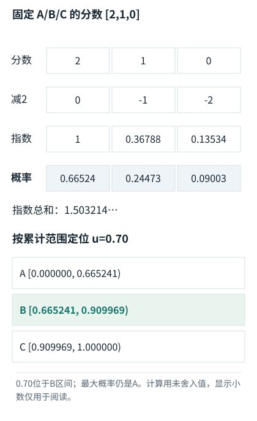
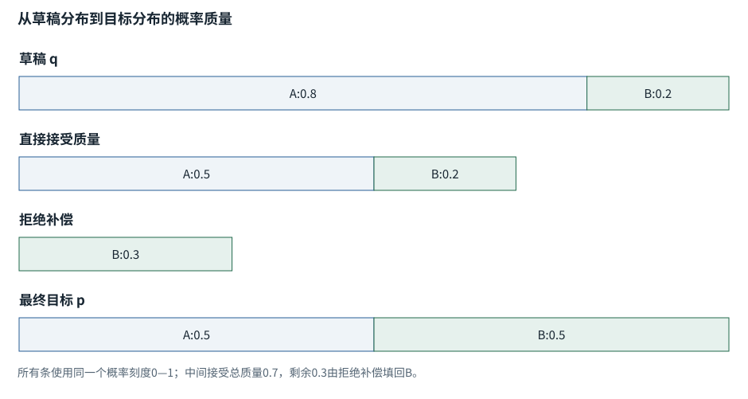
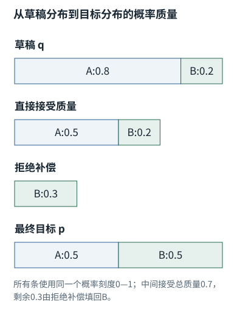

专题研修


<span id="section-0"></span>


# 05｜输出怎样被选中：采样、推测解码与停止条件

> 目标：能区分概率分布、解码算法和产品停止语义；能够推导推测解码的正确性，而不是只知道它“用小模型加速”。实验：`numerics.speculative_sample`。


<span id="visual-reading"></span>


<span id="topic-1"></span>


## 沿着对象与状态理解本章

采样、贪心和推测验证共享模型分数，却不共享选择规则。下图把每轮选择与下一轮输入分开。

下方图解的固定输入在“输入与适用条件”中声明。它用于解释本章机制，不与本章其他独立例子的数值暗中接续。


<span id="visual-F15"></span>

<span id="topic-2"></span>

<span id="topic-3"></span>

<span id="topic-4"></span>

<span id="topic-5"></span>

<span id="topic-6"></span>

<span id="topic-7"></span>


相关动态过程：[一次输入如何连着预测，直到结束](../../visual/F15.md)。本节下文继续展示更具体的计算与工程边界。

继续看相关机制：[F09 · Softmax不是直接把分数除以它们的和](../../visual/F09.md)[F19 · KV Cache：留下算过的，不省掉该读的](../../visual/F16.md)[O07 · 推测解码：草稿可以快，但必须正确校验](../../visual/O07.md)


<span id="c05-h1"></span>


## 1. 概率最高的下一Token，不等于最好的完整答案

贪心选择每一步最大概率Token，不保证全序列概率最大，更不保证业务最优。语言模型概率描述条件下的续写分布；任务价值可能由外部测试决定。Beam Search维护多个部分序列探索高概率路径，但长度偏置、重复与开放式文本的目标不匹配，都需要考虑。不能因为一种方法在翻译任务中适合，就默认用于交互式编码Agent。


<span id="concept-intro-2"></span>


先认识这里的对象与符号

[Top-k、Top-p与重新归一化](../../concepts.md#concept-topk)
:   Top-k保留概率最高的k项；Top-p按概率降序保留累计概率达到阈值的候选前缀。用于抽样时，被保留的候选需按剩余总质量重新归一化。这里k是候选数量，p是累计概率阈值；不是注意力Key表K，也不是表示维度d\_k。

温度把logits除以τ，τ较小使分布更集中，较大使分布更平缓。它不是“错误率旋钮”，不会把缺少证据的答案变成事实。Top-k保留固定数量的候选；Top-p选择累计概率达到阈值的最小候选集合，再归一化。两者若同时应用，顺序和服务实现会影响实际分布，需查具体接口。


<span id="concept-intro-3"></span>


先认识这里的对象与符号

[Schema与Structured Outputs](../../concepts.md#concept-schema)
:   Schema是一份字段和类型等结构规则；结构化输出机制让模型更容易返回符合规则的数据。字段合法仍不等于目标文件存在、已授权或业务正确。独立例：要求path为字符串；{"path":3}类型不合规则，{"path":"missing.py"}虽结构合规则仍可能找不到文件。


<span id="symbol-intro-2"></span>


先认识这里的对象与符号

[JSON：结构化文本，不是执行动作](../../concepts.md#concept-json)
:   JSON是一种用对象、数组、字符串、数字等表达数据的文本格式。花括号对象把字段名映射到值，方括号数组保留项目顺序。解析JSON只得到数据，不会自动执行其中的工具名称。独立例：{"path":"a.py","limit":3}有两个字段；"3"是字符串而3是数值，Schema可以要求其中一种。

在约束输出中，解码器还可能屏蔽不符合语法的Token。这样能帮助满足结构约束，但有三层必须分开：字节能否解析、结构是否满足Schema、字段是否符合业务事实。一个合法JSON仍可以包含不存在的文件路径。[[N17]](../sources.md#N17 "本地来源与核查范围")[[N18]](../sources.md#N18 "本地来源与核查范围")


<span id="c05-h2"></span>


## 2. 数值稳定与低概率事件

softmax中的减最大值避免指数溢出，却不会解决所有下溢或低精度舍入。若概率接近零，需要在对数域计算序列概率，避免直接连乘。不同算子融合、dtype和并行归约顺序可能让接近的logits排序变化，最终自回归放大成不同文本。这里不能推导出“结果不可复现，所以无需记录参数”；恰恰应记录模型/服务版本、种子支持情况、采样配置与环境。

评测多次运行时，不应把同一问题的十次回答当成十个独立业务场景。任务难度带来的相关性需要保留，第19章使用按任务配对的统计方法。单次低温成功尤其不能作为长期可靠性的充分证据。


<span id="mechanism-S05-2"></span>


<span id="topic-8"></span>


### 减最大值只换计算尺度，不改候选之间的概率

**本例条件：**沿用F09的候选A/B/C与分数[2,1,0]；不换输入、不加温度、不截断候选。下方把直接计算和稳定计算逐项对齐。

exp
:   把分数转为正数的指数函数。

分母
:   当前全部候选的指数之和。

平移
:   所有分数减去同一个常数。

**减最大值只换计算尺度，不改候选之间的概率**

![同一组分数 [2,1,0]，从计算到抽样](../../figures/17e2bb7203a74420.svg)



本图仅使用当前算例声明的输入；具体公式、来源和边界见紧邻正文。

[SVG图源](../../../diagrams/rendered/Q007-a7054aed922c.svg) · [原算例数据：Q007](../../../diagrams/source/mechanism-cases.json)

核对完整输入与结果

本图使用的数据与条件

| 计算路线 | 指数值与分母 | 最终概率 |
| --- | --- | --- |
| 直接算 | [7.389056,2.718282,1]；和11.107338 | [0.665241,0.244728,0.090031] |
| 减去最大值2 | [1,0.367879,0.135335]；和1.503215 | [0.665241,0.244728,0.090031] |
| 与Attention缩放比较 | 除√d\_k改变相对差值 | 通常会改变概率，不能混称稳定平移 |

#### 怎样把图中的变化读明白

直接路线与稳定路线的每个指数都相差同一倍exp(2)，分母也相差同一倍，所以分子分母一起约掉。

除√d\_k不是给全部分数加减常数。它会缩小分数差，通常使分布不那么尖锐；这是另一件事。

数值稳定仍有前提：一行若全是−∞，减最大值会出现−∞−(−∞)。应先处理“无可见Key”，而不是相信减最大值能修好一切。

**不要混淆：**直接用[2,1,0]/3得到[2/3,1/3,0]不是softmax；分数为负时，这样做还会产生非法负概率。

机制依据：[[TR]](../../sources.md#src-TR) [[F-PROB]](../../sources.md#src-F-PROB) [[SDPA-213]](../../mechanisms/sources.md#source-SDPA-213)。本例数字和宿主场景为明确给定的教学设定，不是商业模型输出或生产性能测量。


<span id="c05-h3"></span>


## 3. 推测解码：接受与拒绝补偿

设目标分布p、草稿分布q，都在同一Token空间。先从q抽样候选x，以`min(1,p(x)/q(x))`接受。如果拒绝，再从归一化的`max(p−q,0)`残差分布采样。被接受的Token贡献概率为`min(p(x),q(x))`；拒绝后补充恰好覆盖`max(p(x)−q(x),0)`。两部分相加恢复p。[[N12]](../sources.md#N12 "本地来源与核查范围")


<span id="concept-intro-1"></span>


先认识这里的对象与符号

[Σ：按下标逐项求和](../../concepts.md#concept-sum)
:   Σ是加法的简写。下标指出哪项在变化；没有被求和的下标保持不变。它不是一个额外参数，也不表示把数组拼在一起。独立微例：Σᵢ xᵢyᵢ，x=[1,2]、y=[3,4]，就是1×3+2×4=11。

```
接受质量 Ax = q(x) × min(1,p(x)/q(x)) = min(p(x),q(x))
总拒绝概率 R = Σx max(p(x)−q(x),0)
拒绝分支给x的质量 = R × max(p(x)−q(x),0)/R
两分支之和 = p(x)
```

这个一Token推导是本书实验验证的对象。完整多Token推测会先生成一段草稿，再用目标模型并行评估这些位置，顺序接受到第一次拒绝并补偿；若全部接受，可再生成一个目标Token。实现还要正确处理cache回退、截断、位置和批次，不能仅复制上述几行就称为完整高性能服务。

“保持分布”有条件：p与q必须是实际解码规则下的归一化分布，接受/残差计算正确。若目标使用Top-p而验证时用未截断的softmax，就不再是同一个p。草稿太差，拒绝过多，增加的计算可能超过节省。它提高的是计算调度效率，不是凭空让目标模型更聪明。


<span id="mechanism-S05-3"></span>


<span id="topic-9"></span>


### 拒绝草稿时的补偿，才保证目标分布不被带偏

**本例条件：**独立两候选分布：草稿q=[0.8,0.2]，目标p=[0.5,0.5]。一次候选按q提出，再以min(1,p/q)接受；拒绝时从归一化max(p−q,0)补采样。

接受质量
:   提出概率乘接受概率。

残差
:   目标比草稿缺少的概率质量。

同分布
:   最终分布相同，不承诺同一随机种子逐Token一致。

**拒绝草稿时的补偿，才保证目标分布不被带偏**





本图仅使用当前算例声明的输入；具体公式、来源和边界见紧邻正文。

[SVG图源](../../../diagrams/rendered/Q031-33a94be314b9.svg) · [原算例数据：Q031](../../../diagrams/source/mechanism-cases.json)

核对完整输入与结果

本图使用的数据与条件

| 候选 | 直接接受质量 | 拒绝补偿后的总质量 |
| --- | --- | --- |
| A | 0.8×(0.5/0.8)=0.5 | 0.5 |
| B | 0.2×1=0.2 | 再补A被拒绝的0.3 → 0.5 |
| 残差分布 | max(p−q,0)=[0,0.3] | 归一化后只能选B |

#### 怎样把图中的变化读明白

只看接受步骤，B还只有0.2，距离目标0.5差0.3。拒绝补偿正好把草稿过度给A的那部分转回缺少的B。

若拒绝后直接按原目标p再抽，会错误地又给A一部分概率，因此不是同一保证。

真实推测解码把多个候选交给目标模型批量验证；收益还依赖接受率与验证成本。这里只核对单步概率守恒。

**不要混淆：**省去修正采样可能更简单，却会改变生成分布；不能同时声称“任意拒绝处理”和“严格保留目标分布”。

机制依据：[[SPECULATIVE]](../../sources.md#src-SPECULATIVE)。本例数字和宿主场景为明确给定的教学设定，不是商业模型输出或生产性能测量。


<span id="c05-h4"></span>


## 4. 实验读数与能证明的范围

`speculative_sample`用小词表、固定p/q和大量抽样，比较经验频率与目标概率。统计误差不应要求逐项完全相等；代码使用明确容差并固定随机种子便于复查。还应分别测试q=p、支持集边界、强错配分布。若永远直接接受草稿，经验频率应偏向q，构成负对照。

这次实验没有GPU，没有服务端批处理，更没有商业模型加速测量。因此只能证明接受/拒绝机制的教学实现与分布一致性，不能声称“推理速度提高几倍”。性能验证需要固定模型、硬件、序列分布、batch与端到端计时，并同时检查输出分布/质量。


<span id="c05-h5"></span>


## 5. 文本停止、响应完成与业务完成


<span id="symbol-intro-1"></span>


先认识这里的对象与符号

[BOS / EOS：序列边界标记](../../concepts.md#concept-bos-eos)
:   BOS通常表示序列起始，EOS表示结束的特殊Token；具体模型和消息模板可能使用不同名称、数量及结束标记。它们是输入/输出协议中的符号，不是语义正确性的证明。遇到EOS不自动切断两个训练样本之间的注意力；要隔离读取还需mask或实现支持的样本边界。

生成停止可能因为EOS、停止字符串、最大输出Token、取消、网络中断、服务错误或工具调用交接。它们不是同一种“完成”。在API层，应读取响应状态、错误和输出项类型；在Agent层，应检查是否仍有待执行工具或未完成验收。[[N17]](../sources.md#N17 "本地来源与核查范围")[[N19]](../sources.md#N19 "本地来源与核查范围")


<span id="concept-intro-4"></span>


先认识这里的对象与符号

[SSE、chunk、delta：不同的分片层](../../concepts.md#concept-sse)
:   SSE是服务端发送事件的文本协议；网络chunk是这次收到的一段字节；delta是某个输出项的增量内容。三者边界不保证重合。一个完整事件也未必意味着完整工具参数。参数可能先收到{"path":"a，后收到.py"}；必须组装并等协议规定的完成条件，不能见到片段就执行。

例如模型返回`finish_reason`或相应状态表明因长度停止，最后几行看起来像总结，也不能视为任务成功。工具参数可能只生成一半，不能执行。网络流关闭也不证明服务已结束，因为客户端可能只收到了前缀。第07章给出截断SSE的真实解析测试。

一个稳健停止器需要同时满足：没有未决操作、验收结果对应当前工件版本、预算未迫使错误退出、用户目标已达到或限制明确报告。模型一句“完成了”只是一个声明；确定性程序至少应核验可验证部分。


<span id="mechanism-S05-5"></span>


<span id="topic-10"></span>


### “输出停止”与“任务成功”要画在不同状态线上

**本例条件：**独立工具任务：模型先要求写入文件，再需要测试验证。下面列出几种停止事件，它们不是同一条时间线上的连续步骤。

响应结束
:   本次模型输出不再继续到来。

工具完成
:   获准动作已产生可核验结果。

任务完成
:   用户要求的验收条件已成立。

“输出停止”与“任务成功”要画在不同状态线上

| 观察到的事件 | 你能够确认 | 你不能据此确认 |
| --- | --- | --- |
| 出现EOS | 本次序列选择了终止标记 | 文件一定已正确修改 |
| 达到max\_output\_tokens | 生成预算用完 | JSON完整、答案正确 |
| 工具参数生成完 | 可以尝试解析/校验 | 工具已经执行 |
| 测试通过并绑定当前版本 | 本组检查对当前工件有效 | 没覆盖的需求也自动满足 |

各行是独立对象或条件的对照，不暗示上一行的结果自动进入下一行。

#### 怎样把图中的变化读明白

把“模型结束、工具结束、任务完成”设成不同字段，才能避免结束标记触发假成功。

长度限制可能把JSON截在半个字段，应该记录不完整而不是把收到的文本强行当合法调用。

工具调用响应结束后，外层Agent仍可能要执行、回填、再次调用模型。内外两种循环的停止条件不同。

**不要混淆：**取消请求不证明远端副作用已取消；取消后仍应核对在途操作状态。

机制依据：[[TOOLS]](../../sources.md#src-TOOLS) [[STREAM]](../../sources.md#src-STREAM) [[GENERATION]](../../sources.md#src-GENERATION)。本例数字和宿主场景为明确给定的教学设定，不是商业模型输出或生产性能测量。


<span id="c05-h6"></span>


## 6. 最佳实践不是固定采样参数

创意构思、精确配置生成、长链工具执行需要不同的候选多样性与验证方式。与其设一个永远适用的温度，不如先确定成功标准与失败代价，再在真实任务集上选择。允许小模型生成候选、大模型或测试挑选，必须计算完整候选成本，不能只统计最终一个回答。

对工具动作尤其要区分“生成多样性”与“副作用多样性”。可以生成多个方案并比较，但不能让每个方案都向生产数据库执行一次。候选探索应尽量发生在无副作用环境，真正提交前做授权与状态检查。


<span id="worked-S05"></span>


运行示例 · S05


<span id="topic-11"></span>


### 同一概率表，核采样与贪心的可选集合不同

**输入与条件。**概率从高到低为[0.5,0.3,0.15,0.05]，不做其他过滤。


<span id="mechanism-original-worked-S05"></span>


| 步骤与对象 | 内部动作 | 中间结果 / 新状态 |
| --- | --- | --- |
| 1贪心 | 始终选第1项 | 概率表并未转成文本，仍需查Token。 |
| 2Top-k=2 | 保留前两项 | 归一化后[0.625,0.375]。 |
| 3Top-p=0.9 | 累计到第3项才达到0.95 | 通常保留前三项并重归一化。 |
| 4核内概率 | 除以0.95 | 约[0.526316,0.315789,0.157895]。 |
| 5边界 | 若实现先top-k再top-p | 候选集与顺序不同，需要记录生成配置。 |

**把过程连起来。**采样选项改变可选集合或概率，不是模型已经生成一句话以后再删字。

**边界与反例。**具体等于阈值的保留规则与最少保留项数依实现；本例声明累计越过阈值仍保留越过项。

依据与适用范围：[[DERIVE]](../../example-sources.md#ex-src-DERIVE)。示例输入和场景由本书明确设定。


<span id="c05-h7"></span>


## 7. 验收题与参考解答

为什么推测解码拒绝后不能直接从p重新采样？因为接受分支已经贡献了`min(p,q)`，再按整个p补充会重复分配一些质量；正确补偿是正残差分布。证明应写出两条分支对每个Token的总概率，而不是用“看起来差不多”回答。

为什么JSON解析成功后仍要验证工具参数？因为解析只说明字符构成合法对象；路径是否越界、目标对象是否存在、权限是否允许、请求是否陈旧，都不由语法保证。解码与执行是不同可信边界。

AI系统工程：从基础到内部  
[全书目录](../../contents.md) · [术语与符号](../../glossary.md) · [参考资料](../../sources.md)