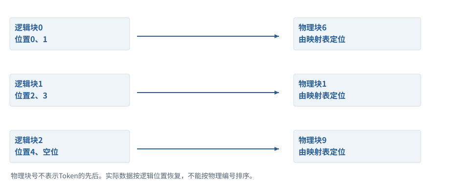
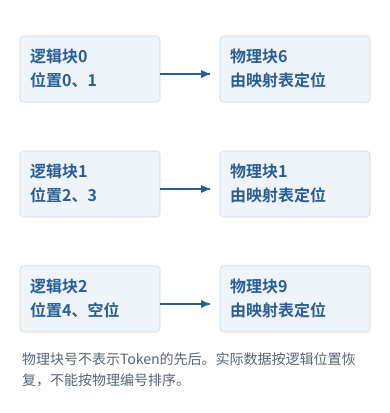
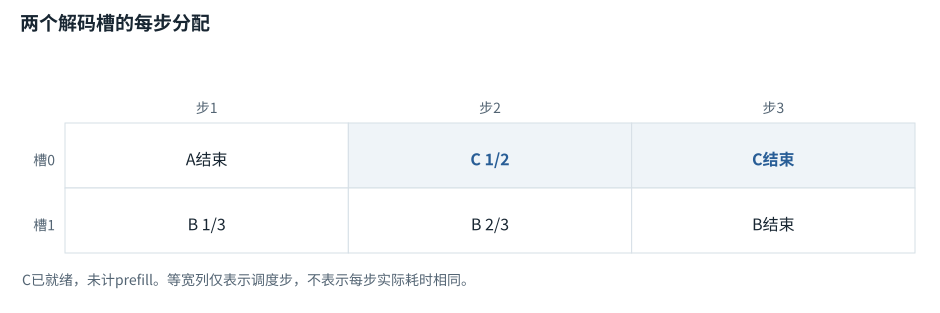
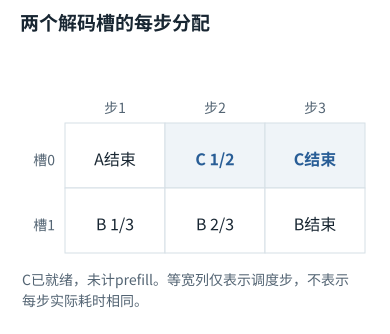

专题研修


<span id="section-0"></span>


# 06｜推理服务的真实瓶颈：内存、FlashAttention、分页与调度

> 目标：从张量尺寸推导服务成本，知道一次优化减少的是计算、内存搬运、碎片还是排队；能够避免用CPU恒等式实验冒充GPU性能结果。


<span id="visual-reading"></span>


<span id="topic-1"></span>


## 沿着对象与状态理解本章

服务优化要先定位搬运、重复计算、碎片和调度各自的占比，再选择技术。

下方图解的固定输入在“输入与适用条件”中声明。它用于解释本章机制，不与本章其他独立例子的数值暗中接续。


<span id="visual-O04"></span>

<span id="topic-2"></span>

<span id="topic-3"></span>

<span id="topic-4"></span>

<span id="topic-5"></span>

<span id="topic-6"></span>

<span id="topic-7"></span>


相关动态过程：[FlashAttention：一边读一边累计，不攒整张表](../../visual/O04.md)。本节下文继续展示更具体的计算与工程边界。

继续看相关机制：[F19 · KV Cache：留下算过的，不省掉该读的](../../visual/F16.md)[O01 · GQA/MQA：减少的是K/V组数](../../visual/O01.md)[O05 · PagedAttention：逻辑连续，物理可以分块](../../visual/O05.md)


<span id="c06-h1"></span>


## 1. Prefill与Decode的资源画像

Prefill处理整个输入前缀，矩阵运算通常具有更高并行度；Decode每步只新增少量位置，却需要读取模型权重和增长的KV。具体瓶颈取决于batch、模型、精度与硬件，不能绝对说前者总是算力受限、后者总是带宽受限。它们是常见分析方向，不是无需测量的结论。[[N11]](../sources.md#N11 "本地来源与核查范围")

以注意力为例，完整前缀长度T的分数矩阵规模为T²；标准全注意力的计算随T²增长。缓存解码时一个新位置对历史T个键评分，单步该部分约随T增长，整个长序列累积仍有相应代价。把KV缓存理解成“以后不需要处理历史”是错误的：省掉的是旧位置K/V重算，不是读取历史注意力所需的数据。


<span id="c06-h2"></span>


## 2. Roofline思考：算力还是数据移动


<span id="concept-intro-4"></span>


先认识这里的对象与符号

[HBM、SRAM与带宽](../../concepts.md#concept-memory-hardware)
:   HBM在此指GPU较大容量的高带宽显存；SRAM相关片上存储通常更小、访问更近。带宽是一段时间能搬多少字节；算术强度是计算量相对于数据搬运量的比值。独立记账：执行100次运算搬10字节，约10次运算/字节。它不是实际硬件性能测量。

设一次操作需要F个浮点运算，搬运M字节，设备峰值算力P和带宽W。粗略下界可写为`时间≥max(F/P,M/W)`，实际还有启动、同步、通信、调度和利用率损失。算术强度F/M帮助判断优化方向。


<span id="concept-intro-5"></span>


先认识这里的对象与符号

[FLOPs与FLOP/s：数量与速率](../../concepts.md#concept-flops)
:   FLOPs通常表示浮点运算数量；FLOP/s表示每秒的运算速率。论文或厂商对乘加计一次还是两次可能不同，需要固定口径。不能只用总运算量除理论峰值就承诺真实耗时：搬运、排队、通信和实际利用率也有成本。

例如减少中间矩阵写回能改善内存受限部分，即使数学运算次数略增加，仍可能更快。反过来，对已经算力饱和的部分，增加重新计算可能变慢。不能只凭FLOPs数量或GPU利用率一个数字判断服务瓶颈；需结合内存带宽、算子时间、队列和请求分布。


<span id="c06-h3"></span>


## 3. FlashAttention为什么能不保存完整注意力矩阵


<span id="concept-intro-2"></span>


先认识这里的对象与符号

[FlashAttention：改变中间数据存取方式](../../concepts.md#concept-flash)
:   通过分块和在线归一化等方式，避免把完整注意力分数/权重矩阵长期写到较慢显存；目标仍是同一个注意力运算，浮点舍入可随运算次序变化。它不是把Token永久压缩，也不是跳过所有Key。区分“不把整张表落显存”与“没有进行这些数学计算”。

普通实现可能把`S=QKᵀ/√d`、softmax概率等T×T矩阵写入高带宽内存。分块算法在更近的片上存储中处理块，并维护归一化统计，使结果不必依赖完整矩阵同时存在。FlashAttention针对这种IO问题组织精确注意力计算，而不是把全注意力变成线性注意力。[[N10]](../sources.md#N10 "本地来源与核查范围")


<span id="concept-intro-1"></span>


先认识这里的对象与符号

[Σ：按下标逐项求和](../../concepts.md#concept-sum)
:   Σ是加法的简写。下标指出哪项在变化；没有被求和的下标保持不变。它不是一个额外参数，也不表示把数组拼在一起。独立微例：Σᵢ xᵢyᵢ，x=[1,2]、y=[3,4]，就是1×3+2×4=11。

对于一个查询行，已处理分数的最大值m、指数和l、未归一化加权和a为：`l=Σexp(s−m)`，`a=Σexp(s−m)v`。看到新块S、V时：

```
m' = max(m, max(S))
l' = exp(m−m') l + Σ exp(S−m')
a' = exp(m−m') a + Σ exp(S−m') V
最终输出 O = a/l
```

为什么需要重缩放旧统计？新块最大值更大时，旧l和a是相对于旧m计算的，必须转成相对于m'的尺度。只更新m而不重缩放，会给不同块错误权重，结果随分块方式变化。这是值得故意注入的错误。


<span id="symbol-intro-1"></span>


先认识这里的对象与符号

[Dropout：训练中的随机置零规则](../../concepts.md#concept-dropout)
:   常用倒置Dropout在训练时按丢弃概率p随机将元素置零，保留项除以1-p以保持期望量级。评估模式通常关闭这一随机操作；底层函数可能要求调用者显式传p=0。独立例：p=0.5，某值2在一次掩码中被保留则输出4，被丢弃则0。这不是训练把对应模型参数永久删掉。

本书`online_attention`实现上述恒等式，并与普通softmax注意力比较不同块大小。它没有CUDA核、共享内存布局、反向算子或硬件性能测量。反向中可利用保存的统计重算部分概率，换取不保存完整矩阵的空间收益；生产实现还必须处理mask、dropout、数值类型和批量布局。


<span id="mechanism-S06-3"></span>


<span id="topic-8"></span>


### 不存完整softmax表，也能把前后块合成同一答案

**本例条件：**独立标量Value例：分数s=[0,ln2]，值v=[10,20]。分别处理一项；保存运行最大值m、指数和l、加权和o，最后输出o/l。

m
:   当前已看部分的最大分数。

l
:   以当前m为基准的指数和。

o
:   同一基准下指数乘Value的和。

不存完整softmax表，也能把前后块合成同一答案

| 处理状态 | m / l / o | 解释 |
| --- | --- | --- |
| 块1：s=0,v=10 | 0 / 1 / 10 | 先有一个候选 |
| 加入块2，m变ln2 | 旧l缩半=0.5；旧o缩半=5 | 换基准时两份统计一起缩放 |
| 合并第二项 | ln2 / 1.5 / 25 | 新项指数1，贡献20 |
| 输出 | 25/1.5=16.666667 | 等于(10×1+20×2)/(1+2) |

各行是独立对象或条件的对照，不暗示上一行的结果自动进入下一行。

#### 怎样把图中的变化读明白

最容易漏的是第二行：最大值变了，旧指数统计也必须改到同一基准。只加新项而不缩放旧项，最后就不是同一个softmax。

l只要一个标量，o按Value宽度保存一排数，不必把每个位置的完整概率都写到外部显存。

FlashAttention利用分块和在线归一化减少IO；这不表示少看几个Token，也不等于近似稀疏注意力。

**不要混淆：**本例证明合并恒等式，不是GPU性能测量；实际速度取决于核实现、形状、dtype和硬件。

机制依据：[[FLASH]](../../sources.md#src-FLASH) [[TR]](../../sources.md#src-TR)。本例数字和宿主场景为明确给定的教学设定，不是商业模型输出或生产性能测量。


<span id="c06-h4"></span>


## 4. 分页KV缓存解决的是分配与共享


<span id="concept-intro-3"></span>


先认识这里的对象与符号

[PagedAttention：分页管理K/V存储](../../concepts.md#concept-paged)
:   把逻辑连续的K/V序列存到多个物理块，通过块表定位。它主要改变存储管理与共享方式，不把注意力公式替换成另一种语义算法。独立例：逻辑位置0—3在物理块7、4—7在块2；逻辑第4个位置不必物理紧跟第3个位置。

长请求长度不一，若每条请求预留连续最大KV空间，容易造成浪费与碎片。PagedAttention把逻辑Token位置映射到固定大小的KV块，物理块可以非连续；共享前缀可引用共享块，分叉写入时需要合适的共享/复制规则。[[N11]](../sources.md#N11 "本地来源与核查范围")

块太小，元数据、寻址与管理成本上升；块太大，最后一个块的内部碎片增大。缓存压缩与量化是另外的技术，分页本身并不自动减少每个有效Token的K/V数值字节数。也不能因为底层共享物理前缀，就忽略租户隔离或缓存侧信道。

服务调度必须知道多少KV容量可以分配。允许过多长请求同时进入，可能导致抢占、换出或失败；单看RPM限额无法反映这种压力。可以分别限制在途Token、请求数、输出上限，并在调度中考虑服务质量目标。


<span id="mechanism-S06-4"></span>


<span id="topic-9"></span>


### 分页改变物理存放，不改变Token的逻辑次序

**本例条件：**独立KV分配例：每块容纳2个位置，序列有5个位置；逻辑块0/1/2分别映射物理块6/1/9。

逻辑位置
:   Token在这条序列里的顺序。

物理块
:   显存里实际可分配的存储单元。

块内偏移
:   一个Token在当前块的第几格。

**分页改变物理存放，不改变Token的逻辑次序**





本图仅使用当前算例声明的输入；具体公式、来源和边界见紧邻正文。

[SVG图源](../../../diagrams/rendered/Q028-63a59c0b3045.svg) · [原算例数据：Q028](../../../diagrams/source/mechanism-cases.json)

核对完整输入与结果

本图使用的数据与条件

| Token位置 | 逻辑块 + 块内偏移 | 物理地址示意 |
| --- | --- | --- |
| 0 | 0 + 0 | 物理块6，第0格 |
| 1 | 0 + 1 | 物理块6，第1格 |
| 2 | 1 + 0 | 物理块1，第0格 |
| 3 | 1 + 1 | 物理块1，第1格 |
| 4 | 2 + 0 | 物理块9，第0格；另一格闲置 |

#### 怎样把图中的变化读明白

按位置2读取时，先算整除2得到逻辑块1，再查映射得到物理块1。物理编号小并不表示它更早。

这条序列不需要占一整段连续大空间；结束后可以按块释放。共享前缀还需要引用计数和写时复制等语义。

分页主要改内存管理。位置规则、可见范围和Key/Value内容仍必须对应原序列，不能因为存储分散而重排Token。

**不要混淆：**最后一块只用了半块，仍有内部碎片。分页不是零浪费，也不是用普通磁盘交换代替显存。

机制依据：[[PAGED]](../../sources.md#src-PAGED)。本例数字和宿主场景为明确给定的教学设定，不是商业模型输出或生产性能测量。


<span id="c06-h5"></span>


## 5. Continuous Batching与公平性

静态batch等一组请求一起完成，新请求不能及时加入；连续批处理在迭代边界加入或移除请求，提高设备利用率。但一个长prefill可能阻塞已经在decode的短请求，影响逐Token延迟。将prefill分块、分离不同阶段或设计公平调度，都有额外复杂度和硬件条件。


<span id="concept-intro-6"></span>


先认识这里的对象与符号

[TTFT、TPOT、p95与吞吐](../../concepts.md#concept-latency)
:   TTFT是请求到首个输出Token的延迟；TPOT描述后续每Token时间的统计；p95是某窗口里约95%观测不超过的分位数；吞吐是单位时间完成量。要说明计时起止。首字快不代表任务快：工具执行可能还要很久。理论峰值吞吐也不等于某个用户的延迟。

[SLI、SLO与错误预算](../../concepts.md#concept-slo)
:   SLI是实际测量的服务水平指标；SLO是该指标的目标；错误预算是相应目标允许的失败空间。它们是服务运行管理对象，不是模型参数。“API返回200”可能不是用户成功；有些业务应以限定时间内正确完成任务的比例定义指标。

指标要分开：TTFT看首次响应，TPOT看输出Token间隔，端到端时间看用户任务，多租户还要看尾延迟。为了吞吐提高batch，可能牺牲交互体验；为了最低延迟，每次只跑一条，又可能降低资源利用率。所谓最优只能针对负载与SLO定义。


<span id="concept-intro-7"></span>


先认识这里的对象与符号

[Little定律：L=λW的局部记号](../../concepts.md#concept-little)
:   队列记账中，L表示平均在系统中的任务数，λ是平均到达率，W是平均停留时间；在稳定等适用条件下L=λW。这里W不是投影矩阵，L不是模型层数。独立例：每秒平均到达2项、平均停留3秒，则平均在系统约6项；不能拿瞬时尖峰直接替代长期平均。

Little定律在稳定系统中给出`在途量L=到达率λ×平均逗留时间W`。它不描述具体队列尾部分布，却能帮助检查容量规划是否自洽。接近饱和后延迟非线性上升，不能用低负载单请求基准直接预测生产峰值。


<span id="mechanism-S06-5"></span>


<span id="topic-10"></span>


### 连续组批把空出来的槽给新请求，但调度步不等于等长时间

**本例条件：**独立离散调度例：两个decode槽；A还需1个Token，B还需3个Token，C已就绪且需2个Token。本图仅按调度步比较，不模拟prefill耗时。

槽
:   某次调度可一起处理的一条序列位置。

完成
:   满足这条请求的停止条件。

连续加入
:   不必等待同批所有请求都结束。

**连续组批把空出来的槽给新请求，但调度步不等于等长时间**





本图仅使用当前算例声明的输入；具体公式、来源和边界见紧邻正文。

[SVG图源](../../../diagrams/rendered/Q029-c6cdde06764d.svg) · [原算例数据：Q029](../../../diagrams/source/mechanism-cases.json)

核对完整输入与结果

本图使用的数据与条件

| 调度步 | 槽0 | 槽1 |
| --- | --- | --- |
| 1 | A生成最后一项，结束 | B生成1/3 |
| 2 | C加入，生成1/2 | B生成2/3 |
| 3 | C生成2/2，结束 | B生成3/3，结束 |

#### 怎样把图中的变化读明白

固定整批策略在A结束后可能让槽0等B；连续组批让C利用这个空档，提高设备利用率。

这里故意把C设为已经完成prefill，否则加入C还要处理长输入，可能挤占正在decode的B。真实调度要处理这种干扰。

比较性能要同时看吞吐、首Token等待与每Token间隔；总体多做了任务，某个短请求仍可能被排队拖慢。

**不要混淆：**图中三步等高是示意，不表示每步毫秒数相同，更不是产品实测的加速倍率。

机制依据：[[PAGED]](../../sources.md#src-PAGED) [[CACHE]](../../sources.md#src-CACHE)。本例数字和宿主场景为明确给定的教学设定，不是商业模型输出或生产性能测量。


<span id="c06-h6"></span>


## 6. Prompt缓存与KV缓存不要混为一个开关

模型内部KV缓存是推理状态；服务的前缀缓存可能复用跨请求前缀计算；计费层对缓存命中的定义又是产品契约。应用应稳定可复用的前缀，避免无关时间戳插入开头，但不能为缓存而继续携带已经错误或越权的内容。安全、正确性优先于命中率。[[N01]](../sources.md#N01 "本地来源与核查范围")[[N14]](../sources.md#N14 "本地来源与核查范围")

如果为了压缩删除中间历史，后续前缀可能变化，降低可复用部分。应比较剩余任务的总成本，而不只是这次压缩后输入少了多少。第12章给出压缩盈亏的计算方法。


<span id="c06-h7"></span>


## 7. 一份可信的性能实验应该包含什么

先保存模型版本、精度、硬件、服务配置、输入/输出长度分布、并发与warm-up方式。分别测无缓存/有缓存、短/长前缀、单请求/生产并发。输出p50/p95等延迟、吞吐、失败率、显存峰值和任务质量，不用一个最佳单点掩盖尾部问题。

验收题：NumPy分块注意力与普通注意力误差很小，能否认定FlashAttention优化完成？不能。它只验证数学子问题；GPU的布局、同步、实际IO和反向正确性仍待实现。将一种机制的正确性与某一生产系统的性能收益分开，是资深工程学习的底线。


<span id="worked-S06"></span>


运行示例 · S06


<span id="topic-11"></span>


### roofline估算为什么只能给下界，不能直接当实测

**输入与条件。**假想算子需1GFLOP和100MB十进制数据移动；设备峰值100TFLOP/s、带宽1TB/s。


<span id="mechanism-original-worked-S06"></span>


| 步骤与对象 | 内部动作 | 中间结果 / 新状态 |
| --- | --- | --- |
| 1计算下界 | 10^9/10^14 | 10微秒。 |
| 2搬运下界 | 10^8/10^12 | 100微秒。 |
| 3理想重叠 | 至少max(10,100) | 100微秒，而非保证110或100实测。 |
| 4实际损失 | 利用率、kernel启动、同步、缓存命中都可能变化 | 实际可以更慢，实际HBM流量也需正确测量。 |
| 5优化方向 | 若确为带宽瓶颈 | 降低读取或提高重用可能比单纯增加乘法吞吐更有用。 |

**把过程连起来。**性能模型帮助判断瓶颈方向，不能把纸面峰值替代运行测量。

**边界与反例。**单位采用MB=10^6、TB=10^12；不是任何实际GPU的规格或性能承诺。

依据与适用范围：[[FLASH]](../../example-sources.md#ex-src-FLASH)。示例输入和场景由本书明确设定。

AI系统工程：从基础到内部  
[全书目录](../../contents.md) · [术语与符号](../../glossary.md) · [参考资料](../../sources.md)