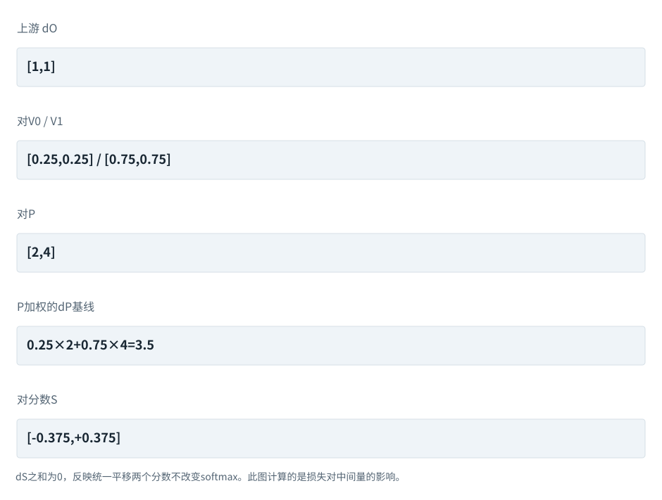
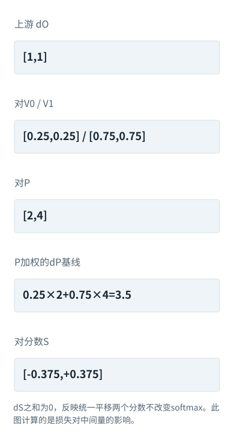
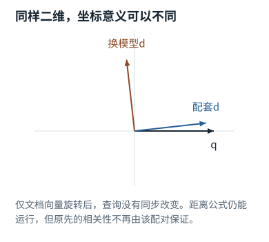

专题研修


<span id="section-0"></span>


# 31｜推导附章：注意力反向传播与可训练检索

> 目标：能沿计算图手工求导，再用数值实验验证；把模型“怎样学习”与前面“怎样推理”闭合。实验：[`attention_gradients.py`](../code/attention_gradients.md)，提供解析反向和有限差分。


<span id="visual-reading"></span>


<span id="topic-1"></span>


## 沿着对象与状态理解本章

反向推导中每个梯度对象都要对齐前向算子与shape；先看局部变化怎么传回去。

下方图解的固定输入在“输入与适用条件”中声明。它用于解释本章机制，不与本章其他独立例子的数值暗中接续。


<span id="visual-F18"></span>

<span id="topic-2"></span>

<span id="topic-3"></span>

<span id="topic-4"></span>

<span id="topic-5"></span>

<span id="topic-6"></span>

<span id="topic-7"></span>


相关动态过程：[训练：给每个位置一道“下一项”题](../../visual/F18.md)。本节下文继续展示更具体的计算与工程边界。

继续看相关机制：[F15 · 梯度像坡度，学习率像迈步大小](../../visual/F17.md)[O09 · Activation Checkpointing：少存一点，反向时重算](../../visual/O09.md)


<span id="c31-h1"></span>


## 1. 从单头注意力开始

设Q为m×d，K为n×d，V为n×dv，定义`S=QKᵀ/√d`，按行softmax得到P，输出`O=PV`。允许m不等于n，以覆盖缓存中新块查询面对完整历史的形状。设上游损失对输出梯度G为m×dv。

前向可以理解为两个步骤：用Q/K决定每行权重，再按权重混合V。反向同样分为权重路径和内容路径。这个推导来自矩阵微分与softmax导数，不需要把注意力拟人化。[[N07]](../sources.md#N07 "本地来源与核查范围")


<span id="c31-h2"></span>


## 2. 先对V和P求导

由`dO=dP·V+P·dV`及标量损失的迹形式，可得：


<span id="concept-intro-5"></span>


先认识这里的对象与符号

[∂、∇：偏导与梯度](../../concepts.md#concept-gradient)
:   ∂L/∂w询问保持其他独立变量不变时，w小幅改变会让损失L怎样变化。多个参数的这些变化率合成梯度∇L。它们是导数记号，不是把两个普通数直接相除。独立微例：L=w²时，w=3处的梯度为6。最简单更新w←w−η×6中，η是学习率。

```
∂L/∂V = Pᵀ G                    [n,dv]
∂L/∂P = G Vᵀ                    [m,n]
```

第一式表示每个Value从读取它的查询位置累计梯度。第二式表示若改变某个注意力权重，输出沿对应V方向变化会如何影响损失。形状核对是推导的一部分，不应只凭公式记忆。


<span id="mechanism-S31-2"></span>


<span id="topic-8"></span>


### 反向不是把前向箭头倒放，而是把“影响”按依赖分配

**本例条件：**独立单行算例：读取份额P=[0.25,0.75]，V0=[2,0]、V1=[0,4]；输出O=[0.5,3]，损失定义为O两格相加，所以上游梯度dO=[1,1]。

dO
:   损失对输出每格的变化率。

dV
:   内容变化怎样影响损失。

dS
:   softmax之前分数的梯度。

**反向不是把前向箭头倒放，而是把“影响”按依赖分配**





本图仅使用当前算例声明的输入；具体公式、来源和边界见紧邻正文。

[SVG图源](../../../diagrams/rendered/Q012-44c51a6c882f.svg) · [原算例数据：Q012](../../../diagrams/source/mechanism-cases.json)

核对完整输入与结果

本图使用的数据与条件

| 反向对象 | 计算 | 结果 |
| --- | --- | --- |
| Value路径 | dV\_j=P\_j×dO | dV0=[0.25,0.25]；dV1=[0.75,0.75] |
| 份额路径 | dP\_j=dO·V\_j | [2,4] |
| 加权基线 | ΣP\_j dP\_j | 0.25×2+0.75×4=3.5 |
| 分数路径 | dS\_j=P\_j(dP\_j−3.5) | [-0.375,+0.375] |

#### 怎样把图中的变化读明白

最后一行一负一正：提高第二个分数会给总值更大的V1更多份额，同时挤走V0的份额，所以两项变化彼此耦合。

不能把softmax导数只写成p(1−p)而忽略其他候选；上面的减去加权基线正是把耦合算进去。

自动求导能正确求“你写的程序”的梯度，但若前向把未来位置放进来，它也只会忠实地对错误前向求导。

**不要混淆：**有限差分检查通过只说明梯度跟当前前向一致；还需独立检查掩码、目标和模型语义。

机制依据：[[TR]](../../sources.md#src-TR) [[F-AUTOGRAD]](../../sources.md#src-F-AUTOGRAD)。本例数字和宿主场景为明确给定的教学设定，不是商业模型输出或生产性能测量。


<span id="c31-h3"></span>


## 3. softmax的Jacobian不必显式建立


<span id="concept-intro-6"></span>


先认识这里的对象与符号

[Jacobian：多输出的导数表](../../concepts.md#concept-jacobian)
:   当函数有多个输入和输出，Jacobian用一张表记录每个输出对每个输入的偏导。J\_F表示函数F的这张表，不是训练数据里的新矩阵。独立微例：F([x₁,x₂])=[2x₁,3x₂]，J\_F=[[2,0],[0,3]]。残差x+F(x)的导数表为I+J\_F。


<span id="symbol-intro-1"></span>


先认识这里的对象与符号

[G、dQ、dW：反传里的中间梯度](../../concepts.md#concept-upstream)
:   G=∂L/∂O通常是后续运算传回的损失对当前输出O的梯度。反传伪代码把∂L/∂Q简写成dQ、∂L/∂W简写成dW；它们形状与被求导的对象对应，不是特征维度d乘Q。先有前向O=AV，再接收G，才能算dV=AᵀG和dA=GVᵀ；dA改变的是份额路径，dV改变的是内容路径。

对一行p，Jacobian是`diag(p)−ppᵀ`。直接建立n×n矩阵会浪费；设该行上游梯度为g，可写：


<span id="concept-intro-2"></span>


先认识这里的对象与符号

[Σ：按下标逐项求和](../../concepts.md#concept-sum)
:   Σ是加法的简写。下标指出哪项在变化；没有被求和的下标保持不变。它不是一个额外参数，也不表示把数组拼在一起。独立微例：Σᵢ xᵢyᵢ，x=[1,2]、y=[3,4]，就是1×3+2×4=11。

[⊙：逐元素乘，不是矩阵乘](../../concepts.md#concept-elementwise)
:   逐元素乘把形状对齐后的同位置数相乘，不沿某个维度再求和。公式的并排矩阵或@通常表示矩阵乘，二者不可互换。独立微例：[1,2]⊙[3,4]=[3,8]，点积则为11。门控前馈里的⊙是在每个特征上调节另一路。

```
ds = p ⊙ (g − Σj pj gj)
```

把所有行组合：`D_S=P⊙(D_P−rowsum(P⊙D_P))`。这一步使每行分数梯度和为零，与给整行分数加同一常数不改变softmax的性质一致。

若某位置被固定mask屏蔽，P为零，其对应分数梯度也应为零。全mask行则没有有效概率分布，本书显式拒绝。生产核若采用其他语义，需要在前向与反向保持一致。


<span id="c31-h4"></span>


## 4. 再传回Q与K

```
∂L/∂Q = D_S K / √d              [m,d]
∂L/∂K = D_Sᵀ Q / √d            [n,d]
```

注意K与V虽然都来自历史位置，梯度路径不同。Q/K影响选择权重，V影响被聚合内容。若只对V反向而不对Q/K反向，模型可能学到输出内容，却无法正确学习注意力匹配。


<span id="concept-intro-1"></span>


先认识这里的对象与符号

[Query、Key、Value：三种中间数值表示](../../concepts.md#concept-qkv)
:   q是接收信息的一行查询表示；k是可读位置提供的一行匹配表示；v是该位置供混合的一行内容表示。大写Q/K/V把多行收集成表。它们由输入与参数计算得到，分别承担打分与提供内容的职责。某个q与两个k点积得到两个分数；softmax得到两个份额；这些份额分别乘两行v，再相加。这里不生成搜索词，也不直接选答案。

Q、K、V若都由同一个X通过不同投影产生，X梯度是三条路径贡献之和；每个投影权重梯度分别由输入转置乘对应输出梯度得到。残差支路还要把上游梯度直接加回。多头实现只是额外的形状重排和各头计算，最后合并处同样需要正确逆变换。


<span id="mechanism-S31-4"></span>


<span id="topic-9"></span>


### 从注意力分数继续传回Q、K和投影参数

**本例条件：**独立可复算单查询例：Q=[0,√2·ln3]，K为2×2单位矩阵，V=[[2,0],[0,4]]，按√2缩放。于是分数[0,ln3]、份额P=[0.25,0.75]，输出O=[0.5,3]。取损失L=O0+O1。

dS
:   损失对缩放后分数的梯度，本例[-0.375,0.375]。

dQ、dK
:   分别追踪Query和Key每格对损失的影响。

XᵀdQ
:   只有Q=XWq时，才可据此计算投影参数的梯度。

从注意力分数继续传回Q、K和投影参数

| 回传位置 | 公式与输入 | 结果 |
| --- | --- | --- |
| 对Q | dQ=dS·K/√2 | [-0.265165,+0.265165] |
| 对K | dK=dSᵀ·Q/√2 | [[0,-0.411980],[0,+0.411980]] |
| 对Wq | 另设X=[1,2]，Q=XWq | dWq=XᵀdQ |
| 参数矩阵梯度 | 每个输入特征乘对应dQ | [[-0.265165,0.265165],[-0.530330,0.530330]] |

各行是独立对象或条件的对照，不暗示上一行的结果自动进入下一行。

#### 怎样把图中的变化读明白

先找到计算发生的那条边。分数S是QKᵀ再除以√2，所以对Q或K反传时，这个缩放系数也必须出现；只把dS乘回去会放大梯度。

dK有两行，因为有两个Key位置；Q只有一行，因此dQ也只有一行。梯度的形状必须与被求导的对象一致，但形状正确仍不能证明缩放与转置正确。

为了继续回到Wq，本例选择X=[1,2]，Wq=[[0,√2·ln3],[0,0]]，确保真的产生前面给定的Q。投影权重在多个位置共享时，还要对各位置的贡献求和。

**不要混淆：**图中没有运行训练迭代。它核对的是一次前向与一次局部反向的数学关系；实际实现还要考虑batch、头、mask以及其他损失路径。

机制依据：[[TR]](../../sources.md#src-TR) [[F-AUTOGRAD]](../../sources.md#src-F-AUTOGRAD)。本例数字和宿主场景为明确给定的教学设定，不是商业模型输出或生产性能测量。


<span id="c31-h5"></span>


## 5. RoPE、RMSNorm与门控的反向直觉

RoPE对固定位置是正交线性变换，反向使用旋转矩阵转置，也就是相反角度旋转上游梯度。位置频率若固定，不需要对它优化；若某种架构学习相关参数，则计算图不同，不应一概而论。


<span id="concept-intro-4"></span>


先认识这里的对象与符号

[Norm、LayerNorm、RMSNorm：不是概率归一化](../../concepts.md#concept-norm)
:   Norm在层公式中表示一个规范化函数。LayerNorm通常按一个Token的特征减均值、除标准差，再缩放平移；RMSNorm通常不减均值，按均方根缩放。它们不等于softmax。独立微例，忽略稳定分母用的小正数ε与可学缩放：LayerNorm([1,3])=[-1,1]；RMSNorm([1,3])=[1/√5,3/√5]。

[γ、β、ε：参数与稳定常数要分开](../../concepts.md#concept-norm-params)
:   在LayerNorm式子中，γ是一排可学习乘法系数，β是一排可学习加法系数；ε是人为设置的小正数，放在分母相关项中避免除零等问题。计算得到的均值μ、方差σ²又是本次数据的统计量。γ=1、β=0常表示每个特征都用1和0，不是一份输入词义。DPO里的β另指目标函数系数，不能套用这里的意思。

RMSNorm设`r=sqrt(mean(x²)+ε)`，`y=γ⊙x/r`。令`g=上游⊙γ`，则输入梯度为`g/r−x·mean(g⊙x)/r³`。这是直接项减去归一化尺度反馈项。把归一化当常数，会丢掉第二项，梯度错误但前向看起来正常。


<span id="concept-intro-3"></span>


先认识这里的对象与符号

[SiLU：输入乘一份门控系数](../../concepts.md#concept-silu)
:   SiLU(x)=x×sigmoid(x)。先把x映射到0与1之间，再乘回x本身，形成非线性。负数不会像ReLU那样一律变为0。独立微例：SiLU(0)=0；SiLU(1)约0.731059；SiLU(-1)约-0.268941。

[SwiGLU、Wg/Wu/Wd：两路变换再合成](../../concepts.md#concept-swiglu)
:   这是门控前馈结构。Wg生成要过SiLU的一路，Wu生成另一条内容路径，两路逐元素相乘，再用Wd映回原宽度。这些W是三组参数，不是三个Agent。读(SiLU(XWg)⊙XWu)Wd时，先算XWg和XWu，再SiLU，再⊙，最后乘Wd。每个位置独立用同一组参数。

SwiGLU由乘法门控组成，两个分支都应接收另一分支值乘以上游的梯度。SiLU还需要自身导数。实现时先验证单算子，再组合整层，通常比只看最终训练loss更容易定位。


<span id="c31-h6"></span>


## 6. 有限差分与自动求导如何配合

本书以`L=sum(O⊙G)`构造标量目标，对Q/K/V每个元素分别加减ε，比较数值梯度与解析梯度。小矩阵上代价可接受；大模型则只抽样部分维度或做方向导数检查。

ε过大，截断误差明显；过小，浮点舍入放大。使用float64、适中数值和明确容差更容易发现逻辑错误。配套测试比较非方形mask下的三类梯度，并验证仅首行输出参与损失时未来K/V梯度为零。

自动求导不是不需要验证。错误mask、错误标签或错误维度会让自动求导忠实计算“错误目标”的梯度。有限差分也只能证明相对于当前前向实现的导数，不能证明前向语义正确。因此需要数学不变性、负对照与任务测试共同形成证据。


<span id="c31-h7"></span>


## 7. Dense Retriever怎样学习“相关”

双塔检索可对一条查询q、正例d+和多个负例dj计算对比损失：

```
L = −log exp(s(q,d+)/τ) / Σj exp(s(q,dj)/τ)
```

它推动正例相对候选更相似，而不是保证绝对距离有统一业务意义。batch内负例提高效率，但可能包含实际上也相关的文档，形成假负例；困难负例能训练细区分，也可能引入标签错误。[[N70]](../sources.md#N70 "本地来源与核查范围")

如果训练数据只区分主题相关与不相关，模型可能无法区分同主题的新旧版本、肯定与否定。对代码检索，需要与实际任务相符的正负样本和评价。增加向量维度不会自动补上目标缺陷。

重排模型可以学习更细的查询—文档交互，但其训练标签若偏爱长文或某种格式，也会带来偏差。检索训练与第19章的评测设计必须共同考虑。


<span id="mechanism-S31-7"></span>


<span id="topic-10"></span>


### 向量同维度，不代表能放在同一个相似度空间

**本例条件：**独立二维示意：查询编码器q输出[1,0]，配套文档编码器的相关文档为[0.9,0.1]。另一个模型把所有方向旋转90°，维度仍为2。

双编码器
:   查询与文档分别编码，用共同训练目标对齐。

相似度空间
:   坐标所代表的关系来自训练，不是维度名称。

归一化
:   把长度标准化，常用于余弦或内积比较。

**向量同维度，不代表能放在同一个相似度空间**




本图仅使用当前算例声明的输入；具体公式、来源和边界见紧邻正文。

[SVG图源](../../../diagrams/rendered/Q059-a6b180a21662.svg) · [原算例数据：Q059](../../../diagrams/source/mechanism-cases.json)

核对完整输入与结果

本图使用的数据与条件

| 配对 | 向量关系 | 能否直接比较 |
| --- | --- | --- |
| 同一训练对齐空间 | q=[1,0]；d=[0.9,0.1] | 可按约定相似度排序 |
| 只更换文档模型 | d旋转为[-0.1,0.9] | 维度相同，排名含义变了 |
| 两个端同时匹配升级 | 重建文档索引并用新查询模型 | 还需重新评测相关性 |

#### 怎样把图中的变化读明白

数据库只会按数值算距离，不知道查询与文档是不是同一个训练空间。形状检查通过仍可能让检索全部失真。

训练常用正确文档对与负例让相关项分数更高；这与“句子意思看起来近似”不是完全同一目标。

升级索引要记录编码器ID、归一化方法、维度与版本；否则同一索引里可能混入不同坐标系。

**不要混淆：**向量相似度高不能替代条件核验，例如“允许”和“不允许”共享很多语义特征但结论相反。

机制依据：[[DPR]](../../sources.md#src-DPR) [[COLBERT]](../../sources.md#src-COLBERT)。本例数字和宿主场景为明确给定的教学设定，不是商业模型输出或生产性能测量。


<span id="c31-h8"></span>


## 8. 这个附章如何使用

先运行现有实验，再故意删掉softmax导数中的行内减项，观察有限差分失败；接着删mask，观察因果梯度测试失败。最后比较PyTorch训练中的自动求导与手工推导，理解两者并不竞争：一个用于高效实现，一个用于验证与理解。

本章达标是能解释某个梯度为什么这样流动，能用实验抓住错导数，并知道实验的逻辑边界。它不等于已经掌握完整分布式训练或GPU反向kernel实现。


<span id="worked-S31"></span>


运行示例 · S31


<span id="topic-11"></span>


### 用一个方向导数核对矩阵反传是否接对

**输入与条件。**函数f(Q)=上游G与Attention输出的点积；解析梯度已算得dQ=[0.5615202771,−0.1871734257]，方向v=[1,−2]。


<span id="mechanism-original-worked-S31"></span>


| 步骤与对象 | 内部动作 | 中间结果 / 新状态 |
| --- | --- | --- |
| 1解析方向导数 | dQ·v | 约0.9358671285。 |
| 2有限差分 | 取ε=10^-6，算(f(Q+εv)−f(Q−εv))/(2ε) | 应接近同一数。 |
| 3坐标检查 | 再对Q/K/V每个元素分别扰动 | 能定位转置或softmax雅可比错误。 |
| 4容差 | 比较绝对/相对误差 | 不是要求浮点小数逐字相同。 |
| 5模型边界 | 通过梯度检查只证明这个算子实现 | 不证明训练数据或整个Agent任务正确。 |

**把过程连起来。**从数学公式到代码，最有价值的示例之一是能用独立数值方法反证错误实现。

**边界与反例。**示例采用可微且不处于mask/选择变化边界的输入；有限差分在不连续点与低精度下要谨慎。

[查看本例程序结果](../../example-verification.md#result-S31) · [完整可运行代码](../../example-verification.md#code)

依据与适用范围：[[DERIVE]](../../example-sources.md#ex-src-DERIVE)。示例输入和场景由本书明确设定。


<span id="worked-X08"></span>


运行示例 · X08


<span id="topic-12"></span>


### 让检索向量学习：查询向量真的往哪个方向移动

**输入与条件。**查询q=[1,0]，正例a=[0.8,0.6]，负例b=[0,1]。使用点积分数、两候选softmax和正例交叉熵；本步只更新q，不更新a、b。


<span id="mechanism-original-worked-X08"></span>


| 步骤与对象 | 内部动作 | 中间结果 / 新状态 |
| --- | --- | --- |
| 1先打分 | q·a=0.8，q·b=0 | 正例概率≈0.689974，负例≈0.310026。 |
| 2对分数求导 | 正例梯度p正−1，负例梯度p负 | 约[-0.310026,0.310026]。 |
| 3传回查询 | dq=(p正−1)a+p负b | 得到[-0.248020,0.124010]。 |
| 4更新q | 学习率0.1，q新=q−0.1dq | 得到[1.024802,−0.012401]；这一小步增加正负点积分数之差。 |
| 5独立核验 | 分别轻微增减q的每个分量，用损失差除步长 | 有限差分与上面的解析梯度一致。 |

**把过程连起来。**“训练更好的检索”对应的是明确目标、候选与梯度。不是人工给Embedding某一列命名后再调高该列。

**边界与反例。**这里是点积相似度，更新后不重新单位化q；若改用cosine或加归一化，必须把对应导数一起传回。

[查看本例程序结果](../../example-verification.md#result-X08) · [完整可运行代码](../../example-verification.md#code)

依据与适用范围：[[DERIVE]](../../example-sources.md#ex-src-DERIVE)。示例输入和场景由本书明确设定。

AI系统工程：从基础到内部  
[全书目录](../../contents.md) · [术语与符号](../../glossary.md) · [参考资料](../../sources.md)