图解 · 运行过程 · 工程取舍

# 动态图解：把每一步看清楚

从一条输入开始，沿着数值、消息、证据和执行状态逐步看系统怎样运作。

图解中的输入与条件始终在图前说明。主张“保持结果相同”的优化会说明保持什么、在哪些假设下成立；近似优化则显示它改变了什么。

**推荐先看两条完整链路：** [文字输入 → 首次预测 → 下一轮 → EOS](visual/F15.md)　[用户 → 模型 → 工具 → 结果回填](visual/F22.md)

[优化比较索引](visual/optimizations.md) · [各章图解对应表](visual/coverage.md) · [程序与检查范围](visual/verification.md)

## 数字与输入表示

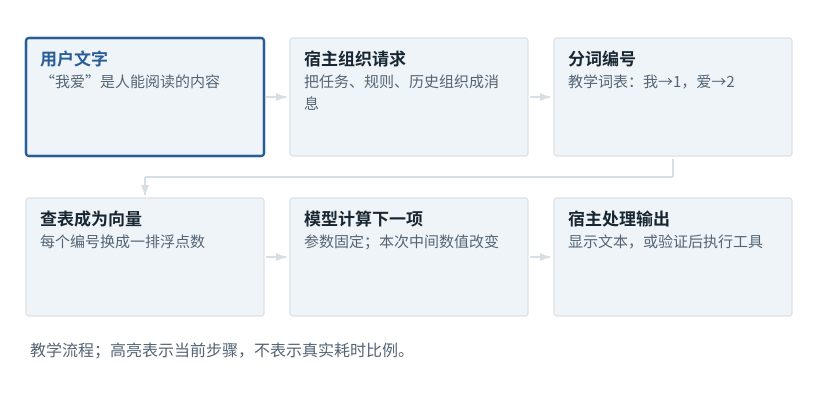

F01 · 6步

### [一句话经过了哪些不同的对象](visual/F01.md)

输入框中的文字，什么时候才变成模型能计算的东西？

F02 · 4步

### [新增一个轴，究竟多了什么](visual/F02.md)

[2,3]为什么变成[2,3,4]？

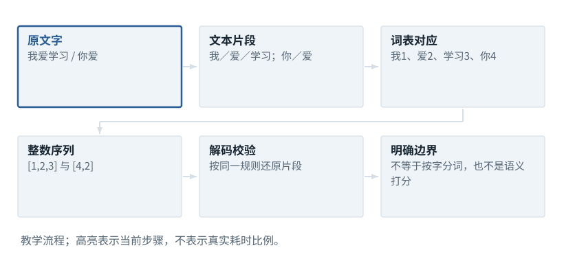

F03 · 6步

### [文字、字节、Token、编号是四件事](visual/F03.md)

为什么不能把“一个汉字”当成“一次生成”？

F04 · 4步

### [组批没有把两句话混成一句](visual/F04.md)

为了整齐补上的PAD，会不会被模型误当成内容？

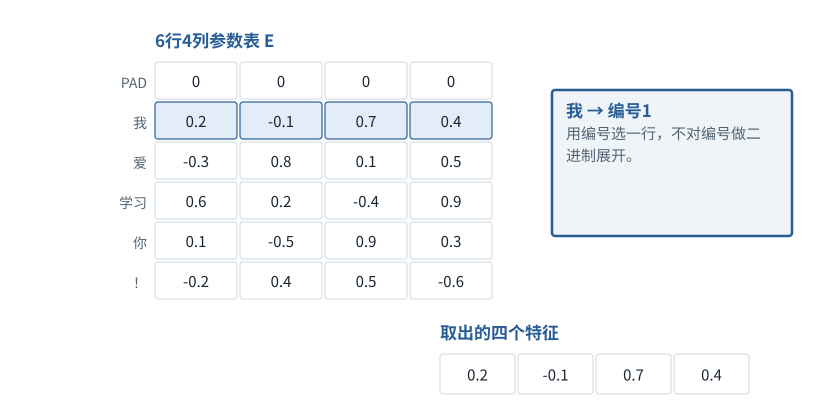

F05 · 5步

### [Embedding是查一行，不是把编号转二进制](visual/F05.md)

一组浮点数怎样替代一个Token编号？

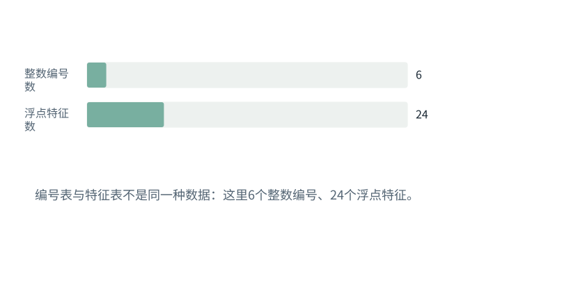

F06 · 4步

### [数据搬到GPU，改变的是位置而不是含义](visual/F06.md)

“装得下”和“算得快”为什么不是同一回事？

## 模型计算、生成与结束

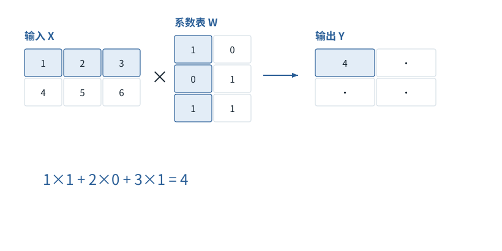

F07 · 4步

### [矩阵乘法像逐格填写配方结果](visual/F07.md)

一个输出格子的数，到底从哪些输入格子来？

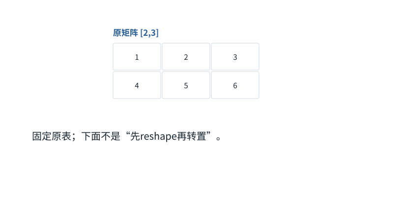

F08 · 4步

### [改摆法与改数值，分开看](visual/F08.md)

reshape、转置、广播为什么不能互换？

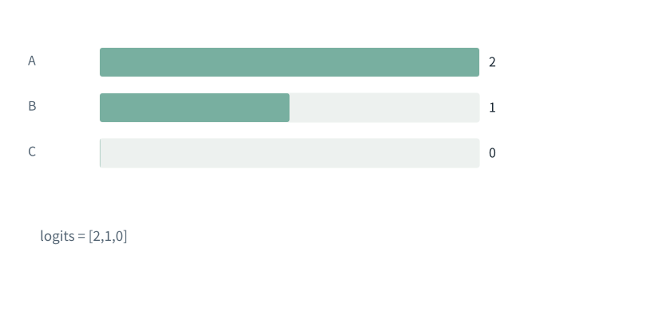

F09 · 5步

### [Softmax不是直接把分数除以它们的和](visual/F09.md)

怎样从同一组三个分数，一步不跳走到抽样？

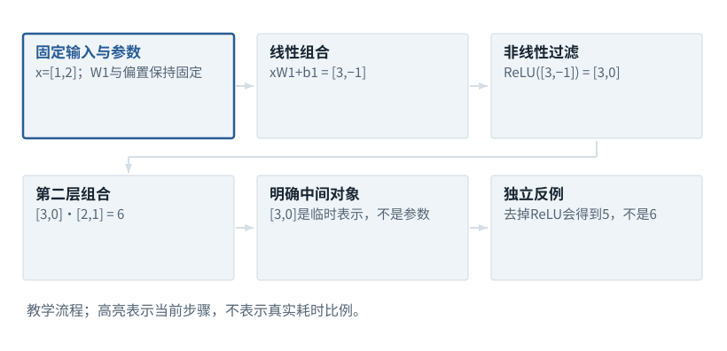

F10 · 6步

### [网络层是在重组数值，不是在生成隐藏句子](visual/F10.md)

为什么多层之间还要放一个非线性函数？

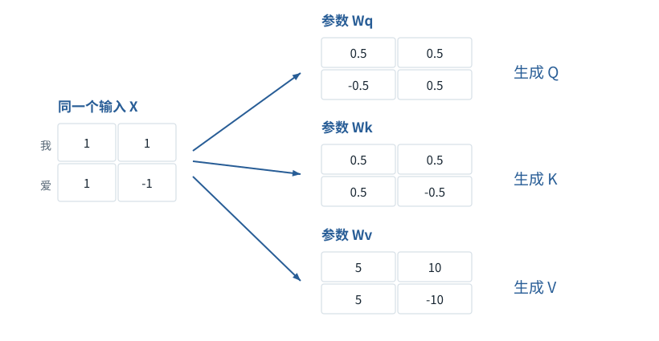

F11 · 5步

### [Q/K/V：先算从哪读，再算读进多少](visual/F11.md)

Query、Key、Value各自是什么数，为什么分三条路径？

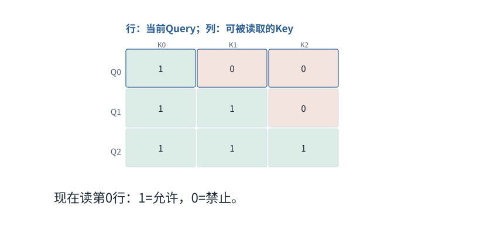

F12 · 5步

### [Mask是可见性表，不是额外语义](visual/F12.md)

怎样防止读到未来，或者把PAD读成内容？

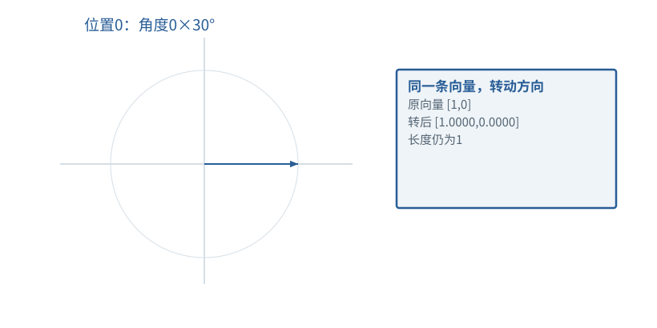

F13 · 5步

### [位置怎样进入数值计算](visual/F13.md)

同一个Token出现在不同位置，为什么还需要额外处理？

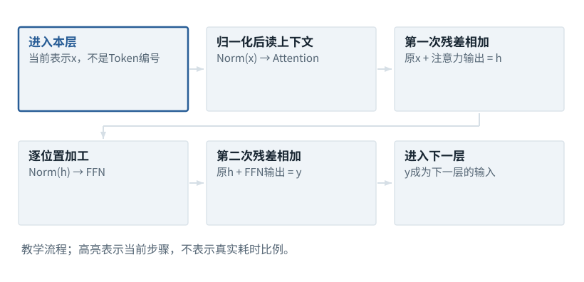

F14 · 6步

### [一层Transformer不是只有Attention](visual/F14.md)

读其他位置之后，为什么还要残差、归一化和FFN？

F18 · 10步

### [一次输入如何连着预测，直到结束](visual/F15.md)

预测到的Token什么时候显示，什么时候成为下一轮输入？

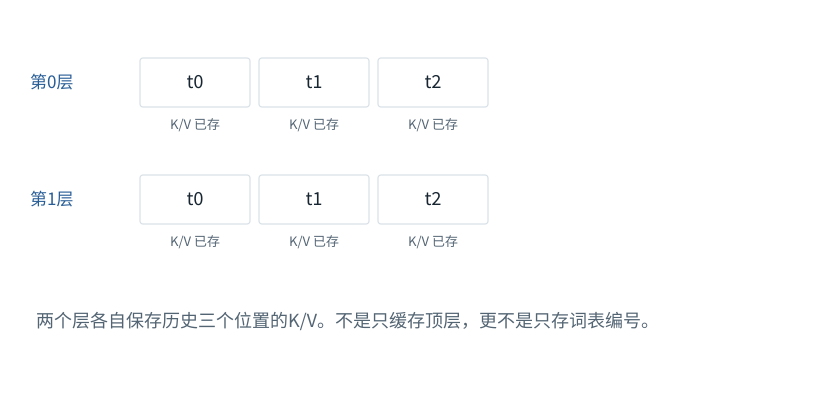

F19 · 5步

### [KV Cache：留下算过的，不省掉该读的](visual/F16.md)

为什么少算了很多步骤，下一Token仍能看到历史？

## 训练与计算资源

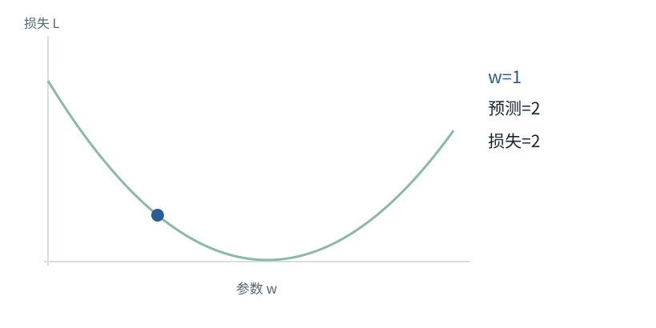

F15 · 4步

### [梯度像坡度，学习率像迈步大小](visual/F17.md)

为什么“梯度下降”有时让参数增大？

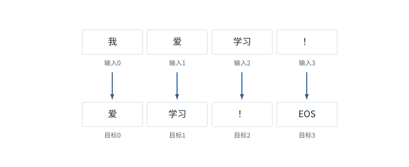

F16 · 5步

### [训练：给每个位置一道“下一项”题](visual/F18.md)

为什么训练看完整句，生成却只能往前走？

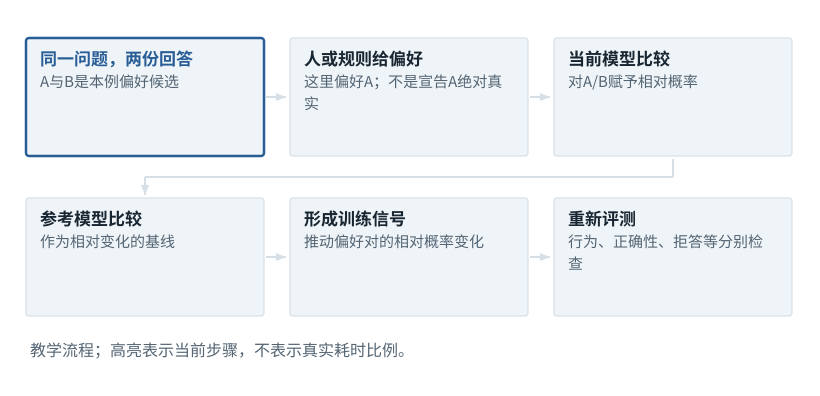

F17 · 6步

### [后训练改变行为，奖励不是事实裁判](visual/F19.md)

既然模型会接下一Token，为什么还要SFT、偏好训练？

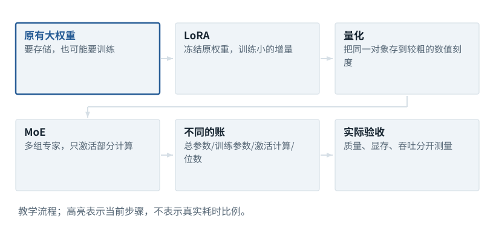

F20 · 6步

### [省参数、省位数、少激活不是同一种优化](visual/F20.md)

LoRA、量化、MoE到底各自省了哪一部分？

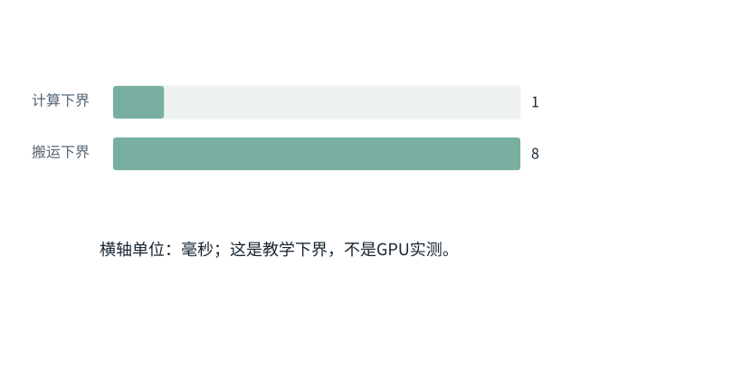

F21 · 4步

### [算得慢，可能是东西搬得慢](visual/F21.md)

为什么一块算力更高的GPU，不一定让任务同比变快？

## Agent、协议与上下文

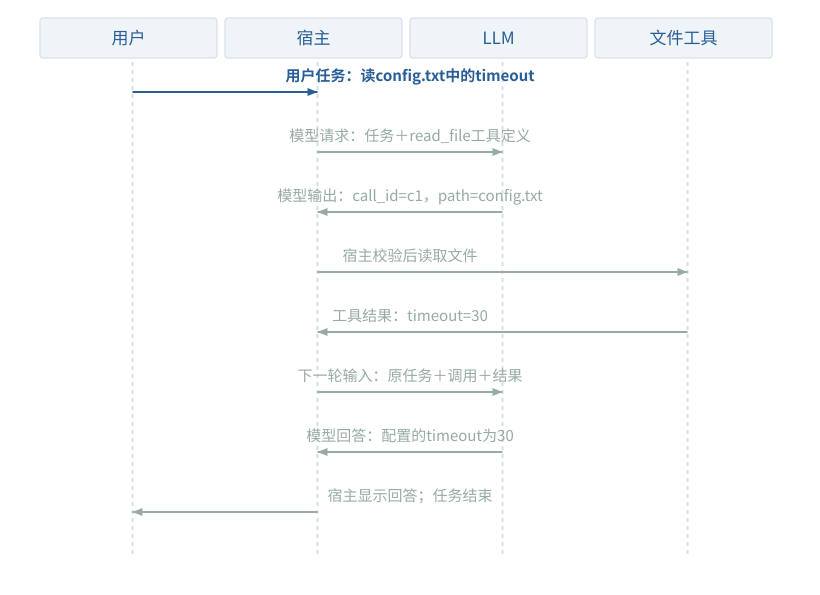

F22 · 8步

### [把一个Agent任务拆成真正发生的几轮](visual/F22.md)

同一句用户任务，为什么可能调用模型不止一次？

F23 · 4步

### [字符完整、事件完整、工具参数完整是三道关](visual/F23.md)

为什么看到半段JSON时绝对不能执行？

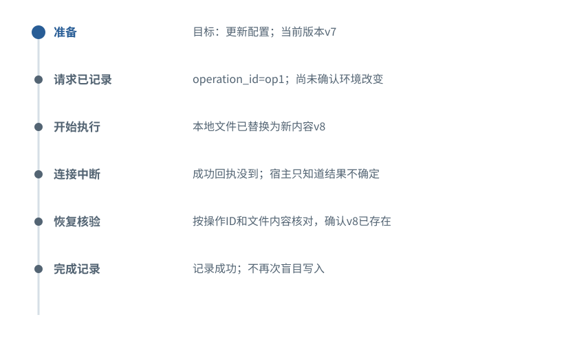

F24 · 6步

### [任务状态不是聊天里的一句总结](visual/F24.md)

“模型知道做过”与“系统能恢复”有什么区别？

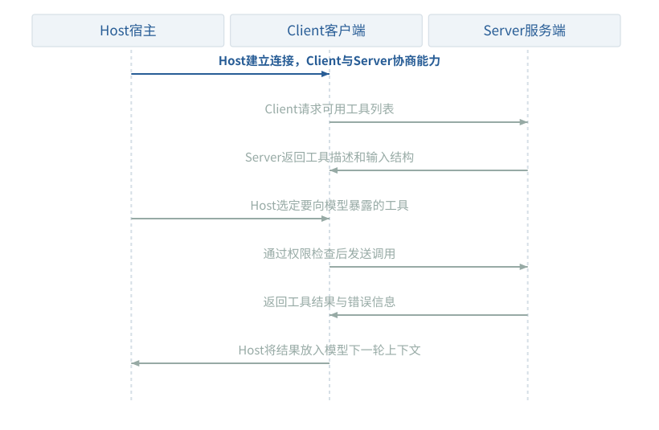

F25 · 7步

### [MCP连起接口，不自动交出权限](visual/F25.md)

连接、发现、模型可见和实际授权分别发生在哪里？

F26 · 5步

### [每轮上下文像一份有边界的工作资料](visual/F26.md)

为什么“读得越多”有时反而越容易误解？

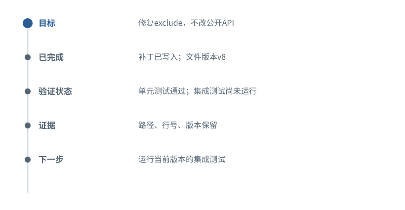

F27 · 5步

### [压缩要保留行动所依赖的事实](visual/F27.md)

把一百轮历史压成几句话，最容易丢什么？

## 检索、记忆、协作与可靠交付

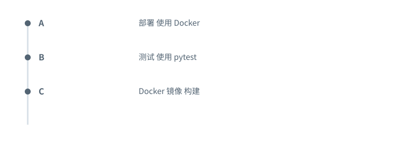

F28 · 4步

### [检索先找候选，再判断能否回答](visual/F28.md)

倒排索引和向量索引分别在帮什么忙？

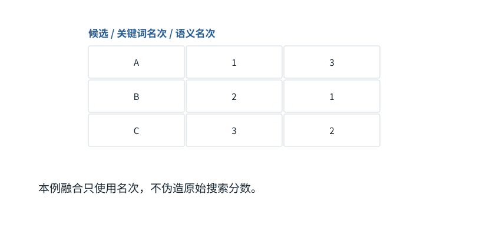

F29 · 5步

### [从两个候选列表，走到可用证据](visual/F29.md)

“相关”与“足以回答”中间还差哪几步？

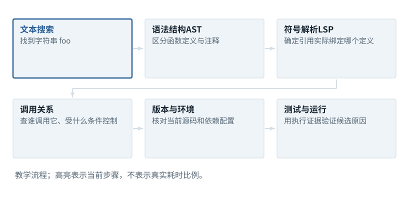

F30 · 6步

### [代码检索不能只靠“语义相近”](visual/F30.md)

grep、AST、LSP、调用图各自看到什么？

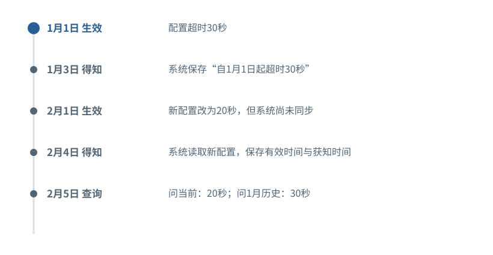

F31 · 5步

### [长期记忆不是永远正确的小纸条](visual/F31.md)

新事实出现后，旧记忆怎样更新而不毁掉历史？

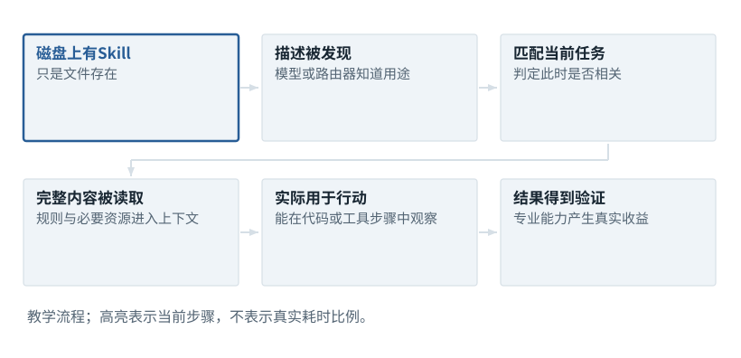

F32 · 6步

### [Skill存在，为什么仍可能完全没用？](visual/F32.md)

从“安装了技能”到“写出了更好的代码”，中间经过什么？

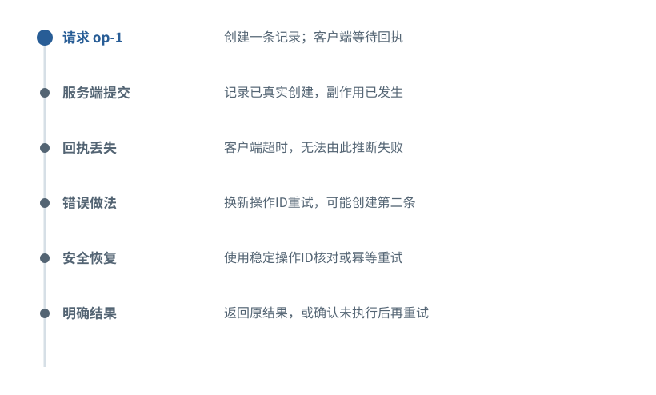

F33 · 6步

### [超时告诉你没收到，不告诉你没发生](visual/F33.md)

为什么自动重试有时会把一次工作做两遍？

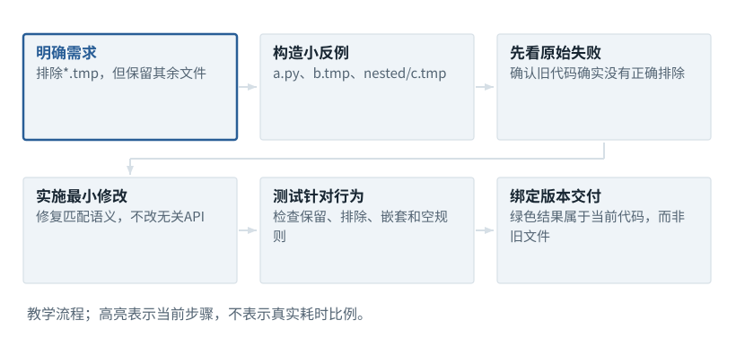

F34 · 6步

### [测试是找反例，不是给代码盖绿章](visual/F34.md)

为什么“测试都通过”仍可能交付错东西？

## 评测、安全与生产

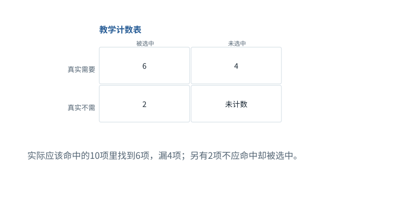

F35 · 4步

### [读指标，先问它的分母是谁](visual/F35.md)

为什么精确率高不等于证据找全了？

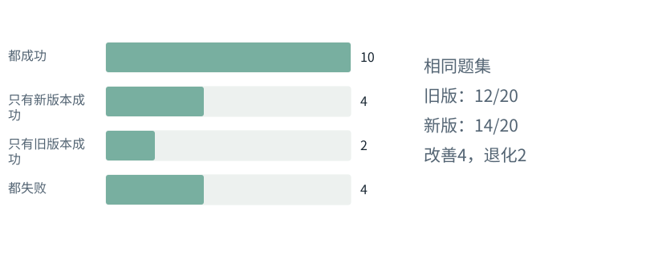

F36 · 5步

### [涨了10个百分点，为什么还不能急着下结论？](visual/F36.md)

一次实验怎样区别真实改进与偶然波动？

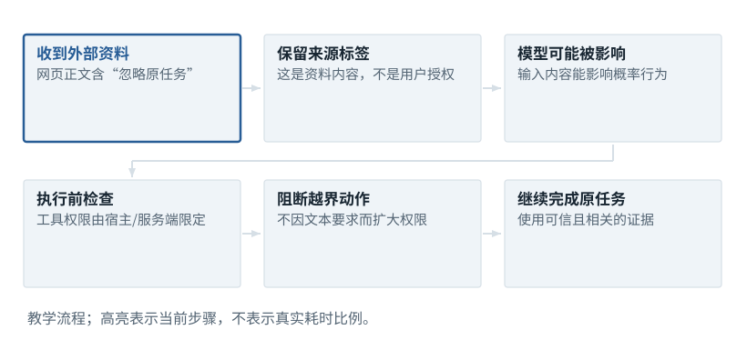

F37 · 6步

### [资料能影响模型，不代表获得了权限](visual/F37.md)

为什么“模型被劝住”不能作为唯一防线？

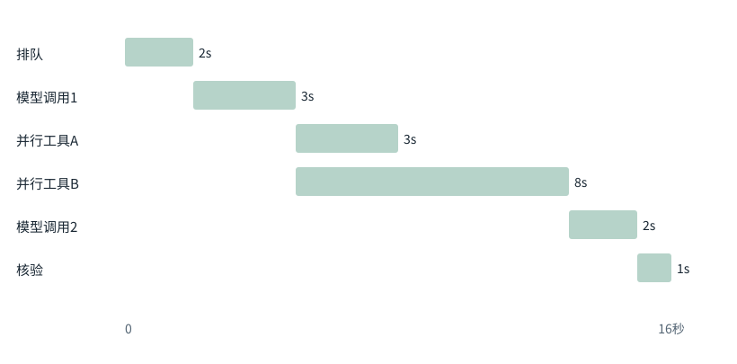

F38 · 5步

### [Trace要告诉你因果，不只是时间戳](visual/F38.md)

为何优化一个最显眼的步骤，整体却没变快？

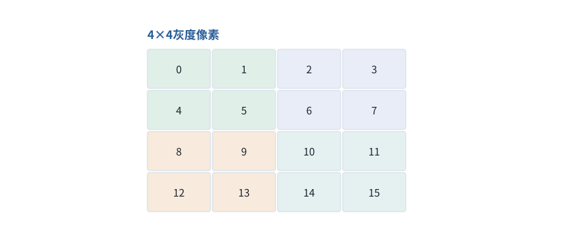

F39 · 4步

### [图像表示与界面行动，是两层不同问题](visual/F39.md)

为什么看得懂截图，也可能点错按钮？

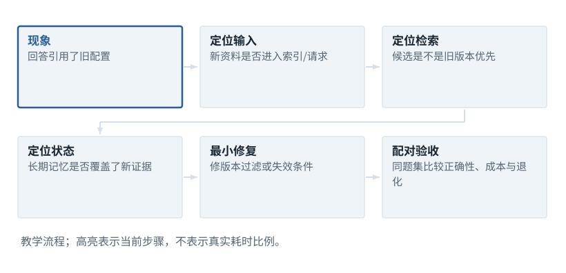

F40 · 6步

### [先找错误发生在哪层，再谈换模型](visual/F40.md)

什么时候该改Prompt、检索、记忆或模型？

## 优化的原因、方法与代价

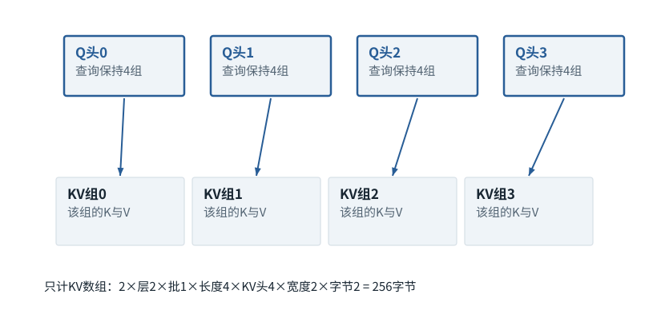

O01 · 4步

### [GQA/MQA：减少的是K/V组数](visual/O01.md)

为什么查询头数没变，缓存却可以变小？

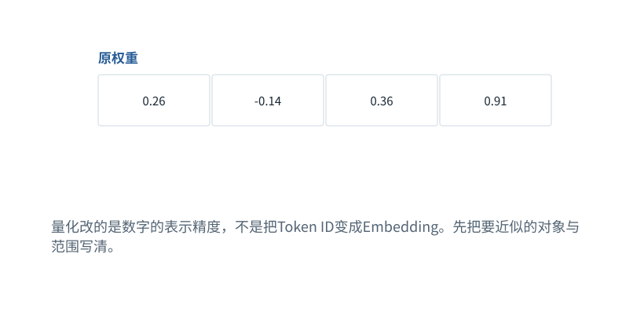

O02 · 4步

### [量化：省存储，也引入近似](visual/O02.md)

为什么“4bit”不等于所有模型内存都缩到八分之一？

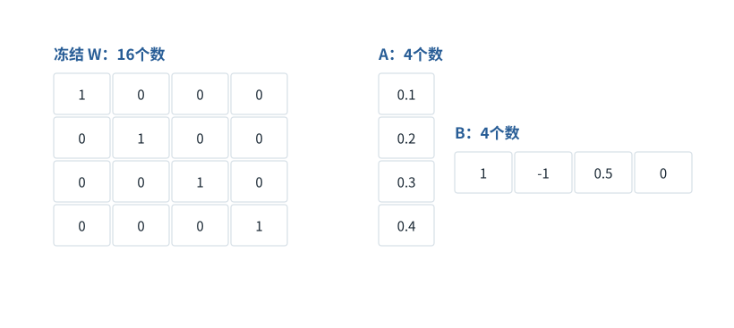

O03 · 4步

### [LoRA：冻结大表，学习小增量](visual/O03.md)

减少的是整个模型，还是需要更新的参数？

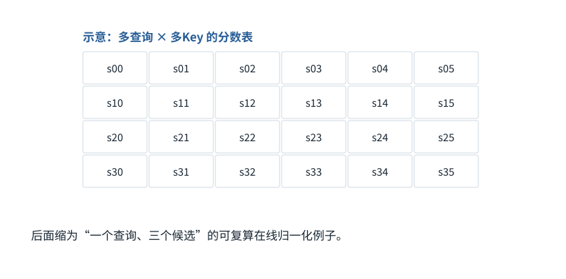

O04 · 5步

### [FlashAttention：一边读一边累计，不攒整张表](visual/O04.md)

不把完整注意力表存下来，怎样仍算出同一输出？

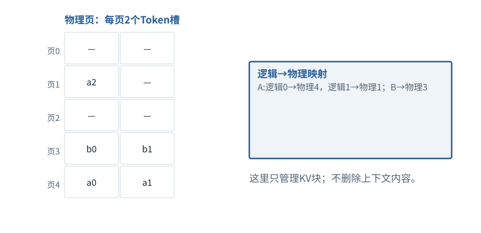

O05 · 4步

### [PagedAttention：逻辑连续，物理可以分块](visual/O05.md)

缓存为什么不必为每个请求找一大块连续显存？

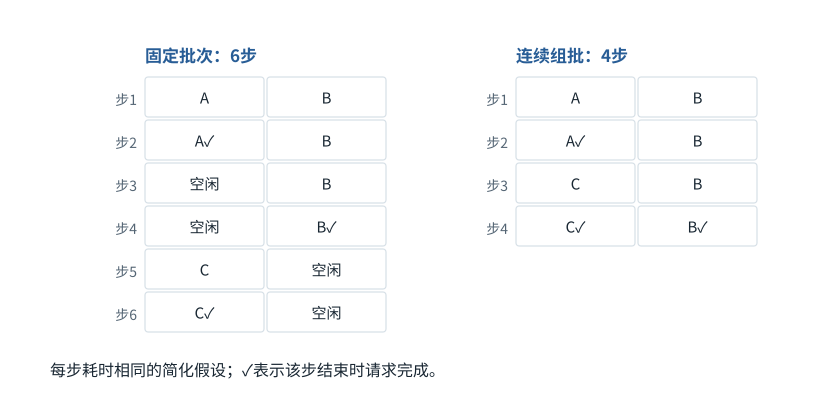

O06 · 4步

### [连续组批：有座位空出来，就接下一位](visual/O06.md)

为什么设备更忙，不代表每条请求都更快？

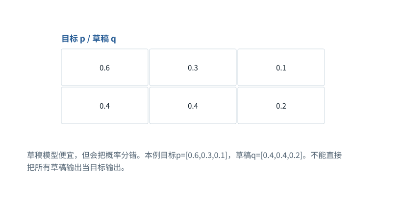

O07 · 5步

### [推测解码：草稿可以快，但必须正确校验](visual/O07.md)

为什么“让小模型先写，大模型点头”还不够准确？

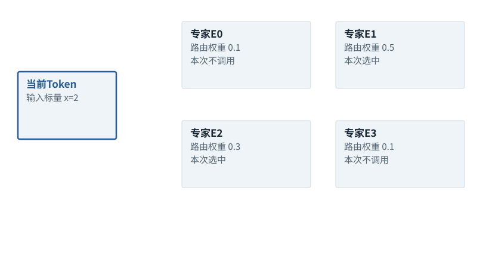

O08 · 4步

### [MoE：每个Token选部分计算路径](visual/O08.md)

为什么总参数很多，但每Token不用计算所有专家？

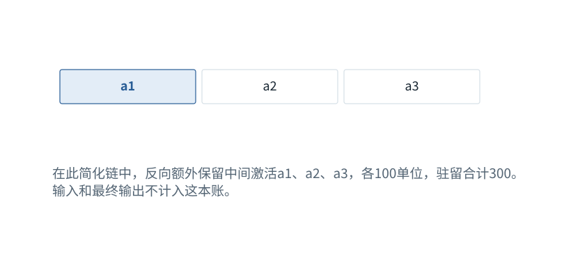

O09 · 5步

### [Activation Checkpointing：少存一点，反向时重算](visual/O09.md)

为什么有的优化是用时间换内存，而KV缓存恰好相反？

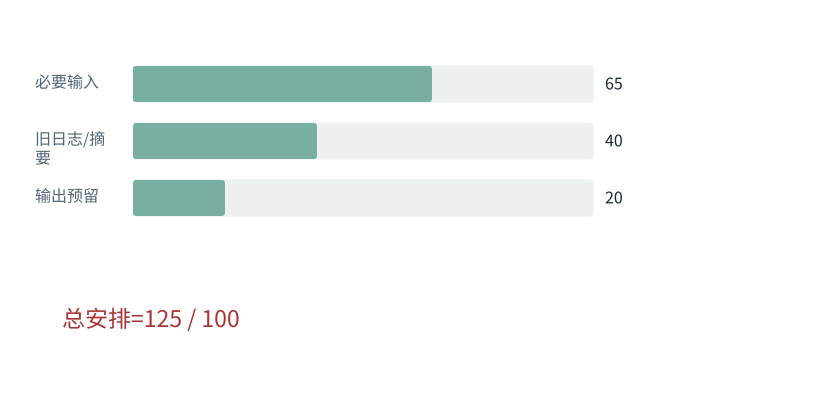

O10 · 4步

### [压缩、检索与Prompt Cache：三种不同的“省”](visual/O10.md)

上下文短了、检索准了、缓存命中了，为什么不能混为一谈？

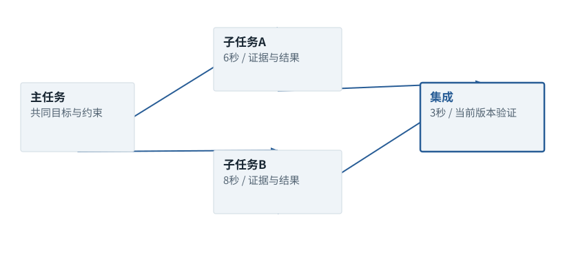

O11 · 4步

### [多Agent：可并行的工作，比Agent数量重要](visual/O11.md)

为什么任务拆得更细，有时完成得更慢、更差？

O12 · 4步

### [模型路由：便宜一次，不一定便宜一项成功任务](visual/O12.md)

怎样判断换小模型是优化，还是把成本挪到返工？