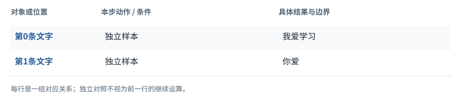

图解 · 运行过程 · 工程取舍

# 文字、字节、Token、编号是四件事

为什么不能把“一个汉字”当成“一次生成”？

配套正文：[F03基础课](../foundations/03.md)

动态图解 · F03

## 文字、字节、Token、编号是四件事

为什么不能把“一个汉字”当成“一次生成”？

Token是分词规则选出来的片段，编号是它在词表中的地址。一个Token可以跨越多个字符，也可能只覆盖字符编码的一部分。教学中把“学习”合成一个Token，只是明确的演示规则，不能当成所有模型的实际分词。

**字节**存储和传输文本的单位；UTF-8里的汉字通常占多个字节。

**Token**分词器处理的片段单位。

**词表**片段与编号的对照。

**输入与适用条件：**本图使用人为词表：PAD0、我1、爱2、学习3、你4、！5；不演示真实BPE训练。

### 1 / 6 · 原文字

停留时间 4.2秒7秒1.5秒

步骤 第1步，共6步

窄屏可左右滑动图形，或点击“放大图形”。文字解释紧随图后。

先确定待编码原文，两句之间不能直接接起来当作同一人的上下文。

`本步状态由图形与说明共同给出。`

默认静止。用“下一步”看完解释再继续；播放到最后一步自动停止。键盘聚焦播放器后，可用左右键逐步查看、空格播放/暂停。图中颜色辅助区分，含义同时用文字注明。

JavaScript未启用；第一帧仍可阅读。完整图解页下方列出全部步骤说明。

## 逐步说明与计算记录

以下解释全部展开，与播放器使用同一份数据；不是另换输入的第二个算例。

### 1．原文字

先确定待编码原文，两句之间不能直接接起来当作同一人的上下文。

### 2．文本片段

“学习”在本例是一项。这里展示结果，不假称来自某个商业分词器。

### 3．词表对应

查对应表得到行号；“你”的4比“我”的1大，不代表语义更强。

### 4．整数序列

短句暂时只有两个编号；补齐是下一步的组批选择，不属于原句本身。

### 5．解码校验

反向查同一词表，按顺序拼片段。“你爱”不能把PAD还原成普通可见文字。

### 6．明确边界

本图拆的是表示关系。真实聊天还可能有角色标记等特殊Token，不应按汉字数估算总Token。

### 为什么需要

弄清计数单位，可避免上下文预算、输出长度和界面刷新混为一谈。

### 怎样实现

用目标模型配套分词器编码和解码，并分开观察字符数、字节数、Token数。

### 可能的代价与误解

更换分词器后沿用旧编号，会读到错误的词表项。

### 如何判断是否做对

对实际输入做一次往返编解码，并按所用分词器规则处理特殊Token。

[F04 · 组批没有把两句话混成一句](F04.md)[F23 · 字符完整、事件完整、工具参数完整是三道关](F23.md)

机制来源：[[TOKEN]](sources.md#s-TOKEN)。数值和运行场景为本书明确设定的教学例；资料出处不代替本页中文解释。