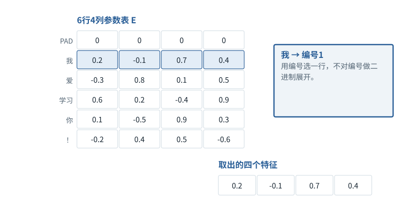

图解 · 运行过程 · 工程取舍

# Embedding是查一行，不是把编号转二进制

一组浮点数怎样替代一个Token编号？

配套正文：[F05基础课](../foundations/05.md)

动态图解 · F05

## Embedding是查一行，不是把编号转二进制

一组浮点数怎样替代一个Token编号？

词表编号像目录的页码；Embedding像打开那一页看到的数值卡。页码2并不会通过“转成0010”得到语义。模型取到的是参数表里事先存好的小数和负数，后续层再根据上下文加工它。

**E**Embedding参数表：每行对应一个词表项。

**查表**以整数编号选择一整行。

**上下文化**同一初始向量经过不同上下文后得到不同表示。

**输入与适用条件：**完全沿用F05正文6×4小数参数表。图示的维度是特征宽度，不是二进制位数。

### 1 / 5 · 为“我”取第1行

停留时间 4.2秒7秒1.5秒

步骤 第1步，共5步

窄屏可左右滑动图形，或点击“放大图形”。文字解释紧随图后。

编号1定位Embedding表的第1行，得到[0.2, -0.1, 0.7, 0.4]。这一行用来表示本例Token“我”，不会因为同批还有其他句子而改为另一行。

`E[1] = [0.2, -0.1, 0.7, 0.4]`

默认静止。用“下一步”看完解释再继续；播放到最后一步自动停止。键盘聚焦播放器后，可用左右键逐步查看、空格播放/暂停。图中颜色辅助区分，含义同时用文字注明。

JavaScript未启用；第一帧仍可阅读。完整图解页下方列出全部步骤说明。

## 逐步说明与计算记录

以下解释全部展开，与播放器使用同一份数据；不是另换输入的第二个算例。

### 1．为“我”取第1行

编号1定位Embedding表的第1行，得到[0.2, -0.1, 0.7, 0.4]。这一行用来表示本例Token“我”，不会因为同批还有其他句子而改为另一行。

`E[1] = [0.2, -0.1, 0.7, 0.4]`

### 2．为“爱”取第2行

编号2定位Embedding表的第2行，得到[-0.3, 0.8, 0.1, 0.5]。这一行用来表示本例Token“爱”，不会因为同批还有其他句子而改为另一行。

`E[2] = [-0.3, 0.8, 0.1, 0.5]`

### 3．为“学习”取第3行

编号3定位Embedding表的第3行，得到[0.6, 0.2, -0.4, 0.9]。这一行用来表示本例Token“学习”，不会因为同批还有其他句子而改为另一行。

`E[3] = [0.6, 0.2, -0.4, 0.9]`

### 4．为“你”取第4行

编号4定位Embedding表的第4行，得到[0.1, -0.5, 0.9, 0.3]。这一行用来表示本例Token“你”，不会因为同批还有其他句子而改为另一行。

`E[4] = [0.1, -0.5, 0.9, 0.3]`

### 5．按原句顺序放回去

先取“我”，再取“爱”，最后取“学习”，组成三行表示。“你爱”同样处理；PAD行只是此处教学设为全零，后续仍需mask。

### 为什么需要

编号方便定位项目，但直接比较编号大小不能表达任务所需关系。

### 怎样实现

为每项取出可训练的向量，再交给后续运算。

### 可能的代价与误解

误把0/1教学矩阵当成所有Embedding的格式；误以为同一个词在所有层都不变。

### 如何判断是否做对

逐项检查原文、编号、取表行号、输出行顺序四者一一对应。

[F02 · 新增一个轴，究竟多了什么](F02.md)[F11 · Q/K/V：先算从哪读，再算读进多少](F11.md)

机制来源：[[EMBED]](sources.md#s-EMBED)。数值和运行场景为本书明确设定的教学例；资料出处不代替本页中文解释。