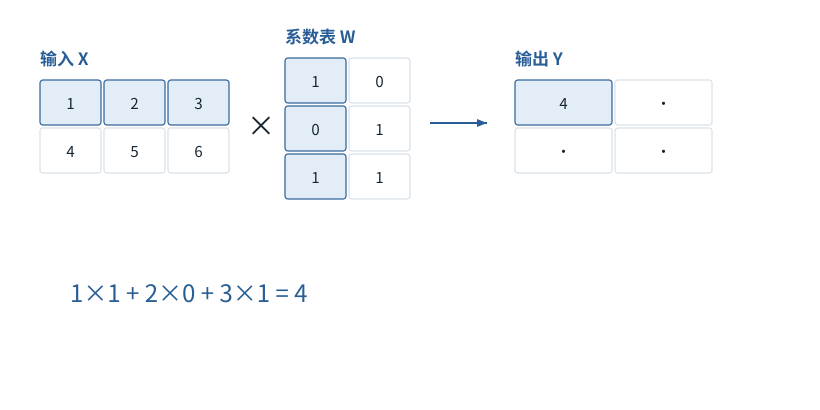

图解 · 运行过程 · 工程取舍

# 矩阵乘法像逐格填写配方结果

一个输出格子的数，到底从哪些输入格子来？

配套正文：[F07基础课](../foundations/07.md)

动态图解 · F07

## 矩阵乘法像逐格填写配方结果

一个输出格子的数，到底从哪些输入格子来？

不要先背形状规则。先盯住一个输出格子：它只拿输入的一行、系数表的一列。每对数字相乘，再把乘积加起来。把同样的动作重复到所有输出格子，就得到整张结果表。

**点积**两排等长数字按位置相乘后求和。

**参数表W**控制输入各分量怎样被组合的系数。

**线性投影**这里指每行乘W，不必降低维度。

**输入与适用条件：**沿用本节“矩阵乘法”主算例X=[[1,2,3],[4,5,6]]，W=[[1,0],[0,1],[1,1]]；不是后文的独立两维算例。

### 1 / 4 · 填输出的第0行第0列

停留时间 4.2秒7秒1.5秒

步骤 第1步，共4步

窄屏可左右滑动图形，或点击“放大图形”。文字解释紧随图后。

选择X的第0行和W的第0列，沿三个特征一一配对、相乘，再相加。其他输出格子各算各的，不能混用另一行。

`Y[0,0] = 4`

1×1 + 2×0 + 3×1 = 4

默认静止。用“下一步”看完解释再继续；播放到最后一步自动停止。键盘聚焦播放器后，可用左右键逐步查看、空格播放/暂停。图中颜色辅助区分，含义同时用文字注明。

JavaScript未启用；第一帧仍可阅读。完整图解页下方列出全部步骤说明。

## 逐步说明与计算记录

以下解释全部展开，与播放器使用同一份数据；不是另换输入的第二个算例。

### 1．填输出的第0行第0列

选择X的第0行和W的第0列，沿三个特征一一配对、相乘，再相加。其他输出格子各算各的，不能混用另一行。

`Y[0,0] = 4`

1×1 + 2×0 + 3×1 = 4

### 2．填输出的第0行第1列

选择X的第0行和W的第1列，沿三个特征一一配对、相乘，再相加。其他输出格子各算各的，不能混用另一行。

`Y[0,1] = 5`

1×0 + 2×1 + 3×1 = 5

### 3．填输出的第1行第0列

选择X的第1行和W的第0列，沿三个特征一一配对、相乘，再相加。其他输出格子各算各的，不能混用另一行。

`Y[1,0] = 10`

4×1 + 5×0 + 6×1 = 10

### 4．填输出的第1行第1列

选择X的第1行和W的第1列，沿三个特征一一配对、相乘，再相加。其他输出格子各算各的，不能混用另一行。

`Y[1,1] = 11`

4×0 + 5×1 + 6×1 = 11

### 为什么需要

用批量算子同时处理许多同类乘加，但每个格子的数学定义没有变化。

### 怎样实现

先把一个格子算对，再利用矩阵库和GPU处理整张表。

### 可能的代价与误解

形状正确仍可能取错轴、误用逐元素乘法。

### 如何判断是否做对

四个结果应依次是4、5、10、11，再与代码的矩阵乘对照。

[F08 · 改摆法与改数值，分开看](F08.md)[F11 · Q/K/V：先算从哪读，再算读进多少](F11.md)

机制来源：[[LINEAR]](sources.md#s-LINEAR)。数值和运行场景为本书明确设定的教学例；资料出处不代替本页中文解释。