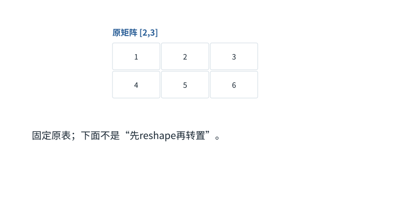

图解 · 运行过程 · 工程取舍

# 改摆法与改数值，分开看

reshape、转置、广播为什么不能互换？

配套正文：[F08基础课](../foundations/08.md)

动态图解 · F08

## 改摆法与改数值，分开看

reshape、转置、广播为什么不能互换？

把矩阵想成带地址的格子。reshape改变分组读法；转置改变行列地址对应；广播配合加法等运算改变数值。三者最后可能有相似形状，却不能据此当成同一过程。

**reshape**保持规定的元素遍历顺序，按另一形状分组。

**转置**原第i行第j列映射到新第j行第i列。

**广播**使小张量沿允许的轴参与大张量运算。

**输入与适用条件：**四帧中的三个对照操作都从原矩阵[[1,2,3],[4,5,6]]开始；每帧明确重置，而不是接力计算。

### 1 / 4 · 原来的两行

停留时间 4.2秒7秒1.5秒

步骤 第1步，共4步

窄屏可左右滑动图形，或点击“放大图形”。文字解释紧随图后。

六个数的行优先顺序是1,2,3,4,5,6。接下来进行两种独立操作，均从这张原表出发。

`本步状态由图形与说明共同给出。`

默认静止。用“下一步”看完解释再继续；播放到最后一步自动停止。键盘聚焦播放器后，可用左右键逐步查看、空格播放/暂停。图中颜色辅助区分，含义同时用文字注明。

JavaScript未启用；第一帧仍可阅读。完整图解页下方列出全部步骤说明。

## 逐步说明与计算记录

以下解释全部展开，与播放器使用同一份数据；不是另换输入的第二个算例。

### 1．原来的两行

六个数的行优先顺序是1,2,3,4,5,6。接下来进行两种独立操作，均从这张原表出发。

### 2．reshape：只重新分组

保持1到6的先后顺序，每两个数成一行。结果是[[1,2],[3,4],[5,6]]。

### 3．转置：交换行列身份

恢复原矩阵，再把原来的列变成新的行。得到[[1,4],[2,5],[3,6]]，虽然同样是[3,2]，但内容排列不同。

### 4．广播：这次真的做加法

再次恢复原矩阵，给第一行都加10、第二行都加20，得到[[11,12,13],[24,25,26]]。这不是重新摆放，而是数值运算。

### 为什么需要

形状操作把数据组织成算子需要的格式，减少不必要复制可提高效率。

### 怎样实现

跟踪下标、步幅和连续性；需要复制时不能只凭“看起来是视图”判断。

### 可能的代价与误解

把转置后的结果当原表继续相加，会得到另一组数却可能不报错。

### 如何判断是否做对

对固定整数表逐格比对结果，并检查是否发生内存复制。

[F07 · 矩阵乘法像逐格填写配方结果](F07.md)[F12 · Mask是可见性表，不是额外语义](F12.md)

机制来源：[[TENSOR]](sources.md#s-TENSOR)。数值和运行场景为本书明确设定的教学例；资料出处不代替本页中文解释。