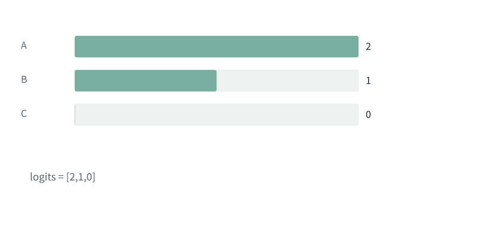

图解 · 运行过程 · 工程取舍

# Softmax不是直接把分数除以它们的和

怎样从同一组三个分数，一步不跳走到抽样？

配套正文：[F09基础课](../foundations/09.md)

动态图解 · F09

## Softmax不是直接把分数除以它们的和

怎样从同一组三个分数，一步不跳走到抽样？

先把分数变成正的相对强度，再除以总量，就能读成候选份额。减最大值像把刻度原点一起移动；所有项的相对差值不变。最后按概率抽样还包含一次选择动作，概率本身不是选出的答案。

**logits**转换前的分数，可正可负。

**指数exp**这里计算e的指定次方。

**归一化**把各项除以共同总和，使总量为1。

**输入与适用条件：**全程固定候选A/B/C、分数[2,1,0]、温度1、不做Top-k/Top-p裁剪；只在最后给定u=0.70。

### 1 / 5 · 分数不是份额

停留时间 4.2秒7秒1.5秒

步骤 第1步，共5步

窄屏可左右滑动图形，或点击“放大图形”。文字解释紧随图后。

候选A、B、C的原分数是2、1、0。2不是200%，它只是尚未转换的分数。

`logits = [2,1,0]`

logits = [2,1,0]

默认静止。用“下一步”看完解释再继续；播放到最后一步自动停止。键盘聚焦播放器后，可用左右键逐步查看、空格播放/暂停。图中颜色辅助区分，含义同时用文字注明。

JavaScript未启用；第一帧仍可阅读。完整图解页下方列出全部步骤说明。

## 逐步说明与计算记录

以下解释全部展开，与播放器使用同一份数据；不是另换输入的第二个算例。

### 1．分数不是份额

候选A、B、C的原分数是2、1、0。2不是200%，它只是尚未转换的分数。

`logits = [2,1,0]`

logits = [2,1,0]

### 2．整体往下平移

三项都减去最大值2。相对差值没有变；这一步是数值稳定处理，不是改变温度。

`[2,1,0] − 2 = [0,−1,−2]`

[2,1,0] − 2 = [0,−1,−2]

### 3．每项取指数

指数把各项变成正数。这些数还不等于概率，因为它们的和约为1.503215。

`exp = [1, 0.367879, 0.135335]`

exp = [1, 0.367879, 0.135335]

### 4．各自除以同一个总和

三项都除以刚才的指数总和，才成为总和为1的概率。此处候选顺序始终是A、B、C。

`总和=1.503215；p=[0.665241, 0.244728, 0.090031]`

总和=1.503215；p=[0.665241, 0.244728, 0.090031]

### 5．用概率区间选一项

把0到1分成三段。给定随机数0.70落在B区间，因此这次抽到B；贪心取最大则会选A。这并不矛盾。

`u=0.70 → B；argmax → A`

u=0.70 → B；argmax → A

### 为什么需要

需要把任意分数变成可比较的份额，并避免大指数溢出。

### 怎样实现

先减最大值、取指数、求和、归一化，再按明确规则选项。

### 可能的代价与误解

这不是整句答案正确率；中间显示的四舍五入数不应反复拿去算下一步。

### 如何判断是否做对

与未平移的精确计算比较概率；概率和为1，u=0.70应选B。

[F11 · Q/K/V：先算从哪读，再算读进多少](F11.md)[F18 · 一次输入如何连着预测，直到结束](F15.md)[O07 · 推测解码：草稿可以快，但必须正确校验](O07.md)

机制来源：[[SOFTMAX]](sources.md#s-SOFTMAX)。数值和运行场景为本书明确设定的教学例；资料出处不代替本页中文解释。