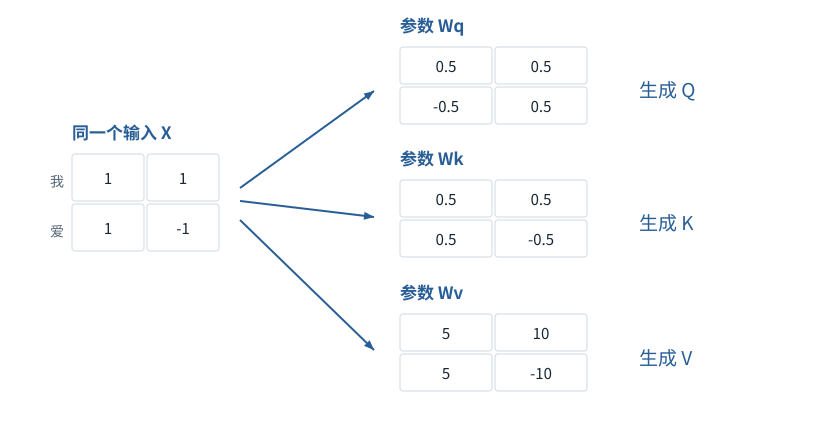

图解 · 运行过程 · 工程取舍

# Q/K/V：先算从哪读，再算读进多少

Query、Key、Value各自是什么数，为什么分三条路径？

配套正文：[F11基础课](../foundations/11.md)

动态图解 · F11

## Q/K/V：先算从哪读，再算读进多少

Query、Key、Value各自是什么数，为什么分三条路径？

计算某个位置的新表示时，它是接收者；所有可见位置都是潜在信息提供者。Query与Key决定各提供者的读取份额，Value提供实际被混合的数。可以借“提问—匹配—取内容”记住分工，但Q不是自然语言问题，K不是数据库主键，V不是正确答案。

**X**本次进入注意力的数值表示；不等于Token编号。

**Wq/Wk/Wv**已给定的三张投影参数表。

**Q/K/V**X经三张表计算后的三份中间表示。

**读取份额**本轮通过softmax算出的权重，区别于参数W里的权重。

**输入与适用条件：**沿用F11正文的独立两位置算例：X=[[1,1],[1,−1]]。本图省略偏置、RoPE、归一化和多头。所有Q/K/V和输出都由配套程序计算。

### 1 / 5 · 同一输入，三条参数路径

停留时间 4.2秒7秒1.5秒

步骤 第1步，共5步

窄屏可左右滑动图形，或点击“放大图形”。文字解释紧随图后。

先不打分。两行输入分别代表“我”和“爱”；Wq、Wk、Wv是三张乘法系数表。它们不是另外三份文字。

`本步状态由图形与说明共同给出。`

默认静止。用“下一步”看完解释再继续；播放到最后一步自动停止。键盘聚焦播放器后，可用左右键逐步查看、空格播放/暂停。图中颜色辅助区分，含义同时用文字注明。

JavaScript未启用；第一帧仍可阅读。完整图解页下方列出全部步骤说明。

## 逐步说明与计算记录

以下解释全部展开，与播放器使用同一份数据；不是另换输入的第二个算例。

### 1．同一输入，三条参数路径

先不打分。两行输入分别代表“我”和“爱”；Wq、Wk、Wv是三张乘法系数表。它们不是另外三份文字。

### 2．每行分别变换，尚未混合位置

计算XWq、XWk、XWv。“爱”这行依次得到q=[1,0]、k=[0,1]、v=[0,20]。三条路径的参数固定，但结果随输入变化。

`q爱=[1,0]；k我=[1,0]；k爱=[0,1]`

### 3．当前接收者是“爱”，比较两个可见位置

用“爱”的q分别与“我”“爱”的k做点积，得到1和0。当前是位置1，所以因果规则允许读位置0和自己。

### 4．把分数变成读取份额

先除以√2，再对[0.707107,0]做softmax，得到来自“我”的份额约0.669762、来自“爱”的份额约0.330238。算法与F09相同，但对象和输入不同。

`份额 = [0.6697615493,0.3302384507]`

### 5．份额确定后，混合的是V而不是K

对第一格：0.669762×10+0.330238×0；对第二格：0.669762×0+0.330238×20。得到[6.697615,6.604769]，仍是一排数。

`输出=[6.697615,6.604769]`

### 为什么需要

让匹配特征与被传递内容分开学习，给模型不同的变换能力。

### 怎样实现

先分别投影每行，再跨位置打分、屏蔽、softmax、混合V。

### 可能的代价与误解

“注意力最大”不直接证明模型最终回答的因果原因；若只有一个可见Key，softmax永远为1，不能用来展示竞争。

### 如何判断是否做对

核对六行投影、两项分数、份额和输出；改变Wv不应在本层直接改变由Q/K算出的份额。

[F07 · 矩阵乘法像逐格填写配方结果](F07.md)[F09 · Softmax不是直接把分数除以它们的和](F09.md)[F12 · Mask是可见性表，不是额外语义](F12.md)[F19 · KV Cache：留下算过的，不省掉该读的](F16.md)

机制来源：[[SDPA]](sources.md#s-SDPA) [[ATTN]](sources.md#s-ATTN) [[LINEAR]](sources.md#s-LINEAR)。数值和运行场景为本书明确设定的教学例；资料出处不代替本页中文解释。