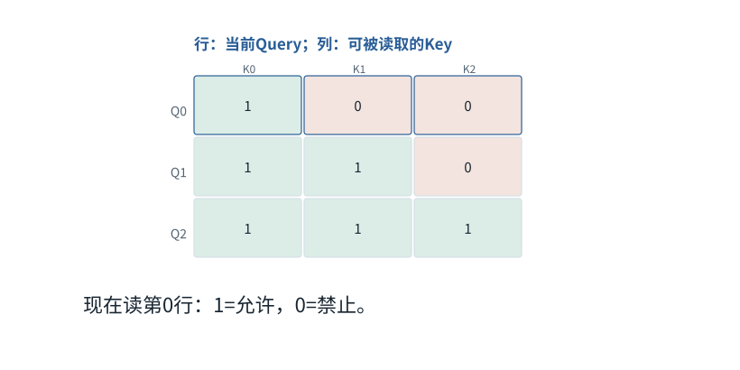

图解 · 运行过程 · 工程取舍

# Mask是可见性表，不是额外语义

怎样防止读到未来，或者把PAD读成内容？

配套正文：[F12基础课](../foundations/12.md)

动态图解 · F12

## Mask是可见性表，不是额外语义

怎样防止读到未来，或者把PAD读成内容？

把注意力的分数表看成一张“谁可以读谁”的座位表。行代表接收者，列代表提供者；禁止格子不能参与概率分母。因果限制、PAD限制可以同时存在，但一个负责时间顺序，一个负责有效内容，不能互相替代。

**因果**当前位置不读取将来位置。

**加性mask**允许处加0，禁止处用−∞等价地排除。

**绝对位置**加上历史前缀后的位置，而不是当前小批次中的行号。

**输入与适用条件：**前3帧用3个有效位置；第4帧是明确的屏蔽数值对照；第5帧另设past=3、new=2展示缓存偏移。图内始终标出当前条件。

### 1 / 5 · 处理绝对位置0

停留时间 4.2秒7秒1.5秒

步骤 第1步，共5步

窄屏可左右滑动图形，或点击“放大图形”。文字解释紧随图后。

位置不是数字大小比赛。因果规则只允许当前查询读取自己和更早的Key；后面的位置即使已经在训练输入数组中，也不能读。

`允许Key位置 ≤ 0`

默认静止。用“下一步”看完解释再继续；播放到最后一步自动停止。键盘聚焦播放器后，可用左右键逐步查看、空格播放/暂停。图中颜色辅助区分，含义同时用文字注明。

JavaScript未启用；第一帧仍可阅读。完整图解页下方列出全部步骤说明。

## 逐步说明与计算记录

以下解释全部展开，与播放器使用同一份数据；不是另换输入的第二个算例。

### 1．处理绝对位置0

位置不是数字大小比赛。因果规则只允许当前查询读取自己和更早的Key；后面的位置即使已经在训练输入数组中，也不能读。

`允许Key位置 ≤ 0`

### 2．处理绝对位置1

位置不是数字大小比赛。因果规则只允许当前查询读取自己和更早的Key；后面的位置即使已经在训练输入数组中，也不能读。

`允许Key位置 ≤ 1`

### 3．处理绝对位置2

位置不是数字大小比赛。因果规则只允许当前查询读取自己和更早的Key；后面的位置即使已经在训练输入数组中，也不能读。

`允许Key位置 ≤ 2`

### 4．禁止不是简单“分数乘0”

如果把被禁分数改为0，exp(0)=1，它仍会得到份额。加性掩码用负无穷表达被禁项，让其指数贡献为0。

softmax([2,1,−∞]) ≈ [0.731059,0.268941,0]

### 5．有缓存时不能从0重新编号

已有位置0、1、2；本轮增加位置3、4。两行新Query应分别能读前4项和前5项，不是用一个从0开始的小三角形。

`mask=[[1,1,1,1,0],[1,1,1,1,1]]`

### 为什么需要

防止训练偷看目标，并排除只为组批存在的填充内容。

### 怎样实现

先按实际位置和有效长度构造关系，再核对所用API布尔mask语义。

### 可能的代价与误解

不同API的True可能表示允许或禁止；全行无可见Key还需明确策略，不能直接做普通softmax。

### 如何判断是否做对

用能暴露未来泄漏的数据，比较正确掩码与故意写错偏移的结果。

[F04 · 组批没有把两句话混成一句](F04.md)[F19 · KV Cache：留下算过的，不省掉该读的](F16.md)

机制来源：[[SDPA]](sources.md#s-SDPA)。数值和运行场景为本书明确设定的教学例；资料出处不代替本页中文解释。