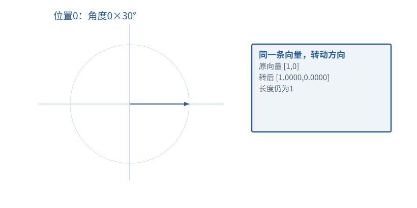

图解 · 运行过程 · 工程取舍

# 位置怎样进入数值计算

同一个Token出现在不同位置，为什么还需要额外处理？

配套正文：[F13基础课](../foundations/13.md)

动态图解 · F13

## 位置怎样进入数值计算

同一个Token出现在不同位置，为什么还需要额外处理？

Embedding先告诉模型“这是什么片段”，位置机制再让匹配计算知道“它出现在哪里”。旋转不是为了画圆好看：改变方向会改变后续点积；两者共同旋转保持角差，展示了相对位置怎样进入比较。

**旋转**改变二维向量方向、保持长度的运算。

**sin/cos**描述给定转角下的坐标分量。

**RoPE**给Q/K成对分量施加依位置而变的旋转。

**输入与适用条件：**独立二维说明图：初始向量[1,0]，教学频率每位置30°；不是商业模型实际RoPE频率。

### 1 / 5 · 位置0旋转到0度

停留时间 4.2秒7秒1.5秒

步骤 第1步，共5步

窄屏可左右滑动图形，或点击“放大图形”。文字解释紧随图后。

这只是二维旋转的教学频率。实际RoPE对Q/K成对分量使用不同频率；作用在匹配表示上，不是简单把位置编号加到Token ID。

`本步状态由图形与说明共同给出。`

R(0°)[1,0]=[1.0000,0.0000]

默认静止。用“下一步”看完解释再继续；播放到最后一步自动停止。键盘聚焦播放器后，可用左右键逐步查看、空格播放/暂停。图中颜色辅助区分，含义同时用文字注明。

JavaScript未启用；第一帧仍可阅读。完整图解页下方列出全部步骤说明。

## 逐步说明与计算记录

以下解释全部展开，与播放器使用同一份数据；不是另换输入的第二个算例。

### 1．位置0旋转到0度

这只是二维旋转的教学频率。实际RoPE对Q/K成对分量使用不同频率；作用在匹配表示上，不是简单把位置编号加到Token ID。

R(0°)[1,0]=[1.0000,0.0000]

### 2．位置1旋转到30度

这只是二维旋转的教学频率。实际RoPE对Q/K成对分量使用不同频率；作用在匹配表示上，不是简单把位置编号加到Token ID。

R(30°)[1,0]=[0.8660,0.5000]

### 3．位置2旋转到60度

这只是二维旋转的教学频率。实际RoPE对Q/K成对分量使用不同频率；作用在匹配表示上，不是简单把位置编号加到Token ID。

R(60°)[1,0]=[0.5000,0.8660]

### 4．位置3旋转到90度

这只是二维旋转的教学频率。实际RoPE对Q/K成对分量使用不同频率；作用在匹配表示上，不是简单把位置编号加到Token ID。

R(90°)[1,0]=[0.0000,1.0000]

### 5．比较角度差，而不是位置名字

两个旋转向量的点积取决于角度差。共同再旋转相同角度，不会改变点积。这个性质帮助相对位置信息进入匹配。

### 为什么需要

让顺序信息参与匹配，而不把词表编号当成位置编码。

### 怎样实现

给正确绝对位置施加对应旋转；缓存中的已旋转Key应按同一约定使用。

### 可能的代价与误解

每轮位置清零或把历史Key重复旋转，会使缓存结果偏离全量计算。

### 如何判断是否做对

检查旋转保持长度、共同平移角度保持点积；再做缓存一致性测试。

[F11 · Q/K/V：先算从哪读，再算读进多少](F11.md)[F19 · KV Cache：留下算过的，不省掉该读的](F16.md)

机制来源：[[ROPE]](sources.md#s-ROPE)。数值和运行场景为本书明确设定的教学例；资料出处不代替本页中文解释。