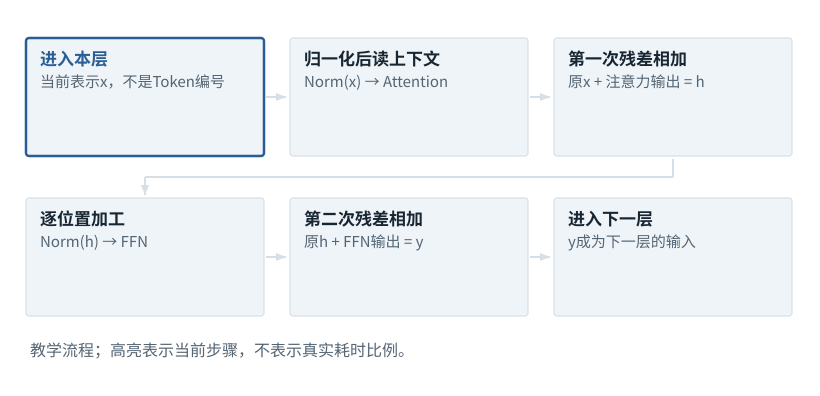

图解 · 运行过程 · 工程取舍

# 一层Transformer不是只有Attention

读其他位置之后，为什么还要残差、归一化和FFN？

配套正文：[F14基础课](../foundations/14.md)

动态图解 · F14

## 一层Transformer不是只有Attention

读其他位置之后，为什么还要残差、归一化和FFN？

可以把一层分成“从上下文取信息”和“在本位置加工信息”两段。残差提供原表示的直接通路，新的计算提供增量；归一化整理每行数值尺度，但不是把语义洗成一样。前馈网络通常对每个位置分别计算，不再像Attention那样直接跨位置加权。

**残差**把子层输入与子层输出相加。

**Norm**本例指按每行特征进行的归一化。

**FFN**带非线性的逐位置前馈网络。

**输入与适用条件：**展示常见pre-norm结构的运算依赖，不假定所有Transformer采用相同顺序。完整模型数值见已有贯通算例。

### 1 / 6 · 进入本层

停留时间 4.2秒7秒1.5秒

步骤 第1步，共6步

窄屏可左右滑动图形，或点击“放大图形”。文字解释紧随图后。

上一层已经加工过的表示也可以作为x，不能每一层都回到最初Embedding。

`本步状态由图形与说明共同给出。`

默认静止。用“下一步”看完解释再继续；播放到最后一步自动停止。键盘聚焦播放器后，可用左右键逐步查看、空格播放/暂停。图中颜色辅助区分，含义同时用文字注明。

JavaScript未启用；第一帧仍可阅读。完整图解页下方列出全部步骤说明。

## 逐步说明与计算记录

以下解释全部展开，与播放器使用同一份数据；不是另换输入的第二个算例。

### 1．进入本层

上一层已经加工过的表示也可以作为x，不能每一层都回到最初Embedding。

### 2．归一化后读上下文

本段从允许的位置读取信息。归一化改变数值尺度，不替代mask或位置机制。

### 3．第一次残差相加

相加要求对应形状一致。这里的加法保留直接通路，不是将两份向量拼成更长向量。

### 4．逐位置加工

FFN按各位置自己的特征进行非线性加工。参数共享不等于所有位置的结果相同。

### 5．第二次残差相加

第二条残差同样逐格相加。输出仍是每个位置的一排数。

### 6．进入下一层

多层把这样的加工继续下去，最后才由词表输出头给候选Token打分。

### 为什么需要

深层网络需要稳定的数值与梯度通路，同时具备上下文读取和局部变换能力。

### 怎样实现

明确本模型的pre-norm/post-norm约定，逐个算子跟踪来源与去向。

### 可能的代价与误解

把LayerNorm与RMSNorm视为同一公式，或忘记γ/β/ε，会得到不同结果。

### 如何判断是否做对

比较每个子层前后张量形状与实际数值；任何替换都需重新验证输出与训练稳定性。

[F11 · Q/K/V：先算从哪读，再算读进多少](F11.md)[F15 · 梯度像坡度，学习率像迈步大小](F17.md)[O01 · GQA/MQA：减少的是K/V组数](O01.md)

机制来源：[[ATTN]](sources.md#s-ATTN) [[NORM]](sources.md#s-NORM)。数值和运行场景为本书明确设定的教学例；资料出处不代替本页中文解释。