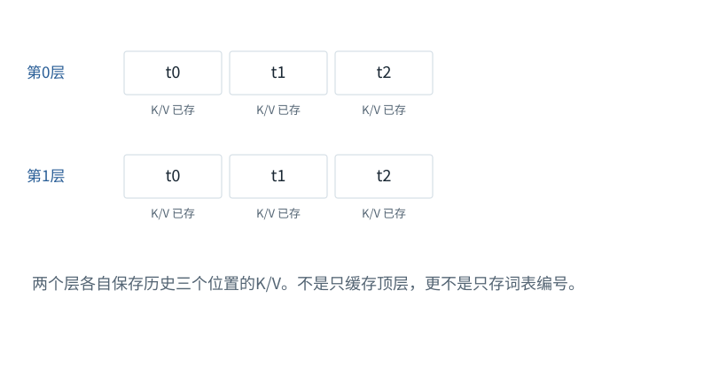

图解 · 运行过程 · 工程取舍

# KV Cache：留下算过的，不省掉该读的

为什么少算了很多步骤，下一Token仍能看到历史？

配套正文：[F19基础课](../foundations/19.md)

动态图解 · F19

## KV Cache：留下算过的，不省掉该读的

为什么少算了很多步骤，下一Token仍能看到历史？

缓存像保存已经整理好的历史资料，而不是每轮把历史丢掉。因果模型中，追加未来位置不会使旧位置突然能看到未来，所以原前缀的K/V可以复用。新位置仍逐层计算，也仍要从允许的历史位置读信息。

**K/V缓存**每层保存已处理位置的Key和Value。

**缓存失效**原来结果的前提改变，不能安全继续复用。

**重算**重新执行此前算过的部分运算。

**输入与适用条件：**本图用两层、三个历史位置演示状态；与F18单层小模型是不同教学结构，图内明确标层数。

### 1 / 5 · 两层分别保存历史

停留时间 4.2秒7秒1.5秒

步骤 第1步，共5步

窄屏可左右滑动图形，或点击“放大图形”。文字解释紧随图后。

两个层各自保存历史三个位置的K/V。不是只缓存顶层，更不是只存词表编号。

`每层cache_len=3`

默认静止。用“下一步”看完解释再继续；播放到最后一步自动停止。键盘聚焦播放器后，可用左右键逐步查看、空格播放/暂停。图中颜色辅助区分，含义同时用文字注明。

JavaScript未启用；第一帧仍可阅读。完整图解页下方列出全部步骤说明。

## 逐步说明与计算记录

以下解释全部展开，与播放器使用同一份数据；不是另换输入的第二个算例。

### 1．两层分别保存历史

两个层各自保存历史三个位置的K/V。不是只缓存顶层，更不是只存词表编号。

`每层cache_len=3`

### 2．选出新项，暂不算进缓存

选出了新Token t3，但它尚未经过各层。缓存仍有三个位置，t3单独处于待处理状态。

`每层cache_len=3`

### 3．只给新位置计算K/V

t3进入每一层，用自己的新Q与该层的历史K/V加上新K/V一起计算。缓存逐层扩到四个位置。

`每层cache_len=4`

### 4．历史被复用，不是被删除

现在才能用t3的最终表示预测t4。历史K/V没有重算，但t3仍要读取它们；缓存不会把注意力变成完全不看历史。

`每层cache_len=4`

### 5．对照：修改前缀就不再是同一份缓存

把t1换成另一项会影响它及后续位置的各层状态。至少需要使受影响后缀失效并重新计算；不能沿用旧缓存假装只是追加。

`发生前缀修改 → 受影响后缀失效`

### 为什么需要

减少逐Token生成时对同一前缀的重复投影和逐位置加工。

### 怎样实现

每层存K/V，下一步只计算新位置，并用正确的位置偏移和可见性关系读取。

### 可能的代价与误解

内存随序列增长；低精度KV另有近似误差；跨用户共享还要隔离数据与权限。

### 如何判断是否做对

固定参数和前缀，对比缓存版与全量前向；不要只比较生成的字是否碰巧相同。

[F12 · Mask是可见性表，不是额外语义](F12.md)[O01 · GQA/MQA：减少的是K/V组数](O01.md)[O04 · FlashAttention：一边读一边累计，不攒整张表](O04.md)

机制来源：[[CACHE]](sources.md#s-CACHE)。数值和运行场景为本书明确设定的教学例；资料出处不代替本页中文解释。