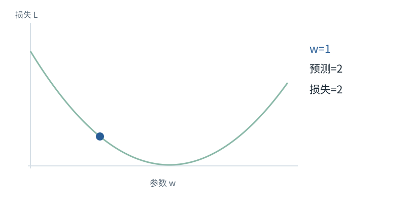

图解 · 运行过程 · 工程取舍

# 梯度像坡度，学习率像迈步大小

为什么“梯度下降”有时让参数增大？

配套正文：[F15基础课](../foundations/15.md)

动态图解 · F15

## 梯度像坡度，学习率像迈步大小

为什么“梯度下降”有时让参数增大？

想象你站在损失曲线上，想往低处走。梯度给的是当前局部坡度；更新用它的相反方向。坡度为负时，往右走会更低，所以减去负梯度使参数增加。它只保证足够小的局部方向信息，不保证任意大一步都正确。

**损失**衡量当前预测偏离目标的数。

**梯度**参数轻微增加时损失的局部变化率。

**学习率**沿更新方向迈多大一步的系数。

**输入与适用条件：**沿用主算例x=2、目标4、w=1、平方误差损失。前三帧学习率0.2；最后一帧明确重置w=1并只改学习率为0.6。

### 1 / 4 · 预测偏小，但参数还没变

停留时间 4.2秒7秒1.5秒

步骤 第1步，共4步

窄屏可左右滑动图形，或点击“放大图形”。文字解释紧随图后。

x=2，目标4，初始w=1，因此预测2，损失2。先有可测的误差，才谈如何更新。

`w=1.0；L=2.0`

L=0.5×(2w−4)²；dL/dw=(2w−4)×2

默认静止。用“下一步”看完解释再继续；播放到最后一步自动停止。键盘聚焦播放器后，可用左右键逐步查看、空格播放/暂停。图中颜色辅助区分，含义同时用文字注明。

JavaScript未启用；第一帧仍可阅读。完整图解页下方列出全部步骤说明。

## 逐步说明与计算记录

以下解释全部展开，与播放器使用同一份数据；不是另换输入的第二个算例。

### 1．预测偏小，但参数还没变

x=2，目标4，初始w=1，因此预测2，损失2。先有可测的误差，才谈如何更新。

`w=1.0；L=2.0`

L=0.5×(2w−4)²；dL/dw=(2w−4)×2

### 2．梯度告诉局部方向

损失对w的梯度是−4：w略微增大时，损失在此处会减小。反向传播算这个变化率，但不会自动替优化器更新参数。

`w=1.0；L=2.0`

L=0.5×(2w−4)²；dL/dw=(2w−4)×2

### 3．选定步长，实际改参数

学习率0.2，w新=1−0.2×(−4)=1.8。重新前向得到预测3.6、损失0.08。不是把原损失数直接改小。

`w=1.8；L=0.07999999999999996`

L=0.5×(2w−4)²；dL/dw=(2w−4)×2

### 4．独立反例：步长太大

恢复初始w=1，只把学习率改为0.6。新w=3.4，预测6.8，损失3.92，大于原来的2；方向正确不保证步子越大越好。

`w=3.4；L=3.9199999999999995`

L=0.5×(2w−4)²；dL/dw=(2w−4)×2

### 为什么需要

需要系统地调整大量参数，而不是逐项猜一个新数。

### 怎样实现

前向算损失，反向传播求梯度，优化器更新，然后重新前向核验。

### 可能的代价与误解

过大步长、错误梯度或错误累计方式都可能让损失上升；降低训练损失不等于提升未见数据表现。

### 如何判断是否做对

这里基准损失2→0.08；大步长反例2→3.92，并用有限差分核对梯度−4。

[F16 · 训练：给每个位置一道“下一项”题](F18.md)[O09 · Activation Checkpointing：少存一点，反向时重算](O09.md)

机制来源：[[AUTOGRAD]](sources.md#s-AUTOGRAD)。数值和运行场景为本书明确设定的教学例；资料出处不代替本页中文解释。