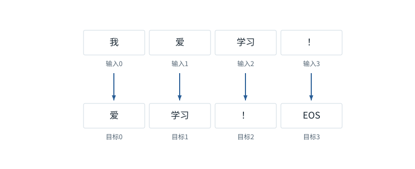

图解 · 运行过程 · 工程取舍

# 训练：给每个位置一道“下一项”题

为什么训练看完整句，生成却只能往前走？

配套正文：[F16基础课](../foundations/16.md)

动态图解 · F16

## 训练：给每个位置一道“下一项”题

为什么训练看完整句，生成却只能往前走？

训练时答案放在试卷的评分区，所以各位置的题目可以同时准备；mask负责不让模型读到自己的答案。生成时后续Token还未决定，下一题的前缀依赖本题选择。两者共享因果预测目标，但已知信息不同。

**标签**用于评分的真实下一Token。

**交叉熵**本例为真实目标概率的负对数。

**有效目标数**实际参与评分的位置数，不必等于补齐长度。

**输入与适用条件：**标签对齐使用5项序列；单位置交叉熵与PAD平均分别是明确独立的小例，不假称那些概率来自对齐图的模型。

### 1 / 5 · 把输入和目标错开一格

停留时间 4.2秒7秒1.5秒

步骤 第1步，共5步

窄屏可左右滑动图形，或点击“放大图形”。文字解释紧随图后。

完整教学序列为“我／爱／学习／！／EOS”。输入用前四项，目标用后四项。每个输入位置预测的是其后一个真实Token。

`输入=[1,2,3,5]；目标=[2,3,5,6]`

默认静止。用“下一步”看完解释再继续；播放到最后一步自动停止。键盘聚焦播放器后，可用左右键逐步查看、空格播放/暂停。图中颜色辅助区分，含义同时用文字注明。

JavaScript未启用；第一帧仍可阅读。完整图解页下方列出全部步骤说明。

## 逐步说明与计算记录

以下解释全部展开，与播放器使用同一份数据；不是另换输入的第二个算例。

### 1．把输入和目标错开一格

完整教学序列为“我／爱／学习／！／EOS”。输入用前四项，目标用后四项。每个输入位置预测的是其后一个真实Token。

`输入=[1,2,3,5]；目标=[2,3,5,6]`

### 2．训练能同时算，不等于能偷看

目标已存在于训练样本，但mask仍禁止当前位置读后续输入。可以并行计算四个位置的损失；推理时未来Token未知，不能照搬这个并行条件。

### 3．先给一个位置评分

独立评分小例：真实目标“学习”的预测概率是0.5，交叉熵为−ln0.5≈0.693147；概率0.25时约1.386294，错得更不自信时惩罚更大。

loss=−ln p(真实目标)

### 4．屏蔽无效目标，再平均

另设三个目标位置，其中第三项是无效PAD；前两项损失0.4与0.8。总损失1.2应除以有效位置数2，得到0.6，而不是除以数组长度3。

`分子与分母都排除无效目标`

### 5．计算梯度之后还要step

反向传播将误差影响传回参数，优化器再利用梯度更新。下一轮是否清零或累积梯度，应依据明确的训练策略，不能无意混入旧梯度。

`backward ≠ 参数已更新`

### 为什么需要

用清晰的预测任务，把参数更新与语言序列关系连接。

### 怎样实现

正确移动标签、限制可见性、屏蔽无效目标、按有效数归一化。

### 可能的代价与误解

偷看未来会产生漂亮但虚假的训练成绩；训练样本重复或泄漏也会高估泛化。

### 如何判断是否做对

用极小固定序列验证每个输入位置和目标位置，再验证PAD不影响有效损失。

[F12 · Mask是可见性表，不是额外语义](F12.md)[F15 · 梯度像坡度，学习率像迈步大小](F17.md)

机制来源：[[CE]](sources.md#s-CE) [[AUTOGRAD]](sources.md#s-AUTOGRAD)。数值和运行场景为本书明确设定的教学例；资料出处不代替本页中文解释。