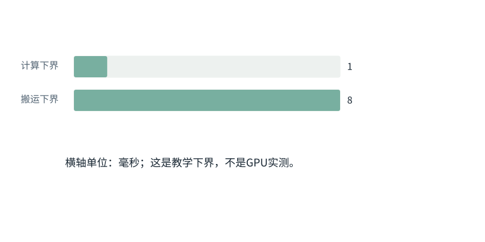

图解 · 运行过程 · 工程取舍

# 算得慢，可能是东西搬得慢

为什么一块算力更高的GPU，不一定让任务同比变快？

配套正文：[F21基础课](../foundations/21.md)

动态图解 · F21

## 算得慢，可能是东西搬得慢

为什么一块算力更高的GPU，不一定让任务同比变快？

把GPU想成工厂只适合记住一个有限类比：运算像加工，读写像运输。加工设备翻倍但运输仍堵塞，整体不会同比快。真正的分析应回到运算数、搬运字节数、设备速率与测量，而不是只看某个宣传峰值。

**计算量**要做的运算总数。

**带宽**单位时间能搬运的字节数。

**吞吐**单位时间完成多少工作；不同于一条请求要多久。

**通信**数据在设备之间交换产生的成本。

**输入与适用条件：**固定教学任务与理想速率。第二、三帧是各自恢复基准后只改一个因素的独立对照；不宣称真实运行时间。

### 1 / 4 · 先问算力和搬运谁更慢

停留时间 4.2秒7秒1.5秒

步骤 第1步，共4步

窄屏可左右滑动图形，或点击“放大图形”。文字解释紧随图后。

教学任务：1,000,000次浮点运算；8,000,000字节搬运。假定算力10亿次/秒、带宽10亿字节/秒。

`计算=1ms；搬运=8ms`

默认静止。用“下一步”看完解释再继续；播放到最后一步自动停止。键盘聚焦播放器后，可用左右键逐步查看、空格播放/暂停。图中颜色辅助区分，含义同时用文字注明。

JavaScript未启用；第一帧仍可阅读。完整图解页下方列出全部步骤说明。

## 逐步说明与计算记录

以下解释全部展开，与播放器使用同一份数据；不是另换输入的第二个算例。

### 1．先问算力和搬运谁更慢

教学任务：1,000,000次浮点运算；8,000,000字节搬运。假定算力10亿次/秒、带宽10亿字节/秒。

`计算=1ms；搬运=8ms`

### 2．只把算力翻倍

仅把计算速度翻倍；计算时间下界变0.0005秒，搬运仍为0.008秒，所以瓶颈没有改变。

`计算=0.5ms；搬运=8ms`

### 3．只把搬运量减半

恢复原算力，只减少一半数据搬运。此时两个下界是0.001与0.004秒，才改变主导限制。

`计算=1ms；搬运=4ms`

### 4．下界不是实测耗时

max(计算下界,搬运下界)只给出理想限制；排队、同步、调度和未重叠部分还会增加实际时间。

`计算=1ms；搬运=4ms`

### 为什么需要

先定位主导瓶颈，才知道该优化矩阵计算、显存读写还是调度。

### 怎样实现

用分账估计指导Profile，再用同任务实测检查。

### 可能的代价与误解

提高吞吐可能增加单请求排队；分片省内存可能增加网络通信。

### 如何判断是否做对

观察端到端时间及各阶段Trace，避免只测某一个最快算子。

[O04 · FlashAttention：一边读一边累计，不攒整张表](O04.md)[O05 · PagedAttention：逻辑连续，物理可以分块](O05.md)[O06 · 连续组批：有座位空出来，就接下一位](O06.md)[O09 · Activation Checkpointing：少存一点，反向时重算](O09.md)

机制来源：[[FLASH]](sources.md#s-FLASH) [[PAGED]](sources.md#s-PAGED)。数值和运行场景为本书明确设定的教学例；资料出处不代替本页中文解释。