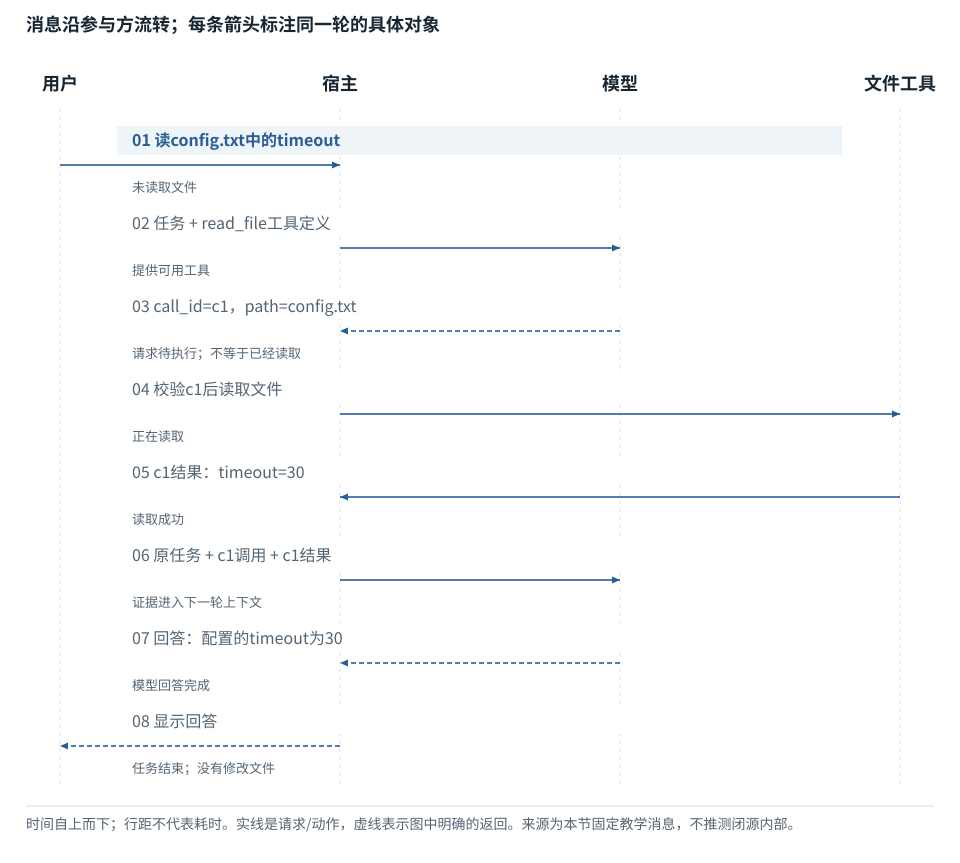

图解 · 运行过程 · 工程取舍

# 把一个Agent任务拆成真正发生的几轮

同一句用户任务，为什么可能调用模型不止一次？

配套正文：[F22基础课](../foundations/22.md)

动态图解 · F22

## 把一个Agent任务拆成真正发生的几轮

同一句用户任务，为什么可能调用模型不止一次？

LLM生成下一步提议，宿主执行获准的动作，把结果再交给LLM。这是外层任务循环；每次模型调用内部还要经历逐Token生成。外层的一轮工具行动不等于内部生成一个Token，两种“循环”不能混用。

**调用标识**把某次工具请求与其结果连接的ID。

**工具结果**程序实际执行后返回的内容。

**上下文**本轮明确交给模型的信息，而非整个电脑状态。

**输入与适用条件：**构造的只读教学任务：文件config.txt含timeout=30。泳道展示职责边界，不声称调用了真实商业API；数据和动作顺序固定。

### 1 / 8 · 1. 用户任务：读config.txt中的timeout

停留时间 4.2秒7秒1.5秒

步骤 第1步，共8步

窄屏可左右滑动图形，或点击“放大图形”。文字解释紧随图后。

模型尚未看到磁盘文件。先区分用户给的任务与环境真实内容。

`未读取`

默认静止。用“下一步”看完解释再继续；播放到最后一步自动停止。键盘聚焦播放器后，可用左右键逐步查看、空格播放/暂停。图中颜色辅助区分，含义同时用文字注明。

JavaScript未启用；第一帧仍可阅读。完整图解页下方列出全部步骤说明。

## 逐步说明与计算记录

以下解释全部展开，与播放器使用同一份数据；不是另换输入的第二个算例。

### 1．1. 用户任务：读config.txt中的timeout

模型尚未看到磁盘文件。先区分用户给的任务与环境真实内容。

`未读取`

### 2．2. 模型请求：任务＋read\_file工具定义

工具定义告诉模型可以提议什么，不授予无限访问权限。

`提供工具`

### 3．3. 模型输出：call\_id=c1，path=config.txt

这只是请求，尚不能宣称文件已读取。调用标识把后续结果与此请求对应。

`请求待执行`

### 4．4. 宿主校验后读取文件

路径、权限和参数检查通过后，由程序执行读文件；不是模型直接打开磁盘。

`正在读取`

### 5．5. 工具结果：timeout=30

本例预设文件确实含timeout=30。返回结果可用于回答，但读取成功不意味着文件被修改。

`读取成功`

### 6．6. 下一轮输入：原任务＋调用＋结果

同一个用户任务发生了第二次模型调用。新增的是实际证据，不需要重新假装猜测。

`证据入上下文`

### 7．7. 模型回答：配置的timeout为30

这份回答有本例工具结果作依据，不只是依据模型参数里的常识。

`回答完成`

### 8．8. 宿主显示回答；任务结束

最终消息结束此演示任务；输出完成与其他带副作用任务是否成功要分别判断。

`结束`

### 为什么需要

模型可以借助工具获得新证据，而不把一切都塞入参数。

### 怎样实现

按请求、校验、执行、结果回填、继续决策组织循环。

### 可能的代价与误解

忘记回填工具结果会让模型重复请求；把输出文本当执行证明会误报完成。

### 如何判断是否做对

对照每轮模型输入和工具日志，确认结果与call\_id匹配。

[F18 · 一次输入如何连着预测，直到结束](F15.md)[F23 · 字符完整、事件完整、工具参数完整是三道关](F23.md)[F24 · 任务状态不是聊天里的一句总结](F24.md)

机制来源：[[AGENT]](sources.md#s-AGENT) [[TOOLS]](sources.md#s-TOOLS)。数值和运行场景为本书明确设定的教学例；资料出处不代替本页中文解释。