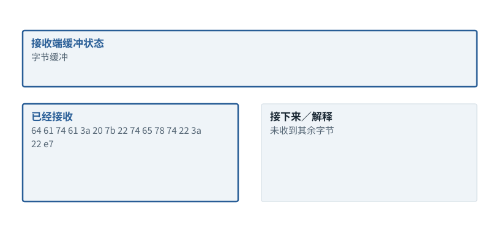

图解 · 运行过程 · 工程取舍

# 字符完整、事件完整、工具参数完整是三道关

为什么看到半段JSON时绝对不能执行？

配套正文：[F23基础课](../foundations/23.md)

动态图解 · F23

## 字符完整、事件完整、工具参数完整是三道关

为什么看到半段JSON时绝对不能执行？

网络像分批送到的纸条，分割点不遵守汉字或JSON边界。接收端先重组字节和字符，再按流协议重组事件，最后解析结构并确认该输出是否表示完整行动。花括号配平不够，因为字符串内部也可能有花括号。

**UTF-8**把字符表示成字节序列的编码。

**SSE**以事件形式持续传送文本数据的一种协议。

**Schema**描述字段和类型约束的结构规范，不保证字段事实正确。

**输入与适用条件：**真实编码了一个小SSE文本事件，故意把“爱”的三个UTF-8字节拆成两段。示例并不使用厂商特定的事件命名。

### 1 / 4 · 收到第一段字节

停留时间 4.2秒7秒1.5秒

步骤 第1步，共4步

窄屏可左右滑动图形，或点击“放大图形”。文字解释紧随图后。

网络片段可以停在一个汉字的UTF-8编码中间。现在只有“爱”的第一个字节，不能把每个网络片段独立按完整字符串解码。

`字节缓冲`

默认静止。用“下一步”看完解释再继续；播放到最后一步自动停止。键盘聚焦播放器后，可用左右键逐步查看、空格播放/暂停。图中颜色辅助区分，含义同时用文字注明。

JavaScript未启用；第一帧仍可阅读。完整图解页下方列出全部步骤说明。

## 逐步说明与计算记录

以下解释全部展开，与播放器使用同一份数据；不是另换输入的第二个算例。

### 1．收到第一段字节

网络片段可以停在一个汉字的UTF-8编码中间。现在只有“爱”的第一个字节，不能把每个网络片段独立按完整字符串解码。

`字节缓冲`

### 2．继续收到剩余字节

增量解码器补齐该字符；这时字符已完整，但仍须遵循协议的事件边界，不能见到一个右括号就执行工具。

`字符可解码`

### 3．完整SSE事件

本例空行结束一个SSE事件。先组装事件数据，再解析其中JSON；真实流可能有多种事件类型。

`事件完整`

### 4．解析结构，再解释语义

得到对象{"text":"爱"}。这是一段文本事件，不是工具调用。只有明确的完整工具调用对象通过验证，才可能执行。

`已解析文本`

### 为什么需要

让网络分片方式不影响语义与执行次数。

### 怎样实现

增量解码→组装事件→解析JSON→检查完成状态→按类型分派。

### 可能的代价与误解

提前执行、重复事件未去重、调用ID错配，都可能把一次动作变成多次副作用。

### 如何判断是否做对

把同一字节串在每个切分点拆开，解析后的事件都应一致。

[F22 · 把一个Agent任务拆成真正发生的几轮](F22.md)[F33 · 超时告诉你没收到，不告诉你没发生](F33.md)

机制来源：[[SSE]](sources.md#s-SSE) [[TOOLS]](sources.md#s-TOOLS)。数值和运行场景为本书明确设定的教学例；资料出处不代替本页中文解释。