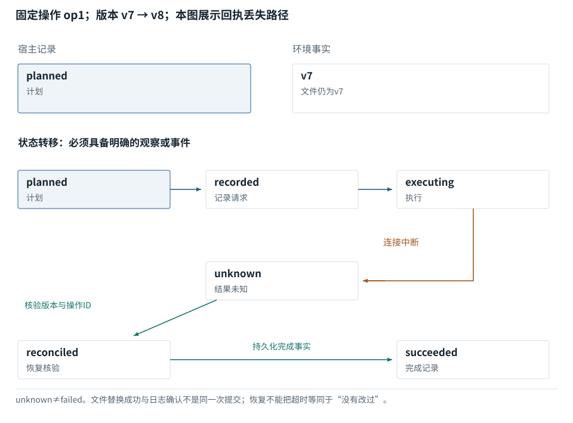

图解 · 运行过程 · 工程取舍

# 任务状态不是聊天里的一句总结

“模型知道做过”与“系统能恢复”有什么区别？

配套正文：[F24基础课](../foundations/24.md)

动态图解 · F24

## 任务状态不是聊天里的一句总结

“模型知道做过”与“系统能恢复”有什么区别？

一次任务至少有目标、当前环境和执行记录。模型上下文可能被截断，但系统仍需要知道动作是否真正落地。事件记录描述发生过的事，快照描述某一时刻的状态；它们与“请总结一下”得到的一段话承担不同职责。

**事件**一次可记录的状态变化，例如文件替换完成。

**快照**某个时刻对任务状态的保存。

**unknown**不能确认成功或失败的状态，不等于已经失败。

**输入与适用条件：**构造的文件更新恢复轨迹。v7/v8是本例的版本标签，不是模型版本；只说明恢复语义，不宣称文件系统和数据库共享事务。

### 1 / 6 · 准备

停留时间 4.2秒7秒1.5秒

步骤 第1步，共6步

窄屏可左右滑动图形，或点击“放大图形”。文字解释紧随图后。

目标：更新配置；当前版本v7

`planned`

默认静止。用“下一步”看完解释再继续；播放到最后一步自动停止。键盘聚焦播放器后，可用左右键逐步查看、空格播放/暂停。图中颜色辅助区分，含义同时用文字注明。

JavaScript未启用；第一帧仍可阅读。完整图解页下方列出全部步骤说明。

## 逐步说明与计算记录

以下解释全部展开，与播放器使用同一份数据；不是另换输入的第二个算例。

### 1．准备

目标：更新配置；当前版本v7

`planned`

### 2．请求已记录

operation\_id=op1；尚未确认环境改变

`recorded`

### 3．开始执行

本地文件已替换为新内容v8

`executing`

### 4．连接中断

成功回执没到；宿主只知道结果不确定

`unknown`

### 5．恢复核验

按操作ID和文件内容核对，确认v8已存在

`reconciled`

### 6．完成记录

记录成功；不再次盲目写入

`succeeded`

### 为什么需要

避免长任务在中断或压缩后重复、漏掉、覆盖已经完成的工作。

### 怎样实现

持久化必要状态；遇到未知结果先核对环境，再决定重试或继续。

### 可能的代价与误解

所有动作都做重型日志可能过度工程；但有不可重复副作用时仅靠聊天记录又不够。

### 如何判断是否做对

故意在执行与回执之间中断，恢复后检查动作次数与最终环境。

[F27 · 压缩要保留行动所依赖的事实](F27.md)[F33 · 超时告诉你没收到，不告诉你没发生](F33.md)

机制来源：[[STATE]](sources.md#s-STATE)。数值和运行场景为本书明确设定的教学例；资料出处不代替本页中文解释。